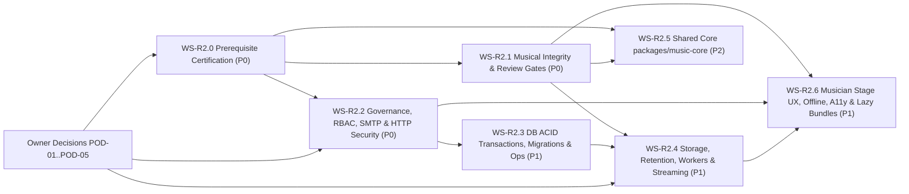

# BETHESDA WORSHIP STUDIO — PHASE R2 MASTER EXECUTION AND GOVERNANCE PLAN

- **Date:** `2026-11-21`
- **Project:** Bethesda Worship Studio (`https://github.com/juancastro2381-hub/BETHESDA-WORSHIP-STUDIO.git`)
- **Branch / Upstream:** `feature/phase-1a-core-foundation` -> `origin/feature/phase-1a-core-foundation` (`0 0`, synchronized)
- **Approved R1 Closure Commit:** `2ebb0fd1c4b70780e740da60342e07e81a166cdd` (`fix(phase-r1): close alternate-route tokenVersion bypass and certify PostgreSQL acceptance gate`, `2026-11-21 14:44:37 -0500`)
- **Current HEAD SHA:** `83fbe26a7c019fbd8e58265256afa18a3065d259` (`Informe Ejecutivo de Evaluación y Preparación para Fase R2`, `2026-11-21 15:28:32 -0500`)
- **Governance Status:** **CONTROLLED PREPARATION ONLY — NO IMPLEMENTATION AUTHORIZED** (`WS-R2.0` pending controlled certification approval; `WS-R2.1` through `WS-R2.6` **NOT AUTHORIZED**)
- **Preparation Verdict:** **`CONDITIONAL PASS — OWNER DECISIONS REQUIRED`**

---

## 1. Executive Summary

This Master Execution and Governance Plan defines the architectural roadmap, prerequisite gates, risk controls, musical-integrity invariants, security safeguards, and Project Owner approval framework governing transition from formally closed **Phase R1** into **Phase R2** for **Bethesda Worship Studio**.

An independent verification against current `HEAD` ([`83fbe26a`](file:///c:/Users/juanc/OneDrive/Documentos/Desarrollo%20proyectos/Sistema%20musical%20-%20partituras/BETHESDA%20WORSHIP%20STUDIO/BETHESDA_WORSHIP_STUDIO_PHASE_R2_ARCHITECTURE_AND_READINESS_ASSESSMENT.md)) confirmed:
1. Commit `83fbe26a` sits directly on `2ebb0fd1` and added **strictly** the 3 Phase R2 readiness Markdown documents (`795 insertions(+)`) with zero modifications to code, schema, migrations, dependencies, or configuration.
2. All closed Phase R1 perimeter controls (`R1.1`–`R1.7`, `R1-VAL-01`) remain intact, and static TypeScript checks (`backend` and `frontend` `tsc --noEmit`) plus the isolated Python audio worker suite (`test_worker.py`, `18/18` passed) succeed cleanly.
3. All **38 findings (`R2-F01`–`R2-F38`)** documented in the R2 assessment were independently verified at source-line or runtime level (0 false positives), establishing **`22 P0`**, **`11 P1`**, and **`5 P2`** items requiring structured, incremental remediation across workstreams **`WS-R2.0` through `WS-R2.6`**.

Unrestricted implementation cannot proceed until **`WS-R2.0`** certification gates close cleanly and Project Owner resolves strategic decisions **`POD-01` through `POD-05`**.

---

## 2. Verified Baseline

| Verification Dimension | Verified State | Method / Evidence |
|---|---|---|
| **Branch & Upstream Sync** | `feature/phase-1a-core-foundation` synced `0 0` with `origin/feature/phase-1a-core-foundation` | `git rev-parse`, `git rev-list` (`VERIFIED`) |
| **R1 Closure Preservation** | Parent of `83fbe26a` is exact R1 closure `2ebb0fd1c4b70780e740da60342e07e81a166cdd`; zero non-doc diff since R1 | `git log`, `git show --stat` (`VERIFIED`) |
| **TypeScript Static Baseline** | `npm --prefix backend run typecheck` (`exit 0`); `npm --prefix frontend run typecheck` (`exit 0`) | Live command execution (`VERIFIED`) |
| **Python Audio Worker (`test_worker.py`)** | **`18/18` passed** (`21.71s`, isolated `tmp_path`, zero DB/repo side effects) | Live `pytest` execution (`VERIFIED`) |
| **Frontend Suite (`node v24.12.0`)** | `624/628` passed, `4` failed (`exit 1`); `tsx` pass confirms 3 `.tsx` runner breaks + 1 contract drift (`browser-rendering-integration` #8) + CWD sensitivity in `autoscroll` #8–9 | Live execution under Node & `tsx` (`VERIFIED`) |
| **Backend / PG Pending Suites** | `audio-preservation-and-worker.test.ts` (`40` tests), `conversion-worker-certification.test.ts` (`105` tests), `omr-persistence-and-integrity.test.ts` (`68` tests incl. `20.1–20.12`) | Static inspection; **NOT executed** pending isolated PG gate |
| **Repository Inventory (`git ls-files`)** | `8,871` tracked (`backend/node_modules/`: `7,367` / `103.8 MB`; `backend/storage/`: `223`; `.zip`: `20`; `.sha256`: `87`; tracked `.env*`: only `.env.example` files) | Live `git ls-files` & filesystem inspection (`VERIFIED`) |

---

## 3. Governance Model

Phase R2 operates under a strict, non-auto-advancing 8-stage subphase lifecycle:

$$\mathbf{AUDIT \rightarrow PLAN \rightarrow OWNER\ APPROVAL \rightarrow IMPLEMENTATION \rightarrow VALIDATION \rightarrow ACCEPTANCE \rightarrow DOCUMENTATION \rightarrow GATE\ CLOSURE}$$

### Mandatory Execution Rules (Enforced on Every Authorized Subphase)
1. Implement strictly the single authorized workstream (`WS-R2.x`); prohibit speculative or cross-workstream scope creep.
2. Deliver small, reviewable diffs; avoid unrelated formatting or architectural churn.
3. Preserve backward compatibility unless explicit breaking contract updates are approved.
4. Never add/upgrade dependencies or modify database schemas without an approved workstream plan & migration script.
5. Never touch production credentials, production infrastructure, or persistent dev/test DBs during certification (`TEST_DATABASE_URL !== DATABASE_URL`).
6. Never fabricate musical metadata, weaken assertions to force green tests, or silently promote unverified/AI drafts to `APPROVED`.
7. Exclude browser automation (`Playwright`, `Selenium`, `Cypress`) per Project Owner testing policy; rely on deterministic automated core/backend/PG/Python suites plus structured **Manual Validation Matrices**.
8. Commit, branch creation, tag, rebase, reset, force-push, and push require explicit Project Owner authorization.

---

## 4. Target Phase R2 Architecture

Phase R2 transforms the current technical beta into a verified, internally coherent worship music platform along six architectural pillars:
1. **Truthful Canonical Musical Core:** Bug-free `Pitch`/`Chord`/MIDI/Tab/Transposition math, consistent absolute/measure-relative timing coordinates, lossless MusicXML/ChordPro/MIDI/Tab round-trips, zero `C / 120 / 4-4` fabrication, and per-format approval isolation.
2. **Closed Approval & Security Governance:** Strict `DRAFT -> REVIEW -> APPROVED` lifecycle (`POST /songs` and importers never self-approve), authenticated SMTP onboarding/recovery without token leaks in JSON, PostgreSQL immutability on `audit_logs` & `song_versions`, verified non-superuser runtime DB role, DB-tracked document ownership, and full HTTP rate/input/log-redaction hardening.
3. **ACID Concurrency & Clean Migration Chain:** Atomic `tx`-scoped catalog commits (eliminating pool deadlocks), pessimistic `FOR UPDATE` locking across versions/setlists/tokens/admin transitions, reconciled Drizzle schema/snapshots/migrations, clean shutdown (`pool.end()`), and `/live` + `/ready` probes.
4. **Durable Bounded Storage & Queued Workers (`POD-01` Gated):** Unified env-anchored paths (`local` vs `S3CompatibleStorageProvider`), active scheduled `OutputRetentionService` + CAS reconciliation, concurrency-queued Python DSP analysis, streaming multipart uploads, bounded `zlib.inflateSync()`, non-amplifying Range streaming, and backup/restore runbooks.
5. **Decoupled Monorepo Core (`packages/music-core`):** Clean workspace package boundary removing all `30` cross-imports from `backend/src/` into `../frontend/src/core/` and consolidating duplicated PDF/audio/provenance utilities.
6. **Stage-Ready Live Musician UX:** Honest error states (no fake hymn SVG), unbroken offline IndexedDB open flow + `sw.js` contract parity, arbitrated keyboard shortcuts, collision-free mobile `<=640px` Atril controls, complete onboarding/reset views, accessible Light/High-Contrast/Print modes, and lazy-loaded OSMD/AlphaTab chunks.

---

## 5. Workstream Dependency Graph & Sequence Evaluation

Evaluating the proposed sequence **`WS-R2.0 -> WS-R2.1 -> WS-R2.2 -> WS-R2.3 -> WS-R2.4 -> WS-R2.5 -> WS-R2.6`** confirms it is technically optimal:

- **Why `WS-R2.0` must run first:** Unexecuted `pg-boss` v12 (`105` tests) and audio-worker (`40` tests) suites may expose runtime regressions before domain edits begin; untracking `7,367` `node_modules` files (`POD-05`) cleans Git noise early.
- **Why `WS-R2.1` and `WS-R2.2` precede `WS-R2.3`–`WS-R2.6`:** Fixing canonical math, zero-fabrication, `TemporalValidator`, RBAC approval locks, and `audit_logs`/`song_versions`/document tables establishes stable domain invariants and consolidated SQL migrations before ACID refactors (`WS-R2.3`), worker/storage changes (`WS-R2.4`), package extraction (`WS-R2.5`), and frontend integration (`WS-R2.6`).
- **Why `WS-R2.5` comes after `WS-R2.1` and before `WS-R2.6` (or after `WS-R2.4`):** Moving `frontend/src/core/` into `packages/music-core` *after* musical fixes land prevents huge merge conflicts across 30 backend imports and simplifies final frontend bundle splitting.

---

## 6. Prioritization Framework

All 38 independently verified findings (`R2-F01`–`R2-F38`) are assigned strict priorities:
- **`P0 — Critical` (`22` findings):** Active musical corruption (`R2-F01`–`R2-F08`, `R2-F10`), catalog approval bypass (`R2-F11`), SMTP/token/session flaws (`R2-F12`), DB immutability & least-privilege role (`R2-F13`, `R2-F18`), prod info/log leakage (`R2-F14`), ACID deadlock/races (`R2-F19`), storage/retention/PDF/Python OOM risks (`R2-F22`–`R2-F25`), stage stand fake SVG/offline/shortcut failures (`R2-F31`), and pending certification blockers (`R2-F36`, `R2-F37`).
- **`P1 — High` (`11` findings):** Temporal/pickup serializer gap (`R2-F09`), document ownership/audio RBAC (`R2-F15`), missing rate-limits/`.uuid()`/bounds (`R2-F16`), migration journal/FK hygiene (`R2-F20`, `R2-F21`), ops DI/shutdown/caches (`R2-F26`), Conversion Center format parity (`R2-F27`), ingestion validate-before-persist (`R2-F28`), worker retry/Range I/O/CWD split (`R2-F29`), onboarding/API UI drift (`R2-F33`), and `node_modules` Git bloat (`R2-F38`).
- **`P2 — Medium` (`5` findings):** Multi-tenancy (`R2-F17`, deferred unless `POD-02`), OMR/PDF-OCR limitations (`R2-F30`, deferred engine + honest UI), core package extraction & bundle split (`R2-F32`), theme/print/a11y (`R2-F34`), utility/license hygiene (`R2-F35`).

---

## 7. Risk Management Matrix

| Risk | Linked Findings | Probability | Severity | Mitigation Strategy |
|---|---|---|---|---|
| **Silent musical regression when activating `TemporalValidator` in `CanonicalSerializer`** | `R2-F05`, `R2-F09` | High | High | Land first-class serialized `chordId` & `isPickup` before enabling `TemporalValidator`; validate all existing fixtures against `bethesda_worship_r2_cert_tmp`. |
| **PostgreSQL migration divergence between blank DBs and R1-upgraded DBs** | `R2-F13`, `R2-F20` | Medium | Critical | Test every new R2 SQL migration twice: once on a blank DB and once on a pre-seeded DB at R1 SHA `2ebb0fd1`. |
| **Storage/S3 re-architecture breaking audio HTTP 206 seeking or orphaned cleanup** | `R2-F22`, `R2-F23`, `R2-F29` | Medium | High | Keep unified adapter interface across all 4 asset domains; test Range reads and `OutputRetentionService` reconciliation explicitly. |
| **Regressions while decomposing `ConversionCenterWorkspace` (2,967 lines)** | `R2-F32`, `R2-F33` | High | Medium | Extract isolated sub-panels incrementally in `WS-R2.6` only after backend contracts settle; verify manually with `MV-6.x`. |
| **GPLv3 compliance ambiguity if distributing desktop/appliance bundles** | `R2-F35` | Low (SaaS) / High (Dist) | High | Keep Python `imageio-ffmpeg` strictly as server-side separate subprocess; resolve `POD-05` legal review before any distribution. |

---

## 8. Cross-Workstream Dependencies & Owner Decision (`POD`) Gating

| Project Owner Decision | Workstreams Directly Blocked / Parameterized | Default Fallback If Unresolved |
|---|---|---|
| **`POD-01` (Hosting & Storage Topology)** | `WS-R2.4` (S3 mandatory vs local VPS; Redis deferral scope; audio worker process budget) | **Blocked** — do not select S3 or Redis implementation prematurely. |
| **`POD-02` (Single-Church vs Multi-Tenant)** | `WS-R2.3` (migration scope) & `R3+` boundary (`community_id`/RLS) | **Blocked** — schema stays single-tenant unless approved otherwise. |
| **`POD-03` (Approval Role Hierarchy)** | `WS-R2.1`, `WS-R2.2` (`songs:approve` RBAC on `WORSHIP_LEADER` vs `ADMIN`) | **Blocked** — `auth-types.ts` vs `omr/completion/audio` conflict remains. |
| **`POD-04` (SMTP & Onboarding Delivery)** | `WS-R2.2`, `WS-R2.6` (email provider config vs JSON token suppression & `/accept-invite`) | **Blocked** — no email provider may be connected unapproved. |
| **`POD-05` (Git Hygiene & GPLv3 Review)** | `WS-R2.0` (`git rm --cached backend/node_modules/`, storage cleanup), `WS-R2.5` | **Blocked** — no files/tracked paths may be removed without authorization. |

---

## 9. Workstream Entry & Exit Gates (`WS-R2.0` – `WS-R2.6`)

| Subphase | Mandatory Entry Gate | Authorized Scope Summary | Mandatory Exit Gate (Owner Sign-Off Required) |
|---|---|---|---|
| **`WS-R2.0`** | Owner approves isolated PG certification + `POD-01`..`POD-05` | Fix OMR test DB target (`L2556,2586`) + `provision_app_runtime_role.sql` test verification, run 3 pending PG suites on disposable DB, switch frontend runner to `tsx` + fix #8/`autoscroll` CWD, optional Owner-approved `node_modules` untrack (`POD-05`) | 100% pass across `audio` (40), `conversion-worker` (105), `omr` (68 incl. `20.1–20.12` non-superuser), `test_worker.py` (18), frontend `tsx` (`78` suites), `MV-0.1`, recorded `POD-01`..`POD-05` |
| **`WS-R2.1`** | `WS-R2.0` closed + `POD-03` resolved | Fix `R2-F01`–`R2-F10` (musical domain, exporters, importers, zero fabrication, provenance, per-format review gates, renderers) | All core musical suites + new multi-bar/Cb/B#/Chord/minor-XML/Buffer-less `.tab` unit tests pass + `MV-1.1`–`MV-1.3` passed |
| **`WS-R2.2`** | `WS-R2.0` + `POD-03`, `POD-04` resolved | Fix `R2-F11`–`R2-F16`, `R2-F18`, `R2-F24` (approval RBAC, SMTP onboarding, DB immutability triggers, Swagger/Pino/500 hardening, doc ownership, rate limits/UUID/inflate cap) | Full backend security/RBAC suite + non-superuser `bethesda_app_runtime` boot/test pass + `MV-2.1`–`MV-2.2` passed |
| **`WS-R2.3`** | `WS-R2.0`, `WS-R2.2` coordinated (`POD-02` resolved) | Fix `R2-F19`–`R2-F21`, `R2-F26` (single-tx `commitJobToCatalog`, `FOR UPDATE` locking, migration journal/snapshot alignment, DI centralization, `env.ts:20`, `pool.end()`, `/live`+`/ready`, L1 cache removal) | Concurrency race tests pass + fresh & R1-upgrade migration tests match schema identically + `MV-3.1`–`MV-3.2` passed |
| **`WS-R2.4`** | `WS-R2.1`, `WS-R2.3` + `POD-01` resolved | Fix `R2-F22`, `R2-F23`, `R2-F25`, `R2-F27`–`R2-F29` (unified S3/local storage, scheduled retention + CAS sync, queued audio DSP + streaming multipart, Range I/O fix, validate-before-persist, Conversion Center format parity, `retryJob` + shutdown order, backup/restore scripts) | `storage-provider`, `output-retention`, `cas-concurrency`, `conversion-worker-certification`, `audio-preservation` + `MV-4.1`–`MV-4.3` passed |
| **`WS-R2.5`** | `WS-R2.0` (`POD-05`), `WS-R2.1` closed | Fix `R2-F32` (core extraction), `R2-F35` (shared utils + remove `@fastify/jwt` / `@fastify/rate-limit`) | Zero `backend -> frontend` cross-imports + isolated `backend/dist` boot (`MV-5.1`) + 100% test/build parity |
| **`WS-R2.6`** | `WS-R2.1`, `WS-R2.2`, `WS-R2.4` closed | Fix `R2-F31`–`R2-F34` (VisualStand error, full offline loop + `sw.js`, shortcut/mobile bar/solo Stand, onboarding/reset UI, binary reader & honest copy, theme/print/a11y, `React.lazy` bundle split) | `frontend` `typecheck` + `build` (`< 800 KB` initial chunk) + `tsx` tests + `MV-6.1`–`MV-6.3` (including Airplane-Mode tablet run) passed |

---

## 10. Project Owner Approval Process

1. Owner reviews [POD-01 through POD-05 Decision Report](file:///c:/Users/juanc/OneDrive/Documentos/Desarrollo%20proyectos/Sistema%20musical%20-%20partituras/BETHESDA%20WORSHIP%20STUDIO/BETHESDA_WORSHIP_STUDIO_PHASE_R2_PROJECT_OWNER_DECISIONS_POD_01_POD_05.md) and records written choices for `POD-01`–`POD-05`.
2. Owner explicitly authorizes **`WS-R2.0` ONLY** as the controlled entry workstream.
3. At `WS-R2.0` Gate Closure, Orchestrator submits live certification results (disposable DB + Python + frontend + optional repo cleanup diff) for explicit Owner approval to unlock `WS-R2.1`.
4. **Hard Stop** repeats between every subsequent workstream (`WS-R2.1 -> WS-R2.2 -> ... -> WS-R2.6`).

---

## 11. Incremental Implementation Strategy

- **Domain-First, Isolated Diffs:** Keep musical theory fixes (`WS-R2.1`) strictly inside core/service boundaries without unrelated React UI churn.
- **Migration Coalescing:** Batch schema changes needed by `WS-R2.2` (triggers, `documents` ownership metadata) and `WS-R2.3` (constraints, partial indexes, FKs, `pgboss` / runtime grants) cleanly into sequential, reversible Drizzle migrations (`up` + `.down.sql`) tested on both fresh and R1-upgraded DBs.
- **Flagged Parity Rollout:** Ensure `FormatCapabilitiesEvaluator`, API routes, and UI buttons switch in lockstep so musicians never see dead promises.

---

## 12. Release Strategy

1. Pre-release DB step executed via DBA/`MIGRATION_DATABASE_URL` (taking pre-migration `pg_dump` backup first); application container boots strictly as restricted `bethesda_app_runtime` (`assertNonSuperuserRuntimeRole()` verifying non-superuser, non-`createrole`, non-`createdb`).
2. Storage configured per `POD-01` (`STORAGE_ROOT_DIR` or S3/R2 endpoint verified via `/ready` write probe).
3. Staged rollout to single worship community pilot with Swagger disabled in production and `/ready` + sanitized logs monitored before opening general traffic.

---

## 13. Rollback Strategy

- **Code / Container:** Tagged commit/image rollback per closed workstream (`git revert` cleanly; zero history rewrite or force-push).
- **Database Schema:** Every new R2 migration must ship with an explicit verified `.down.sql` plus pre-upgrade `pg_dump` snapshot validated before deployment (`R2-F22` backup runbook).
- **Binary Storage:** Retention cleanup in `OutputRetentionService` operates conservatively (7-day orphan grace window + CAS reference checks); zero automatic destructive wipes during rollbacks.

---

## 14. Security & Governance Safeguards

Directly enforcing Section 5 protections:
- **Zero Auth/Token Regressions:** Preserve R1 DB `tokenVersion` + `accountStatus` validation across all routes; fix `GET /auth/refresh` -> `POST`, add `/change-initial-password` lockout accounting, align DB refresh expiry with env.
- **Onboarding Privacy & Token Hygiene:** Suppress plaintext `invitationToken` in production API JSON; store hashed tokens only; block inviting `SUSPENDED`/`LOCKED` or prematurely enabling `PENDING_INVITATION` accounts; zero credentials/tokens/connection strings in logs or reports (`Pino` redaction + off-URL ticket transport).
- **Least-Privilege PostgreSQL & Immutable Audit:** Fix `provision_app_runtime_role.sql` for all 21 tables + `pgboss`; add `BEFORE UPDATE OR DELETE` + `REVOKE` protection on `audit_logs` and `song_versions` (`ON DELETE RESTRICT`).
- **Endpoint & DoS Hardening:** Disable prod Swagger UI, sanitize `PersistenceError.toJSON()`, enforce per-route rate limits on CPU/subprocess routes (`VIEWER`-accessible `/verify`, `/analyze`, `/validate-preview`), add `.uuid()` & `.max()` schema validation, bound `zlib.inflateSync()`, enforce DB ownership + `realpathSync` on `/documents/*`, include `ADMIN` on `DELETE /audio/:id`, gate disk purge off `audit:read`.

---

## 15. Musical Integrity Safeguards

Directly enforcing Section 4 invariants:
- **Exact Musical Representation:** Accurate `Pitch.midiNumber` for double/single sharps & flats (`Cb`/`B#`), lossless `Chord.parse/toString` across worship extensions, cumulative MIDI ticks without bar-doubling, transposed Tablature `writtenPitch` + `maxFret`, single transposed Capo chord layer, full MusicXML multi-part & tie `'CONTINUE'` + `<mode>minor</mode>`, serialized `chordId`/`isPickup`, and `TemporalValidator` gating inside `CanonicalSerializer`.
- **Mandatory Origin & Verification Taxonomy:** Every canonical payload, measure, chord, and note sequence must preserve explicit provenance flags separating:
  1. **Source-derived** (`HUMAN_SOURCE` from uploaded MusicXML/MIDI/ChordPro/Tab with immutable SHA-256 `song_sources` record),
  2. **Deterministically transformed** (`TranspositionEngine` / `ProjectionService` preserving uncertainty & source hash),
  3. **AI-inferred** (`isAiDraft: true`, `evidenceStatus: 'AI_INFERRED'`, `confidence` preserved across transpositions),
  4. **User-entered** (explicit manual notation edits / `WrittenNotes`),
  5. **Human-reviewed** (`HUMAN_VERIFIED` stamped strictly *after* authenticated reviewer approval, per-format), and
  6. **Unresolved** (`null` / `isUnresolved: true` / `UNVERIFIED_DRAFT`, **never** masked with `C / 120 / 4-4` or promoted to `APPROVED`).

---

## 16. Operational Resilience Plan

- **Memory & Upload Ceilings:** Bounded `zlib.inflateSync` decompression, streaming disk-buffered multipart uploads replacing 80 MiB heap duplication, bounded HTTP payload limits per endpoint.
- **Process & Queue Isolation:** Queued concurrency-capped Python DSP analysis (`pg-boss` / semaphore + disconnect abort), `ConversionWorker` DLQ + `attempts = 0` reset on retry, ordered shutdown (`app.close()` -> `conversionWorker.stop()` checking `WorkerStopResult` -> `stopConversionQueue()` -> `pool.end()`).
- **Storage, I/O & Health Probes:** Env-anchored unified storage root (`POD-01` local/S3), scheduled `OutputRetentionService` full cycles (including `reconcilePendingDeletions` & canonical keys), HTTP 206 Range streaming without repeated full-file SHA-256 hashing, `env.ts:20` test-detection fix, `/api/v1/live` + `/api/v1/ready` checks, and tested backup/restore drills.

---

## 17. Acceptance & Validation Framework

Per Section 10 (**Project Owner Manual-Validation Policy**):
- **Strictly Prohibited:** `Playwright`, `Selenium`, `Cypress`, or any automated browser E2E runner.
- **Mandatory Two-Tier Gate Per Workstream:**
  1. **Automated Deterministic Suite:** `npm --prefix backend run typecheck`, `npm --prefix frontend run typecheck`, `backend/dist` ESM build, `frontend` Vite build, isolated PostgreSQL unit/integration/security tests (`tsx --test`), `workers/audio_worker` `pytest`, and headless core musical suites (`tsx --test`).
  2. **Manual Validation & Security/Regression Matrices:** Live human execution on desktop Chrome/Edge, church tablet, and mobile `390×844` (including Airplane-Mode PWA reload, live audio Range seek, least-privilege DB SQL probe logs, and Light/Dark/High-Contrast/Print checks) matching scenarios `MV-0.1`–`MV-6.3` in [Phase R2 Proposed Roadmap](file:///c:/Users/juanc/OneDrive/Documentos/Desarrollo%20proyectos/Sistema%20musical%20-%20partituras/BETHESDA%20WORSHIP%20STUDIO/BETHESDA_WORSHIP_STUDIO_PHASE_R2_PROPOSED_ROADMAP.md).
