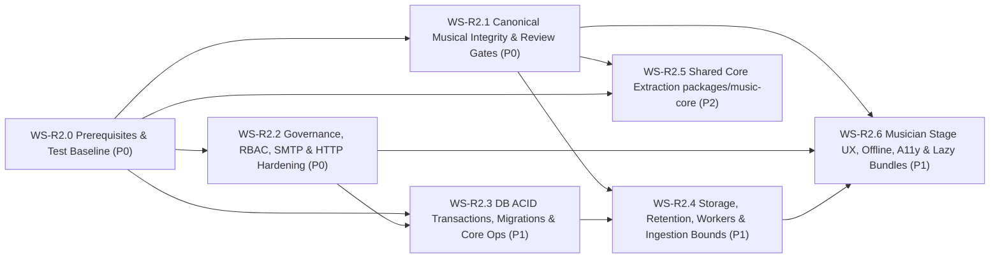

# BETHESDA WORSHIP STUDIO — PHASE R2 PROPOSED ROADMAP & GOVERNANCE GATES

- **Date:** `2026-11-21`
- **Repository / Branch:** `BETHESDA WORSHIP STUDIO` / `feature/phase-1a-core-foundation` (`origin/feature/phase-1a-core-foundation`)
- **Baseline HEAD SHA:** `2ebb0fd1c4b70780e740da60342e07e81a166cdd` (`fix(phase-r1): close alternate-route tokenVersion bypass and certify PostgreSQL acceptance gate`)
- **Gate Classification:** **`CONDITIONAL PASS — PREREQUISITES REQUIRED`**
- **Authorization Status:** **PROPOSED PLAN ONLY — Phase R2 implementation is NOT initiated and remains unauthorized without explicit Project Owner approval.**

---

## 1. Executive Roadmap

Phase R1 formally closed critical P0 perimeter security, login lockout, `tokenVersion` enforcement, migration `0018`/`0019` recovery, and backend ESM build capability. The companion [Architecture and Readiness Assessment](file:///c:/Users/juanc/OneDrive/Documentos/Desarrollo%20proyectos/Sistema%20musical%20-%20partituras/BETHESDA%20WORSHIP%20STUDIO/BETHESDA_WORSHIP_STUDIO_PHASE_R2_ARCHITECTURE_AND_READINESS_ASSESSMENT.md) identifies **38 concrete issues (`R2-F01`–`R2-F38`)** across musical integrity, governance/security, ACID concurrency, storage/worker reliability, shared core packaging, and live-stage UX.

This Phase R2 roadmap avoids monolithic "big-bang" changes or unrelated feature development. Instead, it divides stabilization into **7 sequential, strictly gated subphases (`WS-R2.0` through `WS-R2.6`)** prioritizing:
1. Certifying unexecuted baseline suites and resolving Project Owner architectural decisions (`WS-R2.0`).
2. Eliminating silent musical data corruption and review bypasses (`WS-R2.1`, `WS-R2.2`).
3. Sealing PostgreSQL ACID/migration/least-privilege reliability (`WS-R2.2`, `WS-R2.3`).
4. Preventing ephemeral storage data loss, retention buildup, and Python/PDF OOM crashes (`WS-R2.4`).
5. Decoupling the shared domain package (`packages/music-core`) for clean builds/containers (`WS-R2.5`).
6. Fixing stage-breaking offline/document-fallback/shortcut/bundle defects for worship musicians (`WS-R2.6`).

### Validation Philosophy (Project Owner Preference)
Per Project Owner direction (**Section 11**), **manual validation is the primary acceptance gate** for user-facing and end-to-end workflows, supported by headless Node/`tsx` domain tests, PostgreSQL integration tests, and Python `pytest` checks. **Browser automated testing (`Playwright`, `Selenium`, `Cypress`) is NOT introduced in Phase R2.**

---

## 2. Entry Prerequisites & Project Owner Decisions Before Implementation

### 2.1 Mandatory Technical Prerequisites (`WS-R2.0`)
1. Execute `audio-preservation-and-worker.test.ts` (4,055 lines) and `conversion-worker-certification.test.ts` (3,270 lines, 105 tests) plus `workers/audio_worker/tests/test_worker.py` against a disposable PostgreSQL DB and verify 100% pass post-R1.
2. Remediate `provision_app_runtime_role.sql` (21 tables + `pgboss`) and hardcoded `bethesda_worship_test` in `omr-persistence-and-integrity.test.ts:2556,2586`, then execute `20.1–20.12` under a least-privilege non-superuser role (`68/68`).
3. Stabilize `npm --prefix frontend test` using `tsx --test` and fix the contract assertion in `browser-rendering-integration.test.ts:362-378` #8.

### 2.2 Required Project Owner Decisions (Before Approving R2 Implementation)
| Decision ID | Architectural / Product Question | Options | Recommended Option for Free / Lean Operations |
|---|---|---|---|
| **POD-01** | **Target Hosting Topology:** Single-node VPS/Docker vs Multi-instance / Ephemeral PaaS (Render/Railway/Fly)? | (A) Single-node persistent VPS + local NVMe + scheduled backups; (B) Stateless/ephemeral PaaS requiring mandatory S3/R2 object storage (+ Redis if >1 replica) | **Option B (S3/R2 + 1 worker/API node)** if using free PaaS; **Option A** if persistent VPS |
| **POD-02** | **Tenancy Model in R2:** Single-church installation vs Multi-church SaaS sharing one PostgreSQL DB? | (A) Single-church (`R2`), postpone `community_id`/RLS to `R3+`; (B) Add `community_id` + RLS in `R2` | **Option A** (avoids invasive 21-table RLS rewrite blocking urgent musical/security fixes) |
| **POD-03** | **Catalog Approval Role Policy (`songs:approve`):** Who can publish `APPROVED` songs? | (A) `ADMIN` & `SUPER_ADMIN` only (matches `auth-types.ts`); (B) Also grant `songs:approve` to `WORSHIP_LEADER` (matches hardcoded OMR/Completion/Audio services) | **Option B** with explicit **draft -> review -> approve** workflow (never skipping `DRAFT` on upload/import) |
| **POD-04** | **Onboarding & Password Reset Email Channel:** | (A) Configure transactional SMTP provider (`nodemailer` / Resend / SMTP relay) and stop returning `invitationToken` in JSON; (B) Explicit admin one-time invite link mode without self-service reset | **Option A** (SMTP relay with free tier, keeping fail-closed `UNCONFIGURED` warning in dev only) |
| **POD-05** | **Repo Bloat & License Cleanup (`R2-F35`, `R2-F38`):** | (A) Approve `git rm -r --cached backend/node_modules/` + cleanup of leftover root `storage/` test artifacts in `WS-R2.0`, and confirm internal-server use of GPLv3 `imageio-ffmpeg` binary; (B) Defer repo untrack | **Option A** (prevents `~7,367`-file noise and binary lock-in prior to `WS-R2.5` package extraction) |

---

## 3. Proposed Phase R2 Workstreams (`WS-R2.0` – `WS-R2.6`)

---

### Workstream `WS-R2.0`: Validation Baseline Certification, Test Runner Alignment & Git Hygiene

- **Problem:** Two mission-critical backend certification suites (`audio-preservation-and-worker.test.ts`, `conversion-worker-certification.test.ts`, `R2-F36`) were never executed post-R1; `omr-persistence-and-integrity.test.ts` `20.1–20.12` fails from both superuser context and hardcoded `bethesda_worship_test` (`R2-F18`); `npm --prefix frontend test` fails 4 tests (`R2-F37`); and `backend/node_modules/` (`7,367` tracked files) + stray root `storage/` test folders pollute the working repo (`R2-F38`).
- **Objectives:** Establish a 100% honest, green automated baseline across backend, PostgreSQL least-privilege role, Python worker, and frontend core *before* refactoring musical or security code; capture all 5 Project Owner decisions (`POD-01`–`POD-05`).
- **Proposed Scope:**
  - Fix dynamic DB URL binding in `backend/src/__tests__/omr-persistence-and-integrity.test.ts:2556,2586` and fix `backend/src/db/scripts/provision_app_runtime_role.sql` to verify `20.1–20.12`.
  - Execute `audio-preservation-and-worker.test.ts`, `conversion-worker-certification.test.ts`, `omr-persistence-and-integrity.test.ts`, and `workers/audio_worker/tests/test_worker.py` against a clean disposable DB (`bethesda_worship_r2_precheck`).
  - Switch `frontend/package.json:9` `"test"` to `tsx --test`, add `tsx` devDependency, and align `frontend/src/core/rendering/__tests__/browser-rendering-integration.test.ts:362-378` #8 + add `LYRICS_ONLY` `capo === 0` invariant test.
  - With Project Owner approval (`POD-05`), untrack `backend/node_modules/` via `git rm -r --cached` (without deleting working local `node_modules`) and remove stray root `storage/non_existent_cert_dir_404` & `storage/test-symlink-outside`.
- **Out of Scope:** Fixing application musical/security/UX defects; adding Playwright/Cypress/Selenium; modifying production/dev/test persistent DBs.
- **Dependencies:** Project Owner approval of `WS-R2.0` and `POD-01`–`POD-05`.
- **Risks:** Previously unexecuted suites (`audio`, `conversion-worker`) may uncover live `pg-boss` v12 or R1 auth regressions requiring triage prior to `WS-R2.1+`.
- **Acceptance Criteria:**
  1. `omr-persistence-and-integrity.test.ts` passes `68/68` under provisioned least-privilege role.
  2. `audio-preservation-and-worker.test.ts`, `conversion-worker-certification.test.ts`, and `test_worker.py` pass `100%` (`0` failed, `0` skipped) on disposable DB.
  3. `npm --prefix frontend test` passes `100%` across all `78` suites (`0` failed).
  4. Owner decisions `POD-01`–`POD-05` documented and signed off.
- **Manual Validation:**

| Scenario | Preconditions | Steps | Expected Result | Failure Conditions | Evidence to Collect | Responsible Validator | Acceptance Criteria |
|---|---|---|---|---|---|---|---|
| **MV-0.1** Baseline Certification Sign-Off | Disposable PG instance running; `.venv` Python active | Run documented backend, Python, and frontend test commands cleanly; inspect `git status` | All suites pass with 0 skips; repo clone free of tracked `node_modules` | Any failed/skipped assertion or modified source file | Terminal logs (`exit 0`), `git ls-files` count reduction log | QA Lead + DBA | `0` unexpected failures; baseline report signed |

- **Relative Effort:** `S`
- **Priority:** `P0 — Critical`
- **Gate:** **Entry Gate:** Explicit Owner approval for `WS-R2.0` + `POD-05`. **Exit Gate:** All prerequisite suites pass 100% and `POD-01`–`POD-05` decisions are recorded before opening `WS-R2.1`.

---

### Workstream `WS-R2.1`: Canonical Musical Data Integrity, Importers, Projections & Review Gates

- **Problem:** Multiple verified defects silently corrupt pitch (`R2-F01`), chord qualities (`R2-F02`), MIDI timing (`R2-F03`), transposed tablature and ChordPro `chordAbove` (`R2-F04`), importer round-trips & browser `.tab` uploads (`R2-F05`), measure-relative vs absolute lyric ticks (`R2-F08`), tie/polyphony validation (`R2-F09`), provenance/renderers (`R2-F10`), fabricate `C / 120 / 4-4 / rest / 'C'` across 8 code paths (`R2-F06`), and bypass per-format human review via global `APPROVED` escalation (`R2-F07`).
- **Objectives:** Guarantee mathematically and theoretically accurate musical representation, transposition, formatting, provenance, and zero-fabrication/per-format review enforcement across `frontend/src/core/` and backend musical services.
- **Proposed Scope:**
  - Fix `Pitch.midiNumber` (`pitch.ts:35-37`) and transposed octave calculation (`projection-service.ts:135-137`, `conversion-transformer.ts:200-201`).
  - Fix `Chord.parse()` & `Chord.toString()` (`chord.ts:156-167,220-282,319-323`) for `sus2`, `maj`, `Cmaj9`, `Cm9`, `C9`, `add2/add4/11/13`, unicode `♯/♭`.
  - Fix `CanonicalToMidiSerializer:261` (`startTick` absolute, no double `measureStart +`) + tempo/time-sig map events.
  - Fix `ProjectionService` (`L210-267`) & `ConversionTransformer` (`L155-267`) so Tablature receives transposed `writtenPitch`, per-tuning `maxFret`, and recomputed/cleared frets; remove duplicate untransposed `chordAbove` across `LeadSheetDomAdapter` & `ChordProSerializer`; preserve `ChordEvent.evidenceStatus`/`confidence`; normalize `measureStart + syllable.tickOffset` across renderers and serializers; restore diatonic interval spelling and mid-song modulations.
  - Fix importers & exporters: promote serialized `chordId`/`tupletGroup` on `Note` (plus `notationMetadata` on `Rest`); replace Node `Buffer.byteLength` in `ascii-tab-parser.ts:130` with `TextEncoder`; fix `ChordProImporter` minor fifths table (`:539-574`) & `.cho` detection; iterate all parts `0..N` and middle `<tie>` `'CONTINUE'` in `MusicXmlImporter`, and export `<mode>minor</mode>`; deduplicate same-tick tempo events in `MidiIngestionAdapter`; support first-class `isPickup`, fix `validator.ts:285` `<=`, fix `Voice.calculateTotalDurationTicks()`, and wire `TemporalValidator` inside `CanonicalSerializer`.
  - Fix renderers: prioritize `OSMD` for `STANDARD_NOTATION` in `RendererRegistry`; eliminate `AlphaTex 0.1` fabrication (`alphatex-generator.ts:102-105`); support post-init `staveProfile` updates (`AlphaTabAdapter:307-329`); surface async `OsmdAdapter` errors (`:271-279`); fix Tenor Sax `+14` (`instrument-profile.ts:301`) and Capo fingering key (`leadsheet-dom-adapter.ts:218-220`).
  - Eliminate silent fabrication of `C / 120 / 4-4` across all 8 locations (`written-notes-adapter`, `document-service`, `audio-transcription-service`, `musical-content-completion-service`, `omr-proposal-handler`, `song.schemas`, `chord-sheet-converter`, `chordpro-importer`) and preserve OMR/version/conversion `sourceType` + `metadata`.
  - Close global `APPROVED` escalation (`musical-content-completion-service`, `stand-format-capabilities`, `workspace-orchestrator`) so per-format approval never unlocks unapproved formats, and remove premature `HUMAN_VERIFIED` pre-stamping (`:1252-1261`).
- **Out of Scope:** HTTP auth/user onboarding (`WS-R2.2`), DB transactions (`WS-R2.3`), real OMR engine or `ENGRAVED_PDF` (`R3+`), React layout refactor (`WS-R2.6`).
- **Dependencies:** `WS-R2.0` complete.
- **Risks:** Enforcing `TemporalValidator` inside `CanonicalSerializer` may break legacy test fixtures with collisions/broken ties unless `chordId` and pickup support land cleanly first.
- **Acceptance Criteria:**
  1. `Pitch('Cb', 4).midiNumber === 59`, `Pitch('B#', 3).midiNumber === 60`; `Chord.parse('Csus2')`, `'Cmaj'`, `'Cmaj9'`, `'C9'` round-trip losslessly.
  2. Multi-measure MIDI export produces exact cumulative tick offsets (`bar 2 = 1920`, not `3840`).
  3. Transposing G->A updates Guitar/Bass Tablature frets and Capo LeadSheets with zero duplicate chords and zero `0.1` fallback notes on wind/piano Standard Notation.
  4. Importing minor-key ChordPro (`Am`) and minor MusicXML round-trips with accurate minor key signatures and preserves all parts `2..N`.
  5. `.tab` parsing executes cleanly in browsers without `globalThis.Buffer`.
  6. Approving `CHORDS` on a draft does **not** mark `SHEET_MUSIC` or `TABLATURE` approved/ready in `StandFormatCapabilityResolver` or `WorkspaceOrchestrator`.
- **Manual Validation:**

| Scenario | Preconditions | Steps | Expected Result | Failure Conditions | Evidence to Collect | Responsible Validator | Acceptance Criteria |
|---|---|---|---|---|---|---|---|
| **MV-1.1** Transposition & Multi-Instrument Parity | Song in G Major containing notes, chords, lyrics (`>= 4` bars) | Open Stand for Piano, Alto Sax, Guitar (Capo 2 Tab), and Vocal; transpose `+2` semitones (A Major) | Piano/Sax show score without `0.1` tab notes; Guitar frets shift accurately; Vocal shows transposed chords once without untransposed duplicates; bar 2+ lyrics align | `0.1` open E4 notes; old G chords alongside A chords; static guitar frets | Screen captures of all 4 instrument views + exported MIDI timing check | Worship Music Director + QA | 100% pitch/chord/lyric parity across bars 1–4 in transposed key |
| **MV-1.2** ChordPro / MusicXML / `.tab` Browser Round-Trip | `.cho` in `Am`, 2-part `.musicxml` (Piano+Voice) in `Em`, polyphonic `.tab` file | Import all 3; save/reload from catalog; export back to MusicXML & MIDI | `Am`/`Em` keep minor signatures; both parts remain after save; `.tab` imports in browser with chords intact; MIDI plays at natural bar durations | Browser `Buffer is not defined`; `Am->A` or `Em->G`; Part 2 lost; MIDI bars spaced with 1-bar gaps | Browser console (`0` errors), imported/exported file inspection & audio playback listen | Worship Music Director | Lossless round-trip across all 3 formats |
| **MV-1.3** Zero-Fabrication & Per-Format Review Gate | Unmetered audio/completion draft with only `CHORDS` approved | Approve `CHORDS` only; open Stand as LeadSheet vs Tablature vs Sheet Music | `CHORDS` opens cleanly; `SHEET_MUSIC` and `TABLATURE` remain visibly blocked (`Unapproved` / `Insufficient`), showing no invented `C/120/4-4` metadata | Unapproved formats open with fabricated tempo/key/notes | UI screenshots + inspected `song_versions.canonical_payload.metadata` JSON | Music Reviewer + QA | Zero unapproved format leakage; unresolved fields stay `null` |

- **Relative Effort:** `XL`
- **Priority:** `P0 — Critical`
- **Gate:** **Entry Gate:** `WS-R2.0` complete. **Exit Gate:** All 78 frontend core suites + new musical regression tests pass 100% + `MV-1.1`–`MV-1.3` signed off before `WS-R2.4`/`WS-R2.6`.

---

### Workstream `WS-R2.2`: Governance, RBAC, Onboarding Security, Audit Immutability & Input/HTTP Hardening

- **Problem:** Multiple `P0`/`P1` security and governance defects persist post-R1: `status:'APPROVED'` mass assignment & hardcoded approval in 4 ingestion/document paths + `MUSICIAN` overwriting `APPROVED` songs + `REVIEW_REQUIRED` commits (`R2-F11`); unimplemented SMTP, prod plaintext `invitationToken` leaks, `SUSPENDED`/`LOCKED` & `PENDING_INVITATION` state bypasses, `GET /refresh`, unthrottled initial password change, hardcoded 7d expiry (`R2-F12`); `audit_logs` and `song_versions` lack DB immutability triggers + `ON DELETE CASCADE` (`R2-F13`); prod Swagger UI, `PersistenceError` raw PG disclosure, unredacted `?ticket=` logs, SSE `writeHead` CORS bypass & `x-test-close`, global 25 MiB `bodyLimit` (`R2-F14`); unowned `/documents/:storageKey/*`, `DELETE /audio/:id` omitting `ADMIN`, destructive purge under `audit:read` (`R2-F15`); unthrottled `VIEWER` CPU routes, missing `.uuid()`, unbounded Zod inputs (`R2-F16`); `provision_app_runtime_role.sql` broken & `assertNonSuperuserRuntimeRole()` uncalled (`R2-F18`); PDF `zlib.inflateSync()` zip-bomb (`R2-F24`).
- **Objectives:** Close all catalog approval bypasses, harden onboarding/session endpoints, enforce least-privilege PostgreSQL + DB-level audit/version immutability, eliminate raw info/token leaks, and bound/throttle dangerous HTTP & PDF inputs.
- **Proposed Scope:**
  - Lock down `POST /api/v1/songs` (`CreateSongBodySchema`), `DocumentService`, `UniversalIngestionService`, and `IngestionPersistenceService` so created/imported songs default to `'DRAFT'` unless explicit `songs:approve` permission (`POD-03`) is enforced via dedicated approval workflow; reject `MUSICIAN` mutation/activation on `APPROVED`/`ARCHIVED` songs; block `ConversionJobService.commitJobToCatalog` on `REVIEW_REQUIRED` until reviewed.
  - Implement SMTP delivery abstraction (`POD-04`), suppress `invitationToken` from production JSON responses, fix `invitationId` field (`user.routes.ts:116`), pass IP/UA audit context, block inviting `SUSPENDED`/`LOCKED` users & enabling `PENDING_INVITATION` users, convert `GET /auth/refresh` -> `POST`, add account+IP throttling to `/auth/change-initial-password` + `/auth/forgot-password`, align DB refresh TTL with `env.REFRESH_TOKEN_EXPIRES_IN_DAYS`, revoke stream tickets proactively on disable/role change.
  - Add PostgreSQL `BEFORE UPDATE OR DELETE` immutability triggers + `REVOKE UPDATE/DELETE/TRUNCATE` on `audit_logs` and `song_versions` (`audit_logs.user_id` -> `RESTRICT`, `song_versions.song_id` -> `RESTRICT`), complete `provision_app_runtime_role.sql` for all 21 tables + `pgboss`, and wire `assertNonSuperuserRuntimeRole()` on prod boot.
  - Enforce DB-backed ownership/metadata table (or persisted tracking) + `realpathSync`/null-byte checks on `/documents/:storageKey/*`; add `ADMIN` to `DELETE /audio/:id`; move `POST /audio/recovery/reconcile` off `audit:read` to admin mutation permission.
  - Apply tiered rate limits to `/audio/:id/verify`, `/audio/*`, `/documents/*`, `/songs/*/validate-preview`, `/omr/*`, `/ingestion/*`, `/realtime/*`, `/users/*`; add strict `.uuid()` path validation & `.max()` length bounds on all schemas; add bounded `maxOutputLength` on `zlib.inflateSync()` (`R2-F24`); disable Swagger UI in `NODE_ENV=production`; sanitize 500 `PersistenceError` JSON; add Pino redaction (`authorization`, `cookie`, `?ticket=`); fix SSE CORS/Helmet headers & remove `x-test-close`; tighten global `bodyLimit` vs per-route limits.
- **Out of Scope:** Refactoring `ConversionJobService` nested transactions (`WS-R2.3`), S3/worker queues (`WS-R2.4`), frontend onboarding UI screens (`WS-R2.6`, except API contract coordination).
- **Dependencies:** `WS-R2.0` (`POD-03`, `POD-04`), coordinated with `WS-R2.3` for any new SQL migration (`documents` table + `audit_logs`/`song_versions` triggers).
- **Risks:** Changing `GET /auth/refresh` -> `POST` or stripping `invitationToken` from HTTP JSON will affect any existing integration tests or frontend clients calling those fields (must update `api-client.ts` / tests coherently).
- **Acceptance Criteria:**
  1. `POST /songs`, `/documents/import-song`, `/documents/:key/convert-song`, `/ingestion/upload` never persist `APPROVED` without authorization; `MUSICIAN` receives `403` attempting to modify versions of an `APPROVED` song.
  2. In `NODE_ENV=production`: `/documentation` returns `404`; `PersistenceError` returns generic message + reference ID (0 SQL/constraint leak); logs redact Bearer/cookies/tickets; `POST /users/invite` omits `invitationToken`.
  3. Non-superuser runtime DB role passes `100%` of integration tests including `audit_logs` & `song_versions` update/delete denial (`42501`/`55000`).
  4. Crafted FlateDecode zip-bomb PDF fails cleanly with HTTP `400`/`413` (`0` OOM); malformed `:jobId`/`:setlistId` return `400`.
- **Manual Validation:**

| Scenario | Preconditions | Steps | Expected Result | Failure Conditions | Evidence to Collect | Responsible Validator | Acceptance Criteria |
|---|---|---|---|---|---|---|---|
| **MV-2.1** Governance & RBAC Separation | Users logged in as `MUSICIAN`, `WORSHIP_LEADER`, `ADMIN`, `VIEWER` | Attempt direct `status:'APPROVED'` creation, `MUSICIAN` version swap on `APPROVED` song, `VIEWER` access to private `/documents/:key/file`, `ADMIN` deleting user's audio | Unprivileged catalog approvals & edits blocked (`403`); `ADMIN` audio delete succeeds; private docs isolated | Any unapproved song hits `APPROVED` or `VIEWER` reads private PDF | HTTP status logs + DB `songs`/`audit_logs` snapshot | Security Lead | 100% policy enforcement per `POD-03` |
| **MV-2.2** Onboarding & Production Safe Boot | App booted in prod-like config with non-superuser `bethesda_app_runtime` & SMTP sandbox | Invite user; verify email receipt; test `forgot-password` -> `reset-password`; hit `/documentation` & malformed UUID; inspect server logs | Email delivered; invite JSON has no secret token; `/documentation` `404`; 400 JSON clean; zero tickets/passwords in Pino logs | Permission denied DB errors; token in API response or logs; stack trace/PG string in JSON | Email inbox capture, scrubbed API responses, redacted server logs | Security + Ops Lead | Zero secret leaks; non-superuser DB role runs cleanly |

- **Relative Effort:** `L`
- **Priority:** `P0 — Critical`
- **Gate:** **Entry Gate:** `WS-R2.0` + `POD-03`/`POD-04` signed off. **Exit Gate:** Backend security/DB tests pass against least-privilege runtime role + `MV-2.1`–`MV-2.2` approved.

---

### Workstream `WS-R2.3`: Database ACID Transactions, Migration Chain Normalization & Core Ops Stability

- **Problem:** `ConversionJobService.commitJobToCatalog` risks orphan songs and connection-pool deadlock by running outer-pool queries inside `this.db.transaction()` (`R2-F19`); `version-repository`, `setlist-repository`, `AuthService.refresh`, `PasswordResetService.resetPassword`, last-`SUPER_ADMIN`, `WorshipServiceService`, and `UniversalIngestionService` suffer concurrency races (`R2-F19`); `_journal.json` misorders `0020` vs `0018`/`0019` with missing Drizzle snapshots past `0007` and partial-index/constraint drift (`R2-F20`, `R2-F21`); and backend ops suffer `env.ts:20` `"test"` path corruption, missing `pool.end()`, shallow `/health`, 14× DI duplication, N+1 `multitrack` queries, and stale L1 RAM caches (`R2-F26`).
- **Objectives:** Guarantee atomic DB transactions and pessimistic/optimistic concurrency safety, establish a clean reproducible Drizzle migration baseline, and make process startup/shutdown/health deterministic.
- **Proposed Scope:**
  - Refactor `DrizzleSongRepository` / `DrizzleSongVersionRepository` to accept an optional Drizzle transaction executor `tx`, fixing `ConversionJobService.commitJobToCatalog` (`L511-676`) into one atomic transaction.
  - Add `SELECT ... FOR UPDATE` locking + transactional boundaries to `createVersion`/`setCurrentVersion`, `SetlistRepository.createItem/updateItem/deleteItem` (+ mutability check in `updateSetlist`/`deleteSetlist`), `AuthService.refresh`, `PasswordResetService.resetPassword` atomic claim, last-`SUPER_ADMIN` role/disable guard, `WorshipServiceService` + state-transition rules, and `UniversalIngestionService` DB steps.
  - Align `schema.ts` with SQL constraints (partial indexes, `songs.current_version_id` FK/index, `UNIQUE(song_id) WHERE is_current = true`, `song_metadata` unique `song_id`, deferrable unique `(setlist_id, sequence_order)`, token `expires_at` indexes, drop duplicate indexes, `23503`/`23505` -> `409 ConflictError`, populate user attribution columns); reconcile `_journal.json` / snapshot baseline safely without breaking already-applied R1 DBs; decouple CLI migrations from multi-replica API boot (`RUN_MIGRATIONS_ON_BOOT` flag).
  - Centralize backend DI container cleanly inside Fastify (`JwtTokenService` env parity across all 14 plugins, eliminate per-request `DrizzleSongRepository` and duplicate `userRepo.findById` / `multitrack` N+1 calls); fix `env.ts:18-25` test-runner detection; wire `pool.end()` + `isShuttingDown` + unhandled error hooks; replace stale `MultitrackService.sessions` & `OmrService.proposals` caches with PostgreSQL reads; add `/api/v1/live` and `/api/v1/ready` health endpoints.
- **Out of Scope:** Full Redis cluster state migration (`R3+`, unless required by `POD-01` for >1 replica) and multi-tenant `community_id` RLS (`POD-02`).
- **Dependencies:** `WS-R2.0`; coordinate migration sequence with `WS-R2.2`.
- **Risks:** Re-anchoring Drizzle snapshots/journal timestamps must be tested on both blank DBs AND simulated post-R1 existing DBs so production/staging DBs never skip or fail idempotent runs.
- **Acceptance Criteria:**
  1. Concurrent calls to `commitJobToCatalog`, `createVersion`, `createItem`, `refresh`, `resetPassword`, and last-`SUPER_ADMIN` demotion produce `0` deadlocks, `0` 500s, and `100%` consistent DB invariants.
  2. Fresh + post-R1 upgrade migration runs succeed twice idempotently (`exit 0`); `drizzle-kit check` / schema inspection reports zero unexpected drift.
  3. Booting `dist/backend/src/server.js` from a path containing `"test"` (e.g. `latest`) respects `NODE_ENV=production`; `SIGTERM` drains `app`, worker, and `pool.end()` cleanly.
- **Manual Validation:**

| Scenario | Preconditions | Steps | Expected Result | Failure Conditions | Evidence to Collect | Responsible Validator | Acceptance Criteria |
|---|---|---|---|---|---|---|---|
| **MV-3.1** Upgrade vs Fresh DB Migration Check | Two disposable DBs: (A) blank DB, (B) simulated R1 snapshot at `2ebb0fd1` | Run R2 migration script twice on (A) and twice on (B); inspect PG tables, constraints & triggers | Both DBs match identical schema/triggers/roles; 2nd run is no-op (`exit 0`) | Errors on existing constraints/indexes or skipped migrations | `migrate.ts` stdout + `pg_catalog` diff between DB A and DB B | DBA / Backend Lead | Zero schema divergence between fresh and upgraded DBs |
| **MV-3.2** Path & Graceful Shutdown Smoke | Compiled `dist/` placed in folder `/tmp/bethesda-test-deploy/` | Start server with `NODE_ENV=production`; poll `/ready`; trigger `SIGTERM` | Boots in production mode (no `TEST_DATABASE_URL` crash), `/ready` 200, exits cleanly closing PG connections | Falls back to `'test'` env; hangs or logs PG unexpected EOF | Startup/shutdown Pino logs & `pg_stat_activity` count = 0 | Ops Lead | Clean `SIGTERM` exit `0` under 5s |

- **Relative Effort:** `L`
- **Priority:** `P1 — High`
- **Gate:** **Entry Gate:** `WS-R2.0` complete. **Exit Gate:** Full backend suite + `MV-3.1`–`MV-3.2` pass before storage/worker deployment (`WS-R2.4`).

---

### Workstream `WS-R2.4`: Storage Lifecycle, Retention, Worker Reliability, Streaming & Audio Queueing

- **Problem:** Ephemeral FS destroys local storage on PaaS redeploys (`R2-F22`); `S3CompatibleStorageProvider` is dead code with 4 bugs (`R2-F22`); 4 local providers have split `<repo>/storage` vs `<repo>/backend/storage` trees (`R2-F29`); `OutputRetentionService` is unscheduled and `runFullCycle`/`pruneExpiredOutputs` have 2 bugs (`R2-F23`); 80 MiB buffered multipart & synchronous Python/FFmpeg subprocesses risk OOM (`R2-F25`); HTTP 206 audio seeking re-hashes whole files (`R2-F29`); `UniversalIngestionService` persists before validation (`R2-F28`); `ConversionWorker` runs in-process without DLQ, fails retries due to non-reset `attempts`, and shuts down before `app.close()` (`R2-F29`); Conversion Center advertises MIDI/Written-Notes/TXT/WEBP/TAB inconsistently (`R2-F27`); and zero backup/restore runbooks exist (`R2-F22`).
- **Objectives:** Make file storage durable, path-consistent, bounded in memory/disk, retention-enforced, and backed up; isolate CPU/Python heavy processing from the HTTP event loop; and align ingestion/conversion format viability truthfully.
- **Proposed Scope:**
  - Anchor all 4 storage root directories via unified environment configuration (`STORAGE_ROOT_DIR`, eliminating `process.cwd()` split), add atomic writes + `realpathSync` to `DocumentStorageProvider`, fix the 4 bugs in `S3CompatibleStorageProvider` (truncation, error propagation, SigV4 `publicBaseUrl`, remove or implement signed output route parity), and wire unified storage adapter switching (`local` vs `s3`, per `POD-01`).
  - Fix `OutputRetentionService` (`runFullCycle` including `reconcilePendingDeletions` + `reconcileUnauditedDeletions`, and `.select()` including `errorDetails`), schedule retention & stale-`.tmp` pruning on a controlled lifecycle timer/worker, and enforce per-song/global storage quotas.
  - Fix `UniversalIngestionService` to execute adapter format/XXE validation **before** saving to storage or inserting `song_sources` (with rollback cleanup on error and success-only idempotency).
  - Queue `POST /audio/:id/analyze` through a concurrency-bounded background job/worker mechanism (with configurable worker concurrency cap, process timeout, client abort, and reuse of `worker_threads` or dedicated worker entry for `ConversionWorker`), and replace 80 MiB full-RAM custom multipart parser (`audio.routes.ts:390-396`) with streaming disk temp writes (`@fastify/multipart` / streaming busboy).
  - Fix audio HTTP 206 streaming so full-file integrity checks happen cleanly without re-hashing 50 MiB per browser seek chunk; fix `retryJob()` resetting `attempts = 0`, add `pg-boss` DLQ, fix shutdown order (`app.close()` -> `conversionWorker.stop()` checking `WorkerStopResult` -> `stopConversionQueue()` -> `pool.end()`).
  - Reconcile `FormatCapabilitiesEvaluator` vs `ConversionEngine`/`UnifiedMusicImporter` (`MIDI`, `WrittenNotes`, `TXT`, `.mxl`, `.webp`, `WebM`, `TABLATURE`) — either implement missing adapters cleanly or surface truthful `DEFERRED` status matching backend reality.
  - Add `pg_dump` + object/storage coordinated backup/restore scripts & operational runbook.
- **Out of Scope:** Real OMR engine, `ENGRAVED_PDF`, MP4 audio/video extraction (`R3+`).
- **Dependencies:** `WS-R2.0` (`POD-01`), `WS-R2.1`, `WS-R2.3`.
- **Risks:** Introducing S3 backend for all 4 domains (`sources`, `outputs`, `audio`, `documents`) requires consistent key/metadata abstraction and careful testing of stream seeking; async audio analysis requires matching UI status polling in `ConversionCenterWorkspace` (`WS-R2.6`).
- **Acceptance Criteria:**
  1. All 4 providers read/write under single configured root or S3 bucket regardless of `cwd`; zero leaked files in repo root.
  2. `OutputRetentionService` executes scheduled pruning + CAS crash reconciliation; crashed `cas_deletion_intents` reconcile cleanly.
  3. Simultaneous audio analysis requests respect concurrency ceiling without blocking `/health` or exceeding container memory target; streaming multipart avoids full 80 MiB heap duplication.
  4. Invalid/XXE upload rejected at `UniversalIngestionService` leaves 0 bytes on disk, 0 `song_sources` rows, and repeats cleanly reject (`400`) on retry.
  5. Every format marked `canConvert: true` by `FormatCapabilitiesEvaluator` executes end-to-end without `UNSUPPORTED_FORMAT`.
- **Manual Validation:**

| Scenario | Preconditions | Steps | Expected Result | Failure Conditions | Evidence to Collect | Responsible Validator | Acceptance Criteria |
|---|---|---|---|---|---|---|---|
| **MV-4.1** Rejection Rollback & Retry Idempotency | Server running with clean `storage/sources` | Upload crafted/XXE XML twice via `/ingestion/upload`; inspect `storage/sources` & `song_sources` | Both uploads return `400` cleanly; disk & DB show 0 orphaned rows | 2nd attempt returns `201`; invalid file remains on disk | HTTP logs, `ls storage/sources`, SQL count `0` | Backend + QA Lead | Zero poisoned idempotency |
| **MV-4.2** Retention & Backup/Restore Drill | Populated songs, audio, documents & expired job outputs | Run scheduled retention cycle; execute backup script; wipe disposable DB/temp storage; execute restore script | Expired outputs pruned & audited; restored DB + storage renders songs/audio identically | Active songs pruned; checksum mismatch post-restore | Retention audit log, backup/restore script transcripts, restored asset check | Ops Lead | 100% checksum parity after restore |
| **MV-4.3** Concurrent Audio Analysis & Range Seeking | Authenticated session; two 5-min audio files | Trigger 2 parallel analyses + rapidly scrub `<audio>` preview Range bar | `/health` stays `<100ms`; analyses complete sequentially/bounded; Range scrubbing stays smooth | OOM crash; API stalls `>5s`; high CPU spike per seek | Server RSS memory log, worker queue trace, UI status completion | Backend + Ops Lead | Peak RSS stays bounded; zero timeouts |

- **Relative Effort:** `XL`
- **Priority:** `P1 — High`
- **Gate:** **Entry Gate:** `WS-R2.0` (`POD-01`), `WS-R2.1`, `WS-R2.3`. **Exit Gate:** `audio-preservation-and-worker.test.ts`, `conversion-worker-certification.test.ts`, `output-retention.test.ts`, `cas-concurrency.test.ts`, `storage-provider.test.ts` + `MV-4.1`–`MV-4.3` pass 100%.

---

### Workstream `WS-R2.5`: Shared Workspace Core Extraction & Build Decoupling (`packages/music-core`)

- **Problem:** `30` files across `backend/src/` (101 imports) cross outside `backend/` into `../frontend/src/core/` (`R2-F32`), forcing a brittle `dist/backend/src/... + dist/frontend/src/core/...` emit structure (`tsconfig.build.json`) and preventing clean containerization; PDF/audio signature utilities are duplicated across frontend/backend/Python with mismatched `ProvenanceManager` hashes (`R2-F35`); and `@fastify/jwt` + `@fastify/rate-limit` sit unused in `backend/package.json` (`R2-F35`).
- **Objectives:** Extract isomorphic pure domain logic into a proper shared package (e.g. `packages/music-core`), restore independent backend & frontend builds, eliminate domain utility duplication, and clean dead npm dependencies.
- **Proposed Scope:**
  - Configure npm workspaces (`package.json` at root) with `packages/music-core` exporting clean ESM/TS types (canonical model, music theory, importers, exporters, conversion engine/capabilities, projection, unified PDF chord/page utils & audio signature magic tables, crypto-neutral provenance interface).
  - Keep browser-only/frontend-specific adapters (`api-client`, `offline` IndexedDB, `osmd-adapter`, `alphatab-adapter`, `hooks`) strictly inside `frontend/src/`.
  - Simplify `backend/tsconfig.build.json` (`rootDir: "src"`, `outDir: "dist"`, emitting clean `dist/server.js`) and remove unused `@fastify/jwt` / `@fastify/rate-limit`.
- **Out of Scope:** Functional musical algorithm changes (completed in `WS-R2.1`) or UI visual/component refactoring (`WS-R2.6`).
- **Dependencies:** `WS-R2.0` (`POD-05` untracking `backend/node_modules/`), `WS-R2.1` (so core extraction happens *after* musical fixes merge).
- **Risks:** Broken import paths across 48 backend tests and 78 frontend tests if workspace tsconfig resolution differs between `vite`, `tsc`, and `tsx`.
- **Acceptance Criteria:**
  1. `0` files inside `backend/` import from `../frontend/`.
  2. `npm --prefix backend run typecheck`, `npm --prefix backend run build` (`node dist/server.js`), `npm --prefix frontend run typecheck`, `npm --prefix frontend run build`, and all backend/frontend test suites pass cleanly.
- **Manual Validation:**

| Scenario | Preconditions | Steps | Expected Result | Failure Conditions | Evidence to Collect | Responsible Validator | Acceptance Criteria |
|---|---|---|---|---|---|---|---|
| **MV-5.1** Standalone Backend Packaging Smoke | Clean CI/build directory | Build `packages/music-core` & `backend`; copy only built backend + migrations + shared pkg to isolated folder; boot `node dist/server.js` | Boots cleanly with zero references to `frontend/` directory | `ERR_MODULE_NOT_FOUND` referencing `frontend` | `ls` of isolated deploy folder + `/live` & `/ready` 200 responses | Build / Release Lead | Zero dependency on `frontend/src` at runtime |

- **Relative Effort:** `L`
- **Priority:** `P2 — Medium`
- **Gate:** **Entry Gate:** `WS-R2.0` (`POD-05`) & `WS-R2.1`. **Exit Gate:** Both builds + full backend/frontend test suites + `MV-5.1` pass.

---

### Workstream `WS-R2.6`: Live-Stage Musician UX, Complete Offline Loop, A11y, Themes & Bundle Splitting

- **Problem:** `VisualDocumentStand.tsx:313` displays fake `"GRANDE ES TU FIDELIDAD"` SVG when real files fail (`R2-F31`); offline open loop fails on `App.tsx:43` (`OfflineStatusBar`), `MusicalWorkspace.tsx:701`, `use-setlist-execution.ts:140`, `sw.js:26,475-484` (`R2-F31`); `Space`/`Arrow`/`Escape` collide between Autoscroll, PDF Stand & Setlists (`R2-F31`); mobile `<=640px` setlist bar hides Autoscroll (`R2-F31`); solo musicians lack Atril/Zoom/Contrast toggles (`R2-F31`); `/accept-invite` and `/forgot-password` lack UI routes (`R2-F33`); `DatabaseSongsModal` uses an unshared `BethesdaApiClient` (`R2-F33`); stale copy advertises removed audio player while hiding true status (`R2-F33`); `.mxl`/`.aac`/uppercase binary files read as text in Conversion Center (`R2-F33`); Bass/Drums quick pills & `GRAND_STAFF` mapping fail (`R2-F33`); light theme/high-contrast/print/modal focus fail WCAG (`R2-F34`); and eager OSMD+AlphaTab imports ship a monolithic `3.26 MB` JS bundle with 3 `RendererRegistry` singletons (`R2-F32`).
- **Objectives:** Make live church stand performance rock-solid online and offline on tablets/phones, repair user onboarding & Conversion Center UX parity, enforce theme/print accessibility, and cut initial bundle size via lazy loading.
- **Proposed Scope:**
  - Replace `VisualDocumentStand.tsx:313` SVG tautology with an honest error/retry panel (`sampleScoreSvg` strictly scoped to sample preview).
  - Complete offline open loop: pass `onSelectSong`/`onSelectSetlist` in `App.tsx:43`, open cached IndexedDB songs directly in `MusicalWorkspace.tsx:701` when offline (with graceful online sync fallback), add IndexedDB fallback to `useSetlistExecution.loadSetlist:140`, fix `sw.js:26` (`/manifest.webmanifest`) and `sw.js:475-484` structured `ApiError` JSON object `{ error: { code: 'OFFLINE_MODE', message } }`.
  - Implement global modal/shortcut priority arbitration (`Modal > VisualDocumentStand > AutoscrollControl > SetlistNavigationToolbar`), guard `AutoscrollControl` when `isVisible === false`, fix mobile `<=640px` fixed bottom bar layout stacking, remove nested `<main>` in `VisualDocumentStand.tsx:433`, remove CSS double-zoom stacking, and expose Atril/Zoom/High-Contrast toggles for solo musicians too.
  - Wire `/accept-invite` (`POST /auth/accept-invite`) & `/forgot-password`/`/reset-password` flows cleanly from `App.tsx` / `LoginModal.tsx`; use `BethesdaApiClient.getInstance()` in `DatabaseSongsModal.tsx:19`; align `api-client.ts` reactive 401 timer reschedule + consistent `ApiError` parsing; fix binary extension handling in `ConversionCenterWorkspace` & real `/health` status indicator (instead of fake green dots); clean stale audio-player/Phase-C copy, invalid 38-byte sample PDF, `InstrumentSelector` `'bass'`/`'drums'`, `GRAND_STAFF: 'SCORE'`, and `FormatCompletionWizardModal` >24-note pagination; replace native `alert`/`confirm` with non-blocking dialogs.
  - Fix `[data-theme="light"]` token styling (replacing hardcoded inline dark styles in `ConversionCenterWorkspace`, `UserManagementModal`, `SongHeader`), fix `.workspace-song-header` high-contrast selector (`index.css:8784`), add `@media print` & `prefers-reduced-motion`, add modal `Escape`/focus management & keyboard `onKeyDown` on upload triggers.
  - Code-split `OsmdAdapter`, `AlphaTabAdapter`, and heavy admin/conversion modals via `React.lazy()` + Vite `manualChunks` and unify to 1 `RendererRegistry` singleton; decompose oversized `ConversionCenterWorkspace` / `SetlistsModal` sub-views cleanly where coupled to lazy splitting.
- **Out of Scope:** Adding Playwright/Selenium/Cypress E2E tests (excluded by default); building brand-new UI pages for deferred `omr`/`multitrack`/`realtime` modules (`R3+`).
- **Dependencies:** `WS-R2.1`, `WS-R2.2` (for `/accept-invite` & approval/reset endpoints), `WS-R2.4` (for async audio analysis UI polling). Can adopt `packages/music-core` before or alongside `WS-R2.5`.
- **Risks:** Refactoring `ConversionCenterWorkspace` (2,967 lines) and `SetlistsModal` (1,224 lines) has UI regression potential — mitigate via incremental modular decomposition and full manual scenario sign-off.
- **Acceptance Criteria:**
  1. Initial shell bundle size drops substantially (`< 800 KB` initial chunk; OSMD & AlphaTab loaded asynchronously on demand) with `1` shared `RendererRegistry`.
  2. Broken visual documents never render `"GRANDE ES TU FIDELIDAD"`.
  3. In browser Airplane Mode (offline), reloading page, opening `OfflineInventoryModal` or `DatabaseSongsModal`, and stepping through a cached setlist succeeds without 503 network block.
  4. `Space`/`Arrow`/`Escape` operate deterministically without double-triggering; mobile `390×844` shows both Setlist and Autoscroll bars without overlap.
  5. Both Light, Dark, High-Contrast, and Print (`Ctrl+P`) views maintain readable WCAG contrast.
- **Manual Validation:**

| Scenario | Preconditions | Steps | Expected Result | Failure Conditions | Evidence to Collect | Responsible Validator | Acceptance Criteria |
|---|---|---|---|---|---|---|---|
| **MV-6.1** Airplane-Mode Church Tablet Live Service | Worship Setlist + 3 songs downloaded offline; Chrome DevTools / tablet Wi-Fi OFF | Reload page offline; open cached setlist & solo cached song from Inventory and DB modal; toggle Autoscroll + Transpose + Modo Atril on `390×844` mobile & `768×1024` tablet | App boots offline; songs/setlists load from IndexedDB; Autoscroll + Setlist bars visible together without overlap; `Space` & `Arrow` act on active scope cleanly | Network 503 failure; dead open button; Autoscroll hidden behind Setlist bar; song skips on `ArrowRight` | Offline DevTools console screenshot + mobile/tablet captures | Worship Leader + Musician Validator | Complete rehearsal run offline with 0 blockers |
| **MV-6.2** Onboarding & Honest Visual/Conversion Errors | Fresh invite link from Admin; corrupted PNG & valid `.mxl` upload | Open `/accept-invite?token=...` in clean browser, set password & login; upload unreadable image to Visual Stand; check Conversion Center health when backend stopped | Invite sets password smoothly; Visual Stand shows error/retry (NOT "Grande Es Tu Fidelidad"); Conversion Center accurately reflects offline/unhealthy API | Blank page on `/accept-invite`; fake hymn SVG appears; fake green API dot stays green | Browser screenshots + Network tab check | QA + Admin Validator | Honest error telemetry & smooth onboarding |
| **MV-6.3** Light/Dark/High-Contrast, Keyboard Only & Print Check | Logged-in user on Stand & Conversion Center | Switch Dark -> Light -> High Contrast; navigate upload/modals via `Tab`/`Enter`/`Esc`; open Print Preview (`Ctrl+P`) | High-contrast song header styles cleanly; Light theme has crisp readable badges/buttons; Print hides app chrome & formats score neatly; Esc closes dialogs | Invisible text on white bg; trapped/lost modal focus; clipped print sheet | Screenshots of all 3 themes + Print Preview PDF export | Accessibility / UX Validator | Zero unreadable controls; clean printed lead sheet |

- **Relative Effort:** `XL`
- **Priority:** `P1 — High`
- **Gate:** **Entry Gate:** `WS-R2.1` + `WS-R2.2` + `WS-R2.4` API contracts finalized. **Exit Gate:** `npm --prefix frontend run typecheck`, `build`, all `78+` tests + `MV-6.1`–`MV-6.3` pass.

---

## 4. Recommended Implementation Sequence & Dependency Graph

**Recommended Execution Order:** `WS-R2.0` -> `WS-R2.1` -> `WS-R2.2` -> `WS-R2.3` -> `WS-R2.4` -> `WS-R2.5` -> `WS-R2.6`.
- *Rationale:* Executing `WS-R2.0` first exposes any latent `pg-boss` / Python worker regressions before editing code; landing `WS-R2.1` (musical core fixes) and `WS-R2.2`/`WS-R2.3` (governance, SMTP, DB ACID, single migration batch) before `WS-R2.4` and `WS-R2.5` prevents merge conflicts and avoids migrating unfixed core bugs into `packages/music-core`; finishing `WS-R2.6` after API/worker contracts settle ensures frontend onboarding, async audio polling, and offline behavior match stable backend contracts.

---

## 5. Explicitly Postponed Scope (`Phase R3 / R4+`)

To avoid over-scoping R2 into an unshippable rewrite, the following remain **out of scope for Phase R2** unless reclassified by explicit Project Owner decision:
1. **Real Optical Music Recognition (OMR) Engine (`R2-F30`):** Replacing `StandardOmrProvider` stub with Audiveris / neural OMR pipeline (`PLANNED_PHASE_2B` / `R3+`).
2. **Server-Side Engraved PDF Generation (`ENGRAVED_PDF`):** Headless Chromium / LilyPond / VexFlow score rendering service.
3. **Video / MP4 File Upload, Demuxing & Frame OCR.**
4. **Full Multi-Instance Redis Clustering (`R2-F26`):** `ioredis`-backed `DualRateLimiter`, `StreamTicketService`, and `RealtimeSessionManager` Pub/Sub (remains `R3+` *unless* Project Owner selects multi-replica deployment in `POD-01`).
5. **Multi-Tenant `community_id` & PostgreSQL RLS Across 21 Tables (`R2-F17`):** Remains `R3+` *unless* Project Owner selects immediate SaaS multi-church isolation in `POD-02`.
6. **Mounting New UI Modules for Detached Workflows:** Full frontend workspaces for `multitrack.routes.ts` (mixing console), `realtime.routes.ts` (live conductor sync), and `omr.routes.ts` (staff editor).
7. **Optional Automated Browser E2E Suite (`Playwright`):** Excluded in Phase R2 per Project Owner manual-testing policy; may be evaluated optionally in `R4+`.

---

## 6. Phase R2 Implementation Governance Structure & Subphase Gates (Section 15)

No Phase R2 subphase may begin automatically or bypass review. Every subphase (`WS-R2.0` through `WS-R2.6`) must follow the non-auto-advancing 8-stage governance lifecycle:

$$\mathbf{AUDIT \rightarrow PLAN \rightarrow OWNER\ APPROVAL \rightarrow IMPLEMENTATION \rightarrow VALIDATION \rightarrow ACCEPTANCE \rightarrow DOCUMENTATION \rightarrow GATE\ CLOSURE}$$

### Mandatory 12-Point Governance Checklist Per Subphase (`WS-R2.x`)

| Control Gate | Mandatory Requirement Before Proceeding / Closing |
|---|---|
| **1. Preflight** | Confirm clean Git working tree, exact expected branch (`feature/phase-1a-core-foundation`), exact parent commit SHA, and running test DB isolation (`NODE_ENV=test`, dedicated disposable DB — never `bethesda_worship_dev` / production). |
| **2. Baseline** | Record exact starting HEAD SHA and verify all prerequisite subphase Exit Gates (`WS-R2.(x-1)`) are formally closed. |
| **3. Scope** | Reconfirm strict alignment with the approved Proposed Scope & Out-of-Scope boundaries for `WS-R2.x` only. |
| **4. Authorized Files & Components** | Enumerate the explicit allow-list of source, test, migration, and config files permitted for `WS-R2.x` in the subphase implementation plan. |
| **5. Explicit Prohibited Changes** | Prohibit touching unrelated modules, unapproved schema changes, production DB operations, dependency additions not listed in the plan, or `R3+` features. |
| **6. Implementation Requirements** | Zero silent defaults/fabrication, typed errors (`AppError` subclasses), parameterized SQL / Drizzle tx executors, preserved backward compatibility or coordinated client updates. |
| **7. Validation Requirements** | Execute `typecheck`, targeted + regression automated backend/core/Python suites (`0` failed, `0` skipped), production `build`, and non-superuser DB validation where DB changes apply. |
| **8. Manual Acceptance Matrix** | Execute every `MV-x.y` scenario in the workstream table, collecting exact evidence (logs, screenshots, SQL queries, exported files) signed by the designated Responsible Validator. |
| **9. Documentation** | Produce a dedicated closure report + updated [Traceability and Acceptance Matrix](file:///c:/Users/juanc/OneDrive/Documentos/Desarrollo%20proyectos/Sistema%20musical%20-%20partituras/BETHESDA%20WORSHIP%20STUDIO/BETHESDA_WORSHIP_STUDIO_PHASE_R2_TRACEABILITY_AND_ACCEPTANCE_MATRIX.md) capturing exact commands, outputs, limitations, and evidence. |
| **10. Git Integrity** | Verify `git diff --stat`, zero tracked secrets/credentials, zero `node_modules`/`dist`/binary artifact leakage, and single clean scoped commit after closure sign-off (commit/push only if explicitly authorized). |
| **11. Final Gate** | Issue formal Gate Verdict (`PASS`, `CONDITIONAL PASS`, or `FAIL`) cleanly distinguishing verified code, executed tests, manual checks, and remaining gaps. |
| **12. Project Owner Approval** | **HARD STOP** between every subphase — obtain explicit Project Owner sign-off before transitioning `GATE CLOSURE -> AUDIT/PLAN` of the next workstream. |
