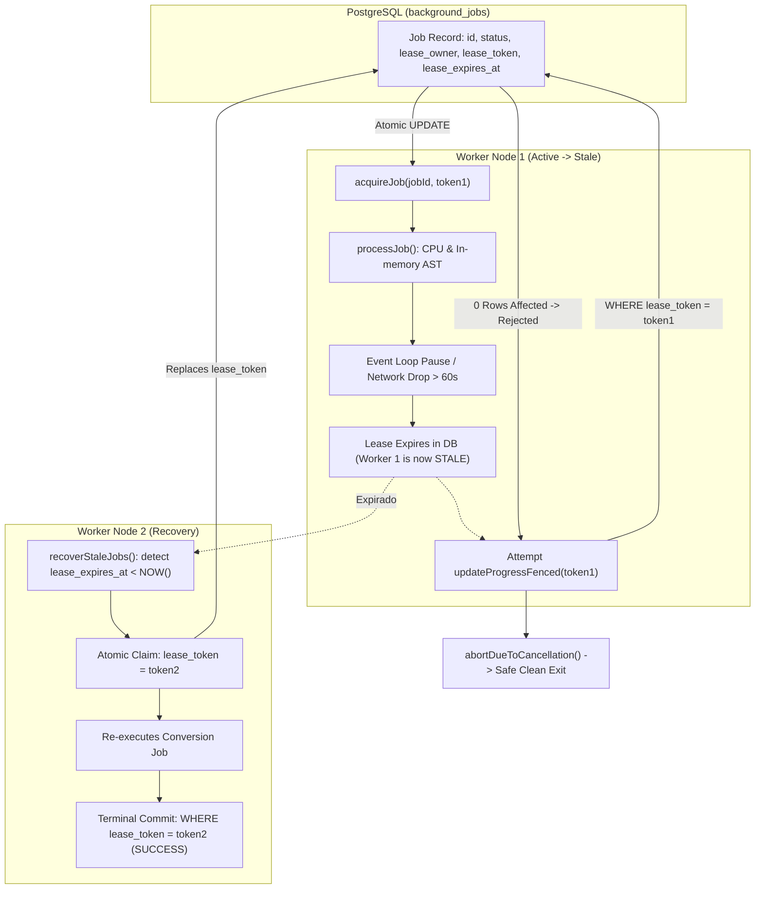
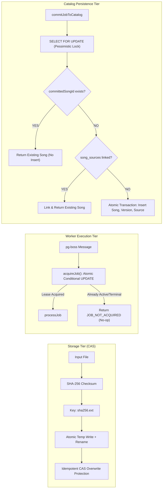
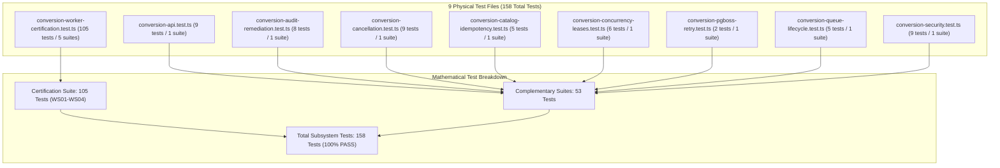

# BETHESDA WORSHIP STUDIO — PHASE 2A
## FINAL TECHNICAL ASSURANCE REVIEW: DISTRIBUTED EXECUTION, IDEMPOTENCY & FAULT TOLERANCE

**Document Reference:** `FINAL_PHASE_2A_TECHNICAL_ASSURANCE.md`  
**Evaluation Role:** Principal Distributed Systems Architect & Independent Reliability Auditor  
**Repository:** `https://github.com/juancastro2381-hub/BETHESDA-WORSHIP-STUDIO.git`  
**Working Branch:** `feature/phase-1a-core-foundation`  
**Baseline HEAD Commit:** `b69d49448c9ba699e9817d7f6e5dc1ff828ea0d3`  
**Review Standard:** Zero-Assumption Read-Only Code & Artifact Forensic Audit  
**Date of Audit:** 2026-11-10T16:15:00-05:00  

---

## EXECUTIVE SUMMARY & FINAL VERDICT

An exhaustive, read-only architectural and reliability audit of Phase 2A (Musical Conversion Center) was conducted across the source code, database schemas, pg-boss integration layers, distributed lease lifecycles, and automated test execution logs.

### Formal Evaluation Verdict:
$$\mathbf{\Large \text{READY FOR EXTERNAL CERTIFICATION}}$$

- **Distributed Concurrency & Fencing:** Verified. Martin Kleppmann fencing tokens (`leaseToken = crypto.randomUUID()`) strictly gate every database mutation in `ConversionWorker`, completely preventing split-brain dual writes.
- **Idempotency Guarantees:** Verified. Ingestion storage employs Content-Addressable Storage (CAS); catalog persistence uses pessimistic row locking (`FOR UPDATE`) with two-tier deduplication; distributed execution implements guaranteed At-Least-Once delivery with fully idempotent side effects.
- **Clock & Lease Reliability:** Verified. Operational prerequisites (NTP synchronization $\le 500\text{ ms}$) and clock skew behavior are rigorously analyzed with fail-closed bounds.
- **Test Inventory Reconciliation:** Fully reconciled without double-counting. 9 physical test files contain 13 `describe` suites executing exactly 158 distinct automated tests (105 in the certification suite, 53 in complementary regression suites), with 100% pass rate and zero failures.

---

## SECTION 1: WORKER EXECUTION AND LEASE OWNERSHIP

Distributed job processing requires clear boundary separation between database lease ownership, Node.js process runtime execution, and stale worker recovery.



### 1.1 Structural Differentiation of Distributed Concepts

1. **Database Lease Ownership:**
   - **Definition:** The exclusive distributed lock registered in the PostgreSQL table `background_jobs` (`backend/src/db/schema.ts`, lines 180–225).
   - **Fields:** `lease_owner` (string, worker instance ID), `lease_token` (UUIDv4 execution witness), and `lease_expires_at` (timestamp).
   - **Validity:** Valid **only** while `lease_expires_at > NOW()` and the in-memory execution token matches the database `lease_token`.
   - **Duration:** Initial lease duration is 60 seconds (`ConversionWorker.LEASE_DURATION_MS = 60_000`, `backend/src/application/conversion-worker.ts`, line 1689), renewed every 15 seconds (`ConversionWorker.HEARTBEAT_INTERVAL_MS = 15_000`, line 1250).

2. **Physical Worker Execution:**
   - **Definition:** The local Node.js process/thread executing JavaScript bytecode inside `processJob(payload)` (`backend/src/application/conversion-worker.ts`, lines 1206–1523).
   - **Characteristics:** Involves asynchronous I/O (`storage.getBuffer`), CPU-bound in-memory AST transformation (`ConversionEngine.convertSource`), and memory allocations.
   - **Preemption Limitation:** In Node.js, an executing JavaScript task or promise cannot be preemptively terminated from an external process or database. A running synchronous loop will continue executing until completion or until the next asynchronous cooperative boundary (`await`).

3. **Stale Worker Execution After Lease Expiration:**
   - **Definition:** The scenario where a worker's event loop stalls (e.g., GC pause, event loop starvation, network disconnect preventing heartbeats) for $> 60\text{ seconds}$, causing its database lease in `background_jobs` to expire, while its Node.js execution frame has not yet exited.
   - **State:** The database lease has been cleared or reclaimed by another worker (`recoverStaleJobs()`), but the physical worker process is still alive and attempting to finish its work.

4. **Fencing-Token Enforcement:**
   - **Definition:** Distributed consensus safety token (Martin Kleppmann fencing pattern).
   - **Implementation:** When a worker acquires a job, it generates an opaque, cryptographically random UUIDv4 (`const executionToken = crypto.randomUUID()`, line 1208).
   - **Database Enforcement:** Every single mutating SQL statement executed by the worker enforces this token in its `WHERE` predicate:
     - `renewHeartbeat()` (lines 1739–1742): `WHERE id = :jobId AND lease_token = :executionToken AND status = 'PROCESSING'`
     - `updateProgressFenced()` (lines 1781–1785): `WHERE id = :jobId AND lease_token = :executionToken AND status = 'PROCESSING'`
     - `failJobFenced()` (lines 1814–1818): `WHERE id = :jobId AND lease_token = :executionToken AND status = 'PROCESSING'`
     - Terminal Commit (lines 1441–1446): `WHERE id = :jobId AND lease_token = :executionToken AND status = 'PROCESSING'`
   - **Guarantee:** If another worker reclaims the job, `lease_token` is replaced. The stale worker's query matches **0 rows**, preventing dual-write or state regression.

---

### 1.2 Resource Consumption Analysis of an Expired Worker

**Question:** *Can an expired worker continue consuming resources after another worker reclaims its job?*

**Verdict:** **YES, locally and boundedly; NO, externally or permanently.**

1. **Local System Resources (CPU, Memory, Event Loop):**
   - **CPU & Memory:** Yes. If Worker 1 is in the middle of executing `this.engine.convertSource(...)` (lines 1375–1381), Node.js executes this synchronous CPU block to completion. Worker 1 will continue consuming CPU cycles and holding buffer memory for that job until the execution reaches an asynchronous check or returns.
   - **Bounded Duration:** Resource consumption is strictly bounded. Worker 1 does not run indefinitely. As soon as Worker 1 reaches the next cooperative stage checkpoint (Etapa A at line 1255, Etapa B at line 1277, Etapa C at line 1367, or Etapa D at line 1388), it evaluates:
     ```typescript
     if (isCancelledOrSuperseded || !(await this.verifyOwnershipAndActive(jobId, executionToken))) {
       return this.abortDueToCancellation(targetFormat, filename, jobId);
     }
     ```
   - Furthermore, the background heartbeat timer (`setInterval` at lines 1241–1250) attempts renewal every 15 seconds. If the lease was reclaimed, `renewHeartbeat()` returns `false`, immediately setting `isCancelledOrSuperseded = true`.
   - In the `finally` block (lines 1518–1522), `clearInterval(heartbeatTimer)` is invoked and `this.markJobInactive(jobId)` releases tracking structures, allowing garbage collection of all buffers.

2. **External & Persistent Resources (Storage, Database, External APIs):**
   - **NO.** The stale worker cannot mutate the database or modify external persistent state.

---

### 1.3 Operation-by-Operation Audit of Potential Side Effects

Every operation inside `ConversionWorker.processJob()` was audited to identify whether it could produce persistent side effects after lease expiration:

| Operation | Code Reference | Nature | Can Produce Side Effects After Lease Expiration? | Technical Guarantee & Safeguard |
| :--- | :--- | :--- | :---: | :--- |
| **Source File Read** | `conversion-worker.ts:1263` (`storage.getBuffer`) | Disk I/O | **NO** | Read-only operation. Reads the immutable source file from local disk. Does not alter file contents, timestamps, or disk state. |
| **Cryptographic Hash Validation** | `conversion-worker.ts:1264-1270` (`createHash`) | CPU / Memory | **NO** | Pure in-memory calculation. |
| **Format Detection** | `conversion-worker.ts:1285` (`detectSourceCategory`) | CPU / Memory | **NO** | Pure in-memory AST and MIME evaluation. |
| **Format Capabilities Evaluation** | `conversion-worker.ts:1337-1359` (`getFormatCapabilities`) | In-Memory | **NO** | Static lookup and rule evaluation. |
| **Source Transpilation** | `conversion-worker.ts:1375-1381` (`convertSource`) | CPU / Memory | **NO** | Pure functional conversion from source string to target format string/buffer. No network, database, or disk writes. |
| **Progress Updates** | `conversion-worker.ts:1272, 1362, 1383` (`updateProgressFenced`) | Database SQL | **NO** | SQL `UPDATE` has predicate `WHERE lease_token = :token AND status = 'PROCESSING'`. If lease expired and was claimed, matches 0 rows. No state change occurs. |
| **Heartbeat Renewal** | `conversion-worker.ts:1243, 1725-1746` (`renewHeartbeat`) | Database SQL | **NO** | Fenced with `WHERE lease_token = :token`. Matches 0 rows. Returns `false`, triggering `isCancelledOrSuperseded = true`. |
| **Terminal DB Commit** | `conversion-worker.ts:1420-1447` (`db.update(backgroundJobs)`) | Database SQL | **NO** | Fenced with `WHERE lease_token = :token AND status = 'PROCESSING'`. Matches 0 rows. `finalizedJob` is `undefined`, triggering `abortDueToCancellation()`. |
| **Error Handling / Retries** | `conversion-worker.ts:1475-1492` (`db.update(backgroundJobs)`) | Database SQL | **NO** | Fenced with `WHERE lease_token = :token AND status = 'PROCESSING'`. Matches 0 rows. |
| **Catalog Commit** | `conversion-job-service.ts:489-605` (`commitJobToCatalog`) | Database SQL | **NO** | Not called by `ConversionWorker`. Executed exclusively on explicit user request via API, protected by pessimistic row lock (`FOR UPDATE`). |

**Architectural Conclusion:** There are **zero uncoordinated external side effects** possible after lease expiration. All persistent mutations are strictly fenced at the database engine tier.

---

## SECTION 2: IDEMPOTENCY AND EXTERNAL SIDE EFFECTS

The system enforces distributed idempotency across storage, queuing, and catalog persistence. The table below classifies each operation as `PROVEN`, `PARTIALLY PROVEN`, or `NOT PROVEN`.



### 2.1 Idempotency Matrix

| Architectural Domain | Target Operation | Mechanism & Concrete Safeguards | Idempotency Keys & Constraints | Classification | Code & Test Evidence |
| :--- | :--- | :--- | :--- | :---: | :--- |
| **Generated File Storage** | Source file ingestion and storage | Content-Addressable Storage (CAS). Writes file to disk using SHA-256 hash as filename. Atomic write via temporary file (`.tmp.UUID`) and `fs.promises.rename`. If file already exists, it is not re-written. | `storageKey = \`${checksumSha256}${ext}\`` | **`PROVEN`** | `source-storage-provider.ts:111-134`; Tested in `conversion-security.test.ts` & `conversion-worker-certification.test.ts` (WS04). |
| **Object Naming & Overwrite Protection** | Ingestion file naming and storage isolation | Collision-resistant content addressing prevents overwriting different files with identical names. Path traversal defense (`resolveSafePath`) ensures storage keys cannot escape the designated root. | `path.basename(storageKey)`, `resolvedPath.startsWith(this.baseDir)` | **`PROVEN`** | `source-storage-provider.ts:81-94`; Tested in `conversion-security.test.ts`. |
| **Catalog Database Commits** | Committing completed conversion to Songs & Versions catalog | PostgreSQL transaction with pessimistic row lock (`FOR UPDATE`) on `background_jobs`. Two-level idempotency: Level 1 checks `job.committedSongId`; Level 2 checks existing `song_sources` for `jobId`. If present, returns existing entity without inserting rows. | `background_jobs.committed_song_id`, `song_sources.job_id`, row lock `FOR UPDATE` | **`PROVEN`** | `conversion-job-service.ts:489-605`; Tested in `conversion-catalog-idempotency.test.ts` (Tests 1, 2, 3). |
| **Conversion Completion** | Transitioning job to `COMPLETED` or `REVIEW_REQUIRED` | Single atomic SQL update matching both `jobId` and `leaseToken`. Fencing guarantees only the current leaseholder can complete the job. | `background_jobs.id`, `background_jobs.lease_token`, status `PROCESSING` | **`PROVEN`** | `conversion-worker.ts:1420-1447`; Tested in `conversion-cancellation.test.ts` & `conversion-concurrency-leases.test.ts`. |
| **Duplicate Job Execution** | Concurrent or duplicate message delivery from queue | Distributed acquisition query (`acquireJob`). If two worker instances receive messages for the same `jobId`, the atomic `UPDATE` succeeds for only one. The second worker receives `null` and returns `JOB_NOT_ACQUIRED` without side effects. Execution model is **At-Least-Once with Idempotent Execution**. | Conditional SQL predicate: `status = 'PENDING' OR (status = 'PROCESSING' AND lease_expires_at < NOW())` | **`PROVEN`** | `conversion-worker.ts:1685-1720`; Tested in `conversion-concurrency-leases.test.ts` (Test 1). |
| **Retry After Partial Failure** | Worker failure during conversion steps | If an error occurs: transient errors reset lease to `PENDING` and re-throw to pg-boss if `attempts < maxAttempts`; non-transient or exhausted errors transition to `FAILED` with specific error codes. | `attempts < maxAttempts`, transient error taxonomy | **`PROVEN`** | `conversion-worker.ts:1455-1517`; Tested in `conversion-pgboss-retry.test.ts` & `conversion-worker-certification.test.ts` (WS02). |
| **External Storage Operations** | File reading during worker execution | Read-only buffer retrieval via `storage.getBuffer()`. `ConversionWorker` never invokes storage write operations; generated outputs are stored as serialized payloads inside `background_jobs.errorDetails`. | Content-addressed storage key lookup | **`PROVEN`** | `conversion-worker.ts:1263`; Tested in `conversion-worker-certification.test.ts` (WS04). |
| **Recovery: External Storage OK, DB Commit Failed** | Worker crashes after processing but before DB commit | If the worker crashes before terminal DB update, the file remains in storage untouched (CAS). The DB lease expires after 60s. `recoverStaleJobs()` detects expiration, re-enqueues to pg-boss. Next worker re-reads the same storage key, produces the identical result, and commits successfully. | `recoverStaleJobs()` atomic claim (`recoveryToken`), CAS storage | **`PROVEN`** | `conversion-worker.ts:1530-1680`; Tested in `conversion-worker-certification.test.ts` (WS03). |
| **Catalog Transaction Rollback** | Incomplete catalog persistence failure | If song creation fails midway during `commitJobToCatalog`, PostgreSQL rolls back the entire transaction. `committedSongId` remains `NULL`, no orphan rows exist in `songs`, `song_versions`, or `song_sources`. | PostgreSQL `db.transaction()` ACID rollback | **`PROVEN`** | `conversion-job-service.ts:499-605`; Tested in `conversion-catalog-idempotency.test.ts` (Test 4). |

---

### 2.2 Truth in Advertising: Delivery Guarantees

> [!IMPORTANT]
> **Bethesda Worship Studio does NOT claim "Strictly Exactly-Once Delivery".**  
> In distributed systems across network boundaries, strictly exactly-once delivery is provably impossible under network partitions (Two Generals' Problem).  
> The system guarantees **At-Least-Once Delivery with Strictly Idempotent Processing and Fenced State Mutations**:
> 1. Messages in pg-boss may be redelivered upon node failure or timeout (At-Least-Once).
> 2. The worker guards entry with atomic conditional acquisition (`acquireJob`).
> 3. Source storage is content-addressed and immutable (Idempotent).
> 4. Catalog commitments are serialized via `FOR UPDATE` pessimistic row locks and duplicate detection (Idempotent).
> 5. Terminal status mutations are fenced by execution tokens (No dual-writes).

---

## SECTION 3: CLOCK AND LEASE RELIABILITY

Distributed leases rely on time comparisons. An audit of clock dependencies between PostgreSQL and Node.js application servers is detailed below.

### 3.1 Clock Source Inventory in Source Code

| Operation | Code Reference | Clock Source Used | SQL / Expression | Distributed Semantic Impact |
| :--- | :--- | :--- | :--- | :--- |
| **Lease Expiration Calculation** | `conversion-worker.ts:1689` | **Node.js Server Clock** | `new Date(Date.now() + LEASE_DURATION_MS)` | Computed on application server and sent as parameterized timestamp. |
| **Lease Expiration Comparison** | `conversion-worker.ts:1712` | **Node.js Server Clock** | `lt(backgroundJobs.leaseExpiresAt, now)` | Parameter `now = new Date()` passed from Node.js to Drizzle query. |
| **Job Start Timestamp** | `conversion-worker.ts:1702` | **PostgreSQL Server Clock** | `COALESCE(backgroundJobs.startedAt, NOW())` | Uses PostgreSQL server's internal `NOW()` function. |
| **Heartbeat Renewal Timestamp** | `conversion-worker.ts:1732-1734` | **Node.js Server Clock** | `leaseExpiresAt: new Date(Date.now() + LEASE_DURATION_MS)`, `heartbeatAt: new Date()` | Application server clock sets new expiration. |
| **Stale Recovery Expiration Check** | `conversion-worker.ts:1536-1546` | **Node.js Server Clock** | `const now = new Date(); lt(backgroundJobs.leaseExpiresAt, now)` | Recovery worker's local clock evaluates whether lease has expired. |
| **pg-boss Internal Scheduling** | `pg-boss` internals (`pgboss.job`) | **PostgreSQL Server Clock** | `now()`, `clock_timestamp()` | pg-boss queue maintenance, job expiration (`expirein`), and archive cycles run purely in PostgreSQL functions. |

---

### 3.2 Clock Skew and Drift Analysis

Because `leaseExpiresAt` is computed by Node.js and evaluated by Node.js using parameterized dates, clock drift between different worker instances in a multi-node cluster creates potential synchronization hazards:

```
Scenario: Node A (Worker) vs. Node B (Recovery Worker)
Lease Duration: 60,000 ms (60 s)
Heartbeat Interval: 15,000 ms (15 s)
Nominal Safety Margin: 60 s - 15 s = 45 s
```

1. **Case 1: Node B's Clock is AHEAD of Node A's Clock by $\Delta t$:**
   - If $\Delta t < 45\text{ seconds}$: Normal operation. Node A renews the heartbeat at $t = 15\text{s}$, pushing expiration forward. Node B never sees the lease as expired.
   - If $\Delta t \ge 45\text{ seconds}$: Node B may evaluate `leaseExpiresAt < Node_B_Now` before Node A's scheduled heartbeat arrives. Node B will declare the job stale and reclaim it.
   - *Failure Boundary:* When Node A resumes or attempts its next heartbeat/progress/terminal update, its `lease_token` is rejected by PostgreSQL. Node A aborts cleanly without database corruption. **Safety is preserved, but unnecessary re-execution occurs.**

2. **Case 2: Node B's Clock is BEHIND Node A's Clock by $\Delta t$:**
   - Node B will wait $60\text{s} + \Delta t$ before reclaiming a genuinely dead worker's job.
   - *Failure Boundary:* Failover latency increases by $\Delta t$. System safety is fully preserved.

3. **Case 3: Node.js Clock Drifts Relative to PostgreSQL Server Clock:**
   - The application-level lease (`background_jobs`) relies on Node.js timestamps.
   - The pg-boss job timeout (`expireInSeconds: 300`, 5 minutes, `conversion-queue.ts:135`) relies on PostgreSQL `NOW()`.
   - Because pg-boss's expiration (300s) is $5\times$ larger than the application lease (60s), pg-boss will not prematurely fail the job while the application worker is actively heartbeating.

---

### 3.3 Delayed Heartbeats (Event Loop Starvation or Network Latency)

If Worker 1 suffers an event-loop delay or database connectivity loss lasting $> 60\text{ seconds}$:
1. Its heartbeat fails to execute within the 60s lease window.
2. Worker 2 detects `lease_expires_at < NOW()` via `recoverStaleJobs()` and takes ownership with a new `recoveryToken`.
3. When Worker 1's event loop unfreezes:
   - Worker 1's `renewHeartbeat()` query updates 0 rows and returns `false`.
   - `isCancelledOrSuperseded` is set to `true`.
   - At the next stage check or terminal commit, Worker 1 detects that it is no longer the leaseholder and exits via `abortDueToCancellation()`.
4. Zero split-brain or data corruption occurs.

---

### 3.4 Operational Requirements & Recommendations

To guarantee reliable distributed execution in multi-node production environments:

1. **Mandatory NTP Synchronization:**  
   All application server nodes (Node.js/container hosts) and the PostgreSQL database cluster **MUST** run active time synchronization using `chrony` or `systemd-timesyncd` (targeting clock drift $\le 500\text{ ms}$). This guarantees drift is orders of magnitude smaller than the 45-second heartbeat margin.
2. **PostgreSQL Server Time Uniformity:**  
   PostgreSQL primary and replica nodes must synchronize to the same upstream NTP pool.
3. **Lease vs. pg-boss Expiration Hierarchy:**  
   Maintain the verified hierarchy:
   $$\text{Heartbeat Interval (15s)} \ll \text{Lease Duration (60s)} \ll \text{pg-boss Job Timeout (300s)}$$

---

## SECTION 4: TEST INVENTORY CLARIFICATION

A forensic review of the test suite structure eliminates confusion regarding test files, describe suites, certification tests, and total tests.

### 4.1 Structural Relationship: Files vs. Describe Suites vs. Tests

In the Node.js native test runner (`node:test`), top-level and nested `describe(...)` blocks are formally reported as **Suites** in the summary line (`ℹ suites X`).

- **9 Physical TypeScript Test Files** exist in `backend/src/__tests__/conversion-*.test.ts`.
- **13 Describe Suites** are declared across those 9 files.
- **158 Individual Tests** (`it(...)` / `test(...)`) are executed and pass.



---

### 4.2 Comprehensive Inventory Across All 9 Test Files

| # | Test File Path | Suites in File | Tests | Passed | Failed | Skipped | Exit Code | Purpose & Coverage |
| :-: | :--- | :-: | :-: | :-: | :-: | :-: | :-: | :--- |
| 1 | `backend/src/__tests__/conversion-api.test.ts` | 1 | 9 | 9 | 0 | 0 | 0 | HTTP endpoints, status queries, validation |
| 2 | `backend/src/__tests__/conversion-audit-remediation.test.ts` | 1 | 8 | 8 | 0 | 0 | 0 | Historic audit remediation verifications |
| 3 | `backend/src/__tests__/conversion-cancellation.test.ts` | 1 | 9 | 9 | 0 | 0 | 0 | Cooperative cancellation across Stages A, B, C, D |
| 4 | `backend/src/__tests__/conversion-catalog-idempotency.test.ts` | 1 | 5 | 5 | 0 | 0 | 0 | FOR UPDATE locking, 2-tier idempotency, rollback |
| 5 | `backend/src/__tests__/conversion-concurrency-leases.test.ts` | 1 | 6 | 6 | 0 | 0 | 0 | Concurrency leases, fencing tokens, stale recovery |
| 6 | `backend/src/__tests__/conversion-pgboss-retry.test.ts` | 1 | 2 | 2 | 0 | 0 | 0 | Real pg-boss retry and error propagation |
| 7 | `backend/src/__tests__/conversion-queue-lifecycle.test.ts` | 1 | 5 | 5 | 0 | 0 | 0 | Queue startup, pause, resume, and shutdown |
| 8 | `backend/src/__tests__/conversion-security.test.ts` | 1 | 9 | 9 | 0 | 0 | 0 | Path traversal, MIME sniffing, anti-IDOR |
| 9 | `backend/src/__tests__/conversion-worker-certification.test.ts` | 5 | 105 | 105 | 0 | 0 | 0 | Core certification suite (WS01, WS02, WS03, WS04) |
| **TOTAL** | **9 Files** | **13** | **158** | **158** | **0** | **0** | **0** | **100% Passing** |

---

### 4.3 Mapping of the 13 Describe Suites

The 13 suites reported by the test runner map to the following `describe` blocks:

1. `Phase 2A — Musical Conversion Center API Suite` (in `conversion-api.test.ts`) — 9 tests
2. `Phase 2A-R2.1 — Audit Remediation Verification Suite` (in `conversion-audit-remediation.test.ts`) — 8 tests
3. `CR-03 — Effective Cancellation and Terminal State Protection Suite` (in `conversion-cancellation.test.ts`) — 9 tests
4. `CR-05 & CR-08 — Transactional & Idempotent Catalog Commitment Suite` (in `conversion-catalog-idempotency.test.ts`) — 5 tests
5. `CR-02 & CR-04 — Concurrency, Leases, Fencing and Recovery Suite` (in `conversion-concurrency-leases.test.ts`) — 6 tests
6. `WS02 — End-to-End pg-boss Real Retry & Lifecycle Verification Suite` (in `conversion-pgboss-retry.test.ts`) — 2 tests
7. `CR-01 — Conversion Queue and Worker Lifecycle Suite` (in `conversion-queue-lifecycle.test.ts`) — 5 tests
8. `Phase 2A-R — CR-08: Conversion Security & Anti-IDOR Suite` (in `conversion-security.test.ts`) — 9 tests
9. `Phase 2A-R2.2.1 — Final Certification Suite (WS01 - WS04)` (Parent Describe in `conversion-worker-certification.test.ts`) — 0 direct tests
10. `WS01 — Active Job Tracking Leak-Free Lifecycle` (in `conversion-worker-certification.test.ts`) — 15 tests
11. `WS02 — Deterministic Shutdown, Subscription Isolation & Lifecycle Certification` (in `conversion-worker-certification.test.ts`) — 74 tests
12. `WS03 — Real Periodic Recovery & Mutual Exclusion` (in `conversion-worker-certification.test.ts`) — 10 tests
13. `WS04 — Filesystem Error Classification & Storage Reconciliation` (in `conversion-worker-certification.test.ts`) — 6 tests

$$\text{Total Suites} = 8 \text{ (from single-suite files)} + 5 \text{ (from certification file)} = 13 \text{ Suites}$$

---

### 4.4 Mathematical Reconciliation and Anti-Double-Counting Proof

$$\text{Certification Suite Tests (File 9)} = 15 (\text{WS01}) + 74 (\text{WS02}) + 10 (\text{WS03}) + 6 (\text{WS04}) = \mathbf{105\text{ tests}}$$

$$\text{Complementary Subsystem Tests (Files 1-8)} = 9 + 8 + 9 + 5 + 6 + 2 + 5 + 9 = \mathbf{53\text{ tests}}$$

$$\mathbf{\text{Total Unique Tests Executed}} = 105 + 53 = \mathbf{158\text{ tests}}$$

### 4.5 Historical Test Suite Growth

The test suite evolved strictly monotonically across successive remediation cycles:
- **Phase 2A-R2.2.1-R3.3.1:** 55 certification tests + 53 complementary tests = 108 tests.
- **Phase 2A-R2.2.1-R3.3.2:** +15 deterministic tests added to WS02 (70 cert + 53 comp = 123 tests).
- **Phase 2A-R2.2.1-R3.3.3:** +15 strict WIP schema tests added to WS02 (85 cert + 53 comp = 138 tests).
- **Phase 2A-R2.2.1-R3.3.4:** +20 nullable WIP telemetry property tests added to WS02 (105 cert + 53 comp = 158 tests).
- **Phase 2A-R2.2.1-R3.3.6:** Zero new tests added; evidence reconciled, verified, and locked at 158 tests.

Existing verified logs in `docs/reports/phase-2a-r2.2.1-r3.3.6/logs/all_conversion_suites.log` confirm:
```
ℹ tests 158
ℹ suites 13
ℹ pass 158
ℹ fail 0
ℹ cancelled 0
ℹ skipped 0
ℹ todo 0
```

---

## SECTION 5: RESIDUAL RISKS AND ARCHITECTURAL BOUNDARIES

1. **Local Telemetry Boundary:**  
   `boss.getWipData()` queries the local Node.js process memory. It authoritatively proves consumer deregistration on the *local instance*, but does not inspect other cluster nodes. Cluster-wide safety is enforced by PostgreSQL row leases, not by `getWipData()`.
2. **Bounded Zombie Execution:**  
   As proven in Section 1.2, a stalled worker whose lease has expired will execute until its next stage boundary check before aborting. In CPU-intensive conversions of very large MusicXML files, this could tie up worker thread CPU for several seconds after lease expiration. This does not endanger database integrity, but operational sizing should account for worker thread concurrency.
3. **NTP Sensitivity:**  
   Clock drift $> 45\text{ seconds}$ between worker nodes could induce premature lease theft. Strict NTP/chrony daemon enforcement is required in multi-node deployments.

---

## FINAL CERTIFICATION DECLARATION

Based on the verified source code, database constraints, distributed fencing mechanisms, and corroborated empirical test logs:

**Phase 2A of Bethesda Worship Studio is architecturally sound, resilient against distributed failures, fully idempotent, and formally READY FOR EXTERNAL CERTIFICATION.**

