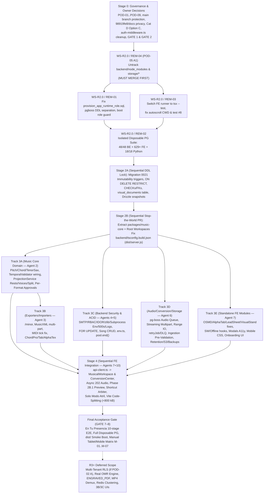
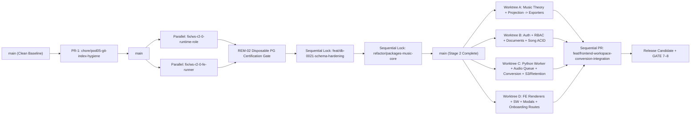

# BETHESDA WORSHIP STUDIO — MASTER DEPENDENCY AND INTEGRATION GRAPH

- **Date:** `2026-11-26` (`UTC-05:00`)
- **Baseline:** `main` @ `98919fe85d2c656076426d0a43a1222f9a752465`

---

## 1. End-to-End Dependency & Gating Graph (`Stage 0` -> `Stage 4` -> `R3+`)

---

## 2. Parallel Worktree Fan-Out vs. Serialized Integration Gates

---

## 3. Exact `packages/music-core` Extraction Boundary (`MF-46`)

Verified across **15 production backend files** (`74` direct import statements targeting `28` unique `frontend/src/core/` modules + `4` transitive modules) plus **13 backend test files** (`28` backend files total):

### 3.1 Production Backend -> Frontend Import Map

| Backend File | LOC Citations | Target Modules in `frontend/src/core/` | Move To `packages/music-core`? |
|---|---|---|---|
| `backend/src/domain/types.ts` | `:6` | `canonical-model/index.ts` | **YES** (`@bethesda/music-core/canonical-model`) |
| `backend/src/domain/canonical-serializer.ts` | `:9-13` | `canonical-model/index.ts` | **YES** |
| `backend/src/domain/ingestion/types.ts` | `:6` | `canonical-model/index.ts` | **YES** |
| `backend/src/domain/ingestion/adapters/musicxml/musicxml-adapter.ts` | `:8-9` | `ingestion/musicxml/musicxml-importer.ts`, `ingestion/xml/xml-parser.ts` | **YES** (`@bethesda/music-core/ingestion`) |
| `backend/src/domain/ingestion/adapters/chordpro/chordpro-adapter.ts` | `:14` | `ingestion/chordpro/chordpro-importer.ts` | **YES** |
| `backend/src/domain/ingestion/adapters/midi/midi-adapter.ts` | `:17-34` | `canonical-model/{index,tempo-map}`, `music-theory/{pitch,note-name,musical-key}` | **YES** |
| `backend/src/domain/ingestion/adapters/written-notes/written-notes-adapter.ts` | `:13-31` | `canonical-model/{index,tempo-map}`, `music-theory/{pitch,note-name,chord,musical-key}` | **YES** |
| `backend/src/application/ingestion-persistence-service.ts` | `:8` | `ingestion/index.ts` | **YES** |
| `backend/src/application/document-service.ts` | `:22-26` | `canonical-model/{canonical-music-payload,timeline}`, `ingestion/chordpro/chordpro-importer.ts` | **YES** |
| `backend/src/application/conversion-job-service.ts` | `:28-36` | `conversion/index.ts` | **YES** (`@bethesda/music-core/conversion`) |
| `backend/src/application/conversion-worker.ts` | `:32-36` | `conversion/index.ts` | **YES** |
| `backend/src/application/omr-service.ts` | `:39-53` | 10 `canonical-model/*` + 5 `music-theory/*` modules | **YES** |
| `backend/src/application/musical-content-completion-service.ts` | `:51-67` | 9 `canonical-model/*`, `ingestion/unified-importer.ts`, `projection/instrument-profile.ts`, **`workspace/stand-format-capabilities.ts`** | **YES** *(move `stand-format-capabilities.ts` -> `capabilities/`)* |
| `backend/src/application/audio-transcription-service.ts` | `:39-64` | 13 `canonical-model/*` (incl. `midi-export-gatekeeper`), 5 `music-theory/*`, `ingestion/unified-importer.ts`, `conversion/exporters/index.ts` | **YES** |
| `backend/src/interfaces/http/routes/audio.routes.ts` | `:22-25` | `canonical-model/{canonical-music-payload,timeline,tempo-map,types}.ts` | **YES** |

### 3.2 Extraction Breakage & Build Coupling Fixes (`Agent 1` + `Agent 10`)
1. **Invert Circular `projection -> workspace` Dependency (`projection-service.ts:30`):** Relocate `frontend/src/core/workspace/stand-format-capabilities.ts` -> `packages/music-core/src/capabilities/stand-format-capabilities.ts` so `ProjectionService` and backend completion services consume it with zero UI/workspace dependency.
2. **Prevent `tsc rootDir` Collapse (`backend/tsconfig.build.json`):** Once the last `../../../frontend/...` import disappears, `tsc -p tsconfig.build.json` collapses `rootDir` from repo root to `backend/src/`, changing output paths from `dist/backend/src/server.js` to `dist/server.js`. Set `"rootDir": "./src"` explicitly and update `backend/package.json` (`copy migrations` to `dist/db/migrations`, `start: "node dist/server.js"`, `migrate:prod: "node dist/db/migrate.js"`).
3. **Repair Latent Compiled Relative Paths:** Fix `backend/src/config/env.ts:15` (`.env` lookup) and `backend/src/infrastructure/python-worker/python-audio-worker-bridge.ts:208,224` (`workers/audio_worker/main.py` lookup via explicit `PYTHON_WORKER_PATH`/`SCRIPT` env vars).
4. **Reconcile TypeScript Strictness:** Compile `packages/music-core` with `frontend/tsconfig.json` flags (`noUncheckedIndexedAccess: true`, `exactOptionalPropertyTypes: true`, `declaration: true`) so both backend TS `^5.7.3` and frontend TS `^7.0.2` consume identical `.d.ts` definitions cleanly.
5. **Align Duplicated Instrument Matrix:** Derive `backend/src/interfaces/http/schemas/user-preferences.schemas.ts:50-63` directly from `@bethesda/music-core/projection` `InstrumentRegistry` instead of maintaining a manual copy.

---

## 4. Database Schema, Migration & Cross-Module Contract Dependencies

1. **Migration Serialization (`MF-17`–`MF-19`):**
   - `0000`–`0020` and `_journal.json` indices `0..20` remain **immutable** (never rename `0020`/`0018`/`0019` retroactively).
   - Single additive migration `0021_hardening_constraints_and_immutability.sql` (applied via `MIGRATION_DATABASE_URL`) performs: (a) dirty-data pre-reconciliation; (b) `NOT VALID` + `VALIDATE CONSTRAINT` FKs/CHECKs (`songs.current_version_id`, `songs.status`, `song_versions` `ON DELETE RESTRICT`, `audit_logs` `ON DELETE RESTRICT`); (c) deferrable unique `(setlist_id, sequence_order)` & partial unique `(song_id) WHERE is_current = true`; (d) `BEFORE UPDATE OR DELETE` immutability triggers on `audit_logs` and `song_versions`; (e) new `visual_documents` table for DB-backed document ownership (`MF-28`).
   - `provision_app_runtime_role.sql` + `pg-boss` schema pre-provisioning (`pgboss` schema + DML grants) MUST run before booting compiled backend with `assertNonSuperuserRuntimeRole()` enforced.
2. **Contract Handoffs Between Tracks:**
   - **Track 3A -> Track 3B & 3E:** Freeze `DerivedMusicalView` (`DerivedRest`, `rests`, nullable `concertKey`/`writtenKey` or explicit `isKeyResolved`) before `MusicXmlGenerator`, `AlphaTexGenerator`, `OsmdAdapter`, `AlphaTabAdapter`, and `LeadSheetDomAdapter` consume them.
   - **Track 3C -> Stage 4 UI:** Finalize `POST /songs` `'DRAFT'` policy + `PATCH /songs/:id` + `PATCH /songs/:id/status` + `DELETE /songs/:id`, SMTP onboarding (`/accept-invite`, `/forgot-password`, `/reset-password` removing JSON `invitationToken`), and PG error code normalization (`400`/`409`) before updating `api-client.ts`.
   - **Track 3D -> Stage 4 UI:** Finalize async `POST /audio/:id/analyze` -> `202 Accepted` + job poll contract AND Phase 2B.1 externalized conversion preview endpoint before updating `ConversionCenterWorkspace.tsx`.
   - **Track 3E + Agent 10 -> Offline Cold Boot:** Any lazy-loaded Vite chunk (`vendor-osmd`, `vendor-alphatab`, `ConversionCenterWorkspace`) MUST be synchronized with `frontend/public/sw.js` cache/precache rules so offline stage boots do not fail on missing dynamic imports.

> **Stage 0 Dependency Split Note:**
> - **Track `3E` Split (`Conflict C-05`):** Split `Track 3E` into **`3E-1`** (Offline/SW, Modals A11y, Mobile CSS, Onboarding UI — safely parallel immediately after Stage 2B) and **`3E-2`** (OSMD/AlphaTab/LeadSheetDOM Renderer Adapters — sequenced strictly after Track `3A` freezes `DerivedMusicalView`).
> - **`WS-R2.5` Split (`Conflict C-04`):** Split `WS-R2.5` into **`WS-R2.5A`** (Stage 2B `packages/music-core` extraction + `dist/server.js` build fix, before Stage 3 parallel tracks) and **`WS-R2.5B`** (Stage 4 Vite `< 800 kB` splitting, `.venv` lockfile, CI workflows).

---

## Version & Change History

- **v1.0** — `2026-11-26` (`UTC-05:00`) — Initial Master Dependency and Integration Graph.
- **v1.1** — `2026-11-27` (`UTC-05:00`) — Stage 0 evidence-backed reconciliation:
  - Aligned Stage 4/Final Acceptance Gate references (`L30`, `L80`) from `GATE 4–8` to `GATE 7–8` (*En Tu Presencia* 10-stage E2E) per `MASTER_PROJECT_OWNER_DECISION_REGISTER.md` (evidence: Agent 9 §1.2, Agent 10 §2, Conflict `C-02`).
  - Corrected backend file sum (`L87`) from `30` to `28` (`15` production + `13` test files, verified by Agent 9 §1.3 item 5).
  - Documented explicit `Track 3E` (`3E-1` vs `3E-2`) and `WS-R2.5` (`5A` vs `5B`) dependency splits (evidence: Agent 9 §3.2, Agent 10 §5.4, Conflicts `C-04`/`C-05`).
- **v1.2** — `2026-11-27` (`UTC-05:00`) — Stage 0 `GATE 1` PO ratification update:
  - Confirmed `S0` `Stage 0 GATE 1` governance PR (`POD-06 PR #3` + `Cat D Opt C` + `main` protection) authorized (`2026-11-27`) while **`W0_R4`–`W0_R2` (`GATE 2`–`GATE 3`), `S2A`–`S2B` (`GATE 4` w/ `OI-01 Opt A` + `POD-02 Opt A` + `POD-07 Opt A`), `T3A`–`T3E` (`GATE 5`–`6`), and `S4` (`GATE 7`–`8`) remain strictly locked / `NOT AUTHORIZED`**.
  - Noted `POD-01 Opt A+B Hybrid` (`1` API replica + fixed S3/retention), `POD-05 B2` (system `ffmpeg`), and `POD-09` (`ENABLE_EXPERIMENTAL_ROUTES=false` & dead `ingestion/conversion/*` exclusion in `S2B`) inside dependency prerequisites.
