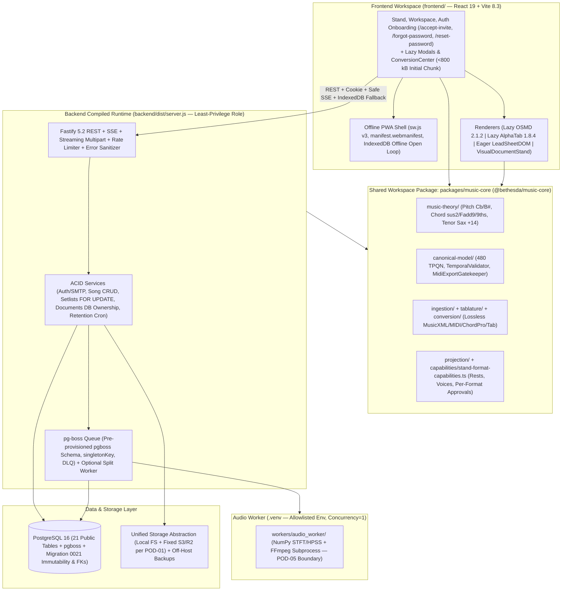

# BETHESDA WORSHIP STUDIO — MASTER MULTI-AGENT ARCHITECTURE AND EXECUTION PLAN

- **Date:** `2026-11-26` (`UTC-05:00`)
- **Repository:** `https://github.com/juancastro2381-hub/BETHESDA-WORSHIP-STUDIO.git` *(visibility: public)*
- **Authoritative Baseline Branch:** `main` (synced `0 0` with `origin/main`)
- **Authoritative HEAD SHA:** `98919fe85d2c656076426d0a43a1222f9a752465` (`CATEGORY D INDEPENDENT TRACEABILITY MATRIX AUDIT AND PROMOTION READINESS REVIEW`, `2026-11-24 20:46:54 -0500`)
- **HEAD Parent SHA:** `97d1546af599c75edaa0bfbbb7eba1d0be626635` (`Merge pull request #2`)
- **Scope & Authorization:** Architecture, multi-agent task decomposition, dependency sequencing, and governance planning ONLY. **`STAGE 0 GATE 1: PASS (VERIFIED 2026-11-27 — PR #3 OPEN, Ruleset #28275963 ACTIVE)` for governance/privacy PR `#3` and decision records ONLY.** **`GATE 2`–`GATE 8` and zero source, SQL, migration, config, dependency, or DB mutations remain STRICTLY `NOT AUTHORIZED`.**

---

## 1. Live Repository Baseline & Preflight Snapshot

Verified read-only on `2026-11-26T17:18:37-05:00`:

| Baseline Item | Verified State |
|---|---|
| **Active branch / Remote sync** | `main` (`0` ahead / `0` behind `origin/main`) |
| **Other remote/local branches** | `docs/git-governance-and-post-reversal-recovery` (`dd6da38c`, merged); `feature/phase-1a-core-foundation` (`efd1edc8`, `3` doc-only commits unique vs `main`, holds Category D blob `f6c03cc0`) |
| **Stale local remote-tracking ref** | `remotes/origin/revert-1-feature/phase-1a-core-foundation` (`766650ce`, deleted on GitHub; not pruned locally) |
| **Pre-existing working-tree diff** | `M backend/src/interfaces/http/middlewares/auth-middleware.ts` (`+1/-1`, line 23 `) {}` -> `) { }`, CRLF/whitespace recurrence of prior IDE anomaly; untouched) |
| **Untracked local artifacts prior to plan** | `BETHESDA_WORSHIP_STUDIO_COMPREHENSIVE_PRODUCT_AND_FUNCTIONAL_AUDIT.md`; `183` ignored filesystem entries; `0` staged; `0` stashes |
| **Tracked Git index bloat** | `7,367` tracked files in `backend/node_modules/` (`103.8 MiB`) and `223` tracked files in `backend/storage/` |
| **Governance & Decision State** | `POD-01`–`POD-09`, `OI-01`, and **`GATE 1: PASS (2026-11-27)`** (PR `#3` open, Ruleset `#28275963` active); **`GATE 2`–`GATE 8`** & `WS-R2.0`–`WS-R2.6` remain strictly **`[ ]` LOCKED / `NOT AUTHORIZED / NOT STARTED`** |

### Companion Master Deliverables
- `MASTER_FINDINGS_AND_ROOT_CAUSE_MATRIX.md` — 48 master findings (`MF-01`–`MF-48`) cross-mapped to historical `R2-F01`–`R2-F38` and `AUD-01`–`AUD-24`
- `MASTER_AGENT_RESPONSIBILITY_AND_FILE_OWNERSHIP_MATRIX.md` — 10 specialist charters, exclusive writable file sets, and 14 high-conflict shared files
- `MASTER_DEPENDENCY_AND_INTEGRATION_GRAPH.md` — Critical path, parallel worktree graph, `packages/music-core` extraction map, and API/DB handoffs
- `MASTER_TEST_AND_ACCEPTANCE_STRATEGY.md` — Live test baseline, 3-tier backend suite classification, 8 blind spots (`BS-01`–`BS-08`), *En Tu Presencia* 8-stage regression suite, disposable PG protocol, and manual stand acceptance matrix (`M-01`–`M-07`)
- `MASTER_RISK_AND_REGRESSION_REGISTER.md` — 20 technical, data-loss, security, and operational regression risks (`RR-01`–`RR-20`)
- `MASTER_PROJECT_OWNER_DECISION_REGISTER.md` — Consolidated decisions `POD-01`–`POD-09` and `OI-01` (`GATE 1 PASS`; `GATE 2`–`GATE 8` strictly `[ ]` LOCKED)

---

## 2. Multi-Agent Governance & Team Model

The **Principal Project Orchestrator** acts as the single engineering authority over architecture, invariant preservation, task allocation, worktree merges, dependency resolution, and acceptance recommendations. No specialist agent may unilaterally redefine shared contracts, relax canonical invariants, bypass PostgreSQL safety boundaries, or edit another agent's owned files.

### 2.1 The 10-Role Specialized Engineering Team

| # | Role | Primary Mission | Verification Mode |
|---|---|---|---|
| **1** | **Principal Software Architect** | Own cross-module boundaries, shared-file lock protocol, `packages/music-core` extraction boundary, API/SSE/IPC/`pg-boss` contracts, and execution wave sequencing. | Architecture & dependency audit |
| **2** | **Music Domain and Canonical Engine Specialist** | Remediate `music-theory`, `canonical-model` validation, `ProjectionService` (polyphonic rests/voices, transposition, capo, Piano Grand Staff split, Tenor Sax `+14`), zero-fabrication paths, and per-format stand approvals. | Deterministic unit & *En Tu Presencia* invariant checks |
| **3** | **MusicXML, MIDI, ChordPro and Tablature Specialist** | Fix `<backup>`/`<chord/>`/`<mode>minor</mode>`, multi-part MusicXML import/export, MIDI `measureStart + note.startTick` double-offset, Gatekeeper false-rejects, ChordPro minor keys/duplication, browser `.tab`, and `AlphaTexGenerator` `0.1` fabrication. | Lossless round-trip & binary SMF verification |
| **4** | **Backend and PostgreSQL Architect** | Deliver additive migration `0021`, immutability triggers (`audit_logs`, `song_versions`), `provision_app_runtime_role.sql` + `pgboss` pre-provisioning, ACID `tx` & `FOR UPDATE` locking, Song CRUD routes, `env.ts` / `server.ts` hardening, and PG SQLSTATE error mapping. | Disposable PG certification & `Promise.all` contention tests |
| **5** | **Application Security and Identity Specialist** | Eliminate invite-token leaks (`POD-04`), fix `accountStatus` hijacks & RBAC bypasses (`POD-03`), replace `DocumentService` RAM IDOR, add `zlib.inflateSync` zip-bomb bounds, sanitize worker subprocess env/logs/500s/SSE, and gate multi-tenancy (`POD-02`). | Security regression & negative RBAC/IDOR tests |
| **6** | **Audio Processing, Conversion and Storage Engineer** | Move audio DSP off HTTP onto `pg-boss`, add streaming multipart & O(range) Range reads, fix `listDraftsBySongId` full-table scan, repair `failJobFenced`/`retryJob`, fix `UniversalIngestionService` orphan+201 bug, wire `OutputRetentionService` & storage/backups (`POD-01`, `POD-05`). | Python `.venv` pytest, worker lifecycle & storage integrity tests |
| **7** | **Frontend, UX and Digital Music Stand Specialist** | Fix OSMD/AlphaTab/LeadSheetDOM/VisualDocumentStand adapters, Phase 2B.1 Conversion preview, `SourceFileUploader` persistence, preference/setlist key preservation, offline IndexedDB open loop, `sw.js`, shortcut arbiter, mobile bottom bars, A11y modals, and onboarding UI routes. | State/DOM unit tests + manual browser/tablet acceptance |
| **8** | **QA and Test Engineering Specialist** | Fix `npm --prefix frontend test` (`tsx --test`, CWD, test #8), classify/isolate backend Tier A/B/C tests, close `BS-01`–`BS-08`, build *En Tu Presencia* 8-stage E2E suite, govern disposable PG certification (`bethesda_worship_r2_cert_tmp`), and verify manual matrix `M-01`–`M-07`. | Reproducible CI/local test execution (zero Playwright/Selenium/Cypress) |
| **9** | **Independent Security and Code Auditor** | Continuously audit public-repo privacy leaks (`98919fe8`, `docs/`, Category D), GPLv3 `imageio-ffmpeg` boundaries (`POD-05`), orphaned/dead modules, `provenance.ts` weak hashing/fixed dates, and governance-vs-code parity. | Cross-check read-only verification |
| **10** | **Integration and Release Engineer** | Enforce `docs/governance/BETHESDA_WORSHIP_STUDIO_GIT_WORKFLOW_STANDARD.md`, manage external Windows/OneDrive-safe Git worktrees (`C:\dev\bws-wt\`), execute `POD-05 A1` index untrack, execute `packages/music-core` & `dist/` build split, Vite `< 800 kB` code splitting, `.venv` readiness, and `GATE 1`–`GATE 8` promotion/rollback controls. | Clean build, bundle budget & smoke verification |

---

## 3. Target Stabilization Architecture

### Key Target Architectural Corrections
1. **Eliminate Cross-Boundary Coupling (`packages/music-core`):** Extract pure ESM TypeScript (`music-theory`, `canonical-model`, `tablature`, `ingestion`, `conversion`, `projection`, and relocate `stand-format-capabilities.ts` out of `workspace/`) into `@bethesda/music-core` compiled cleanly under strict flags (`noUncheckedIndexedAccess`, `exactOptionalPropertyTypes`), fixing `backend/tsconfig.build.json` (`rootDir: "./src"`, `dist/server.js`), `env.ts` `.env` resolution, and Python bridge path resolution.
2. **True Polyphonic Musical Pipeline:** `DerivedMusicalView` preserves `Rest`s and filters/groups by `InstrumentTrack.voiceIds`; both `MusicXmlGenerator` (OSMD) and `CanonicalToMusicXmlSerializer` emit `<backup>`/`<chord/>`/`<mode>minor</mode>`; `RendererRegistry` routes non-tab `STANDARD_NOTATION` to OSMD (zero `0.1` fabrication); `CanonicalToMidiSerializer` uses song-absolute ticks with multi-track/tie-merge support.
3. **Hardened Auth, Least-Privilege DB & ACID Guarantees:** SMTP delivery (`POD-04`), sanitized 500/logs/subprocess env, PG-backed `DocumentService` ownership, strict `accountStatus` & `songs:approve` (`POD-03`) guards, additive migration `0021` (immutability triggers, `ON DELETE RESTRICT` on `song_versions`, `FOR UPDATE` locking, single-`tx` `commitJobToCatalog`), pre-provisioned `pgboss` schema, and wired `assertNonSuperuserRuntimeRole()`.
4. **Queued Audio & Unified Storage Lifecycle:** Move audio DSP off HTTP requests into `pg-boss` (`202 Accepted`), stream multipart uploads, drop per-range SHA-256 re-hashing, validate `UniversalIngestionService` inputs before writing disk/DB, repair `failJobFenced`/`retryJob`, schedule `OutputRetentionService`, and implement unified local/S3 storage + off-host backups per `POD-01`.
5. **Live-Stage UX, Offline Continuity & Bundle Budget:** Repair offline UI open loop + `sw.js`, fix `VisualDocumentStand:313` error UI, centralize keyboard shortcut arbitration (`Space`/Arrows/Modals), fix mobile `<=640px` bar overlap, expose solo `Modo Atril`/Zoom/High-Contrast, fix Phase 2B.1 Conversion preview, and code-split Vite renderers (`< 800 kB` initial chunk).

---

## 4. API, IPC, Queue and Data Contract Rules

- **REST Envelope & HTTP Safety:** Remove state-mutating `GET /api/v1/auth/refresh` (`POST` only); never return `invitationToken` in production JSON; validate all UUID path params (`:jobId`, `:setlistId`, etc.) via Zod; map PG SQLSTATEs (`22P02 -> 400`, `23503/23505 -> 409`, `23514/23502 -> 400`, `55000 -> 403/409`) cleanly without raw SQL in 500/503 responses.
- **Audio Analysis Contract Transition:** Migrating `POST /api/v1/audio/:id/analyze` from blocking `90s` HTTP `200/201` to queued `202 Accepted` + job polling must update `frontend/src/core/api/api-client.ts` and `ConversionCenterWorkspace.tsx` atomically.
- **Python IPC (`contractVersion: "1.0"`):** Preserve strict stdin/stdout JSON-lines schema, URI protocol blocking, and SHA-256 checks while passing **only an allowlisted environment** (excluding `DATABASE_URL`, `JWT_SECRET`, `COOKIE_SECRET`, `STORAGE_SIGNING_SECRET`, and bootstrap passwords) and failing closed in production when `.venv` dependencies are absent.
- **`pg-boss` Queue Contract:** Separate schema DDL into DBA/migration step (`MIGRATION_DATABASE_URL`), use `singletonKey` idempotency, configure DLQ (`deadLetter`), preserve immutable source metadata (`storageKey`, `checksumSha256`, `targetFormat`, `options`) across failure records, and reset `attempts = 0` on manual `retryJob()`.
- **SSE & Auth Tickets:** Restore CORS/Helmet headers on SSE responses (remove `reply.raw.writeHead` header stripping and `x-test-close`), verify live DB leadership role on host dispatch, and bind `StreamTicketService` invalidation to `tokenVersion` changes and logout/disable transitions.

---

## 5. Sequenced Multi-Agent Execution Plan

> **Governance Gate:** **NO workstream below is authorized today.** Every stage requires explicit Project Owner approval of its governing decisions and gate criteria.

### Stage 0 — Project Owner Governance, Privacy & Decision Gate *(Prerequisites — `GATE 1: PASS` `2026-11-27`)*
- **Owner Actions Ratified & Verified (`2026-11-27`):** `POD-01`–`POD-09` + `OI-01` formally approved (`A+B Hybrid`, `Opt A`, `Opt B`, `Opt C`, `A1/B2`, `PR #3 + Cat D Opt C`, `Opt A`, `Opt C`, `Defer R3+`, `OI-01 Opt A`); GitHub Ruleset `#28275963` (`BETHESDA - Protect Main`) verified ACTIVE on `main`; docs-only PR `#3` (`https://github.com/juancastro2381-hub/BETHESDA-WORSHIP-STUDIO/pull/3`: `98919fe8` + **`14`** pre-existing `docs/` local path leaks + Category D `Option C` + `Phase 2B.1` reconciliation + clean `auth-middleware.ts:23` LF restoration) verified OPEN / UNMERGED.
- **Execution Mode:** Documentation/Git-governance PR `#3` only (`0` app/SQL/`.gitattributes` changes), leaving `GATE 2` (`WS-R2.0`) strictly `NOT AUTHORIZED` until Project Owner merges PR `#3` and separately authorizes `GATE 2`.

### Stage 1 — `WS-R2.0`: Certification Baseline & Repository Hygiene *(First Technical Milestone)*
- **Tracks:** `REM-04` (`POD-05 A1` safe `git rm -r --cached backend/node_modules backend/storage/*` + `.gitignore` hardening — **merges first**), `REM-01` (`provision_app_runtime_role.sql` + `pgboss` DDL split + `assertNonSuperuserRuntimeRole()`), `REM-03` (`frontend/package.json` `tsx --test` + `autoscroll.test.ts` `import.meta.url` + test #8 alignment), and `REM-02` (disposable DB `bethesda_worship_r2_cert_tmp` executing all `48` backend PG suites including `105` conversion worker + `40` audio + `68` OMR tests).
- **Worktree Strategy:** Serial PR-1 (`REM-04` index hygiene) -> parallel `REM-01` & `REM-03` -> isolated PG gate `REM-02`.

### Stage 2 — Structural & Schema Serialization (`WS-R2.5 Core` + `WS-R2.3 Schema`)
- **Wave 2A (`0021` DB Schema & Error Mapper — Strictly Sequential):** Additive migration `0021` (immutability triggers on `audit_logs` & `song_versions`, `song_versions` `ON DELETE RESTRICT`, FKs/CHECKs via `NOT VALID` + `VALIDATE CONSTRAINT`, dirty-data pre-reconciliation), `drizzle.config.ts` fix, and `pg-error-mapper.ts`. *(Historical `0000`–`0020` tags and `_journal.json` indices stay untouched.)*
- **Wave 2B (`packages/music-core` Extraction — Stop-the-World Structural PR):** Root `package.json` workspaces + `packages/music-core` compilation + `backend/tsconfig.build.json` (`rootDir: "./src"`) + `env.ts`/`python-audio-worker-bridge.ts` path fixes + 30 cross-import rewrites. **Must merge before parallel Stage 3 worktrees begin** to avoid massive path-move conflicts.

### Stage 3 — Parallel Core Remediation Tracks *(Disjoint Isolated Worktrees outside OneDrive: `C:\dev\bws-wt\`)*
Once Stage 2 lands cleanly on `main`, these 5 tracks own disjoint files and run in parallel:
1. **Track 3A — Music Domain & Canonical Engine (`Agent 2`):** `Pitch`/`Chord`/Tenor Sax `+14`, `validator.ts`/`TemporalValidator`, `ProjectionService` (`Rest`s, track voice filtering, transposed `chordAbove` & Tab, Piano Grand Staff split, unresolved key preservation), `stand-format-capabilities.ts` per-format approval.
2. **Track 3B — Formats & Exporters (`Agent 3`):** Coordinated sequentially on shared `packages/music-core` after 3A's `DerivedMusicalView` interface freeze: `<backup>`/`<chord/>`/`<mode>minor</mode>` in `MusicXmlGenerator` & `MusicXmlSerializer`, multi-part/tie `MusicXmlImporter`, MIDI absolute ticks + gatekeeper tuning, ChordPro minor keys & deduplication, browser `.tab` `TextEncoder` + Capo Tab export, `AlphaTexGenerator` zero-`0.1` fix. *(Alternative: run 3A -> 3B as an ordered sub-chain inside one shared music-core worktree with strict per-file handoffs.)*
3. **Track 3C — Security, Identity, RBAC & Song CRUD (`Agent 4` + `Agent 5`):** Invite token removal + SMTP (`POD-04`), account lifecycle & `SUPER_ADMIN` protections, RBAC guards (`POD-03`), Song `PATCH`/`status`/`DELETE` routes + actor attribution, `DocumentService` PG ownership + `zlib` cap, subprocess env allowlist, HTTP 500/logs/SSE/rate-limit/env hardening, ACID `FOR UPDATE` locks (`AuthService`, `SetlistRepo`, `VersionRepo`, `WorshipService`), `pool.end()` shutdown.
4. **Track 3D — Audio Worker, Conversion Queue & Storage (`Agent 6`):** Python WebM + Viterbi/novelty sections, async `pg-boss` audio analysis + streaming multipart + Range I/O fix + `listDraftsBySongId` `WHERE`, `failJobFenced`/`retryJob`/DLQ/`singletonKey`, single-tx `commitJobToCatalog`, `UniversalIngestionService` validate-before-write + WEBP + `FormatCapabilities` parity, `OutputRetentionService` schedule/fixes, S3/local storage (`POD-01`) + backups.
5. **Track 3E — Standalone Frontend Modules (`Agent 7`):** Renderers (`RendererRegistry`, async `OsmdAdapter`, `AlphaTabAdapter` `staveProfile`, `LeadSheetDomAdapter`, `VisualDocumentStand:313`/TIFF/shortcuts), offline (`sw.js` `manifest.webmanifest` + 503 Response, `OfflineStatusBar`), A11y modal focus-trap hook, CSS mobile bottom-bars/print/reduced-motion, onboarding views (`/accept-invite`, `/forgot-password`, `/reset-password`).

### Stage 4 — Sequential UI Integration, Bundle Splitting & Final Certification (`WS-R2.6` + `GATE 7`–`GATE 8`)
- **Sequential UI Integration (`Agent 7` + `Agent 10`):** Refactor monolithic `api-client.ts`, `MusicalWorkspace.tsx`, and `ConversionCenterWorkspace.tsx` (sync -> `202` audio polling, Phase 2B.1 externalized preview + Stand button, solo `Modo Atril`, shortcut arbiter, preference stability, offline open callback, dynamic `import()` + Vite `manualChunks` `< 800 kB`).
- **Final Verification & Manual Acceptance Gate (`Agent 8` + `Agent 9` + Project Owner):** Execute full `En Tu Presencia` 10-stage regression suite, full disposable PostgreSQL certification across all 48+ backend suites under non-superuser role, Python `.venv` 18+ suite, clean `dist/` smoke boot, bundle budget verification, and Project Owner manual browser/mobile/music-stand acceptance (`M-01`–`M-07`) **without browser automation**.
- **`R3+` Deferred Scope:** Multi-tenancy (`POD-02` Option A selected — RLS deferred), real PDF/Image OMR engine (`R2-F30`), `ENGRAVED_PDF`, MP4/video extraction, Redis multi-replica state, and orphaned `Realtime 3B`/`Multitracks 3C` UI activation remain deferred unless explicitly authorized by the Project Owner.

---

## 6. Recommended First Authorized Milestone

1. **Completed Governance Step (`Stage 0 GATE 1: PASS`, Verified `2026-11-27`):** Project Owner ratified `POD-01`–`POD-09` + `OI-01`, enabled active GitHub Ruleset `#28275963` (`BETHESDA - Protect Main`), and opened PR `#3` (`https://github.com/juancastro2381-hub/BETHESDA-WORSHIP-STUDIO/pull/3`) with `98919fe8` + `14` `docs/` leaks sanitized, Category D `Option C`, and clean `auth-middleware.ts:23` parity (`post-merge` prune deferred until PR `#3` merge).
2. **Next Pending Milestone (`GATE 2` — `WS-R2.0` Controlled Certification Baseline — `NOT YET AUTHORIZED`):** Upon separate `GATE 2` signature after PR `#3` merges, authorize ONLY `REM-04` (`POD-05 A1` tracked bloat cleanup + `.gitattributes`), `REM-01` (least-privilege PostgreSQL role + `pgboss` separation + startup role check), `REM-03` (frontend `tsx --test` + `tsx` devDependency + CWD + test #8 alignment), and `REM-02` (isolated disposable `bethesda_worship_r2_cert_tmp` execution of all `48` backend test suites).

---

## Version & Change History

- **v1.0** — `2026-11-26` (`UTC-05:00`) — Initial Master Multi-Agent Architecture and Execution Plan.
- **v1.1** — `2026-11-27` (`UTC-05:00`) — Stage 0 evidence-backed reconciliation (`POD-01`–`POD-09`, `GIT_WORKFLOW_STANDARD.md` path, `GATE 7`–`GATE 8`, `POD-02 Option A`).
- **v1.2** — `2026-11-27` (`UTC-05:00`) — Recorded formal `2026-11-27` Project Owner approvals (`POD-01`–`POD-09` + `OI-01`, `STAGE 0 GATE 1 ONLY`), aligned `L125` leak count `13 -> 14`, and confirmed `GATE 2`–`GATE 8` & `WS-R2.0`–`WS-R2.6` remain strictly **`NOT AUTHORIZED`**.
- **v1.3** — `2026-11-27` (`UTC-05:00`) — Recorded independent **`GATE 1: PASS`** revalidation (PR `#3` open/unmerged; Ruleset `#28275963` `BETHESDA - Protect Main` active on `main`), fixed L32 companion note, and kept `GATE 2`–`GATE 8` strictly locked.
