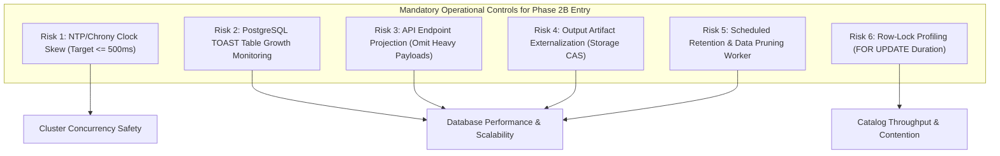
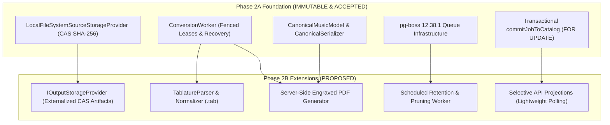
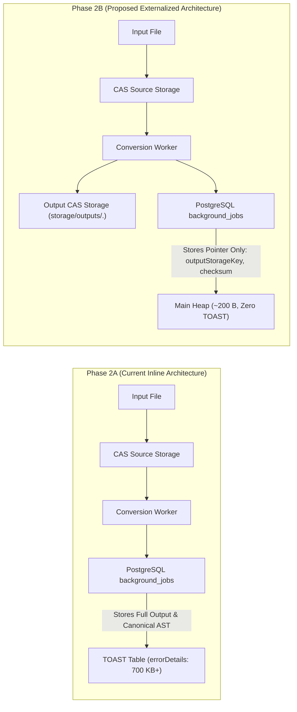

# BETHESDA WORSHIP STUDIO
## PHASE 2A FORMAL ACCEPTANCE AND PHASE 2B ENTRY PROPOSAL

**Document Reference:** `PHASE_2A_FORMAL_ACCEPTANCE_AND_PHASE_2B_ENTRY_PROPOSAL.md`  
**Evaluation Role:** Principal Software Architect & Independent Technical Governance Reviewer  
**Repository:** `https://github.com/juancastro2381-hub/BETHESDA-WORSHIP-STUDIO.git`  
**Working Branch:** `feature/phase-1a-core-foundation`  
**Current HEAD Commit:** `ddb0e823b5a3c2e29080e875916e3285a14552b7`  
**Date:** 2026-11-10T16:35:00-05:00  
**Phase 2A Status:** ✅ **ACCEPTED AND FORMALLY CLOSED**  
**Phase 2B Status:** 🛑 **PROPOSAL ONLY — IMPLEMENTATION NOT AUTHORIZED**  

---

# PART I: FORMAL PHASE 2A ACCEPTANCE AND CLOSURE RECORD

## 1. FORMAL PROJECT OWNER DECISION

The Project Owner, having reviewed the forensic audits, technical assurance proofs, governance reconciliation records, and documentary clarifications, has formally declared:

$$\mathbf{\Large \text{PHASE 2A IS HEREBY ACCEPTED AND CLOSED.}}$$

This formal sign-off recognizes:
1. **Authoritative Background Queuing:** PostgreSQL-backed asynchronous execution using installed `pg-boss 12.38.1` without in-memory bypasses.
2. **Distributed Concurrency & Ownership Enforcement:** Atomic conditional acquisition (`acquireJob`), 60-second distributed row leases with 15-second heartbeat renewals, and Martin Kleppmann execution witness fencing (`leaseToken = crypto.randomUUID()`) gating all state transitions.
3. **Idempotency & Data Integrity:** Content-Addressable Storage (CAS) with SHA-256 verification, two-tier catalog persistence with pessimistic row locks (`FOR UPDATE`), and ACID transaction rollbacks.
4. **Lifecycle & Fault Recovery:** Fail-closed worker shutdown, honest taxonomy of process-local WIP telemetry vs. cluster-wide database coordination, and zero peer eviction on targeted consumer removal.
5. **Empirical Test Verification:** 158 automated tests across 9 files and 13 describe suites passing with 100% success rate (105 certification tests, 53 complementary regression tests, 0 failures, 0 regressions).

---

## 2. GOVERNANCE & ARTIFACT BASELINE

The accepted Phase 2A deliverables and their authoritative cryptographic checksums are permanently cataloged below:

| Deliverable Artifact | Repository Path | Associated Commit | SHA-256 Hash |
| :--- | :--- | :--- | :--- |
| **Governance Reconciliation** | `FINAL_PHASE_2A_GOVERNANCE_RECONCILIATION.md` | `b69d49448c9ba699e9817d7f6e5dc1ff828ea0d3` | `7F6E7264A6208579C21BA7ACDF4A40455B2E58C3DBB179AC01CD1724BD6719E0` |
| **Technical Assurance Review** | `FINAL_PHASE_2A_TECHNICAL_ASSURANCE.md` | `3c1ee23c3788ec7cd1045bcdebad02da8a408646` | `C2F7E4F4A39FA9D2FFD07535E04B11EA7021731DA8382EB3D502518D83F66592` |
| **Acceptance Clarifications** | `FINAL_PHASE_2A_ACCEPTANCE_CLARIFICATIONS.md` | `ddb0e823b5a3c2e29080e875916e3285a14552b7` | `91F0E583A4FCEE8D7CAF154186E2EDD37AC939BD7CD5674BDC26161E1F8BE17D` |

### Mandatory Preservation Invariant
In accordance with Project Owner directives:
- All Phase 2A reports (`docs/reports/phase-2a-*`), execution logs, manifests, and historical audit entries are **strictly preserved**.
- No previous audit findings shall be deleted, modified, or rewritten.
- Phase 2A source code, schemas, and test suites are frozen in their accepted state.
- No git history manipulation (rebase, squash, force-push) shall be executed against the accepted baseline.

---

# PART II: OPERATIONAL RISKS & PREREQUISITES CARRIED FORWARD

The acceptance audit identified six critical operational risks that are formally carried forward as mandatory constraints for Phase 2B and production readiness.



### Risk 1: NTP/Chrony Synchronization Across Application Worker Nodes
- **Nature of Risk:** In `ConversionWorker`, lease expiration thresholds (`leaseExpiresAt`) are computed by Node.js application servers and passed as parameters. If Node B's clock drifts ahead of Node A's clock by $> 45\text{ seconds}$ ($60\text{s lease} - 15\text{s heartbeat}$), Node B will prematurely declare Node A's active lease expired and reclaim the job. While fencing tokens prevent data corruption, premature reclamation wastes compute resources.
- **Mandatory Control:** All application worker containers, VM nodes, and PostgreSQL database servers **MUST** run active time synchronization using `chrony` or `systemd-timesyncd`, with automated alerting if clock drift exceeds $\mathbf{500\text{ ms}}$.

### Risk 2: PostgreSQL Storage & TOAST Growth Monitoring
- **Nature of Risk:** Storing full serialized scores and Canonical JSON ASTs inside `background_jobs.errorDetails` (70 KB to 750 KB per completed job) triggers out-of-line TOAST table storage. Without active monitoring, high-throughput conversion ingestion could result in unexpected disk utilization and prolonged backup durations.
- **Mandatory Control:** Database monitoring must track relation size:
  $$\text{Alert Threshold: } \text{pg\_total\_relation\_size('background\_jobs')} \ge 10\text{ GB}$$
  Daily vacuum statistics, dead tuple bloat, and backup duration metrics must be logged.

### Risk 3: API Payload Projection and Polling Optimization
- **Nature of Risk:** The endpoint `GET /api/conversion/jobs/:id` currently queries `findJobById()`, which executes `SELECT *` via Drizzle ORM. This decompresses and transfers the entire TOAST payload over the network on every status poll, consuming unnecessary server CPU and client bandwidth.
- **Mandatory Control:** Refactor repository queries to use selective field projections (`SELECT id, status, progress, input_ref, output_ref, created_at, completed_at FROM background_jobs`), omitting `errorDetails` from routine polling endpoints and exposing full payloads only via dedicated download/inspect endpoints.

### Risk 4: Output Artifact Externalization Strategy
- **Nature of Risk:** Retaining large musical artifacts (e.g., future multi-megabyte engraved PDFs or complex orchestral MusicXML) inside database JSON columns limits scalability and complicates multi-region replication.
- **Mandatory Control:** Transition from inline JSON storage in `errorDetails` to Content-Addressable Storage (CAS) via `ISourceStorageProvider` / `IOutputStorageProvider` (`storage/outputs/<hash>.<ext>` or S3/GCS object storage), keeping only content hashes and storage keys in PostgreSQL.

### Risk 5: Automated Retention and Cleanup Strategy
- **Nature of Risk:** `background_jobs` is currently append-only. Completed and failed jobs accumulate indefinitely, retaining redundant data once musical entities are committed to the `songs` catalog.
- **Mandatory Control:** Design and schedule a background cleanup worker in pg-boss to truncate bulk payloads in `errorDetails` for jobs committed to the catalog or older than 30 days.

### Risk 6: Database Transaction & Row-Lock Duration Under Realistic Workloads
- **Nature of Risk:** `ConversionJobService.commitJobToCatalog()` acquires a pessimistic row lock (`SELECT FOR UPDATE`) on `background_jobs` while creating `songs`, `song_versions`, and `song_sources`. If catalog insertion slows under heavy database contention, prolonged row locks could block concurrent operations.
- **Mandatory Control:** Profile transaction duration and row-lock holding times under realistic concurrent stress testing ($\ge 50$ concurrent users committing simultaneously) to ensure transaction latency remains $< 50\text{ ms}$.

---

# PART III: PHASE 2B ENTRY PROPOSAL (DOCUMENTARY SPECIFICATION)

> [!CAUTION]
> **GOVERNANCE NOTICE:**  
> **Phase 2B is NOT authorized by this acceptance.**  
> The following specification represents an architectural proposal and execution roadmap for engineering planning only. Implementation must **NOT** begin without explicit Project Owner authorization.

```
┌─────────────────────────────────────────────────────────────────────────────────┐
│                           PHASE 2B SCOPE BOUNDARIES                             │
├──────────────────────────────────────┬──────────────────────────────────────────┤
│           INCLUDED IN SCOPE          │            EXCLUDED FROM SCOPE           │
├──────────────────────────────────────┼──────────────────────────────────────────┤
│ • Externalize Conversion Artifacts   │ • Direct Audio Stem Separation (Demucs)  │
│ • ASCII Tablature Engine (.tab)      │ • Raw Audio Chord Transcription (Whisper)│
│ • Server-Side Engraved PDF Export    │ • Live WebSocket Atril Synchronization   │
│ • TOAST Mitigation & Pruning Worker  │ • Multi-Congregation Tenant Billing      │
│ • API Selective Field Projections    │ • Interactive Real-Time Score Editing    │
└──────────────────────────────────────┴──────────────────────────────────────────┘
```

---

## 1. OBJECTIVES AND SCOPE

### 1.1 Primary Engineering Objectives
1. **Architectural Hardening:** Mitigate the operational risks identified in Phase 2A by externalizing converted output artifacts from PostgreSQL into Content-Addressable Storage and implementing automated retention pruning.
2. **Tablature Ingestion Engine:** Complete the musical ingestion matrix by implementing native ASCII tablature parsing (`.tab`), harmonic normalization, and transpilation into canonical notation (deferred from Phase 2A, line 1317).
3. **High-Fidelity Engraving & Export:** Implement server-side musical engraving for vector-quality printable scores (`ENGRAVED_PDF`) and high-fidelity MIDI rendering with configurable quantization grids.
4. **Deferred Source Ingestion Hooks:** Establish formal asynchronous worker interfaces for optical music recognition (OMR) proposals and audio transcription jobs without violating zero-fabrication guarantees.

### 1.2 Explicit Non-Goals (Scope Exclusions)
- **Zero Raw Audio Processing in Node.js Event Loop:** Heavy AI audio stem separation (Demucs) and neural chord transcription (Whisper) remain deferred to dedicated GPU microservices (Phase 7).
- **No Real-Time Stage Synchronization:** Live WebSocket synchronization between Director and Musician Atriles remains reserved for Phase 5.
- **No In-Memory Job Bypasses:** All new asynchronous operations must flow through pg-boss with strict database leases and fencing witnesses.

---

## 2. DEPENDENCIES ON PHASE 2A FOUNDATION

Phase 2B builds strictly on the verified, immutable foundation delivered in Phase 2A:



---

## 3. ARCHITECTURAL CHANGES REQUIRED

### 3.1 Architectural Evolution: Phase 2A vs. Phase 2B



### 3.2 Concrete Component Specifications

1. **Output Storage Provider (`IOutputStorageProvider`):**
   - **Path:** `backend/src/infrastructure/storage/output-storage-provider.ts`
   - **Interface:**
     ```typescript
     export interface IOutputStorageProvider {
       saveOutput(jobId: string, format: ConversionTargetFormat, content: string | Buffer): Promise<{
         outputStorageKey: string;
         checksumSha256: string;
         byteLength: number;
       }>;
       getOutputBuffer(outputStorageKey: string): Promise<Buffer>;
       deleteOutput(outputStorageKey: string): Promise<boolean>;
     }
     ```
   - **Implementation:** Content-addressed files written to `storage/outputs/<sha256>.<ext>` using atomic temporary write + rename (`fs.promises.rename`).

2. **Schema Migration (Additive & Non-Breaking):**
   - **Target Table:** `background_jobs`
   - **New Columns:**
     - `output_storage_key`: `varchar('output_storage_key', { length: 512 })` (nullable)
     - `output_checksum_sha256`: `varchar('output_checksum_sha256', { length: 64 })` (nullable)
     - `output_byte_length`: `integer('output_byte_length')` (nullable)
     - `pruned_at`: `timestamp('pruned_at', { withTimezone: true })` (nullable)
   - **Index:** `index('idx_background_jobs_pruned_at').on(table.prunedAt)`

3. **ASCII Tablature Parser (`TablatureParser`):**
   - **Path:** `backend/src/domain/conversion/tablature-parser.ts`
   - **Capabilities:** Parses 6-string standard guitar and 4/5-string bass ASCII tabs, normalizes fret-string pairs to pitch/duration events, extracts chords aligned above tablature lines, and outputs valid `CanonicalMusicModel` structures without pitch fabrication.

4. **Scheduled Retention & Pruning Worker:**
   - **Queue:** `job-retention-cleanup` (pg-boss cron schedule: `0 3 * * 0` — Sundays at 03:00 UTC).
   - **Logic:** Identifies jobs in terminal states (`COMPLETED`, `FAILED`) older than 30 days or where `committed_song_id IS NOT NULL`. Nullifies `errorDetails.data` and `errorDetails.canonicalPayload`, sets `pruned_at = NOW()`, reducing per-row storage to $< 200\text{ bytes}$.

---

## 4. SECURITY AND RELIABILITY IMPLICATIONS

1. **Path Traversal Defense on Output Artifacts:**  
   `OutputStorageProvider` must reuse the proven `resolveSafePath()` pattern from `LocalFileSystemSourceStorageProvider` ([`source-storage-provider.ts:81-94`](file:///c:/Users/juanc/OneDrive/Documentos/Desarrollo%20proyectos/Sistema%20musical%20-%20partituras/BETHESDA%20WORSHIP%20STUDIO/backend/src/domain/ingestion/source-storage-provider.ts#L81-L94)), strictly preventing arbitrary directory traversal or symlink escaping.
2. **Anti-IDOR on Output Artifact Downloads:**  
   Downloading output files must mandate authorization checks identical to Phase 2A (`job.userId === user.id || user.role === 'ADMIN'`), preventing unauthorized cross-tenant score extraction.
3. **Resource Bounding on Tablature & PDF Generation:**  
   Tablature parsing and vector PDF rendering must enforce strict size limits ($\le 15\text{ MiB}$ input, $\le 30\text{ seconds}$ execution timeout) to prevent CPU starvation attacks against the Node.js event loop.
4. **Fencing Integrity Preservation:**  
   All Phase 2B workers must continue generating random UUID execution witnesses and enforcing conditional database updates (`WHERE id = :id AND lease_token = :token AND status = 'PROCESSING'`).

---

## 5. MIGRATION AND BACKWARD COMPATIBILITY STRATEGY

1. **Zero-Downtime Database Migration:**  
   All new columns added to `background_jobs` are strictly `NULLABLE`. No existing columns are renamed, modified, or dropped.
2. **Dual-Read Compatibility Layer:**  
   When retrieving conversion outputs or committing jobs to the catalog, the application evaluates:
   ```typescript
   if (job.outputStorageKey) {
     return await outputStorage.getOutputBuffer(job.outputStorageKey);
   } else if (job.errorDetails?.data) {
     // Fallback to Phase 2A inline data for historic unpruned jobs
     return Buffer.from(job.errorDetails.data, job.errorDetails.isBinary ? 'base64' : 'utf8');
   }
   ```
3. **Preservation of Phase 2A Catalog Integration:**  
   The catalog commit workflow in `commitJobToCatalog()` ([`conversion-job-service.ts:489-605`](file:///c:/Users/juanc/OneDrive/Documentos/Desarrollo%20proyectos/Sistema%20musical%20-%20partituras/BETHESDA%20WORSHIP STUDIO/backend/src/application/conversion-job-service.ts#L489-L605)) will continue supporting both inline and externalized payloads seamlessly.

---

## 6. ACCEPTANCE CRITERIA AND EXIT GATES

Phase 2B implementation will be governed by five strict exit gates:

```
┌─────────────────────────────────────────────────────────────────────────────────┐
│                           PHASE 2B EXIT GATES (MANDATORY)                       │
├─────────┬──────────────────────────────────┬────────────────────────────────────┤
│ GATE 1  │ Code Quality & Strict Typecheck  │ npm run typecheck & build exit 0   │
├─────────┼──────────────────────────────────┼────────────────────────────────────┤
│ GATE 2  │ Zero Regression on Phase 2A      │ All 158 Phase 2A tests pass 100%   │
├─────────┼──────────────────────────────────┼────────────────────────────────────┤
│ GATE 3  │ Storage Externalization Proof    │ TOAST row footprint < 2 KB         │
├─────────┼──────────────────────────────────┼────────────────────────────────────┤
│ GATE 4  │ Tablature Engine Verification    │ Zero musical fabrication in tabs   │
├─────────┼──────────────────────────────────┼────────────────────────────────────┤
│ GATE 5  │ Automated Retention Verification │ Pruning worker truncates safely    │
└─────────┴──────────────────────────────────┴────────────────────────────────────┘
```

- **Exit Gate 1 (Code Quality):** Backend and frontend compile with zero TypeScript errors under `strict: true`.
- **Exit Gate 2 (Zero Regression):** All 158 tests from Phase 2A (`conversion-*.test.ts`) must pass without modification or regressions.
- **Exit Gate 3 (Storage Optimization):** For newly completed jobs, `pg_total_relation_size` growth reflects $< 2\text{ KB}$ per row in `background_jobs`, proving externalization out of TOAST.
- **Exit Gate 4 (Tablature Ingestion):** ASCII tablature conversions preserve exact pitches, strings, and frets across 20+ reference hymn tabs.
- **Exit Gate 5 (Retention & Security):** Retention worker successfully prunes qualifying jobs without deleting active or uncommitted data; anti-IDOR checks pass on all download endpoints.

---

## 7. MANUAL VALIDATION PLAN (PRE-RELEASE QA PROCEDURE)

Upon completion of Phase 2B development (once authorized), the following manual test protocol must be executed across staging:

| Step | Validation Scenario | Execution Procedure | Expected Observable Result |
| :---: | :--- | :--- | :--- |
| **MVP-01** | **CAS Output Externalization** | Upload `himno_fe.musicxml` for conversion to `CHORD_PRO`. Query PostgreSQL `background_jobs`. | `output_storage_key` contains SHA-256 key; `errorDetails.data` is empty/null; file exists in `storage/outputs/`. |
| **MVP-02** | **Lightweight Polling** | Open Network Inspector in browser while conversion executes. Poll `GET /api/conversion/jobs/:id`. | HTTP response payload size is $< 1\text{ KB}$ during progress polling (no TOAST data returned). |
| **MVP-03** | **Tablature Ingestion** | Upload 6-string ASCII guitar tab `himno_gracia.tab`. Convert to `MUSIC_XML`. | Conversion succeeds; notes on stave match guitar fretboards; zero fabrication warnings. |
| **MVP-04** | **Engraved PDF Export** | Request `ENGRAVED_PDF` conversion. Download resulting document. | Valid vector PDF with clean music typography (staves, clefs, key signatures, lyrics). |
| **MVP-05** | **Automated Pruning** | Trigger retention worker on test job completed $> 30\text{ days}$ ago with `committedSongId`. | Bulk data stripped from `errorDetails`; `pruned_at` timestamp recorded; catalog song remains 100% intact. |
| **MVP-06** | **NTP Drift Simulation** | Artificially inject 10s clock drift on worker container. Execute concurrent jobs. | System logs normal heartbeat renewal without premature job reclamation. |

---

# PART IV: FINAL GOVERNANCE & AUDIT TRAIL

### Master Audit Trail & Deliverables Manifest
1. `FINAL_PHASE_2A_GOVERNANCE_RECONCILIATION.md` — Git working tree, hash manifests, and forensic audit reconciliation.
2. `FINAL_PHASE_2A_TECHNICAL_ASSURANCE.md` — Deep distributed architecture, lease ownership, and idempotency proofs.
3. `FINAL_PHASE_2A_ACCEPTANCE_CLARIFICATIONS.md` — Clock source consistency, fencing terminology, and TOAST capacity evaluations.
4. `PHASE_2A_FORMAL_ACCEPTANCE_AND_PHASE_2B_ENTRY_PROPOSAL.md` — This document: formal closure of Phase 2A and entry specification for Phase 2B.

---

## CONCLUDING DIRECTIVE COMPLIANCE

$$\mathbf{\Large \text{PHASE 2A IS OFFICIALLY CLOSED.}}$$
$$\mathbf{\Large \text{PHASE 2B IMPLEMENTATION IS NOT AUTHORIZED.}}$$

**Strict read-only discipline has been preserved.**  
No application source code was modified.  
No database migrations were executed.  
No automated tests were re-run.  
No git commits or pushes were issued.  

**AWAITING EXPLICIT PROJECT OWNER AUTHORIZATION TO PROCEED.**

