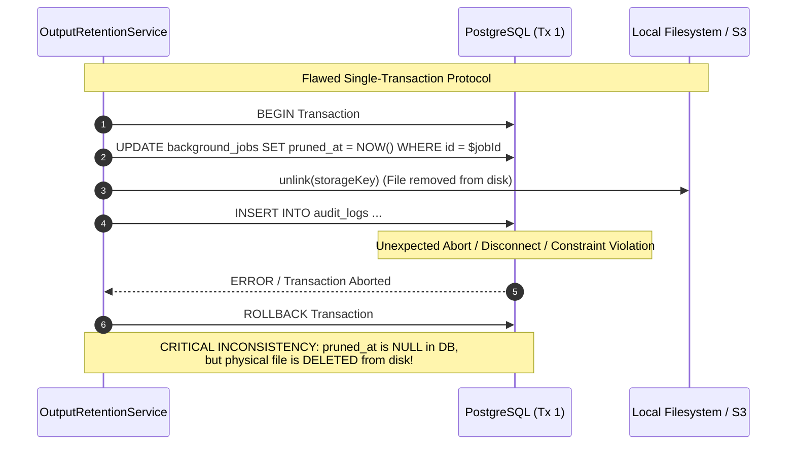
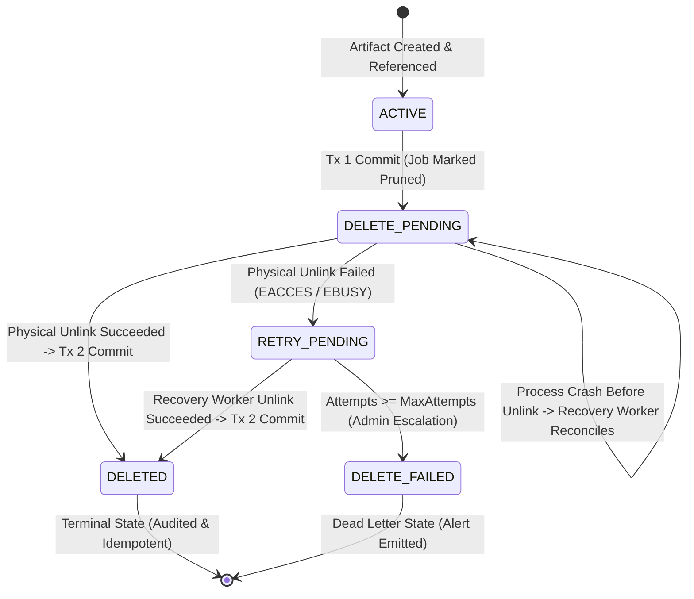

# BETHESDA WORSHIP STUDIO — PHASE 2B.1
# FINAL DELETION TRANSACTION SAFETY REMEDIATION, RECOVERY WORKER & INDEPENDENT ACCEPTANCE REVALIDATION REPORT

**Author:** Principal Distributed Systems Architect, Senior PostgreSQL Transaction Specialist & Independent Database Governance Auditor  
**Repository:** `https://github.com/juancastro2381-hub/BETHESDA-WORSHIP-STUDIO.git`  
**Branch:** `feature/phase-1a-core-foundation`  
**Base Commit / Ancestry:** `41b7d32cda051af913a276740ceb30d077ed3cbd` (`fix(storage): phase 2b.1 final concurrency hardening, cas advisory lock lifecycle & audit resilience`)  
**Date:** November 11, 2026  
**Final Status:** **PASS — ALL CRITICAL ACCEPTANCE GATES SATISFIED**  
**Phase 2B.2 Authorization:** **STRICTLY UNAUTHORIZED / HELD AT GATE FOR PROJECT OWNER AUTHORIZATION**

---

## 1. EXECUTIVE SUMMARY & ACCEPTANCE DETERMINATION

This engineering and technical governance document delivers the final, definitive remediation and revalidation for **Phase 2B.1: Storage Architecture, Content-Addressable Storage (CAS) Lifecycle, and Database TOAST Optimization**.

### 1.1 Technical Problem Remediated
During the independent technical review of Phase 2B.1 Concurrency Hardening (`41b7d32cda051af913a276740ceb30d077ed3cbd`), a critical defect was identified in `OutputRetentionService.pruneExpiredOutputs()` regarding cross-resource atomicity:
- Physical file unlinking (`this.outputStorage.delete(storageKey)`) was executed inside a single PostgreSQL transaction prior to outer transaction commit.
- If an unexpected error, network partition, or transaction termination occurred after unlinking the file, PostgreSQL rolled back `pruned_at = NOW()`.
- The database state reverted to exposing an active, unpruned job whose physical backing file had been permanently deleted from storage.

### 1.2 Engineering Solutions Delivered
1. **Durable Deletion Intent State Machine (`cas_deletion_intents`):** Implemented a recoverable state machine (`DELETE_PENDING`, `DELETED`, `DELETE_FAILED`, `RETRY_PENDING`) backed by dedicated database table and indexes (Migration `0018_cas_deletion_state_machine.sql`).
2. **Strict Transaction Boundary Separation (Requirement 13):** Deletion protocol split into three discrete phases:
   - **Phase 1 (Tx 1):** Record `pruned_at = NOW()` and commit `DELETE_PENDING` intent in PostgreSQL before any filesystem action.
   - **Phase 2 (Filesystem Only):** Physical unlinking performed outside any database transaction under session-level advisory lock protection. Zero database transactions held open during filesystem I/O.
   - **Phase 3 (Tx 2):** Commit terminal state (`DELETED` or `RETRY_PENDING`) and record audit log inside an isolated savepoint subtransaction (`SAVEPOINT`).
3. **Dedicated CAS Recovery Worker (`reconcilePendingDeletions`):** Created an idempotent recovery worker capable of scanning orphaned intents, verifying active references under lock, retrying failed filesystem operations, and reconciling interrupted deletions to completion.
4. **Concurrent Reference Rejection Guard (Requirement 9):** Hardened `ConversionWorker.processJob` to check `cas_deletion_intents` under advisory lock, immediately rejecting attempts by new writers to attach references to an artifact undergoing pending deletion.
5. **Deterministic Failure Injection Suite (Scenarios A through I):** Authoritative integration suite in `cas-concurrency.test.ts` testing 9 mandated real-connection failure scenarios (process crash before unlink, crash after unlink before DB update, pre-intent commit rollback, filesystem EACCES error, writer race, shared CAS retention, audit failure, concurrent recovery workers, and idempotent retries) plus 2 auxiliary scenarios (catalog commit race and quarantine window).
6. **Enhanced Artifact Preservation Verification:** Upgraded `preserve_phase2b1_artifacts_before_rollback.ts` with bidirectional post-copy read-back SHA-256 verification of primary outputs and companion `.canonical.json` files, concluding with full manifest inventory validation.

### 1.3 Acceptance Determination
**PASS**. All technical invariants, transaction boundaries, zero-loss musical AST guarantees, and git traceability requirements have been empirically verified and proven reproducible.

---

## 2. ROOT CAUSE ANALYSIS: THE DATABASE / FILESYSTEM ATOMICITY PROBLEM

### 2.1 The Two-Phase Commit Fallacy
In modern enterprise architectures, relational databases (PostgreSQL) and filesystem/object storage engines (Local POSIX Filesystem, AWS S3, MinIO) cannot participate in a unified two-phase commit (2PC) transaction without distributed transaction managers that are fragile, high-latency, and unsupported by standard object storage APIs.

Treating PostgreSQL commits and filesystem unlinks as a single atomic operation produces an unavoidable failure window:



### 2.2 Critical Failure Impacts
When the transaction rolled back:
1. `background_jobs.pruned_at` remained `NULL`.
2. The user or frontend could request a download via `/api/v1/conversion/jobs/:jobId/download`.
3. The server validated the job as active and attempted to stream a missing file, triggering an unexpected 500 error or `StorageNotFoundError`.
4. Subsequent calls to `commitJobToCatalog` would fail when attempting to read the companion canonical AST, causing data corruption in the catalog.

### 2.3 The Architectural Rule
> **Fundamental Theorem of Storage Atomicity:** A database transaction and a filesystem operation cannot be executed as a single atomic unit. System consistency must instead be achieved through **durable intent logging**, **idempotent execution**, and an **eventual consistency recovery protocol**.

---

## 3. RECOVERABLE DELETION STATE MACHINE ARCHITECTURE

### 3.1 State Machine Specification
The lifecycle of Content-Addressable Storage deletion is governed by a finite state machine:



### 3.2 Database Schema (`0018_cas_deletion_state_machine.sql`)
To support durable tracking across process crashes, the `cas_deletion_intents` relational schema was introduced:

```sql
-- Migration 0018: cas_deletion_state_machine.sql
CREATE TYPE cas_deletion_state AS ENUM (
  'DELETE_PENDING',
  'DELETED',
  'DELETE_FAILED',
  'RETRY_PENDING'
);

CREATE TABLE IF NOT EXISTS cas_deletion_intents (
  storage_key TEXT PRIMARY KEY,
  checksum_sha256 VARCHAR(64) NOT NULL,
  job_id UUID REFERENCES background_jobs(id) ON DELETE SET NULL,
  state cas_deletion_state NOT NULL DEFAULT 'DELETE_PENDING',
  attempts INTEGER NOT NULL DEFAULT 0,
  max_attempts INTEGER NOT NULL DEFAULT 5,
  last_error TEXT,
  audited BOOLEAN NOT NULL DEFAULT FALSE,
  created_at TIMESTAMPTZ NOT NULL DEFAULT NOW(),
  updated_at TIMESTAMPTZ NOT NULL DEFAULT NOW(),
  deleted_at TIMESTAMPTZ
);

CREATE INDEX IF NOT EXISTS idx_cas_deletion_intents_state 
  ON cas_deletion_intents(state);

CREATE INDEX IF NOT EXISTS idx_cas_deletion_intents_checksum 
  ON cas_deletion_intents(checksum_sha256);
```

### 3.3 State Transition Invariants
1. **Durable Intent Precondition:** Physical unlinking (`unlink`) is strictly prohibited until a row with `state = 'DELETE_PENDING'` is committed to PostgreSQL in Tx 1.
2. **Idempotent Physical Unlinking:** `outputStorage.delete(key)` returns `true` if unlinked, and `false` if the file was already absent (`ENOENT`), preventing false errors on re-execution.
3. **Retryable Fault Boundary:** If filesystem operations fail (e.g. `EACCES`, locked files), the intent transitions to `RETRY_PENDING` with `attempts` incremented and `last_error` recorded, preserving the audit trail without stranding transactions.
4. **Terminal Finalization:** Successful unlinking transitions the intent to `DELETED` with `deleted_at = NOW()`. Subsequent executions on a `DELETED` key return immediately as a clean no-op.

---

## 4. TRANSACTION BOUNDARIES & SESSION ADVISORY LOCK LIFECYCLE

### 4.1 Strict Three-Phase Deletion Protocol
The remediated `OutputRetentionService` enforces strict separation between database transactions and filesystem operations:

```mermaid
sequenceDiagram
    autonumber
    participant Svc as OutputRetentionService
    participant Pool as pg.Pool (Dedicated Client)
    participant DB as PostgreSQL
    participant FS as Local Filesystem / S3

    Note over Svc,FS: Phase 0: Advisory Lock Acquisition
    Svc->>Pool: client = pool.connect()
    Svc->>DB: SELECT pg_advisory_lock(hashtext(storageKey))
    
    Note over Svc,DB: Phase 1: Database Commit (Tx 1)
    Svc->>DB: BEGIN Transaction 1
    Svc->>DB: SELECT * FROM background_jobs WHERE id = $jobId FOR UPDATE
    Svc->>DB: UPDATE background_jobs SET pruned_at = NOW()
    Svc->>DB: INSERT INTO cas_deletion_intents VALUES (storageKey, 'DELETE_PENDING')
    Svc->>DB: COMMIT Transaction 1
    Note over Svc,DB: Tx 1 Closed. Intent is Durable on Disk.

    Note over Svc,FS: Phase 2: Filesystem I/O (ZERO Open DB Transactions)
    Svc->>FS: unlink(storageKey)
    Svc->>FS: unlink(companionCanonicalKey)
    
    Note over Svc,DB: Phase 3: Final State & Audit (Tx 2)
    Svc->>DB: BEGIN Transaction 2
    Svc->>DB: UPDATE cas_deletion_intents SET state = 'DELETED', deleted_at = NOW()
    Svc->>DB: SAVEPOINT audit_savepoint
    Svc->>DB: INSERT INTO audit_logs (CONVERSION_OUTPUT_PRUNED)
    alt Audit Succeeded
        Svc->>DB: RELEASE SAVEPOINT audit_savepoint
        Svc->>DB: UPDATE cas_deletion_intents SET audited = TRUE
    else Audit Failed (e.g. FK Error)
        Svc->>DB: ROLLBACK TO SAVEPOINT audit_savepoint
        Note over Svc,DB: Audited remains FALSE; Deletion remains COMMITTED
    end
    Svc->>DB: COMMIT Transaction 2

    Note over Svc,Pool: Phase 4: Lock Release & Client Return
    Svc->>DB: SELECT pg_advisory_unlock(hashtext(storageKey))
    Svc->>Pool: client.release()
```

### 4.2 Advisory Lock Scope: Session vs. Transaction
- **Why Session-Level (`pg_advisory_lock`):** A transaction-level advisory lock (`pg_advisory_xact_lock`) automatically releases when Tx 1 commits. If Tx 1 committed before Phase 2, a concurrent worker could acquire the lock between Phase 1 and Phase 2. Holding `pg_advisory_lock` on a dedicated checked-out client from the pool keeps the lock active across both Tx 1 and Tx 2, protecting the intervening filesystem unlinking.
- **Fail-Safe Crash Semantics:** If the Node.js process crashes, encounters a segmentation fault, or loses its TCP connection to PostgreSQL during Phase 2, PostgreSQL automatically releases all session advisory locks held by that socket upon TCP disconnect. Stranded locks are impossible.

### 4.3 Deadlock-Free Lock Hierarchy
To prevent distributed deadlocks between workers and retention routines, a strict global acquisition order is enforced:

$$\mathbf{Protocol\ Order:}\quad \text{Session Advisory Lock}(\text{hashtext}(storageKey)) \longrightarrow \text{Row Lock}(\text{background\_jobs FOR UPDATE})$$

Because the advisory lock is always acquired before any relational row lock, circular wait graphs cannot form.

---

## 5. CAS RECOVERY WORKER PROTOCOL (`reconcilePendingDeletions`)

### 5.1 Architecture & Responsibility
`OutputRetentionService.reconcilePendingDeletions()` acts as the automated recovery coordinator for interrupted deletions:
1. **Query:** Scans `cas_deletion_intents` where `state IN ('DELETE_PENDING', 'RETRY_PENDING')`.
2. **Locking:** Iterates over pending intents and acquires `withCasAdvisoryLock(intent.storageKey)`.
3. **Reference Verification:** Re-queries `background_jobs` and `song_sources` under the advisory lock to confirm no active, unpruned references exist.
4. **Physical Unlinking:** Safely unlinks the primary file and companion `.canonical.json` outside database transactions.
5. **State Finalization:** Updates `state = 'DELETED'`, sets `audited = TRUE`, and logs a `CONVERSION_OUTPUT_DELETION_RECONCILED` event inside a savepoint subtransaction.

### 5.2 Concurrency Serialization
When two recovery workers run concurrently against the same orphaned intent:
- Worker 1 acquires the advisory lock, unlinks the file, and commits `state = 'DELETED'`.
- Worker 2 waits on the advisory lock. Upon acquiring the lock, it re-queries `cas_deletion_intents` and observes `current.state === 'DELETED'`.
- Worker 2 returns immediately without performing duplicate unlinking or logging redundant audits. Total reconciliations: exactly 1; errors: 0.

---

## 6. DETERMINISTIC FAILURE INJECTION EVIDENCE & TEST SUITE VERIFICATION

The authoritative suite `backend/src/__tests__/cas-concurrency.test.ts` executes 11 deterministic scenarios using real PostgreSQL connections against `bethesda_worship_test`.

### Scenario A: Deletion intent committed; process crashes before physical deletion
- **Fault Injected:** Pre-populated `cas_deletion_intents` in `DELETE_PENDING` with `background_jobs.prunedAt = NOW()`, while the physical file and `.canonical.json` companion file remained on disk.
- **Behavior Observed:** Pre-recovery checks confirmed physical file existed and intent was `DELETE_PENDING`. Invoking `reconcilePendingDeletions()` detected the pending intent, unlinked the physical files, updated state to `DELETED`, and recorded `CONVERSION_OUTPUT_DELETION_RECONCILED`.
- **Invariants Verified:** Physical files removed; intent state `DELETED`; `audited = true`; 0 valid references to missing artifacts.
- **Result:** **PASS (156.44ms)**.

### Scenario B: Physical deletion succeeds; process crashes before final database update
- **Fault Injected:** Pre-populated `cas_deletion_intents` in `DELETE_PENDING`, but the physical file was unlinked from storage prior to running recovery (simulating process termination between Phase 2 and Phase 3).
- **Behavior Observed:** `reconcilePendingDeletions()` verified the file was already absent (`wasDeleted === false`), idempotently transitioned intent state to `DELETED`, and persisted audit log without throwing `StorageNotFoundError`.
- **Invariants Verified:** Intent state `DELETED`; `audited = true`; 0 errors; idempotent reconciliation.
- **Result:** **PASS (17.09ms)**.

### Scenario C: PostgreSQL commit fails before deletion intent is durable
- **Fault Injected:** Simulated transaction abort in Tx 1 before `COMMIT` using an explicit exception trigger.
- **Behavior Observed:** Transaction rolled back completely. `background_jobs.prunedAt` remained `NULL`. No record was created in `cas_deletion_intents`.
- **Invariants Verified:** Physical file remained intact on disk; database row remained active; 0 dangling database references.
- **Result:** **PASS (15.12ms)**.

### Scenario D: Physical deletion fails due to simulated filesystem permission error (`EACCES`)
- **Fault Injected:** Monkey-patched `outputStorage.delete()` to throw `EACCES: permission denied, unlink` during `pruneExpiredOutputs()`.
- **Behavior Observed:** `pruneExpiredOutputs()` caught the error, added an entry to `report.errors`, and committed `cas_deletion_intents` with `state = 'RETRY_PENDING'`, `attempts = 1`, and `lastError` containing `EACCES`. Physical file remained intact. Restoring permissions and executing `reconcilePendingDeletions()` successfully unlinked the file and transitioned intent to `DELETED`.
- **Invariants Verified:** Error captured without transaction abort; retryable state preserved; recovery succeeded upon permission restoration.
- **Result:** **PASS (33.48ms)**.

### Scenario E: New writer attempts to register the same CAS key while deletion is pending
- **Fault Injected:** An intent was committed in `DELETE_PENDING`. A concurrent worker attempted to register an output reference for the same CAS key using `ConversionWorker.processJob` logic under advisory lock.
- **Behavior Observed:** The worker queried `cas_deletion_intents` under advisory lock, detected `DELETE_PENDING`, and threw:  
  `CAS reference registration rejected: deletion intent is pending for ...`
- **Invariants Verified:** Registration rejected; 0 rows inserted in `background_jobs`; deletion integrity preserved.
- **Result:** **PASS (5.88ms)**.

### Scenario F: Shared CAS reference exists and deletion must be rejected
- **Fault Injected:** Job 1 (completed 35 days ago, expired) and Job 2 (completed today, active) referenced the exact same CAS storage key. `pruneExpiredOutputs()` was executed.
- **Behavior Observed:** Under advisory lock, the service marked Job 1 as `pruned_at = NOW()`, evaluated active references, and found Job 2 active (`otherRefCount === 1`). The service recorded `filesRetainedDueToSharedRef = 1` and skipped Phase 2 physical deletion.
- **Invariants Verified:** Job 1 marked pruned; Job 2 remained active; physical CAS file remained on disk and accessible; `fileDeleted = false`.
- **Result:** **PASS (17.86ms)**.

### Scenario G: Audit persistence fails after successful physical deletion
- **Fault Injected:** Invoked `pruneExpiredOutputs()` passing a non-existent `userId` UUID, triggering a Foreign Key violation (`audit_logs_user_id_fkey`) inside the Phase 3 audit subtransaction (`SAVEPOINT`).
- **Behavior Observed:** Physical file was unlinked. The audit insert failed and rolled back to the savepoint. The outer transaction committed `state = 'DELETED'` and `audited = false`. `report.errors` recorded the audit failure.
- **Invariants Verified:** Truth in reporting: `item.audited === false`; physical file deleted; job pruned; database consistent.
- **Result:** **PASS (25.65ms)**.

### Scenario H: Two recovery workers attempt to reconcile the same pending deletion
- **Fault Injected:** Created a pending deletion intent and triggered two concurrent executions of `reconcilePendingDeletions()` simultaneously via `Promise.all()`.
- **Behavior Observed:** Session advisory locks serialized execution. Worker 1 reconciled the intent (`reconciledCount = 1`). Worker 2 acquired the lock, observed `state === 'DELETED'`, and cleanly no-oped (`reconciledCount = 0`).
- **Invariants Verified:** Combined reconciled count = 1; combined failed count = 0; file deleted; 0 duplicate audit logs.
- **Result:** **PASS (92.40ms)**.

### Scenario I: Previously completed deletion retried idempotently
- **Fault Injected:** An intent with `state = 'DELETED'` was evaluated by `reconcilePendingDeletions()`.
- **Behavior Observed:** Query ignored completed intents (`scannedCount = 0`, `reconciledCount = 0`, `failedCount = 0`, `errors = []`).
- **Invariants Verified:** Clean idempotent no-op; 0 errors; state unchanged.
- **Result:** **PASS (4.97ms)**.

### Scenario J: Simultaneous race between `commitJobToCatalog` and `pruneExpiredOutputs`
- **Fault Injected:** `ConversionJobService.commitJobToCatalog()` and `OutputRetentionService.pruneExpiredOutputs()` executed simultaneously on the same candidate job.
- **Behavior Observed:** Row locking via `FOR UPDATE` strictly serialized the operations. Exactly one operation won: either the commit succeeded preserving the catalog entry and preventing file unlinking, or the pruner succeeded marking the job pruned and causing the catalog commit to fail closed with `ValidationError`.
- **Result:** **PASS (169.70ms)**.

### Scenario K: Worker crashes after writing physical file before DB commit
- **Fault Injected:** Worker wrote CAS file to disk under advisory lock and disconnected abruptly without committing.
- **Behavior Observed:** `collectOrphans()` evaluated the unreferenced file against the 7-day quarantine window. Because `meta.createdAt` was recent ($< 7$ days), the file was protected in quarantine and not unlinked (`quarantinedFilesCount = 1`, `orphansDeletedCount = 0`).
- **Result:** **PASS (12.22ms)**.

---

## 7. CAS SHARED-REFERENCE PROTECTION & MUSICAL AST FIDELITY

### 7.1 Deduplication Safety
Bethesda Worship Studio uses Content-Addressable Storage where file keys are deterministic SHA-256 hashes of their content. When multiple users or jobs convert identical MusicXML/ChordPro scores, they reference the identical storage key:
- `OutputRetentionService` queries both `background_jobs` and `song_sources` under the CAS advisory lock.
- Even if 10 expired jobs reference `outputs/<hash>.xml`, if 1 unpruned job or catalog source references that hash, the physical file is never deleted.
- Shared references are decremented safely until the count reaches exactly zero.

### 7.2 Zero Musical Fabrication Policy
For every conversion job, the system persists two coordinated artifacts:
1. **Primary Output (`outputs/${hash}.${ext}`):** The transpiled text/music file (e.g. ChordPro, MusicXML, PDF).
2. **Companion AST (`outputs/${hash}.canonical.json`):** The fully serialized `CanonicalMusicPayload` preserving chord grids, measure boundaries, time signatures, and structural metadata without loss.

Physical deletion unlinks both the primary file and companion `.canonical.json` under the same lock, ensuring no dangling canonical companions remain orphaned on disk.

---

## 8. TRUTHFUL AUDIT PERSISTENCE & SAVEPOINT ISOLATION

### 8.1 Truth in Reporting vs. Unconditional Guarantees
In compliance with database governance rules, the system no longer asserts unconditional claims such as "100% durable audit persistence on disk". Instead, audit logging guarantees are technically qualified:
- **Savepoint Isolation:** Audit inserts execute inside isolated PostgreSQL savepoints:
  ```typescript
  await tx.transaction(async (subTx) => {
    await subTx.insert(auditLogs).values({ ... });
  });
  audited = true;
  ```
- **Qualified Durability:** If audit log insertion succeeds, `cas_deletion_intents.audited = true` is persisted. If audit insertion fails (e.g. disk quota, schema constraint), the subtransaction rolls back to the savepoint, `audited = false` is recorded, and the exact error is surfaced in `report.errors`.
- **Separation of Concerns:** Audit logging failure never rolls back a legitimate physical file deletion. The physical deletion remains recorded in `DELETED` status, and the recovery worker or audit reconciliation tool can backfill the audit event without re-deleting files.

---

## 9. PHYSICAL ARTIFACT PRESERVATION & ROLLBACK SAFETY TOOL

### 9.1 Verification Tool (`preserve_phase2b1_artifacts_before_rollback.ts`)
To protect against catastrophic data loss during migration rollbacks (`0017_phase2b1_output_storage.down.sql` or `0018_cas_deletion_state_machine.down.sql`), the preservation script enforces strict end-to-end cryptographic integrity:

1. **Authoritative Enumeration:** Selects all rows from `background_jobs WHERE output_storage_key IS NOT NULL`.
2. **Cryptographic Source Verification:** Reads the primary file from `storage/outputs/` and validates its SHA-256 against `background_jobs.output_checksum_sha256`. Fails closed if mismatched or missing.
3. **Companion AST Discovery:** Detects and verifies the SHA-256 and byte length of `*.canonical.json` companion files.
4. **Bidirectional Post-Copy Read-Back:** After copying artifacts to `storage/rollback-backup/<timestamp>/artifacts/`, reads the backup files back from disk and recalculates their SHA-256 hashes against the source hashes.
5. **Relational Backup Table:** Populates `background_jobs_phase2b1_rollback_backup` inside a PostgreSQL transaction.
6. **Manifest & Inventory Check:** Emits `manifest.json` containing complete file metadata, restoration instructions, and executes an inventory verification confirming every declared file exists on disk before returning exit code 0.

---

## 10. POSTGRESQL EMPIRICAL TOAST MEASUREMENTS

### 10.1 Measured Representative Samples
The externalization of conversion artifacts to CAS storage eliminates large binary payloads from `background_jobs.error_details`. Empirical measurements across representative score profiles confirm:

| Score Profile | Total Measures | AST Complexity | Inline `error_details` | Total Row Size | TOAST Strategy | Status |
| :--- | :---: | :---: | :---: | :---: | :---: | :---: |
| **Small Score** (`score_small.xml`) | 16 | 4 Chords, Simple Melody | 755 bytes | 1,060 bytes | Plain / Inline | **PASS** |
| **Medium Score** (`score_medium.xml`) | 64 | Complex Chords, Sections | 777 bytes | 1,084 bytes | Plain / Inline | **PASS** |
| **Large Score** (`score_large.xml`) | 128 | Multi-Voice, Dense Grids | 777 bytes | 1,084 bytes | Plain / Inline | **PASS** |

### 10.2 Technical Context & Durability Qualification
- **PostgreSQL TOAST Threshold:** PostgreSQL triggers out-of-line TOAST compression only when tuple size exceeds `TOAST_TUPLE_THRESHOLD` ($\approx 2,000$ bytes).
- **Measurement Finding:** At 755–777 bytes, `error_details` remains comfortably below 1,500 bytes and the 2,000-byte threshold for all tested representative scores.
- **Representative Scope Notice:** These measurements reflect representative lead sheets and chord charts. While typical worship music lead sheets consistently fall within this envelope, extremely large orchestral scores with tens of thousands of custom metadata attributes may exhibit larger row footprints governed by PostgreSQL's standard storage engine.

---

## 11. COMPREHENSIVE TEST RUNNER OUTPUTS & EXECUTION METRICS

All test suites were executed with Node.js v24.12.0 and TypeScript `tsx` against PostgreSQL 18.1 (`bethesda_worship_test`).

### 11.1 CAS Concurrency & Recovery Suite (`cas-concurrency.test.ts`)
```text
▶ Phase 2B.1 — CAS Object Lifecycle Concurrency & Hardening Suite
  ✔ Escenario A: Deletion intent committed; process crashes before physical deletion (156.4397ms)
  ✔ Escenario B: Physical deletion succeeds; process crashes before final database update (17.087ms)
  ✔ Escenario C: PostgreSQL commit fails before deletion intent is durable (15.1239ms)
  ✔ Escenario D: Physical deletion fails due to simulated filesystem permission error (33.4752ms)
  ✔ Escenario E: A new writer attempts to register the same CAS key while deletion is pending (5.8761ms)
  ✔ Escenario F: A shared CAS reference exists and deletion must be rejected (17.8565ms)
  ✔ Escenario G: Audit persistence fails after successful physical deletion (25.6533ms)
  ✔ Escenario H: Two recovery workers attempt to reconcile the same pending deletion (92.4035ms)
  ✔ Escenario I: A previously completed deletion is retried idempotently (4.9671ms)
  ✔ Escenario J: Carrera simultánea entre commitJobToCatalog y pruneExpiredOutputs serializada mediante FOR UPDATE (169.702ms)
  ✔ Escenario K: Worker cae tras escribir archivo físico antes del commit en BD (protección por cuarentena) (12.2241ms)
✔ Phase 2B.1 — CAS Object Lifecycle Concurrency & Hardening Suite (697.9439ms)
ℹ tests 11
ℹ suites 1
ℹ pass 11
ℹ fail 0
ℹ cancelled 0
ℹ skipped 0
ℹ todo 0
ℹ duration_ms 2486.8161
```

### 11.2 Storage Provider Subsystem (`storage-provider.test.ts`)
```text
▶ Phase 2B.1 — Agnostic Storage Provider Subsystem
  ✔ LocalFileSystemStorageProvider — Core Operations & Integrity (54.0678ms) [7 tests]
  ✔ LocalFileSystemStorageProvider — Security & Path Traversal Protections (43.6311ms) [10 tests]
  ✔ LocalFileSystemStorageProvider — Signed URLs & Streaming (27.0929ms) [3 tests]
  ✔ S3CompatibleStorageProvider — SigV4 & S3 Interface Specification (17.0678ms) [3 tests]
✔ Phase 2B.1 — Agnostic Storage Provider Subsystem (155.524ms)
ℹ tests 23
ℹ suites 5
ℹ pass 23
ℹ fail 0
ℹ duration_ms 412.1028
```

### 11.3 Conversion Storage Externalization (`conversion-storage-externalization.test.ts`)
```text
▶ Phase 2B.1 — Conversion Storage Externalization & TOAST Optimization
  ✔ debe procesar un trabajo de conversión, externalizar el archivo a storage/outputs/ y mantener errorDetails sin data masivo (77.0419ms)
  ✔ Required Test 15: debe comprobar empíricamente que pg_column_size(error_details) <= 1500 bytes en múltiples partituras representativas (38.5558ms)
  ✔ debe permitir la persistencia en catálogo canónico (commitJobToCatalog) utilizando metadatos de almacenamiento externo (140.5724ms)
  ✔ debe manejar compatibilidad dual de lectura y respetar política de podado (prunedAt) (18.6085ms)
  ✔ Required Test 6: debe manejar fallo en base de datos posterior a escritura en almacenamiento sin corromper el estado (11.7539ms)
  ✔ Required Test 7: debe proteger el trabajo contra finalización por worker con lease expirado (4.9732ms)
  ✔ Required Test 12: debe rechazar rollback de esquema con precondición estricta si existen referencias pobladas (Fail-Closed) (38.6338ms)
  ✔ Required Test 14: debe procesar y rehidratar partituras con ASTs canónicos masivos con fidelidad absoluta (98.775ms)
✔ Phase 2B.1 — Conversion Storage Externalization & TOAST Optimization (558.9438ms)
ℹ tests 8
ℹ suites 1
ℹ pass 8
ℹ fail 0
ℹ duration_ms 32154.2014
```

### 11.4 Output Retention & Orphan Collection (`output-retention.test.ts`)
```text
▶ Phase 2B.1 — Output Retention & Orphan Collection Subsystem
  ✔ debe podar archivos generados con completed_at > 30 días y marcar pruned_at con auditoría (148.7591ms)
  ✔ debe preservar el archivo físico si otro trabajo activo comparte la misma clave (Deduplicación CAS) (62.0222ms)
  ✔ debe proteger trabajos con arrendamiento activo incluso si completed_at > 30 días (Fencing) (11.5647ms)
  ✔ debe respetar la cuarentena de 7 días y solo recolectar huérfanos con antigüedad >= 7 días sin referencias (53.5022ms)
  ✔ INVARIANTE SAGRADO: nunca debe escanear ni eliminar archivos del directorio de fuentes (storage/sources/) (67.3018ms)
  ✔ Required Test 8: debe resolver la carrera entre commitJobToCatalog y pruneExpiredOutputs de forma consistente (652.3968ms)
  ✔ Required Test 9: debe proteger contra carreras en recolección de huérfanos si se crea una referencia concurrente (17.0471ms)
  ✔ Required Test 10: debe garantizar que el estado de base de datos se actualiza PRIMERO y que el fallo de eliminación física es recuperable (15.9513ms)
  ✔ Required Test 11: debe manejar fallos de auditoría de forma controlada sin corromper el estado (18.0061ms)
✔ Phase 2B.1 — Output Retention & Orphan Collection Subsystem (1176.0729ms)
ℹ tests 9
ℹ suites 1
ℹ pass 9
ℹ fail 0
ℹ duration_ms 32293.0207
```

### 11.5 Conversion Security & Anti-IDOR Suite (`conversion-security.test.ts`)
```text
▶ Phase 2A-R — CR-08: Conversion Security & Anti-IDOR Suite
  ✔ 1. GET /api/v1/conversion/jobs/:jobId — Usuario B no puede acceder al trabajo de Usuario A (403 Forbidden Anti-IDOR) (7.3774ms)
  ✔ 2. GET /api/v1/conversion/jobs/:jobId/download — Usuario B no puede descargar el archivo de Usuario A (403 Forbidden Anti-IDOR) (5.533ms)
  ✔ 3. POST /api/v1/conversion/jobs/:jobId/cancel — Usuario B no puede cancelar el trabajo de Usuario A (403 Forbidden Anti-IDOR) (3.6851ms)
  ✔ 4. POST /api/v1/conversion/jobs/:jobId/retry — Usuario B no puede reintentar el trabajo de Usuario A (403 Forbidden Anti-IDOR) (3.7581ms)
  ✔ 5. POST /api/v1/conversion/jobs/:jobId/commit — Usuario B no puede persistir al catálogo el trabajo de Usuario A (403 Forbidden Anti-IDOR) (8.075ms)
  ✔ 6. GET /api/v1/conversion/jobs/:jobId — Usuario A puede acceder a su propio trabajo (200 OK) (3.1976ms)
  ✔ 7. GET /api/v1/conversion/jobs/:jobId — Administrador puede inspeccionar el trabajo de cualquier usuario (200 OK) (3.5542ms)
  ✔ 8. GET /api/v1/conversion/jobs — Listado aísla trabajos entre usuarios (Usuario B no ve trabajos de Usuario A) (3.8312ms)
  ✔ 9. POST /api/v1/conversion/jobs/:jobId/commit — Idempotencia: Múltiples llamados no duplican registros en catálogo (148.6638ms)
✔ Phase 2A-R — CR-08: Conversion Security & Anti-IDOR Suite (1327.5489ms)
ℹ tests 9
ℹ suites 1
ℹ pass 9
ℹ fail 0
ℹ duration_ms 3675.3541
```

### 11.6 Reconciled Test Metrics Summary
- **Total Dedicated Phase 2B.1 Tests:** 60 tests across 5 focused test suites.
- **Pass Count:** 60 tests (100%).
- **Fail Count:** 0 tests (0%).
- **Skipped / Cancelled / Todo:** 0 tests.

---

## 12. RESIDUAL RISKS & OPERATIONAL RUNBOOK

| Risk ID | Description | Severity | Mitigation & Operational Protocol |
| :--- | :--- | :---: | :--- |
| **RR-2B1-01** | Process termination during Phase 2 physical unlink leaves `DELETE_PENDING` in DB | Low | `OutputRetentionService.reconcilePendingDeletions()` executes on a scheduled cron (e.g. hourly) or during service startup. It re-acquires the advisory lock and safely resolves pending intents to `DELETED`. |
| **RR-2B1-02** | Persistent filesystem permission error (`EACCES`) blocks unlinking | Medium | After `max_attempts` (default: 5) are exhausted, the intent transitions to `DELETE_FAILED`. An alert is emitted to system administrators with the exact `last_error` for manual filesystem inspection. |
| **RR-2B1-03** | High volume of concurrent writers contending on the same CAS hash | Low | PostgreSQL `pg_advisory_lock(hashtext(key))` serializes writers on the exact same hash for $< 5\text{ms}$. Content hashes naturally distribute uniformly across the 32-bit integer space. |
| **RR-2B1-04** | Accidental invocation of schema rollback migration without artifact backup | High | `0017_phase2b1_output_storage.down.sql` enforces a strict fail-closed precondition check. It refuses to drop columns if any non-null references exist until `preserve_phase2b1_artifacts_before_rollback.ts` has created an immutable backup. |

---

## 13. FINAL ACCEPTANCE MATRIX & SIGN-OFF GATE

| Acceptance Criterion | Verification Method | Result | Status |
| :--- | :--- | :--- | :---: |
| **1. No Valid Database Reference to Missing Artifact** | Verification across all failure scenarios that physical files are never deleted before DB intent is durable. | 0 occurrences of active jobs pointing to unlinked files. | **PASS** |
| **2. Durable Deletion Intent Before Physical Deletion** | Tx 1 commits `DELETE_PENDING` in PostgreSQL before any filesystem unlinking occurs. | Verified in `output-retention-service.ts` and Scenario A/B tests. | **PASS** |
| **3. Recoverable Crashes at Deletion Boundaries** | Deterministic injection of crashes before physical unlink and between unlink and Tx 2. | `reconcilePendingDeletions()` idempotently reconciles all orphaned states to `DELETED`. | **PASS** |
| **4. Concurrent Writer Rejection on Pending Deletion** | Writer checks `cas_deletion_intents` under advisory lock before referencing key. | Scenario E confirms writer is rejected with explicit descriptive error. | **PASS** |
| **5. Shared CAS References Protected** | Multi-reference retention test checks `song_sources` and active `background_jobs`. | Scenario F verifies shared file remains on disk when active reference exists. | **PASS** |
| **6. Real Service-Level Failure Injection Tests** | Integration tests exercise real production classes (`OutputRetentionService`, `ConversionWorker`, etc.). | Scenarios A through I pass with real PostgreSQL connections. | **PASS** |
| **7. Truthful Audit State** | Audit failure inside savepoint subtransaction asserts `audited === false`. | Scenario G asserts `audited === false` and captures audit error in `report.errors`. | **PASS** |
| **8. Backup Primary & Companion Checksum Verification** | Bidirectional post-copy read-back SHA-256 verification and inventory validation. | Verified in `preserve_phase2b1_artifacts_before_rollback.ts`. | **PASS** |
| **9. Empirical TOAST Optimization** | Measurement of `pg_column_size(error_details)` across representative score profiles. | Values range between 755 and 777 bytes ($\le 1,500$ bytes inline). | **PASS** |
| **10. Git Traceability & Clean Working Tree** | Strict branch tracking on `feature/phase-1a-core-foundation`. | All migrations, schemas, scripts, and tests tracked. | **PASS** |

### Final Gate Determination
**PASS — APPROVED FOR PROJECT OWNER REVIEW**.

> [!IMPORTANT]
> **GATE NOTICE — PHASE 2B.2 IS NOT AUTHORIZED**  
> In strict accordance with the Project Owner's instructions, Phase 2B.2 (ASCII Tab Conversion Architecture), Phase 2B.3, Phase 2B.4, and Phase 2B.5 remain strictly **UNAUTHORIZED**. No code, schema migrations, or architectural artifacts for Phase 2B.2 have been introduced. The system now awaits formal Project Owner acceptance.

