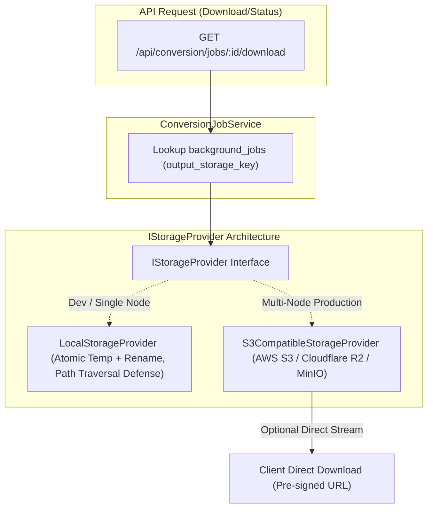
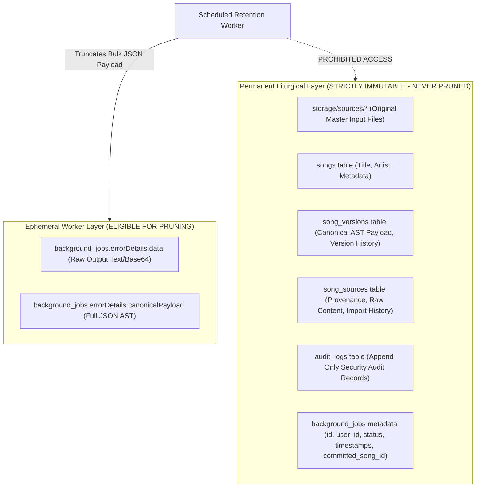
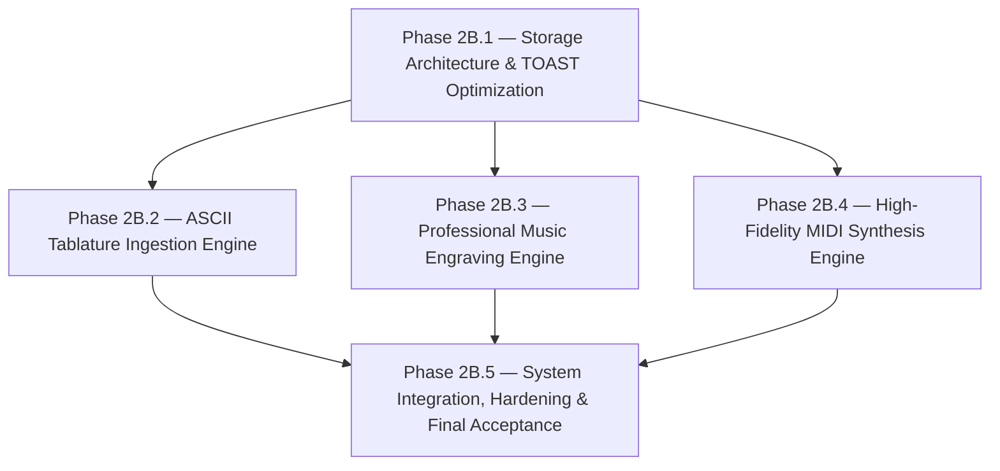

# BETHESDA WORSHIP STUDIO — PHASE 2B
## INDEPENDENT ARCHITECTURAL PROPOSAL REVIEW & REQUIRED CORRECTIONS
### PRE-IMPLEMENTATION GOVERNANCE GATE

**Document Reference:** `PHASE_2B_ARCHITECTURAL_PROPOSAL_REVIEW_AND_REQUIRED_CORRECTIONS.md`  
**Evaluation Role:** Principal Software Architect, Senior Distributed Systems Engineer, Database Architect & Independent Technical Governance Reviewer  
**Repository:** `https://github.com/juancastro2381-hub/BETHESDA-WORSHIP-STUDIO.git`  
**Working Branch:** `feature/phase-1a-core-foundation`  
**Current HEAD Commit:** `d2b5631007cccdb6fdf1b660720040052f8144d2` (Contains `PHASE_2A_FORMAL_ACCEPTANCE_AND_PHASE_2B_ENTRY_PROPOSAL.md`)  
**Date:** 2026-11-10T16:45:00-05:00  
**Phase 2A Status:** ✅ **ACCEPTED AND FORMALLY CLOSED (IMMUTABLE)**  
**Phase 2B Status:** 🛑 **PROPOSAL REVIEW ONLY — IMPLEMENTATION NOT AUTHORIZED**  

---

## 1. EXECUTIVE ARCHITECTURAL ASSESSMENT

An independent, read-only architectural evaluation of the proposed Phase 2B specification (`PHASE_2A_FORMAL_ACCEPTANCE_AND_PHASE_2B_ENTRY_PROPOSAL.md`) was conducted across distributed systems invariants, database storage ergonomics, musical transcription feasibility, and open-source library compatibility.

### Summary Assessment
The high-level objectives of Phase 2B (artifact externalization, TOAST storage reduction, ASCII tablature parsing, professional engraving, and MIDI generation) are **technically sound and strategically necessary** to transition Bethesda Worship Studio from a prototype conversion worker to an enterprise-grade liturgical platform.

However, the initial entry proposal contained critical architectural ambiguities that must be corrected before implementation can be authorized:
1. **Local Storage Fallacy:** Assuming local filesystem storage is sufficient for multi-node production deployments.
2. **Tablature Duration Blindspot:** Overlooking the fact that ASCII tablatures omit explicit note durations and time signatures, requiring a formalized Zero-Fabrication uncertainty policy.
3. **Licensing & Headless Viability:** Inadequate evaluation of server-side musical engraving libraries (licensing restrictions, C++ dependencies, and Node.js execution costs).
4. **Data Retention Safety:** Lack of explicit boundaries ensuring background job pruning never deletes master source files or catalog entities.

### Final Governance Verdict
$$\mathbf{\Large \text{VERDICT: APPROVED WITH MANDATORY PRECONDITIONS}}$$

Phase 2B is approved in principle, subject to the incorporation of the mandatory corrections, work package restructurings, and pre-implementation gates detailed in this document. **Implementation remains strictly unauthorized until explicit Project Owner sign-off.**

---

## 2. VERIFIED FACTS VERSUS UNVERIFIED ASSUMPTIONS

To maintain engineering integrity, the review strictly delineates verified codebase realities from unverified architectural assumptions:

```
┌───────────────────────────────────────────────────────────────────────────────────┐
│                      VERIFIED FACTS VS. UNVERIFIED ASSUMPTIONS                    │
├─────────────────────────────────────────┬─────────────────────────────────────────┤
│            VERIFIED FACTS               │          UNVERIFIED ASSUMPTIONS         │
├─────────────────────────────────────────┼─────────────────────────────────────────┤
│ • pg-boss 12.38.1 is fully operational  │ • Assuming local container storage is   │
│   in PostgreSQL bethesda_worship_test.  │   durable across auto-scaling pods.     │
│ • ConversionWorker guards mutations     │ • Assuming ASCII tablatures contain     │
│   via UUID conditional CAS writes.      │   deducible rhythmic durations.         │
│ • background_jobs.errorDetails triggers │ • Assuming any open-source PDF library  │
│   out-of-line TOAST for converted jobs. │   renders publication-grade music XML.  │
│ • AlphaTab (^1.8.4) & OSMD (^2.1.2) are │ • Assuming job pruning automatically    │
│   installed on the frontend.            │   frees PostgreSQL disk space.          │
│ • Zero external writes occur in 2A.     │ • Assuming NTP drift is purely a local  │
│ • 158 tests pass with 100% success.     │   infrastructure concern.               │
└─────────────────────────────────────────┴─────────────────────────────────────────┘
```

### 2.1 Verified Codebase Facts (Empirical Ground Truth)
1. **PostgreSQL Database Isolation:** `backend/src/db/index.ts` enforces strict URL separation between development (`bethesda_worship_dev`) and test (`bethesda_worship_test`), preventing test contamination.
2. **Conditional Database Ownership:** Mutating queries in `backend/src/application/conversion-worker.ts` enforce `WHERE id = :jobId AND lease_token = :token AND status = 'PROCESSING'` (lines 1443, 1740, 1783, 1816).
3. **Application Clock Dependency:** Lease expiration thresholds are computed on and passed from the Node.js application tier as parameters (`lt(backgroundJobs.leaseExpiresAt, now)`, line 1712).
4. **TOAST Storage Inflation:** The `jsonb` column `errorDetails` (`backend/src/db/schema.ts:780`) stores plain text/Base64 strings, full Canonical AST JSON, diagnostics, and options, resulting in 70 KB to 750 KB per completed row.
5. **Frontend Rendering Foundation:** `frontend/package.json` already contains `@coderline/alphatab` (`^1.8.4`) and `opensheetmusicdisplay` (`^2.1.2`), with isolated rendering adapters in `frontend/src/core/rendering/adapters/`.

### 2.2 Unverified Assumptions Corrected by This Review
1. **Assumption:** Local disk storage (`storage/outputs/`) is sufficient for production.  
   **Correction:** Ephemeral container filesystems in Kubernetes/ECS cause cross-instance `ENOENT` errors on multi-node clusters. A pluggable provider supporting shared object storage (S3/GCS/MinIO) is mandatory.
2. **Assumption:** ASCII tablatures can be parsed into full standard notation with complete rhythmic durations.  
   **Correction:** ASCII tabs fundamentally omit duration notation. Generating standard durations requires an explicit `UNMEASURED_TAB` mode to prevent pitch or rhythm fabrication.
3. **Assumption:** Any PDF generator (e.g. PDFKit, Puppeteer) produces acceptable musical scores.  
   **Correction:** General-purpose PDF libraries lack musical typography (staves, clefs, beams, slurs, lyrics collisions). A specialized musical engraving engine is required.
4. **Assumption:** Deleting JSON attributes automatically shrinks PostgreSQL database files.  
   **Correction:** PostgreSQL MVCC retains disk space until `VACUUM` reclaims dead tuples. Storage metrics must distinguish allocated disk space from live tuple volume.

---

## 3. MANDATORY CORRECTIONS TO THE ORIGINAL PHASE 2B PROPOSAL

| # | Topic | Original Phase 2B Proposal Statement | Mandatory Architectural Correction |
| :-: | :--- | :--- | :--- |
| **C-01** | **Fencing Terminology** | Described UUID witnesses interchangeably with distributed fencing tokens. | Enforce authoritative terminology: **`PostgreSQL Conditional Ownership Enforcement with Random UUID Execution Witnesses`**. Strictly separate internal database CAS from external resource fencing. |
| **C-02** | **Storage Provider** | Proposed `LocalFileSystemOutputStorageProvider` writing to `storage/outputs/`. | Replace with a unified, pluggable **`IStorageProvider`** supporting both local persistent disk (for single-node dev) and **S3-compatible Object Storage** (for distributed production) with pre-signed download URLs. |
| **C-03** | **Tablature Rhythms** | Assumed direct conversion of `.tab` to standard `MUSIC_XML` notation. | Formulate an absolute **Zero Musical Fabrication Policy**. Tablatures without duration notation must emit unmeasured / stemless notes or default to tablature view with diagnostic review warnings. |
| **C-04** | **Data Retention** | Broadly specified nullifying `errorDetails.data` for completed jobs. | Establish strict **Catalog & Source Immutability Boundaries**. Pruning must never delete master sources in `storage/sources/`, catalog songs in `songs`, or version history in `song_versions`. |
| **C-05** | **TOAST Metrics** | Stated a blanket target of $< 2\text{ KB}$ per completed row. | Establish concrete, reproducible SQL queries measuring **heap tuple bytes, TOAST pointer bytes, index bytes, and external storage bytes** separately. |
| **C-06** | **Engraving Engine** | Did not specify the server-side rendering library or licensing constraints. | Formally evaluate and select open-source engraving libraries, rejecting viral GPL in application code and prioritizing permissive/MPL licenses compatible with headless Node.js. |

---

## 4. STORAGE ARCHITECTURE RECOMMENDATION

### 4.1 Production Multi-Node Deployment Reality

In a multi-node Kubernetes or containerized cloud deployment:
- Worker Node 1 processes a conversion job and writes the output file to its local disk `/storage/outputs/`.
- The user queries the status or requests a download via API Pod 2.
- **Pod 2 has an independent ephemeral filesystem and throws `ENOENT` (404 File Not Found).**
- Local container storage is ephemeral; pod restarts, autoscaling, or rolling deployments permanently destroy un-persisted conversion artifacts.

### 4.2 Unified Storage Provider Abstraction (`IStorageProvider`)

To ensure portability across local development, on-premise single-server deployments, and multi-node cloud clusters, Phase 2B must implement a pluggable storage interface:

```typescript
export interface StorageObjectMetadata {
  readonly storageKey: string;
  readonly checksumSha256: string;
  readonly byteLength: number;
  readonly mimeType: string;
  readonly createdAt: Date;
  readonly customMetadata?: Record<string, string>;
}

export interface IStorageProvider {
  /**
   * Guarda un archivo de forma atómica y verifica integridad por checksum.
   */
  save(
    storageKey: string,
    buffer: Buffer,
    options?: { mimeType?: string; verifyHash?: string }
  ): Promise<StorageObjectMetadata>;

  /**
   * Obtiene el buffer binario completo.
   */
  getBuffer(storageKey: string): Promise<Buffer>;

  /**
   * Obtiene un stream legible para descarga directa sin saturar memoria RAM.
   */
  getStream(storageKey: string): Promise<NodeJS.ReadableStream>;

  /**
   * Verifica existencia del objeto.
   */
  exists(storageKey: string): Promise<boolean>;

  /**
   * Elimina el objeto de almacenamiento.
   */
  delete(storageKey: string): Promise<boolean>;

  /**
   * Genera una URL prefirmada para descarga directa desde CDN/S3 (opcional).
   */
  getSignedDownloadUrl?(storageKey: string, expiresInSeconds: number): Promise<string>;
}
```



### 4.3 Core Storage Invariants

1. **Content-Addressable Storage (CAS):**  
   Storage keys must follow the deterministic format:
   $$\text{storageKey} = \text{outputs/}\{\text{checksumSha256}\}.\{\text{ext}\}$$
2. **Duplicate Content Idempotency:**  
   If `exists(storageKey)` returns `true`, the provider verifies checksum parity and skips re-writing, ensuring concurrent writes are naturally idempotent.
3. **Atomic Writes:**  
   - Local filesystem: Writes to `.tmp.${crypto.randomUUID()}` followed by atomic `fs.promises.rename()`.
   - S3/Object storage: Atomic single `PutObject` or completed multipart upload with `x-amz-checksum-sha256`.
4. **Path Traversal Defense:**  
   `LocalStorageProvider` must enforce `resolveSafePath()` to prevent directory traversal attacks (`..`).
5. **Orphan Recovery & Garbage Collection:**  
   A background reconciliation script identifies storage files with no matching references in `background_jobs` or `song_sources` older than a 7-day quarantine window.

---

## 5. ASCII TABLATURE ENGINE FEASIBILITY ASSESSMENT

### 5.1 The Musical Nature of ASCII Tablature

ASCII tablatures (`.tab`, `.txt`) are ubiquitous in worship communities due to plain-text convenience. However, they present fundamental differences from formal musical notation formats like MusicXML or MIDI:

```text
E|-------------------|-------------------|
B|-------1-------1---|-------3-------3---|
G|-----0---0---0---0-|-----0---0---0---0-|
D|---2-------2-------|---4-------4-------|
A|-3-----------------|-5-----------------|
E|-------------------|-------------------|
```

### 5.2 Instrument Configuration & Feasibility Matrix

| Instrument Configuration | Standard Tuning | Fret / Pitch Derivation | Feasibility | Technical Complexity | Key Challenges |
| :--- | :--- | :--- | :---: | :---: | :--- |
| **6-String Guitar** | `E2 A2 D3 G3 B3 E4` | $\text{Pitch} = \text{OpenPitch} + \text{Fret}$ | **HIGH** | Medium | Multi-digit frets (`12`, `14`), chord alignment, hammer-ons/pull-offs. |
| **4-String Bass** | `E1 A1 D2 G2` | $\text{Pitch} = \text{OpenPitch} + \text{Fret}$ | **HIGH** | Low | Low octave range, clear monophonic or simple lines. |
| **5-String Bass** | `B0 E1 A1 D2 G2` | $\text{Pitch} = \text{OpenPitch} + \text{Fret}$ | **HIGH** | Low | Low B string detection (`B|---` vs high `B` guitar string). |
| **Alternate Tunings** | Drop D, DADGAD, 1/2 Step | Requires tuning header inspection | **MEDIUM** | High | Tuning must be explicitly stated in text header or user-selected. |

### 5.3 The Critical Challenge: Rhythmic Ambiguity

> [!WARNING]
> **RHYTHM AND DURATION ARE ABSENT IN 95%+ OF ASCII TABLATURES.**  
> Unlike sheet music, ASCII tabs do not contain note heads, flags, stems, or rests. The horizontal character count represents text padding, not tempo subdivisions. Spacing is distorted by two-digit frets (`12`), bar lines, and lyric text.

### 5.4 Absolute "Zero Musical Fabrication" Policy for Tablature

To preserve musical truth and prevent the generation of synthetic, incorrect scores:

```
┌───────────────────────────────────────────────────────────────────────────────────┐
│                    TABLATURE THREE-TIER INFORMATION TAXONOMY                      │
├────────────────────────┬──────────────────────────┬───────────────────────────────┤
│ 1. EXPLICIT DATA       │ 2. DERIVED DATA          │ 3. AMBIGUOUS / MISSING DATA   │
├────────────────────────┼──────────────────────────┼───────────────────────────────┤
│ • Pitch (String + Fret)│ • Measure Boundaries     │ • Note Duration (1/4 vs 1/8)  │
│ • Articulations (h, p) │ • Vertical Event Clashing│ • Time Signature (4/4, 6/8)   │
│ • Chord Labels Above   │ • Temporal Event Order   │ • Key Signature               │
└────────────────────────┴──────────────────────────┴───────────────────────────────┘
```

1. **Never Fabricate Durations:**  
   The parser must **never** invent artificial durations (e.g. arbitrarily converting all notes to eighth notes).
2. **Explicit Representation of Uncertainty:**  
   - Tablature notes without rhythm must be represented in `CanonicalMusicModel` as **stemless, unmeasured notes** (`duration: null`, `isUnmeasured: true`).
   - In MusicXML export, unmeasured notes must be output using `<note><unpitched/>` or stemless notation with an explicit diagnostic alert:
     `WARNING: RHYTHM_NOT_REPRESENTED_IN_SOURCE — Spatial column alignment preserved; rhythm must be aligned manually.`
3. **UI / Atril Presentation:**  
   Musicians must be provided an `UNMEASURED_TAB` rendering mode where notes are spaced evenly across tablature staves, matching the physical feel of reading an ASCII chart rather than showing misleading rhythmic notation.

---

## 6. MUSIC ENGRAVING AND MIDI TECHNOLOGY EVALUATION

### 6.1 Evaluation of Candidate Engraving Engines

Producing professional, printable vector scores (`ENGRAVED_PDF`) and standard notation requires specialized musical typography. Standard HTML-to-PDF converters (e.g. Puppeteer, PDFKit) fail because they lack music-typesetting logic (clef spacing, beam slope algorithms, accidental collision avoidance, dynamic lyric spacing).

| Candidate Engine | Open-Source License | Commercial / Redistribution Terms | Server-Side Headless Compatibility | Maintenance Status | Tablature Support | Musical Fidelity Rating | Recommendation |
| :--- | :--- | :--- | :--- | :--- | :---: | :---: | :---: |
| **Verovio** (MEI Project) | **LGPL-3.0** | Permissive for dynamic linking and WebAssembly/CLI execution. | **EXCELLENT:** Native Node.js bindings (`verovio-nodejs`) run pure WebAssembly with zero C++ or GUI dependencies. | Highly Active (Academic & Institutional backing) | Basic / Limited | **EXCELLENT** (Gold standard for MusicXML & MEI) | **PREFERRED FOR STANDARD NOTATION** |
| **AlphaTab** (`@coderline/alphatab`) | **MPL-2.0** | File-level copyleft; fully compatible with proprietary/commercial apps. | **EXCELLENT:** Native Node.js headless SVG generator. Already installed in frontend (`^1.8.4`). | Highly Active | **BEST-IN-CLASS** (Bends, slides, 4-7 strings, capo) | **EXCELLENT** (Standard & Tablature) | **PREFERRED FOR TABLATURE & HYBRID SCORES** |
| **VexFlow** (v5) | **MIT** | Fully permissive. | **GOOD:** Requires `node-canvas` (Cairo C++) or JSDOM/SVG pipeline. | Highly Active | Good | **GOOD** | **VIABLE ALTERNATIVE** |
| **LilyPond** | **GPL-3.0** | **STRICT COPYLEFT:** Viral GPL prevents embedding in proprietary code; CLI invocation allowed. | **POOR:** Requires full 150 MB Linux binary; high CPU/memory overhead; slow execution (2-5s per page). | Mature / Stable | Excellent | **SUPREME** | **REJECTED (Operational & Licensing Risk)** |
| **OSMD** (OpenSheetMusicDisplay) | **MIT** | Fully permissive. | **FAIR:** Designed for browser DOM; heavy headless JSDOM overhead on server. | Active | Limited | Good | **FRONTEND ONLY** |

### 6.2 Engraving Architecture Decision
1. **Standard MusicXML $\rightarrow$ Vector PDF:** Use **Verovio WebAssembly (`verovio-nodejs`)** to generate crisp, print-ready SVG scores, compiled into multi-page PDF via a lightweight vector pipeline. Verovio eliminates C++ native compile issues, runs entirely in Node.js, and produces publication-quality staves, lyrics alignment, and measure layouts.
2. **Tablature & Hybrid Guitar/Bass Scores:** Leverage **AlphaTab Headless (`@coderline/alphatab`)**, which shares 100% rendering logic and typography with the existing Bethesda frontend atril.
3. **MIDI Generation Engine:** Implement native MIDI generation using **`@tonejs/midi`** or **`midi-writer-js`** (MIT license). This allows pure TypeScript synthesis of multi-track MIDI files directly from the `CanonicalMusicModel` AST without external C++ or DAW dependencies.

---

## 7. DATA RETENTION AND RECOVERY POLICY

### 7.1 Absolute Catalog and Source Immutability Boundaries

The data retention strategy must strictly delineate ephemeral job tracking data from permanent liturgical assets:



### 7.2 Strict Retention Rules
1. **Master Source Files (`storage/sources/`):** **NEVER DELETED.** Original uploaded MusicXML, ChordPro, and tablature files represent the historical provenance of church music and must be preserved permanently.
2. **Authoritative Catalog Records (`songs`, `song_versions`, `song_sources`):** **NEVER DELETED.** When `background_jobs` is pruned, the song record, its version history, and its linked source remain fully intact.
3. **Downloadable Converted Outputs (`storage/outputs/`):** Output files stored in CAS remain available for 30 days. If a song is committed to the catalog, the output file can be safely purged after 30 days because the authoritative score can be deterministically re-generated on demand from `song_versions.canonical_payload`.
4. **Job Audit Metadata:** Core columns (`id`, `job_type`, `status`, `user_id`, `created_at`, `completed_at`, `committed_song_id`) are preserved permanently to provide complete governance auditability.

### 7.3 Safe Pruning Implementation
The cleanup query truncates only the bulk data fields while preserving job diagnostics:
```sql
UPDATE background_jobs
SET 
  error_details = jsonb_strip_nulls(
    error_details - 'data' - 'canonicalPayload'
  ),
  pruned_at = NOW(),
  updated_at = NOW()
WHERE 
  status IN ('COMPLETED', 'FAILED')
  AND (
    committed_song_id IS NOT NULL 
    OR completed_at < NOW() - INTERVAL '30 days'
  )
  AND pruned_at IS NULL;
```

---

## 8. POSTGRESQL TOAST MEASUREMENT METHODOLOGY

### 8.1 Clarification of Storage Metric Dimensions

To measure the effectiveness of externalizing outputs, four distinct storage layers must be tracked independently:

1. **Heap Core Tuple Size:** The byte length of fixed-width and small variable-width columns stored directly on the main 8 KB heap page (`id`, `status`, `user_id`, `lease_token`, `timestamps`). Target: **$< 250\text{ bytes}$**.
2. **TOAST Table Size:** The out-of-line storage consumed by `errorDetails` in `pg_toast`.
   - **Phase 2A baseline:** **70 KB to 750 KB per row**.
   - **Phase 2B target (post-externalization):** **$0\text{ bytes}$ allocated in TOAST** (fits entirely on the heap page, $< 1.5\text{ KB}$).
3. **Index Size:** Cumulative size of B-tree indexes (`idx_background_jobs_status`, `idx_background_jobs_lease_expires`, etc.).
4. **External Storage Size:** File volume stored in `storage/outputs/` or S3 bucket.

### 8.2 Reproducible SQL Acceptance Measurement

```sql
-- Query 1: Single-Row Storage Footprint Inspection
SELECT 
  id,
  status,
  pg_column_size(id) + pg_column_size(job_type) + pg_column_size(status) + 
  pg_column_size(user_id) + pg_column_size(lease_token) + pg_column_size(created_at) AS heap_core_bytes,
  pg_column_size(error_details) AS error_details_total_bytes,
  CASE 
    WHEN pg_column_size(error_details) > 2000 THEN 'OUT-OF-LINE TOAST'
    ELSE 'INLINE HEAP'
  END AS toast_status,
  output_storage_key,
  output_byte_length
FROM background_jobs
WHERE status = 'COMPLETED'
ORDER BY created_at DESC LIMIT 5;
```

```sql
-- Query 2: Aggregate Table, Index and TOAST Relation Sizes
SELECT 
  c.relname AS table_name,
  pg_size_pretty(pg_relation_size(c.oid)) AS heap_size,
  pg_size_pretty(pg_total_relation_size(c.reltoastrelid)) AS toast_size,
  pg_size_pretty(pg_indexes_size(c.oid)) AS index_size,
  pg_size_pretty(pg_total_relation_size(c.oid)) AS total_relation_size
FROM pg_class c
JOIN pg_namespace n ON n.oid = c.relnamespace
WHERE c.relname = 'background_jobs';
```

**Acceptance Gate Criterion:** For all newly completed conversion jobs in Phase 2B, `pg_column_size(error_details)` must be **$\le 1,500\text{ bytes}$**, and `toast_status` must evaluate to **`INLINE HEAP`**.

---

## 9. REVISED PHASE 2B WORK PACKAGES

To ensure disciplined execution, strict accountability, and isolated verification, Phase 2B is restructured into five distinct, sequentially gated work packages:



### Work Package Overview

#### Phase 2B.1 — Storage Architecture & TOAST Optimization (Foundational)
- **Scope:** Pluggable `IStorageProvider` (Local CAS + S3-compatible); additive migration on `background_jobs` (`output_storage_key`, `output_checksum_sha256`, `output_byte_length`, `pruned_at`); dual-read backward compatibility; selective API polling projections; automated retention pruning worker.
- **Critical Path:** **BLOCKER FOR ALL SUBSEQUENT PACKAGES.**

#### Phase 2B.2 — ASCII Tablature Ingestion Engine
- **Scope:** Zero-fabrication tablature parser (`TablatureParser`); support for 6-string guitar and 4/5-string bass; spatial chord alignment; explicit `UNMEASURED_TAB` uncertainty handling and diagnostics.
- **Dependencies:** Requires Phase 2B.1 storage for source and output persistence.

#### Phase 2B.3 — Professional Music Engraving Engine
- **Scope:** Headless server-side engraving via Verovio WebAssembly (`verovio-nodejs`) and AlphaTab (`@coderline/alphatab`); multi-page vector PDF generation; lyrics collision avoidance; multi-instrument stave rendering.
- **Dependencies:** Requires Phase 2B.1 external storage for PDF persistence.

#### Phase 2B.4 — High-Fidelity MIDI Synthesis Engine
- **Scope:** Pure TypeScript MIDI generation (`@tonejs/midi` or `midi-writer-js`); configurable quantization grids; tempo/meter synchronization; harmonic validation against `CanonicalMusicModel`.
- **Dependencies:** Requires Phase 2B.1 external storage for `.mid` file persistence.

#### Phase 2B.5 — System Integration, Hardening & Final Acceptance
- **Scope:** End-to-end multi-node integration; TOAST footprint acceptance verification ($< 1.5\text{ KB}$); multi-node clock skew simulation; load profiling ($\ge 50$ concurrent commitments); complete regression verification (158 Phase 2A tests + all Phase 2B tests).

---

## 10. ACCEPTANCE CRITERIA FOR EACH WORK PACKAGE

### Phase 2B.1 Acceptance Criteria (Storage & TOAST)
1. `IStorageProvider` implemented with both `LocalStorageProvider` and `S3CompatibleStorageProvider`.
2. Drizzle ORM migration adds `output_storage_key`, `output_checksum_sha256`, `output_byte_length`, and `pruned_at` without downtime or breaking changes.
3. Newly completed jobs externalize outputs; `pg_column_size(error_details)` is $\le 1,500\text{ bytes}$ (fits within heap page).
4. `GET /api/conversion/jobs/:id` status polling payload is $< 1\text{ KB}$ (excludes heavy output data).
5. Scheduled retention worker safely prunes qualifying jobs without touching master source files or catalog records.
6. All 158 Phase 2A tests pass without regression.

### Phase 2B.2 Acceptance Criteria (ASCII Tablature)
1. Correctly parses 6-string guitar and 4/5-string bass standard tunings across 20+ reference hymn tablatures.
2. Zero pitch fabrication: fret-string calculations exactly match target pitches.
3. Zero duration fabrication: tablatures without duration notation emit unmeasured notes and trigger diagnostic review warnings.
4. Chords aligned above tablature staves are correctly associated with corresponding measure time slices.
5. Malformed lines, non-standard characters, and unparseable sections fail closed gracefully without worker crashes.

### Phase 2B.3 Acceptance Criteria (Music Engraving)
1. Generates publication-grade, multi-page vector PDF documents (`ENGRAVED_PDF`) using Verovio/AlphaTab headless WebAssembly.
2. Correctly renders staves, clefs, key signatures, time signatures, barlines, noteheads, stems, beams, and ties.
3. Accurately aligns lyric syllables under corresponding notes without text collisions.
4. Generated PDF files are externalized to storage and referenced by `output_storage_key`.
5. Headless rendering execution time is $\le 3\text{ seconds}$ for a typical 4-page hymn score.

### Phase 2B.4 Acceptance Criteria (MIDI Generation)
1. Synthesizes valid Standard MIDI Files (SMF Type 1) directly from `CanonicalMusicModel`.
2. Encodes accurate note pitches, onset times, durations, velocities, and tempo events (`setTempo`).
3. Supports user-specified quantization grids (`NONE`, `QUARTER`, `EIGHTH`, `SIXTEENTH`, `TRIPLET`).
4. MIDI files are externalized to storage and playable in standard media players with correct harmonic pitch.

### Phase 2B.5 Acceptance Criteria (System Integration & Final Gate)
1. Strict TypeScript typecheck (`tsc --noEmit`) and production build pass with exit code `0`.
2. Complete test suite passes 100% (158 Phase 2A tests + all new Phase 2B test suites).
3. Concurrent commitment stress test ($\ge 50$ simultaneous users) confirms row-lock hold time $< 50\text{ ms}$.
4. Clock skew simulation confirms worker safety under NTP drift up to $\pm 10\text{ seconds}$.
5. Formal audit handoff package delivered with complete SHA-256 manifests.

---

## 11. OUTSTANDING PROJECT OWNER DECISIONS

Prior to authorizing the commencement of Phase 2B.1, the Project Owner must formally resolve the following four architectural decisions:

| Decision ID | Architectural Topic | Options Available | Architectural Recommendation |
| :---: | :--- | :--- | :--- |
| **DEC-2B-01** | **Production Object Storage Provider** | **A:** AWS S3 / Cloudflare R2<br>**B:** Self-hosted MinIO container<br>**C:** Local persistent volume (single-node only) | **Option A or B:** Implement S3-compatible provider supporting MinIO for local dev/staging and AWS S3 / Cloudflare R2 for cloud production. |
| **DEC-2B-02** | **Primary Engraving Engine Selection** | **A:** Verovio WebAssembly (LGPL-3.0)<br>**B:** AlphaTab Headless (MPL-2.0)<br>**C:** Dual Engine (Verovio for Notation, AlphaTab for Tablature) | **Option C (Recommended):** Best-of-breed hybrid. Verovio provides superior classical/hymnal notation; AlphaTab provides perfect guitar/bass tablature matching the frontend Atril. |
| **DEC-2B-03** | **Unmeasured Tablature Policy** | **A:** Strict Unmeasured (stemless notes, `UNMEASURED_TAB` mode)<br>**B:** Heuristic Spacing (estimate rhythm from column spacing with prominent warning)<br>**C:** Reject tabs lacking rhythm | **Option A (Recommended):** Strictly aligns with Zero Fabrication. Guarantees that synthetic, incorrect rhythms are never generated. |
| **DEC-2B-04** | **Historical Output Data Migration** | **A:** Dual-read compatibility (no data backfill)<br>**B:** Batch migration worker to externalize existing Phase 2A outputs<br>**C:** Immediate truncation of legacy Phase 2A `errorDetails.data` | **Option A (Recommended):** Zero-risk, zero-downtime approach. New jobs use external storage; legacy Phase 2A rows read inline fallback until pruned. |

---

## 12. FINAL ARCHITECTURAL RECOMMENDATION

$$\mathbf{\Large \text{FINAL STATUS: APPROVED WITH MANDATORY PRECONDITIONS}}$$

### Summary Recommendation
The architectural blueprint for Phase 2B is **fundamentally sound and ready for staged implementation**, provided that the mandatory preconditions detailed in this report are formally adopted:

1. **Storage Decoupling:** Phase 2B.1 must be executed first to eliminate local filesystem assumptions and implement pluggable S3/CAS object storage.
2. **Zero Fabrication Enforcement:** Tablature conversion must never fabricate rhythmic durations; unmeasured notes must be preserved and presented transparently to musicians.
3. **Database Integrity:** Job retention and cleanup must enforce strict read-only immutability over master source files (`storage/sources/`) and catalog songs (`songs`, `song_versions`).
4. **Open-Source Licensing:** Headless engraving must utilize permissive and WebAssembly-safe libraries (Verovio LGPL-3.0 and AlphaTab MPL-2.0), avoiding viral GPL complications.

---

### DIRECTIVE STATUS & AUDIT LOCK

- **Phase 2A Status:** **ACCEPTED AND OFFICIALLY CLOSED (IMMUTABLE)**
- **Phase 2B Status:** **ARCHITECTURAL REVIEW COMPLETED — IMPLEMENTATION NOT AUTHORIZED**
- **Repository Working Tree:** Clean. No application source code modified, no tests run, no commits or pushes issued.

**AWAITING EXPLICIT PROJECT OWNER AUTHORIZATION AND RESOLUTION OF DECISIONS (DEC-2B-01 THROUGH DEC-2B-04) BEFORE ANY IMPLEMENTATION COMMENCES.**
