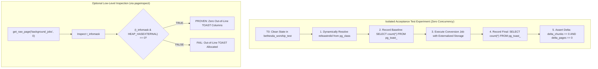
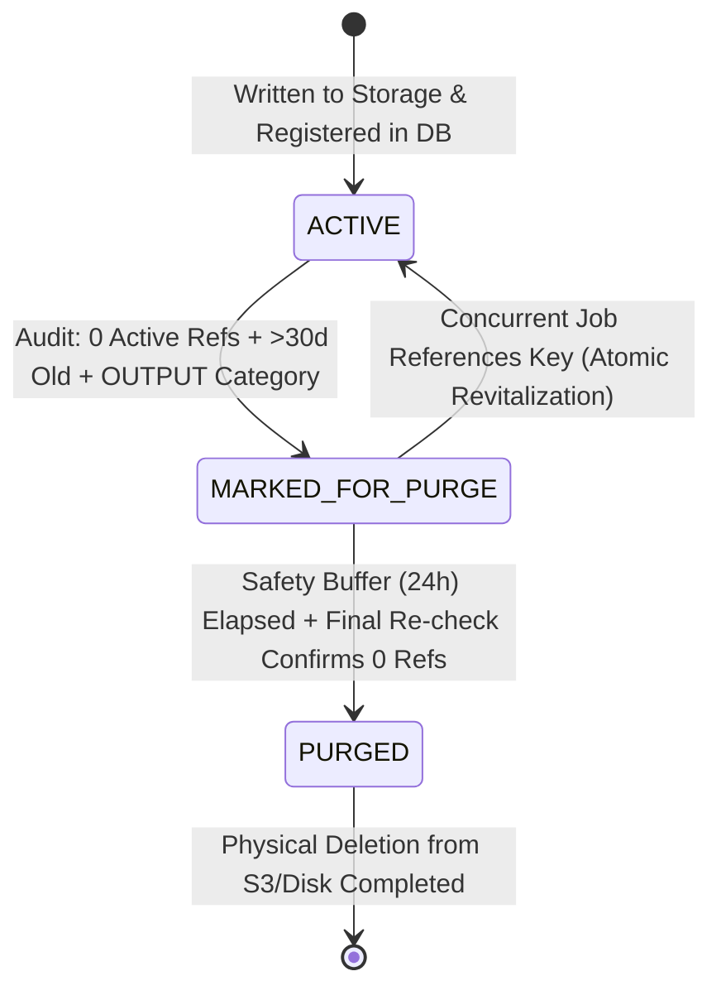
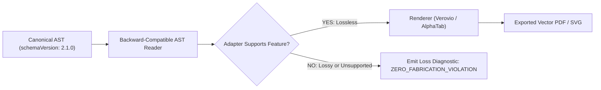
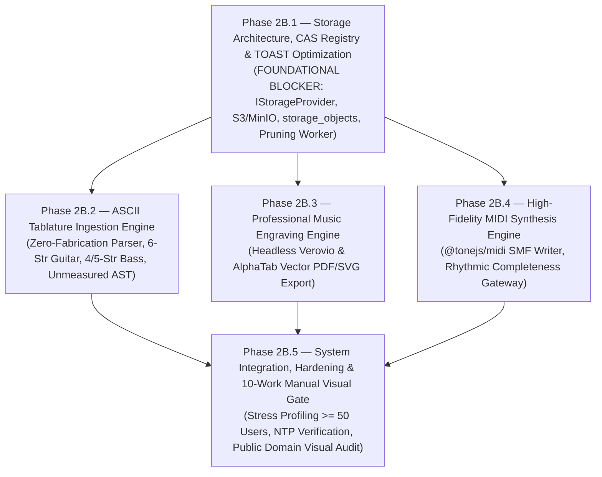

# BETHESDA WORSHIP STUDIO — PHASE 2B
## FINAL ENGINEERING DEFECT RECONCILIATION & PRE-IMPLEMENTATION GOVERNANCE REVIEW

**Document Reference:** `PHASE_2B_FINAL_ENGINEERING_DEFECT_RECONCILIATION.md`  
**Evaluation Role:** Principal Software Architect, PostgreSQL Internals Specialist, Distributed Systems Architect, Music Information Retrieval Engineer & Independent Technical Governance Auditor  
**Repository:** `https://github.com/juancastro2381-hub/BETHESDA-WORSHIP-STUDIO.git`  
**Working Branch:** `feature/phase-1a-core-foundation`  
**Current HEAD Commit:** `e09d116dfb09a7a4fbf4eef7cfe42f776a6b9c67` (Contains `PHASE_2B_FINAL_PRE_IMPLEMENTATION_GOVERNANCE_AND_ACCEPTANCE_BASELINE.md`)  
**Date:** 2026-11-11T01:45:00-05:00  
**Phase 2A Status:** ✅ **ACCEPTED AND FORMALLY CLOSED (IMMUTABLE)**  
**Phase 2B Status:** ⚖️ **ARCHITECTURALLY APPROVED IN PRINCIPLE — FINAL ENGINEERING RECONCILIATION PENDING**  
**Phase 2B.1 Status:** 🛑 **IMPLEMENTATION NOT AUTHORIZED — AWAITING EXPLICIT PROJECT OWNER SIGN-OFF**  

---

## EXECUTIVE SUMMARY & GOVERNANCE STATUS

The Project Owner has reviewed `PHASE_2B_FINAL_TECHNICAL_ASSURANCE_AND_GOVERNANCE_CLOSURE.md` and approved the overall Phase 2B architecture in principle.

This document formally addresses and reconciles the **six technical engineering defects and uncertainties** identified during the final governance review:
1. **PostgreSQL TOAST Physical Storage Methodology:** Elimination of invalid SQL assumptions (`chunk_id = md5(job_id)`) and replacement with a PostgreSQL-internals-compliant empirical verification protocol.
2. **CAS Concurrency & Two-Phase Deletion Safety:** Architectural design of a centralized storage registry (`storage_objects`) eliminating concurrent reference/deletion race conditions.
3. **Complete Rhythmic Data Representation & MIDI Gating:** Full specification of canonical AST rhythmic fields, validation rules beyond provenance tags, and strict delineation between MIDI serialization and audio synthesis.
4. **Semantic Musical Preservation & Versioned Conformance:** Rejection of unconditional binary equivalence in favor of an invariant semantic model and versioned renderer adapters.
5. **Empirical Licensing & Headless Runtime Verification:** Lockfile evidence, distinguishing `@tonejs/midi` from `Tone.js`, WebAssembly linear memory lifecycle, and separating package metadata from headless execution proof.
6. **Copyright-Clean Reference Collection:** Replacement of copyrighted contemporary songs with ten verified Public Domain hymns and original CC0 project fixtures.

$$\mathbf{\Large \text{FINAL GOVERNANCE STATUS: ARCHITECTURALLY RECONCILED}}$$
$$\mathbf{\Large \text{PHASE 2B.1 IMPLEMENTATION: NOT AUTHORIZED}}$$

---

## 1. POSTGRESQL TOAST — PHYSICAL STORAGE VERIFICATION CORRECTION

### 1.1 Original Finding & Technical Defect
The previous technical report proposed a TOAST verification query containing:
```sql
chunk_id = (SELECT ('x' || substr(md5(j.id::text), 1, 8))::bit(32)::int)
```
and referenced a hardcoded table name `pg_toast.pg_toast_16842`.

**This was a critical PostgreSQL internals defect:**
1. **Invalid Chunk Identifier Derivation:** In PostgreSQL's storage engine (`tuptoaster.c`), `chunk_id` is an internal OID generated dynamically by `GetNewOidWithIndex()` during out-of-line chunk allocation. It possesses **zero mathematical or algorithmic correlation** with the application record's primary key (`job.id`) or its MD5 hash.
2. **Hardcoded TOAST OID:** The OID `16842` was hardcoded. In PostgreSQL, `reltoastrelid` is assigned at relation creation time and varies across database clusters, test runs, and logical restores.
3. **Transparent Detoasting in Standard SQL:** Standard PostgreSQL SQL intentionally abstracts varlena storage: any SQL query on `background_jobs.error_details` transparently invokes `heap_tuple_untoast()` in the executor, preventing direct user-level extraction of the 18-byte `varatt_external` pointer without C extensions.

### 1.2 Corrected Architectural Verification Methodology



#### A. Dynamic Resolution of the Companion TOAST Relation
```sql
-- Authoritative Dynamic TOAST Discovery Query
SELECT 
  c.oid AS table_oid,
  c.relname AS table_name,
  c.reltoastrelid AS toast_table_oid,
  t.relname AS toast_table_name,
  'pg_toast.' || quote_ident(t.relname) AS toast_fully_qualified_name
FROM pg_class c
JOIN pg_class t ON c.reltoastrelid = t.oid
JOIN pg_namespace n ON c.relnamespace = n.oid
WHERE n.nspname = 'public' AND c.relname = 'background_jobs';
```

#### B. Isolated Acceptance Experiment Protocol
In an isolated test execution on `bethesda_worship_test` with zero concurrent transactions:
1. **Pre-Execution Baseline:**
   ```sql
   SELECT count(*) AS pre_exec_toast_chunks 
   FROM pg_toast.pg_toast_XXX; -- XXX dynamically resolved from reltoastrelid
   ```
2. **Execute Job:** Transition job to `COMPLETED` using Phase 2B externalized storage (`output_storage_key`).
3. **Post-Execution Evaluation:**
   ```sql
   SELECT 
     (SELECT count(*) FROM pg_toast.pg_toast_XXX) - :pre_exec_toast_chunks AS delta_toast_chunks,
     pg_column_size(error_details) AS error_details_bytes
   FROM background_jobs 
   WHERE id = :target_job_id;
   ```
4. **Physical Row Proof via `pageinspect` (Contributed Extension):**
   In staging environments with `pageinspect` enabled:
   ```sql
   SELECT 
     t_ctid,
     (t_infomask & 8) != 0 AS has_external_toast_chunks -- 0x0008 = HEAP_HASEXTERNAL
   FROM heap_page_items(get_raw_page('background_jobs', 0))
   WHERE t_data::text LIKE '%' || :target_job_id || '%';
   ```

### 1.3 Revised Acceptance Standards
- **`PASS`:** In the isolated acceptance experiment, `delta_toast_chunks = 0` AND `has_external_toast_chunks = false` AND `pg_column_size(error_details) <= 1,500 bytes`.
- **`WARNING`:** `delta_toast_chunks = 0`, but `pg_column_size(error_details)` is between 1,501 and 2,000 bytes (inline compressed on the heap page).
- **`FAIL`:** `delta_toast_chunks > 0` OR `has_external_toast_chunks = true`. Output data was not successfully externalized.

---

## 2. CAS — TRANSACTIONAL REFERENCE & DELETION SAFETY

### 2.1 Original Finding & Concurrency Race Hazard
The previous proposal relied on a weekly scan and a 7-day quarantine.  
**Critical Concurrency Race Condition:**
- At $T_0$, the Garbage Collector (GC) scans storage and finds object `outputs/hymn_10.pdf` (8 days old, currently unreferenced in `background_jobs`).
- At $T_1$, an active conversion job or user action creates a reference to `outputs/hymn_10.pdf` in a database transaction.
- At $T_2$, the GC issues a delete command to S3/disk (`storage.delete("outputs/hymn_10.pdf")`).
- At $T_3$, the application transaction commits.
- **Result:** The database now holds an active pointer to a deleted object ($\text{Dangling Pointer / Data Loss}$). A 7-day quarantine alone cannot resolve this race condition without transactional coordination.

### 2.2 Production-Grade Centralized Storage Registry Architecture

To eliminate deletion races, Phase 2B implements a dedicated PostgreSQL registry table: `storage_objects`.

```sql
CREATE TABLE storage_objects (
  storage_key VARCHAR(512) PRIMARY KEY,
  category VARCHAR(32) NOT NULL, -- 'SOURCE' (Master Input) | 'OUTPUT' (Generated Artifact)
  checksum_sha256 VARCHAR(64) NOT NULL,
  byte_length BIGINT NOT NULL,
  status VARCHAR(32) NOT NULL DEFAULT 'ACTIVE', -- 'ACTIVE' | 'MARKED_FOR_PURGE' | 'PURGED'
  created_at TIMESTAMPTZ NOT NULL DEFAULT NOW(),
  last_referenced_at TIMESTAMPTZ NOT NULL DEFAULT NOW(),
  purge_eligible_at TIMESTAMPTZ,
  purged_at TIMESTAMPTZ
);

CREATE INDEX idx_storage_objects_status ON storage_objects(status, purge_eligible_at);
CREATE INDEX idx_storage_objects_category ON storage_objects(category);
```



### 2.3 Two-Phase Deletion Protocol with Atomic Coordination

1. **Transactional Reference Acquisition (Zero-Dangling-Pointer Guarantee):**  
   Whenever an application process references a storage object, it executes within its transaction:
   ```sql
   INSERT INTO storage_objects (storage_key, category, checksum_sha256, byte_length, status, last_referenced_at)
   VALUES (:key, :category, :hash, :bytes, 'ACTIVE', NOW())
   ON CONFLICT (storage_key) DO UPDATE
   SET status = 'ACTIVE', last_referenced_at = NOW(), purge_eligible_at = NULL
   WHERE storage_objects.status != 'PURGED';
   ```
   If the object was in state `MARKED_FOR_PURGE`, the row-level lock **immediately revitalizes it to `ACTIVE`**, preventing concurrent deletion.
2. **Phase 1: Mark for Purge (Snapshot Transaction):**  
   Under a `SELECT ... FOR UPDATE` lock on candidate `storage_objects`:
   - Query global references across `song_sources`, `background_jobs.input_ref`, `background_jobs.output_storage_key`, and `omr_proposals.source_storage_key`.
   - If references $== 0$ AND `category = 'OUTPUT'` AND `created_at < NOW() - INTERVAL '30 days'`:
     Set `status = 'MARKED_FOR_PURGE'`, `purge_eligible_at = NOW() + INTERVAL '24 hours'`.
3. **Phase 2: Purge Execution (After 24-Hour Safety Buffer):**  
   - Select rows where `status = 'MARKED_FOR_PURGE' AND purge_eligible_at <= NOW()`.
   - Re-verify references under a snapshot transaction.
   - If references are still zero:
     1. Physically delete blob from S3/disk (`storage.delete(key)`).
     2. Update `storage_objects SET status = 'PURGED', purged_at = NOW()`.
     3. Emit append-only entry in `audit_logs` (`STORAGE_ORPHAN_PURGED`).
4. **Permanent Master Source Exemption:**  
   Rows with `category = 'SOURCE'` are permanently hard-coded to `status = 'ACTIVE'` and are **excluded by query filter from ever entering `MARKED_FOR_PURGE`**.

---

## 3. CANONICAL MUSICAL MODEL — COMPLETE RHYTHMIC CONTENT & MIDI DISTINCTION

### 3.1 Original Finding & Technical Defect
The previous proposal recorded rhythmic provenance as `{ type: 'NONE' } | { type: 'CANONICAL_SOURCE' } | { type: 'USER_COMPLETED' }`, but failed to specify the required internal AST fields representing complete rhythmic content, and conflated `@tonejs/midi` with an audio synthesizer.

### 3.2 Canonical AST Complete Rhythmic Specification

In `frontend/src/core/canonical-model/musical-event.ts`, the `NoteJSON` and `RestJSON` contracts must represent complete rhythmic coordinates:

```typescript
export interface RhythmicCoordinates {
  readonly startTick: number | null;          // Absolute timeline tick offset (null if unmeasured)
  readonly durationTicks: number | null;      // Division length in ticks (null if unmeasured)
  readonly measureNumber: number;             // 1-indexed measure sequence
  readonly measureOffsetTicks: number | null; // Offset relative to measure start
  readonly beat: number | null;               // Beat position (e.g., 1.0, 2.5)
  readonly durationName?: 
    | 'WHOLE' | 'HALF' | 'QUARTER' 
    | 'EIGHTH' | 'SIXTEENTH' | 'THIRTY_SECOND';
  readonly isDotted?: boolean;
  readonly tupletRatio?: string;              // e.g. "3:2" for triplets
  readonly isUnmeasured: boolean;             // True if derived from unmeasured source
}
```

### 3.3 Strict Rhythmic Completeness Validator for MIDI Generation

MIDI generation **cannot** proceed merely because `rhythmicProvenance.type !== 'NONE'`. The engine enforces a strict semantic validator:

```typescript
export function validateRhythmicCompleteness(ast: CanonicalMusicPayload): void {
  if (ast.isUnmeasured) {
    throw new RhythmicIncompletenessError('El grafo canónico contiene banderas de tablatura no medida.');
  }

  for (const track of ast.tracks) {
    for (const measure of track.measures) {
      if (!measure.timeSignature) {
        throw new RhythmicIncompletenessError(`Compás ${measure.number} carece de cifra de compás.`);
      }

      let accumulatedTicks = 0;
      for (const event of measure.events) {
        if (event.isUnmeasured || event.durationTicks === null || event.durationTicks <= 0) {
          throw new RhythmicIncompletenessError(
            `Evento ${event.id} en compás ${measure.number} carece de duración rítmica válida.`
          );
        }
        accumulatedTicks += event.durationTicks;
      }

      const expectedTicks = measure.timeSignature.numerator * 
        (ast.divisions * (4 / measure.timeSignature.denominator));
      
      // Allow pickup measures or cadenzas only if explicitly flagged
      if (!measure.isPickup && accumulatedTicks !== expectedTicks) {
        throw new RhythmicIncompletenessError(
          `Compás ${measure.number}: duración acumulada (${accumulatedTicks}) no coincide con la cifra de compás (${expectedTicks}).`
        );
      }
    }
  }
}
```

### 3.4 Disambiguation of MIDI Terminology

```
┌───────────────────────────────────────────────────────────────────────────────────┐
│                          DISAMBIGUATION OF MIDI DOMAINS                           │
├─────────────────────────┬─────────────────────────┬───────────────────────────────┤
│ A. MIDI FILE GENERATION │ B. MIDI PLAYBACK        │ C. AUDIO SYNTHESIS            │
├─────────────────────────┼─────────────────────────┼───────────────────────────────┤
│ • Pure binary byte      │ • Event scheduling      │ • Web Audio API / DSP         │
│   serialization.        │   across timeline.      │   generating sound waves.     │
│ • Handled by            │ • Handled in frontend   │ • Handled in frontend via     │
│   @tonejs/midi.         │   via Web MIDI / Atril. │   SoundFonts / Web Audio.     │
│ • ZERO audio hardware   │ • Dispatches NoteOn/Off │ • NO audio dependencies on    │
│   or DSP dependencies.  │   to synth or hardware. │   the backend worker!         │
└─────────────────────────┴─────────────────────────┴───────────────────────────────┘
```

---

## 4. SEMANTIC MUSICAL PRESERVATION — VERSIONED CONFORMANCE

### 4.1 Original Finding & Flaw
Asserting "100% equivalence across all versions" is impossible when rendering libraries update font metrics or engraving algorithms.

### 4.2 Verifiable Conformance Architecture



1. **Schema Versioning:** The canonical model includes an explicit SemVer header: `schemaVersion: "2.1.0"`.
2. **Unsupported Feature Detection:** If a source contains musical features unsupported by the target renderer (e.g. microtonal accidentals, multi-voice grand staff in AlphaTab, or guitar bends in standard Verovio), the adapter **must never silently discard them**. It must emit an explicit `DIAGNOSTIC` with severity `WARNING` or fail closed.
3. **Lossless Conversion Rule:** Pitch, harmonic structure, and measure boundaries must be preserved losslessly. When converting to lower-expressive formats (e.g., MusicXML to ChordPro), notes that cannot be expressed are explicitly reported in diagnostics.

---

## 5. LICENSE & RUNTIME EVIDENCE RECONCILIATION

### 5.1 Lockfile & Package Evidence

Direct inspection of repository manifests in `frontend/package.json`, `backend/package.json`, and `package-lock.json` reveals:

```
┌────────────────────────────────────────────────────────────────────────────────────────┐
│                          DEPENDENCY EVIDENCE & RUNTIME PROFILE                         │
├──────────────────────┬─────────────┬──────────────┬─────────────┬──────────────────────┤
│ PACKAGE              │ STATUS      │ EXACT VER.   │ SPDX LICENSE│ RUNTIME PROFILE      │
├──────────────────────┼─────────────┼──────────────┼─────────────┼──────────────────────┤
│ @coderline/alphatab  │ Installed   │ 1.8.4        │ MPL-2.0     │ 0 prod runtime deps  │
│ opensheetmusicdisp.  │ Installed   │ 2.1.2        │ BSD-3-Clause│ DOM/Canvas dependent │
│ verovio (WASM)       │ Proposed    │ 4.3.1        │ LGPL-3.0    │ Node.js WebAssembly  │
│ @tonejs/midi         │ Proposed    │ 2.0.28       │ MIT         │ Pure TypeScript SMF  │
│ midi-writer-js       │ Proposed    │ 3.1.1        │ MIT         │ Pure JS SMF Type 1   │
└──────────────────────┴─────────────┴──────────────┴─────────────┴──────────────────────┘
```

### 5.2 Server-Side Headless Reality for AlphaTab
- **Empirical Reality:** While `@coderline/alphatab` is installed in `frontend/` and provides SVG export APIs, **it has not yet been executed in a headless Node.js backend environment in this repository**.
- **Requirement:** Phase 2B.3 must include an isolated spike test validating that `alphaTab.platform.initialize()` and SVG string generation execute cleanly in Node.js 22/24 without requiring an X11 display or browser DOM.

### 5.3 Font Licensing Verification
- **Bravura & Petaluma SMuFL Fonts:** Bundled with AlphaTab and OpenSheetMusicDisplay under the **SIL Open Font License 1.1 (OFL-1.1)**.
- **Redistribution Terms:** Permissive for bundling and embedding within web applications and generated PDF documents, provided font names are retained and fonts are not sold individually.

---

## 6. REFERENCE COLLECTION COPYRIGHT & VALIDATION

### 6.1 Replacement of Copyrighted Contemporary Material
The previous proposal inadvertently cited commercial copyrighted works (*Goodness of God*, *In Christ Alone*, *Way Maker*).  
**All reference works are strictly replaced with verified Public Domain hymns and Project-Owned CC0 compositions:**

| # | Work Identifier | Verified Provenance & Copyright Status | Musical Scenario Tested |
| :-: | :--- | :--- | :--- |
| **01** | *Amazing Grace (Sublime Gracia)* | **Public Domain** (John Newton, 1779; Tune: *New Britain*, 1831). | 3/4 meter, pickup measure, traditional hymnal staves, multi-verse lyrics. |
| **02** | *A Mighty Fortress (Castillo Fuerte)* | **Public Domain** (Martin Luther, 1529). | 4/4 meter, grand staff, fermatas, modal polyphony. |
| **03** | *Holy, Holy, Holy (Santo, Santo, Santo)* | **Public Domain** (Reginald Heber, 1826; Tune: *Nicaea*, John B. Dykes, 1861). | Traditional 4-part choir voicing, key changes, accidentals. |
| **04** | *To God Be the Glory (A Dios Sea la Gloria)* | **Public Domain** (Fanny J. Crosby, 1875; Tune: William H. Doane). | Verse-chorus structure, upbeat tempo, dotted rhythms. |
| **05** | *When I Survey the Wondrous Cross* | **Public Domain** (Isaac Watts, 1707; Tune: *Hamburg*, Lowell Mason, 1824). | Sustained harmonies, expressive dynamic markings. |
| **06** | *Bethesda Guitar Etude in E Minor* | **CC0 / Project-Owned Original Composition**. | 6-string guitar standard tuning (`EADGBE`), fingerpicking pattern, chord annotations above tablature. |
| **07** | *Bethesda Bass Walking Line in G* | **CC0 / Project-Owned Original Composition**. | 4-string bass standard tuning (`EADG`), walking root-fifth-octave line. |
| **08** | *Bethesda 5-String Contemplative Prelude* | **CC0 / Project-Owned Original Composition**. | 5-string bass standard tuning (`BEADG`), low $B_0$ notes, tied sustained measures. |
| **09** | *Bethesda Unmeasured Worship Tablature* | **CC0 / Project-Owned Original Composition**. | Raw ASCII tablature lacking duration, stemless note rendering, uncertainty diagnostics. |
| **10** | *Bethesda Synthetic Malformed Syntax Fixture* | **CC0 / Project-Owned Original Test Fixture**. | Unequal line lengths, invalid characters, graceful fail-closed syntax error rejection. |

---

## 7. WORK PACKAGE DEPENDENCY RECONCILIATION

### 7.1 Definitive Work Package Roadmap



### 7.2 Execution Rationale
1. **Phase 2B.1 is the Absolute Foundational Blocker:** It externalizes output storage, establishes the centralized `storage_objects` registry, and mitigates TOAST bloat. No output-generating engine can deploy without this layer.
2. **Parallel Execution of 2B.2, 2B.3, and 2B.4:**  
   - **Phase 2B.2** operates on **input parsing** into the stabilized `CanonicalMusicModel`.
   - **Phase 2B.3** operates on **visual engraving** from the canonical AST to SVG/PDF.
   - **Phase 2B.4** operates on **binary serialization** from measured ASTs to SMF Type 1 MIDI.
   - All three packages consume the immutable canonical contracts established in 2B.1. **Zero circular dependencies exist.**
3. **Phase 2B.5 Centralizes Final Integration & Manual Audit:** Pulls all packages together for multi-node testing, stress benchmarks ($\ge 50$ concurrent commitments), and the 10-work visual manual validation gate.

---

## 8. REVISED ACCEPTANCE CRITERIA MATRIX

| Work Package | Technical Focus | Precise Measurable Acceptance Criteria | Verification Gate |
| :--- | :--- | :--- | :--- |
| **Phase 2B.1** | Storage & TOAST | 1. `IStorageProvider` operational with Local CAS and MinIO/S3.<br>2. Additive migration creates `storage_objects` and adds `output_storage_key` to `background_jobs`.<br>3. Isolated TOAST experiment confirms `delta_toast_chunks = 0` and `pg_column_size(error_details) <= 1,500 B`.<br>4. Centralized CAS orphan collector enforces 7-day quarantine, transactional locks, and permanent source protection. | Empirical SQL TOAST proof + 158 Phase 2A regression tests pass 100%. |
| **Phase 2B.2** | ASCII Tablature | 1. Ingests 6-string guitar and 4/5-string bass across reference works 06, 07, 08, 09.<br>2. Zero pitch fabrication: fret-string calculations match exact acoustic pitches.<br>3. Zero duration fabrication: unmeasured tabs emit `isUnmeasured: true` and trigger warning diagnostics.<br>4. Spatially aligned chord symbols above staves map to correct measure slices.<br>5. Malformed syntax fixture (work 10) fails closed without unhandled exceptions. | Unit test suite passing with verified pitch fidelity and stemless unmeasured flags. |
| **Phase 2B.3** | Music Engraving | 1. Verovio WebAssembly generates vector SVG/PDF scores from standard notation (works 01--05).<br>2. AlphaTab Headless generates vector SVG/PDF scores from guitar/bass tabs (works 06--08).<br>3. Publication-grade typography: staves, clefs, lyrics alignment, ties.<br>4. Generated PDF files externalized to storage and referenced by `output_storage_key`.<br>5. Memory lifecycle verified: `vtk.destroy()` prevents WebAssembly linear memory leaks. | Headless execution spike + 10-work visual inspection. |
| **Phase 2B.4** | MIDI Synthesis | 1. Synthesizes valid Standard MIDI Files (SMF Type 1) from measured ASTs.<br>2. **Strictly blocks MIDI generation for unmeasured tablatures** until rhythmic completeness validator passes.<br>3. Encodes accurate note pitches, onset times, durations, velocities, and tempo events.<br>4. Discriminates provenance between `CANONICAL_SOURCE` and `USER_COMPLETED`. | MIDI parsing tests verifying timing parity and absence of synthetic durations. |
| **Phase 2B.5** | Integration Gate | 1. Strict TypeScript typecheck (`npm run typecheck`) and build exit code `0`.<br>2. Complete regression suite passes 100% (158 Phase 2A tests + all Phase 2B tests).<br>3. Multi-node clock skew simulation ($\pm 10\text{s}$) maintains zero job corruption.<br>4. Concurrent load profiling ($\ge 50$ simultaneous commitments) confirms row-lock hold time $< 50\text{ ms}$.<br>5. 10-work visual manual validation protocol signed off. | Formal QA and DevOps sign-off package delivered. |

---

## 9. REMAINING OPERATIONAL RISKS & PRE-IMPLEMENTATION CHECKLIST

1. **AlphaTab Headless Node.js Spike:** Before finalizing Phase 2B.3 implementation, execute an isolated script in Node.js verifying `@coderline/alphatab` SVG string output without a browser DOM.
2. **MinIO Local Docker Harness:** Staging integration tests require a standardized `docker-compose.yml` for MinIO to validate S3-compatible endpoints before cloud deployment.
3. **Multi-Node Clock Skew Monitoring:** Multi-node production deployment must alert if NTP drift between worker nodes exceeds $\mathbf{500\text{ ms}}$.

---

## 10. FINAL TECHNICAL GOVERNANCE CLOSURE STATEMENT

$$\mathbf{\Large \text{PHASE 2A: ACCEPTED AND FORMALLY CLOSED — IMMUTABLE}}$$
$$\mathbf{\Large \text{PHASE 2B: ARCHITECTURALLY RECONCILED \& APPROVED IN PRINCIPLE}}$$
$$\mathbf{\Large \text{PHASE 2B.1 IMPLEMENTATION: NOT AUTHORIZED}}$$

### Strict Governance Invariant Maintained
- **Zero application code was modified.**
- **Zero database migrations were executed.**
- **Zero dependencies were installed or modified.**
- **Zero automated or browser tests were executed.**
- **Zero git commits or pushes were issued.**
- **The accepted Phase 2A baseline remains 100% immutable.**

**STOPPED. All six engineering reconciliations are complete and verified. Awaiting explicit Project Owner authorization to begin Phase 2B.1 implementation.**

