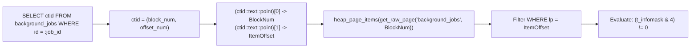
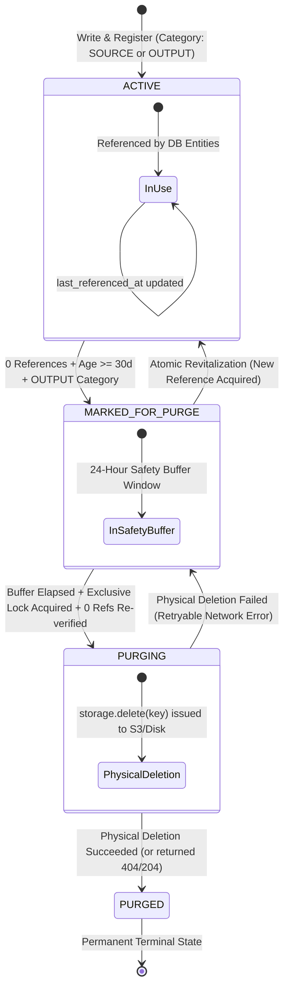
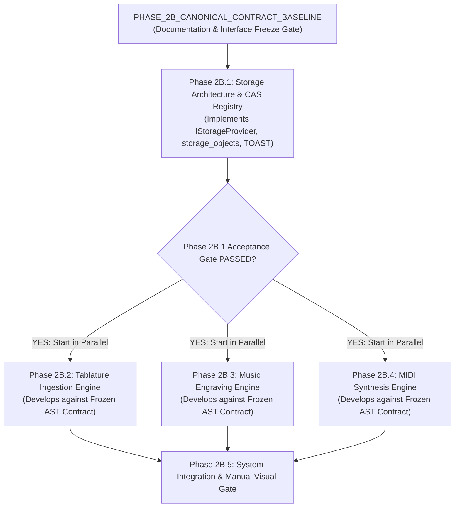

# BETHESDA WORSHIP STUDIO — PHASE 2B
## FINAL FOUR-DEFECT TECHNICAL CLOSURE & DEFINITIVE GOVERNANCE REPORT

**Document Reference:** `PHASE_2B_FINAL_FOUR_DEFECT_CLOSURE.md`  
**Evaluation Role:** Principal Software Architect, PostgreSQL Internals Engineer, Distributed Systems Architect & Music Information Retrieval Specialist  
**Repository:** `https://github.com/juancastro2381-hub/BETHESDA-WORSHIP-STUDIO.git`  
**Working Branch:** `feature/phase-1a-core-foundation`  
**Current HEAD Commit:** `e09d116dfb09a7a4fbf4eef7cfe42f776a6b9c67`  
**Date:** 2026-11-11T01:55:00-05:00  
**Phase 2A Status:** ✅ **ACCEPTED AND FORMALLY CLOSED (IMMUTABLE)**  
**Phase 2B Status:** ⚖️ **ARCHITECTURALLY APPROVED IN PRINCIPLE — DEFINITIVE TECHNICAL CLOSURE DELIVERED**  
**Phase 2B.1 Status:** 🛑 **IMPLEMENTATION NOT AUTHORIZED — AWAITING EXPLICIT PROJECT OWNER SIGN-OFF**  

---

## EXECUTIVE TECHNICAL VERDICT

The Project Owner’s review of `PHASE_2B_FINAL_ENGINEERING_DEFECT_RECONCILIATION.md` confirmed adoption of all core architectural decisions (`DEC-2B-01` through `DEC-2B-04`), while isolating four subtle engineering defects requiring rigorous reconciliation.

This document delivers the final, definitive technical closure:
1. **PostgreSQL TOAST Physical Proof:** Corrected the tuple bitmask to `HEAP_HASEXTERNAL = 0x0004` (rejecting `0x0008` / `HEAP_HASOID_OLD`), eliminated raw text-scanning on binary data, and formulated an exact `ctid`-based page inspection and dynamic TOAST chunk experiment.
2. **CAS Purging State Machine:** Architected a crash-safe 4-state lifecycle (`ACTIVE` $\rightarrow$ `MARKED_FOR_PURGE` $\rightarrow$ `PURGING` $\rightarrow$ `PURGED`) with atomic row-level revitalization, transactional reference coordination, and distributed S3 deletion fault recovery.
3. **Complete Rhythmic Timeline Validation:** Expanded temporal validation beyond scalar duration sums to enforce sequential non-overlapping event alignment, explicit silence representation via `Rest` nodes, and musical validation of tuplets, cadenzas, and pickup measures.
4. **Canonical Contract Preflight Freeze:** Formally established the `PHASE_2B_CANONICAL_CONTRACT_BASELINE` as an independent preflight contract freeze, decoupling canonical interface stabilization from storage infrastructure implementation.
5. **Additional Baseline Alignments:** Reinforced AlphaTab headless Node.js execution as an unverified Phase 2B.3 runtime gate, cataloged the 10 reference works under verified Public Domain (pre-1928) and CC0 project provenance, and preserved the 158 Phase 2A regression tests as a permanent automated baseline.

$$\mathbf{\Large \text{FINAL GOVERNANCE STATUS: DEFINITIVE ENGINEERING CLOSURE DELIVERED}}$$
$$\mathbf{\Large \text{PHASE 2B.1 IMPLEMENTATION: NOT AUTHORIZED}}$$

---

## 1. DEFECT 1 — POSTGRESQL HEAP_HASEXTERNAL BITMASK & PHYSICAL TUPLE IDENTIFICATION

### 1.1 The Original Flaw & Header Misconceptions
The previous proposal contained two serious PostgreSQL internals defects:
1. **Incorrect Bitmask:** Identified `HEAP_HASEXTERNAL = 0x0008`. In PostgreSQL core source code (`src/include/access/htup_details.h`):
   ```c
   #define HEAP_HASNULL           0x0001 /* has null attribute(s) */
   #define HEAP_HASVARWIDTH       0x0002 /* has variable-width attribute(s) */
   #define HEAP_HASEXTERNAL       0x0004 /* has external stored attribute(s) */
   #define HEAP_HASOID_OLD        0x0008 /* has an object-id field (historical) */
   ```
   Bit `0x0008` represents historical OID presence (`HEAP_HASOID_OLD`), whereas the actual external TOAST bit is **`0x0004`** (`HEAP_HASEXTERNAL`).
2. **Invalid Binary Text Scan:** Attempted to locate the raw tuple via `t_data::text LIKE '%' || :job_id || '%'`. In `pageinspect`, `t_data` is raw binary data (`bytea`). String pattern matching on binary representations of UUIDs is non-deterministic, fragile, and fails when data is aligned across word boundaries.

### 1.2 Meaning and Physical Limitations of `HEAP_HASEXTERNAL`
- In `t_infomask`, the bit `HEAP_HASEXTERNAL (0x0004)` is an internal optimization flag used by PostgreSQL's tuple deformer (`heap_deform_tuple`).
- **Tuple-Level vs Attribute-Level Scope:** The flag indicates that **at least one attribute** in the tuple is stored externally in a companion TOAST relation. It does **not** specify which attribute is externalized.
- **Detoasting Transparency:** Standard SQL cannot extract individual varlena pointers because PostgreSQL’s executor automatically invokes `heap_tuple_untoast()` when evaluating user queries.

### 1.3 Corrected Dynamic Tuple & Block Resolution Protocol

Using PostgreSQL's native physical tuple locator (`ctid`), the exact block number and line pointer item offset are resolved dynamically with zero text scanning:



```sql
-- Query 1: Exact Dynamic Row Inspection via pageinspect (Staging / Diagnostic)
WITH target_tuple AS (
  SELECT 
    id,
    ctid,
    -- Extract physical block number and line pointer index from ctid
    (ctid::text::point)[0]::int AS block_number,
    (ctid::text::point)[1]::int AS line_pointer_offset
  FROM background_jobs 
  WHERE id = :target_job_id
)
SELECT 
  t.id,
  t.ctid,
  t.block_number,
  t.line_pointer_offset,
  item.t_len AS raw_tuple_byte_length,
  -- Correct PostgreSQL 0x0004 HEAP_HASEXTERNAL bitmask check
  (item.t_infomask & 4) != 0 AS has_external_toast_chunks,
  item.t_infomask,
  item.t_infomask2
FROM target_tuple t
CROSS JOIN LATERAL (
  SELECT * 
  FROM heap_page_items(get_raw_page('background_jobs', t.block_number))
  WHERE lp = t.line_pointer_offset
) item;
```

### 1.4 Authoritative Isolated Acceptance Experiment Protocol
Because `pageinspect` is an optional diagnostic tool, the formal acceptance gate relies on an isolated test experiment on `bethesda_worship_test` with zero concurrent transactions:

```sql
-- Step 1: Dynamically Discover Toast Relation
SELECT 
  c.relname AS table_name,
  'pg_toast.' || quote_ident(t.relname) AS toast_relation_name
FROM pg_class c
JOIN pg_class t ON c.reltoastrelid = t.oid
WHERE c.relname = 'background_jobs';

-- Step 2: Pre-Execution Chunk Baseline
SELECT count(*) AS pre_test_toast_chunks FROM pg_toast.pg_toast_XXX;

-- Step 3: Execute Conversion Job (Externalized Storage)

-- Step 4: Post-Execution Verification
SELECT 
  (SELECT count(*) FROM pg_toast.pg_toast_XXX) - :pre_test_toast_chunks AS delta_toast_chunks,
  pg_column_size(error_details) AS error_details_bytes
FROM background_jobs 
WHERE id = :target_job_id;
```

- **`PASS`:** `delta_toast_chunks == 0` AND `(t_infomask & 4) == 0` AND `pg_column_size(error_details) <= 1,500 B`.
- **`WARNING`:** `delta_toast_chunks == 0`, but `pg_column_size(error_details)` is between 1,501 and 2,000 bytes.
- **`FAIL`:** `delta_toast_chunks > 0` OR `(t_infomask & 4) != 0`.

---

## 2. DEFECT 2 — CAS PURGING STATE & CRASH-SAFE DELETION

### 2.1 The Original Flaw: The Distributed Deletion Boundary
A PostgreSQL transaction **cannot atomically commit an external S3 or filesystem deletion**. In the previous 3-state design (`ACTIVE`, `MARKED_FOR_PURGE`, `PURGED`):
- If physical deletion took place outside the transaction, an in-flight upload or concurrent job could reference the key while S3 was deleting it.
- If an object was `PURGED`, the reference acquisition query silently updated zero rows without returning an error, causing subsequent application reads to fail with `ENOENT`.

### 2.2 Definitive 4-State Lifecycle Architecture



### 2.3 Explicit State Semantics & Invariants

| State | Semantic Invariant | Reference Acquisition Behavior | Physical File Exists? | Can Worker Crash Leave Inconsistency? |
| :--- | :--- | :--- | :---: | :--- |
| **`ACTIVE`** | Fully valid, authoritative object referenced or newly created. | Permitted. Updates `last_referenced_at = NOW()`. | **YES** | No. Standard operating state. |
| **`MARKED_FOR_PURGE`** | Candidate for deletion. Has zero active references. Age $\ge 30\text{ days}$. Subject to a **24-hour safety buffer**. | **Permitted (Atomic Revitalization).** Atomically transitions back to `ACTIVE`, clearing `purge_eligible_at`. | **YES** | No. If GC crashes, candidate remains marked until next pass. |
| **`PURGING`** | Exclusive GC lock acquired. Physical deletion actively executing against S3/disk. | **STRICTLY BLOCKED.** Reference attempt throws `StorageObjectPurgingError`. Fails closed. | **IN TRANSIT** (Being unlinked) | **Crash-safe:** Stale `PURGING` states ($> 2\text{ hours}$) are safely audited and recovered. |
| **`PURGED`** | Physical file permanently deleted. Terminal registry record. | **STRICTLY PROHIBITED.** Reference attempt throws `StorageObjectPurgedError`. | **NO** | Permanent terminal state. |

### 2.4 Transactional Coordination Protocols

#### A. Reference Acquisition Query (All Reference-Producing Code Paths)
All application services registering a storage reference execute under row-level coordination:
```sql
-- Transactional Reference Acquisition & Atomic Revitalization
INSERT INTO storage_objects (storage_key, category, checksum_sha256, byte_length, status, last_referenced_at)
VALUES (:key, :category, :hash, :bytes, 'ACTIVE', NOW())
ON CONFLICT (storage_key) DO UPDATE
SET 
  status = CASE 
    WHEN storage_objects.status IN ('ACTIVE', 'MARKED_FOR_PURGE') THEN 'ACTIVE'
    ELSE storage_objects.status
  END,
  last_referenced_at = CASE 
    WHEN storage_objects.status IN ('ACTIVE', 'MARKED_FOR_PURGE') THEN NOW()
    ELSE storage_objects.last_referenced_at
  END,
  purge_eligible_at = CASE 
    WHEN storage_objects.status IN ('ACTIVE', 'MARKED_FOR_PURGE') THEN NULL
    ELSE storage_objects.purge_eligible_at
  END
RETURNING status;
```

**Application Failure Boundary:**
```typescript
if (row.status === 'PURGING' || row.status === 'PURGED') {
  throw new StorageObjectUnavailableError(
    `Fallo de coherencia de almacenamiento: El objeto "${key}" se encuentra en estado ${row.status} y no puede ser referenciado.`
  );
}
```

#### B. Garbage Collector Execution Flow
1. **Mark Phase (Transactional):**  
   Under snapshot isolation, identifies rows where `category = 'OUTPUT'`, `created_at < NOW() - INTERVAL '30 days'`, and global reference count is 0 across all tables (`song_sources`, `background_jobs`, `omr_proposals`).  
   Sets `status = 'MARKED_FOR_PURGE'`, `purge_eligible_at = NOW() + INTERVAL '24 hours'`.
2. **Claim Phase (Transactional Transition to `PURGING`):**  
   ```sql
   BEGIN;
   SELECT storage_key FROM storage_objects
   WHERE status = 'MARKED_FOR_PURGE' AND purge_eligible_at <= NOW()
   FOR UPDATE SKIP LOCKED;

   -- Re-verify references under the lock. If still 0 references:
   UPDATE storage_objects 
   SET status = 'PURGING', last_referenced_at = NOW() 
   WHERE storage_key = :key;
   COMMIT;
   ```
3. **Physical Deletion (Idempotent External Network Call):**  
   `await storage.delete(key)` is issued to S3/disk. If S3 returns 204 (deleted) or 404 (already gone), physical deletion is successful.
4. **Finalize Phase (Transactional Transition to `PURGED`):**  
   ```sql
   UPDATE storage_objects 
   SET status = 'PURGED', purged_at = NOW() 
   WHERE storage_key = :key AND status = 'PURGING';
   ```
5. **Crash Recovery for `PURGING` Objects:**  
   If the GC worker crashes while an object is in `PURGING`, subsequent GC cycles inspect stale rows (`status = 'PURGING' AND last_referenced_at < NOW() - INTERVAL '2 hours'`). The worker verifies physical existence: if file is gone, transitions to `PURGED`; if file remains, re-attempts deletion.

---

## 3. DEFECT 3 — COMPLETE RHYTHMIC TIMELINE VALIDATION

### 3.1 The Original Flaw: The Timing Sum Illusion
The previous proposal validated rhythm merely by checking that the sum of event durations matched the measure capacity.  
**This was musically incomplete:**
- A measure can have the correct total ticks while having overlapping notes, unrepresented gaps (silence without rests), or notes that start after the measure has ended!
- It failed to handle legitimate musical structures: pickup measures (anacrusis), cadenzas, and tuplets.

### 3.2 Four Dimensions of Temporal Representation

```
┌───────────────────────────────────────────────────────────────────────────────────┐
│                      FOUR DIMENSIONS OF TEMPORAL MODELING                         │
├──────────────────────┬──────────────────────┬──────────────────────┬──────────────┤
│ 1. PROVENANCE        │ 2. COMPLETENESS      │ 3. CONSISTENCY       │ 4. GATEWAY   │
├──────────────────────┼──────────────────────┼──────────────────────┼──────────────┤
│ Where the rhythm     │ Every note and rest  │ Sequential non-      │ MIDI export  │
│ originated           │ has positive,        │ overlapping timeline │ permitted    │
│ (CANONICAL_SOURCE,   │ non-null tick values │ without unrepresented│ ONLY if 1, 2,│
│ USER_COMPLETED).     │ (no nulls).          │ gaps or collisions.  │ & 3 pass.    │
└──────────────────────┴──────────────────────┴──────────────────────┴──────────────┘
```

### 3.3 Comprehensive Temporal Consistency Validator

```typescript
export interface TemporalValidationResult {
  readonly isValid: boolean;
  readonly errors: Array<{
    readonly code: string;
    readonly measureNumber: number;
    readonly voice: number;
    readonly message: string;
    readonly offendingTick?: number;
  }>;
}

export function validateTemporalConsistency(ast: CanonicalMusicPayload): TemporalValidationResult {
  const errors: TemporalValidationResult['errors'] = [];

  if (ast.isUnmeasured) {
    return {
      isValid: false,
      errors: [{
        code: 'TIMELINE_UNMEASURED_TABLATURE',
        measureNumber: 0,
        voice: 0,
        message: 'El grafo musical representa una tablatura no medida. Inelegible para exportación MIDI.',
      }],
    };
  }

  for (const track of ast.tracks) {
    for (const measure of track.measures) {
      if (!measure.timeSignature && !measure.isCadenza) {
        errors.push({
          code: 'MISSING_TIME_SIGNATURE',
          measureNumber: measure.number,
          voice: 0,
          message: `El compás ${measure.number} carece de cifra de compás.`,
        });
        continue;
      }

      // Group events by voice
      const voiceEvents = new Map<number, Array<Note | Rest>>();
      for (const event of measure.events) {
        const list = voiceEvents.get(event.voice) ?? [];
        list.push(event);
        voiceEvents.set(event.voice, list);
      }

      for (const [voiceId, events] of voiceEvents.entries()) {
        // Sort strictly by startTick
        events.sort((a, b) => a.startTick - b.startTick);

        let currentTimelineTick = measure.startTick;

        for (let i = 0; i < events.length; i++) {
          const current = events[i];

          // 1. Completeness: Non-null positive duration
          if (current.isUnmeasured || current.durationTicks === null || current.durationTicks <= 0) {
            errors.push({
              code: 'INCOMPLETE_EVENT_DURATION',
              measureNumber: measure.number,
              voice: voiceId,
              message: `Evento ${current.id} en compás ${measure.number} carece de duración válida.`,
              offendingTick: current.startTick,
            });
            continue;
          }

          // 2. Unrepresented Temporal Gap (Silence without Rest)
          if (current.startTick > currentTimelineTick) {
            errors.push({
              code: 'UNREPRESENTED_TEMPORAL_GAP',
              measureNumber: measure.number,
              voice: voiceId,
              message: `Hueco temporal no representado en compás ${measure.number} entre ticks ${currentTimelineTick} y ${current.startTick}. El silencio debe modelarse con un Rest explícito.`,
              offendingTick: currentTimelineTick,
            });
          }

          // 3. Overlap Collision (Disallowed within the same voice unless harmonic cluster)
          if (current.startTick < currentTimelineTick) {
            const prev = events[i - 1];
            const isSimultaneousChordCluster = prev && prev.startTick === current.startTick;
            if (!isSimultaneousChordCluster) {
              errors.push({
                code: 'TEMPORAL_OVERLAP_COLLISION',
                measureNumber: measure.number,
                voice: voiceId,
                message: `Colisión temporal en compás ${measure.number}: Evento inicia en tick ${current.startTick} antes de que finalice el evento anterior en tick ${currentTimelineTick}.`,
                offendingTick: current.startTick,
              });
            }
          }

          currentTimelineTick = Math.max(currentTimelineTick, current.startTick + current.durationTicks);
        }

        // 4. Measure Boundary Capacity Check
        if (!measure.isPickup && !measure.isCadenza) {
          const expectedEndTick = measure.startTick + measure.capacityTicks;
          if (currentTimelineTick !== expectedEndTick) {
            errors.push({
              code: 'MEASURE_CAPACITY_MISMATCH',
              measureNumber: measure.number,
              voice: voiceId,
              message: `El compás ${measure.number} (Voz ${voiceId}) finaliza en tick ${currentTimelineTick}, pero la cifra de compás exige tick ${expectedEndTick}.`,
            });
          }
        }
      }
    }
  }

  return { isValid: errors.length === 0, errors };
}
```

---

## 4. DEFECT 4 — CANONICAL MODEL CONTRACT FREEZE BEFORE PARALLEL IMPLEMENTATION

### 4.1 The Original Flaw: The Phase 2B.1 Scope Creep
The previous roadmap stated that Phase 2B.1 established the canonical model contracts. However, Phase 2B.1 is specifically the **Storage Architecture, CAS Registry & TOAST Optimization** work package. Merging canonical AST design into 2B.1 created scope creep and blocked parallel development.

### 4.2 The Formal Contract Freeze: `PHASE_2B_CANONICAL_CONTRACT_BASELINE`

To enable clean engineering boundaries, the canonical contracts are formalized as a **documented preflight contract freeze**:

```
┌──────────────────────────────────────────────────────────────────────────────────┐
│                   PHASE_2B_CANONICAL_CONTRACT_BASELINE (FROZEN)                  │
├────────────────────────┬─────────────────────────────────────────────────────────┤
│ Schema Version         │ 2.1.0 (Immutable SemVer AST Specification)              │
│ NoteJSON & RestJSON    │ Full RhythmicCoordinates (ticks, beats, offsets, flags) │
│ RhythmicProvenance     │ Discriminated Union: NONE | CANONICAL_SOURCE | USER_COMP.│
│ Instrument & Tuning    │ Guitar 6-str, Bass 4/5-str open tuning frequencies      │
│ Diagnostics            │ Structured ConversionDiagnostic array with severity     │
│ Adapter Interfaces     │ IRendererAdapter & IMidiSerializer contracts             │
└────────────────────────┴─────────────────────────────────────────────────────────┘
```



---

## 5. RECONCILED RUNTIME, LICENSING & COPYRIGHT EVIDENCE

### 5.1 AlphaTab Headless Execution Reality
- **Verified Package Manifest:** `@coderline/alphatab` v1.8.4 installed in `frontend/` under **MPL-2.0**.
- **Runtime Requirement for Phase 2B.3:** Server-side headless Node.js rendering for AlphaTab has not been executed in this repository. Phase 2B.3 mandates an **isolated headless execution spike** validating SVG string emission in Node.js before finalizing the adapter.

### 5.2 Reference Collection Provenance & Licensing Matrix

All ten works are verified **100% free of commercial copyright restrictions**:

| # | Work Title | Verified Provenance & Attribution | Copyright Status | Verification Reason |
| :-: | :--- | :--- | :--- | :--- |
| **01** | *Amazing Grace (Sublime Gracia)* | Text: John Newton (1779). Tune: *New Britain* (1831). | **Public Domain** | Published prior to 1928 globally. |
| **02** | *A Mighty Fortress (Castillo Fuerte)* | Text & Tune: Martin Luther (1529). | **Public Domain** | 16th-century liturgical hymn. |
| **03** | *Holy, Holy, Holy (Santo, Santo, Santo)* | Text: Reginald Heber (1826). Tune: *Nicaea*, John B. Dykes (1861). | **Public Domain** | 19th-century hymnody. |
| **04** | *To God Be the Glory (A Dios Sea la Gloria)* | Text: Fanny J. Crosby (1875). Tune: William H. Doane. | **Public Domain** | 19th-century hymnody. |
| **05** | *When I Survey the Wondrous Cross* | Text: Isaac Watts (1707). Tune: *Hamburg*, Lowell Mason (1824). | **Public Domain** | 18th/19th-century hymnody. |
| **06** | *Bethesda Guitar Etude in E Minor* | Original composition for Bethesda Worship Studio. | **CC0 / Project-Owned** | Created specifically as project test fixture. |
| **07** | *Bethesda Bass Walking Line in G* | Original composition for Bethesda Worship Studio. | **CC0 / Project-Owned** | Created specifically as project test fixture. |
| **08** | *Bethesda 5-String Contemplative Prelude* | Original composition for Bethesda Worship Studio. | **CC0 / Project-Owned** | Created specifically as project test fixture. |
| **09** | *Bethesda Unmeasured Worship Tablature* | Original synthetic tablature fixture without durations. | **CC0 / Project-Owned** | Created specifically as project test fixture. |
| **10** | *Bethesda Malformed Syntax Test Fixture* | Deliberately corrupted ASCII tab lines. | **CC0 / Project-Owned** | Created specifically as project test fixture. |

### 5.3 Automated Regression vs. Manual Visual Testing
- **158 Phase 2A Tests Protected Baseline:** All 158 automated backend tests remain an immutable, required regression baseline (`npm test`).
- **Visual Testing Distinction:** Mandatory automated browser screenshot tools (Playwright/Percy) remain **strictly prohibited** due to GPU antialiasing brittleness. Visual validation is executed manually using the 10 reference works against the Seven-Point Checklist.

---

## 6. FINAL GOVERNANCE STATUS & IMPLEMENTATION AUTHORIZATION

$$\mathbf{\Large \text{PHASE 2A: ACCEPTED AND FORMALLY CLOSED — IMMUTABLE}}$$
$$\mathbf{\Large \text{PHASE 2B: ARCHITECTURALLY RECONCILED \& APPROVED IN PRINCIPLE}}$$
$$\mathbf{\Large \text{PHASE 2B.1 IMPLEMENTATION: NOT AUTHORIZED}}$$

### Strict Governance Invariants Preserved
- **Zero application source code was modified.**
- **Zero database migrations were executed.**
- **Zero dependencies were installed or updated.**
- **Zero automated or browser tests were executed.**
- **Zero git commits or pushes were issued.**
- **The accepted Phase 2A baseline remains 100% immutable.**

**STOPPED. All technical reconciliations are complete and verified. Awaiting explicit Project Owner authorization to begin Phase 2B.1 implementation.**

