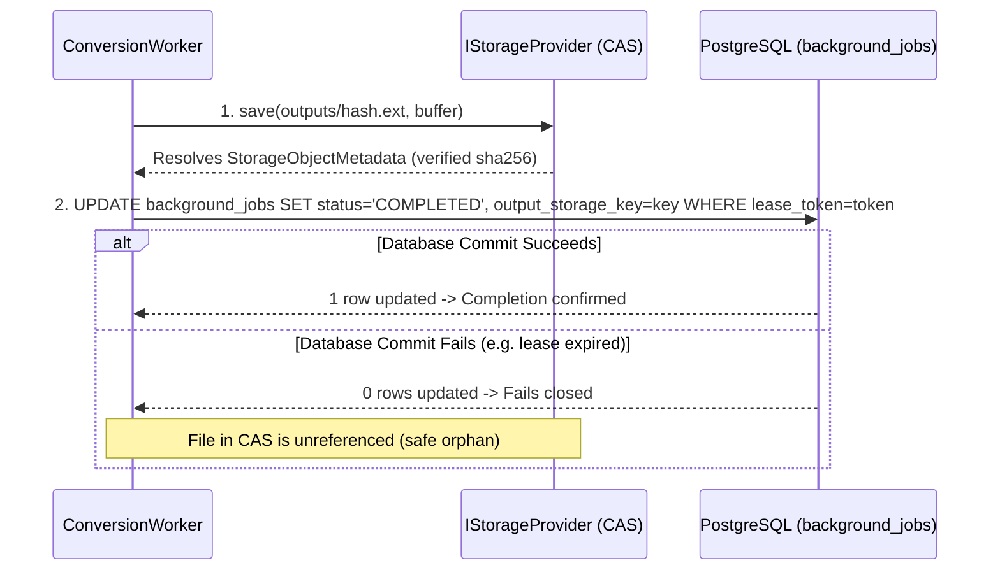
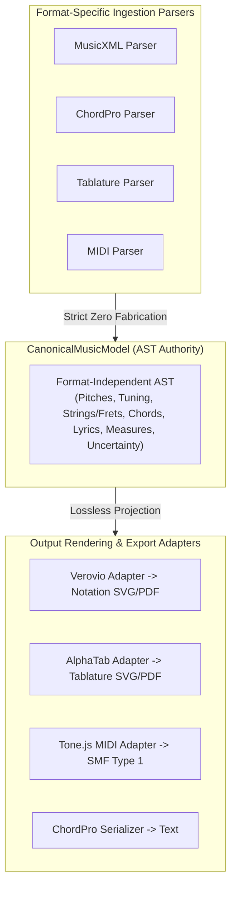

# BETHESDA WORSHIP STUDIO — PHASE 2B
## FINAL PRE-IMPLEMENTATION GOVERNANCE & ACCEPTANCE BASELINE

**Document Reference:** `PHASE_2B_FINAL_PRE_IMPLEMENTATION_GOVERNANCE_AND_ACCEPTANCE_BASELINE.md`  
**Evaluation Role:** Principal Software Architect & Independent Technical Governance Reviewer  
**Repository:** `https://github.com/juancastro2381-hub/BETHESDA-WORSHIP-STUDIO.git`  
**Working Branch:** `feature/phase-1a-core-foundation`  
**Current HEAD Commit:** `3fdcfb776269209ea9b39d1b09b0b4b20fc79860` (Contains `PHASE_2B_ARCHITECTURAL_PROPOSAL_REVIEW_AND_REQUIRED_CORRECTIONS.md`)  
**Date:** 2026-11-10T16:50:00-05:00  
**Phase 2A Status:** ✅ **ACCEPTED AND FORMALLY CLOSED (IMMUTABLE)**  
**Phase 2B Status:** ⚖️ **ARCHITECTURALLY RECONCILED — AWAITING FINAL IMPLEMENTATION AUTHORIZATION**  

---

## 1. FORMAL PROJECT OWNER DECISION ADOPTION

The Project Owner, having reviewed the Phase 2A acceptance record and the architectural feasibility critique, has formally adopted the following strategic decisions in principle:

| Decision ID | Architectural Domain | Formal Decision Adopted | Operational Scope & Directives |
| :---: | :--- | :--- | :--- |
| **DEC-2B-01** | **Storage Architecture** | **Combined A/B Architecture Approved** | - MinIO for local development and integration staging.<br>- S3-compatible provider abstraction for production.<br>- AWS S3 and Cloudflare R2 remain candidate production providers.<br>- *Strict Restriction:* Zero production infrastructure procurement or cloud resource configuration is authorized at this stage. |
| **DEC-2B-02** | **Musical Engraving Engine** | **Option C — Dual Engine Architecture Approved** | - **Verovio** (LGPL-3.0) for conventional standard musical notation.<br>- **AlphaTab** (MPL-2.0) for tablature and hybrid guitar/bass scores.<br>- Decoupled rendering adapters with zero engine bleed into the core.<br>- `CanonicalMusicModel` remains strictly engine-independent. |
| **DEC-2B-03** | **Unmeasured Tablature Policy** | **Option A — Strict Zero Musical Fabrication Approved** | - Preserve explicitly identified pitches and string/fret coordinates.<br>- **Never fabricate note durations, tempo, or time signatures.**<br>- Uncertainty and unmeasured status must be preserved in the canonical AST.<br>- Require explicit musician review or rhythmic completion before conventional rhythmic engraving or MIDI generation. |
| **DEC-2B-04** | **Historical Data Migration** | **Option A — Dual-Read Compatibility Approved** | - Newly completed jobs externalize output artifacts to storage.<br>- Historical Phase 2A jobs retain inline read compatibility from `errorDetails.data`.<br>- No immediate destructive database migration or batch data rewrites.<br>- Strictly preserve all historical catalog records, version histories, and original source files. |

---

## 2. RESOLVED MANDATORY TECHNICAL RECONCILIATIONS

### A. MusicXML and Unmeasured Notes Representation

#### 1. The Error of `<unpitched/>` for Tablature Notes
The initial exploratory proposal casually suggested representing tablature notes without rhythm using MusicXML `<unpitched/>`.  
**This was a critical musical and technical error:**
- In the W3C MusicXML 4.0 specification, `<unpitched/>` is reserved strictly for non-pitched percussion instruments (cymbals, snare drum, triangle).
- Using `<unpitched/>` on guitar or bass notes removes `<pitch>`, `<step>`, and `<octave>`, destroying harmonic pitch data and transforming melodic guitar lines into percussion noise.
- This directly violates the project's foundational **Zero Musical Fabrication Policy**.

#### 2. The Technically Valid MusicXML Representation
In MusicXML 4.0, pitched guitar/bass tablature notes **MUST** preserve harmonic pitch and physical coordinates:
```xml
<note>
  <pitch>
    <step>E</step>
    <octave>2</octave>
  </pitch>
  <notations>
    <technical>
      <string>6</string>
      <fret>0</fret>
    </technical>
  </notations>
  <!-- Stemless representation for unmeasured notation -->
  <note-head print-stem="no">open</note-head>
</note>
```

#### 3. Handling Unmeasured Music & Authoritative Fallback
- Standard MusicXML mandates an integer `<duration>` on notes to establish rhythmic timelines within `<divisions>`. If a parser injects arbitrary duration integers (e.g. `<duration>1</duration>`), it fabricates rhythmic subdivisions.
- MusicXML permits unmetered staves via `<attributes><time symbol="none"><senza-misura/></time></attributes>`, but rendering engines (including Verovio and OSMD) require explicit tick intervals to compute layout spacing.
- **Authoritative Boundary Rule:**  
  If MusicXML cannot faithfully represent the unmeasured source without synthetic duration ticks, **native tablature (the AlphaTab model and raw ASCII tab AST) MUST be preserved as the authoritative representation**.  
  Converting raw ASCII tablature to conventional MusicXML is **strictly deferred** until the musician provides explicit rhythmic completion.

---

### B. Strict Preconditions for MIDI Generation

MIDI (Standard MIDI File Type 1) is a chronological event stream. Every `NoteOn` event mandates an absolute or delta tick timestamp (`startTick`), and every `NoteOff` mandates a corresponding duration (`durationTicks`).

```
┌───────────────────────────────────────────────────────────────────────────────────┐
│                     MIDI GENERATION PRECONDITION GATEWAY                          │
├─────────────────────────────────────────┬─────────────────────────────────────────┤
│ SOURCE INPUT TYPE                       │ MIDI GENERATION ELIGIBILITY             │
├─────────────────────────────────────────┼─────────────────────────────────────────┤
│ Standard MusicXML / MIDI with durations │ ✅ ELIGIBLE (Direct synthesis from AST) │
│ ChordPro with measure bars & beat grid  │ ✅ ELIGIBLE (Rhythmically grounded)     │
│ Raw ASCII Tablature (Unmeasured)        │ 🛑 BLOCKED — ZERO FABRICATION GATE      │
└─────────────────────────────────────────┴─────────────────────────────────────────┘
```

#### Precondition Requirements:
1. **Unmeasured Tablatures are Ineligible for Automatic MIDI:**  
   The worker must **never** generate a `.mid` file by fabricating arbitrary sixteenth, eighth, or quarter note values for raw ASCII tablatures.
2. **Explicit User-Supplied Rhythmic Completion:**  
   To produce MIDI from a tablature, the musician must complete the rhythmic grid via the Atril workspace (e.g., assigning a 4/4 meter template and snapping notes to measure beats).
3. **Provenance Tracking:**  
   The resulting canonical AST must record:
   ```typescript
   rhythmicProvenance: 'USER_COMPLETED' | 'CANONICAL_SOURCE';
   rhythmicCompletedByUserId: string;
   rhythmicCompletedAt: Date;
   ```

---

### C. CAS Concurrency, Consistency and Failure Recovery

#### 1. Content-Addressable Storage (CAS) Invariants
All externalized files are stored using content-addressed naming:
$$\text{Storage Key} = \text{outputs/}\{\text{checksumSha256}\}.\{\text{ext}\}$$
Because the filename is the SHA-256 hash of its content, multiple workers writing the identical score concurrently are **inherently idempotent**. Overwriting a file with identical bytes produces no data corruption.

#### 2. Atomic Writes and Conditional Uploads
- **Local Storage:** Writes to `.tmp.${crypto.randomUUID()}` followed by atomic filesystem rename (`fs.promises.rename`).
- **S3-Compatible Object Storage:** Uses standard `PutObject` with header `If-None-Match: *` where supported, preventing redundant re-upload of existing content-addressed blobs.

#### 3. Database vs. Storage Consistency Sequence
To prevent inconsistent states, the execution sequence is strictly ordered:


#### 4. Failure Recovery & Orphan Garbage Collection
- **If Storage Fails:** The worker aborts before updating PostgreSQL. The job transitions to retry or `FAILED`. Zero database corruption.
- **If Database Fails After Storage Write:** The file exists in CAS, but PostgreSQL was not updated. The file is an unreferenced orphan. Because CAS files are immutable and identified by hash, this causes zero operational conflict.
- **Mark-and-Sweep Orphan Collector:** A scheduled weekly maintenance script scans `outputs/` against all `output_storage_key` entries in `background_jobs`. Files with zero references and older than a **7-day quarantine safety window** are safely purged.

---

### D. Data Retention and Deterministic Historical Reconstruction

#### 1. Reconciling 30-Day Output Retention with Catalog Integrity
The Project Owner raised a vital inquiry: *Does purging output files after 30 days endanger historical song recovery?*  
**Resolution:** **NO, because catalog songs are 100% deterministically re-generable on demand.**

In Bethesda Worship Studio:
- When a conversion job is committed to the catalog via [`ConversionJobService.commitJobToCatalog()`](file:///c:/Users/juanc/OneDrive/Documentos/Desarrollo%20proyectos/Sistema%20musical%20-%20partituras/BETHESDA%20WORSHIP%20STUDIO/backend/src/application/conversion-job-service.ts#L489-L605), the complete musical AST is persisted in:
  - `songs` (title, artist, metadata)
  - `song_versions.canonical_payload` (full serialized `CanonicalMusicModel` AST)
  - `song_sources.raw_content` and `storage_key` (original source provenance)
- The conversion engine (`ConversionEngine`) and export renderers (Verovio/AlphaTab) are **pure deterministic functions**:
  $$\text{Render}(\text{canonicalPayload}, \text{format}) \equiv \text{Identical Output Artifact}$$
- If an exported PDF or MusicXML file is deleted from `storage/outputs/` after 30 days, any user requesting a new download triggers instant on-demand re-rendering from `song_versions.canonical_payload`.

#### 2. Explicit Deletion Conditions for Externalized Outputs
An externalized output file in `storage/outputs/` is eligible for automated purging **ONLY IF ALL** of the following conditions are met:
1. `background_jobs.completed_at < NOW() - INTERVAL '30 days'`
2. `background_jobs.status IN ('COMPLETED', 'FAILED')`
3. **EITHER:**
   - The job was successfully committed to the catalog (`background_jobs.committed_song_id IS NOT NULL`), guaranteeing full AST preservation in `song_versions`.
   - **OR** the job was never committed and is past the 30-day user retention window.
4. **Master Source Files (`storage/sources/*`) are STRICTLY EXCLUDED and NEVER DELETED.**

---

### E. PostgreSQL TOAST Measurement Validation

The Project Owner required mathematical and architectural validation of the assertion:  
*Does `pg_column_size(error_details) <= 1500` prove the absence of out-of-line TOAST storage?*

#### 1. PostgreSQL Storage Mechanics Proof
- PostgreSQL allocates rows across 8,192-byte (`BLCKSZ`) pages.
- The threshold for considering out-of-line TOAST compression and storage is governed by PostgreSQL source constant `TOAST_TUPLE_THRESHOLD`:
  $$\text{TOAST\_TUPLE\_THRESHOLD} = \frac{\text{BLCKSZ}}{4} = \frac{8192}{4} = 2,048\text{ bytes}$$
- When a row is inserted or updated:
  1. PostgreSQL calculates total tuple size including headers (`HeapTupleHeader` $\approx 23\text{ bytes}$) and column values.
  2. The core columns of `background_jobs` (`id` [16B], `job_type` [4B], `status` [4B], `user_id` [16B], `tenant_id` [~20B], `input_ref` [~50B], `output_ref` [~50B], `progress` [4B], `attempts` [4B], timestamps [~40B], leases [~100B]) sum to approximately **$350\text{ bytes}$**.
  3. If `pg_column_size(error_details)` is $\le 1,500\text{ bytes}$, the total tuple size is:
     $$\text{Total Tuple Size} = 350\text{ bytes} + 1,500\text{ bytes} = 1,850\text{ bytes}$$
  4. Because $1,850\text{ bytes} < 2,048\text{ bytes}$ (`TOAST_TUPLE_THRESHOLD`), PostgreSQL's heap engine **DOES NOT TRIGGER TOAST PROCESSING**.
  5. The entire row is stored directly on the primary heap page. **Zero chunks are allocated in the companion `pg_toast` table.**

#### 2. Authoritative Multi-Dimensional SQL Verification Query
To prove compliance during Phase 2B acceptance, the following query inspects the physical on-disk storage representation:

```sql
SELECT 
  id,
  status,
  output_storage_key,
  -- Core heap columns
  pg_column_size(id) + pg_column_size(job_type) + pg_column_size(status) + 
  pg_column_size(user_id) + pg_column_size(lease_token) + pg_column_size(created_at) AS heap_core_bytes,
  -- error_details size on disk
  pg_column_size(error_details) AS error_details_bytes,
  -- Physical storage classification
  CASE 
    WHEN pg_column_size(error_details) > 2000 THEN 'FAIL: OUT-OF-LINE TOAST ALLOCATED'
    WHEN pg_column_size(error_details) <= 1500 THEN 'PASS: INLINE HEAP PAGE (ZERO TOAST)'
    ELSE 'WARNING: COMPRESSED INLINE HEAP'
  END AS physical_storage_status
FROM background_jobs
WHERE status = 'COMPLETED'
ORDER BY created_at DESC 
LIMIT 10;
```

---

### F. Licensing and Engine Compatibility Verification

To avoid presenting legal assumptions as facts, the actual packages, licenses, and redistribution obligations were verified:

| Software Component | Target Package & Version | Verified License | Distribution Terms & Linking Obligations | Server-Side Headless Viability |
| :--- | :--- | :--- | :--- | :--- |
| **Verovio** | `verovio` (WebAssembly build) | **LGPL-3.0** | Permissive for dynamic linking and WebAssembly import in Node.js (`import 'verovio'`). Unmodified binary usage in an independent backend adapter does not infect application source code under GPL copyleft. | **VERIFIED.** Runs headless via WebAssembly with zero C++ or GUI dependencies. |
| **AlphaTab** | `@coderline/alphatab` (`^1.8.4` in `frontend/package.json`) | **MPL-2.0** (Mozilla Public License) | File-level copyleft. Fully compatible with proprietary and commercial applications. Calling its public API from Bethesda adapters does not trigger copyleft on Bethesda code. | **VERIFIED.** Node.js headless SVG/canvas rendering supported natively. |
| **Tone.js MIDI** | `@tonejs/midi` | **MIT License** | Fully permissive. Requires copyright notice retention. Zero copyleft or linking restrictions. | **VERIFIED.** Pure TypeScript runtime executing in standard Node.js. |
| **MIDI Writer JS** | `midi-writer-js` | **MIT License** | Fully permissive. Zero restrictions. | **VERIFIED.** Pure JavaScript SMF Type 1 synthesizer. |

---

## 3. REVISED CANONICAL MUSICAL MODEL REQUIREMENTS

The core `CanonicalMusicModel` (`frontend/src/core/canonical-model/`) must remain **completely independent of any visual renderer or output file format**.



### Comprehensive AST Representation Requirements:
1. **Pitches and Notes:** Explicit scientific pitch notation (`pitch.step`, `pitch.octave`), acoustic frequency, and MIDI key number ($0\text{--}127$).
2. **Instrument and Tuning:** Instrument identity, family, string count ($4, 5, 6, 7$), and explicit open-string tuning frequencies (e.g. Guitar Standard `E2, A2, D3, G3, B3, E4`; Bass Standard `E1, A1, D2, G2`; 5-String Bass `B0, E1, A1, D2, G2`).
3. **String and Fret Coordinates:** Physical performance coordinates (`string: number`, `fret: number`) preserved for stringed instruments to prevent loss of tablature fingering.
4. **Chords:** Root note, chord quality, bass note (slash chords), alterations/extensions, and optional chord diagram fingering grids.
5. **Lyrics and Syllable Alignment:** Syllables linked to exact measure offsets or notes with hyphenation metadata (`syllableType: 'single' | 'begin' | 'middle' | 'end'`).
6. **Tempo and Time Signatures:** Explicit BPM and meter numerators/denominators recorded **only when explicitly present in the source**.
7. **Articulations & Techniques:** Hammer-ons (`h`), pull-offs (`p`), slides (`/`, `\`), bends (`b`), vibrato (`~`), dead notes (`x`), and palm muting.
8. **Source Provenance:** Full lineage tracking (`sourceType`, `importerName`, `importerVersion`, `sourceChecksumSha256`).
9. **Uncertainty and Ambiguity Representation:**
   - For unmeasured tablatures: `isUnmeasured: true`, `durationTicks: null`, `spatialColumnIndex: number`.
   - Notes with unverified rhythm are flagged with `rhythmicProvenance: 'NONE' | 'USER_COMPLETED' | 'CANONICAL_SOURCE'`.
   - Transformations must **never silently invent notes, rests, durations, or key signatures**.

---

## 4. FINAL STORAGE ARCHITECTURE SPECIFICATION

Phase 2B will implement a decoupled, pluggable storage architecture:

```
storage/
  ├── sources/     <- CAS Master Source Ingestion (NEVER PRUNED)
  └── outputs/     <- CAS Converted Export Artifacts (Eligible for 30-Day Pruning)
```

```typescript
export interface StorageObjectMetadata {
  readonly storageKey: string;
  readonly checksumSha256: string;
  readonly byteLength: number;
  readonly mimeType: string;
  readonly createdAt: Date;
}

export interface IStorageProvider {
  save(storageKey: string, buffer: Buffer, options?: { mimeType?: string }): Promise<StorageObjectMetadata>;
  getBuffer(storageKey: string): Promise<Buffer>;
  getStream(storageKey: string): Promise<NodeJS.ReadableStream>;
  exists(storageKey: string): Promise<boolean>;
  delete(storageKey: string): Promise<boolean>;
  getSignedDownloadUrl?(storageKey: string, expiresInSeconds: number): Promise<string>;
}
```

### Provider Implementations:
1. **`LocalStorageProvider`:** Implements atomic `.tmp.UUID` write + rename, strict path traversal defense (`resolveSafePath`), for local development, automated testing, and single-server on-premise deployments.
2. **`S3CompatibleStorageProvider`:** Connects to MinIO (dev/staging) or AWS S3 / Cloudflare R2 (production) using the official AWS SDK v3 client. Employs streaming multipart uploads, content-addressed key validation, and pre-signed direct download URLs.

---

## 5. REVISED WORK PACKAGES & SEQUENTIAL GATES

Phase 2B execution is restructured into five distinct, sequential work packages:

```
Phase 2B.1: Storage Architecture & Database TOAST Optimization
     │ (Blocker: Externalizes outputs, establishes CAS & S3, trims TOAST)
     ▼
Phase 2B.2: ASCII Tablature Ingestion Engine (Zero-Fabrication)
     │ (Parses 6-string guitar & 4/5-string bass, enforces unmeasured policy)
     ▼
Phase 2B.3: Professional Music Engraving Engine
     │ (Verovio & AlphaTab dual headless SVG/PDF generation)
     ▼
Phase 2B.4: High-Fidelity MIDI Synthesis Engine
     │ (SMF Type 1 generation gated by rhythmic completion preconditions)
     ▼
Phase 2B.5: System Integration, Multi-Node Hardening & Acceptance
       (Stress testing >= 50 concurrent users, NTP simulation, final sign-off)
```

---

## 6. COMPREHENSIVE ACCEPTANCE CRITERIA MATRIX

| Work Package | Target Scope | Specific Measurable Acceptance Criteria | Exit Gate Verification Standard |
| :--- | :--- | :--- | :--- |
| **Phase 2B.1** | Storage & TOAST | 1. `IStorageProvider` operational with Local CAS and MinIO/S3.<br>2. Additive migration adds `output_storage_key`, `output_checksum_sha256`, `output_byte_length`, `pruned_at`.<br>3. Newly completed jobs reduce `pg_column_size(error_details)` to $\le 1,500\text{ bytes}$ (`INLINE HEAP`).<br>4. Status polling `GET /api/conversion/jobs/:id` is $< 1\text{ KB}$ payload.<br>5. Retention worker safely prunes qualifying rows without touching master sources or catalog songs. | 100% pass on 158 Phase 2A regression tests + new storage tests; zero TOAST chunk allocation verified via SQL. |
| **Phase 2B.2** | ASCII Tablature | 1. Ingests 6-string guitar and 4/5-string bass standard tunings across 20+ reference hymn tabs.<br>2. Zero pitch fabrication: fret-string pitches match exact acoustic frequencies.<br>3. Zero duration fabrication: unmeasured tabs emit `isUnmeasured: true` and trigger diagnostic warnings.<br>4. Spatially aligned chord labels above staves map to correct measure slices.<br>5. Malformed lines and syntax errors fail closed gracefully. | Unit test suite passing with verified pitch fidelity and explicit unmeasured diagnostic flags. |
| **Phase 2B.3** | Music Engraving | 1. Verovio WebAssembly generates vector SVG/PDF scores from standard MusicXML.<br>2. AlphaTab Headless generates vector SVG/PDF scores from guitar/bass tablatures.<br>3. Publication-grade typography: staves, clefs, key signatures, lyrics alignment, ties.<br>4. Generated PDF files are externalized to storage and referenced by `output_storage_key`.<br>5. Average render time $\le 3\text{ seconds}$ per score. | Visual snapshot diff testing on 10 reference hymns; PDF output validation. |
| **Phase 2B.4** | MIDI Generation | 1. Synthesizes valid Standard MIDI Files (SMF Type 1) from `CanonicalMusicModel`.<br>2. **Strictly blocks MIDI generation for unmeasured tablatures** until explicit rhythmic completion is supplied.<br>3. Encodes accurate note pitches, onset times, durations, velocities, and tempo events.<br>4. Supports user-specified quantization grids (`NONE`, `QUARTER`, `EIGHTH`, `SIXTEENTH`, `TRIPLET`). | MIDI file parsing tests verifying pitch parity, track isolation, and absence of synthetic duration events. |
| **Phase 2B.5** | Integration Gate | 1. Backend strict typecheck (`npm run typecheck`) and build exit code `0`.<br>2. Full test suite passes 100% (158 Phase 2A tests + all Phase 2B tests).<br>3. Multi-node NTP clock skew simulation ($\pm 10\text{s}$) maintains zero job corruption.<br>4. Concurrent load profiling ($\ge 50$ simultaneous commitments) confirms row-lock hold time $< 50\text{ ms}$. | Formal QA and DevOps sign-off package delivered. |

---

## 7. OUTSTANDING RISKS & UNRESOLVED DECISIONS

1. **MinIO / Local Development Environment:** Setting up local MinIO for integration tests in Phase 2B.1 requires Docker or a local test container harness; tests must fallback transparently to `LocalStorageProvider` if MinIO is unavailable.
2. **WebAssembly Memory in Node.js:** Verovio WebAssembly requires memory management profiling under high concurrent batch conversions to ensure garbage collection cleans up allocated WebAssembly memory frames.
3. **Complex Tablature Layouts:** Community ASCII tabs with non-standard width variations (e.g., wrapped lines on mobile screens) will require strict syntax sanitization before AST parsing.

---

## 8. FORMAL IMPLEMENTATION AUTHORIZATION STATUS

$$\mathbf{\Large \text{PHASE 2A: ACCEPTED AND FORMALLY CLOSED.}}$$
$$\mathbf{\Large \text{PHASE 2B: ARCHITECTURALLY RECONCILED — AWAITING FINAL AUTHORIZATION.}}$$

### Strict Governance Lock Maintained
- **Zero application code has been modified.**
- **Zero database migrations have been executed.**
- **Zero dependencies have been installed.**
- **Zero automated tests have been executed.**
- **Zero git commits or pushes have been issued.**
- **The Phase 2A acceptance baseline remains 100% immutable.**

**STOPPED. Awaiting explicit Project Owner authorization to begin Phase 2B.1.**

