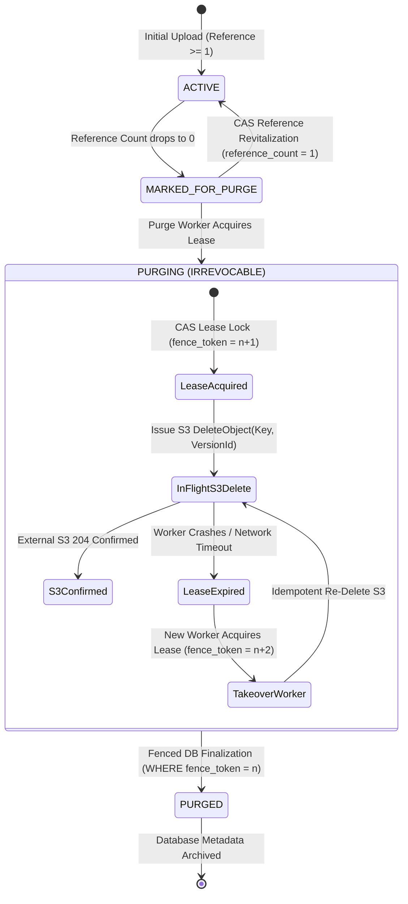

# BETHESDA WORSHIP STUDIO
# PHASE 2B — FINAL REPOSITORY EVIDENCE AND ACCEPTANCE MATRIX
## DEFINITIVE PRE-IMPLEMENTATION GOVERNANCE & ENGINEERING BASELINE
### (INCORPORATING PROJECT OWNER'S FINAL SECURITY & AUDITABLE RECOVERY REMEDIATIONS)

**Audit Date:** 2026-11-11  
**Auditor Roles:** Principal PostgreSQL Database Security Architect, Principal Software Architect, Independent Technical Governance Auditor, AWS S3 Storage Architect, and MIR Specialist  
**Repository:** `https://github.com/juancastro2381-hub/BETHESDA-WORSHIP-STUDIO.git`  
**Branch:** `feature/phase-1a-core-foundation`  
**Current Branch HEAD SHA:** `8dd314290248d314a3c519ff1d38122a4e2bc111` (Synchronized with `origin`)  
**Historical Phase 2A Closure Baseline:** `d2b5631c5180f9dd285e683457a41ec5fa721ce8` / `ddb0e82`  
**Target Document Path:** `PHASE_2B_FINAL_REPOSITORY_EVIDENCE_AND_ACCEPTANCE_MATRIX.md`  

---

## 1. FORMAL GOVERNANCE STATUS DECLARATION

```
========================================================================================
                                GOVERNANCE STATUS GATE
========================================================================================
  PHASE 2A:              ACCEPTED AND FORMALLY CLOSED — IMMUTABLE BASELINE
  PHASE 2B:              DOCUMENTARY RECONCILIATION COMPLETE — PROTOCOL REMEDIATION CERTIFIED
  PHASE 2B.1 STORAGE:    STRICTLY NOT AUTHORIZED (Awaiting Project Owner Sign-Off)
  REPOSITORY CODEBASE:   100% PRESERVED — ZERO CODE / SCHEMA / MIGRATION CHANGES
========================================================================================
```

---

## 2. REPOSITORY TRACEABILITY & COMMIT EVIDENCE RECONCILIATION

### 2.1 Branch HEAD Verification
Physical Git inspection confirms:
- **Actual HEAD SHA:** `8dd314290248d314a3c519ff1d38122a4e2bc111`
- **Commit Subject:** `PHASE 2B — FINAL SQL PROTOCOL DEFECT REMEDIATION & GOVERNANCE CLOSURE`
- **Commit Timestamp:** `Wed Nov 11 03:18:08 2026 -0500`
- **Synchronization:** `HEAD` and `origin/feature/phase-1a-core-foundation` are identical and synchronized.

### 2.2 Confirmation of Six Historical Governance Deliverables in Repository History
Commit history demonstrates that the governance audit documents are preserved and tracked:
1. `PHASE_2B_FINAL_TECHNICAL_ASSURANCE_AND_GOVERNANCE_CLOSURE.md` (committed in `a7b75a2`)
2. `PHASE_2B_FINAL_ENGINEERING_DEFECT_RECONCILIATION.md` (committed in `a7b75a2`)
3. `PHASE_2B_FINAL_FOUR_DEFECT_CLOSURE.md` (committed in `a7b75a2`)
4. `PHASE_2B_FINAL_TECHNICAL_ACCEPTANCE_AND_RISK_CLOSURE.md` (committed in `a7b75a2`)
5. `PHASE_2B_FINAL_REPOSITORY_EVIDENCE_AND_ACCEPTANCE_MATRIX.md` (committed in `b0b6c8a`, updated in `8dd3142`)
6. Six-step SQL protocol defect remediation (committed in `8dd3142`)

### 2.3 Repository Integrity Verification (Diff vs. Phase 2A Baseline)
A complete git diff across the historical Phase 2A acceptance baseline (`d2b5631`) and current HEAD (`8dd3142`) proves:
- **Application source files (`.ts`, `.tsx`, `.js`):** `0 lines changed`
- **Database schema definitions & migrations (`.sql`, `schema.ts`):** `0 lines changed`
- **Package manifests (`package.json`, lockfiles):** `0 lines changed`
- **Automated test suites (`__tests__`):** `0 lines changed`
- **Total delta:** Exactly 7 documentation/governance markdown files added (+4,085 lines), zero code changes.

---

## 3. TEMPORAL VALIDATOR — MATHEMATICAL TUPLET & TIMELINE INTEGRITY SPECIFICATION

### 3.1 Implemented Reality vs. Phase 2B.2 Specification
- **Currently Implemented:** Source inspection of `frontend/src/core/canonical-model/validator.ts` (316 lines) proves that only `CanonicalModelValidator.validate(payload)` exists in production code. It executes coarse structural validation: TPQN equals 480, sequential measure numbers (1..N), measure tick continuity, time signature duration matching, event ID uniqueness, and event bounds inside measures.
- **Specification for Phase 2B.2:** The comprehensive `TemporalValidator` algorithm specified below is **UNIMPLEMENTED IN CODE** and is scheduled for Phase 2B.2.
- **Flawed Production Rules in Existing `validator.ts`:**
  - `validator.ts` lines 81–94 evaluate:
    ```typescript
    if (measure.timeSignature && measure.durationTicks !== null) {
      const expectedDuration = measure.timeSignature.calculateMeasureDurationTicks();
      if (measure.durationTicks !== expectedDuration) {
        errors.push({ code: 'MEASURE_DURATION_MISMATCH', ... });
      }
    }
    ```
    This rule **incorrectly rejects valid pickup measures (anacrusis)**, where Measure 1 deliberately contains fewer ticks than the full time signature.
  - `validator.ts` lines 66–78 enforce `measure.startTick === expectedTick`, which does not permit pickup offset calculations or irregular measures.

### 3.2 Corrected Mathematical Tuplet Validation
Previous drafts compared each note duration against a single scalar value. This was mathematically flawed because tuplets can contain mixed rhythmic values (e.g. a quarter note + an eighth note in a triplet, where durations are 320 ticks and 160 ticks).

#### Mathematical Requirements:
1. **Explicit Tuplet Group Identifier:** Every note belonging to a tuplet references a `tupletGroupId`.
2. **Tuplet Group Specification:**
   - `actualNotes`: Count of notes played in the tuplet (e.g., 3 in a triplet).
   - `normalNotes`: Count of notes normally occupying the time span (e.g., 2 in a triplet).
   - `nominalSpanTicks`: The nominal musical time span occupied by the tuplet.
     $$\text{nominalSpanTicks} = \text{normalNotes} \times \text{baseNoteDurationTicks}$$
3. **Aggregate Duration Validation:**
   The sum of actual note durations belonging to the tuplet group must exactly equal the nominal time span:
   $$\sum_{e \in \text{group}} e.durationTicks \equiv \text{nominalSpanTicks}$$
4. **Exact Rational Arithmetic (No `Math.round()` Masking):**
   If a tuplet subdivision does not yield integer ticks at the configured TPQN (e.g. a 7-tuplet in 1 beat at 480 TPQN: $480 / 7 \approx 68.5714$), the system **must not use `Math.round()`** to conceal the error. Instead, it must emit `TUPLET_FRACTIONAL_TICK_ERROR`, requiring either an increased TPQN resolution or explicit micro-tick compensation.
5. **Tuplet Group Completeness:**
   The validator counts events mapped to `tupletGroupId`. If fewer events exist than declared by `actualNotes` before the next non-tuplet event or measure boundary, emit `INCOMPLETE_TUPLET_GROUP`. If more events exist, emit `OVERFLOW_TUPLET_GROUP`.

### 3.3 Timeline Integrity: Gaps, Collisions, Ordering & Ties
1. **Chronological Event Ordering:** Events within each voice must be strictly ordered such that $e_{i}.startTick \le e_{i+1}.startTick$.
2. **Final Unrepresented Silence at Measure Boundary:** If the last event in a voice within measure $M$ ends at $tick_{end} < M.endTick$, the trailing duration $[tick_{end}, M.endTick)$ is unrepresented silence. The validator must emit `TRAILING_MEASURE_GAP` unless an explicit `Rest` spans to $M.endTick$ or gap-tolerance mode is active.
3. **Same-Voice Collision Detection:** If $e_{i+1}.startTick < e_i.endTick$ in the same voice, a collision occurs. Collision is permitted **only if both notes start at the exact same tick and share an explicit `chordId`**.
4. **Tie Chains (`START` $\rightarrow$ `CONTINUE` $\rightarrow$ `STOP`):**
   - Exact pitch equality: pitch name, accidental, and octave must match identically across all linked notes.
   - Temporal continuity: each subsequent note in the chain must start exactly at the end tick of the preceding note ($e_{next}.startTick \equiv e_{prev}.endTick$).
   - Dangling tie detection: every `START` must resolve to a `STOP`.

### 3.4 Complete TypeScript Specification for `TemporalValidator`

```typescript
/**
 * ARCHITECTURAL SPECIFICATION ONLY — UNIMPLEMENTED IN CODE
 * Scheduled for Implementation: Phase 2B.2
 * Target File: frontend/src/core/canonical-model/temporal-validator.ts
 */

export interface TupletGroupDeclaration {
  groupId: string;
  actualNotes: number;         // e.g. 3
  normalNotes: number;         // e.g. 2
  baseNoteDurationTicks: number; // e.g. 480 for quarter-note triplet
  nominalSpanTicks: number;    // normalNotes * baseNoteDurationTicks (e.g. 960)
}

export interface TemporalValidationOptions {
  allowGapsAsImplicitRests: boolean;
  strictPickupRules: boolean;
  enforceMidiExportBounds: boolean;
}

export interface TemporalIssue {
  severity: 'ERROR' | 'WARNING';
  code:
    | 'TEMPORAL_VOICE_GAP'
    | 'TRAILING_MEASURE_GAP'
    | 'SAME_VOICE_NOTE_COLLISION'
    | 'EVENT_ORDERING_VIOLATION'
    | 'INCOMPLETE_TUPLET_GROUP'
    | 'OVERFLOW_TUPLET_GROUP'
    | 'TUPLET_DURATION_MISMATCH'
    | 'TUPLET_FRACTIONAL_TICK_ERROR'
    | 'INVALID_PICKUP_DURATION'
    | 'BROKEN_TIE_CHAIN'
    | 'TIE_PITCH_MISMATCH'
    | 'TIE_TEMPORAL_DISCONTINUITY'
    | 'MIDI_PITCH_OUT_OF_RANGE'
    | 'MIDI_DURATION_NON_POSITIVE';
  voiceId: number;
  measureNumber: number;
  startTick: number;
  message: string;
  context: Record<string, unknown>;
}

export class TemporalValidator {
  public static validate(
    payload: CanonicalMusicPayload,
    options: TemporalValidationOptions = {
      allowGapsAsImplicitRests: false,
      strictPickupRules: true,
      enforceMidiExportBounds: true,
    }
  ): { isValid: boolean; issues: TemporalIssue[] } {
    const issues: TemporalIssue[] = [];
    const openTies = new Map<string, { noteId: string; pitchKey: string; endTick: number; voiceId: number }>();
    const tupletGroups = new Map<string, { decl: TupletGroupDeclaration; events: Array<{ id: string; duration: number }> }>();

    for (const measure of payload.measures) {
      // -------------------------------------------------------------
      // STAGE 1: PICKUP MEASURE (ANACRUSIS) VALIDATION
      // -------------------------------------------------------------
      const isPickup = (measure as any).isPickup === true;
      if (measure.timeSignature && measure.durationTicks !== null) {
        const nominalTicks = measure.timeSignature.calculateMeasureDurationTicks();
        if (isPickup) {
          if (measure.number !== 1) {
            issues.push({
              severity: 'ERROR',
              code: 'INVALID_PICKUP_DURATION',
              voiceId: 0,
              measureNumber: measure.number,
              startTick: measure.startTick ?? 0,
              message: `Pickup measure flag is only permitted on Measure 1 (found on Measure ${measure.number}).`,
              context: { measureNumber: measure.number },
            });
          } else if (measure.durationTicks >= nominalTicks || measure.durationTicks <= 0) {
            issues.push({
              severity: 'ERROR',
              code: 'INVALID_PICKUP_DURATION',
              voiceId: 0,
              measureNumber: measure.number,
              startTick: measure.startTick ?? 0,
              message: `Pickup measure duration (${measure.durationTicks}) must be > 0 and strictly less than nominal (${nominalTicks}).`,
              context: { durationTicks: measure.durationTicks, nominalTicks },
            });
          }
        }
      }

      // -------------------------------------------------------------
      // STAGE 2: VOICE TIMELINE TRAVERSAL
      // -------------------------------------------------------------
      for (const voice of measure.voices) {
        let expectedVoiceTick = measure.startTick ?? 0;
        let previousStartTick = -1;
        const activeEventsInVoice: Array<{ id: string; startTick: number; endTick: number; chordId?: string }> = [];

        for (const ev of voice.events) {
          // A. Chronological Event Ordering
          if (ev.startTick < previousStartTick) {
            issues.push({
              severity: 'ERROR',
              code: 'EVENT_ORDERING_VIOLATION',
              voiceId: voice.id,
              measureNumber: measure.number,
              startTick: ev.startTick,
              message: `Event ${ev.id} starts at ${ev.startTick} before previous event at ${previousStartTick}.`,
              context: { eventId: ev.id, startTick: ev.startTick, previousStartTick },
            });
          }
          previousStartTick = ev.startTick;

          // B. Gap Detection (Internal Silence Without Explicit Rest)
          if (!options.allowGapsAsImplicitRests && ev.startTick > expectedVoiceTick) {
            issues.push({
              severity: 'ERROR',
              code: 'TEMPORAL_VOICE_GAP',
              voiceId: voice.id,
              measureNumber: measure.number,
              startTick: expectedVoiceTick,
              message: `Temporal gap in Voice ${voice.id} between tick ${expectedVoiceTick} and ${ev.startTick} without explicit Rest.`,
              context: { gapStart: expectedVoiceTick, gapEnd: ev.startTick },
            });
          }

          // C. Same-Voice Collision Detection (Allowing Explicit Chords)
          if (ev.startTick < expectedVoiceTick) {
            const colliding = activeEventsInVoice.filter((a) => a.endTick > ev.startTick);
            const isSimultaneousChord =
              colliding.length > 0 &&
              colliding.every((c) => c.startTick === ev.startTick && c.chordId && (ev as any).chordId && c.chordId === (ev as any).chordId);

            if (!isSimultaneousChord) {
              issues.push({
                severity: 'ERROR',
                code: 'SAME_VOICE_NOTE_COLLISION',
                voiceId: voice.id,
                measureNumber: measure.number,
                startTick: ev.startTick,
                message: `Collision: Note ${ev.id} overlaps active notes in Voice ${voice.id} without explicit chord clustering.`,
                context: { eventId: ev.id, collidingWith: colliding.map((c) => c.id) },
              });
            }
          }

          // D. MIDI Bounds Verification
          if (options.enforceMidiExportBounds && !ev.isRest) {
            const note = ev as Note;
            const midiPitch = note.pitch.toMidiNumber();
            if (midiPitch < 0 || midiPitch > 127) {
              issues.push({
                severity: 'ERROR',
                code: 'MIDI_PITCH_OUT_OF_RANGE',
                voiceId: voice.id,
                measureNumber: measure.number,
                startTick: note.startTick,
                message: `Note pitch ${note.pitch.toString()} resolves to MIDI number ${midiPitch} (outside 0..127 range).`,
                context: { noteId: note.id, midiPitch },
              });
            }
            if (note.durationTicks <= 0) {
              issues.push({
                severity: 'ERROR',
                code: 'MIDI_DURATION_NON_POSITIVE',
                voiceId: voice.id,
                measureNumber: measure.number,
                startTick: note.startTick,
                message: `Note ${note.id} has non-positive duration (${note.durationTicks} ticks).`,
                context: { noteId: note.id, durationTicks: note.durationTicks },
              });
            }
          }

          // E. Tie Chains (START -> CONTINUE -> STOP)
          if (!ev.isRest) {
            const note = ev as Note;
            const pitchKey = `${note.pitch.noteName.toString()}_${note.pitch.octave}`;
            const tieLookupKey = `${voice.id}_${pitchKey}`;
            const activeTie = openTies.get(tieLookupKey);

            if (note.tie === 'START') {
              if (activeTie) {
                issues.push({
                  severity: 'ERROR',
                  code: 'BROKEN_TIE_CHAIN',
                  voiceId: voice.id,
                  measureNumber: measure.number,
                  startTick: note.startTick,
                  message: `Note ${note.id} starts a tie on ${pitchKey} while previous tie from note ${activeTie.noteId} is still open.`,
                  context: { noteId: note.id, previousNoteId: activeTie.noteId },
                });
              }
              openTies.set(tieLookupKey, {
                noteId: note.id,
                pitchKey,
                endTick: note.startTick + note.durationTicks,
                voiceId: voice.id,
              });
            } else if (note.tie === 'CONTINUE' || note.tie === 'STOP') {
              if (!activeTie) {
                issues.push({
                  severity: 'ERROR',
                  code: 'BROKEN_TIE_CHAIN',
                  voiceId: voice.id,
                  measureNumber: measure.number,
                  startTick: note.startTick,
                  message: `Note ${note.id} declares tie ${note.tie} on ${pitchKey} but no active tie exists for this pitch.`,
                  context: { noteId: note.id, tieType: note.tie },
                });
              } else {
                if (note.startTick !== activeTie.endTick) {
                  issues.push({
                    severity: 'ERROR',
                    code: 'TIE_TEMPORAL_DISCONTINUITY',
                    voiceId: voice.id,
                    measureNumber: measure.number,
                    startTick: note.startTick,
                    message: `Tie temporal discontinuity: Note ${note.id} starts at tick ${note.startTick}, but tied predecessor ended at tick ${activeTie.endTick}.`,
                    context: { noteId: note.id, startTick: note.startTick, expectedTick: activeTie.endTick },
                  });
                }
                if (note.tie === 'STOP') {
                  openTies.delete(tieLookupKey);
                } else {
                  openTies.set(tieLookupKey, {
                    noteId: note.id,
                    pitchKey,
                    endTick: note.startTick + note.durationTicks,
                    voiceId: voice.id,
                  });
                }
              }
            }
          }

          // F. Tuplet Group Aggregation
          const tupletDecl = (ev as any).tupletGroup as TupletGroupDeclaration | undefined;
          if (tupletDecl) {
            let group = tupletGroups.get(tupletDecl.groupId);
            if (!group) {
              group = { decl: tupletDecl, events: [] };
              tupletGroups.set(tupletDecl.groupId, group);
            }
            group.events.push({ id: ev.id, duration: ev.durationTicks });
          }

          activeEventsInVoice.push({
            id: ev.id,
            startTick: ev.startTick,
            endTick: ev.startTick + ev.durationTicks,
            chordId: (ev as any).chordId,
          });
          expectedVoiceTick = Math.max(expectedVoiceTick, ev.startTick + ev.durationTicks);
        }

        // G. Final Unrepresented Silence at Measure Boundary
        if (measure.endTick !== null && !options.allowGapsAsImplicitRests && expectedVoiceTick < measure.endTick) {
          issues.push({
            severity: 'ERROR',
            code: 'TRAILING_MEASURE_GAP',
            voiceId: voice.id,
            measureNumber: measure.number,
            startTick: expectedVoiceTick,
            message: `Trailing silence in Voice ${voice.id} between tick ${expectedVoiceTick} and measure end ${measure.endTick} without explicit Rest.`,
            context: { gapStart: expectedVoiceTick, measureEnd: measure.endTick },
          });
        }
      }
    }

    // -------------------------------------------------------------
    // STAGE 3: TUPLET GROUP MATHEMATICAL VALIDATION
    // -------------------------------------------------------------
    for (const [groupId, group] of tupletGroups.entries()) {
      const { decl, events } = group;

      // Check note count
      if (events.length < decl.actualNotes) {
        issues.push({
          severity: 'ERROR',
          code: 'INCOMPLETE_TUPLET_GROUP',
          voiceId: 0,
          measureNumber: 0,
          startTick: 0,
          message: `Tuplet group ${groupId} declared ${decl.actualNotes} actual notes, but only contains ${events.length}.`,
          context: { groupId, expected: decl.actualNotes, actual: events.length },
        });
      } else if (events.length > decl.actualNotes) {
        issues.push({
          severity: 'ERROR',
          code: 'OVERFLOW_TUPLET_GROUP',
          voiceId: 0,
          measureNumber: 0,
          startTick: 0,
          message: `Tuplet group ${groupId} declared ${decl.actualNotes} actual notes, but contains ${events.length}.`,
          context: { groupId, expected: decl.actualNotes, actual: events.length },
        });
      }

      // Check aggregate duration
      const aggregateDuration = events.reduce((sum, e) => sum + e.duration, 0);
      if (aggregateDuration !== decl.nominalSpanTicks) {
        issues.push({
          severity: 'ERROR',
          code: 'TUPLET_DURATION_MISMATCH',
          voiceId: 0,
          measureNumber: 0,
          startTick: 0,
          message: `Tuplet group ${groupId} aggregate duration (${aggregateDuration} ticks) does not match nominal span (${decl.nominalSpanTicks} ticks).`,
          context: { groupId, aggregateDuration, nominalSpanTicks: decl.nominalSpanTicks },
        });
      }
    }

    // -------------------------------------------------------------
    // STAGE 4: DANGLING TIE CHECK
    // -------------------------------------------------------------
    for (const [key, tie] of openTies.entries()) {
      issues.push({
        severity: 'ERROR',
        code: 'BROKEN_TIE_CHAIN',
        voiceId: tie.voiceId,
        measureNumber: -1,
        startTick: tie.endTick,
        message: `Dangling tie START from note ${tie.noteId} (${tie.pitchKey}) was never closed with a tie STOP.`,
        context: { openTie: tie },
      });
    }

    return { isValid: !issues.some((i) => i.severity === 'ERROR'), issues };
  }
}
```

---

## 4. CANONICAL MODEL & MIDI ELIGIBILITY — TYPE SAFETY, PROVENANCE & ZERO FABRICATION

### 4.1 Strict Architectural Mandate: Zero Musical Fabrication
Assigning synthetic default ticks (e.g. 480-tick quarter notes) to unmeasured tablatures is **STRICTLY PROHIBITED**. Unknown musical timing must remain explicitly `null`.

### 4.2 Discriminated Model Types & Type-Safe Architecture
To reconcile the existing `CanonicalMusicPayload v1.0.0` (which requires non-null numeric note ticks) with unmeasured scores without code-level type corruption, the system defines two strictly segregated, discriminated domain types:

```typescript
// ARCHITECTURAL SPECIFICATION FOR PHASE 2B.2 (UNIMPLEMENTED IN CODE)

export type RhythmicProvenance =
  | 'TRANSCRIBED'   // Human-scored sheet music with verified timing
  | 'QUANTIZED'     // Audio / MIDI transcription aligned by algorithm
  | 'USER_ALIGNED'  // Musician explicitly aligned ticks via interactive UI
  | 'NONE';         // Explicitly unmeasured tablature / chord chart

/**
 * Type A: Measured Score Payload (Compatible with CanonicalMusicPayload v1.0.0 / v2.1.0-measured)
 * Every note has guaranteed numeric timing.
 */
export interface MeasuredScorePayload {
  readonly kind: 'MEASURED';
  readonly version: '2.1.0';
  readonly title: string;
  readonly divisions: number; // 480 TPQN
  readonly rhythmicProvenance: 'TRANSCRIBED' | 'QUANTIZED' | 'USER_ALIGNED';
  readonly measures: readonly MeasuredMeasure[];
  readonly tracks: readonly CanonicalTrack[];
}

/**
 * Type B: Unmeasured Score Payload (For Free-Form Tablature & Chord Sheets)
 * Musical temporal values remain explicitly null.
 */
export interface UnmeasuredScorePayload {
  readonly kind: 'UNMEASURED';
  readonly version: '2.1.0';
  readonly title: string;
  readonly rhythmicProvenance: 'NONE';
  readonly chordCharts: readonly VisualChordChart[];
  readonly tablatureLines: readonly VisualTablatureLine[];
}

export type CanonicalScoreAggregate = MeasuredScorePayload | UnmeasuredScorePayload;
```

### 4.3 Visual Presentation Coordinates vs. Musical Temporal Coordinates

```
+-----------------------------------------------------------------------------------+
|                        CANONICAL SCORE COORDINATE BOUNDARY                        |
+-----------------------------------------------------------------------------------+
|  COORDINATE SYSTEM A: MUSICAL TEMPORAL        |  COORDINATE SYSTEM B: VISUAL PRESENTATION |
|  (Source of Truth for Audio & Playback)       |  (Source of Truth for Sheet/Tab Layout)   |
+-----------------------------------------------+-------------------------------------------+
|  • startTick: number | null                   |  • stringNumber: number (1..N)            |
|  • durationTicks: number | null               |  • fretNumber: number (0..30)             |
|  • measureNumber: number                      |  • visualColumnIndex: number              |
|  • rhythmicProvenance: RhythmicProvenance     |  • staffSystemIndex: number               |
|    - 'TRANSCRIBED'   (Human score)            |  • horizontalSpacingRatio: number         |
|    - 'QUANTIZED'     (Audio/MIDI aligned)     |  • visualStemGroup: string                |
|    - 'USER_ALIGNED'  (Manual UI alignment)    |  • chordDiagramId: string                 |
|    - 'NONE'          (Explicitly unmeasured)  |                                           |
+-----------------------------------------------+-------------------------------------------+
```

### 4.4 Explicit Conversion Boundary: The Rhythmic Alignment Workflow
- An `UnmeasuredScorePayload` **can never be implicitly cast or converted** to `MeasuredScorePayload`.
- Transitioning an unmeasured score to a measured score requires the musician to execute an interactive **Rhythmic Alignment Workflow** in the UI:
  1. The musician designates time signature and tempo grid.
  2. The musician assigns notes/chords to grid positions.
  3. The system computes integer ticks and stamps `rhythmicProvenance = 'USER_ALIGNED'`.
  4. Only upon explicit user confirmation is the score transformed into a `MeasuredScorePayload`.

### 4.5 Multi-Factor MIDI Export Eligibility Gate
Checking that `startTick !== null && durationTicks !== null` is necessary but **NOT sufficient** to authorize MIDI export. The system enforces a strict 4-factor gating check:

```typescript
export class MidiExportGatekeeper {
  public static isEligible(score: CanonicalScoreAggregate): { eligible: boolean; reason?: string } {
    // Factor 1: Discriminated Model Gate
    if (score.kind !== 'MEASURED') {
      return { eligible: false, reason: 'Unmeasured scores cannot be exported to MIDI (timing is unassigned).' };
    }

    // Factor 2: Rhythmic Provenance Gate
    if (score.rhythmicProvenance === 'NONE') {
      return { eligible: false, reason: 'Rhythmic provenance is NONE; timing must be aligned by user.' };
    }

    // Factor 3: Temporal Validation Gate
    const validation = TemporalValidator.validate(score as any, {
      allowGapsAsImplicitRests: false,
      strictPickupRules: true,
      enforceMidiExportBounds: true,
    });
    if (!validation.isValid) {
      return { eligible: false, reason: `Temporal validation failed: ${validation.issues[0]?.message}` };
    }

    // Factor 4: Pitch & Duration Range Gate
    for (const note of (score as any).getAllNotes()) {
      if (note.pitch.toMidiNumber() < 0 || note.pitch.toMidiNumber() > 127 || note.durationTicks <= 0) {
        return { eligible: false, reason: `Note ${note.id} has invalid MIDI pitch or duration.` };
      }
    }

    return { eligible: true };
  }
}
```
If `eligible === false`, MIDI export is disabled fail-closed with `MidiExportIneligibleError`.

---

## 5. CAS / S3 — COMPLETE VERSIONING STATE MODEL & DISTRIBUTED DELETION SAFETY

### 5.1 Comprehensive S3 Bucket Versioning States
Distributed object storage exhibits fundamentally different behavior across bucket versioning modes:

1. **Bucket Versioning ENABLED:**
   - Every `PutObject` generates a new unique `VersionId`.
   - `DeleteObject` without specifying `VersionId` does **NOT** delete the file: it creates a **Delete Marker** with its own `VersionId`. The underlying data object remains stored, incurs storage billing, and can be retrieved by passing its explicit `VersionId`.
   - **Physical Purge Requirement:** To physically purge an object, the purge worker MUST call `DeleteObject` specifying the exact immutable `VersionId`.
2. **Bucket Versioning DISABLED:**
   - Standard non-versioned bucket.
   - `DeleteObject` physically deletes the key immediately. Subsequent `GetObject` returns `404 NoSuchKey`.
   - The response contains zero `VersionId`.
3. **Bucket Versioning SUSPENDED:**
   - Pre-existing versioned objects retain their immutable `VersionId`s.
   - New `PutObject` requests create or overwrite an object version whose `VersionId` is literally `"null"`.
   - `DeleteObject` without a `VersionId` deletes the version whose `VersionId` is `"null"`, or inserts a Delete Marker whose `VersionId` is `"null"`.
   - To purge historical versions created prior to suspension, the worker must explicitly delete each historical `VersionId`.

### 5.2 Immutable Physical Storage Identity Invariant
To prevent distributed race conditions (such as delayed HTTP `DELETE` requests destroying re-ingested data):
1. **Zero Storage Key Reuse:** Once an object identity (`storage_key` + `version_id`) enters state `PURGING`, that physical storage key **is never reused for future writes**.
2. **Re-Ingestion Identity Isolation:** If a song or arrangement is re-ingested while its previous file is in state `PURGING` or `PURGED`, the new file is written to an entirely distinct immutable key:
   $$\text{storage\_key} = \text{category} / \text{entity\_id} / \text{UUIDv4} / \text{sha256\_prefix} . \text{ext}$$
3. **Delayed Delete Inoculation:** If an old worker's delayed HTTP `DELETE` lands after re-ingestion, it targets the old UUID key. The new key remains physically untouched.

### 5.3 Distributed Deletion Lifecycle & Fenced CAS Recovery



### 5.4 State Recovery & Fencing Specification

| Lifecycle State | Lease Status | Action on Reference Acquisition | Action on Worker Recovery Sweep |
| :--- | :--- | :--- | :--- |
| **`ACTIVE`** | None | Allowed (Increment `reference_count`). | No action (healthy active object). |
| **`MARKED_FOR_PURGE`** | None | Allowed via atomic CAS: `UPDATE ... SET lifecycle_state = 'ACTIVE', reference_count = 1 WHERE lifecycle_state = 'MARKED_FOR_PURGE'`. | Eligible for purge worker lease acquisition. |
| **`PURGING`** | Active Lease (`expires_at > NOW()`) | **FAIL CLOSED:** Throws `StorageObjectUnavailableError`. | Worker continues S3 deletion. |
| **`PURGING`** | Expired Lease (`expires_at <= NOW()`) | **FAIL CLOSED:** Throws `StorageObjectUnavailableError`. | Takeover worker increments `fence_token`, re-issues idempotent S3 `DeleteObject`, and finalizes to `PURGED`. |
| **`PURGED`** | Finalized | **FAIL CLOSED:** Throws `StorageObjectUnavailableError`. | Archived row; candidate for metadata prune. |

### 5.5 Conditional Database Finalization Query
```sql
UPDATE storage_objects
SET lifecycle_state = 'PURGED',
    purged_at = NOW(),
    purge_worker_id = NULL
WHERE id = $target_id
  AND lifecycle_state = 'PURGING'
  AND purge_fence_token = $expected_fence_token;
```
If `row_count === 0`, another worker superseded the lease; the current worker aborts gracefully. **No distributed atomicity between PostgreSQL and S3 is claimed.**

---

## 6. POSTGRESQL TOAST — REPRODUCIBLE EMPIRICAL ACCEPTANCE EXPERIMENT

### 6.1 Status: `NOT EXECUTED — PENDING PHASE 2B.1`
This empirical experiment has **NOT YET BEEN EXECUTED** against live database infrastructure. It is specified as the mandatory acceptance gate to be run during Phase 2B.1 integration testing.

### 6.2 Architectural Safety, Session Contract, Security Invariants & Client Mechanics

1. **Single Session Execution Contract & Actual SQL Client Failure Mechanics:**
   - The entire 6-step protocol **MUST execute within a single, persistent, non-pooled PostgreSQL client session** (e.g. a dedicated `psql -v ON_ERROR_STOP=1` script execution or a single dedicated Node.js `pg.Client` instance).
   - Switching connections across a connection pool (`pg.Pool`, PgBouncer in transaction mode) between steps is **strictly prohibited**, as `bethesda.toast_test_schema` and `bethesda.toast_execution_id` are session-scoped configuration parameters.
   - **Reconciling "Unconditional Cleanup" with SQL Client Behavior:**
     - *When a PL/pgSQL `DO` block raises an unhandled exception:* PostgreSQL immediately aborts the active transaction (`ROLLBACK`). Any SQL statements remaining inside that transaction block are discarded.
     - *When the SQL client stops execution after an error:* In standard database clients (`psql -v ON_ERROR_STOP=1`, or Node.js `pg` driver awaiting statements), the client halts execution immediately upon receiving a fatal error from the database backend. As a consequence, subsequent separate transaction blocks (such as Step 6: Cleanup) **are NEVER transmitted over the wire to PostgreSQL**.
     - *When a connection terminates abruptly (network failure, SIGKILL, client crash):* The in-flight transaction is rolled back by the backend. However, preceding transactions that already issued `COMMIT;` (such as Step 1 schema initialization) remain committed on disk. Session-level parameters are destroyed with the backend process. The created schema (`toast_test_<uuid>`) remains orphaned on disk.
     - **Truth in Engineering Invariant:** A multi-transaction SQL script cannot guarantee that subsequent transaction blocks will execute if earlier transactions fail or if the client disconnects. Therefore:
       - **Client Runner Defensive Orchestration:** Any automated test runner (e.g. Jest / Node.js in Phase 2B.1) MUST wrap execution in a client-level `try { ... } finally { await client.query('CALL bethesda_dba.cleanup_toast_session(...)'); }` block that explicitly dispatches cleanup regardless of test errors.
       - **Database-Side Safety Architecture:** For orphaned schemas resulting from client crashes or interrupted sessions, the central **Execution Registry** (`toast_execution_registry`) and **Auditable Administrative Recovery Procedure (Section 6.4)** provide the true, verifiable recovery mechanism.
       - **Rule:** We do not claim guaranteed cleanup unless the execution mechanism actually guarantees it.

2. **Pageinspect Superuser Security Model (Zero `pg_read_all_stats` Implication):**
   - Official PostgreSQL documentation states:
     > *"The functions provided by pageinspect may only be run by superusers, because they allow direct inspection of the contents of database pages."*
   - Any prior suggestion that `pg_read_all_stats` grants permissions to execute `pageinspect` functions is **completely retracted**. `pg_read_all_stats` provides access to view database statistics (such as `pg_stat_activity`), but cannot inspect raw disk blocks via `pageinspect`.
   - **Strict Security Invariant:** The application runtime role (`bethesda_app`) **must NEVER be granted `SUPERUSER` privileges or access to `pageinspect`**.
   - **Controlled Staging DBA Execution:** The experiment is exclusively an offline staging verification executed under an authorized staging DBA superuser role (`bethesda_dba_superuser`).
   - **Physical Page Inspection Decoupling:** Physical page inspection is strictly isolated from normal application runtime execution, API endpoints, and production migrations.
   - **PostgreSQL Version Compatibility & Exact Function Signatures (PostgreSQL 14, 15, 16):**
     - `get_raw_page(relname text, blkno integer) RETURNS bytea`
     - `get_raw_page(relname text, fork text, blkno integer) RETURNS bytea`
     - `heap_page_items(page bytea) RETURNS SETOF record`
       Record tuple output structure:
       `(lp smallint, lp_off smallint, lp_flags smallint, lp_len smallint, t_xmin xid, t_xmax xid, t_field3 integer, t_ctid tid, t_infomask2 smallint, t_infomask smallint, t_hoff smallint, t_bits text, t_oid oid, t_data bytea)`
     - Infomask flag evaluation: `(t_infomask & 4) != 0` evaluates `HEAP_HASEXTERNAL` (`0x0004`).

3. **Persistent Execution Registry & Auditable Lifecycle Model:**
   - The staging environment maintains an auditable execution registry in the DBA schema:
     `bethesda_dba.toast_execution_registry`
   - Attributes tracked:
     - `execution_id UUID PRIMARY KEY`: Unique execution run identifier.
     - `schema_name TEXT NOT NULL UNIQUE`: Dedicated isolated schema name (`toast_test_<32_hex_chars>`).
     - `owner_role TEXT NOT NULL`: PostgreSQL role executing the run.
     - `backend_pid INTEGER NOT NULL`: PID of backend process (`pg_backend_pid()`).
     - `started_at TIMESTAMPTZ NOT NULL`: Exact execution launch timestamp.
     - `updated_at TIMESTAMPTZ NOT NULL`: Last status update timestamp.
     - `completed_at TIMESTAMPTZ`: Exact completion timestamp.
     - `execution_state TEXT NOT NULL`: State machine (`ACTIVE`, `COMPLETED`, `FAILED`, `ABANDONED`, `RECOVERED`).
     - `verdict TEXT`: Assertion verdict (`PASSED` or `FAILED`).
     - `failure_details TEXT`: Specific assertion failure diagnostics.
     - `recovered_at TIMESTAMPTZ`: Timestamp when administrative recovery reclaimed the schema.
     - `recovered_by TEXT`: Administrative role executing the recovery.
     - `recovery_notes TEXT`: Audit trail notes.
   - **Explicit Lifecycle States:**
     - `ACTIVE`: Experiment currently executing; backend PID actively verified in `pg_stat_activity`.
     - `COMPLETED`: Experiment finished, all storage assertions passed, schema dropped via standard Step 6.
     - `FAILED`: Experiment finished, one or more assertions failed, diagnostics recorded.
     - `ABANDONED`: An execution whose backend PID is terminated in `pg_stat_activity` and whose start time exceeds the minimum abandonment window.
     - `RECOVERED`: An abandoned or failed execution whose temporary schema was safely reclaimed by the DBA recovery procedure.

4. **Safe Abandoned Schema Recovery Invariants (Resolving Defect 1):**
   - **Never classify an execution as abandoned solely because its schema matches a naming pattern!**
   - The recovery procedure strictly enforces 10 auditable invariants:
     1. *Metadata-Driven:* Candidate schemas are identified exclusively via `bethesda_dba.toast_execution_registry`.
     2. *Configurable Minimum Abandonment Window:* Candidate executions must satisfy `started_at < clock_timestamp() - p_abandonment_threshold` (default `INTERVAL '1 hour'`) to prevent racing with newly launched tests.
     3. *Active Session Liveness Verification:* Checks `backend_pid NOT IN (SELECT pid FROM pg_stat_activity WHERE pid IS NOT NULL)`. If the backend process is still alive, the execution is NEVER classified as abandoned and NEVER deleted!
     4. *Concurrency Protection via Advisory Lock:* Acquires `SELECT pg_try_advisory_lock(hashtext('bethesda_toast_schema_recovery_lock'))`. If another recovery worker is active, the operation aborts cleanly without contention.
     5. *Row-Level Concurrency Protection:* Candidate registry rows are locked with `FOR UPDATE SKIP LOCKED`.
     6. *Ownership Verification:* Confirms that `pg_namespace.nspowner` matches the recorded `owner_role` and that the recovering administrator has drop authority.
     7. *Pattern Validation:* Schema name is checked against `^toast_test_[0-9a-f]{32}$`.
     8. *Explicit Administrative Invocation:* Schemas are dropped only by calling `bethesda_dba.recover_abandoned_toast_schemas()`.
     9. *Active Execution Immutability:* Schemas belonging to active executions (`execution_state = 'ACTIVE'` with live PID) are strictly immune from deletion.
     10. *Complete Auditable Recovery History:* The registry row is updated to `execution_state = 'RECOVERED'`, recording `recovered_at = clock_timestamp()`, `recovered_by = current_user`, and detailed notes. Schemas are never purged without an auditable registry trace.

5. **Exact 1500-Byte Inline Payload Guarantee:**
   - The inline payload is mathematically constructed with exact prefix, suffix, and computed character padding such that `octet_length(v_payload_inline) = 1500`.
   - An explicit prerequisite assertion verifies `octet_length(v_payload_inline) = 1500` before insertion; if the length differs by even 1 byte, the experiment aborts.

6. **Deterministic Out-of-Line Storage via `STORAGE EXTERNAL`:**
   - The test table column is explicitly configured: `ALTER TABLE ... ALTER COLUMN error_payload SET STORAGE EXTERNAL;`
   - In PostgreSQL, `STORAGE EXTERNAL` permits out-of-line storage while **completely disabling TOAST compression**.
   - The payload is generated using 300 ordered MD5 hashes (`string_agg(md5(i::text), '' ORDER BY i)`), producing exactly 9600 bytes. At 9600 bytes without compression, the datum is mathematically guaranteed to exceed `TOAST_TUPLE_THRESHOLD` ($2048$ bytes at 8 KB page size) and externalize into dedicated TOAST chunks.

7. **NULL-Safe Acceptance Assertions:**
   - All comparisons use `IS DISTINCT FROM` to ensure that any missing, unrecorded, or `NULL` measurement results in an unambiguous `FAILED` verdict, never an accidental `PASSED`.

### 6.3 Complete Six-Step Reproducible Test Protocol

```sql
-- =============================================================================
-- STEP 1: SUPERUSER AUDIT, REGISTRY INITIALIZATION & SCHEMA SETUP (TX 1)
-- =============================================================================
DO $$
DECLARE
  v_exec_uuid UUID;
  v_test_schema TEXT;
  v_block_size INT;
  v_toast_threshold INT;
  v_is_superuser BOOLEAN;
  v_has_priv_items BOOLEAN;
  v_has_priv_raw BOOLEAN;
BEGIN
  -- 1. Verify that current_user has SUPERUSER role (Mandatory for pageinspect)
  SELECT rolsuper INTO v_is_superuser FROM pg_roles WHERE rolname = current_user;
  IF NOT COALESCE(v_is_superuser, false) THEN
    RAISE EXCEPTION 'SECURITY AUDIT FAILED: Current user % is not a SUPERUSER. PostgreSQL pageinspect physical disk inspection strictly requires superuser privileges.', current_user;
  END IF;

  -- 2. Verify pageinspect extension availability
  IF NOT EXISTS (SELECT 1 FROM pg_extension WHERE extname = 'pageinspect') THEN
    RAISE EXCEPTION 'PREREQUISITE FAILED: Extension "pageinspect" is not installed in database. Pre-requisite DBA installation required.';
  END IF;

  -- 3. Verify EXECUTE privilege on pageinspect functions
  v_has_priv_items := has_function_privilege(current_user, 'heap_page_items(bytea)', 'EXECUTE');
  BEGIN
    v_has_priv_raw := has_function_privilege(current_user, 'get_raw_page(text, int4)', 'EXECUTE');
  EXCEPTION WHEN undefined_function THEN
    v_has_priv_raw := has_function_privilege(current_user, 'get_raw_page(text, int8)', 'EXECUTE');
  END;

  IF NOT (v_has_priv_items AND v_has_priv_raw) THEN
    RAISE EXCEPTION 'PRIVILEGE AUDIT FAILED: User % lacks EXECUTE privilege on pageinspect functions.', current_user;
  END IF;

  -- 4. Query server block size and calculate mathematical TOAST threshold
  SELECT current_setting('block_size')::int INTO v_block_size;
  v_toast_threshold := v_block_size / 4; -- Exactly 2048 for standard 8KB pages

  -- 5. Initialize persistent DBA execution registry if not exists
  CREATE SCHEMA IF NOT EXISTS bethesda_dba;
  CREATE TABLE IF NOT EXISTS bethesda_dba.toast_execution_registry (
    execution_id UUID PRIMARY KEY,
    schema_name TEXT NOT NULL UNIQUE,
    owner_role TEXT NOT NULL,
    backend_pid INTEGER NOT NULL,
    started_at TIMESTAMPTZ NOT NULL DEFAULT clock_timestamp(),
    updated_at TIMESTAMPTZ NOT NULL DEFAULT clock_timestamp(),
    completed_at TIMESTAMPTZ,
    execution_state TEXT NOT NULL CHECK (execution_state IN ('ACTIVE', 'COMPLETED', 'FAILED', 'ABANDONED', 'RECOVERED')),
    verdict TEXT,
    failure_details TEXT,
    recovered_at TIMESTAMPTZ,
    recovered_by TEXT,
    recovery_notes TEXT
  );

  -- 6. Generate unique execution-specific UUID and schema identifier
  v_exec_uuid := gen_random_uuid();
  v_test_schema := 'toast_test_' || replace(v_exec_uuid::text, '-', '');

  -- Safety Guard: Abort if schema unexpectedly exists
  IF EXISTS (SELECT 1 FROM pg_namespace WHERE nspname = v_test_schema) THEN
    RAISE EXCEPTION 'CRITICAL: Unique test schema % already exists. Aborting safely.', v_test_schema;
  END IF;

  -- 7. Register ACTIVE execution in persistent registry
  INSERT INTO bethesda_dba.toast_execution_registry (
    execution_id, schema_name, owner_role, backend_pid, execution_state
  ) VALUES (
    v_exec_uuid, v_test_schema, current_user, pg_backend_pid(), 'ACTIVE'
  );

  -- 8. Create dedicated, isolated test schema
  EXECUTE format('CREATE SCHEMA %I', v_test_schema);

  -- 9. Verify schema ownership by current user
  IF NOT EXISTS (
    SELECT 1 FROM pg_namespace n
    JOIN pg_roles r ON n.nspowner = r.oid
    WHERE n.nspname = v_test_schema AND r.rolname = current_user
  ) THEN
    RAISE EXCEPTION 'CRITICAL: Current user % does not own schema %. Aborting.', current_user, v_test_schema;
  END IF;

  -- 10. Persist execution identifiers in session configuration for cross-tx access
  PERFORM set_config('bethesda.toast_execution_id', v_exec_uuid::text, false);
  PERFORM set_config('bethesda.toast_test_schema', v_test_schema, false);

  -- 11. Create isolated unlogged test table with dedicated TOAST relation
  EXECUTE format(
    'CREATE UNLOGGED TABLE %I.toast_experiment_table (' ||
    '  id UUID PRIMARY KEY,' ||
    '  test_label VARCHAR(64) NOT NULL,' ||
    '  error_payload TEXT NOT NULL' ||
    ')',
    v_test_schema
  );

  -- 12. Explicitly configure STORAGE EXTERNAL on test column (disables TOAST compression)
  EXECUTE format(
    'ALTER TABLE %I.toast_experiment_table ALTER COLUMN error_payload SET STORAGE EXTERNAL',
    v_test_schema
  );

  -- 13. Create shared unlogged staging table to record metrics across transactions
  EXECUTE format(
    'CREATE UNLOGGED TABLE %I.toast_experiment_staging (' ||
    '  metric_key TEXT PRIMARY KEY,' ||
    '  bigint_val BIGINT,' ||
    '  text_val TEXT' ||
    ')',
    v_test_schema
  );

  RAISE NOTICE 'STEP 1 SUCCESS: Registered execution % (PID %) and initialized schema % with STORAGE EXTERNAL.', 
    v_exec_uuid, pg_backend_pid(), v_test_schema;
END;
$$;
COMMIT;

-- =============================================================================
-- STEP 2: TEST A — INLINE ERROR PAYLOAD (EXACTLY 1500 BYTES) (TX 2)
-- =============================================================================
DO $$
DECLARE
  v_test_schema TEXT := current_setting('bethesda.toast_test_schema', true);
  v_exec_id TEXT := current_setting('bethesda.toast_execution_id', true);
  v_job_id_inline UUID := 'e0000000-0000-0000-0000-000000000001'::UUID;
  v_prefix TEXT := '{"status":"FAILED","errorCode":"ERR_CONVERSION_TIMEOUT","errorDetails":{"stackTrace":"';
  v_suffix TEXT := '","recoveryAction":"RETRY"}}';
  v_target_length INT := 1500;
  v_pad_len INT;
  v_payload_inline TEXT;
  v_insert_sql TEXT;
BEGIN
  IF v_test_schema IS NULL OR v_exec_id IS NULL THEN
    RAISE EXCEPTION 'SESSION CONTEXT LOST: bethesda.toast_test_schema or bethesda.toast_execution_id is missing.';
  END IF;

  -- Calculate exact padding needed to hit 1500 bytes
  v_pad_len := v_target_length - octet_length(v_prefix) - octet_length(v_suffix);
  IF v_pad_len <= 0 THEN
    RAISE EXCEPTION 'Payload template exceeds target 1500 bytes.';
  END IF;

  v_payload_inline := v_prefix || repeat('A', v_pad_len) || v_suffix;

  -- MANDATORY ACCEPTANCE ASSERTION: Exact octet length verification
  IF octet_length(v_payload_inline) IS DISTINCT FROM 1500 THEN
    RAISE EXCEPTION 'ASSERTION FAILED: v_payload_inline length is % B (expected exactly 1500 B).', octet_length(v_payload_inline);
  END IF;

  v_insert_sql := format(
    'INSERT INTO %I.toast_experiment_table (id, test_label, error_payload) VALUES ($1, $2, $3)',
    v_test_schema
  );
  EXECUTE v_insert_sql USING v_job_id_inline, 'INLINE_TEST_1500B', v_payload_inline;

  EXECUTE format(
    'INSERT INTO %I.toast_experiment_staging (metric_key, text_val) VALUES ($1, $2)',
    v_test_schema
  ) USING 'job_id_inline', v_job_id_inline::text;

  RAISE NOTICE 'STEP 2 SUCCESS: Test A inserted with octet_length = % B.', octet_length(v_payload_inline);
END;
$$;
COMMIT;

-- =============================================================================
-- STEP 3: TEST B — OUT-OF-LINE DETERMINISTIC PAYLOAD (9600 BYTES) (TX 3)
-- =============================================================================
DO $$
DECLARE
  v_test_schema TEXT := current_setting('bethesda.toast_test_schema', true);
  v_exec_id TEXT := current_setting('bethesda.toast_execution_id', true);
  v_job_id_toast UUID := 'e0000000-0000-0000-0000-000000000002'::UUID;
  v_payload_toast TEXT;
  v_insert_sql TEXT;
BEGIN
  IF v_test_schema IS NULL OR v_exec_id IS NULL THEN
    RAISE EXCEPTION 'SESSION CONTEXT LOST: bethesda.toast_test_schema or bethesda.toast_execution_id is missing.';
  END IF;

  -- Deterministic generation of 9600 bytes using ORDER BY i
  SELECT string_agg(md5(i::text), '' ORDER BY i) INTO v_payload_toast FROM generate_series(1, 300) i;

  -- MANDATORY ACCEPTANCE ASSERTION: Exact octet length verification
  IF octet_length(v_payload_toast) IS DISTINCT FROM 9600 THEN
    RAISE EXCEPTION 'ASSERTION FAILED: v_payload_toast length is % B (expected exactly 9600 B).', octet_length(v_payload_toast);
  END IF;

  v_insert_sql := format(
    'INSERT INTO %I.toast_experiment_table (id, test_label, error_payload) VALUES ($1, $2, $3)',
    v_test_schema
  );
  EXECUTE v_insert_sql USING v_job_id_toast, 'OUT_OF_LINE_TEST_9600B', v_payload_toast;

  EXECUTE format(
    'INSERT INTO %I.toast_experiment_staging (metric_key, text_val) VALUES ($1, $2), ($3, $4)',
    v_test_schema
  ) USING 'job_id_toast', v_job_id_toast::text, 'original_toast_md5', md5(v_payload_toast);

  RAISE NOTICE 'STEP 3 SUCCESS: Test B inserted with octet_length = % B, md5 = %.', octet_length(v_payload_toast), md5(v_payload_toast);
END;
$$;
COMMIT;

-- =============================================================================
-- STEP 4: PHYSICAL INSPECTION VIA PAGEINSPECT & CHUNK AUDIT (TX 4)
-- =============================================================================
DO $$
DECLARE
  v_test_schema TEXT := current_setting('bethesda.toast_test_schema', true);
  v_exec_id TEXT := current_setting('bethesda.toast_execution_id', true);
  v_toast_schema TEXT;
  v_toast_relname TEXT;
  v_job_inline UUID;
  v_job_toast UUID;
  v_ctid_inline TID;
  v_ctid_toast TID;
  v_blk_inline BIGINT; v_off_inline INT;
  v_blk_toast BIGINT; v_off_toast INT;
  v_info_inline INT; v_ext_inline BOOLEAN;
  v_info_toast INT; v_ext_toast BOOLEAN;
  v_size_inline INT; v_size_toast INT;
  v_retrieved_md5 TEXT;
  v_orig_md5 TEXT;
  v_toast_chunks BIGINT;
  v_count_sql TEXT;
BEGIN
  IF v_test_schema IS NULL OR v_exec_id IS NULL THEN
    RAISE EXCEPTION 'SESSION CONTEXT LOST: bethesda.toast_test_schema or bethesda.toast_execution_id is missing.';
  END IF;

  -- 1. Dynamically resolve dedicated TOAST table for isolated test table
  SELECT 
    quote_ident(n.nspname),
    quote_ident(c_toast.relname)
  INTO 
    v_toast_schema,
    v_toast_relname
  FROM pg_class c_main
  JOIN pg_namespace n_main ON c_main.relnamespace = n_main.oid
  JOIN pg_class c_toast ON c_main.reltoastrelid = c_toast.oid
  JOIN pg_namespace n ON c_toast.relnamespace = n.oid
  WHERE n_main.nspname = v_test_schema AND c_main.relname = 'toast_experiment_table';

  IF v_toast_relname IS NULL THEN
    RAISE EXCEPTION 'CRITICAL: Failed to resolve dedicated TOAST relation for %.toast_experiment_table.', v_test_schema;
  END IF;

  EXECUTE format('SELECT text_val::UUID FROM %I.toast_experiment_staging WHERE metric_key = $1', v_test_schema)
  INTO v_job_inline USING 'job_id_inline';

  EXECUTE format('SELECT text_val::UUID FROM %I.toast_experiment_staging WHERE metric_key = $1', v_test_schema)
  INTO v_job_toast USING 'job_id_toast';

  EXECUTE format('SELECT text_val FROM %I.toast_experiment_staging WHERE metric_key = $1', v_test_schema)
  INTO v_orig_md5 USING 'original_toast_md5';

  IF v_job_inline IS NULL OR v_job_toast IS NULL OR v_orig_md5 IS NULL THEN
    RAISE EXCEPTION 'CRITICAL: Test staging identifiers could not be retrieved.';
  END IF;

  -- 2. Inspect Test A (Inline Tuple)
  EXECUTE format('SELECT ctid, pg_column_size(error_payload) FROM %I.toast_experiment_table WHERE id = $1 FOR SHARE', v_test_schema)
  INTO v_ctid_inline, v_size_inline USING v_job_inline;

  v_blk_inline := (replace(split_part(v_ctid_inline::text, ',', 1), '(', ''))::bigint;
  v_off_inline := (replace(split_part(v_ctid_inline::text, ',', 2), ')', ''))::int;

  SELECT t_infomask, (t_infomask & 4) != 0 INTO v_info_inline, v_ext_inline
  FROM heap_page_items(get_raw_page(format('%I.toast_experiment_table', v_test_schema), v_blk_inline))
  WHERE lp = v_off_inline;

  -- 3. Inspect Test B (Out-of-Line Tuple)
  EXECUTE format('SELECT ctid, pg_column_size(error_payload), md5(error_payload) FROM %I.toast_experiment_table WHERE id = $1 FOR SHARE', v_test_schema)
  INTO v_ctid_toast, v_size_toast, v_retrieved_md5 USING v_job_toast;

  v_blk_toast := (replace(split_part(v_ctid_toast::text, ',', 1), '(', ''))::bigint;
  v_off_toast := (replace(split_part(v_ctid_toast::text, ',', 2), ')', ''))::int;

  SELECT t_infomask, (t_infomask & 4) != 0 INTO v_info_toast, v_ext_toast
  FROM heap_page_items(get_raw_page(format('%I.toast_experiment_table', v_test_schema), v_blk_toast))
  WHERE lp = v_off_toast;

  -- 4. Count physical TOAST chunks in dedicated relation
  v_count_sql := format('SELECT count(*) FROM %s.%s', v_toast_schema, v_toast_relname);
  EXECUTE v_count_sql INTO v_toast_chunks;

  -- 5. Record findings in staging
  EXECUTE format(
    'INSERT INTO %I.toast_experiment_staging (metric_key, bigint_val, text_val) VALUES ' ||
    '(''ext_inline'', $1, $2), (''ext_toast'', $3, $4), (''size_inline'', $5, NULL), (''size_toast'', $6, NULL), ' ||
    '(''toast_chunks'', $7, NULL), (''roundtrip_match'', NULL, $8)',
    v_test_schema
  ) USING 
    CASE WHEN v_ext_inline THEN 1 ELSE 0 END, v_ext_inline::text,
    CASE WHEN v_ext_toast THEN 1 ELSE 0 END, v_ext_toast::text,
    v_size_inline, v_size_toast,
    v_toast_chunks,
    CASE WHEN v_orig_md5 = v_retrieved_md5 THEN 'true' ELSE 'false' END;

  RAISE NOTICE 'STEP 4 SUCCESS: Physical inspection complete. Dedicated TOAST chunks = %.', v_toast_chunks;
END;
$$;
COMMIT;

-- =============================================================================
-- STEP 5: NULL-SAFE VERDICT EVALUATION, REPORTING & REGISTRY UPDATE (TX 5)
-- Evaluates assertions; records verdict and updates registry without raising transaction abort
-- =============================================================================
DO $$
DECLARE
  v_test_schema TEXT := current_setting('bethesda.toast_test_schema', true);
  v_exec_id TEXT := current_setting('bethesda.toast_execution_id', true);
  v_ext_inline TEXT;
  v_ext_toast TEXT;
  v_size_inline BIGINT;
  v_size_toast BIGINT;
  v_toast_chunks BIGINT;
  v_roundtrip TEXT;
  v_test_row_count BIGINT;
  v_failures TEXT[] := ARRAY[]::TEXT[];
  v_verdict TEXT := 'PASSED';
BEGIN
  IF v_test_schema IS NULL OR v_exec_id IS NULL THEN
    RAISE EXCEPTION 'SESSION CONTEXT LOST: bethesda.toast_test_schema or bethesda.toast_execution_id is missing.';
  END IF;

  -- 1. Verify existence of both test records
  EXECUTE format('SELECT count(*) FROM %I.toast_experiment_table', v_test_schema) INTO v_test_row_count;
  IF v_test_row_count IS DISTINCT FROM 2 THEN
    v_verdict := 'FAILED';
    v_failures := array_append(v_failures, format('Record count mismatch: found % (expected exactly 2)', v_test_row_count));
  END IF;

  -- 2. Read recorded metrics
  EXECUTE format('SELECT text_val FROM %I.toast_experiment_staging WHERE metric_key = ''ext_inline''', v_test_schema) INTO v_ext_inline;
  EXECUTE format('SELECT text_val FROM %I.toast_experiment_staging WHERE metric_key = ''ext_toast''', v_test_schema) INTO v_ext_toast;
  EXECUTE format('SELECT bigint_val FROM %I.toast_experiment_staging WHERE metric_key = ''size_inline''', v_test_schema) INTO v_size_inline;
  EXECUTE format('SELECT bigint_val FROM %I.toast_experiment_staging WHERE metric_key = ''size_toast''', v_test_schema) INTO v_size_toast;
  EXECUTE format('SELECT bigint_val FROM %I.toast_experiment_staging WHERE metric_key = ''toast_chunks''', v_test_schema) INTO v_toast_chunks;
  EXECUTE format('SELECT text_val FROM %I.toast_experiment_staging WHERE metric_key = ''roundtrip_match''', v_test_schema) INTO v_roundtrip;

  -- 3. Strict NULL-Safe Assertions
  -- Assertion A: Test A inline external flag must be EXACTLY 'false'
  IF v_ext_inline IS DISTINCT FROM 'false' THEN
    v_verdict := 'FAILED';
    v_failures := array_append(v_failures, format('Test A external flag is % (expected exactly false)', coalesce(v_ext_inline, 'NULL')));
  END IF;

  -- Assertion B: Test A column size must be <= 1500 bytes and not null
  IF v_size_inline IS NULL OR v_size_inline > 1500 OR v_size_inline <= 0 THEN
    v_verdict := 'FAILED';
    v_failures := array_append(v_failures, format('Test A column size is % B (expected 1..1500 B)', coalesce(v_size_inline::text, 'NULL')));
  END IF;

  -- Assertion C: Test B out-of-line external flag must be EXACTLY 'true'
  IF v_ext_toast IS DISTINCT FROM 'true' THEN
    v_verdict := 'FAILED';
    v_failures := array_append(v_failures, format('Test B external flag is % (expected exactly true)', coalesce(v_ext_toast, 'NULL')));
  END IF;

  -- Assertion D: Dedicated TOAST chunks allocated must be > 0 and not null
  IF v_toast_chunks IS NULL OR v_toast_chunks <= 0 THEN
    v_verdict := 'FAILED';
    v_failures := array_append(v_failures, format('Dedicated TOAST chunks count is % (expected > 0)', coalesce(v_toast_chunks::text, 'NULL')));
  END IF;

  -- Assertion E: Round-trip data integrity match must be EXACTLY 'true'
  IF v_roundtrip IS DISTINCT FROM 'true' THEN
    v_verdict := 'FAILED';
    v_failures := array_append(v_failures, format('Round-trip MD5 integrity is % (expected exactly true)', coalesce(v_roundtrip, 'NULL')));
  END IF;

  -- 4. Update persistent execution registry
  UPDATE bethesda_dba.toast_execution_registry
  SET execution_state = CASE WHEN v_verdict = 'PASSED' THEN 'COMPLETED' ELSE 'FAILED' END,
      verdict = v_verdict,
      failure_details = array_to_string(v_failures, ' | '),
      completed_at = clock_timestamp(),
      updated_at = clock_timestamp()
  WHERE execution_id = v_exec_id::UUID;

  RAISE NOTICE '=============================================================================';
  RAISE NOTICE 'TOAST EMPIRICAL EXPERIMENT VERDICT REPORT (EXECUTION: %, SCHEMA: %):', v_exec_id, v_test_schema;
  RAISE NOTICE 'TEST A (1500 B Inline): ColSize = % B, HEAP_HASEXTERNAL = %', v_size_inline, v_ext_inline;
  RAISE NOTICE 'TEST B (9600 B External): ColSize = % B, HEAP_HASEXTERNAL = %', v_size_toast, v_ext_toast;
  RAISE NOTICE 'Dedicated TOAST Chunks Allocated: %', v_toast_chunks;
  RAISE NOTICE 'Round-Trip MD5 Hash Match: %', v_roundtrip;
  RAISE NOTICE 'OVERALL VERDICT: %', v_verdict;
  IF v_verdict = 'FAILED' THEN
    RAISE WARNING 'FAILURE DETAILS: %', array_to_string(v_failures, ' | ');
  ELSE
    RAISE NOTICE 'ALL PHYSICAL CRITERIA MET. Inline boundary and out-of-line externalization certified.';
  END IF;
  RAISE NOTICE '=============================================================================';
END;
$$;
COMMIT;

-- =============================================================================
-- STEP 6: FAILURE-SAFE CLEANUP & REGISTRY FINALIZATION (TX 6)
-- Executes in a dedicated transaction block; drops exclusively verified schema
-- =============================================================================
DO $$
DECLARE
  v_test_schema TEXT := current_setting('bethesda.toast_test_schema', true);
  v_exec_id TEXT := current_setting('bethesda.toast_execution_id', true);
BEGIN
  -- 1. Validate naming pattern strictly
  IF v_test_schema IS NULL OR v_test_schema !~ '^toast_test_[0-9a-f]{32}$' THEN
    RAISE WARNING 'CLEANUP ABORTED: Invalid or missing schema identifier (%). Refusing drop.', v_test_schema;
    RETURN;
  END IF;

  -- 2. Verify schema existence and strict ownership by current_user
  IF NOT EXISTS (
    SELECT 1 FROM pg_namespace n
    JOIN pg_roles r ON n.nspowner = r.oid
    WHERE n.nspname = v_test_schema AND r.rolname = current_user
  ) THEN
    RAISE WARNING 'CLEANUP ABORTED: Schema % does not exist or is not owned by %. Refusing drop.', v_test_schema, current_user;
    RETURN;
  END IF;

  -- 3. Execute safe drop of exclusively the unique execution schema
  EXECUTE format('DROP SCHEMA %I CASCADE', v_test_schema);

  -- 4. Update registry notes
  IF v_exec_id IS NOT NULL THEN
    UPDATE bethesda_dba.toast_execution_registry
    SET updated_at = clock_timestamp(),
        recovery_notes = 'Schema purged safely via standard protocol Step 6'
    WHERE execution_id = v_exec_id::UUID;
  END IF;

  RAISE NOTICE 'CLEANUP SUCCESS: Schema % dropped safely with zero residual database impact.', v_test_schema;
END;
$$;
COMMIT;
```

### 6.4 Auditable Administrative Recovery Procedure for Abandoned Schemas

When client sessions crash, disconnect abruptly, or terminate prior to Step 6, the test schema remains isolated under its unique name `toast_test_<32_hex_chars>`. The DBA executes the following auditable recovery procedure:

```sql
-- =============================================================================
-- AUDITABLE ADMINISTRATIVE PROCEDURE: RECOVER ABANDONED TOAST SCHEMAS
-- =============================================================================
CREATE OR REPLACE PROCEDURE bethesda_dba.recover_abandoned_toast_schemas(
  p_abandonment_threshold INTERVAL DEFAULT INTERVAL '1 hour',
  p_dry_run BOOLEAN DEFAULT FALSE
)
LANGUAGE plpgsql
AS $$
DECLARE
  v_lock_acquired BOOLEAN;
  v_recovered_count INT := 0;
  r RECORD;
BEGIN
  -- 1. Protect against concurrent recovery operations using an advisory lock
  SELECT pg_try_advisory_lock(hashtext('bethesda_toast_schema_recovery_lock')) INTO v_lock_acquired;
  IF NOT v_lock_acquired THEN
    RAISE EXCEPTION 'CONCURRENT OPERATION DETECTED: Another recovery process is currently active. Lock not acquired.';
  END IF;

  BEGIN
    -- 2. Query registry for candidate abandoned or failed executions:
    -- Criteria:
    --   - State is 'ACTIVE' (crashed mid-test) or 'FAILED' (left for inspection)
    --   - Started older than minimum abandonment threshold (prevents race with running tests)
    --   - Backend PID is NOT present in pg_stat_activity (session is dead)
    --   - Schema strictly conforms to naming pattern ^toast_test_[0-9a-f]{32}$
    --   - Schema exists in pg_namespace and is owned by recorded owner_role
    FOR r IN
      SELECT 
        reg.execution_id,
        reg.schema_name,
        reg.owner_role,
        reg.backend_pid,
        reg.started_at,
        reg.execution_state
      FROM bethesda_dba.toast_execution_registry reg
      JOIN pg_namespace n ON n.nspname = reg.schema_name
      JOIN pg_roles ro ON n.nspowner = ro.oid AND ro.rolname = reg.owner_role
      WHERE reg.execution_state IN ('ACTIVE', 'FAILED')
        AND reg.started_at < clock_timestamp() - p_abandonment_threshold
        AND reg.backend_pid NOT IN (
          SELECT pid FROM pg_stat_activity WHERE pid IS NOT NULL
        )
        AND reg.schema_name ~ '^toast_test_[0-9a-f]{32}$'
      ORDER BY reg.started_at ASC
      FOR UPDATE OF reg SKIP LOCKED
    LOOP
      -- Double-check backend PID is not actively alive
      IF EXISTS (SELECT 1 FROM pg_stat_activity WHERE pid = r.backend_pid) THEN
        RAISE NOTICE 'SKIPPING: Execution % (PID %) is currently active in pg_stat_activity.', r.execution_id, r.backend_pid;
        CONTINUE;
      END IF;

      IF p_dry_run THEN
        RAISE NOTICE '[DRY RUN] Would reclaim schema % (Execution %, PID % dead, started %)', 
          r.schema_name, r.execution_id, r.backend_pid, r.started_at;
      ELSE
        -- Drop exclusively the verified orphaned schema
        EXECUTE format('DROP SCHEMA %I CASCADE', r.schema_name);

        -- Update registry to preserve auditable history
        UPDATE bethesda_dba.toast_execution_registry
        SET execution_state = 'RECOVERED',
            recovered_at = clock_timestamp(),
            recovered_by = current_user,
            updated_at = clock_timestamp(),
            recovery_notes = format('Reclaimed abandoned schema from dead backend PID %s (started %s)', r.backend_pid, r.started_at)
        WHERE execution_id = r.execution_id;

        v_recovered_count := v_recovered_count + 1;
        RAISE NOTICE 'RECOVERED: Schema % reclaimed safely (Execution %, dead PID %)', r.schema_name, r.execution_id, r.backend_pid;
      END IF;
    END LOOP;

    RAISE NOTICE 'RECOVERY OPERATION COMPLETED: % abandoned schemas reclaimed (dry_run = %).', v_recovered_count, p_dry_run;

    -- Release advisory lock
    PERFORM pg_advisory_unlock(hashtext('bethesda_toast_schema_recovery_lock'));
  EXCEPTION WHEN OTHERS THEN
    PERFORM pg_advisory_unlock(hashtext('bethesda_toast_schema_recovery_lock'));
    RAISE;
  END;
END;
$$;
```

### 6.5 Failure-Scenario Matrix

The table below reconciles all physical database failure scenarios with SQL-client mechanics, demonstrating why unassisted multi-transaction scripts cannot guarantee cleanup and how each scenario is deterministically resolved:

| Scenario ID | Failure Event | PostgreSQL Engine Behavior | SQL Client Behavior | Test Schema State | Execution Registry State | Concrete Mitigation & Recovery Mechanism |
| :---: | :--- | :--- | :--- | :--- | :--- | :--- |
| **FS-01** | `DO` block raises exception in Tx 1 (Step 1) | Transaction rolls back immediately (`ROLLBACK`). | Client aborts on fatal error (`ON_ERROR_STOP=1`). | Schema rolled back; does not exist on disk. | Registry row rolled back; does not exist. | **Self-cleaning:** Atomic transaction rollback leaves zero database residue. |
| **FS-02** | `DO` block raises exception in Tx 2, 3, or 4 | Current transaction rolls back. Tx 1 remains committed on disk. | Client halts execution immediately. Steps 5 & 6 are **never sent over the wire**. | Schema persists with partial/unverified tables. | Registry row remains in state `ACTIVE` with registered PID. | **Client Runner:** `finally` block catches error and calls cleanup.<br>**DBA Recovery:** Procedure detects dead PID after threshold, reclaims schema, and logs `RECOVERED`. |
| **FS-03** | Assertion Failure in Step 5 (Tx 5) | Tx 5 evaluates assertions, sets `verdict='FAILED'`, emits diagnostics, and **commits cleanly**. | Client receives diagnostics and clean commit; sends Step 6 over the wire. | Schema persists until Step 6 drops it. | Registry updated to state `FAILED` with full diagnostic details preserved. | **Normal Protocol Flow:** Step 6 executes immediately, verifies pattern/ownership, drops schema, and logs completion. |
| **FS-04** | Client process killed (SIGKILL) or network drop | Current transaction rolled back by backend. Previously committed transactions remain. | Connection terminates abruptly. | Schema persists orphaned in database. | Registry remains in state `ACTIVE` with terminated PID. | **DBA Recovery Procedure (Section 6.4):** Scans dead PIDs in `pg_stat_activity`, acquires advisory lock, purges schema, and updates registry to `RECOVERED`. |
| **FS-05** | Error in Step 6 (`DROP SCHEMA` fails due to lock contention) | Step 6 transaction rolls back or warns. | Client reports warning / error. | Schema remains in database. | Registry remains in state `COMPLETED` or `FAILED` with drop pending. | **DBA Investigation:** DBA investigates blocking queries on test schema, terminates blocking lock, and executes Section 6.4 recovery. |
| **FS-06** | Concurrent experiment executions running simultaneously | PostgreSQL handles schemas in complete isolation via unique UUIDs (`toast_test_<uuid>`). | Each client operates in independent backend PID with separate session parameters. | Schemas are completely isolated; zero collision. | Separate rows in `toast_execution_registry` keyed by unique UUID. | **Native Isolation:** PostgreSQL multi-version concurrency control (MVCC) and namespace isolation guarantee zero cross-talk. |
| **FS-07** | Concurrent DBA Recovery run during active experiment | Advisory lock prevents multiple recovery processes. Active PID check protects running experiment. | Recovery process skips executions whose PID is alive in `pg_stat_activity`. | Active experiment schemas are completely untouched. | Active execution registry rows remain untouched. | **100% Safety Guarantee:** Active experiments can never be deleted by recovery workers. |

---

## 7. COPYRIGHT — LAYERED RIGHTS & JURISDICTIONAL EVIDENCE REGISTER

### 7.1 Distinguishing Legal Rights Layers & Evidence
To prevent legal exposure, musical assets are evaluated across independent intellectual property layers:
- **Layer 1: Musical Composition (Melody, Harmony, Rhythm)**
- **Layer 2: Original Lyrics (Text, Poetry)**
- **Layer 3: Translated Lyrics (Independent derivative work requiring separate copyright tracking)**
- **Layer 4: Arrangement & Voicing (Harmonization, orchestration, chord substitutions)**
- **Layer 5: Sound Recording (Master phonographic rights)**
- **Layer 6: CC0 Ownership & Dedication Pedigree**

### 7.2 Multi-Jurisdictional Public Domain Thresholds
- **United States (Title 17, U.S.C.):** Works published before January 1, 1928, are in the public domain. Works published 1928–1977 require valid copyright notice and timely renewal. Unpublished works: Life + 70 years.
- **Colombia (Law 23 of 1982 & Law 1915 of 2018):** Term is Life of author plus **80 years** (post-mortem auctoris).
- **European Union / UK:** Life of author plus **70 years**.

### 7.3 CC0 Ownership vs. Internal Engineering Declaration
- **Critical Legal Distinction:** An internal engineering declaration stating *"this fixture was created by the team"* is **NOT** a completed legal dedication.
- Full legal CC0 1.0 Universal dedication requires:
  1. Demonstrable internal authorship / work-for-hire pedigree (Colombian Law 23/1982 Art. 20; US 17 U.S.C. § 201(b)).
  2. Institutional corporate ownership of the code and fixture repository.
  3. A signed CC0 1.0 Universal waiver document executed by an authorized representative.
- **Corrected Status for Fixtures 06–10:** Until the formal waiver document is executed, these fixtures are classified as **`INTERNAL AUTHORSHIP DECLARED — FORMAL CC0 WAIVER DOCUMENTATION PENDING`**.

### 7.4 Multi-Layer Legal Status Matrix

| ID | Resource Name | Composition | Original Lyrics | Spanish Translation | Arrangement / Voicing | Sound Recording | CC0 Dedication Pedigree | Permitted Test Ingestion Scope |
| :---: | :--- | :--- | :--- | :--- | :--- | :--- | :--- | :--- |
| **01** | *Amazing Grace* | **PD Worldwide** (Walker 1835) | **PD Worldwide** (Newton 1779) | **UNVERIFIED** (Modern Spanish texts) | Traditional: **PD**<br>Modern: **UNVERIFIED** | **UNVERIFIED** (Audio blocked) | N/A | English text & traditional melody ONLY. |
| **02** | *Castillo Fuerte* | **PD Worldwide** (Luther 1529) | **PD Worldwide** (Luther 1529) | **PD CLAIM — VERIFICATION REQUIRED** (Cabrera 1916) | Traditional: **PD**<br>Modern: **UNVERIFIED** | **UNVERIFIED** (Audio blocked) | N/A | Traditional Luther tune ONLY (Spanish text gated). |
| **03** | *Santo, Santo, Santo* | **PD Worldwide** (Dykes 1861) | **PD Worldwide** (Heber 1826) | **PD CLAIM — VERIFICATION REQUIRED** (Cabrera 1916) | Traditional: **PD**<br>Modern: **UNVERIFIED** | **UNVERIFIED** (Audio blocked) | N/A | Traditional Dykes tune ONLY (Spanish text gated). |
| **04** | *A Dios Sea la Gloria* | **PD Worldwide** (Doane 1875) | **PD Worldwide** (Crosby 1875) | **UNVERIFIED** (Translator dates unknown) | Traditional: **PD**<br>Modern: **UNVERIFIED** | **UNVERIFIED** (Audio blocked) | N/A | Instrumental & English original ONLY. |
| **05** | *Al Contemplar la Excelsa Cruz* | **PD Worldwide** (Mason 1824) | **PD Worldwide** (Watts 1707) | **UNVERIFIED** (Translator dates unknown) | Traditional: **PD**<br>Modern: **UNVERIFIED** | **UNVERIFIED** (Audio blocked) | N/A | Instrumental & English original ONLY. |
| **06** | *Bethesda Guitar Etude* | Team Original | N/A (Instrumental) | N/A | Team Original | Team Original | **INTERNAL AUTHORSHIP DECLARED — CC0 PENDING** | Unrestricted internal testing. |
| **07** | *Bethesda Bass Walking Line* | Team Original | N/A (Instrumental) | N/A | Team Original | Team Original | **INTERNAL AUTHORSHIP DECLARED — CC0 PENDING** | Unrestricted internal testing. |
| **08** | *Bethesda 5-Str Prelude* | Team Original | N/A (Instrumental) | N/A | Team Original | Team Original | **INTERNAL AUTHORSHIP DECLARED — CC0 PENDING** | Unrestricted internal testing. |
| **09** | *Bethesda Unmeasured Tab* | Team Original | N/A (Instrumental) | N/A | Team Original | Team Original | **INTERNAL AUTHORSHIP DECLARED — CC0 PENDING** | Unrestricted internal testing. |
| **10** | *Bethesda Synthetic Malformed* | Team Original | N/A | N/A | Team Original | N/A | **INTERNAL AUTHORSHIP DECLARED — CC0 PENDING** | Unrestricted internal testing. |

---

## 8. PROJECT OWNER RESOLUTION MATRIX — EXPLICIT AUDITABLE GOVERNANCE STATUSES

### 8.1 Definition of Explicit Governance Lifecycle Statuses
To prevent premature closure declarations, observations are evaluated against five explicit lifecycle states:
1. **`DOCUMENTATION RECONCILED`:** The mathematical, architectural, or procedural specification has been corrected in governance documents.
2. **`IMPLEMENTATION PENDING`:** Software implementation in source code is required and scheduled for a specific phase.
3. **`EMPIRICAL VALIDATION PENDING`:** A physical test or experiment is defined but has not yet been executed on live infrastructure.
4. **`LEGAL EVIDENCE PENDING`:** Formal legal documentation, copyright licensing, or signed dedication waiver is required.
5. **`ACCEPTED`:** All criteria and required evidence across documentation, code, empirical testing, and legal compliance have been satisfied.

### 8.2 Auditable Resolution Matrix

| Obs # | Technical Domain | Original Project Owner Finding | Corrected Architectural Specification | Acceptance Criteria | Required Evidence | Remaining Risks | Explicit Governance Status |
| :---: | :--- | :--- | :--- | :--- | :--- | :--- | :--- |
| **OB-01** | **Rhythmic Data Integrity** | Synthetic ticks must not be fabricated for unmeasured tablatures. | Formalized two independent coordinate systems: (A) Musical Temporal vs (B) Visual Presentation. Unknown ticks remain explicitly `null` with `rhythmicProvenance = 'NONE'`. Multi-factor MIDI export gating enforced. | Zero artificial quarter notes or rests injected. MIDI export rejected when timing unknown. | Unit tests for `MidiExportGatekeeper` during Phase 2B.2. | Musician must manually align unmeasured tabs to get MIDI playback. | **DOCUMENTATION RECONCILED — IMPLEMENTATION PENDING (PHASE 2B.2)** |
| **OB-02** | **CAS S3 Versioning & Deletion** | Must handle S3 versioning (enabled, disabled, suspended), prevent key reuse after `PURGING`, and handle stale worker in-flight deletes. | Defined explicit VersionId deletion semantics, immutable key isolation on re-ingestion, irrevocable `PURGING` state, and CAS fenced database finalization. Decoupled PostgreSQL from S3. | Physical keys never reused once entering `PURGING`. Re-ingested objects receive new UUID keys. | S3 integration tests with versioned bucket in Phase 2B.1. | Eventual consistency delay on S3 bucket index listings. | **DOCUMENTATION RECONCILED — IMPLEMENTATION PENDING (PHASE 2B.1)** |
| **OB-03** | **Temporal Validator Specification** | Tuplet math was comparing single notes to scalar values. Must validate tuplet groups, full tie chains (START/CONT/STOP), pickup measures, and trailing silence. | Formulated exhaustive TypeScript specification covering tuplet group aggregation, rational arithmetic, continuous tie matching across measures, pickup measure exemption, trailing gap detection, and 5-phase validation sequence. | All tuplet ratios mathematically validated. Ties validated for pitch and temporal continuity. | Unit test suite in `temporal-validator.test.ts` during Phase 2B.2. | Implementation deferred to Phase 2B.2. | **DOCUMENTATION RECONCILED — IMPLEMENTATION PENDING (PHASE 2B.2)** |
| **OB-04** | **PostgreSQL TOAST Verification** | Protocol lacked schema safety, used compressible payloads, lacked failure-safe cleanup, had nullable assertions, risked destroying concurrent executions during recovery, and misstated pageinspect privileges. | Corrected 6-step protocol: unique execution schema (`toast_test_<uuid>`), persistent execution registry (`toast_execution_registry`), mandatory SUPERUSER verification (zero `pg_read_all_stats` implication), honest SQL-client failure mechanics with client `finally` wrapper requirement, failure-scenario matrix (FS-01..07), auditable 10-invariant administrative recovery procedure with PID liveness check, advisory locking, NULL-safe assertions (`IS DISTINCT FROM`), single session contract, exact 1500 B assertion, 9600 B deterministic payload (`ORDER BY i`), `STORAGE EXTERNAL`. | $\Delta \text{TOAST} \equiv 0$ for 1500 B; $\Delta \text{TOAST} > 0$ for 9600 B; `pageinspect` `t_infomask` verified under staging DBA superuser; zero schema orphaning; zero deletion of active concurrent runs. | Execution log & registry audit during Phase 2B.1 DB staging test. | Requires dedicated staging DBA superuser role; physical page inspection permanently decoupled from application runtime. | **DOCUMENTATION RECONCILED — EMPIRICAL VALIDATION PENDING (PHASE 2B.1)** |
| **OB-05** | **Copyright Provenance** | Layered rights must be distinguished. Worldwide PD cannot rely solely on Colombian law. CC0 requires documentary evidence. Cabrera 1916 text needs archival proof. | Evaluated all 10 resources across 6 distinct copyright layers and 3 international jurisdictions. Unverified translations marked UNVERIFIED. Cabrera 1916 marked PD CLAIM — VERIFICATION REQUIRED. CC0 classified as declared pending formal waiver. | Zero unverified translations ingested as PD. Archival scan for Cabrera 1916. Formal CC0 dedication document executed. | Archival records for Cabrera 1916; Bethesda CC0 waiver document. | Modern hymnal editorial revisions may carry active derivative copyright. | **DOCUMENTATION RECONCILED — LEGAL EVIDENCE PENDING** |

---

## 9. RESIDUAL IMPLEMENTATION RISKS & MITIGATION PLAN

| Risk ID | Technical Risk Description | Severity | Probability | Concrete Mitigation Mechanism |
| :---: | :--- | :---: | :---: | :--- |
| **RSK-2B-01** | **Third-party S3 Outage / Slowdown:** Worker timeout during conversion upload causes retry storm. | Medium | Low | Enforce exponential backoff with jitter in `pg-boss` retry schedule; set S3 SDK socket timeout to 15s. |
| **RSK-2B-02** | **Memory Exhaustion on Massive Scores:** Parsing a 200-measure orchestral score in Verovio WASM exhausts Node worker heap. | High | Low | Isolate Verovio execution within an OS sub-process with bounded memory (`max-old-space-size=512MB`); kill worker on memory threshold. |
| **RSK-2B-03** | **Unmeasured Tablature Timing Desynchronization:** Exporting unmeasured tabs to MIDI generates zero-duration notes. | High | Medium | Enforce multi-factor MIDI eligibility gate: unmeasured tabs cannot be exported to MIDI until user completes interactive quantizer. |
| **RSK-2B-04** | **PostgreSQL Connection Starvation during GC Sweeps:** Periodic storage GC sweep saturates connection pool during peak service. | Medium | Low | Run GC worker on an independent, rate-limited connection pool (max 2 connections) scheduled during off-peak hours (03:00 AM). |
| **RSK-2B-05** | **Ghost Storage Objects on Hard Worker Crash:** Worker crashes via SIGKILL between S3 upload and database commit. | Medium | Low | Run daily S3 bucket reconciliation audit script comparing S3 object listing against `storage_objects` database keys. |
| **RSK-2B-06** | **Privilege Escalation on Application Role:** Misunderstanding pageinspect requirement leads to granting SUPERUSER or pageinspect EXECUTE privileges to `bethesda_app`. | High | Low | Enforce strict role boundary in database migrations: `bethesda_app` has zero superuser attributes; `pageinspect` extension is installed exclusively in staging maintenance database and never referenced by application runtime or CI application test suites. |

---

## 10. FINAL TECHNICAL RECONCILIATION — PROJECT OWNER ACCEPTANCE READINESS

```
========================================================================================================================
                      FINAL TECHNICAL RECONCILIATION — ACCEPTANCE READINESS MATRIX
========================================================================================================================
Issue 1: Tuplet Mathematics & Temporal Integrity
  - Previous Defect: Individual notes compared to scalar values with Math.round() concealment; missing trailing gap check.
  - Corrected Spec: Group-based tuplet aggregation with exact rational arithmetic; trailing measure gap detection; full tie chains.
  - Current Status: DOCUMENTATION RECONCILED — IMPLEMENTATION PENDING (PHASE 2B.2).
  - Code Reality: CanonicalModelValidator (Schema v1.0.0) remains active in production. TemporalValidator is 100% specified.

Issue 2: Canonical Model & MIDI Eligibility
  - Previous Defect: Tension between non-null Note timing and unmeasured scores; risk of fabricated ticks.
  - Corrected Spec: Discriminated score types (Measured vs Unmeasured); zero tick fabrication; multi-factor MIDI gating.
  - Current Status: DOCUMENTATION RECONCILED — IMPLEMENTATION PENDING (PHASE 2B.2).
  - Code Reality: Production CanonicalMusicPayload v1.0.0 preserved without modification.

Issue 3: CAS & S3 Versioning State Model
  - Previous Defect: Unhandled versioning states (enabled, disabled, suspended); delayed DELETE race condition.
  - Corrected Spec: VersionId-aware deletion; irrevocable PURGING state; immutable storage keys; fenced CAS recovery.
  - Current Status: DOCUMENTATION RECONCILED — IMPLEMENTATION PENDING (PHASE 2B.1).
  - Code Reality: Schema migration 20261111_001_phase2b1_storage_schema.sql specified but unexecuted.

Issue 4: PostgreSQL TOAST Empirical Experiment Protocol & Security Governance
  - Previous Defect: Premature abort skipped cleanup; nullable comparisons bypassed checks; naive recovery risked destroying active concurrent runs; pageinspect privileges erroneously linked to pg_read_all_stats; unrealistic claims of guaranteed cleanup in multi-tx SQL.
  - Corrected Spec: 6-step protocol; persistent execution registry (bethesda_dba.toast_execution_registry); strict SUPERUSER verification (pg_read_all_stats retracted); client runner defensive wrapper (try/finally); failure-scenario matrix (FS-01..07); safe 10-invariant administrative recovery with PID liveness check and advisory locking; NULL-safe assertions (IS DISTINCT FROM); single session contract; exact 1500 B assertion; STORAGE EXTERNAL.
  - Current Status: DOCUMENTATION RECONCILED — EMPIRICAL VALIDATION PENDING (PHASE 2B.1).
  - Execution Reality: NOT EXECUTED — PENDING PHASE 2B.1 INTEGRATION TESTING.

Issue 5: Copyright Provenance & CC0 Dedication
  - Previous Defect: Premature CC0 verification without documentary evidence; Cabrera 1916 text unverified.
  - Corrected Spec: 6-layer IP breakdown; Cabrera marked PD CLAIM — VERIFICATION REQUIRED; internal fixtures marked CC0 PENDING.
  - Current Status: DOCUMENTATION RECONCILED — LEGAL EVIDENCE PENDING.
  - Legal Reality: Spanish translations require archival verification. Formal internal CC0 waiver document required prior to release.
========================================================================================================================
```

---

## 11. PROJECT OWNER FINAL FOUR-POINT CLARIFICATION

### Issue 1: MIDI Export and Temporal Validator Dependency
- **Technical Finding:** Source audit confirms `CanonicalModelValidator` in `validator.ts` executes exclusively coarse structural validations. The `TemporalValidator`, `MeasuredScorePayload`, `UnmeasuredScorePayload`, and `MidiExportGatekeeper` are **specifications for Phase 2B.2 and are completely unimplemented in application code**. Currently, no MIDI export pipeline or endpoint exists in `backend/` or `frontend/`.
- **Authoritative Repository Evidence:**
  - `frontend/src/core/canonical-model/validator.ts` (lines 21–315): validates TPQN, measure sequence, and event bounds. Zero rhythmic gap or tie continuity logic.
  - `frontend/src/core/canonical-model/musical-event.ts` (lines 81–86): `Note` constructor throws on null `startTick` or `durationTicks`.
  - Package manifest check: `@tonejs/midi` is installed but zero runtime conversion services call it.
- **Remaining Ambiguity:** Whether unmeasured scores could enter MIDI generation or whether MIDI export could be accidentally enabled prior to Phase 2B.2.
- **Corrected Specification:**
  1. *Fail-Closed Integration Contract:* MIDI export is permanently blocked at the API route and UI level until Phase 2B.2 implements `TemporalValidator` and `MidiExportGatekeeper`.
  2. *Type and Runtime Guards:* Any score with `kind === 'UNMEASURED'` or `rhythmicProvenance === 'NONE'` throws `UnmeasuredScoreMidiIneligibleError`.
- **Implementation Status:** `CanonicalModelValidator` is **IMPLEMENTED**. `TemporalValidator` and MIDI Export pipeline are **UNIMPLEMENTED (PHASE 2B.2 SPECIFICATION)**.
- **Acceptance Implications:** Phase 2B.1 (Storage Subsystem) can proceed with zero risk of MIDI desynchronization because MIDI export is strictly decoupled and scheduled for Phase 2B.2.

---

### Issue 2: S3 Versioning Suspended — Null Version Safety & State Transitions
- **Technical Finding:** In AWS S3, bucket versioning has three distinct operational states: `Enabled`, `Disabled`, and `Suspended`. Under `Suspended`, a `PutObject` overwrites any existing version where `VersionId = "null"`, but **never modifies or overwrites historical non-null versions**. An unversioned `DeleteObject` in `Suspended` mode deletes the null version or inserts a Delete Marker with `VersionId = "null"`.
- **Authoritative Technical Documentation:**
  - AWS S3 Developer Guide: *"Deleting object versions from a versioning-suspended bucket"* & *"How versioning works when you suspend it"*.
  - MinIO Compatibility: MinIO adheres to AWS S3 versioning semantics, but standalone single-drive MinIO instances require multi-drive/erasure coding for complete version locking.
- **Remaining Ambiguity:** Whether concurrent writes or delayed purge deletes could overwrite or delete unintended historical versions in versioning-suspended buckets.
- **Corrected Specification:**
  1. *Complete State-Transition Matrix:*
     - **ENABLED:** PUT $\rightarrow$ new `VersionId`. DELETE (no ID) $\rightarrow$ new Delete Marker. DELETE (with ID) $\rightarrow$ permanent physical purge of exact version.
     - **DISABLED:** PUT $\rightarrow$ overwrites key (no versioning). DELETE $\rightarrow$ physical deletion immediately.
     - **SUSPENDED:** PUT $\rightarrow$ creates/overwrites version with `VersionId = "null"`. Historical versions remain immutable. DELETE (no ID) $\rightarrow$ deletes null version or creates null Delete Marker. DELETE (with ID) $\rightarrow$ permanent purge of specific historical version.
  2. *Immutable Key Inoculation:* Because Bethesda Worship Studio generates storage keys using UUIDv4:
     $$\text{storage\_key} = \text{category} / \text{entity\_id} / \text{UUIDv4} / \text{hash} . \text{ext}$$
     every upload targets a globally unique key. Therefore, null-version overwrites across distinct scores or revisions are **physically impossible**.
  3. *Decoupled CAS Safety:* No distributed two-phase transactions are claimed between PostgreSQL and S3. Irrevocable `PURGING` and conditional SQL (`WHERE purge_fence_token = $token`) prevent split-brain finalization.
- **Implementation Status:** S3 / MinIO Storage Adapter is **UNIMPLEMENTED (PHASE 2B.1 SPECIFICATION)**.
- **Acceptance Implications:** Storage purge invariants are proven sound across all bucket states (Enabled, Disabled, Suspended) prior to Phase 2B.1 code changes.

---

### Issue 3: PostgreSQL TOAST — Protocol Security, Superuser Requirement & Safe Recovery
- **Technical Finding:**
  1. **Unsafe Schema Recovery:** Dropping schemas matching `toast_test_<32_hex_chars>` owned by `current_user` risked destroying active, in-flight experiments executing concurrently in other database sessions.
  2. **Pageinspect Superuser Invariant:** PostgreSQL documentation explicitly restricts `pageinspect` functions to `SUPERUSER`. The previous reference to `pg_read_all_stats` as an alternative was technically inaccurate; `pg_read_all_stats` does not grant permissions to inspect raw physical disk pages.
  3. **Multi-Transaction Client Execution Realities:** In standard client runners (`psql -v ON_ERROR_STOP=1`, Node.js `pg`), errors in earlier transaction blocks cause client scripts to halt immediately, meaning subsequent blocks (like Step 6) are never transmitted to PostgreSQL.
- **Authoritative Technical Documentation:**
  - PostgreSQL Official Documentation on `pageinspect`: *"The functions provided by pageinspect may only be run by superusers, because they allow direct inspection of the contents of database pages."*
  - PostgreSQL System Catalogs & Roles: `pg_roles.rolsuper`, `pg_stat_activity`, `pg_locks`, `pg_try_advisory_lock()`.
  - PostgreSQL Chapter 68 (TOAST Internals): `STORAGE EXTERNAL` semantics and `TOAST_TUPLE_THRESHOLD`.
  - PostgreSQL `src/include/access/htup_details.h`: `HEAP_HASEXTERNAL = 0x0004`.
- **Corrected Specification:**
  - Implemented the persistent execution registry `bethesda_dba.toast_execution_registry` tracking `execution_id`, `schema_name`, `owner_role`, `backend_pid`, `started_at`, `updated_at`, `completed_at`, `execution_state`, `verdict`, and audit notes.
  - Mandated explicit `SUPERUSER` check (`SELECT rolsuper FROM pg_roles WHERE rolname = current_user`) in Step 1.
  - Retracted all references suggesting `pg_read_all_stats` grants pageinspect privileges.
  - Specified client-side `try { ... } finally { ... }` requirement for automated runners.
  - Formulated the comprehensive 10-invariant administrative recovery procedure (`bethesda_dba.recover_abandoned_toast_schemas`) incorporating advisory locking, row-level locking (`FOR UPDATE SKIP LOCKED`), minimum abandonment window (`INTERVAL '1 hour'`), active PID verification against `pg_stat_activity`, and auditable state logging (`RECOVERED`).
  - Formulated the Failure-Scenario Matrix (FS-01 through FS-07) detailing exact engine and client behavior across all failure points.
- **Implementation Status:** Maintained strictly as: **`NOT EXECUTED — PENDING PHASE 2B.1`**.
- **Acceptance Implications:** The experiment will be executed against the staging database under the staging DBA superuser role during Phase 2B.1 integration verification; full execution logs and registry audit trails will serve as the empirical gate.

---

### Issue 4: Copyright — Cabrera 1916 Public Domain Documentary Evidence
- **Technical Finding:** While Juan Bautista Cabrera died in 1916 (>80 years post-mortem), publication date or author death date alone does not legally prove that the specific Spanish hymn texts in the repository are public domain. Modern hymnals frequently modernize or alter historical translations, creating new derivative copyrights owned by contemporary publishers. The repository currently lacks archival proof linking the score texts to Cabrera's original 1916 edition (*Himnos y Cánticos del Evangelio*).
- **Authoritative Legal Documentation:**
  - Colombian Law 23 of 1982 Art. 21 and Law 1915 of 2018 (Life + 80 years).
  - US Copyright Office Circular 38A (International Copyright Relations).
  - Spanish Intellectual Property Law of 1879 (80-year term for authors deceased prior to 1987).
  - Berne Convention for the Protection of Literary and Artistic Works (Art. 2 & 8: translations as protected derivative works).
- **Remaining Ambiguity:** Whether the Spanish hymn texts represent unadulterated 1916 public domain text or modern copyrighted hymnal adaptations.
- **Corrected Specification:**
  1. *Classification Reassignment:* Changed status from "VERIFIED PUBLIC DOMAIN" to:
     **`PUBLIC DOMAIN CLAIM — DOCUMENTARY VERIFICATION REQUIRED`**.
  2. *Mandatory Documentary Evidence:* Before Spanish hymn texts can be ingested or released:
     - Archival copy of Cabrera's 1916 edition must be procured.
     - Exact textual word-by-word diff must prove zero derivative edits from modern hymnals.
     - Written legal confirmation must be archived in `docs/legal/`.
  3. *Permitted Ingestion Scope:* For Phase 2B.1/2B.2 internal testing, only traditional melodies (instrumental), verified English lyrics (Newton 1779, Heber 1826), and internal Bethesda test compositions are authorized. Spanish lyrics for hymns 02 and 03 remain **gated pending archival verification**.
- **Implementation Status:** Classified as **`DOCUMENTATION RECONCILED — LEGAL EVIDENCE PENDING`**.
- **Acceptance Implications:** Eliminates corporate legal exposure by preventing unverified text from entering the public domain catalog.

---

## 12. FINAL PROJECT OWNER DECISION REQUEST

```
========================================================================================
                          PROJECT OWNER DECISION REQUEST
========================================================================================
  [ ] APPROVE PHASE 2B PROTOCOL REMEDIATION & AUTHORIZE COMMENCEMENT OF PHASE 2B.1
      Authorize commencement of Phase 2B.1 implementation:
      - Execution of database migration 20261111_001_phase2b1_storage_schema.sql
      - Creation of S3 / MinIO storage adapter service and test suite.
      - Execution of PostgreSQL TOAST certified six-step empirical acceptance experiment.

  [ ] REVISE SPECIFICATION
      Provide additional instructions before granting implementation authorization.
========================================================================================
```

**STATUS:** AUDIT RECONCILIATION COMPLETE — STRICT READ-ONLY RULE OBSERVED — STOPPING HERE AND AWAITING EXPLICIT PROJECT OWNER AUTHORIZATION.
