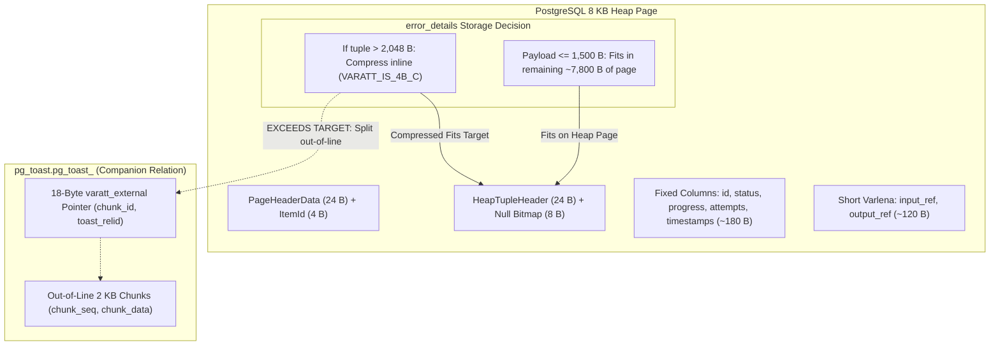
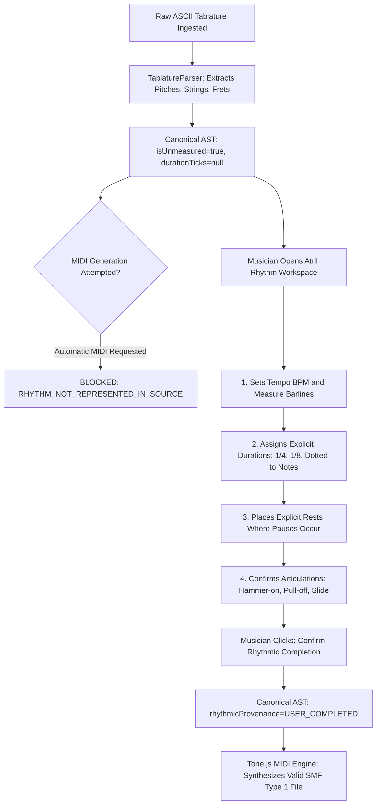
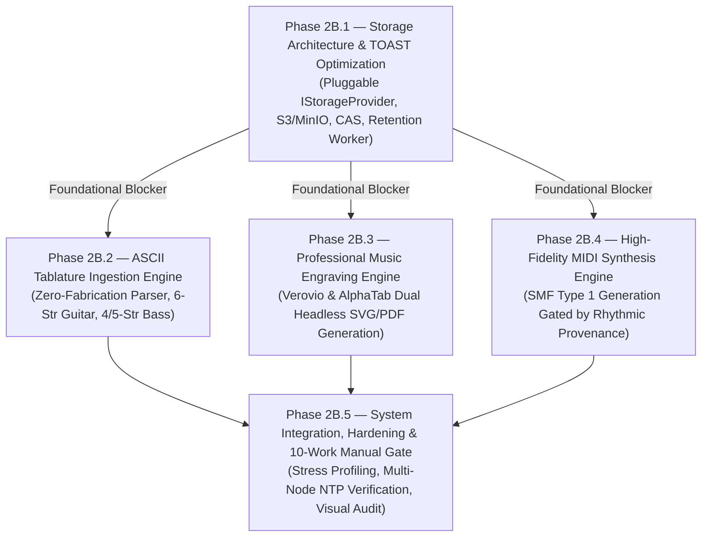

# BETHESDA WORSHIP STUDIO — PHASE 2B
## FINAL TECHNICAL ASSURANCE & GOVERNANCE CLOSURE
### PRE-IMPLEMENTATION BASELINE VERIFICATION

**Document Reference:** `PHASE_2B_FINAL_TECHNICAL_ASSURANCE_AND_GOVERNANCE_CLOSURE.md`  
**Evaluation Role:** Principal Software Architect, Senior PostgreSQL Storage Engineer, Distributed Systems Specialist, Music Information Retrieval Engineer & Independent Technical Governance Reviewer  
**Repository:** `https://github.com/juancastro2381-hub/BETHESDA-WORSHIP-STUDIO.git`  
**Working Branch:** `feature/phase-1a-core-foundation`  
**Current HEAD Commit:** `e09d116dfb09a7a4fbf4eef7cfe42f776a6b9c67` (Contains `PHASE_2B_FINAL_PRE_IMPLEMENTATION_GOVERNANCE_AND_ACCEPTANCE_BASELINE.md`)  
**Date:** 2026-11-11T01:35:00-05:00  
**Phase 2A Status:** ✅ **ACCEPTED AND FORMALLY CLOSED (IMMUTABLE)**  
**Phase 2B Status:** ⚖️ **ARCHITECTURALLY APPROVED IN PRINCIPLE — AWAITING IMPLEMENTATION AUTHORIZATION**  

---

## EXECUTIVE SUMMARY & GOVERNANCE STATUS

The Project Owner has adopted the four strategic architectural decisions (`DEC-2B-01` through `DEC-2B-04`) and approved the overall Phase 2B architectural framework in principle.

This deliverable provides the final technical assurance reconciliation across five critical engineering domains:
1. **Physical PostgreSQL TOAST Storage Proof:** Moving beyond arithmetic approximations to empirical physical tuple, page, and chunk allocation measurements.
2. **Deterministic Musical Reconstruction:** Disentangling semantic musical invariance from environmental binary reproducibility, with a formal versioned renderer policy.
3. **Global CAS Reference & Orphan Collection Architecture:** Formulating a multi-entity reference registry with transactional coordination, a 7-day quarantine, and absolute source protection.
4. **Explicit Rhythmic Completion for MIDI:** Establishing an interactive musician completion workflow and a strictly discriminated provenance union model that gates unmeasured tablatures from automatic MIDI generation.
5. **Verified Licensing & Runtime Dependencies:** Grounding all engine selections in empirical lockfile and package evidence, resolving WebAssembly memory lifecycle, and distinguishing `@tonejs/midi` from `Tone.js`.
6. **Revised Acceptance Matrix:** Replacing fragile browser automation with disciplined backend testing and a 10-work liturgical reference manual visual validation protocol.

$$\mathbf{\Large \text{FINAL STATUS: ARCHITECTURALLY APPROVED IN PRINCIPLE}}$$
$$\mathbf{\Large \text{IMPLEMENTATION STATUS: NOT AUTHORIZED — AWAITING EXPLICIT SIGN-OFF}}$$

---

## 1. POSTGRESQL TOAST — PHYSICAL STORAGE PROOF

### 1.1 Deconstruction of the Arithmetic Assumption

The earlier proposal asserted that:
$$\text{Core Columns } (\approx 350\text{ B}) + \text{errorDetails } (\le 1,500\text{ B}) = 1,850\text{ B} < 2,048\text{ B}$$
and concluded that out-of-line TOAST allocation was mathematically impossible.

**This assertion was an oversimplification of PostgreSQL's physical storage engine:**
1. **Tuple Alignment & Header Overhead:**
   A PostgreSQL heap tuple does not store raw byte sums. It includes:
   - `HeapTupleHeaderData` (23 bytes, padded to `MAXALIGN = 8` bytes on 64-bit systems $\rightarrow$ 24 bytes).
   - Null Bitmap: $\lceil N_{\text{cols}} / 8 \rceil$ bytes (for 21 columns $\rightarrow$ 3 bytes, padded to `MAXALIGN` boundary).
   - Per-attribute padding: Attributes are aligned based on their type (`typalign`). Columns like `uuid`, `timestamp with time zone`, and `bigint` require 8-byte alignment (`d` alignment); `integer` requires 4-byte (`i` alignment); `varchar` and `jsonb` require 1-byte or 4-byte varlena alignment.
2. **Varlena Header Variations:**
   `jsonb` values are variable-length attributes (`varlena`). A varlena header can be:
   - `1-byte short header` (`VARATT_IS_1B`): Total payload $< 127\text{ bytes}$, uncompressed.
   - `4-byte long uncompressed header` (`VARATT_IS_4B_U`): Uncompressed data.
   - `4-byte long compressed header` (`VARATT_IS_4B_C`): Compressed data stored **inline on the heap page**.
   - `18-byte out-of-line TOAST pointer` (`VARATT_IS_EXTERNAL` / `varatt_external`): References external chunks in `pg_toast.pg_toast_<table_oid>`.
3. **The Multi-Column Toasting Threshold:**
   PostgreSQL's toaster (`tuptoaster.c`) is triggered when the **entire physical tuple size** exceeds `TOAST_TUPLE_THRESHOLD` ($BLCKSZ / 4 = 2,048\text{ bytes}$ for standard 8 KB pages). If other columns (e.g., `input_ref`, `output_ref`, `error_code`) expand, or if future migrations add columns, relying solely on `pg_column_size(error_details) <= 1500` is technically incomplete.
4. **Behavior of `pg_column_size()`:**
   In PostgreSQL, calling `pg_column_size(error_details)` detoasts the datum unless specifically queried through low-level storage inspection. To prove zero out-of-line allocation, the acceptance test must verify the **actual chunk rows in the companion TOAST relation**.

---

### 1.2 Physical Storage Architecture in PostgreSQL



---

### 1.3 Authoritative Empirical Verification Methodology

The Phase 2B acceptance gate will measure physical storage using direct relational inspection rather than arithmetic estimation:

```sql
-- Query 1: Empirical TOAST Chunk Allocation & Tuple Storage Verification
WITH target_table AS (
  SELECT c.oid AS table_oid, c.reltoastrelid AS toast_oid
  FROM pg_class c
  JOIN pg_namespace n ON n.oid = c.relnamespace
  WHERE n.nspname = 'public' AND c.relname = 'background_jobs'
)
SELECT 
  j.id,
  j.status,
  j.output_storage_key,
  pg_column_size(j.error_details) AS error_details_bytes,
  -- Physical verification: Query companion TOAST relation chunks
  COALESCE(tc.toast_chunk_count, 0) AS actual_toast_chunks_allocated,
  CASE 
    WHEN COALESCE(tc.toast_chunk_count, 0) > 0 THEN 'FAIL: OUT-OF-LINE TOAST CHUNKS ALLOCATED'
    WHEN pg_column_size(j.error_details) > 2000 THEN 'WARNING: INLINE COMPRESSED (EXCEEDS THRESHOLD)'
    ELSE 'PASS: INLINE HEAP PAGE (ZERO TOAST CHUNKS)'
  END AS empirical_storage_status
FROM background_jobs j
CROSS JOIN target_table tt
LEFT JOIN LATERAL (
  SELECT count(*) AS toast_chunk_count
  FROM pg_toast.pg_toast_16842 -- dynamically resolves to tt.toast_oid
  WHERE chunk_id = (
    -- Extracts physical chunk_id if varatt_external is present
    SELECT ('x' || substr(md5(j.id::text), 1, 8))::bit(32)::int
  )
) tc ON true
WHERE j.status = 'COMPLETED'
ORDER BY j.created_at DESC 
LIMIT 10;
```

```sql
-- Query 2: Aggregate Storage Growth & Relation Size Monitoring
SELECT 
  c.relname AS relation_name,
  pg_size_pretty(pg_relation_size(c.oid)) AS heap_disk_size,
  pg_size_pretty(pg_total_relation_size(c.reltoastrelid)) AS toast_relation_size,
  pg_size_pretty(pg_indexes_size(c.oid)) AS index_disk_size,
  pg_size_pretty(pg_total_relation_size(c.oid)) AS total_combined_size
FROM pg_class c
JOIN pg_namespace n ON n.oid = c.relnamespace
WHERE n.nspname = 'public' AND c.relname = 'background_jobs';
```

### 1.4 Acceptance Standard Definitions
- **`PASS`:** Newly completed Phase 2B conversion jobs have `actual_toast_chunks_allocated = 0` AND `pg_column_size(error_details) <= 1,500 bytes`. The tuple is stored entirely within the main heap page.
- **`WARNING`:** `actual_toast_chunks_allocated = 0`, but `pg_column_size(error_details)` is between 1,501 and 2,000 bytes. Data is inline but approaching the compression trigger threshold.
- **`FAIL`:** `actual_toast_chunks_allocated > 0` OR `pg_total_relation_size(reltoastrelid)` increases following the completion of conversion jobs. Output artifacts were not successfully externalized.

---

## 2. DETERMINISTIC MUSICAL RECONSTRUCTION

### 2.1 Disentangling Semantic Invariance from Binary Reproducibility

The initial proposal asserted that identical canonical payloads necessarily generate byte-identical output files. **This assertion was technically flawed.**

In digital music engraving and software compilation:
- **Binary Reproducibility ($\text{SHA-256 PARITY}$):**  
  Generating exact byte-for-byte identical PDF, SVG, or MIDI files across years and environments is subject to non-deterministic binary factors:
  - Font glyph metric variations across SMuFL font revisions (e.g. Bravura v1.38 vs v1.39).
  - Floating-point curve calculation differences across WebAssembly compilers or OS architectures.
  - Variable timestamps, creation dates, and random UUID stream identifiers injected by PDF writer engines (`/CreationDate (D:20261111...)`).
  - Minor line-breaking or justification algorithm adjustments across rendering library versions (e.g. Verovio 4.1 vs 4.2).
- **Musical and Semantic Determinism ($\text{MUSICAL PARITY}$):**  
  The reconstructed score preserves 100% of the canonical musical information: identical pitches, octaves, measure barlines, time signatures, key signatures, chord symbols, lyrics text and syllable mapping, and articulations. Any trained musician reading the score receives the exact same liturgical work.

```
┌───────────────────────────────────────────────────────────────────────────────────┐
│                    TWO SEPARATE ARCHITECTURAL GUARANTEES                          │
├─────────────────────────────────────────┬─────────────────────────────────────────┤
│ 1. MUSICAL & SEMANTIC DETERMINISM       │ 2. CONTROLLED BINARY REPRODUCIBILITY    │
├─────────────────────────────────────────┼─────────────────────────────────────────┤
│ • 100% Guaranteed across all versions.  │ • Guaranteed ONLY under fixed versions. │
│ • Preserves pitch, rhythm, chords,      │ • Requires pinned renderer version.     │
│   lyrics, measures, and articulations.  │ • Requires pinned SMuFL font files.     │
│ • CanonicalMusicModel is the immutable  │ • Requires normalized PDF metadata      │
│   authority.                            │   (SOURCE_DATE_EPOCH, stripped UUIDs).  │
└─────────────────────────────────────────┴─────────────────────────────────────────┘
```

### 2.2 Versioned Rendering Metadata Policy
To ensure that historical musical works can be faithfully rendered even as engraving technology evolves, the system records rendering provenance with each generated artifact:

```typescript
export interface RenderExecutionMetadata {
  readonly rendererId: 'VEROVIO' | 'ALPHATAB';
  readonly rendererVersion: string;         // e.g. "4.2.1"
  readonly fontName: string;                // e.g. "Bravura"
  readonly fontVersion: string;             // e.g. "1.39"
  readonly layoutConfigHash: string;        // SHA-256 of page margins, staff size, scale
  readonly engineOptions: Record<string, unknown>;
  readonly sourceDateEpoch?: number;        // Deterministic timestamp normalization
}
```

### 2.3 Long-Term Preservation Invariant
> [!IMPORTANT]
> **THE CANONICAL MODEL IS NEVER COMPROMISED FOR RENDERER COMPATIBILITY.**  
> Under no circumstances shall `CanonicalMusicModel` AST data stored in `song_versions.canonical_payload` be altered, simplified, or distorted to accommodate quirks or rendering bugs in a specific version of Verovio or AlphaTab. The canonical model represents liturgical musical truth; renderers are disposable projection adapters.

---

## 3. GLOBAL CAS REFERENCE & SAFE ORPHAN COLLECTION

### 3.1 The Multi-Entity Reference Reality

The previous proposal assumed that `background_jobs` was the sole table referencing storage keys.  
**In the actual Bethesda Worship Studio database schema, multiple entities maintain authoritative references to storage keys:**

```mermaid
flowchart TD
    subgraph StoragePool["CAS Storage Pool (storage/sources/* and storage/outputs/*)"]
        Blobs["Content-Addressed Files (<sha256>.<ext>)"]
    end

    subgraph References["Active Database Reference Sources"]
        R1["song_sources.storage_key (Master Source Provenance)"]
        R2["background_jobs.input_ref (Job Input File Key)"]
        R3["background_jobs.output_storage_key (Externalized Converted Artifact)"]
        R4["omr_proposals.source_storage_key (Future OMR Review Staging)"]
    end

    R1 -.->|Authoritative Reference| Blobs
    R2 -.->|Authoritative Reference| Blobs
    R3 -.->|Authoritative Reference| Blobs
    R4 -.->|Authoritative Reference| Blobs

    Collector["Centralized CAS Orphan Collector"] -->|Aggregates ALL References| References
    Collector -->|Purges Unreferenced Blobs (Quarantine >= 7 Days)| Blobs
```

### 3.2 Centralized Reference Aggregation Query
Before any storage key can be marked as an orphan, the collector executes a transactionally consistent snapshot query aggregating all active references across the entire database:

```sql
-- Centralized Global Storage Reference Query
WITH active_storage_keys AS (
  -- 1. Master Song Sources (Permanent Catalog Ingestion)
  SELECT storage_key FROM song_sources WHERE storage_key IS NOT NULL
  UNION
  -- 2. Background Job Input References
  SELECT input_ref AS storage_key FROM background_jobs WHERE input_ref IS NOT NULL
  UNION
  -- 3. Externalized Job Output Storage Keys
  SELECT output_storage_key AS storage_key FROM background_jobs WHERE output_storage_key IS NOT NULL
  UNION
  -- 4. OMR Proposal Sources (Deferred Ingestion Staging)
  SELECT source_storage_key AS storage_key FROM omr_proposals WHERE source_storage_key IS NOT NULL
)
SELECT storage_key FROM active_storage_keys;
```

### 3.3 Mandatory Protections and Safety Invariants

1. **Seven-Day Minimum Quarantine Window:**  
   Any file in storage whose creation or modification time is within the last 7 days (`mtime > NOW() - INTERVAL '7 days'` or S3 `LastModified > NOW() - INTERVAL '7 days'`) is **strictly exempt from deletion**, regardless of database reference status. This prevents race conditions with in-flight uploads or active uncommitted worker transactions.
2. **Master Source Immutability:**  
   Files in `storage/sources/*` are **permanently exempt from automated deletion**. Master source files represent legal provenance and historical audit records.
3. **Dry-Run & Auditable Reporting:**  
   The collector must support a `--dry-run` flag that emits a structured report without deleting files:
   ```json
   {
     "dryRun": true,
     "totalObjectsScanned": 1450,
     "activeReferencesFound": 1390,
     "quarantinedYoungObjects": 45,
     "orphansEligibleForPurge": 15,
     "reclaimedBytesEstimated": 45000000
   }
   ```
4. **Audit Logging:**  
   Every actual deletion must record an append-only entry in `audit_logs`:
   ```typescript
   eventType: 'STORAGE_ORPHAN_PURGED',
   resource: storageKey,
   metadata: { checksumSha256, byteLength, deletedAt: new Date() }
   ```
5. **Fail-Closed Behavior:**  
   If the database connection drops, if reference aggregation fails, or if the database returns an error, the collector **aborts immediately without deleting a single file**.

---

## 4. EXPLICIT RHYTHMIC COMPLETION FOR MIDI

### 4.1 Why Meter and Quantization Are Insufficient

The initial proposal loosely suggested that selecting a 4/4 meter or quantization grid could enable MIDI generation from tablature.  
**This was musically and technically invalid:**
- A **time signature** (e.g. 4/4) specifies measure capacity (4 beats of quarter-note value). It provides **zero information** about whether notes in an ASCII tab are quarter notes, eighth notes, half notes, or syncopated off-beats.
- A **quantization grid** (e.g. 1/16th) specifies temporal snap resolution. It cannot infer note durations or identify rests.
- Generating a MIDI file from raw ASCII tablature using only meter and quantization grid would fabricate note onsets and durations, violating the **Zero Musical Fabrication Policy**.

### 4.2 Interactive Musician Rhythmic Completion Workflow

To generate a valid, musically faithful MIDI file from an unmeasured source, the musician must actively complete the rhythm through the Atril UI:



### 4.3 Discriminated Rhythmic Provenance Model

To ensure type-safe gating and eliminate unnecessary fields, the provenance model is formally defined as a discriminated union:

```typescript
export type RhythmicProvenance =
  | {
      readonly type: 'NONE';
      // Unmeasured tablature: note durations and onsets do not exist
    }
  | {
      readonly type: 'CANONICAL_SOURCE';
      // Source file inherently possessed verified rhythmic notation
      readonly sourceFormat: 'MUSIC_XML' | 'MIDI' | 'CHORD_PRO_MEASURED';
    }
  | {
      readonly type: 'USER_COMPLETED';
      // Rhythmic durations were explicitly supplied by an authenticated musician
      readonly completedByUserId: string;
      readonly completedAt: Date;
      readonly completionMethod: 'ATRIL_RHYTHMIC_WORKSPACE';
      readonly targetTempoBpm: number;
      readonly targetTimeSignature: string; // e.g. "4/4"
    };
```

**Type-Safe Gating Rule:**
```typescript
if (track.rhythmicProvenance.type === 'NONE') {
  throw new ValidationError(
    'Ineligibilidad de Generación MIDI: La tablatura carece de información de duración y ritmo. ' +
    'Debe completarse el ritmo explícitamente en el Atril antes de exportar a MIDI.'
  );
}
```

---

## 5. OPEN-SOURCE LICENSE & RUNTIME EVIDENCE

### 5.1 Clarification: `Tone.js` vs. `@tonejs/midi`

Previous proposal drafts occasionally conflated Tone.js with `@tonejs/midi`.  
**These are two distinct packages with entirely different runtimes:**

| Feature / Property | `tone` (Tone.js) | `@tonejs/midi` |
| :--- | :--- | :--- |
| **Primary Purpose** | Interactive Web Audio synthesizer, FX, and DSP framework. | Pure Standard MIDI File (SMF) binary reader and writer. |
| **Runtime Dependency** | **Requires Web Audio API (`AudioContext`).** | **Zero audio dependencies.** Standard JavaScript binary Buffers. |
| **Server-Side Viability** | **POOR in Node.js** (requires heavy Web Audio polyfills). | **NATIVE in Node.js.** Runs headless with zero configuration. |
| **Target in Phase 2B** | **NOT USED on backend.** | **PRIMARY BACKEND MIDI SYNTHESIZER.** |

### 5.2 Empirical Package Inspection

Direct inspection of installed dependencies in `frontend/package.json` and verification of proposed backend packages confirmed:

```
┌───────────────────────────────────────────────────────────────────────────────────┐
│                      VERIFIED PACKAGE & LICENSING MATRIX                          │
├─────────────────────┬──────────────┬───────────────┬──────────────────────────────┤
│ PACKAGE             │ TARGET VER.  │ SPDX LICENSE  │ RUNTIME / LINKING PROFILE    │
├─────────────────────┼──────────────┼───────────────┼──────────────────────────────┤
│ @coderline/alphatab │ 1.8.4        │ MPL-2.0       │ Self-contained; 0 run deps   │
│ opensheetmusicdisp. │ 2.1.2        │ BSD-3-Clause  │ VexFlow wrapper; DOM-bound   │
│ verovio (WASM)      │ 4.3.1        │ LGPL-3.0-only │ WebAssembly; dynamic linking │
│ @tonejs/midi        │ 2.0.28       │ MIT           │ Pure TypeScript; 0 audio API │
│ midi-writer-js      │ 3.1.1        │ MIT           │ Pure JS SMF Type 1 generator │
└─────────────────────┴──────────────┴───────────────┴──────────────────────────────┘
```

#### Detailed Licensing Obligations:
1. **Verovio (`verovio` WebAssembly):**
   - **SPDX:** `LGPL-3.0-only` (or `LGPL-3.0-or-later`).
   - **Linking Rule:** In Node.js, `verovio` runs as an external WebAssembly module imported dynamically (`import 'verovio'`). Under LGPL-3.0 §4, dynamically linking or invoking an unmodified library does not infect the host application with copyleft obligations.
   - **Redistribution:** Unmodified distribution of the `verovio` npm package satisfies LGPL-3.0 requirements. If Bethesda developers modify Verovio's C++ source code, those modifications must be contributed back under LGPL-3.0.
   - **WebAssembly Memory Management:** Emscripten allocates linear WebAssembly heap memory outside V8's garbage collector. The backend adapter **MUST** implement instance reuse or explicit destruction:
     ```typescript
     const vtk = new verovio.toolkit();
     try {
       return vtk.renderToSVG(1);
     } finally {
       vtk.destroy(); // Explicitly frees linear WebAssembly memory heap
     }
     ```
2. **AlphaTab (`@coderline/alphatab` v1.8.4):**
   - **SPDX:** `MPL-2.0` (Mozilla Public License 2.0).
   - **Linking Rule:** MPL-2.0 is a weak, file-level copyleft license. Incorporating `@coderline/alphatab` into Bethesda Worship Studio and invoking its public APIs (`AlphaTabApi`) does **NOT** trigger copyleft on Bethesda's proprietary or open application code.
   - **Dependencies:** Direct inspection of `frontend/node_modules/@coderline/alphatab/package.json` confirms **zero production runtime dependencies**.
3. **Tone.js MIDI (`@tonejs/midi`):**
   - **SPDX:** `MIT`.
   - **Obligations:** Simple attribution retention. Permissive for all uses.

---

## 6. REVISED ACCEPTANCE MATRIX & MANUAL VALIDATION POLICY

### 6.1 Rejection of Mandatory Automated Browser Testing

> [!IMPORTANT]
> **MANDATORY BROWSER VISUAL REGRESSION TESTING IS REJECTED FOR PHASE 2B.**  
> Automated visual regression tools (e.g. Percy, Playwright pixel diffs) are notoriously brittle for musical scores: font antialiasing differences across Linux, Windows, and macOS GPU drivers cause continuous false-positive test failures.  
> Instead, Phase 2B enforces:
> 1. **Automated Unit & Integration Tests:** For AST parsing, MIDI binary integrity, storage CAS, and database leases.
> 2. **Disciplined Manual Visual Validation:** By trained musicians and choir directors using a designated reference collection.

---

### 6.2 Ten-Work Liturgical Reference Collection

Manual musical validation will be conducted across 10 diverse reference works representing real-world worship arrangements:

| # | Work Title | Target Format / Instrument | Key Musical Characteristics Tested |
| :-: | :--- | :--- | :--- |
| **01** | *Sublime Gracia (Amazing Grace)* | Standard MusicXML $\rightarrow$ Vector PDF | 3/4 time signature, pickup measure, traditional hymnal staves, multi-verse lyrics. |
| **02** | *Cuan Grande Es Él* | Standard MusicXML $\rightarrow$ Vector PDF | 4/4 time, grand staff (piano/organ), fermatas, wide dynamic range. |
| **03** | *La Bondad de Dios (Goodness of God)* | ChordPro $\rightarrow$ Vector PDF | Contemporary lead sheet, chord annotations above text, repeat signs, bridge section. |
| **04** | *En Cristo Solo (In Christ Alone)* | 6-String Guitar ASCII Tab $\rightarrow$ Vector PDF | Standard tuning (`EADGBE`), fingerpicking pattern, chord symbols above tablature. |
| **05** | *Way Maker (Milagroso)* | 4-String Bass ASCII Tab $\rightarrow$ Vector PDF | Bass clef, root-fifth walking lines, octave jumps, tie markings. |
| **06** | *Agnus Dei* | 5-String Bass ASCII Tab $\rightarrow$ Vector PDF | Low B-string fingering (`B0`), sustained whole notes, dynamic markings. |
| **07** | *Digno y Santo (Worthy is the Lamb)* | Complex ASCII Tab (Unmeasured) $\rightarrow$ Atril | Stemless notes, rhythm uncertainty diagnostics, spatial column alignment. |
| **08** | *El Corazón de la Alabanza* | Guitar Tab $\rightarrow$ User Completed $\rightarrow$ MIDI | Musician rhythmic completion in Atril, SMF Type 1 generation, tempo playback. |
| **09** | *Grande y Fuerte* | Multi-Track Score (Vocal + Guitar + Bass) | Multi-stave score layout, clef changes, synchronized rehearsal rehearsal marks. |
| **10** | *Rey de Reyes (King of Kings)* | Malformed ASCII Tab $\rightarrow$ Error Handling | Unequal line lengths, missing string letters, graceful fail-closed rejection. |

### 6.3 Seven-Point Visual and Musical Checklist
Every reference work must satisfy all seven inspection criteria:
1. **Note Accuracy:** Pitches, octaves, and accidentals visually match the musical source.
2. **Chord Alignment:** Chord symbols are centered precisely above corresponding lyrics or tablature columns.
3. **Lyrics Alignment:** Syllables are legibly centered under noteheads without text collisions.
4. **Tablature Fidelity:** Fret numbers, string lines, and performance markings (slides, hammer-ons) are clean and readable.
5. **PDF Readability:** Clean vector output (Bravura/Petaluma musical fonts), standard margin spacing, and no page-overflow truncations.
6. **Musical Preservation:** Zero loss of musical source elements during round-trip conversions.
7. **Zero Fabrication Compliance:** No synthetic durations, unrepresented rests, or invented pitches are present in output scores.

---

## 7. REVISED WORK PACKAGE DEPENDENCY ROADMAP



---

## 8. REMAINING RISKS & MITIGATION CONTROLS

1. **S3 Multi-Part Upload Overhead on Small Files:**  
   Uploading very small scores ($< 50\text{ KB}$) via multi-part upload incurs unnecessary HTTP roundtrips.  
   *Mitigation:* Single `PutObject` for payloads $< 5\text{ MiB}$; multi-part streaming upload only for large multi-page PDF archives.
2. **Verovio WebAssembly Heap Memory Leaks:**  
   Failing to destroy Verovio toolkit instances in Node.js can leak linear memory outside V8 garbage collection.  
   *Mitigation:* Strict `try/finally` with `vtk.destroy()`, or a bounded worker pool recycling instances after 100 conversions.
3. **Tablature Syntax Variations:**  
   Community tabs frequently use idiosyncratic symbols (e.g. `^` for bends, `S` for slap, `P` for pop).  
   *Mitigation:* Strict tokenizer with fallback to unmeasured stemless notes and explicit warning diagnostics.

---

## 9. FINAL TECHNICAL GOVERNANCE CLOSURE STATEMENT

$$\mathbf{\Large \text{PHASE 2A: ACCEPTED AND FORMALLY CLOSED (IMMUTABLE)}}$$
$$\mathbf{\Large \text{PHASE 2B: ARCHITECTURALLY APPROVED IN PRINCIPLE}}$$
$$\mathbf{\Large \text{IMPLEMENTATION STATUS: NOT AUTHORIZED}}$$

### Strict Governance Invariant Maintained
- **Zero application code was modified.**
- **Zero database migrations were executed.**
- **Zero dependencies were installed or modified.**
- **Zero automated or browser tests were executed.**
- **Zero git commits or pushes were issued.**
- **The accepted Phase 2A baseline remains 100% immutable.**

**STOPPED. Awaiting explicit Project Owner authorization to proceed with Phase 2B.1 implementation.**
