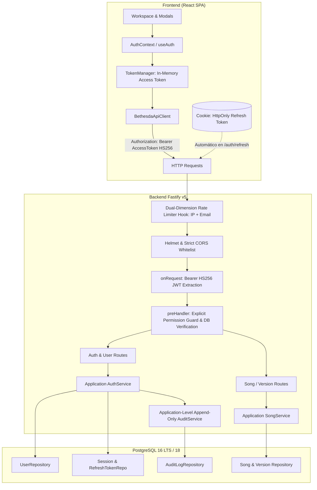
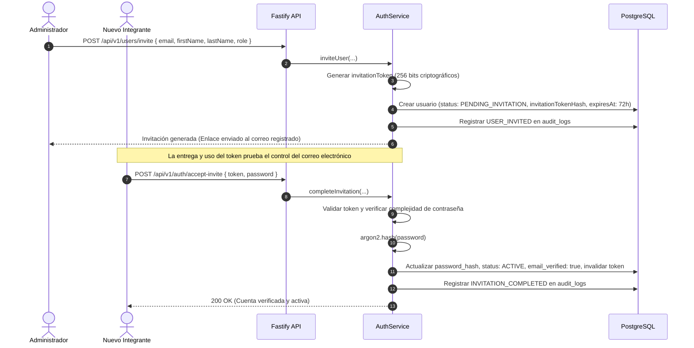
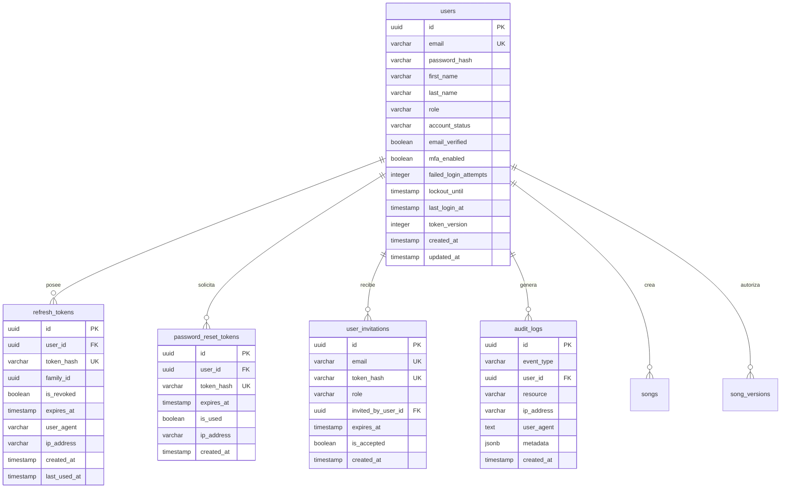

# BETHESDA WORSHIP STUDIO
## Plan de Implementación Técnica — Fase 2B
### Autenticación, Autorización y Fundación RBAC

**Organización:** Iglesia Cristiana Bethesda — Madrid, Cundinamarca, Colombia  
**Fase:** 2B — Authentication, Authorization & RBAC Foundation  
**Estado:** DOCUMENTO DE PLANIFICACIÓN ENDURECIDO Y CLARIFICADO (Esperando Autorización Explícita de Implementación)  
**Fecha:** 20 de Septiembre de 2026  

---

## 0. Decisiones de Endurecimiento Previo a la Implementación (Phase 2B Hardening Decisions)

A partir de las revisiones técnicas previas a la autorización de código, se establecen e integran de forma obligatoria las siguientes **doce directrices arquitectónicas de endurecimiento**:

1. **Estrategia Única y Exclusiva de Almacenamiento de Tokens:**
   - **Access Token:** Exclusivamente en **memoria volátil de JavaScript** en el cliente React. Queda estrictamente prohibido su almacenamiento en `localStorage`, `sessionStorage` o `IndexedDB` para inmunizar el sistema contra robo por XSS.
   - **Refresh Token:** Exclusivamente en **Cookie `HttpOnly`, `Secure` (en producción), `SameSite=Strict` y prefijo `Path=/api/v1/auth`**. Jamás se devolverá el refresh token en el cuerpo JSON de la respuesta para almacenamiento por scripts de cliente.
   - El endpoint `POST /api/v1/auth/refresh` leerá el token de refresco únicamente desde la cookie HTTP.
   - **Análisis CSRF:** Dado que el refresh token viaja en cookie, la directiva `SameSite=Strict` garantiza que los navegadores modernos no adjunten la cookie en solicitudes cruzadas iniciadas desde sitios de terceros. Adicionalmente, el backend validará los encabezados `Origin` y `Referer` contra la lista blanca estricta de dominios autorizados, y el endpoint `POST` requiere encabezados personalizados implícitos de la API.
2. **Autoridad del Rol y del JWT (Principio del Principal Autenticado):**
   - El payload JWT identifica al **principal autenticado** (`sub = userId`, `email`, `jti`, `iat`, `exp`). El rol incluido en el JWT es únicamente un *claim informativo* para optimizaciones visuales y enrutamiento en cliente.
   - Para **decisiones de autorización sensibles** (aprobación de partituras, archivado, mutación de versiones maestras, creación/gestión de usuarios, modificación de roles), el backend **debe verificar el estado y rol actual del usuario en la base de datos** (o caché de sesión).
   - **Cambio de Rol Concurrente:** Si un administrador degrada o modifica el rol de un usuario mientras su Access Token anterior sigue vigente (hasta 15 min), las operaciones críticas consultarán el rol en tiempo real en la base de datos. Adicionalmente, la modificación del rol revocará de inmediato la familia de refresh tokens del usuario y actualizará su `token_version`, invalidando las sesiones activas en su próxima renovación.
3. **Modelo RBAC Sin Herencia Implícita:**
   - Se elimina cualquier noción o asunción de herencia automática de permisos en cascada entre los cinco roles (`SUPER_ADMIN`, `ADMIN`, `WORSHIP_LEADER`, `MUSICIAN`, `VIEWER`).
   - Cada rol posee un **conjunto explícito y granular de permisos declarados** en el backend. Las comprobaciones de seguridad validan el permiso requerido explícitamente (`requirePermission('songs:approve')`), nunca asumiendo permisos por jerarquía no testeada.
4. **Ciclo de Vida de Invitación de Usuarios y Semántica de Verificación de Correo:**
   - Ningún administrador definirá permanentemente la contraseña de otro usuario.
   - **Semántica de Verificación:** La entrega y consumo de un token criptográfico de invitación de un solo uso a través del correo registrado del usuario constituye prueba suficiente y formal del control de dicha dirección de correo.
   - **Flujo Obligatorio Sin Redundancias:**
     $$\text{ADMIN INVITA} \longrightarrow \text{Token de Invitación Generado} \longrightarrow \text{Entrega al Correo Registrado} \longrightarrow \text{Usuario Acepta e Ingresa Clave}$$
     $$\longrightarrow \text{Token Consumido} \longrightarrow \text{email\_verified = true} \longrightarrow \text{Cuenta ACTIVE}$$
   - **No se introducirá un segundo flujo redundante de verificación de correo en la Fase 2B.**
5. **Hashing de Contraseñas Mandatorio con Argon2id (Sin Fallback Silencioso):**
   - **Argon2id es estrictamente obligatorio** (utilizando `@node-rs/argon2` con binarios nativos optimizados para Node.js v24).
   - Queda prohibido el fallback automático o silencioso a `bcrypt`. Si el entorno no soporta la ejecución de Argon2id, el arranque del backend fallará de forma explícita, documentando el requisito de compilación o soporte de arquitectura.
6. **Rate Limiting de Autenticación en Dos Dimensiones Independientes:**
   - Para endpoints relacionados con autenticación (`/login`, `/forgot-password`, `/reset-password`), se evalúan e implementan **dos dimensiones independientes**:
     1. **Límite basado en IP de origen:** Protege contra ataques de fuerza bruta concentrada o stuffing desde una misma dirección.
     2. **Límite basado en cuenta/correo electrónico:** Protege contra ataques distribuidos de fuerza bruta o rociado de contraseñas (*password spraying*) dirigidos a una cuenta específica desde múltiples IPs rotativas.
   - Ambas dimensiones se evalúan de forma independiente: la violación de cualquiera de los dos límites resulta en rechazo inmediato (`HTTP 429 Too Many Requests`).
   - **Infraestructura:** Almacenamiento en memoria volátil en entorno de desarrollo; requisito formal de almacenamiento compartido distribuido (**Redis**) en producción multi-instancia.
7. **Algoritmo de Firma JWT Estrictamente HS256 (Claves Simétricas):**
   - Algoritmo de firma obligatorio: **`HS256`** (HMAC con SHA-256).
   - La configuración de Fastify fijará explícitamente `algorithms: ['HS256']`.
   - **Rechazo de Algoritmos Inesperados:** Se rechazará de forma tajante cualquier algoritmo alternativo y queda estrictamente bloqueado `alg=none`.
   - **Campos Requeridos Mandatorios:** Cada token emitido incluirá obligatoriamente los claims `jti` (JWT ID único para auditoría y revocación), `iat` (issued at) y `exp` (expiration).
   - La clave simétrica de alta entropía se suministrará mediante la variable de entorno validada `JWT_SECRET` (mínimo 32 caracteres / 256 bits).
   - No se introducirán esquemas de claves asimétricas en la Fase 2B.
8. **Auditoría: Registro Inmutable a Nivel de Aplicación ("Application-Level Append-Only Audit Log"):**
   - Se adopta la denominación técnica exacta **"application-level append-only audit log"**, reconociendo que la inmutabilidad es gobernada por la capa de servicio y permisos de base de datos restringidos.
   - **Regla Estricta de Sanitización:** Queda absolutamente prohibido almacenar contraseñas, refresh tokens, access tokens, tokens de restablecimiento, tokens de invitación o cualquier secreto en los registros de auditoría o sus metadatos.
9. **Credenciales Iniciales Temporales de SUPER_ADMIN:**
   - Las credenciales de arranque (*bootstrap*) serán estrictamente temporales.
   - Al iniciar sesión por primera vez, el sistema **exigirá forzosamente el cambio inmediato de contraseña** antes de otorgar acceso a cualquier otra funcionalidad (`MUST_CHANGE_PASSWORD`).
   - Queda terminantemente prohibido incluir contraseñas de bootstrap en el control de versiones, imprimirlas en logs de producción o exponerlas en la auditoría.
10. **Preparación Arquitectónica para MFA (MFA Readiness):**
    - Aunque la Fase 2B no implementará MFA (TOTP / WebAuthn), el modelo de datos de `users` y la máquina de estados de autenticación incluirán las columnas y estados necesarios (`mfa_enabled`, `mfa_secret_encrypted`, estado intermedio `AWAITING_MFA_CHALLENGE`) para garantizar que la posterior incorporación de doble factor no requiera migraciones disruptivas ni rotura de contratos.
11. **Compatibilidad Canónica de Base de Datos:**
    - Se estandariza oficialmente **PostgreSQL 16 LTS** para Docker, CI/CD y despliegue productivo en nube, garantizando plena compatibilidad con PostgreSQL 18 local.
12. **Invarianza Absoluta del Dominio Musical:**
    - La seguridad es un servicio de infraestructura y aplicación.
    - `CanonicalMusicPayload`, `ProjectionService`, `DerivedMusicalView`, `RendererRegistry`, `AlphaTab`, `OSMD` y `LeadSheetDOM` son puros e inmutables, y jamás tendrán conocimiento ni acoplamiento con identidades, sesiones, roles o tokens.

---

## 1. Resumen Ejecutivo

La **Fase 2A** dotó a *Bethesda Worship Studio* de una base de persistencia de grado empresarial basada en PostgreSQL y Drizzle ORM, preservando estrictamente a `CanonicalMusicPayload` como la única fuente de verdad musical y verificando la integridad de ida y vuelta (*round-trip*) de partituras reales en MusicXML y ChordPro con 198 pruebas automatizadas pasando y validación en navegador real.

La **Fase 2B** tiene como objetivo establecer la **fundación de seguridad, identidad, control de acceso basado en roles (RBAC) y auditoría**, preparando la plataforma para la operación multiusuario segura en la congregación (pastores, líderes de alabanza, directores musicales, instrumentistas, vocalistas y equipo técnico), sin contaminar en ningún nivel el dominio musical ni las pipelines de proyección y renderizado.

---

## 2. Línea Base Arquitectónica Actual (Fase 1A – 2A)

El sistema opera actualmente bajo los siguientes contratos verificados y aprobados:

1. **Pipeline Canónica:**
   $$\text{PostgreSQL (JSONB)} \xrightarrow{\text{Repository}} \text{CanonicalMusicPayload} \xrightarrow{\text{ProjectionService}} \text{DerivedMusicalView} \xrightarrow{\text{RendererRegistry}} \text{AlphaTab / OSMD / LeadSheetDOM}$$
2. **Invariante Armónico:** Documentos ChordPro puros mantienen `totalMelodyNotes === 0` determinísticamente en persistencia y renderizado.
3. **Persistencia Híbrida:** Metadatos relacionales indexados (`songs`, `song_versions`, `song_sources`, `song_metadata`) combinados con instantáneas inmutables en JSONB.
4. **Backend Fastify v5:** Servidor HTTP modular con validación Zod, documentación OpenAPI Swagger (`/documentation`) y manejo estructurado de errores (`VALIDATION_ERROR`, `NOT_FOUND`, `INVALID_MUSIC_PAYLOAD`, `PERSISTENCE_ERROR`).
5. **Métricas de Prueba:**
   - Frontend: 35 suites / 180 pruebas (100% pasando).
   - Backend: 4 suites / 18 pruebas (100% pasando).
   - Total: 39 suites / 198 pruebas automatizadas sin fallos ni omisiones.
   - Typecheck: 0 errores en TypeScript estricto.
   - Escenarios Dorados A–D: Completamente funcionales en navegador real.

---

## 3. Arquitectura Objetivo de la Fase 2B

La arquitectura de seguridad se estructura en capas completamente desacopladas:



---

## 4. Arquitectura de Autenticación y Ciclo de Vida del Usuario

### 4.1 Identidad del Usuario
- Identificador primario global: UUIDv4.
- Correo electrónico único normalizado a minúsculas en base de datos (`citext` o índice único `LOWER(email)`).
- Estados de cuenta: `PENDING_INVITATION`, `MUST_CHANGE_PASSWORD`, `ACTIVE`, `LOCKED`, `SUSPENDED`.

### 4.2 Hashing Obligatorio con Argon2id
- Algoritmo: **Argon2id** (`@node-rs/argon2`).
- Parámetros conformes a OWASP:
  - Memoria: $65536\text{ KiB}$ (64 MiB).
  - Tiempo: 3 iteraciones.
  - Paralelismo: 4 hilos.
  - Salt: 16 bytes criptográficamente seguros (`crypto.randomBytes`).
  - Salida: 32 bytes.
- **Sin fallback:** Si la biblioteca nativa falla en un entorno no compatible, el sistema abortará con un error descriptivo de infraestructura.

### 4.3 Ciclo de Vida de Invitación de Usuarios y Semántica de Verificación de Correo


---

## 5. Arquitectura de Sesiones y Tokens

### 5.1 Especificación Estricta de Almacenamiento

| Atributo | Access Token | Refresh Token |
|---|---|---|
| **Estrategia** | **Memoria Volátil Únicamente** | **Cookie HttpOnly Únicamente** |
| **Persistencia en Cliente** | Variable en memoria del `TokenManager` (React). Desaparece al cerrar pestaña. | Cookie gestionada por el navegador. |
| **Prohibiciones** | **Jamás** en `localStorage`, `sessionStorage` o `IndexedDB`. | **Jamás** devuelto en el JSON de respuesta. |
| **Seguridad de Transporte** | Encabezado `Authorization: Bearer <token>`. | Enviado automáticamente por el navegador en `POST /api/v1/auth/refresh`. |
| **Atributos de Cookie** | N/A | `HttpOnly; Secure; SameSite=Strict; Path=/api/v1/auth; Max-Age=604800` |
| **Algoritmo de Firma** | **`HS256`** (HMAC-SHA256 con `JWT_SECRET`) | Hash SHA-256 en base de datos (`token_hash`) |
| **Claims Requeridos** | `sub`, `email`, `role`, `jti`, `iat`, `exp` | Opaco (sin claims en texto plano) |
| **Tiempo de Vida** | 15 minutos | 7 días (rotación obligatoria en cada uso) |

### 5.2 Mitigación y Análisis CSRF
Dado que el Refresh Token viaja en una Cookie, se implementa una defensa en profundidad contra CSRF:
1. **`SameSite=Strict`**: El navegador bloqueará el envío de la cookie en todas las solicitudes entre sitios originadas externamente.
2. **Validación Estricta de Origen**: Fastify verificará que el encabezado `Origin` coincida exactamente con la lista blanca (`CORS_ORIGIN`).
3. **Requisito de Método `POST` y Contenido JSON**: Las solicitudes cross-origin simples no pueden enviar payloads JSON con encabezados personalizados sin activar la comprobación preflight `OPTIONS`.

### 5.3 Rotación de Tokens de Refresco y Detección de Reuso (Family Tracking)
1. Al invocar `POST /api/v1/auth/refresh`, el backend:
   - Extrae el token de la cookie HttpOnly.
   - Calcula su hash SHA-256 y consulta `refresh_tokens`.
   - Si el token está marcado como `is_revoked = true`:
     - **Alerta de Seguridad Inmediata:** Se asume suplantación o robo.
     - Se revoca inmediatamente **toda la familia de tokens** (`family_id`).
     - Se emite el evento `SUSPICIOUS_TOKEN_REUSE` en `audit_logs`.
     - Se eliminan las cookies del cliente y se retorna `HTTP 401 Unauthorized`.
   - Si el token es válido:
     - Se marca como `is_revoked = true`.
     - Se genera un nuevo par de tokens dentro de la misma `family_id`.
     - Se emite la nueva cookie HttpOnly y se retorna el nuevo Access Token en el JSON.

---

## 6. Modelo de Roles (RBAC) y Permisos Explícitos

Se definen **cinco roles formales**. Queda abolida cualquier asunción de herencia implícita; los permisos son **discretos y validados de forma explícita** en cada endpoint del backend:

### 6.1 Catálogo de Roles
- **`SUPER_ADMIN`**: Administración global del sistema, gestión de administradores, acceso a auditoría de seguridad y estado de infraestructura.
- **`ADMIN`**: Dirección general de alabanza y pastoral; aprobación final de partituras para culto oficial (`songs:approve`), archivado (`songs:archive`), gestión de músicos e invitaciones.
- **`WORSHIP_LEADER`**: Creación de canciones, importación de fuentes MusicXML y ChordPro, edición de versiones de ensayo (`songs:create`, `songs:update_draft`, `versions:create`).
- **`MUSICIAN`**: Lectura del catálogo de canciones aprobadas y borradores asignados; transposición local, cejilla, cambio de instrumento y cifrado en atril sin mutar la base de datos (`songs:read`).
- **`VIEWER`**: Modo atril / visualización pasiva exclusivamente para canciones en estado `APPROVED`. Sin permisos de creación, modificación ni acceso a borradores.

### 6.2 Verificación en Tiempo Real de Decisiones Sensibles (Beyond JWT Claims)
- Para mutaciones críticas (`songs:approve`, `songs:delete`, `users:change_role`, `users:disable`):
  1. El backend extrae el `userId` autenticado del JWT.
  2. **Consulta en la base de datos** el registro activo de `users` para garantizar que la cuenta continúa en estado `ACTIVE` y ostenta el rol necesario en ese milisegundo exacto.
  3. Si el usuario fue degradado o revocado previamente, la operación es abortada de inmediato con `HTTP 403 Forbidden`, independientemente de lo que declare el token JWT en memoria.

---

## 7. Matriz Exhaustiva de Autorización y Permisos

| Recurso / Operación | Código de Permiso | VIEWER | MUSICIAN | WORSHIP_LEADER | ADMIN | SUPER_ADMIN | Verificación DB en Tiempo Real |
|---|---|:---:|:---:|:---:|:---:|:---:|:---:|
| **Diagnóstico de Salud** | `system:health` | ✅ | ✅ | ✅ | ✅ | ✅ | No |
| **Inicio de Sesión** | `auth:login` | ✅ (Púb) | ✅ (Púb) | ✅ (Púb) | ✅ (Púb) | ✅ (Púb) | Sí (Credenciales) |
| **Renovación de Token** | `auth:refresh` | ✅ (Cookie) | ✅ (Cookie) | ✅ (Cookie) | ✅ (Cookie) | ✅ (Cookie) | Sí (Session Table) |
| **Cierre de Sesión** | `auth:logout` | ✅ | ✅ | ✅ | ✅ | ✅ | Sí |
| **Consultar Catálogo (Aprobadas)**| `songs:read` | ✅ | ✅ | ✅ | ✅ | ✅ | No |
| **Consultar Borradores (`DRAFT`)**| `songs:read_drafts` | ❌ | ❌ | ✅ | ✅ | ✅ | No |
| **Importar Fuentes MusicXML/ChordPro**| `songs:import` | ❌ | ❌ | ✅ | ✅ | ✅ | No |
| **Crear Canción / Versión** | `songs:create` | ❌ | ❌ | ✅ | ✅ | ✅ | No |
| **Editar Metadatos de Borrador** | `songs:update_draft` | ❌ | ❌ | ✅ | ✅ | ✅ | Sí |
| **Aprobar Partitura (`APPROVED`)**| `songs:approve` | ❌ | ❌ | ❌ | ✅ | ✅ | **Sí (Mandatoria)** |
| **Archivar Canción (`ARCHIVED`)** | `songs:archive` | ❌ | ❌ | ❌ | ✅ | ✅ | **Sí (Mandatoria)** |
| **Eliminar Canción del Catálogo** | `songs:delete` | ❌ | ❌ | ❌ | ❌ | ✅ | **Sí (Mandatoria)** |
| **Invitar Nuevo Usuario** | `users:invite` | ❌ | ❌ | ❌ | ✅ | ✅ | **Sí (Mandatoria)** |
| **Listar Integrantes del Ministerio**| `users:list` | ❌ | ❌ | ❌ | ✅ | ✅ | No |
| **Modificar Rol de Usuario** | `users:change_role` | ❌ | ❌ | ❌ | ❌ | ✅ | **Sí (Mandatoria)** |
| **Desactivar Cuenta de Usuario** | `users:disable` | ❌ | ❌ | ❌ | ✅ | ✅ | **Sí (Mandatoria)** |
| **Consultar Logs de Auditoría** | `audit:read` | ❌ | ❌ | ❌ | ❌ | ✅ | **Sí (Mandatoria)** |

---

## 8. Diseño del Esquema de Persistencia (PostgreSQL + Drizzle ORM)



---

## 9. Contratos de la API HTTP (`/api/v1/auth`, `/api/v1/users`)

### 9.1 Inicio de Sesión (`POST /api/v1/auth/login`)
- **Body:** `{ "email": "...", "password": "..." }`
- **Rate Limit Dual:** Evaluado por IP (máx 5/min) y por correo (máx 5/min) independientemente.
- **Encabezados de Respuesta:**
  - `Set-Cookie: bethesda_refresh_token=...; HttpOnly; Secure; SameSite=Strict; Path=/api/v1/auth; Max-Age=604800`
- **Cuerpo JSON:**
  ```json
  {
    "success": true,
    "data": {
      "accessToken": "eyJhbGciOiJIUzI1Ni...",
      "expiresIn": 900,
      "user": {
        "id": "...",
        "email": "...",
        "firstName": "...",
        "lastName": "...",
        "role": "WORSHIP_LEADER",
        "mustChangePassword": false
      }
    }
  }
  ```

### 9.2 Renovación de Tokens (`POST /api/v1/auth/refresh`)
- **Headers:** La cookie `bethesda_refresh_token` es enviada de forma nativa por el navegador.
- **Body:** Vacío.
- **Respuesta:** Nuevo Access Token firmado con `HS256` en JSON y rotación de Cookie HttpOnly en los encabezados.

### 9.3 Cierre de Sesión (`POST /api/v1/auth/logout`)
- **Comportamiento:** Invalida el refresh token en la base de datos y borra la cookie (`Max-Age=0`).

### 9.4 Aceptación de Invitación (`POST /api/v1/auth/accept-invite`)
- **Body:** `{ "token": "...", "password": "..." }`
- **Resultado:** Establece contraseña, marca `email_verified = true`, pasa la cuenta a `ACTIVE`.

---

## 10. Integración con Frontend React (Cero Contaminación Musical)

1. **`TokenManager` en Memoria:**
   - Custodia el Access Token en una variable privada de cierre léxico (*closure*).
   - Renovación silenciosa programada 60 segundos antes de la expiración del Access Token para evitar interrupciones durante ensayos.
2. **`BethesdaApiClient` Interceptor:**
   - Inyecta `Authorization: Bearer <token>` firmado con `HS256`.
   - Renovación automática silenciosa transparente ante respuestas `401 Unauthorized`.
3. **Aislamiento Musical Garantizado:**
   - Los componentes `MusicalScoreRenderer`, `AlphaTabAdapter`, `OsmdAdapter` y `LeadSheetDomAdapter` **no** importan `useAuth` ni interactúan con seguridad.

---

## 11. Modelo de Amenazas de Seguridad (Threat Model Completo)

| Vector de Amenaza | Mitigación Técnica en Fase 2B | Capa de Aplicación |
|---|---|---|
| **Credential Stuffing** | Rate limit dual independiente por IP y correo; bloqueo automático tras 5 fallos. | Fastify Hook + AuthService |
| **Brute Force (Fuerza Bruta)**| Rate limiting por IP + rate limiting por correo + Hashing costoso Argon2id. | Rate-Limit + Argon2id |
| **Password Spraying** | Rate limiting bidimensional por cuenta/correo + política de contraseñas de alta entropía. | Fastify Hook + Schemas |
| **Token Theft (XSS)** | Access token guardado exclusivamente en memoria volátil; Refresh token en Cookie HttpOnly inaccesible por JS. | TokenManager + Cookies |
| **Refresh Token Replay** | Rotación obligatoria y detección de reuso por familias; revocación masiva inmediata ante anomalías. | SessionRepository |
| **Algorithm Confusion (JWT)** | Algoritmo fijado estrictamente a `HS256`; rechazo tajante de `alg=none` o algoritmos asimétricos no autorizados. | Fastify JWT Config |
| **CSRF** | Cookie `SameSite=Strict`, validación estricta de encabezado `Origin` y métodos no idempotentes con preflight. | Fastify Middleware |
| **Session Fixation** | Generación de nuevas sesiones y destrucción de identificadores previos tras autenticación. | AuthService |
| **Privilege Escalation** | Roles evaluados en backend; verificación directa contra la base de datos en operaciones sensibles. | Fastify Auth Hooks |
| **IDOR** | Verificación de pertenencia y permisos explícitos en los repositorios antes de mutar recursos. | Services & Repositories |
| **Account Enumeration** | Respuestas unificadas con tiempos homogéneos y mensajes genéricos en login y forgot-password. | Auth Controller |
| **Timing Attacks** | Uso estricto de `crypto.timingSafeEqual` en comparaciones de hashes y tokens. | Crypto Utilities |
| **Database Leakage** | Hashes con salt criptográfico individual; cero secretos o contraseñas en texto plano. | PostgreSQL + Drizzle |
| **Excessive Requests (DoS)**| Rate limiting dual en memoria (desarrollo) y Redis (producción). | `@fastify/rate-limit` |
| **Leaked Secrets** | Variables validadas por Zod en arranque; prohibición de incluir secretos en Git o logs. | `env.ts` + Gitignore |
| **Unauthorized Song Mutation**| Verificación de permisos a nivel de repositorio y estado de la canción (`APPROVED` inmutable sin rol `ADMIN`). | SongService RBAC |
| **Log Leakage** | Sanitizador de auditoría que censura y descarta cualquier token o contraseña. | AuditService |

---

## 12. Arquitectura de Restablecimiento de Contraseña (Password Reset)

1. **Solicitud (`POST /api/v1/auth/forgot-password`):**
   - Comportamiento anti-enumeración: Retorna siempre `HTTP 200 OK` con mensaje neutro.
   - Genera token aleatorio de 256 bits, almacena su hash SHA-256 con vigencia de 15 minutos.
2. **Consumo (`POST /api/v1/auth/reset-password`):**
   - Valida el token contra `password_reset_tokens`.
   - Hashea la nueva contraseña con Argon2id.
   - **Revocación de Sesiones:** Invalida de inmediato todos los refresh tokens del usuario y actualiza `token_version`.
   - Registra el evento en `audit_logs`.

---

## 13. Auditoría de Seguridad: "Application-Level Append-Only Audit Log"

- Se registra cada suceso sensible con: `event_type`, `user_id` (nullable), `resource`, `ip_address`, `user_agent`, `metadata` (sanitizado) y `timestamp`.
- **Inmutabilidad:** Gestionada como un registro estrictamente de anexado (*append-only*) a nivel de aplicación; la base de datos no expone operaciones de `UPDATE` o `DELETE` sobre esta tabla a la capa de servicio.
- **Cero Secretos:** Se prohíbe el almacenamiento de contraseñas, tokens de refresco, tokens de acceso o tokens de recuperación en la columna `metadata`.

---

## 14. Rate Limiting Bidimensional y Protección de Red

Se establece un esquema de limitación bidimensional para endpoints sensibles:

1. **Dimensión 1 (Por Dirección IP):**
   - Previene ráfagas de solicitudes y ataques de fuerza bruta concentrados originados desde una misma máquina o proxy.
   - Límite: **5 intentos por minuto** por IP.
2. **Dimensión 2 (Por Cuenta / Correo Electrónico):**
   - Previene ataques de fuerza bruta distribuida o rociado de contraseñas (*password spraying*) que rotan IPs para vulnerar una cuenta específica.
   - Límite: **5 intentos fallidos por minuto** por cuenta.
3. **Comportamiento Independiente:**
   - La superación de cualquiera de los dos límites activa la respuesta `HTTP 429 Too Many Requests` con el encabezado `Retry-After`.
4. **Infraestructura de Almacenamiento:**
   - **Desarrollo / Pruebas:** Almacenamiento en memoria volátil de Fastify.
   - **Producción Multi-Instancia:** Requisito formal de almacenamiento compartido en **Redis** (`REDIS_URL`) para sincronizar contadores entre réplicas.

---

## 15. Encabezados de Seguridad y CORS

- **CORS de Producción:** Se restringen los orígenes a la lista blanca de la variable `CORS_ORIGIN`. Se habilitará `credentials: true` exclusivamente para dichos dominios.
- **Helmet:** Encabezados CSP estrictos, HSTS (1 año con subdominios), `X-Frame-Options: DENY`, `X-Content-Type-Options: nosniff`.

---

## 16. Configuración de Variables de Entorno (`env.ts`)

```typescript
const envSchema = z.object({
  NODE_ENV: z.enum(['development', 'test', 'production']).default('development'),
  PORT: z.coerce.number().default(3001),
  HOST: z.string().default('0.0.0.0'),
  DATABASE_URL: z.string().url(),
  TEST_DATABASE_URL: z.string().url(),
  CORS_ORIGIN: z.string().default('http://localhost:5173'),
  COOKIE_SECRET: z.string().min(32, 'El secreto de cookies debe tener al menos 32 caracteres'),
  JWT_SECRET: z.string().min(32, 'El secreto JWT debe tener al menos 32 caracteres'),
  JWT_ACCESS_EXPIRES_IN: z.string().default('15m'),
  REFRESH_TOKEN_EXPIRES_IN_DAYS: z.coerce.number().default(7),
  ARGON2_MEMORY_COST: z.coerce.number().default(65536),
  ARGON2_TIME_COST: z.coerce.number().default(3),
  ARGON2_PARALLELISM: z.coerce.number().default(4),
  REDIS_URL: z.string().url().optional(), // Obligatorio en producción para rate limiting compartido
  INITIAL_SUPERADMIN_EMAIL: z.string().email().optional(),
  INITIAL_SUPERADMIN_PASSWORD: z.string().min(10).optional(),
});
```

---

## 17. Credenciales Iniciales de SUPER_ADMIN (Bootstrap Seguro)

- Si la base de datos está vacía, se creará un usuario `SUPER_ADMIN` utilizando las variables de entorno de inicialización.
- Su estado será `MUST_CHANGE_PASSWORD`.
- En el primer inicio de sesión, el backend exigirá forzosamente cambiar la contraseña antes de procesar cualquier otra solicitud.
- Las credenciales iniciales jamás se registrarán en logs de consola ni en `audit_logs`.

---

## 18. Preparación para Autenticación Multifactor (MFA Readiness)

- La tabla `users` incluirá:
  - `mfa_enabled`: booleano por defecto en `false`.
  - `mfa_secret`: texto encriptado nullable.
- La máquina de estados de autenticación contemplará el código de respuesta `202 Accepted` con estado `AWAITING_MFA_CHALLENGE` para permitir una transición limpia y sin roturas en fases posteriores cuando se active TOTP o WebAuthn/Passkeys.

---

## 19. Estrategia de Migración y Conservación de Datos

- Se generará la migración `0001_auth_rbac.sql` con Drizzle Kit.
- Las tablas previas de la Fase 2A (`songs`, `song_versions`, `song_sources`, `song_metadata`) se mantienen al 100%.
- Las nuevas claves foráneas (`created_by_user_id`) son `nullable` con `ON DELETE SET NULL`, garantizando que ninguna canción existente quede huérfana o inválida.

---

## 20. Estrategia de Pruebas Automatizadas

```
Línea Base Fase 2A:     198 pruebas (180 frontend + 18 backend)
Pruebas Nuevas Fase 2B:  ~35 pruebas nuevas
Meta Total Fase 2B:      ~233+ pruebas automatizadas (0 fallos, 0 omitidas)
```

### Suites Especializadas Nuevas
1. `argon2-hasher.test.ts`: Hashing criptográfico, salt, resistencia y falla controlada ante fallos de biblioteca.
2. `auth-flow-and-cookies.test.ts`: Login, lectura de Refresh Token desde Cookie HttpOnly, rechazo si viaja en JSON, cierre de sesión y borrado de cookie.
3. `jwt-hs256-security.test.ts`: Verificación estricta de firma HS256, presencia de `jti`/`iat`/`exp`, rechazo categórico de `alg=none` y algoritmos asimétricos.
4. `token-family-replay.test.ts`: Detección de reuso de token revocado y revocación inmediata de toda la familia de sesiones.
5. `rate-limiting-dual-dimension.test.ts`: Validación independiente de límites por IP y por cuenta/correo en endpoints de autenticación.
6. `rbac-permission-guards.test.ts`: Verificación explícita de permisos (sin herencia no probada), validación en tiempo real en DB para aprobación y modificación de usuarios.
7. `user-invitation-lifecycle.test.ts`: Flujo completo de invitación administrativa, verificación de correo por token y activación sin flujos redundantes.
8. `audit-sanitizer.test.ts`: Validación de que ningún secreto o token es almacenado en `audit_logs`.

---

## 21. Estrategia de Validación en Navegador Real (14 Escenarios)

1. Login exitoso con credenciales válidas; verificación de cookie HttpOnly en DevTools y Access Token en memoria.
2. Login fallido con mensaje genérico seguro ("Credenciales inválidas").
3. Restauración transparente de sesión al recargar la página (`F5`) vía cookie HttpOnly.
4. Cierre de sesión y confirmación de borrado de cookie y vaciado de memoria.
5. Intento de persistencia anónima bloqueado por el cliente solicitando autenticación.
6. Restricción visual y funcional de rol `VIEWER` (acciones de guardado e importación deshabilitadas).
7. Flujo completo de rol `WORSHIP_LEADER` (importación y guardado de borrador en base de datos).
8. Renovación silenciosa de token de acceso en segundo plano durante uso activo.
9. Filtrado de canciones en catálogo: `VIEWER` y `MUSICIAN` sólo ven `APPROVED`; `WORSHIP_LEADER` ve borradores propios.
10. Escenarios Dorados A–D: Verificación visual impecable en `AlphaTab`, `OSMD` y `LeadSheetDOM`.
11. Apertura del modal de base de datos con indicador `🟢 PostgreSQL: Conectado y Operativo`.
12. Guardado de partitura atribuida al usuario logueado en la base de datos.
13. Carga de partitura persistida y reconstrucción del `CanonicalMusicPayload`.
14. Proyección reactiva a través de `ProjectionService` sin degradación visual.

---

## 22. Criterios del Exit Gate de la Fase 2B

- [ ] Migración `0001_auth_rbac.sql` ejecutada en PostgreSQL sin pérdida de datos de la Fase 2A.
- [ ] Hasher Argon2id operativo sin fallbacks silenciosos.
- [ ] Refresh token confinado a Cookie HttpOnly SameSite=Strict; Access Token confinado a memoria volátil.
- [ ] Algoritmo JWT fijado estrictamente a `HS256` con rechazo de `alg=none` y verificación de `jti`/`iat`/`exp`.
- [ ] Detección de reuso de refresh tokens y revocación de familias operativa.
- [ ] Verificación de rol y estado en DB activa para operaciones sensibles.
- [ ] Flujo de invitación de usuarios operativo con verificación de correo inherente por token consumido (sin flujos redundantes).
- [ ] Rate limiting bidimensional operativo (IP + Cuenta/Correo).
- [ ] Primer inicio de sesión de `SUPER_ADMIN` con cambio forzoso de clave (`MUST_CHANGE_PASSWORD`).
- [ ] Registro de auditoría "application-level append-only" sin secretos ni tokens.
- [ ] CORS restringido y encabezados Helmet activos.
- [ ] Interceptor en `BethesdaApiClient` operativo.
- [ ] 180 pruebas de frontend pasando (0 fallos).
- [ ] 18 pruebas de backend de Fase 2A pasando (0 fallos).
- [ ] $\ge 35$ nuevas pruebas de Fase 2B pasando (total $\ge 233$).
- [ ] Typecheck con 0 errores (`tsc --noEmit`).
- [ ] Compilación de producción pasando (`vite build`).
- [ ] Validación en navegador real ejecutada y documentada.
- [ ] Reporte de ingeniería publicado en `docs/PHASE_2B_ENGINEERING_REPORT.md` y en raíz.

---

## 23. Trabajo Formalmente Diferido

- OAuth2 / Social Login.
- Biometría / WebAuthn / Passkeys (diferido a Fase PWA / Offline).
- MFA TOTP (arquitectónicamente preparado, activación funcional diferida).
- WebSockets para sincronización en vivo (Fase 3).
- Multi-tenancy complejo.

---

## 24. Flujos de Trabajo Recomendados (7 Workstreams)

1. **Workstream 1:** Variables de entorno, esquema Drizzle de seguridad y migración aditiva `0001_auth_rbac.sql`.
2. **Workstream 2:** Hasher Argon2id, repositorios de usuarios, sesiones y auditoría.
3. **Workstream 3:** Servicios de aplicación (`AuthService`, `UserInvitationService`, `AuditService`).
4. **Workstream 4:** Fastify plugins (Cookie, Helmet, CORS, Rate Limit dual), hooks de autorización y rutas API con HS256 estricto.
5. **Workstream 5:** Frontend React (`TokenManager`, `AuthContext`, `BethesdaApiClient` interceptor, modales de UI).
6. **Workstream 6:** Pruebas integrales de seguridad, regresión total de 198 pruebas previas y typecheck.
7. **Workstream 7:** Validación en navegador real y reporte formal de ingeniería.
