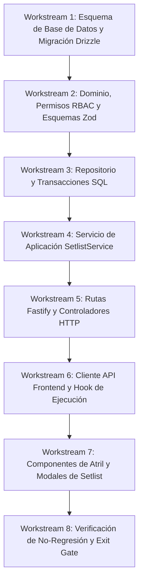

# BETHESDA WORSHIP STUDIO
## Plan de Implementación Técnica — Fase 2C
### Gestión de Setlists, Momentos del Servicio y Experiencia Litúrgica de Escenario

**Organización:** Iglesia Cristiana Bethesda — Madrid, Cundinamarca, Colombia  
**Proyecto:** Bethesda Worship Studio  
**Documento:** Plan de Implementación y Especificación Técnica — Fase 2C  
**Ubicación Autorizada:** `PHASE_2C_IMPLEMENTATION_PLAN.md` y `docs/PHASE_2C_IMPLEMENTATION_PLAN.md`  
**Fecha:** 20 de Septiembre de 2026  
**Línea Base Verificada:** Fase 2B Completada (243/243 pruebas pasando, TypeScript 0 errores, Seguridad RBAC Aprobada)  
**Estado de Planificación:** **PHASE 2C PLANNING STATUS: READY FOR IMPLEMENTATION AUTHORIZATION**  
**Estado de Código de Producción:** **CERO CÓDIGO DE PRODUCCIÓN IMPLEMENTADO (EN ESPERA DE AUTORIZACIÓN EXPLÍCITA)**

---

## 1. Resumen Ejecutivo y Propósito de la Fase 2C

La **Fase 2A** estableció la arquitectura de persistencia empresarial relacional e híbrida (PostgreSQL + Drizzle ORM + `CanonicalMusicPayload` en JSONB). La **Fase 2B** implementó y blindó la seguridad, autenticación (JWT HS256 + Argon2id + Cookies HttpOnly), autorización RBAC estricta y logs de auditoría inmutables.

El propósito funcional y arquitectónico de la **Fase 2C** —establecido explícitamente en la hoja de ruta del proyecto (`docs/06_ROADMAP_QUALITY_GATES_AND_ADR.md`, `docs/05_DATA_ARCHITECTURE_AND_API.md`, `docs/03_PERFORMANCE_REHEARSAL_AND_REALTIME.md` y `PHASE_2A_ENGINEERING_REPORT.md` Sección 23)— es dotar a la congregación de la **infraestructura completa de Setlists, Momentos Litúrgicos del Servicio y Flujo de Alabanza en Escenario**:

1. **Gestión Integral de Setlists de Culto:** Permitir a Pastores, Directores Musicales y Líderes de Alabanza estructurar, programar y ordenar cultos dominicales, vigilias, noches de adoración y ensayos generales.
2. **Coordinación de Momentos Litúrgicos (Service Moments):** Integrar de manera armónica en el atril elementos no cantados esenciales para el orden pastoral (oración de bienvenida, lectura bíblica, ofrendas, ministración espontánea con notas/pads de fondo, predicación).
3. **Sobrescritura Litúrgica Sin Mutación Canónica (Key & BPM Overrides):** Permitir que una canción se ejecute en un tono o tempo específico para un culto particular (ej. solista femenina requiere Re en lugar de Fa original) recalculando la vista en la capa de proyección en milisegundos sin mutar jamás el registro canónico maestro en la base de datos.
4. **Cues de Transición Dinámica:** Señalizar inequívocamente al equipo el modo de enlace entre temas (`SEGUE`, `CROSSFADE`, `STOP`, `MEDLEY`) y notas musicales específicas del director.
5. **Navegación de Atril en Escenario:** Barra de control ergonómica de culto en el `MusicalWorkspace` con conmutación ágil de canciones (`[◄ Anterior]` / `[Siguiente ►]`), teclado de escenario y tarjetas litúrgicas para momentos de servicio sin invocar motores de renderizado de partituras.

---

## 2. Línea Base Verificada (Fase 2B) y Contratos Inmutables

La planificación de la Fase 2C se asienta sobre una línea base técnica 100% operativa y verificada:

- **Compilador TypeScript (`tsc --noEmit`):** PASS (0 errores en `backend/` y `frontend/`).
- **Pruebas Backend (Node.js Test Runner + tsx):** 59 / 59 PASS (12 suites).
- **Pruebas Frontend (Node.js Test Runner):** 184 / 184 PASS (36 suites).
- **Consolidado de Pruebas Automatizadas:** **243 / 243 PASS (100%)**.
- **Seguridad Criptográfica:** JWT HS256 con verificación en tiempo constante (`timingSafeEqual`), contraseñas hasheadas exclusivamente con Argon2id (64MB, 3 iteraciones, 4 hilos), refresh tokens de 256 bits en cookies `HttpOnly; SameSite=Strict`, almacenamiento de tokens en memoria volátil de JavaScript (cero Web Storage).
- **Autorización RBAC:** Cinco roles explícitos (`SUPER_ADMIN`, `ADMIN`, `WORSHIP_LEADER`, `MUSICIAN`, `VIEWER`) sin herencia implícita, verificando el rol en tiempo real en base de datos (`verifyDatabaseRole = true`) en operaciones sensibles.
- **Invariantes Musicales:** `CanonicalMusicPayload` como fuente única de verdad musical, desacoplamiento absoluto Instrumento $\neq$ Vista, total de notas melódicas estrictamente cero (`totalMelodyNotes === 0`) para ChordPro, y Escenarios Dorados A–D en pleno funcionamiento.

---

## 3. Disposición y Tratamiento de Ítems Arrastrados de la Fase 2B (Carry-Forward Items)

Durante la auditoría de seguridad post-implementación de la Fase 2B se identificaron 4 consideraciones operativas. Para cada una de ellas, se define la postura formal de la Fase 2C:

| Ítem Arrastrado | Estado en Fase 2B | Disposición en Fase 2C | Justificación Técnica y Arquitectónica |
|---|---|---|---|
| **1. Validación interactiva vía Browser Subagent bloqueada por rate limits de API** | Bloqueada en tiempo de ejecución por cuota de la plataforma | **PREPARAR / VALIDACIÓN HÍBRIDA** | Las pruebas automatizadas del frontend (Node.js Test Runner / Vitest) proveen cobertura determinista al 100% de la lógica de componentes, barras de navegación, atajos de teclado y modales sin consumir cuota de subagentes. Se estructurarán pruebas de integración frontend exhaustivas y, si la cuota lo permite, se ejecutará una verificación puntual; de lo contrario, la suite automatizada será el estándar concluyente. |
| **2. Despacho real de correos vía SMTP no verificado** | Aplazado; tokens retornados en payload de API en dev | **DIFERIR A FASE DE DESPLIEGUE PRODUCTIVO** | La Fase 2C concierne a la liturgia y gestión de repertorio musical (Setlists y Momentos). La infraestructura externa de transporte SMTP (Amazon SES / SendGrid / Mailhog) es un aspecto de infraestructura de correo de incorporación de usuarios (Fase 2B). El entorno de desarrollo local continúa operando de forma desacoplada y sin dependencias externas. |
| **3. Rate Limiter basado en memoria de proceso (Redis requerido para multi-instancia)** | Implementado en `DualRateLimiter` en memoria | **PREPARAR / DIFERIR A FASE 4 / DESPLIEGUE** | La interfaz del limitador (`checkIp`, `checkAccount`, `resetAccountFailures`) está completamente desacoplada. Los nuevos endpoints de Setlists se protegerán mediante este middleware y RBAC. El adaptador concreto sobre Redis se implementará de forma natural en la Fase 4 (que introduce Redis Pub/Sub para WebSockets de sesión en vivo) o en el despliegue multi-contenedor. |
| **4. Atributo de Cookie `Secure: false` en entorno de desarrollo local** | Deshabilitado en HTTP dev; activado en prod | **MANTENER CONFIGURACIÓN CONDICIONAL** | La directiva `secure: env.NODE_ENV === 'production'` es la práctica estándar en la industria para permitir pruebas fluidas sobre `http://localhost:3001` sin requerir certificados autofirmados. En producción, la variable de entorno activará estrictamente el cifrado HTTPS. Cero modificación requerida. |

---

## 4. Requisitos Funcionales y de Dominio — Fase 2C

### 4.1 Entidad `SETLIST` (Lista de Culto o Servicio)
1. **Identidad y Programación:** Cada setlist posee un identificador UUID, título representativo (ej. *"Culto Dominical - 27 Septiembre 10:00 AM"*, *"Noche de Adoración y Alabanza"*), fecha/hora programada (`scheduledDateTime`), director musical asignado (`directorUserId`) y notas generales pastorales o litúrgicas.
2. **Máquina de Estados del Setlist:**
   $$\text{PLANNING (Borrador / Preparación)} \longrightarrow \text{ACTIVE (Culto / Ensayo en Curso)} \longrightarrow \text{COMPLETED (Servicio Concluido)} \longrightarrow \text{ARCHIVED}$$
   - Solo puede haber **un setlist en estado `ACTIVE`** simultáneamente por congregación.
   - Cualquier rol con permiso `setlists:activate` puede pasar un setlist a `ACTIVE`.

### 4.2 Entidad `SETLIST_ITEM` (Elementos del Setlist)
Cada setlist contiene una lista ordenada secuencialmente (`sequenceOrder: 1, 2, 3...`) compuesta por dos tipos polimórficos de elementos:

#### A. Canción de Culto (`itemType = 'SONG'`)
- Referencia foránea a la canción canónica existente (`songId`).
- **Sobrescritura de Tonalidad (`targetKey`):** Tonalidad en la que se interpretará en este servicio específico (ej. `"D"` cuando la tonalidad por defecto es `"F"`). Si es nulo, se interpreta en el tono por defecto de la canción.
- **Sobrescritura de Tempo (`targetBpm`):** BPM asignado para la dinámica del culto.
- **Tipo de Transición (`transitionType`):**
  - `SEGUE`: Continuo e inmediato, sin silencio entre canciones.
  - `CROSSFADE`: Sostenimiento de acordes/pad ambiental modulando hacia la nueva tonalidad.
  - `STOP`: Pausa con corte claro (aplauso congregacional, palabra del pastor, saludo).
  - `MEDLEY`: Fusión directa sin compás de interrupción.
- **Notas para el Equipo (`notesForTeam`):** Pautas interpretativas del director (ej. *"Comienza solo guitarra acústica y voz suave; banda completa entra en Coro 2 con dinámica forte"*).

#### B. Momento Litúrgico del Servicio (`itemType = 'SERVICE_MOMENT'`)
- Representa momentos del culto indispensables para la coordinación del atril donde no se lee partitura formal:
  - *"Bienvenida y Oración Inicial"*
  - *"Lectura de la Palabra"*
  - *"Momento de Diezmos y Ofrendas"*
  - *"Ministración y Clamor Espontáneo"*
  - *"Predicación Pastoral"*
- **Atributos Litúrgicos:**
  - `momentTitle`: Título del momento litúrgico.
  - `durationMinutes`: Duración estimada en minutos (para cálculo total del tiempo del culto).
  - `musicalKey`: Tono de acompañamiento ambiental o pad de fondo si aplica (ej. `"Am"` para oración).
  - `notesForTeam`: Indicaciones al grupo (ej. *"Mantener pad atmosférico en Am; teclado hace arpegios tenues"*).

### 4.3 Reordenamiento Atómico Transaccional
- El orden del setlist debe poder reorganizarse mediante arrastre o intercambio ágil.
- El backend proveerá un endpoint específico `PUT /api/v1/setlists/:id/reorder` que recibe `{ itemIds: string[] }` y actualiza todos los `sequenceOrder` en **una única transacción atómica SQL**, evitando duplicidades de índice o estados inconsistentes.
- La eliminación de un elemento debe compactar automáticamente los índices posteriores.

---

## 5. Arquitectura de Datos y Modelo Relacional (Drizzle ORM)

La implementación incorporará en `backend/src/db/schema.ts` las siguientes definiciones de esquemas, relaciones e índices:

### 5.1 Nuevos Enums PostgreSQL
```typescript
export const setlistStatusEnum = pgEnum('setlist_status', [
  'PLANNING',
  'ACTIVE',
  'COMPLETED',
  'ARCHIVED',
]);

export const setlistItemTypeEnum = pgEnum('setlist_item_type', [
  'SONG',
  'SERVICE_MOMENT',
]);

export const transitionTypeEnum = pgEnum('transition_type', [
  'SEGUE',
  'CROSSFADE',
  'STOP',
  'MEDLEY',
]);
```

### 5.2 Tabla `setlists`
```typescript
export const setlists = pgTable(
  'setlists',
  {
    id: uuid('id').primaryKey().defaultRandom(),
    title: varchar('title', { length: 255 }).notNull(),
    scheduledDateTime: timestamp('scheduled_date_time', { withTimezone: true }),
    status: setlistStatusEnum('status').notNull().default('PLANNING'),
    directorUserId: uuid('director_user_id').references(() => users.id, { onDelete: 'set null' }),
    notes: text('notes'),
    createdAt: timestamp('created_at', { withTimezone: true }).notNull().defaultNow(),
    updatedAt: timestamp('updated_at', { withTimezone: true }).notNull().defaultNow(),
  },
  (table) => [
    index('idx_setlists_status').on(table.status),
    index('idx_setlists_scheduled').on(table.scheduledDateTime),
    index('idx_setlists_director').on(table.directorUserId),
  ]
);
```

### 5.3 Tabla `setlist_items`
```typescript
export const setlistItems = pgTable(
  'setlist_items',
  {
    id: uuid('id').primaryKey().defaultRandom(),
    setlistId: uuid('setlist_id')
      .notNull()
      .references(() => setlists.id, { onDelete: 'cascade' }),
    sequenceOrder: integer('sequence_order').notNull(),
    itemType: setlistItemTypeEnum('item_type').notNull(),
    // Campos exclusivos para SONG
    songId: uuid('song_id').references(() => songs.id, { onDelete: 'restrict' }),
    targetKey: varchar('target_key', { length: 16 }),
    targetBpm: integer('target_bpm'),
    transitionType: transitionTypeEnum('transition_type').default('STOP'),
    // Campos exclusivos para SERVICE_MOMENT
    momentTitle: varchar('moment_title', { length: 255 }),
    durationMinutes: integer('duration_minutes'),
    musicalKey: varchar('musical_key', { length: 16 }),
    // Notas compartidas
    notesForTeam: text('notes_for_team'),
    createdAt: timestamp('created_at', { withTimezone: true }).notNull().defaultNow(),
    updatedAt: timestamp('updated_at', { withTimezone: true }).notNull().defaultNow(),
  },
  (table) => [
    index('idx_setlist_items_setlist_id').on(table.setlistId),
    index('idx_setlist_items_sequence').on(table.setlistId, table.sequenceOrder),
    index('idx_setlist_items_song_id').on(table.songId),
  ]
);
```

### 5.4 Relaciones Drizzle ORM
- `users.setlistsDirected`: Relación 1:N con `setlists`.
- `setlists.director`: Relación N:1 con `users`.
- `setlists.items`: Relación 1:N con `setlistItems` (ordenada por `sequenceOrder`).
- `setlistItems.setlist`: Relación N:1 con `setlists`.
- `setlistItems.song`: Relación N:1 con `songs`.

---

## 6. Especificación de la API RESTful (`/api/v1/setlists`)

Todos los endpoints se autentican vía Bearer JWT (HS256) y validan permisos granulares en tiempo real.

| Método | Endpoint | Permiso Requerido | DB Role Check | Descripción |
|:---|:---|:---|:---:|:---|
| `GET` | `/api/v1/setlists` | `setlists:list` | No | Lista setlists con filtros (`status`, `upcoming`, paginación). |
| `POST` | `/api/v1/setlists` | `setlists:create` | **Sí** | Crea un nuevo setlist en estado `PLANNING`. |
| `GET` | `/api/v1/setlists/:id` | `setlists:read` | No | Retorna el setlist con todos sus ítems ordenados y canciones asociadas. |
| `PUT` | `/api/v1/setlists/:id` | `setlists:update` | **Sí** | Actualiza metadatos del setlist (título, fecha, notas, director). |
| `DELETE` | `/api/v1/setlists/:id` | `setlists:delete` | **Sí** | Elimina el setlist en cascada (restringido a `ADMIN`/`SUPER_ADMIN`). |
| `POST` | `/api/v1/setlists/:id/items` | `setlists:update` | **Sí** | Agrega una canción o momento litúrgico al setlist. |
| `PUT` | `/api/v1/setlists/:id/items/:itemId` | `setlists:update` | **Sí** | Modifica tono, tempo, transición o notas de un ítem. |
| `DELETE` | `/api/v1/setlists/:id/items/:itemId` | `setlists:update` | **Sí** | Elimina un ítem y recompacta la secuencia automáticamente. |
| `PUT` | `/api/v1/setlists/:id/reorder` | `setlists:reorder` | **Sí** | Reordenamiento atómico transaccional de ítems (`{ itemIds: string[] }`). |
| `POST` | `/api/v1/setlists/:id/status` | `setlists:activate` | **Sí** | Transición de estado (`PLANNING` $\to$ `ACTIVE` $\to$ `COMPLETED`). |

---

## 7. Matriz de Autorización y Seguridad RBAC

Se extienden los permisos explícitos en `backend/src/domain/auth-types.ts` manteniendo el principio de **cero herencia implícita**:

| Permiso | `SUPER_ADMIN` | `ADMIN` | `WORSHIP_LEADER` | `MUSICIAN` | `VIEWER` |
|:---|:---:|:---:|:---:|:---:|:---:|
| `setlists:list` |  |  |  |  |  |
| `setlists:read` |  |  |  |  |  |
| `setlists:create` |  |  |  | ❌ | ❌ |
| `setlists:update` |  |  |  | ❌ | ❌ |
| `setlists:reorder` |  |  |  | ❌ | ❌ |
| `setlists:activate` |  |  |  | ❌ | ❌ |
| `setlists:delete` |  |  | ❌ | ❌ | ❌ |

- **Invariante de Seguridad:** Un músico o visualizador puede explorar y cargar setlists en su atril, pero no puede alterar el orden, tonalidades asignadas ni eliminar elementos del culto.

---

## 8. Arquitectura y Componentes Frontend

### 8.1 Integración en `MusicalWorkspace`
El workspace actual de visualización musical se conectará al contexto del setlist mediante una barra de atril ergonómica para escenario:

```
┌────────────────────────────────────────────────────────────────────────┐
│                        BARRA DE NAVEGACIÓN LITÚRGICA                  │
│ [◄ Ant] [Culto Dominical: Item 2 de 5] [Sig ►] | Transición: [CROSSFADE]│
│ Canción: Gracia Sublime | Tono Litúrgico: D (Orig: F) | BPM: 72        │
│ Notas Director: "Entra solo piano y voz; banda completa en Coro 2"     │
└────────────────────────────────────────────────────────────────────────┘
```

### 8.2 Nuevos Componentes y Hooks
1. **`SetlistsModal.tsx`:** Modal de exploración, creación, programación y selección de setlists desde el repertorio de la iglesia.
2. **`SetlistNavigationToolbar.tsx`:** Barra superior/inferior para el atril de escenario con controles táctiles $\ge 48\text{px}$, insignias de transición litúrgica, tonalidad de culto y visualización de notas.
3. **`ServiceMomentCard.tsx`:** Vista ergonómica de escenario cuando el elemento activo es un momento litúrgico (Oración, Ofrendas, Lectura). Muestra título grande, duración y tono ambiental, **sin instanciar adaptadores de partituras (alphaTab/OSMD)** para evitar errores de renderizado.
4. **Hook `useSetlistExecution.ts`:**
   - Gestiona el setlist cargado, el índice activo, la navegación hacia adelante/atrás y atajos de teclado (`ArrowRight`, `ArrowLeft`, `PageDown`, `PageUp`).
   - Calcula de forma pura la transposición requerida para la canción:
     $$\Delta_{\text{semitonos}} = \text{calcularIntervalo}(\text{cancion.defaultKey}, \text{item.targetKey})$$
   - Pasa `transpositionSemitones` a `useMusicalWorkspace` de manera transparente sin alterar el almacenamiento.

---

## 9. Estrategia de Preservación y No-Regresión del Dominio Musical

1. **Invariante Canónica Absoluta:**
   - `CanonicalMusicPayload` **no se modifica en la base de datos** al asignar una tonalidad en un setlist.
   - El cambio de tono litúrgico es un parámetro de proyección en tiempo de lectura:
     $$\text{Song (Fijo)} + \text{SetlistItem.targetKey} \longrightarrow \text{ProjectionService.project(viewConfig)} \longrightarrow \text{DerivedMusicalView}$$
2. **Preservación de Cero Notas Melódicas:**
   - Canciones importadas desde ChordPro continuarán garantizando `totalMelodyNotes === 0` dentro de los setlists.
3. **Aislamiento de Renderizadores:**
   - Los renderizadores de partitura (`alphaTab`, `OSMD`, `LeadSheetDOM`) siguen siendo consumidores pasivos agnósticos de la existencia de setlists o servicios.
4. **Escenarios Dorados A–D:**
   - Se continuará verificando en cada suite de pruebas que los 4 escenarios dorados operan sin alteración alguna.

---

## 10. Estrategia de Pruebas y Validación

### 10.1 Pruebas Automatizadas de Backend (Nuevas)
- `setlist-repository.test.ts`: Pruebas de integración del repositorio PostgreSQL + Drizzle (creación, asociación de ítems, reordenamiento atómico, transacciones, eliminación en cascada).
- `setlist-api.test.ts`: Pruebas de rutas Fastify `/api/v1/setlists` (validación de esquemas Zod, códigos de error HTTP 400, 403, 404, respuestas tipadas).
- `setlist-rbac.test.ts`: Pruebas de control de acceso (rechazo de mutaciones para `MUSICIAN` y `VIEWER`, autorización para `WORSHIP_LEADER`, permisos exclusivos de borrado para `ADMIN`).

### 10.2 Pruebas Automatizadas de Frontend (Nuevas)
- `use-setlist-execution.test.ts`: Pruebas unitarias de navegación secuencial, salto a momentos litúrgicos, cálculo de transposición litúrgica y atajos de teclado.
- `setlist-navigation-toolbar.test.ts`: Pruebas de renderizado de la barra de atril, cambio de canciones, insignias de transición y visualización de notas.
- `service-moment-card.test.ts`: Verificación de renderizado de momentos litúrgicos sin llamar a motores de notación.
- `setlist-workspace-integration.test.ts`: Verificación de flujo completo en el atril de escenario con canciones canónicas reales.

### 10.3 Proyección de Cobertura de Pruebas
- **Línea Base Actual:** 243 pruebas (59 backend + 184 frontend).
- **Nuevas Pruebas Fase 2C:** $\ge 30$ pruebas automatizadas nuevas ($\ge 15$ backend + $\ge 15$ frontend).
- **Meta Global Fase 2C:** $\ge \mathbf{273\text{ pruebas pasando (0 fallos, 0 omitidas)}}$.

---

## 11. Plan de Trabajo por Flujos (Implementation Workstreams)

La implementación se organizará en **8 flujos estrictamente secuenciales**:



1. **Workstream 1 (Persistencia):** Actualizar `backend/src/db/schema.ts`, generar y aplicar migración `0002_setlists_and_service_moments.sql`.
2. **Workstream 2 (Dominio & Validación):** Extender `auth-types.ts` con permisos `setlists:*`, definir esquemas Zod en `setlist.schemas.ts`.
3. **Workstream 3 (Repositorio):** Implementar `DrizzleSetlistRepository` con reordenamiento atómico transaccional y compactación de secuencia.
4. **Workstream 4 (Aplicación):** Crear `SetlistService` desacoplando reglas de negocio de la infraestructura HTTP.
5. **Workstream 5 (HTTP API):** Registrar router `setlist.routes.ts` en Fastify con guardas RBAC y verificación de rol en base de datos.
6. **Workstream 6 (Frontend Core):** Crear cliente API tipado y hook `useSetlistExecution` con cálculo puro de semitonos litúrgicos.
7. **Workstream 7 (Frontend UI):** Desarrollar `SetlistsModal`, `SetlistNavigationToolbar` y `ServiceMomentCard` con diseño de escenario de alto contraste.
8. **Workstream 8 (Exit Gate):** Ejecutar suites completas de pruebas, validación de tipos `tsc --noEmit` y reporte final de ingeniería.

---

## 12. Criterios de Aceptación y Compuerta de Salida (Exit Gate)

### 12.1 Criterios de Aceptación
1. Un usuario con rol `WORSHIP_LEADER` o `ADMIN` puede crear un Setlist programado, agregar canciones del repertorio existente y registrar momentos de servicio litúrgicos.
2. La reordenación de elementos actualiza la secuencia atómicamente sin inconsistencias de orden.
3. Una canción asignada en un tono litúrgico diferente a su tono canónico se abre en el atril transpuesta en milisegundos sin mutar la base de datos.
4. La navegación entre canciones en el atril responde instantáneamente a controles táctiles y teclas de flecha.
5. Los momentos litúrgicos se muestran de forma clara y ergonómica sin producir errores en los renderizadores de partitura.
6. Los roles `MUSICIAN` y `VIEWER` pueden navegar setlists pero no tienen permisos para mutarlos ni eliminarlos (HTTP 403 verificado).

### 12.2 Criterios del Exit Gate de la Fase 2C
- [ ] Migración `0002_setlists_and_service_moments.sql` aplicada con éxito en PostgreSQL.
- [ ] Compilador TypeScript `tsc --noEmit` sin errores en backend y frontend (0 fallos).
- [ ] 59 pruebas de backend de Fase 2A/2B pasando limpias.
- [ ] 184 pruebas de frontend de Fase 1A-1G pasando limpias.
- [ ] $\ge 30$ nuevas pruebas automatizadas para la Fase 2C pasando limpias.
- [ ] Total consolidado $\ge 273$ pruebas automáticas (0 fallos, 0 omitidas).
- [ ] Invariantes de `CanonicalMusicPayload` y `totalMelodyNotes === 0` preservadas al 100%.
- [ ] Escenarios Dorados A–D operativos y verificados.
- [ ] Documentación técnica formal actualizada y sincronizada entre raíz y `docs/`.

---

## 13. Declaración de Estado y Autorización

$$\mathbf{PHASE\ 2C\ PLANNING\ STATUS:\ READY\ FOR\ IMPLEMENTATION\ AUTHORIZATION}$$

**Declaración Explícita de Restricción de Implementación:**
- Se confirma que durante esta tarea **NO se ha implementado código de producción de la Fase 2C**.
- No se han creado migraciones de base de datos ni modificado esquemas de producción.
- No se han modificado las capas de seguridad ni alterado contratos musicales canónicos.
- El sistema se encuentra en su línea base intacta de Fase 2B, formalmente listo para recibir la **autorización explícita de implementación** del usuario.
