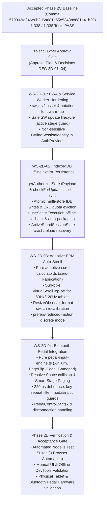

# BETHESDA WORSHIP STUDIO
# PHASE 2D — STAGE ERGONOMICS & OFFLINE READINESS
## IMPLEMENTATION PLAN, WORKSTREAM SEQUENCE & ACCEPTANCE MATRIX

**Project:** Bethesda Worship Studio  
**Organization:** Iglesia Cristiana Bethesda — Madrid, Cundinamarca, Colombia  
**Repository:** `https://github.com/juancastro2381-hub/BETHESDA-WORSHIP-STUDIO.git`  
**Branch:** `feature/phase-1a-core-foundation`  
**Accepted Phase 2C Baseline Commit (`HEAD`):** `570902fa346e0b2d6a681d55e5348b8681a41b29`  
**Parent Commit (`HEAD~1`):** `654c5f52a115e0449c9037bd92560caeb9bcd91b`  
**Project Execution Designation:** Phase 2D — Stage Ergonomics & Resilient Offline Music Stand Experience  
**Master Roadmap Capability Reference:** Phase 3 — Stage Ergonomics & Offline-First Atril  
**Assignment Scope:** Implementation Planning & Acceptance Matrix Only (Not Authorized for Production Code Execution)  
**Date:** November 12, 2026  
**Governance Gate Status:** `PREFLIGHT CONDITIONAL PASS — DECISIONS REQUIRED`  

---

## 1. Executive Summary & Implementation Scope

This document defines the complete engineering implementation plan, workstream dependency graph, risk mitigation framework, non-browser automated test strategy, manual/physical hardware validation protocol, and formal acceptance matrix for **Phase 2D — Stage Ergonomics & Resilient Offline Music Stand Experience** (corresponding to **Phase 3 — Stage Ergonomics & Offline-First Atril** in [`BETHESDA_WORSHIP_STUDIO_MASTER_ROADMAP.md`](file:///c:/Users/juanc/OneDrive/Documentos/Desarrollo%20proyectos/Sistema%20musical%20-%20partituras/BETHESDA%20WORSHIP%20STUDIO/docs/BETHESDA_WORSHIP_STUDIO_MASTER_ROADMAP.md#L298-L322)).

### 1.1 Summary of Implemented vs. Remaining Capabilities

| Workstream | Already Implemented in Repository (`HEAD: 570902f`) | Remaining to Implement in Phase 2D |
| :--- | :--- | :--- |
| **`WS-2D-01` PWA & Service Worker** | • [`manifest.webmanifest`](file:///c:/Users/juanc/OneDrive/Documentos/Desarrollo%20proyectos/Sistema%20musical%20-%20partituras/BETHESDA%20WORSHIP%20STUDIO/frontend/public/manifest.webmanifest) & [`index.html`](file:///c:/Users/juanc/OneDrive/Documentos/Desarrollo%20proyectos/Sistema%20musical%20-%20partituras/BETHESDA%20WORSHIP%20STUDIO/frontend/index.html) PWA tags • [`sw.js`](file:///c:/Users/juanc/OneDrive/Documentos/Desarrollo%20proyectos/Sistema%20musical%20-%20partituras/BETHESDA%20WORSHIP%20STUDIO/frontend/public/sw.js) v1 shell precache, `isCacheEligible`, `safelyPutInCache`, `/api/v1/` 503 guard, navigation fallback, stale-while-revalidate • SW registration in [`main.tsx`](file:///c:/Users/juanc/OneDrive/Documentos/Desarrollo%20proyectos/Sistema%20musical%20-%20partituras/BETHESDA%20WORSHIP%20STUDIO/frontend/src/main.tsx) • 10/10 unit tests in [`service-worker-cache-eligibility.test.ts`](file:///c:/Users/juanc/OneDrive/Documentos/Desarrollo%20proyectos/Sistema%20musical%20-%20partituras/BETHESDA%20WORSHIP%20STUDIO/frontend/src/core/offline/__tests__/service-worker-cache-eligibility.test.ts) | • **`GAP-2D-01A`:** Notation font & compiled bundle warm-up precaching (`PRECACHE_ASSETS` message channel in `sw.js` v2) • **`GAP-2D-01B`:** Controlled SW update lifecycle (`SKIP_WAITING` handshake) preventing disruptive reload during an `ACTIVE` setlist or `isMusicStandMode` • **`GAP-2D-01C`:** Non-sensitive `OfflineSessionIdentity` in `AuthProvider` (`auth-context.tsx`) so offline cold boot / F5 reload preserves user-scoped read-only access within the 7-day grace period |
| **`WS-2D-02` IndexedDB Offline Setlist Persistence** | • [`indexeddb-storage.ts`](file:///c:/Users/juanc/OneDrive/Documentos/Desarrollo%20proyectos/Sistema%20musical%20-%20partituras/BETHESDA%20WORSHIP%20STUDIO/frontend/src/core/offline/storage/indexeddb-storage.ts) (`BethesdaOfflineStorage` v1, 4 stores, tombstone recovery, `purgeUserData`) • [`offline-manager.ts`](file:///c:/Users/juanc/OneDrive/Documentos/Desarrollo%20proyectos/Sistema%20musical%20-%20partituras/BETHESDA%20WORSHIP%20STUDIO/frontend/src/core/offline/offline-manager.ts) (`downloadSong`, `downloadSetlist`, `getAuthorizedSongPayload`, 7-day expiry, SHA-256 check, 85% quota guard, `checkForUpdates`) • 43/43 unit tests across `indexeddb-storage`, `offline-manager`, `setlist-packager`, `session-isolation` | • **`GAP-2D-02A`:** Offline IndexedDB fallback in [`useSetlistExecution.loadSetlist()`](file:///c:/Users/juanc/OneDrive/Documentos/Desarrollo%20proyectos/Sistema%20musical%20-%20partituras/BETHESDA%20WORSHIP%20STUDIO/frontend/src/core/workspace/use-setlist-execution.ts#L135-L152) • **`GAP-2D-02B`:** `getAuthorizedSetlistPayload(setlistId)` + setlist revalidation in `checkForUpdates()` • **`GAP-2D-02C`:** Automatic active setlist persistence (`syncActiveSetlistForOffline`) + execution cursor recovery (`activeSetlistSessionState`) after browser termination • **`GAP-2D-02D`:** Wire `onSelectSong` and `onSelectSetlist` in [`App.tsx`](file:///c:/Users/juanc/OneDrive/Documentos/Desarrollo%20proyectos/Sistema%20musical%20-%20partituras/BETHESDA%20WORSHIP%20STUDIO/frontend/src/App.tsx#L43) / `MusicalWorkspace.tsx` • **`GAP-2D-02E`:** Offline-first N+1 song prefetching in `MusicalWorkspace.tsx` • **`GAP-2D-02F`:** Atomic multi-store IDB write transactions + non-active LRU quota eviction protecting the `ACTIVE` setlist |
| **`WS-2D-03` Adaptive Auto-Scroll** | • [`use-autoscroll.ts`](file:///c:/Users/juanc/OneDrive/Documentos/Desarrollo%20proyectos/Sistema%20musical%20-%20partituras/BETHESDA%20WORSHIP%20STUDIO/frontend/src/core/autoscroll/use-autoscroll.ts) & [`AutoscrollControl.tsx`](file:///c:/Users/juanc/OneDrive/Documentos/Desarrollo%20proyectos/Sistema%20musical%20-%20partituras/BETHESDA%20WORSHIP%20STUDIO/frontend/src/components/workspace/AutoscrollControl.tsx) • Constant pixel velocity (`35 px/s` $\times$ `0.5x–3.0x`), passive touch/wheel pause with `2000ms` grace period, `visibilitychange` pause • 8/8 unit tests in [`autoscroll.test.ts`](file:///c:/Users/juanc/OneDrive/Documentos/Desarrollo%20proyectos/Sistema%20musical%20-%20partituras/BETHESDA%20WORSHIP%20STUDIO/frontend/src/core/autoscroll/__tests__/autoscroll.test.ts) | • **`GAP-2D-03A`:** Pure BPM & measure-count adaptive velocity calculator (`adaptive-scroll-calculator.ts`) consuming `CanonicalMusicPayload.timeline`, `TempoMap`, and `setlistItem.targetBpm` with strict Zero-Fabrication fallback when unmeasured or missing BPM • **`GAP-2D-03B`:** Floating-point sub-pixel scroll accumulator (`virtualScrollTopRef`) preventing quantization stalls on 60Hz/120Hz High-DPI tablets • **`GAP-2D-03C`:** `ResizeObserver` recalibration preserving progress across reading format switches (`SCORE`, `TAB`, `CHORD_SHEET`, `LYRICS`) and zoom changes • **`GAP-2D-03D`:** `prefers-reduced-motion: reduce` detection and discrete page-step accessibility mode |
| **`WS-2D-04` Bluetooth Pedal Integration** | • **0% Implemented** (Explicitly excluded in WP-05; guarded by `autoscroll.test.ts` Test 8) | • **`GAP-2D-04A`:** Resolve `Space` key collision between `SetlistNavigationToolbar.tsx` and `AutoscrollControl.tsx` • **`GAP-2D-04B`:** Implement Smart Stage Paging (`SCROLL_PAGE_OR_NEXT_ITEM`) so `PageDown`/`PageUp` scrolls multi-page scores before switching songs • **`GAP-2D-04C`:** Create decoupled `frontend/src/core/pedals/` subsystem supporting HID Keyboard profiles (AirTurn Modes 2–5, PageFlip, Coda Stomp) and W3C Gamepad API (`navigator.getGamepads()`) • **`GAP-2D-04D`:** Hardware contact-bounce debounce (`220ms`), `e.repeat` suppression, modal/input focus safety guards, disconnection banner, and `PedalControlBar.tsx` |

---

## 2. Workstream Breakdown & Exact File Modification Plan

### 2.1 Workstream 1: `WS-2D-01` — PWA & Service Worker Hardening

#### Objectives
1. Upgrade `frontend/public/sw.js` to `bethesda-worship-studio-shell-v2` with support for client-initiated asset warm-up (`PRECACHE_ASSETS` message) so compiled JS/CSS bundles and musical notation fonts (`Bravura` / UI fonts) are deterministically cached upon installation.
2. Add controlled Service Worker update coordination (`SKIP_WAITING` message handshake) so a newly installed worker does not forcibly reload a live worship session while `loadedSetlist?.status === 'ACTIVE'` or `isMusicStandMode === true`.
3. Implement non-sensitive `OfflineSessionIdentity` persistence in `frontend/src/core/auth/` and `frontend/src/core/offline/` so an offline cold startup or F5 refresh restores the musician's read-only user context (`userId`, `email`, `fullName`, `role`, `lastAuthenticatedAt`) within the 7-day grace period, without ever storing tokens or credentials.

#### Files to Modify / Create in `WS-2D-01`
- **Modify:** [`frontend/public/sw.js`](file:///c:/Users/juanc/OneDrive/Documentos/Desarrollo%20proyectos/Sistema%20musical%20-%20partituras/BETHESDA%20WORSHIP%20STUDIO/frontend/public/sw.js) — Add `message` listener for `PRECACHE_ASSETS` (filtering every URL through `isCacheEligible`) and `SKIP_WAITING`; preserve `/api/v1/` 503 security invariant and scheme guards.
- **Modify:** [`frontend/src/main.tsx`](file:///c:/Users/juanc/OneDrive/Documentos/Desarrollo%20proyectos/Sistema%20musical%20-%20partituras/BETHESDA%20WORSHIP%20STUDIO/frontend/src/main.tsx) — Post discovered document stylesheet/script/font URLs to active Service Worker on load and track waiting SW updates safely.
- **Modify:** [`frontend/src/core/auth/auth-context.tsx`](file:///c:/Users/juanc/OneDrive/Documentos/Desarrollo%20proyectos/Sistema%20musical%20-%20partituras/BETHESDA%20WORSHIP%20STUDIO/frontend/src/core/auth/auth-context.tsx) — Save non-sensitive `OfflineSessionIdentity` on successful `login()` and `performSilentRefresh()`; restore read-only identity when `performSilentRefresh()` fails offline (`!navigator.onLine`) and identity is within the 7-day grace period; purge unconditionally on `logout()`.
- **Create:** `frontend/src/core/offline/__tests__/pwa-lifecycle-and-offline-boot.test.ts` — Unit tests for asset warm-up filtering, update deferral during active setlist execution, and offline cold-boot session identity lifecycle (including 7-day expiry and logout purge).

---

### 2.2 Workstream 2: `WS-2D-02` — IndexedDB Offline Setlist Persistence & Recovery

#### Objectives
1. Implement `getAuthorizedSetlistPayload(setlistId: string)` in `BethesdaOfflineManager` enforcing `FAILED` status checks, SHA-256 payload integrity verification, 7-day offline grace period (`isAuthorizationExpired`), and online revalidation against `apiClient.getSetlist(setlistId)`.
2. Extend `checkForUpdates()` in `BethesdaOfflineManager` to revalidate cached `SETLIST` records in addition to `SONG` records, detecting server-side item/key modifications (`updatedAt` / checksum changes) and purging revoked (`401`/`403`/`404`) setlists.
3. Upgrade `IndexedDbStorage.saveSongPayload`, `saveSetlistPayload`, and `saveAudioRecord` to execute metadata + payload writes in a single atomic multi-store IndexedDB transaction (`[STORES.METADATA, STORES.SONG_PAYLOADS]`), preventing orphaned or half-written records if a write is interrupted.
4. Add `evictLeastRecentlyValidatedResources(requiredBytes, protectedSetlistId)` to `BethesdaOfflineManager` to reclaim storage when approaching the 85% quota limit while strictly protecting the `ACTIVE` setlist and all its `associatedSongIds`.
5. Integrate transparent IndexedDB offline fallback into `useSetlistExecution.loadSetlist(setlistId)` (`frontend/src/core/workspace/use-setlist-execution.ts`) and automatic background packaging (`syncActiveSetlistForOffline`) when a setlist is loaded or activated in the atril.
6. Persist and restore `ActiveStandSessionState` (`{ setlistId, currentIndex, isMusicStandMode, isHighContrast, zoomPercent, ownerUserId, updatedAt }`) so browser tab termination or reload on stage recovers the exact position offline or online.
7. Wire `onSelectSong` and `onSelectSetlist` into `OfflineStatusBar` / `OfflineInventoryModal` and make the N+1 song prefetcher in `MusicalWorkspace.tsx` check `offlineManager.getAuthorizedSongPayload(nextSongId)` before issuing network requests.

#### Files to Modify / Create in `WS-2D-02`
- **Modify:** [`frontend/src/core/offline/types.ts`](file:///c:/Users/juanc/OneDrive/Documentos/Desarrollo%20proyectos/Sistema%20musical%20-%20partituras/BETHESDA%20WORSHIP%20STUDIO/frontend/src/core/offline/types.ts) — Add `OfflineSessionIdentity`, `ActiveStandSessionState`, and `UserViewPreferenceCacheRecord` interfaces.
- **Modify:** [`frontend/src/core/offline/storage/indexeddb-storage.ts`](file:///c:/Users/juanc/OneDrive/Documentos/Desarrollo%20proyectos/Sistema%20musical%20-%20partituras/BETHESDA%20WORSHIP%20STUDIO/frontend/src/core/offline/storage/indexeddb-storage.ts) — Atomic multi-store transactions for `saveSongPayload`, `saveSetlistPayload`, `saveAudioRecord`; session state & user preference storage helpers purged on `purgeUserData` / `purgeAll`.
- **Modify:** [`frontend/src/core/offline/offline-manager.ts`](file:///c:/Users/juanc/OneDrive/Documentos/Desarrollo%20proyectos/Sistema%20musical%20-%20partituras/BETHESDA%20WORSHIP%20STUDIO/frontend/src/core/offline/offline-manager.ts) — Add `getAuthorizedSetlistPayload()`, setlist revalidation in `checkForUpdates()`, `syncActiveSetlistForOffline()`, and `evictStaleNonActiveResources()`.
- **Modify:** [`frontend/src/core/workspace/use-setlist-execution.ts`](file:///c:/Users/juanc/OneDrive/Documentos/Desarrollo%20proyectos/Sistema%20musical%20-%20partituras/BETHESDA%20WORSHIP%20STUDIO/frontend/src/core/workspace/use-setlist-execution.ts) — Add offline fallback via `offlineManager.getAuthorizedSetlistPayload(setlistId)` in `loadSetlist()`, auto-packaging trigger on load/activate, and cursor persistence/recovery.
- **Modify:** [`frontend/src/components/workspace/MusicalWorkspace.tsx`](file:///c:/Users/juanc/OneDrive/Documentos/Desarrollo%20proyectos/Sistema%20musical%20-%20partituras/BETHESDA%20WORSHIP%20STUDIO/frontend/src/components/workspace/MusicalWorkspace.tsx) & [`frontend/src/App.tsx`](file:///c:/Users/juanc/OneDrive/Documentos/Desarrollo%20proyectos/Sistema%20musical%20-%20partituras/BETHESDA%20WORSHIP%20STUDIO/frontend/src/App.tsx) — Wire `onSelectSong` and `onSelectSetlist` from `OfflineStatusBar` into `MusicalWorkspace`; check `offlineManager.getAuthorizedSongPayload(nextSongId)` first in N+1 prefetcher; cache & fallback `userPreferences` offline.
- **Create:** `frontend/src/core/offline/__tests__/phase2d-offline-setlist-persistence.test.ts` — Comprehensive unit & integration tests covering offline `loadSetlist`, `getAuthorizedSetlistPayload`, 7-day setlist expiry, online conflict/revalidation, interrupted write atomicity, LRU eviction protecting active setlist, and session cursor recovery.

---

### 2.3 Workstream 3: `WS-2D-03` — Adaptive BPM Auto-Scroll & High-DPI Smoothness

#### Objectives
1. Create a pure, deterministic domain module `frontend/src/core/autoscroll/adaptive-scroll-calculator.ts` that computes adaptive scroll timing from `CanonicalMusicPayload.timeline`, `TempoMap`, measure `TimeSignature`, and `setlistItem.targetBpm` / `song.defaultBpm`.
2. Enforce the **Zero-Fabrication Rule**:
   - When `timeline.isUnmetered === true`, `measureCount === 0`, `isVisualDocument === true`, or no BPM exists in `targetBpm`, `tempoMap`, or `defaultBpm`, return `{ isAdaptiveAvailable: false, fallbackReason: '...', mode: 'MANUAL_SPEED', basePixelsPerSecond: 35 }` without inventing `120 BPM` or synthetic durations.
   - When authoritative timing exists, compute exact `totalDurationSeconds` and adaptive `basePixelsPerSecond = clamp(maxScrollTop / totalDurationSeconds, 5, 250)`.
3. Upgrade `useAutoscroll` (`frontend/src/core/autoscroll/use-autoscroll.ts`) with:
   - Support for `mode: 'ADAPTIVE_BPM' | 'MANUAL_SPEED'`.
   - A floating-point sub-pixel accumulator (`virtualScrollTopRef`) that prevents integer `scrollTop` truncation freezes on 60Hz/120Hz High-DPI tablets and resynchronizes seamlessly when the user performs a manual touch or wheel scroll.
   - `ResizeObserver` integration to recalibrate `maxScrollTop` and preserve relative scroll percentage when switching reading formats (`SCORE`, `TAB`, `CHORD_SHEET`, `LYRICS`) or Stand Zoom (`zoomPercent`).
   - Detection of `window.matchMedia('(prefers-reduced-motion: reduce)')` to support discrete step scrolling when reduced motion is enabled.
4. Enhance `AutoscrollControl.tsx` to display the active mode (`♩ Adaptativo: 75 BPM` vs `Manual: 35 px/s`), allow toggling between Adaptive and Manual mode when adaptive timing is available, and remove its colliding direct `window` `Space` key listener in favor of the unified Stage Input Dispatcher (`WS-2D-04`).
5. **Strict Test Invariant:** Keep `use-autoscroll.ts` and `AutoscrollControl.tsx` 100% free of the substrings `'pedal'`, `'bluetooth'`, and `'gamepad'` so `autoscroll.test.ts` Test 8 passes without modification.

#### Files to Modify / Create in `WS-2D-03`
- **Create:** `frontend/src/core/autoscroll/adaptive-scroll-calculator.ts` — Pure mathematical calculation of song duration and adaptive scroll velocity with Zero-Fabrication guards.
- **Modify:** [`frontend/src/core/autoscroll/types.ts`](file:///c:/Users/juanc/OneDrive/Documentos/Desarrollo%20proyectos/Sistema%20musical%20-%20partituras/BETHESDA%20WORSHIP%20STUDIO/frontend/src/core/autoscroll/types.ts) — Add `AutoscrollMode` (`'ADAPTIVE_BPM' | 'MANUAL_SPEED'`), `AdaptiveScrollDiagnostics`, and `stepPageForward` / `stepPageBackward` methods on `AutoscrollController`.
- **Modify:** [`frontend/src/core/autoscroll/use-autoscroll.ts`](file:///c:/Users/juanc/OneDrive/Documentos/Desarrollo%20proyectos/Sistema%20musical%20-%20partituras/BETHESDA%20WORSHIP%20STUDIO/frontend/src/core/autoscroll/use-autoscroll.ts) — Integrate adaptive calculator, sub-pixel accumulator `virtualScrollTopRef`, `ResizeObserver` format-switch recalibration, and `prefers-reduced-motion` support.
- **Modify:** [`frontend/src/components/workspace/AutoscrollControl.tsx`](file:///c:/Users/juanc/OneDrive/Documentos/Desarrollo%20proyectos/Sistema%20musical%20-%20partituras/BETHESDA%20WORSHIP%20STUDIO/frontend/src/components/workspace/AutoscrollControl.tsx) — Add Adaptive/Manual mode badge & toggle and reduced-motion indicator.
- **Create:** `frontend/src/core/autoscroll/__tests__/adaptive-autoscroll.test.ts` — Unit tests for BPM-driven velocity, variable `TempoMap` integration, setlist `targetBpm` override, Zero-Fabrication fallback on unmeasured/BPM-less scores, 120Hz sub-pixel accumulation, format-switch progress preservation, and `prefers-reduced-motion`.

---

### 2.4 Workstream 4: `WS-2D-04` — Bluetooth Pedal Integration & Unified Stage Input Dispatcher

#### Objectives
1. Create a dedicated, decoupled pedal subsystem in `frontend/src/core/pedals/` (`types.ts`, `pedal-profiles.ts`, `pedal-input-engine.ts`, `use-pedal-controller.ts`, `index.ts`) supporting:
   - **Web Keyboard API (Bluetooth HID Keyboard Profile):** Built-in presets for:
     - `AIRTURN_MODE_2` / `PAGEFLIP_PAGE` (`PageUp` = Backward, `PageDown` = Forward, `ArrowUp` = Scroll Up, `ArrowDown` = Scroll Down)
     - `AIRTURN_MODE_3` / `PAGEFLIP_ARROWS` (`ArrowLeft` = Backward, `ArrowRight` = Forward, `Space` = Toggle Autoscroll, `Enter` = Next Setlist Item)
     - `CODA_STOMP_DEFAULT` (`PageUp` / `ArrowLeft` = Backward, `PageDown` / `ArrowRight` = Forward, `Space` = Toggle Autoscroll)
     - `CUSTOM_MAPPING` (user-configurable key-to-action map)
   - **W3C Gamepad API (`navigator.getGamepads()`):** Support for USB/Bluetooth HID foot controllers enumerating as standard gamepads (`gamepadconnected` / `gamepaddisconnected` events, edge-triggered button press detection on buttons `0`/`1` and D-Pad `12`/`13`/`14`/`15`).
2. Implement **Unified Stage Input Resolution & Smart Stage Paging**:
   - Eliminate the duplicate `window` `keydown` listeners in `SetlistNavigationToolbar.tsx` and `AutoscrollControl.tsx` that caused the `Space` key collision (`GAP-2D-04A`).
   - Support configurable Forward/Backward actions:
     - `SMART_STAGE_ADVANCE` (Default per `DEC-2D-01`): Forward scrolls down by `85%` of viewport height (`clientHeight`) if `currentScrollTop < maxScrollTop - 4`; when already at the bottom of the score (or on a `SERVICE_MOMENT` card), advances to the next setlist item (`onGoToNext()`). Backward scrolls up by `85%` of viewport height if `currentScrollTop > 4`; when at the top (`scrollTop <= 4`), returns to the previous setlist item (`onGoToPrevious()`).
     - `PAGE_SCROLL_ONLY`: Forward/Backward only scrolls the current score up/down and never switches setlist items.
     - `SETLIST_ITEM_ONLY`: Forward/Backward immediately switches to the next/previous setlist item.
     - `TOGGLE_AUTOSCROLL`: Starts/pauses autoscroll (`Space` default on songs per `DEC-2D-02`).
3. Enforce **Hardware Debouncing, Key-Repeat Suppression & Local Override Guards**:
   - Reject `KeyboardEvent.repeat === true` on navigation/toggle actions so holding a foot switch does not trigger runaway song skipping.
   - Apply a configurable hardware contact-bounce cooldown window (default `220ms`, configurable `100ms–500ms`) per action channel.
   - Automatically suspend pedal dispatch when:
     - Focus is inside `INPUT`, `TEXTAREA`, `SELECT`, or `isContentEditable`.
     - Any modal dialog (`showSetlistsModal`, `showDbModal`, `showUploader`, `showConversionCenter`, `OfflineInventoryModal`) is open.
     - The musician toggles **"Pausar Pedal (Override Local)"** on the stage toolbar.
4. Provide explicit **Device Activity & Disconnection Feedback** (`PedalControlBar.tsx`) without making unverified universal Bluetooth GATT claims.

#### Files to Modify / Create in `WS-2D-04`
- **Create:** `frontend/src/core/pedals/types.ts` — Contracts for pedal profiles, actions, debounce config, connection status, and diagnostic events.
- **Create:** `frontend/src/core/pedals/pedal-profiles.ts` — Built-in profiles for AirTurn (Modes 2/3), PageFlip, Coda Stomp, Gamepad Foot Switch, and Custom bindings.
- **Create:** `frontend/src/core/pedals/pedal-input-engine.ts` — Pure, deterministic state machine processing `KeyboardEvent` and `Gamepad` frames, enforcing `e.repeat` rejection, contact-bounce cooldowns, focus/modal suppression, and `SMART_STAGE_ADVANCE` resolution.
- **Create:** `frontend/src/core/pedals/use-pedal-controller.ts` — React hook wiring `PedalInputEngine` to DOM `keydown`/`keyup` and `gamepadconnected`/`gamepaddisconnected` events.
- **Create:** `frontend/src/core/pedals/index.ts` — Barrel export.
- **Create:** `frontend/src/components/workspace/PedalControlBar.tsx` — Stage UI badge and configuration popover for selecting pedal preset, navigation mode (`Smart Paging` / `Solo Página` / `Solo Canción`), debounce sensitivity, and Local Override mute toggle.
- **Modify:** [`frontend/src/components/workspace/SetlistNavigationToolbar.tsx`](file:///c:/Users/juanc/OneDrive/Documentos/Desarrollo%20proyectos/Sistema%20musical%20-%20partituras/BETHESDA%20WORSHIP%20STUDIO/frontend/src/components/workspace/SetlistNavigationToolbar.tsx) — Delegate keyboard/pedal shortcuts to the unified pedal/stage input controller to eliminate the `Space` collision and premature `PageDown` song-skipping.
- **Modify:** [`frontend/src/components/workspace/MusicalWorkspace.tsx`](file:///c:/Users/juanc/OneDrive/Documentos/Desarrollo%20proyectos/Sistema%20musical%20-%20partituras/BETHESDA%20WORSHIP%20STUDIO/frontend/src/components/workspace/MusicalWorkspace.tsx) — Connect `usePedalController` with `setlistExecution`, `autoscroll`, and `viewportRef`.
- **Create:** `frontend/src/core/pedals/__tests__/pedal-input-engine.test.ts` — Comprehensive unit tests for AirTurn/PageFlip/Coda Stomp key mappings, Gamepad edge detection, `e.repeat` rejection, `220ms` debounce window, `SMART_STAGE_ADVANCE` boundary transitions, input/modal focus guards, disconnection handling, and `Space` collision prevention.

---

## 3. Workstream Dependency Map & Proposed Sequence

### Proposed Sequential Execution Order
1. **Step 1 (`WS-2D-01`):** Establish offline boot continuity (`OfflineSessionIdentity`) and Service Worker v2 asset/font caching first, because `WS-2D-02` offline setlist loading depends on the application booting cleanly into an authenticated offline read-only state.
2. **Step 2 (`WS-2D-02`):** Implement `getAuthorizedSetlistPayload`, atomic multi-store writes, active setlist auto-caching, and `useSetlistExecution.loadSetlist` offline fallback so complete setlists and canonical scores load seamlessly offline.
3. **Step 3 (`WS-2D-03`):** Implement `adaptive-scroll-calculator.ts`, sub-pixel scroll accumulation, format-switch recalibration, and `stepPageForward`/`stepPageBackward` viewport helpers on `AutoscrollController`.
4. **Step 4 (`WS-2D-04`):** Implement `frontend/src/core/pedals/` and `PedalControlBar.tsx`, consuming `AutoscrollController` (`togglePlayPause`, `stepPageForward`, `stepPageBackward`) and `useSetlistExecution` (`goToNext`, `goToPrevious`), and resolving the `Space` / `PageDown` listener collisions.
5. **Step 5 (Full Verification & Acceptance Closure):** Execute all frontend (`node --test`) and backend (`tsx --test`) suites, strict TypeScript checks (`tsc --noEmit`), and document manual/hardware validation procedures.

---

## 4. Technical Risks & Mitigation Strategies

| Risk ID | Risk Description | Likelihood | Severity | Mitigation Strategy |
| :---: | :--- | :---: | :---: | :--- |
| **`RISK-2D-01`** | **iOS / iPadOS WebKit 7-Day Script-Writable Storage Eviction:** Safari on iPadOS may evict IndexedDB data after 7 days of inactivity if the web app is run in a regular browser tab rather than installed to the Home Screen (`standalone` display mode). | Medium | High | 1. Align `OFFLINE_POLICIES.MAX_OFFLINE_DAYS_GRACE_PERIOD` with the 7-day revalidation window. 2. Invoke `navigator.storage.persist()` when available. 3. Document Home Screen PWA installation (`standalone`) in the stage setup checklist. |
| **`RISK-2D-02`** | **iOS Safari Lack of Web Bluetooth (`navigator.bluetooth`) Support:** WebKit does not implement the Web Bluetooth GATT API or WebHID API. | Certain (100% on iOS) | High | Architect `WS-2D-04` around **Bluetooth HID Keyboard Profile (`KeyboardEvent`)** and **W3C Gamepad API (`navigator.getGamepads()`)**, which are natively supported by iOS/iPadOS Safari, Android Chrome, and desktop browsers when pedals (AirTurn, PageFlip, Coda Stomp) are paired at the OS Bluetooth level. Never claim raw BLE GATT universal compatibility. |
| **`RISK-2D-03`** | **Sub-Pixel Scroll Stalling on 120Hz High-DPI Tablets:** Low scroll velocities (`< 15 px/s`) produce per-frame deltas `< 0.15 px` at 120Hz, which round down to `0` if written directly to integer `scrollTop`. | High | High | Maintain an authoritative floating-point `virtualScrollTopRef` accumulator in `useAutoscroll`, applying integer/sub-pixel deltas only when accumulated movement crosses the browser's scroll resolution threshold and syncing on user touch/wheel events. |
| **`RISK-2D-04`** | **Mechanical Foot Pedal Contact Bounce & Accidental Hold:** Foot switches can bounce within `20–80ms` or trigger OS key-repeat (`e.repeat = true`) if the musician rests their foot on the pedal, skipping multiple pages or songs. | High | High | Unconditionally ignore `e.repeat === true` for discrete navigation/toggle actions and enforce a configurable per-action cooldown debounce (`220ms` default) in `PedalInputEngine`. |
| **`RISK-2D-05`** | **Unmeasured or BPM-Less Scores in Adaptive Auto-Scroll:** Phase 2B.2 unmeasured ASCII tablature and ChordPro files without BPM metadata have `totalDurationTicks === null` or `tempoMap.isUnresolved === true`. | Certain | Critical | Enforce strict Zero-Fabrication in `adaptive-scroll-calculator.ts`: never invent `120 BPM` or fake measure counts; explicitly report `isAdaptiveAvailable: false` with a structured diagnostic code and fall back to manual `px/s` speed mode. |
| **`RISK-2D-06`** | **Breaking `autoscroll.test.ts` Test 8 via Pedal Imports:** `autoscroll.test.ts` Test 8 asserts that `use-autoscroll.ts` and `AutoscrollControl.tsx` do not contain `'pedal'`, `'bluetooth'`, or `'gamepad'`. | Low (Known) | High | Keep all pedal code strictly isolated in `frontend/src/core/pedals/` and `frontend/src/components/workspace/PedalControlBar.tsx`. Verify `autoscroll.test.ts` passes unmodified. |

---

## 5. Test Strategy & Manual Hardware Validation Protocol

> [!IMPORTANT]
> **STRICT GOVERNANCE RULE ON AUTOMATED TESTING:**  
> Browser-based automated tests (Playwright, Puppeteer, Cypress, Selenium, or headless browser runners) are **NOT AUTHORIZED** by the Project Owner. All automated verification must execute via the repository's existing non-browser Node.js test runners (`node --test --experimental-strip-types` in `frontend/` and `tsx --test` in `backend/`), complemented by documented manual browser and physical device validation procedures.

### 5.1 Non-Browser Automated Test Suites (`node --test`)
1. **Existing Regression Baseline (Must Remain 100% Green):**
   - `frontend`: `592 / 592` tests across 85 suites (`npm --prefix frontend test` + `npm --prefix frontend run typecheck`).
   - `backend`: `746 / 746` tests across 115 suites (`npm --prefix backend test` + `npm --prefix backend run typecheck`).
2. **New Phase 2D Deterministic Node.js Test Suites to Author:**
   - `frontend/src/core/offline/__tests__/pwa-lifecycle-and-offline-boot.test.ts` (`WS-2D-01`)
   - `frontend/src/core/offline/__tests__/phase2d-offline-setlist-persistence.test.ts` (`WS-2D-02`)
   - `frontend/src/core/autoscroll/__tests__/adaptive-autoscroll.test.ts` (`WS-2D-03`)
   - `frontend/src/core/pedals/__tests__/pedal-input-engine.test.ts` (`WS-2D-04`)

### 5.2 Manual Browser & DevTools Validation Procedure
1. **Online Installation & Asset Warm-Up:** Open application in Chrome/Safari, authenticate as Worship Leader/Musician, verify `/sw.js` activation and Cache API population in DevTools (`Application -> Cache Storage`).
2. **Active Setlist Offline Packaging:** Load an active liturgical setlist containing both `SONG` items (MusicXML, ChordPro, ASCII Tab) and `SERVICE_MOMENT` items into the Atril. Confirm `Disponible Offline` status in `OfflineStatusBar`.
3. **Offline Cold Startup & Atril Execution:** Switch browser DevTools Network to `Offline` (or enable OS Airplane Mode) and press `F5` (reload). Verify the app shell boots in `< 1.2s`, restores the read-only session and active setlist cursor, renders all 4 reading formats (`SCORE`, `CHORD_SHEET`, `LYRICS`, `TAB`), and blocks server mutations with clear read-only indicators.
4. **Online Reconnection & Session Isolation:** Restore network connectivity, verify background `checkForUpdates()` revalidation, then click `Cerrar Sesión` and confirm `IndexedDB` stores and `OfflineSessionIdentity` are completely purged.

### 5.3 Required Physical Device & Bluetooth Hardware Validation
Because Bluetooth HID/Gamepad electrical bounce, OS pairing dialogs, and 60-minute mobile GPU/heap behavior cannot be simulated authentically in Node.js memory tests, the following physical hardware validations are explicitly required for final device-level sign-off:
1. **Target Tablet Hardware:** iPad (iPadOS 15.4+ Safari in Home Screen Standalone PWA mode) and/or Android Tablet (Chrome 100+ in Standalone PWA mode).
2. **Target Bluetooth Foot Pedals:** Physical pairing and foot-switch testing with at least one commercial Bluetooth HID pedal (e.g., **AirTurn PEDpro / DUO** in Mode 2 & Mode 3, **PageFlip Firefly / Cicada**, or **Coda Stomp**) verifying:
   - Single tap forward/backward page scroll and end-of-score setlist advancement (`SMART_STAGE_ADVANCE`).
   - Sustained 2-second foot hold confirming zero runaway key-repeat skipping (`e.repeat` suppression).
   - Rapid double-stomp confirming the `220ms` debounce guard prevents accidental double skips.
   - Turning the pedal power switch OFF mid-song and back ON confirming graceful survival without crashing or losing score scroll position.
3. **60-Minute Airplane Mode Soak Test:** Continuous 60-minute execution of an active liturgical setlist on a tablet in Airplane Mode with Adaptive Auto-Scroll and pedal navigation active, verifying zero memory leaks or UI freezes.

---

## 6. Complete Phase 2D Acceptance Matrix

| Criterion ID | Acceptance Requirement | Workstream | Verification Method | Objective Pass Criteria | Evidence Type |
| :---: | :--- | :---: | :--- | :--- | :--- |
| **`AC-2D-01`** | **First Successful Online Installation** | `WS-2D-01` | **Automated Node Test** (`sw.js` contract & asset eligibility) + **Manual UI Validation** | `manifest.webmanifest` valid; `/sw.js` registers and activates; App Shell HTML, CSS, JS bundles, and notation fonts cached in Cache API; `0` `/api/v1/*` responses in Cache API. | `node --test` output + Manual DevTools Cache API inspection |
| **`AC-2D-02`** | **Successful Offline Startup (Cold Boot / F5 Reload)** | `WS-2D-01` `WS-2D-02` | **Automated Node Test** (`OfflineSessionIdentity` & boot recovery) + **Manual UI Validation** | With network disconnected (`navigator.onLine === false`), reloading the app serves the SPA shell from Service Worker cache in `< 1,200 ms` and restores read-only session context within the 7-day grace period. | `node --test` output + Manual Offline Reload walkthrough |
| **`AC-2D-03`** | **Full Active Setlist Availability Offline** | `WS-2D-02` | **Automated Node Test** (`useSetlistExecution` offline fallback & `getAuthorizedSetlistPayload`) + **Manual UI Validation** | Loading or activating a setlist packages `FrontendSetlistDetail` and all associated `CanonicalMusicPayload` songs into IndexedDB. `useSetlistExecution.loadSetlist()` loads the complete setlist and navigates all `SONG` and `SERVICE_MOMENT` items while completely offline. | `node --test` output + Manual Offline Setlist Walkthrough |
| **`AC-2D-04`** | **Correct Rendering of Supported Musical Formats Offline** | `WS-2D-01` `WS-2D-02` | **Automated Node Test** (`resolveReadingFormatForSong` & offline payload projection) + **Manual UI Validation** | While offline, switching between `SCORE` (OSMD/AlphaTab), `TAB` (AlphaTab), `CHORD_SHEET` (LeadSheetDOM), and `LYRICS` renders accurately from cached `CanonicalMusicPayload` with musician preference precedence (`USER_PREFERENCE` > `SETLIST_SUGGESTION`) and zero fabricated notes. | `node --test` output + Manual Format Switching Offline check |
| **`AC-2D-05`** | **Preservation of Manual Navigation & Adaptive Auto-Scroll** | `WS-2D-03` | **Automated Node Test** (`adaptive-autoscroll.test.ts` & `autoscroll.test.ts`) + **Manual UI Validation** | BPM-adaptive scroll calculates velocity from `timeline` + `targetBpm`/`defaultBpm`; falls back cleanly to manual `px/s` when unmeasured or missing BPM (Zero-Fabrication); manual touch/wheel pauses scroll for `2000ms` grace period; `prefers-reduced-motion` supported; sub-pixel accumulator prevents low-speed freeze. | `node --test` output + Manual Scroll & Touch Override verification |
| **`AC-2D-06`** | **Reliable Pedal Navigation (AirTurn / PageFlip / Coda / Gamepad)** | `WS-2D-04` | **Automated Node Test** (`pedal-input-engine.test.ts`) + **Physical Device Testing** (Bluetooth Pedal) | Supports HID Keyboard profiles (AirTurn Modes 2–3, PageFlip, Coda Stomp) and W3C Gamepad API; resolves `Space` key collision; implements Smart Stage Paging; suppresses `e.repeat === true`; enforces `220ms` debounce; suspends when inputs/modals are focused or Local Override is active. | `node --test` output + Physical Bluetooth Pedal verification |
| **`AC-2D-07`** | **Recovery After Interrupted Sessions & Writes** | `WS-2D-02` | **Automated Node Test** (Atomic multi-store write & `ActiveStandSessionState` recovery) + **Manual UI Validation** | Interrupted downloads never leave `AVAILABLE_OFFLINE` metadata with missing payloads; relaunching after browser tab termination restores active `setlistId`, `currentIndex`, `isMusicStandMode`, `isHighContrast`, and `zoomPercent`. | `node --test` output + Manual Tab Reload Recovery check |
| **`AC-2D-08`** | **Safe Online Synchronization & Conflict Resolution** | `WS-2D-02` | **Automated Node Test** (`checkForUpdates` song & setlist revalidation) + **Manual UI Validation** | Offline mode is strictly read-only (`assertCanMutateServer()`); reconnecting online triggers non-blocking `checkForUpdates()` for both songs and setlists, flagging `UPDATE_AVAILABLE` when server version/`updatedAt` advances and purging resources revoked via HTTP `401`/`403`/`404`. | `node --test` output + Manual Reconnection check |
| **`AC-2D-09`** | **Account & Session Isolation on Shared Devices** | `WS-2D-01` `WS-2D-02` | **Automated Node Test** (`session-isolation.test.ts` + setlist & session identity isolation tests) + **Manual UI Validation** | Logging out aborts active downloads, revokes Object URLs, writes `bethesda_offline_purge_pending` tombstone, and purges all user-owned songs, setlists, preferences, and `OfflineSessionIdentity`. User B cannot access User A's cached setlists or songs. | `node --test` output + Multi-user Logout/Login verification |
| **`AC-2D-10`** | **Zero Regression in Existing Phase 1A–2C Behavior** | All (`WS-2D-01`..`04`) | **Automated Node Test** (Full Frontend + Backend Regression Suites & Typecheck) | 100% of existing `1,338` automated tests (`746` backend + `592` frontend, including `autoscroll.test.ts` Test 8 and `setlist-concurrency.test.ts`) pass with `0` failures and `0` TypeScript errors. All 9 Architectural Immutability Rules preserved. | Full CLI test & `tsc --noEmit` execution logs |
| **`AC-2D-11`** | **Extended 60-Minute Tablet Operation Without Memory Leaks** | `WS-2D-01` `WS-2D-02` `WS-2D-03` `WS-2D-04` | **Automated Node Test** (Lifecycle disposal & listener cleanup assertions) + **Physical Device Testing** (60-Min Tablet Soak) | All `ResizeObserver`, `requestAnimationFrame`, `ObjectURL`, and `keydown`/`gamepad` listeners dispose cleanly on unmount/song switch; 60-minute continuous offline setlist execution on physical tablet exhibits `< 15 MB` heap drift and `0` crashes. | Automated disposal tests + 60-Minute Physical Tablet Soak Log |

---

## 7. Final Governance Gate & Required Project Owner Action

$$\mathbf{PREFLIGHT\ CONDITIONAL\ PASS\ —\ DECISIONS\ REQUIRED}$$

### Summary of Required Project Owner Approvals to Unlock Implementation
1. **Confirm Decision `DEC-2D-01` (Pedal / `PageDown` Behavior in Active Setlist):** Approve **Option A (Recommended — Smart Stage Paging: scroll current score page-by-page first, then advance to next setlist item at bottom of score, with user-configurable mode selector)**.
2. **Confirm Decision `DEC-2D-02` (`Space` Key Collision Resolution):** Approve **Option A (Recommended — `Space` toggles Autoscroll Play/Pause when viewing a song; `ArrowRight`/`PageDown`/Pedal Forward handles navigation)**.
3. **Confirm Decision `DEC-2D-03` (Automatic Setlist Offline Caching):** Approve **Option A (Recommended — Automatically cache setlist and dependency songs in IndexedDB when loaded into the Atril or marked `ACTIVE`)**.
4. **Confirm Decision `DEC-2D-04` (Offline Cold-Boot Session Continuity):** Approve **Option A (Recommended — Persist non-sensitive `OfflineSessionIdentity` without tokens, valid only offline within the 7-day grace period and purged on logout/tombstone)**.
5. **Grant Explicit Implementation Authorization:** Authorize engineering execution of `WS-2D-01` $\rightarrow$ `WS-2D-02` $\rightarrow$ `WS-2D-03` $\rightarrow$ `WS-2D-04`.

> [!CAUTION]
> **MANDATORY STOP:** In compliance with Section 10 and Section 12 of the Project Owner Directive, **zero production code files have been modified**. Engineering execution is paused awaiting explicit Project Owner approval.

