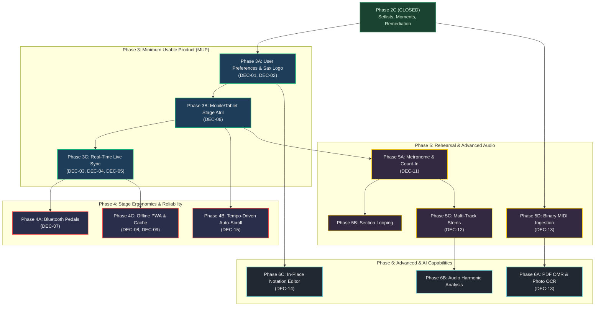

# WORSHIP STUDIO — COMPLETION ROADMAP PROPOSAL
## Phased Implementation Plan, Minimum Usable Product Scope, and Definition of Done

**Project:** Worship Studio  
**Organization:** Iglesia Cristiana Bethesda — Madrid, Cundinamarca, Colombia  
**Document Classification:** Architectural Proposal & Completion Roadmap (Proposal Only)  
**Date:** October 15, 2026  
**Revision:** v2.0 — Post-Audit Governance Consistency Reconciliation  
**Author Roles:** Senior Product Architect, Business Requirements Analyst, Music Software Domain Specialist, and Independent Technical Auditor  
**Governance Status:** `PROPOSED — NOT AUTHORIZED FOR IMPLEMENTATION`  
**Prerequisite Approved Baseline:** [`WORSHIP_STUDIO_REQUIREMENTS_CONSOLIDATION.md`](file:///c:/Users/juanc/OneDrive/Documentos/Desarrollo%20proyectos/Sistema%20musical%20-%20partituras/BETHESDA%20WORSHIP%20STUDIO/WORSHIP_STUDIO_REQUIREMENTS_CONSOLIDATION.md)  
**Deliverable Path:** `WORSHIP_STUDIO_COMPLETION_ROADMAP_PROPOSAL.md` (and byte-identical `docs/WORSHIP_STUDIO_COMPLETION_ROADMAP_PROPOSAL.md`)  

---

## 1. Executive Summary & Governance Notice

### 1.1 Governance Notice
> [!IMPORTANT]
> **GOVERNANCE NOTICE: STRICTLY A PROPOSAL FOR REVIEW**  
> This document constitutes a technical, functional, and architectural proposal for completing Worship Studio.  
> **No workstreams, sub-phases, or code modifications defined in this roadmap are authorized for execution.**  
> Implementation may only commence when the Project Owner and church ministry leadership explicitly approve a specific phase through an authorized governance gate.

### 1.2 Purpose of the Roadmap
Based on the authenticated user requirements gathered from `WORSHIP_STUDIO_PROPUESTA DE AVANCE.pdf` and the technical baseline audit of October 15, 2026, this roadmap defines the logical, evidence-based sequence of work required to complete Worship Studio from its current state (Phase 2C formally closed) into a **complete, resilient, and stage-ready production system**.

The user community expressed clear priorities:
1. Complete musical measures and chord charts are indispensable ("Partituras y Cifrado", Question 12).
2. All 8 core instrument groups must be supported ("Todos", Question 2).
3. Mobile phones are the primary devices, with tablets on stage stands (Question 6).
4. Real-time synchronization is essential under the director-led model ("El director selecciona la canción y todos la ven", Question 10 Option A).
5. Pianist and drummer need wireless pedals (Question 9), and the director needs live notices and on-the-fly key changes (Question 11).
6. Musicians must be able to choose their reading format and have their preference saved (Idea 1).

This roadmap organizes these capabilities into manageable, testable, and non-breaking phases while preserving all 28 user-requested capabilities in the total product scope.

---

## 2. Product Scope Reconciliation & Prioritization Framework

### 2.1 Reconciled Scope Taxonomy
In accordance with governance requirements, the platform distinguishes between the **total product scope** and the **phased delivery sequence**:

```
┌────────────────────────────────────────────────────────────────────────┐
│                   TOTAL USER-REQUESTED PRODUCT SCOPE                   │
│        All 28 Capabilities in Proposal Table + 2 New User Ideas        │
└───────────────────────────────────┬────────────────────────────────────┘
                                    │ Sequenced Delivery Plan
                                    ▼
┌────────────────────────────────────────────────────────────────────────┐
│             TIER 1: MINIMUM USABLE PRODUCT (MUP) — PHASE 3             │
│   Saved Reading Preferences • Official Sax Emblem • Mobile Stage UX    │
│    Director-to-Musician Real-Time Live Sync (Option A + Notices + Keys)│
└───────────────────────────────────┬────────────────────────────────────┘
                                    │
                                    ▼
┌────────────────────────────────────────────────────────────────────────┐
│            TIER 2: STAGE ERGONOMICS & CACHING — PHASE 4               │
│   Bluetooth Page-Turner Pedals (Pianist & Drummer) • Auto-Scroll       │
│    Offline PWA & Local IndexedDB Cache (Sanctuary Outage Immunity)     │
└───────────────────────────────────┬────────────────────────────────────┘
                                    │
                                    ▼
┌────────────────────────────────────────────────────────────────────────┐
│               TIER 3: REHEARSAL & AUDIO SUITE — PHASE 5                │
│   Audio Metronome & Count-In • Section Loop • Practice Tempo Slider    │
│    Multi-Track / Stems Player • Binary MIDI (.mid) File Ingestion      │
└───────────────────────────────────┬────────────────────────────────────┘
                                    │
                                    ▼
┌────────────────────────────────────────────────────────────────────────┐
│           TIER 4: ADVANCED / EXPERIMENTAL (AI) — PHASE 6               │
│   PDF Score OMR • Photo Chord Sheet OCR • Audio Chord/Tempo Detection  │
│    In-Place Interactive Polyphonic Notation Editing                    │
└────────────────────────────────────────────────────────────────────────┘
```

### 2.2 Tier Definitions
- **Tier 1 — Minimum Usable Product (MUP):** The strict minimum set of features without which Worship Studio cannot be deployed for a real worship service. Fulfills the core user desire: *"El director selecciona la canción y todos la ven"* on phones and tablets with scores, chords, and saved preferences.
- **Tier 2 — Stage Ergonomics & Reliability:** Capabilities that eliminate stage friction during live execution (hands-free pedal navigation, auto-scrolling) and protect against church Wi-Fi failures (offline PWA).
- **Tier 3 — Rehearsal & Advanced Audio/MIDI:** Tools supporting individual weekly practice and midweek rehearsals (metronome, stems, MIDI conversion).
- **Tier 4 — Advanced / AI-Assisted Capabilities:** Complex or non-deterministic capabilities (OMR, OCR, AI audio chord detection, interactive notation editing) that require dedicated evaluation and must remain subject to human musical review.

> [!NOTE]
> **SCOPE PRESERVATION DIRECTIVE:**  
> Scheduling capabilities into Tier 2 (Phase 4), Tier 3 (Phase 5), or Tier 4 (Phase 6) does **not** constitute a rejection or removal from the agreed product scope. All 28 capabilities remain accepted product requirements.

---

## 3. Phased Roadmap Specifications

### Phase 3: Stage 1 Readiness & Minimum Usable Product (MUP)

#### Phase 3A: User View Preferences Persistence & Visual Identity Alignment
- **Objective:** Enable musicians to select and permanently persist their preferred instrument and reading format (staff, chords, lyrics, tab), and align the application header with the official Worship Studio saxophone emblem.
- **User-Facing Outcome:** When a musician logs in from their phone, Worship Studio immediately remembers their instrument (e.g., Alto Saxophone, Acoustic Guitar) and reading preference (e.g., Chords + Lyrics, Standard Notation). The header displays the authorized saxophone emblem instead of the generic cross placeholder.
- **Requirements Covered:** `REQ-A11`, `REQ-A12`, `REQ-F02`.
- **Prerequisites:** Phase 2B (User Auth & RBAC), Phase 2C (Setlists & Workspace).
- **Scope Boundaries:**
  - *Included:* PostgreSQL `user_view_preferences` table, Fastify GET/PUT `/api/v1/users/me/preferences` endpoints, frontend integration in `use-musical-workspace.ts`, brand emblem in `App.tsx`.
  - *Excluded:* Multi-device live sync (deferred to Phase 3C).
- **Technical Dependencies:** Drizzle ORM migration `0004_user_view_preferences.sql`, Zod validation schema, Fastify JWT session context.
- **Acceptance Criteria:**
  1. Musician can select "Saxofón Alto" and "Pentagrama", refresh the browser or re-login, and their view preference is automatically restored.
  2. Users without stored preferences receive the factory default for their role.
  3. Header displays `docs/worship_studio_saxophone_emblem.png` with crisp scaling across mobile and desktop.
  4. 100% backward compatibility with existing tests; zero regressions in Golden Scenarios A–D.
- **Regression Risks:** Corrupting `ViewPreference` initialization if database query fails. *Mitigation:* Robust fallback to default in-memory preference on network error.
- **Manual Validation Scenario:** Log in as user `musician@bethesda.org` on a mobile browser; set reading format to "Cifrado y Letra"; close browser tab; reopen application; verify that the song automatically loads in "Cifrado y Letra" without user re-selection.
- **Required Exit Gate:** Phase 3A Preflight & Implementation Report, 100% automated test pass, SHA-256 verification.
- **Unresolved Decisions:** None. All Phase 3A governance decisions formally APPROVED by Project Owner on Oct 15, 2026: **DEC-01** (Saxophone Logo), **DEC-02** (PostgreSQL Persistence), **DEC-03** (Admin & Super Admin Defaults), **DEC-04** (Worship Leader Defaults), and **DEC-05** (Viewer Secondary Representations). Ready for Gate 3 Implementation Authorization.

---

#### Phase 3B: Mobile & Tablet Stage Atril Ergonomics
- **Objective:** Optimize the liturgical atril specifically for stage use on mobile phones (primary device) and tablets in music stands.
- **User-Facing Outcome:** Clean, legible display of chords, lyrics, and sheet music on small screens ($\le 390\text{px}$) without awkward line wraps or overlapping chords; dockable toolbar; full-screen stage mode.
- **Requirements Covered:** `REQ-B01`, `REQ-B02`, `REQ-B03`, `REQ-A08`, `REQ-A10`.
- **Prerequisites:** Phase 3A.
- **Scope Boundaries:**
  - *Included:* Responsive score reflow for mobile viewports, dynamic font scaling for lyrics and chords, full-screen stage toggle button (`requestFullscreen`), touch target audit ($\ge 48\text{px}$).
  - *Excluded:* Bluetooth pedals (Phase 4A), real-time sync (Phase 3C).
- **Technical Dependencies:** CSS viewport units (`dvh`, `cqw`), ResizeObserver API, Screen Wake Lock API (`navigator.wakeLock`).
- **Acceptance Criteria:**
  1. On mobile viewport ($375\text{px}\times 667\text{px}$), long chord symbols do not overlap adjacent words.
  2. Stage screen stays awake during active setlist execution via Wake Lock API without dimming.
  3. All touch controls strictly measure $\ge 48\text{px}\times 48\text{px}$.
  4. Full-screen mode toggles cleanly without breaking navigation toolbar docking.
- **Regression Risks:** Visual layout breakage on desktop. *Mitigation:* Comprehensive media query isolation between mobile fixed-bottom toolbar and desktop sticky-top toolbar.
- **Manual Validation Scenario:** Run atril on a physical iPhone/Android device in portrait mode; advance through a 5-item setlist containing both songs and prayer moments; verify that screen does not sleep for 10 minutes and text remains legible from 1 meter distance.
- **Required Exit Gate:** Phase 3B Implementation Report, physical device verification log.
- **Unresolved Decisions:** Requires Decision **DEC-06** (Mobile Screen Orientation Policy: portrait vs landscape vs lock toggle).

---

#### Phase 3C: Director-to-Musician Real-Time Live Synchronization (Stage 1)
- **Objective:** Implement real-time bi-directional synchronization between the worship director's device and the band members' devices during services.
- **User-Facing Outcome:** When the worship director advances to the next song or selects a song in the setlist, all connected team members' screens switch to that song instantly ($\le 200\text{ms}$). Director can broadcast urgent stage notices and push on-the-fly key changes. Musicians can decouple to "Modo Local" when needed.
- **Requirements Covered:** `REQ-D01`, `REQ-D02`, `REQ-D03`, `REQ-D04`, `REQ-D05`.
- **Prerequisites:** Phase 3A, Phase 3B.
- **Scope Boundaries:**
  - *Included:* WebSocket transport via `@fastify/websocket`, session room tied to the single `ACTIVE` setlist, broadcast events (`SONG_CHANGED`, `KEY_OVERRIDE`, `STAGE_NOTICE`), "Modo Local" toggle for musicians, automatic silent reconnection with exponential backoff.
  - *Excluded:* Section-level micro-jump synchronization (Option B), multi-track audio streaming.
- **Technical Dependencies:** Fastify WebSocket plugin, JWT authentication on WebSocket handshake, React sync context.
- **Acceptance Criteria:**
  1. Director switches from Song 1 to Song 2; connected musician phone switches to Song 2 within $200\text{ms}$.
  2. Director enters a stage notice (e.g., *"Repetir Coro"*); a non-intrusive banner appears on all musician devices for 6 seconds.
  3. Director overrides song key from G to A; all musician charts transpose by $+2$ semitones in real time while preserving each musician's instrument offset.
  4. Musician activates "Modo Local"; musician can freely browse Song 4 without changing the director's screen or other band members' screens.
  5. If church Wi-Fi drops for 10 seconds and reconnects, client seamlessly re-syncs to the current director state without page reload.
  6. Only users with `WORSHIP_LEADER` or `ADMIN` roles can broadcast commands; unauthorized messages from `MUSICIAN` clients are rejected with 403.
- **Regression Risks:** WebSocket connection exhaustion; race conditions during simultaneous re-connection. *Mitigation:* Strict connection limits per IP/user, idempotent state synchronization.
- **Manual Validation Scenario:** Connect Director on laptop and 3 musicians on separate mobile phones over local Wi-Fi; director advances setlist, sends notice, and changes key; verify all 3 phones reflect changes; turn off Wi-Fi on one phone, advance song, re-enable Wi-Fi, verify phone reconnects and catches up.
- **Required Exit Gate:** Phase 3C Preflight, Concurrency & Security Audit, 100% automated test pass.
- **Unresolved Decisions:** Requires Owner Approval for Real-Time Stage Synchronization Architecture (Transport Protocol: WebSockets vs SSE; Stage Sync Scope: Option A initial release; Stage Notice Visual Presentation Format) during Phase 3C preflight.

---

### Phase 4: Stage Ergonomics, Hands-Free Operation & Repertoire Caching

#### Phase 4A: Wireless Bluetooth Page-Turner Pedals (Pianist & Drummer Hands-Free)
- **Objective:** Provide hands-free page turning and song navigation for instrumentalists whose hands are occupied (specifically pianists and drummers).
- **User-Facing Outcome:** Pianist or drummer taps foot pedal to turn page or advance to next song without taking hands off the piano keys or drumsticks.
- **Requirements Covered:** `REQ-E11`, `REQ-B03`.
- **Prerequisites:** Phase 3B.
- **Scope Boundaries:**
  - *Included:* Global keyboard event listener for standard Bluetooth HID pedals (PageUp/PageDown, ArrowUp/ArrowDown, Left/Right), pedal mode configuration modal (Next Page vs Next Song), debouncing ($\approx 250\text{ms}$) to prevent double-skips.
  - *Excluded:* Proprietary Web Bluetooth GATT hardware protocols.
- **Technical Dependencies:** Browser KeyboardEvent API, React global listener.
- **Acceptance Criteria:**
  1. Pressing `PageDown` or `ArrowRight` advances page/song smoothly.
  2. Double-tap within $200\text{ms}$ does not trigger duplicate skips.
  3. Pedal inputs function while user is viewing sheet music or chord sheets regardless of which DOM element has focus.
- **Regression Risks:** Accidental navigation when typing into a search input. *Mitigation:* Pedals ignored when input/textarea elements have active focus.
- **Manual Validation Scenario:** Connect physical Bluetooth pedal (or external keyboard) to tablet; play piano continuously while tapping pedal with foot; verify scores advance seamlessly without lagging or missing beats.
- **Required Exit Gate:** Phase 4A Implementation Report, pedal hardware validation record.
- **Unresolved Decisions:** Requires Decision **DEC-07** (Wireless Foot Pedal Hardware Interface Standard: Bluetooth HID keyboard emulation confirmation with pianist & drummer).

---

#### Phase 4B: Tempo-Driven Automatic Musical Scrolling
- **Objective:** Allow continuous vertical scrolling of scores and chord sheets calculated from the song's BPM and time signature.
- **User-Facing Outcome:** Musician plays song without touching the screen; the sheet music scrolls automatically at a tempo-synchronized speed.
- **Requirements Covered:** `REQ-E10`.
- **Prerequisites:** Phase 3B.
- **Scope Boundaries:**
  - *Included:* Smooth scrolling engine using `requestAnimationFrame`, Play/Pause scroll button on toolbar, manual touch override (touching screen temporarily halts auto-scroll for 3 seconds), tempo sync multiplier ($0.5\times$ to $1.5\times$).
  - *Excluded:* Real-time audio pitch tracking to guide scroll.
- **Technical Dependencies:** DOM `window.scrollBy`, timestamp delta calculations.
- **Acceptance Criteria:**
  1. Auto-scroll velocity accurately reflects target BPM ($\pm 2\%$).
  2. Musician can pause auto-scroll with a single screen tap.
  3. Auto-scroll automatically pauses when entering a `SERVICE_MOMENT` (prayer/reading) and resumes on next song.
- **Regression Risks:** Jittery scrolling on low-end mobile devices. *Mitigation:* CSS hardware-accelerated transforms and `requestAnimationFrame`.
- **Manual Validation Scenario:** Activate auto-scroll on a 4-page song at 120 BPM; verify smooth scrolling across all staves without screen stuttering.
- **Required Exit Gate:** Phase 4B Implementation Report.
- **Unresolved Decisions:** Requires Decision **DEC-15** (Tempo-Driven Auto-Scroll Velocity & Manual Touch Override Policy).

---

#### Phase 4C: Offline PWA & Local Repertoire Caching
- **Objective:** Ensure the entire active worship setlist is accessible and functional even if the church loses internet connectivity entirely.
- **User-Facing Outcome:** If temple Wi-Fi fails before or during the service, the app continues to display all setlist songs, chords, notes, and liturgical moments without interruption or error messages.
- **Requirements Covered:** `REQ-E09`.
- **Prerequisites:** Phase 3C.
- **Scope Boundaries:**
  - *Included:* Progressive Web App (PWA) manifest, Service Worker for static asset caching, IndexedDB persistence of active setlist canonical payloads, offline JWT session validation.
  - *Excluded:* Offline setlist creation/editing (read-only execution during offline mode).
- **Technical Dependencies:** Workbox, IndexedDB (`idb` library or native API).
- **Acceptance Criteria:**
  1. Active setlist is automatically cached in IndexedDB upon opening.
  2. Put device in Airplane Mode; refresh browser; application loads cleanly and all active setlist songs render with full transposition controls.
  3. Offline indicator banner displays: *"Modo Fuera de Línea — Repertorio en Memoria Local"*.
- **Regression Risks:** Stale cache serving outdated song versions. *Mitigation:* Cache invalidation based on song `updatedAt` timestamps during online sync.
- **Manual Validation Scenario:** Load active Sunday setlist while connected; turn on Airplane Mode; navigate entire setlist from Song 1 to final Benediction; confirm zero network failures or missing staves.
- **Required Exit Gate:** Phase 4C Implementation Report, offline resilience audit.
- **Unresolved Decisions:** Requires Decision **DEC-08** (Offline Repertoire Storage Architecture & PWA Packaging) and **DEC-09** (Offline Authentication Token Validity Window).

---

### Phase 5: Rehearsal Suite & Advanced Audio/MIDI Capabilities

#### Phase 5A: Integrated Audible Metronome, Count-In, and Variable Practice Tempo
- **Objective:** Support weekly band rehearsals and personal practice with an accurate digital metronome, count-in, and adjustable rehearsal speeds.
- **User-Facing Outcome:** Musician practices challenging sections with an audible click and count-in, slowing tempo down by $20\%$ and speeding up gradually.
- **Requirements Covered:** `REQ-E01`, `REQ-E03`.
- **Prerequisites:** Phase 3B.
- **Scope Boundaries:**
  - *Included:* Web Audio API precision lookahead scheduler, high/low click synthesis, 1-bar / 2-bar count-in, practice tempo slider ($40\text{--}240\text{ BPM}$ and percentage scaling), visual flashing beat indicator.
  - *Excluded:* In-ear audio click routing across multiple devices over Wi-Fi (Wi-Fi latency precludes multi-device audio click sync).
- **Technical Dependencies:** Web Audio API (`AudioContext`).
- **Acceptance Criteria:**
  1. Metronome drift is $< 1\text{ms}$ over 15 minutes of continuous playback.
  2. Count-in clearly accents beat 1 and triggers playback on beat 1 of measure 1.
  3. Slider adjusts tempo smoothly in real time without audio glitches.
- **Regression Risks:** Background tab throttling of AudioContext. *Mitigation:* Web Worker timer tick to keep AudioContext active in background.
- **Manual Validation Scenario:** Start metronome at 135 BPM with 4/4 count-in; verify 4 count clicks followed by continuous locked rhythm.
- **Required Exit Gate:** Phase 5A Implementation Report.
- **Unresolved Decisions:** Requires Decision **DEC-11** (Audible Metronome Sound Samples & Audio Routing).

---

#### Phase 5B: Measure Section Looping
- **Objective:** Enable looping of specific measures for isolated musical practice.
- **User-Facing Outcome:** Musician selects measures 17–24 (e.g., Instrumental Solo) and loops them continuously with the metronome.
- **Requirements Covered:** `REQ-E02`.
- **Prerequisites:** Phase 5A.
- **Scope Boundaries:**
  - *Included:* Visual measure range selector, seamless loop playback at boundary measures, visual timeline playhead tracking.
  - *Excluded:* Audio stem slicing (pure measure looping).
- **Technical Dependencies:** `CanonicalMusicPayload` measure indexing, Web Audio scheduling.
- **Acceptance Criteria:**
  1. Loop boundary transitions occur precisely on the downbeat of the start measure without stutter.
  2. Score renderer visually highlights the active looped measures.
- **Regression Risks:** None.
- **Manual Validation Scenario:** Select measures 9–16 on a complex piano score; start loop; observe smooth repetition and visual highlight.
- **Required Exit Gate:** Phase 5B Implementation Report.
- **Unresolved Decisions:** Requires User Feedback on loop selection UX (touch timeline drag vs measure number inputs).

---

#### Phase 5C: Multi-Track / Stems Reference Audio Playback
- **Objective:** Provide multi-channel audio stems playback for band preparation and solo rehearsal.
- **User-Facing Outcome:** Bass player mutes recorded bass track and plays along with the rest of the band stems.
- **Requirements Covered:** `REQ-E04`.
- **Prerequisites:** Phase 5A.
- **Scope Boundaries:**
  - *Included:* Multi-track audio player (up to 8 synchronized audio stems), per-track volume faders, mute/solo buttons, master transport (Play/Pause/Seek).
  - *Excluded:* Live audio recording or in-browser mixing console.
- **Technical Dependencies:** Web Audio API `AudioBufferSourceNode` or multiple synchronized HTML5 `<audio>` elements, cloud object storage (S3/R2).
- **Acceptance Criteria:**
  1. All active stems play in phase synchronization ($\le 2\text{ms}$ alignment).
  2. Muting or soloing a track takes effect instantaneously without audio pops.
- **Regression Risks:** High network bandwidth consumption and browser memory exhaustion from large uncompressed audio files. *Mitigation:* Compressed AAC/Opus audio encoding at 128kbps per stem.
- **Manual Validation Scenario:** Load 4-stem song (Click, Drums, Bass, Keys); mute Bass; verify clean playback of remaining 3 tracks in perfect sync.
- **Required Exit Gate:** Phase 5C Implementation Report, audio storage configuration audit.
- **Unresolved Decisions:** Requires Owner Approval for **DEC-12** (Reference Audio Stems Cloud Storage & Bandwidth Budget).

---

#### Phase 5D: Binary MIDI File Ingestion & Canonical Conversion
- **Objective:** Allow worship teams to import `.mid` files directly into the platform to automatically generate scores, chords, and instrument tracks.
- **User-Facing Outcome:** User uploads a standard MIDI file from a sequencer; Worship Studio creates a canonical song with separated instrument staves.
- **Requirements Covered:** `REQ-E05`, `REQ-F01`.
- **Prerequisites:** Phase 1H (Music Ingestion), Phase 2A (Song Persistence).
- **Scope Boundaries:**
  - *Included:* Standard MIDI File (SMF Format 0 and 1) parser, track-to-instrument mapping, polyphonic note extraction quantized to 480 TPQN, time signature and tempo track extraction.
  - *Excluded:* Audio synthesis of MIDI tracks (ingestion only).
- **Technical Dependencies:** Pure TypeScript binary MIDI parser, `CanonicalMusicPayload` builder.
- **Acceptance Criteria:**
  1. Ingesting standard multitrack MIDI file generates valid `CanonicalMusicPayload`.
  2. Note pitches, start ticks, and durations match original MIDI events.
  3. Generated payload passes all canonical validation invariant checks.
- **Regression Risks:** High-density unquantized MIDI (e.g., expressive piano rubato) generating unreadable score rhythms. *Mitigation:* Configurable quantization grid (16th notes, 8th note triplets).
- **Manual Validation Scenario:** Ingest real worship MIDI file; view generated piano staff in OSMD; confirm correct notes and measures.
- **Required Exit Gate:** Phase 5D Implementation Report, MIDI test suite.
- **Unresolved Decisions:** Requires Decision **DEC-13** (Ingestion Roadmap Staging & Binary MIDI Quantization Configuration).

---

### Phase 6: Advanced & AI-Assisted Capabilities (Post-MUP Evaluation)

> [!NOTE]
> **TIER 4 CLASSIFICATION:**  
> These capabilities represent advanced and AI-assisted functions requested in the user survey (Items 26, 27, 28).  
> In accordance with the foundational musicology principles of Worship Studio, **any automated or AI-derived musical transcription must remain strictly advisory and subject to mandatory human musician review.**

#### Phase 6A: Optical Music Recognition (OMR) & Photo Chord Sheet OCR
- **Objective:** Assist song cataloging by extracting notation from scanned sheet music PDFs and extracting chords/lyrics from smartphone photos of chord charts.
- **Requirements Covered:** `REQ-E06`, `REQ-F01`.
- **Approach:** Multi-step pipeline: Document preprocessing $\rightarrow$ OCR/OMR extraction $\rightarrow$ Structural normalization $\rightarrow$ **Mandatory Human Verification Modal** before persisting to database.
- **Unresolved Decisions:** Requires Decision **DEC-13** (Strategic Decision on Third-Party OMR/OCR API Integration vs In-House Pipeline).

#### Phase 6B: Assisted Audio Harmonic & Tempo Analysis
- **Objective:** Analyze audio recordings to suggest tempo (BPM), time signature, and tentative chord progressions.
- **Requirements Covered:** `REQ-E07`.
- **Approach:** Chromagram feature extraction and beat-tracking algorithms generating a draft ChordPro representation flagged as `DRAFT_AI_SUGGESTED`. Must be reviewed and confirmed by a music leader before publication.
- **Unresolved Decisions:** Requires Governance Sign-Off confirming mandatory human verification modal for AI-assisted harmonic transcription.

#### Phase 6C: In-Place Interactive Polyphonic Notation Editing
- **Objective:** Allow interactive adding, moving, and editing of notes directly on the digital staff in the browser.
- **Requirements Covered:** `REQ-E08`.
- **Approach:** Evaluate whether Worship Studio should incorporate a full notation editor or remain focused on performance atril execution and ingestion of MusicXML/ChordPro.
- **Unresolved Decisions:** Requires Strategic Product Scope Decision **DEC-14** (In-Place Interactive Polyphonic Score Editing Scope vs Stage Atril Focus).

---

## 4. Workstream Sequencing and Milestone Dependencies



---

## 5. Formal Completion Definition (Definition of Done)

Worship Studio may only be declared **COMPLETE** for any agreed phase or release when the following evidentiary gates are 100% satisfied:

### 1. Requirements Traceability
- Every requirement in the agreed scope has an unbroken link from the user survey (`WORSHIP_STUDIO_PROPUESTA DE AVANCE.pdf`) through the RTM to verified production source code.

### 2. Functional & Visual Verification
- All user-facing features operate as intended across physical mobile phones (Android, iOS) and stage tablets (iPad, Galaxy Tab).
- High contrast, dark stage visual presentation verified with zero text overlap, zero unreadable chords, and all touch targets measuring $\ge 48\text{px}\times 48\text{px}$.

### 3. End-to-End Live Worship Scenario
- A complete, continuous 60-minute simulated worship service must execute without crashes, memory leaks, or desynchronization:
  1. Director logs in and activates Sunday Setlist.
  2. 5 musicians log in on their respective phones/tablets; their saved reading preferences (Saxophone, Guitar Capo, Piano Grand Staff, Vocals) load automatically.
  3. Director advances through 4 songs and 2 liturgical moments; all 5 screens transition synchronously within $200\text{ms}$.
  4. Director overrides key on-the-fly; all charts update instantly without corrupting original song storage.
  5. One musician toggles "Modo Local" to preview next song; returns to live service with one tap.
  6. Internet is disconnected for 30 seconds; local offline cache sustains playback; reconnection occurs silently when signal returns.

### 4. Automated Regression & Code Quality
- **100% Passing Automated Tests:** Current baseline of 460 tests must never regress. New phases must deliver comprehensive automated unit, domain, and integration tests.
- **Zero TypeScript Compilation Errors:** Both backend and frontend must compile cleanly under strict mode (`tsc --noEmit`).

### 5. Security & Authorization Integrity
- Strict RBAC enforcement: Musicians and viewers can never modify setlists, delete songs, or broadcast director events.
- All real-time WebSocket messages authenticated via JWT.
- Zero secrets, database credentials, or private keys exposed in source code or client bundles.

### 6. Canonical Model Preservation
- Verification that `CanonicalMusicPayload` remains strictly immutable. Zero loss of musical measure data, rhythmic timing (480 TPQN), or accidental spelling integrity.

### 7. Documentation and Cryptographic Closure
- Every completed phase must deliver a formal Engineering & Implementation Report accompanied by verifiable SHA-256 checksums matching root and `docs/` repository copies.

---

## 6. Next Governance Gate

```
================================================================================
GOVERNANCE GATE:
GATE 2 — PHASE 3A TECHNICAL PREFLIGHT AUTHORIZATION
================================================================================
Status:
Gate 1 decisions formally recorded: DEC-01 (APPROVED) and DEC-02 (APPROVED) on Oct 15, 2026.
Action Required:
1. Conduct read-only Phase 3A Technical Preflight Audit.
2. Author comprehensive Phase 3A Preflight Report.
3. Await explicit Project Owner authorization before initiating implementation.
================================================================================
```
