# BETHESDA WORSHIP STUDIO
## Documento 05: Arquitectura de Datos, Diagrama Entidad-Relación (ERD), API y Seguridad

---

## 1. Arquitectura de Datos y Estrategia de Persistencia

Bethesda Worship Studio implementa un esquema de almacenamiento híbrido (**Relacional + Documental JSONB**) sobre **PostgreSQL 16+**:

- **Capa Relacional Normalizada:** Modela organizaciones, usuarios, membresías, permisos, canciones, arreglos, setlists, sesiones y registros de auditoría. Garantiza integridad referencial estricta y búsquedas optimizadas mediante índices B-Tree y GIN.
- **Capa de Modelo Canónico JSONB (`canonical_music_payload`):** Almacena el grafo de compases, polifonía de voces, notas, digitaciones, ligaduras y sílabas. Esto proporciona flexibilidad milimétrica y evita realizar decenas de miles de inserts relacionales para una sola pieza musical de 150 compases.

> [!IMPORTANT]
> **Invariante Canónico de Letras:**  
> *"Ningún contenido lírico musical se persiste fuera del `canonical_music_payload` del Arreglo (`ARRANGEMENT`). La entidad `SONG` almacena exclusivamente metadatos globales (título, artista, CCLI, métrica, tonalidad de referencia, estado). Esto erradica fuentes de verdad desconectadas entre la letra y la partitura."*

---

## 2. Diagrama Entidad-Relación (ERD)

A continuación se presenta el modelo completo de datos en formato Mermaid:

```mermaid
erDiagram
    ORGANIZATION ||--o{ USER_MEMBERSHIP : has
    ORGANIZATION ||--o{ SONG : owns
    ORGANIZATION ||--o{ SETLIST : schedules
    ORGANIZATION ||--o{ REHEARSAL_SESSION : conducts
    ORGANIZATION ||--o{ IMPORT_JOB : tracks
    ORGANIZATION ||--o{ AUDIT_LOG : tracks

    USER ||--o{ USER_MEMBERSHIP : belongs_to
    USER ||--o{ MUSICIAN_PROFILE : defines
    USER ||--o{ AUDIT_LOG : executes

    ORGANIZATION {
        uuid id PK
        string name
        string slug
        string country
        string city
        jsonb settings
        timestamp created_at
    }

    USER {
        uuid id PK
        string email UK
        string hashed_password
        string full_name
        string avatar_url
        boolean is_active
        timestamp created_at
    }

    USER_MEMBERSHIP {
        uuid id PK
        uuid organization_id FK
        uuid user_id FK
        string role "ADMIN | DIRECTOR | ARRANGER | MUSICIAN | VIEWER"
        timestamp joined_at
    }

    MUSICIAN_PROFILE {
        uuid id PK
        uuid user_id FK
        string primary_instrument_code
        string default_view_type
        boolean show_chords
        boolean show_lyrics
        boolean show_diagrams
        boolean auto_scroll_enabled
        string notation_system "STANDARD | LATIN | NASHVILLE | ROMAN"
        string theme_preference "STAGE_DARK | HIGH_CONTRAST | LIGHT"
    }

    SONG {
        uuid id PK
        uuid organization_id FK
        string title
        string original_artist
        string ccli_number
        string default_key
        integer default_bpm
        string time_signature
        string review_status "DRAFT | APPROVED | ARCHIVED"
        timestamp created_at
    }

    ARRANGEMENT {
        uuid id PK
        uuid song_id FK
        string name "Full Band | Acústico | Congregacional"
        string performance_key
        integer bpm
        jsonb section_sequence "Array ordenado de secciones"
        jsonb canonical_music_payload "FUENTE ÚNICA DE VERDAD: compases, notas, polifonía"
        integer version_number
        boolean is_primary
    }

    INSTRUMENT_PART {
        uuid id PK
        uuid arrangement_id FK
        string instrument_code "GUITAR_ELEC | BASS_ELEC | PIANO | SAX_TENOR_BB | DRUMS"
        integer track_index "Índice de pista en el payload canónico"
        integer transposition_semitones "Transposición obligada por instrumento"
        string preferred_clef "G | F | PERCUSSION"
        jsonb tuning "Afinación de cuerdas para tablatura"
        integer default_capo
    }

    ARRANGEMENT_VIEW_PRESET {
        uuid id PK
        uuid arrangement_id FK
        string instrument_code
        string recommended_view_type
        integer suggested_capo_fret
        string notes_for_musician
    }

    IMPORT_JOB {
        uuid id PK
        uuid organization_id FK
        uuid created_by_user_id FK
        string import_type "MUSICXML | MIDI | CHORDPRO | PDF | AUDIO"
        string source_file_url
        string job_status "QUEUED | PROCESSING | COMPLETED | FAILED"
        jsonb parsing_diagnostics
        uuid created_song_id FK
        timestamp created_at
    }

    AI_ANALYSIS_RECORD {
        uuid id PK
        uuid song_id FK
        string analysis_type "CHORD_DETECTION | BPM_DETECTION | STRUCTURE_DETECTION"
        float confidence_score "0.0 a 1.0"
        jsonb raw_model_output
        string review_status "PENDING_REVIEW | APPROVED | REJECTED"
        uuid reviewed_by_user_id FK
        timestamp created_at
    }

    SETLIST {
        uuid id PK
        uuid organization_id FK
        string title
        timestamp scheduled_datetime
        string status "PLANNING | ACTIVE | COMPLETED"
        uuid director_user_id FK
    }

    SETLIST_ITEM {
        uuid id PK
        uuid setlist_id FK
        integer sequence_order
        string item_type "SONG | SERVICE_MOMENT"
        uuid arrangement_id FK
        string target_key
        integer target_bpm
        string transition_type "SEGUE | CROSSFADE | STOP | MEDLEY"
        text notes_for_team
    }

    REHEARSAL_SESSION {
        uuid id PK
        uuid organization_id FK
        uuid setlist_id FK
        uuid active_director_id FK
        string session_state "IDLE | REHEARSAL | LIVE_PERFORMANCE"
        uuid current_song_id FK
        string current_section_id
        integer current_measure
        boolean is_playing
        timestamp started_at
    }

    AUDIT_LOG {
        uuid id PK
        uuid organization_id FK
        uuid user_id FK
        string action "CREATE | UPDATE | DELETE | TRANSPOSE | LIVE_DISPATCH"
        string target_resource
        jsonb details
        timestamp created_at
    }

    SONG ||--o{ ARRANGEMENT : contains
    ARRANGEMENT ||--o{ INSTRUMENT_PART : defines
    ARRANGEMENT ||--o{ ARRANGEMENT_VIEW_PRESET : provides
    SETLIST ||--o{ SETLIST_ITEM : includes
    SETLIST ||--o{ REHEARSAL_SESSION : runs
    ARRANGEMENT ||--o{ SETLIST_ITEM : used_in
    SONG ||--o{ AI_ANALYSIS_RECORD : evaluated_by
```



---

## 3. Arquitectura de API RESTful (FastAPI)

El backend expone endpoints basados en contratos OpenAPI v3 con validación rigurosa mediante esquemas **Pydantic v2**:

### Principales Módulos de la API:

#### A. Autenticación y Perfil
- `POST /api/v1/auth/login`: Autenticación con emisión de par de tokens (Access Token JWT de 15 min + Refresh Token HttpOnly de 30 días).
- `GET /api/v1/users/me/profile`: Retorna datos del músico y sus *Smart Defaults*.
- `PUT /api/v1/users/me/profile`: Actualiza preferencias de visualización y atril.

#### B. Gestión de Canciones y Arreglos
- `GET /api/v1/songs`: Lista paginada con filtrado por título, artista, tono, BPM y etiquetas litúrgicas.
- `POST /api/v1/songs`: Creación de canción canónica.
- `POST /api/v1/songs/import`: Ingesta multipart (MusicXML, MIDI, PDF, Audio, ChordPro).
- `GET /api/v1/songs/{song_id}/arrangements`: Obtiene los arreglos disponibles.
- `GET /api/v1/arrangements/{arrangement_id}/parts/{instrument_code}`: Entrega el payload canónico adaptado y transpuesto para el instrumento solicitado.

#### C. Transposición bajo Demanda
- `POST /api/v1/arrangements/{arrangement_id}/transpose`:
  - Entrada: `{ "target_key": "Ab_MAJOR", "preferred_accidental": "FLAT" }`
  - Salida: Payload canónico re-enarmonizado sin mutar la base original.

#### D. Setlists y Servicios
- `GET /api/v1/setlists`: Listado de cultos programados.
- `POST /api/v1/setlists`: Creación de lista de servicio.
- `PUT /api/v1/setlists/{setlist_id}/reorder`: Actualización atómica de orden de canciones y transiciones.

#### E. Sesiones en Vivo
- `POST /api/v1/sessions/start`: El Director Musical inicia la sesión del culto.
- `GET /api/v1/sessions/{session_id}/snapshot`: Estado actual para sincronización inicial de clientes que se conectan tardíamente.

---

## 4. Estrategia Offline-First y PWA

En un entorno de iglesia, la conexión Wi-Fi puede saturarse por la concurrencia de la congregación o presentar fallas eléctricas. **La aplicación jamás puede dejar de mostrar la música en el altar**.

### Arquitectura de Almacenamiento Local (PWA):
```
┌────────────────────────────────────────────────────────────────────────┐
│                          NAVEGADOR / TABLET                            │
│                                                                        │
│   [ Service Worker (Workbox) ]                                         │
│   ├── CacheStorage (App Shell: HTML, CSS, JS, Fuentes SMuFL)          │
│   └── SoundFonts y Muestras de Audio en Caché                          │
│                                                                        │
│   [ IndexedDB (Dexie.js Wrapper) ]                                     │
│   ├── Table 'cached_songs': Canciones completas en formato JSON        │
│   ├── Table 'cached_setlists': Setlists activos para el domingo        │
│   ├── Table 'user_settings': Smart Defaults y preferencias de vista    │
│   └── Table 'sync_queue': Mutaciones locales pendientes de subida      │
└────────────────────────────────────────────────────────────────────────┘
```

### Mecanismo de Pre-Descarga Automática de Culto:
1. Al publicarse el Setlist dominical, el Service Worker ejecuta en segundo plano la pre-descarga de todas las canciones y arreglos seleccionados.
2. Si el dispositivo pierde internet antes o durante el culto:
   - El músico abre la app normalmente.
   - El sistema conmuta a **Modo Autónomo Local**.
   - Toda la transposición, tablatura, notación y auto-scroll continúan operando al 100% de velocidad sin requerir ni un solo byte del servidor.

---

## 5. Arquitectura de Seguridad y Multi-Inquilino (Multi-Tenancy)

### Aislamiento de Organizaciones (Tenant Isolation):
- Aunque el primer despliegue es exclusivo para la **Iglesia Cristiana Bethesda (Madrid, Cundinamarca)**, toda la base de datos incorpora la columna `organization_id`.
- Se activa la funcionalidad nativa de PostgreSQL **Row Level Security (RLS)**:
  ```sql
  ALTER TABLE song ENABLE ROW LEVEL SECURITY;
  CREATE POLICY org_isolation_policy ON song
    USING (organization_id = NULLIF(current_setting('app.current_org_id', true), '')::uuid);
  ```
- Cada consulta a la base de datos inyecta en la sesión de conexión el tenant context del usuario autenticado, imposibilitando cualquier filtración de datos entre iglesias.

### Control de Acceso Basado en Roles (RBAC):
- **SuperAdmin:** Mantenimiento global de la plataforma.
- **Admin Iglesia:** Administra músicos, suscripción, salas y configuración de Bethesda.
- **Director Musical (MD):** Crea setlists, inicia y conduce sesiones en vivo, aprueba borradores de IA.
- **Arreglista / Compositor:** Crea canciones canónicas, arreglos de Nivel 2 y 3, importa archivos.
- **Músico:** Acceso a repertorio, setlists, atril personalizado, notas de práctica.
- **Visualizador:** Lectura pasiva de letras y cancionero.

### Seguridad en Carga de Archivos:
- Validación rigurosa de tipo MIME y Magic Bytes (evitar spoofing de ejecutables renombrados a `.musicxml` o `.mid`).
- Cuarentena y procesamiento en workers asíncronos aislados sin privilegios de sistema operativo.
- Desinfección contra ataques XXE (*XML External Entity*) deshabilitando entidades externas en el parser XML.
