# BETHESDA WORSHIP STUDIO
## Documento 07: Fase 0.1 — Hardening Arquitectónico y Validación Pre-Implementación

> **Organización:** Iglesia Cristiana Bethesda — Madrid, Cundinamarca, Colombia.  
> **Fase:** 0.1 (Hardening Arquitectónico y Congelamiento de Alcance).  
> **Objetivo:** Resolver inconsistencias, ambigüedades de modelo y riesgos técnicos antes de escribir una sola línea de código en Fase 1.  
> **Regla de Ejecución:** Cero código de producción, cero migraciones de BD, cero UI hasta la firma de la compuerta de salida.

---

## 1. Hallazgos y Diagnóstico Crítico de la Fase 0 y 0.1

Tras una auditoría minuciosa de los documentos 01 al 06 y la revisión de hardening 0.1, se identificaron y resolvieron las siguientes ambigüedades arquitectónicas:

1. **Ambigüedad en la Fuente de la Verdad Musical:**  
   En el ERD preliminar, la entidad `INSTRUMENT_PART` contenía `jsonb part_music_payload` y `SONG` contenía `text canonical_lyrics`. Esto abría el riesgo crítico de **fuentes de verdad desconectadas** (notas desincronizadas entre el arreglo y el instrumento, o letras en la canción desfasadas respecto a las sílabas del arreglo).
2. **Confusión entre Cejilla (Capo) y Transposición Musical:**  
   En la práctica de atril, aplicar un capo no debe mutar la tonalidad canónica de concierto de la banda. Se requería separar tajantemente `transpositionSemitones` de `capoFret`.
3. **Sub-especificación de `PerformanceView`:**  
   El concepto *"Instrumento ≠ Vista"* requería desglosarse formalmente en tres niveles: Perfil de Músico (BD), Preajuste de Canción (BD) y Estado Efímero de Pantalla (Memoria cliente).
4. **Delimitación de Alcance de OSMD en Fase 1:**  
   Se requería clarificar de manera no ambigua si el adaptador `OSMDAdapter` se implementa en la Fase 1 o si su integración en código se difiere a la fase de gran pentagrama de piano (Opción B).
5. **Ausencia de un Modelo Formal de Capacidades Instrumento-Vista:**  
   Se requería un registro de dominio (`INSTRUMENT_REGISTRY`) que valide a nivel lógico qué vistas son compatibles con cada instrumento físico.

---

## 2. Decisiones Arquitectónicas Confirmadas

1. **La Canción como Fuente Única e Inmutable de la Verdad:**  
   Partitura, cifrado, tablatura y letra **nunca son fuentes de datos independientes**. Son proyecciones computadas a partir del `canonical_music_payload` del Arreglo.
2. **Invariante Canónico de Letras:**  
   *"Ningún contenido lírico musical se persiste fuera del `canonical_music_payload` del Arreglo (`ARRANGEMENT`). La entidad `SONG` almacena exclusivamente metadatos globales."*
3. **Desacoplamiento Estricto:**  
   Ningún componente del sistema asocia de forma rígida un instrumento a una sola vista. La disponibilidad de vistas se rige exclusivamente por el **Modelo de Capacidades**.
4. **Cómputo en el Cliente (Client-Side Projection):**  
   Para evitar cuellos de botella en el servidor y permitir el funcionamiento Offline-First, la transposición interválica, la re-enarmonización y el filtrado de pistas para la vista elegida son ejecutados en el navegador por Web Workers en menos de 50 milisegundos.
5. **Cero Complejidad en la Experiencia de Usuario:**  
   El lenguaje técnico (XML, MIDI, semitonos, enarmonías, WebSockets) permanece encapsulado dentro del motor.

---

## 3. Correcciones e Inconsistencias Resueltas

| Componente | Estado Previo (Riesgoso) | Estado Corregido (Hardened 0.1.1) | Justificación Arquitectónica |
|:---|:---|:---|:---|
| **`INSTRUMENT_PART.part_music_payload`** | Almacenaba JSONB con notas independientes. | **ELIMINADO.** Sustituido por `track_index`, `transposition_semitones` y `tuning`. | Previene desincronización de notas entre el arreglo y los instrumentos. |
| **`SONG.canonical_lyrics`** | Texto plano duplicando las letras de la canción. | **ELIMINADO.** Las letras y sílabas residen exclusivamente en `canonical_music_payload`. | Erradica una segunda fuente de verdad para la lírica musical. |
| **Cejilla (Capo) vs. Transposición** | Tratados de forma intercambiable o ambigua. | **SEPARADOS FORMALMENTE.** `transpositionSemitones` (tono real) vs. `capoFret` (digitación). | Un Capo 2 no altera el tono canónico de concierto de la banda. |
| **`PERFORMANCE_VIEW`** | No existía como modelo formal en ERD ni API. | **Formalizado en 3 capas:** `MusicianProfile`, `ArrangementViewPreset` y `RuntimeDisplayState`. | Claridad absoluta entre preferencias de usuario, preajustes de canción y estado visual efímero. |
| **Alcance OSMD en Fase 1** | Ambigüedad entre arquitectura y alcance. | **OPCIÓN B ADOPTADA:** Arquitectura validada en 0.1; implementación de código en Fase 2. | Concentra la Fase 1 en el núcleo teórico, `alphaTab` y `LeadSheetDOM`. |
| **Ingesta Asíncrona** | Faltaba entidad para trazar subidas. | Se formaliza la entidad **`IMPORT_JOB`** en el ERD. | Permite trazabilidad, reintentos y reporte de errores en subidas de MusicXML, MIDI y audios. |
| **Trazabilidad de IA** | Flags booleanos simples en `SONG`. | Se formaliza la entidad **`AI_ANALYSIS_RECORD`**. | Cumple el principio "IA como Asistente": registra confianza, modelo usado y aprobación del director. |

---

## 4. Decisión y Modelado Formal de `PerformanceView`

Para resolver completamente la distinción entre preferencias de usuario, vistas de la obra y estado de pantalla, se definen **tres capas conceptuales y técnicas independientes**:

```
┌────────────────────────────────────────────────────────────────────────┐
│  CAPA A: PREFERENCIA POR DEFECTO DEL MÚSICO (MusicianProfile)          │
│  - Persistencia: PostgreSQL (Tabla 'musician_profile').                │
│  - Alcance: Usuario global.                                            │
│  - Ejemplo: Juan toca Guitarra Eléctrica y prefiere 'SCORE_TAB'.       │
└──────────────────────────────────┬─────────────────────────────────────┘
                                   │ Al abrir una canción
                                   ▼
┌────────────────────────────────────────────────────────────────────────┐
│  CAPA B: PREAJUSTE DE VISTA DE LA CANCIÓN (ArrangementViewPreset)       │
│  - Persistencia: PostgreSQL (Tabla 'arrangement_view_preset').         │
│  - Alcance: Específico del arreglo (curado por el Arreglista o MD).    │
│  - Define: Capo sugerido, clave recomendada, vistas sugeridas.         │
└──────────────────────────────────┬─────────────────────────────────────┘
                                   │ Al renderizar en el atril
                                   ▼
┌────────────────────────────────────────────────────────────────────────┐
│  CAPA C: ESTADO EFÍMERO DE PANTALLA (RuntimeDisplayState)              │
│  - Persistencia: Memoria cliente (React State / LocalStorage).         │
│  - Alcance: Dispositivo del músico durante el culto o ensayo.          │
│  - Ejemplo: Dark Mode, Zoom 120%, Auto-Scroll ON (BPM 74), Capo temp.  │
└────────────────────────────────────────────────────────────────────────┘
```

### Contratos de Tipos en TypeScript (`frontend/src/core/models/performance-view.ts`)

```typescript
/** Modos de visualización musical soportados */
export type ViewType = 
  | 'SCORE'                     // Partitura tradicional estándar
  | 'TABLATURE'                 // Tablatura con digitación de trastes
  | 'SCORE_TAB'                 // Pentagrama y tablatura sincronizados
  | 'CHORD_CHART'               // Grilla armónica sin letra
  | 'LEAD_SHEET'                // Letra con acordes alineados (Letra + Cifrado)
  | 'SCORE_LYRICS_CHORDS'       // Pentagrama melódico vocal con acordes y letra
  | 'PERCUSSION_SCORE'          // Pentagrama de batería (PAS Standard)
  | 'RHYTHM_GUIDE';             // Guía rítmica con cortes (Slash notation)

/** Capa A: Perfil persistido del músico */
export interface IMusicianProfile {
  userId: string;
  primaryInstrumentCode: string;
  defaultViewType: ViewType;
  showChords: boolean;
  showLyrics: boolean;
  showChordDiagrams: boolean;
  autoScrollByDefault: boolean;
  preferredNotationSystem: 'STANDARD' | 'LATIN' | 'NASHVILLE' | 'ROMAN';
  stageTheme: 'STAGE_DARK' | 'HIGH_CONTRAST_BLACK' | 'LIGHT';
}

/** Capa B: Preajuste guardado para un arreglo */
export interface IArrangementViewPreset {
  id: string;
  arrangementId: string;
  instrumentCode: string;
  recommendedViewType: ViewType;
  suggestedCapoFret?: number;
  clefOverride?: 'G' | 'F' | 'PERCUSSION';
  displayNotesForMusician?: string;
}

/** Capa C: Estado de pantalla en vivo (no se guarda en base de datos) */
export interface IRuntimeDisplayState {
  activeViewType: ViewType;
  effectiveKey: string;           // Tonalidad actualmente en pantalla
  transpositionSemitones: number; // Modificación en vivo (+/- semitonos)
  capoFret: number;               // 0 si no hay cejilla activa
  
  // Toggles de capas visuales
  layers: {
    renderChords: boolean;
    renderLyrics: boolean;
    renderFretboardDiagrams: boolean;
    renderMeasureNumbers: boolean;
  };

  // Parámetros ergonómicos de escenario
  stageSettings: {
    darkMode: boolean;
    highContrast: boolean;
    zoomMultiplier: number;       // 1.0 = normal, 1.25 = grande
    autoScrollRunning: boolean;
    autoScrollSpeedFactor: number;
    keepScreenAwake: boolean;     // WakeLock API activa
    highlightActiveMeasure: boolean;
  };
}
```

### Esquema Pydantic v2 en Backend (`backend/app/domain/worship/schemas.py`)

```python
from enum import Enum
from pydantic import BaseModel, Field
from typing import Optional
from uuid import UUID

class ViewTypeEnum(str, Enum):
    SCORE = "SCORE"
    TABLATURE = "TABLATURE"
    SCORE_TAB = "SCORE_TAB"
    CHORD_CHART = "CHORD_CHART"
    LEAD_SHEET = "LEAD_SHEET"
    SCORE_LYRICS_CHORDS = "SCORE_LYRICS_CHORDS"
    PERCUSSION_SCORE = "PERCUSSION_SCORE"
    RHYTHM_GUIDE = "RHYTHM_GUIDE"

class ArrangementViewPresetSchema(BaseModel):
    id: UUID
    arrangement_id: UUID
    instrument_code: str
    recommended_view_type: ViewTypeEnum
    suggested_capo_fret: Optional[int] = Field(default=0, ge=0, le=12)
    clef_override: Optional[str] = None
    display_notes_for_musician: Optional[str] = None

    class Config:
        from_attributes = True
```

---

## 5. Clarificación de la Fuente Única de la Verdad Musical

Para erradicar cualquier posibilidad de desfase entre la partitura, el cifrado y la tablatura, se establece el siguiente **Invariante de Arquitectura**:

> [!IMPORTANT]
> **Invariante Canónico General:**  
> *"La totalidad de la estructura de compases, tempos, armaduras, notas, sílabas y acordes existe EXCLUSIVAMENTE en el `canonical_music_payload` del Arreglo. Ninguna entidad secundaria almacena notas independientes."*
> 
> **Invariante Canónico de Letras:**  
> *"Ningún contenido lírico musical se persiste fuera del `canonical_music_payload` del Arreglo (`ARRANGEMENT`). La entidad `SONG` almacena exclusivamente metadatos globales (título, artista, CCLI, métrica, tonalidad de referencia, estado). Esto erradica fuentes de verdad desconectadas entre la letra y la partitura."*

### Cadena de Transformación y Proyección Musical:

```
[ CANONICAL MUSIC MODEL (JSONB en ARRANGEMENT) ]
  ├── Timeline Global: Compases, Métrica (4/4), Tempo Map (BPM 74), Tonalidad Base (G)
  ├── Pista Armónica Canónica: Acordes vinculados a compás y tick [ {beat: 1, chord: "G"}, {beat: 3, chord: "D/F#"} ]
  ├── Pista Lírica Canónica: Sílabas, guiones y fonemas enlazados a notas y tiempos
  └── Pistas Instrumentales Canónicas: Polifonía, articulaciones, afinaciones de cuerda
             │
             ▼  [ APLICAR DESCRIPTOR DE INSTRUMENTO (InstrumentPart) ]
             │  - Filtra las voces asignadas al instrumento (ej. Guitarra Rítmica)
             │  - Aplica afinación física de cuerdas (E2-A2-D3-G3-B3-E4)
             │  - Inyecta transposición de transpositores (ej. Saxo Tenor Bb: +2 semitonos)
             │
             ▼  [ APLICAR TRANSFORMACIÓN DE TRANSPOSICIÓN (En Vivo) ]
             │  - Desplaza la tonalidad según solicitud del MD o músico (ej. -2 semitonos)
             │  - Aplica reglas diatónicas del Círculo de Quintas y ortografía enarmónica
             │  - Recalcula trastes de tablatura según posición de cejilla lógica
             │
             ▼  [ APLICAR FILTRO DE CAPAS (PerformanceView) ]
             │  - Si la vista es LEAD_SHEET: descarta notas y extrae solo sílabas + acordes
             │  - Si la vista es TABLATURE: proyecta notas a trastes de cuerda
             │  - Si la vista es SCORE: genera notación en clave correspondiente
             │
             ▼  [ RENDERIZADOR ESPECÍFICO ]
                ├── alphaTab (para Tablatura, Batería, Pentagrama moderno)
                ├── OSMD (Fase 2: para Gran Pentagrama de Piano y Coral Polifónico)
                └── LeadSheetDOM (para Letra + Acordes grande en móviles)
```

---

### 5.1 Formalización de Dominio: Transposición Musical vs. Cejilla (Capo)

Es mandatorio para la integridad del sistema separar conceptual, matemática y visualmente dos conceptos que nunca deben tratarse como intercambiables:

> [!IMPORTANT]
> **Invariante de Dominio de Cejilla y Tonalidad:**  
> *"La cejilla (Capo) modifica la estrategia de digitación y renderizado; la transposición musical modifica el tono/frecuencia musical objetivo."*

La clave canónica musical de la obra **NUNCA debe modificarse** simplemente porque un guitarrista coloque un capo en su instrumento.

#### Caso Canónico Demostrativo:
- **Tonalidad Canónica de Concierto:** **Sol Mayor (G)**.
- El guitarrista acústico decide usar Capo en el traste 2 (`capoFret = 2`).
- Para sonar en Sol Mayor con Capo 2, la estrategia de digitación proyecta formas de **Fa Mayor (F)** ($F + 2 \text{ semitonos} = G$).
- **Tono Real Sonante de la Banda:** **Sol Mayor (G)**.
  - El pianista toca en Sol Mayor.
  - El bajista toca en Sol Mayor.
  - Los cantantes entonan en Sol Mayor.
  - El saxofonista tenor (Bb) lee en La Mayor (su transposición instrumental natural de +2 semitonos).
  - Solo el guitarrista en su atril ve acordes con digitación de Fa Mayor con la leyenda: `Capo: Traste 2 (Suena en Sol Mayor)`.

#### Matriz de Responsabilidad en Entidades:
1. **`InstrumentPart` (Descriptor de Instrumento):**
   - `transposition_semitones`: Transposición intrínseca de afinación (ej. +2 para Saxo Tenor Bb, 0 para Guitarra).
   - `default_capo`: 0 por defecto; o traste sugerido por el compositor para instrumentos con afinaciones fijas (ej. Banjo o Guitalele).
2. **`ArrangementViewPreset` (Preajuste de Obra):**
   - `suggested_capo_fret`: Indicación del arreglista al guitarrista para optimizar la sonoridad de acordes abiertos.
3. **`RuntimeDisplayState` (Estado Efímero de Pantalla):**
   - `transpositionSemitones`: Desplazamiento de tono musical real en vivo (ej. toda la banda baja medio tono por fatiga vocal).
   - `capoFret`: Posición física del capo colocada por el músico en su atril.
   - **Regla:** Alterar `capoFret` recalcula las formas visuales de los acordes en tablatura/lead sheet sin emitir eventos de cambio de tono (`KEY_OVERRIDE`) a la sesión en vivo de los demás músicos.

---

## 6. Modelo Formal de Capacidades Instrumento / Vista

Para evitar que la interfaz de usuario deba codificar condicionales manuales o presente opciones absurdas a un músico, la relación entre instrumentos y vistas se gobierna por un **Registro de Capacidades Formal**.

### Lógica de Dominio de Capacidades (`frontend/src/core/music-theory/instrument-capabilities.ts`)

```typescript
export interface IInstrumentDefinition {
  code: string;
  nameSpanish: string;
  family: 'STRINGS' | 'KEYBOARDS' | 'WOODWINDS' | 'BRASS' | 'PERCUSSION' | 'VOICE';
  isPitched: boolean;
  hasStrings: boolean;
  stringCount?: number;
  transpositionSemitones: number; // 0 = Concierto, +2 = Bb, +9 = Eb, +7 = F
  defaultClef: 'G' | 'F' | 'PERCUSSION';
  supportedViews: ViewType[];
}

export const INSTRUMENT_REGISTRY: Record<string, IInstrumentDefinition> = {
  GUITAR_ELEC: {
    code: 'GUITAR_ELEC',
    nameSpanish: 'Guitarra Eléctrica',
    family: 'STRINGS',
    isPitched: true,
    hasStrings: true,
    stringCount: 6,
    transpositionSemitones: 0,
    defaultClef: 'G',
    supportedViews: ['SCORE_TAB', 'TABLATURE', 'SCORE', 'LEAD_SHEET', 'CHORD_CHART']
  },
  GUITAR_ACU: {
    code: 'GUITAR_ACU',
    nameSpanish: 'Guitarra Acústica',
    family: 'STRINGS',
    isPitched: true,
    hasStrings: true,
    stringCount: 6,
    transpositionSemitones: 0,
    defaultClef: 'G',
    supportedViews: ['LEAD_SHEET', 'CHORD_CHART', 'SCORE_TAB', 'TABLATURE', 'SCORE']
  },
  BASS_ELEC: {
    code: 'BASS_ELEC',
    nameSpanish: 'Bajo Eléctrico',
    family: 'STRINGS',
    isPitched: true,
    hasStrings: true,
    stringCount: 4, // Soporta también variantes de 5 y 6 cuerdas
    transpositionSemitones: 0,
    defaultClef: 'F',
    supportedViews: ['SCORE_TAB', 'TABLATURE', 'SCORE', 'CHORD_CHART', 'LEAD_SHEET']
  },
  PIANO_ACOUSTIC: {
    code: 'PIANO_ACOUSTIC',
    nameSpanish: 'Piano Acústico',
    family: 'KEYBOARDS',
    isPitched: true,
    hasStrings: false,
    transpositionSemitones: 0,
    defaultClef: 'G', // Doble pentagrama (Sol + Fa)
    supportedViews: ['SCORE', 'CHORD_CHART', 'LEAD_SHEET', 'SCORE_LYRICS_CHORDS']
  },
  DRUMS_KIT: {
    code: 'DRUMS_KIT',
    nameSpanish: 'Batería Acústica',
    family: 'PERCUSSION',
    isPitched: false,
    hasStrings: false,
    transpositionSemitones: 0,
    defaultClef: 'PERCUSSION',
    supportedViews: ['PERCUSSION_SCORE', 'RHYTHM_GUIDE']
  },
  SAX_ALTO_EB: {
    code: 'SAX_ALTO_EB',
    nameSpanish: 'Saxofón Alto (Eb)',
    family: 'WOODWINDS',
    isPitched: true,
    hasStrings: false,
    transpositionSemitones: 9, // Tono escrito = Concierto + 9 semitonos
    defaultClef: 'G',
    supportedViews: ['SCORE', 'CHORD_CHART', 'LEAD_SHEET']
  },
  SAX_TENOR_BB: {
    code: 'SAX_TENOR_BB',
    nameSpanish: 'Saxofón Tenor (Bb)',
    family: 'WOODWINDS',
    isPitched: true,
    hasStrings: false,
    transpositionSemitones: 2, // Tono escrito = Concierto + 2 semitonos
    defaultClef: 'G',
    supportedViews: ['SCORE', 'CHORD_CHART', 'LEAD_SHEET']
  },
  VOICE_LEAD: {
    code: 'VOICE_LEAD',
    nameSpanish: 'Voz Principal',
    family: 'VOICE',
    isPitched: true,
    hasStrings: false,
    transpositionSemitones: 0,
    defaultClef: 'G',
    supportedViews: ['LEAD_SHEET', 'SCORE_LYRICS_CHORDS', 'SCORE']
  }
};
```

---

## 7. Matriz Técnica de Validación de Motores de Renderizado

Evaluación exhaustiva de los 15 requerimientos de renderizado de partituras para el culto en Bethesda:

| # | Requerimiento de Notación | **alphaTab** | **OSMD (OpenSheetMusicDisplay)** | **LeadSheetDOM (Render Nativo)** | Decisión Arquitectónica Adoptada |
|:---:|:---|:---:|:---:|:---:|:---|
| **1** | **Piano Gran Pentagrama (Sol + Fa)** | Parcial | **Soportado (Excelente)** | No aplicable | **OSMD** procesa partituras de piano a dos manos. |
| **2** | **Guitarra Notación Estándar** | **Soportado** | Soportado | No aplicable | **alphaTab** (óptimo espaciado de compases). |
| **3** | **Guitarra Tablatura** | **Soportado (Líder)** | No apto (muy deficiente) | No aplicable | **alphaTab** exclusivo. |
| **4** | **Bajo Eléctrico Notación (Clave Fa)** | **Soportado** | Soportado | No aplicable | **alphaTab** o **OSMD**. |
| **5** | **Bajo Eléctrico Tablatura (4/5 cuerdas)**| **Soportado** | No apto | No aplicable | **alphaTab** exclusivo con afinaciones personalizadas. |
| **6** | **Notación de Batería (Percusión PAS)** | **Soportado (Nativo)**| Parcial (complejo) | No aplicable | **alphaTab** exclusivo con mapeo General MIDI. |
| **7** | **Símbolos de Acordes (Cifrado)** | **Soportado** | Parcial (requiere XML chords) | **Soportado (100% Flexible)** | **alphaTab** en partitura; **LeadSheetDOM** en texto. |
| **8** | **Texto de Letra (Lyrics)** | Soportado | **Soportado** | **Soportado** | Todos los motores soportan capas líricas. |
| **9** | **Partitura + Letra (Vocal Lead)** | Soportado | **Soportado (Óptimo silabeo)** | No aplicable | **OSMD** o **alphaTab**. |
| **10**| **Partitura + Cifrado** | **Soportado** | Soportado | No aplicable | **alphaTab** (renderizado ágil). |
| **11**| **Partitura + Tablatura (Unificada)** | **Soportado (Excepcional)**| No apto | No aplicable | **alphaTab** exclusivo. |
| **12**| **Renderizado Responsivo Móvil** | **Soportado (Auto-wrap)**| Parcial (consume CPU en reflow)| **Soportado (Puro CSS Flexbox)**| **LeadSheetDOM** en móviles; **alphaTab** en tablets. |
| **13**| **Resaltado de Compás en Vivo** | **Soportado (Cursor API)** | Soportado | **Soportado (Data Attributes)**| API nativa de cursor y overlays SVG. |
| **14**| **Transposición en Caliente** | Requiere recálculo previo | Requiere re-parseo XML | **Instantánea (< 5ms en memoria)**| Motor de transposición canónico en Web Worker. |
| **15**| **Reproducción y Cursor de Audio** | **Soportado (SoundFonts)** | Parcial | No aplicable | **alphaTab** sincronizado con Web Audio API. |

### Confirmación de la Arquitectura de Renderizado:
Se **ratifica** la estrategia híbrida bajo la interfaz abstracta `IMusicRenderer`:
1. `AlphaTabRenderer`: Gobierna guitarra, bajo, batería, viento y partituras de atril moderno.
2. `OSMDRenderer`: Gobierna piano clásico/coral de gran formato desde MusicXML puro.
3. `LeadSheetDOMRenderer`: Gobierna la vista ultraligera y de alta visibilidad para vocalistas en pantallas móviles pequeñas.

---

## 8. Revisión y Actualización del Modelo de Datos / ERD Hardened

Se actualiza el esquema formal de datos en **PostgreSQL 16+**, eliminando `part_music_payload` y agregando `IMPORT_JOB`, `AI_ANALYSIS_RECORD` y `ARRANGEMENT_VIEW_PRESET`:

```mermaid
erDiagram
    ORGANIZATION ||--o{ USER_MEMBERSHIP : has
    ORGANIZATION ||--o{ SONG : owns
    ORGANIZATION ||--o{ SETLIST : schedules
    ORGANIZATION ||--o{ REHEARSAL_SESSION : conducts
    ORGANIZATION ||--o{ IMPORT_JOB : tracks
    ORGANIZATION ||--o{ AUDIT_LOG : tracks

    USER ||--o{ USER_MEMBERSHIP : belongs_to
    USER ||--o{ MUSICIAN_PROFILE : defines
    USER ||--o{ AUDIT_LOG : executes

    ORGANIZATION {
        uuid id PK
        string name
        string slug
        string country
        string city
        jsonb settings
        timestamp created_at
    }

    USER {
        uuid id PK
        string email UK
        string hashed_password
        string full_name
        string avatar_url
        boolean is_active
        timestamp created_at
    }

    USER_MEMBERSHIP {
        uuid id PK
        uuid organization_id FK
        uuid user_id FK
        string role "ADMIN | DIRECTOR | ARRANGER | MUSICIAN | VIEWER"
        timestamp joined_at
    }

    MUSICIAN_PROFILE {
        uuid id PK
        uuid user_id FK
        string primary_instrument_code
        string default_view_type
        boolean show_chords
        boolean show_lyrics
        boolean show_diagrams
        boolean auto_scroll_enabled
        string notation_system "STANDARD | LATIN | NASHVILLE | ROMAN"
        string theme_preference "STAGE_DARK | HIGH_CONTRAST | LIGHT"
    }

    SONG {
        uuid id PK
        uuid organization_id FK
        string title
        string original_artist
        string ccli_number
        string default_key
        integer default_bpm
        string time_signature
        string review_status "DRAFT | APPROVED | ARCHIVED"
        timestamp created_at
    }

    ARRANGEMENT {
        uuid id PK
        uuid song_id FK
        string name "Full Band | Acústico | Congregacional"
        string performance_key
        integer bpm
        jsonb section_sequence "Array ordenado de secciones"
        jsonb canonical_music_payload "FUENTE ÚNICA DE VERDAD: compases, notas, polifonía"
        integer version_number
        boolean is_primary
    }

    INSTRUMENT_PART {
        uuid id PK
        uuid arrangement_id FK
        string instrument_code "GUITAR_ELEC | BASS_ELEC | PIANO | SAX_TENOR_BB | DRUMS"
        integer track_index "Índice de pista en el payload canónico"
        integer transposition_semitones "Transposición obligada por instrumento"
        string preferred_clef "G | F | PERCUSSION"
        jsonb tuning "Afinación de cuerdas para tablatura"
        integer default_capo
    }

    ARRANGEMENT_VIEW_PRESET {
        uuid id PK
        uuid arrangement_id FK
        string instrument_code
        string recommended_view_type
        integer suggested_capo_fret
        string notes_for_musician
    }

    IMPORT_JOB {
        uuid id PK
        uuid organization_id FK
        uuid created_by_user_id FK
        string import_type "MUSICXML | MIDI | CHORDPRO | PDF | AUDIO"
        string source_file_url
        string job_status "QUEUED | PROCESSING | COMPLETED | FAILED"
        jsonb parsing_diagnostics
        uuid created_song_id FK
        timestamp created_at
    }

    AI_ANALYSIS_RECORD {
        uuid id PK
        uuid song_id FK
        string analysis_type "CHORD_DETECTION | BPM_DETECTION | STRUCTURE_DETECTION"
        float confidence_score "0.0 a 1.0"
        jsonb raw_model_output
        string review_status "PENDING_REVIEW | APPROVED | REJECTED"
        uuid reviewed_by_user_id FK
        timestamp created_at
    }

    SETLIST {
        uuid id PK
        uuid organization_id FK
        string title
        timestamp scheduled_datetime
        string status "PLANNING | ACTIVE | COMPLETED"
        uuid director_user_id FK
    }

    SETLIST_ITEM {
        uuid id PK
        uuid setlist_id FK
        integer sequence_order
        string item_type "SONG | SERVICE_MOMENT"
        uuid arrangement_id FK
        string target_key
        integer target_bpm
        string transition_type "SEGUE | CROSSFADE | STOP | MEDLEY"
        text notes_for_team
    }

    REHEARSAL_SESSION {
        uuid id PK
        uuid organization_id FK
        uuid setlist_id FK
        uuid active_director_id FK
        string session_state "IDLE | REHEARSAL | LIVE_PERFORMANCE"
        uuid current_song_id FK
        string current_section_id
        integer current_measure
        boolean is_playing
        timestamp started_at
    }

    AUDIT_LOG {
        uuid id PK
        uuid organization_id FK
        uuid user_id FK
        string action
        string target_resource
        jsonb details
        timestamp created_at
    }

    SONG ||--o{ ARRANGEMENT : contains
    ARRANGEMENT ||--o{ INSTRUMENT_PART : defines
    ARRANGEMENT ||--o{ ARRANGEMENT_VIEW_PRESET : provides
    SETLIST ||--o{ SETLIST_ITEM : includes
    SETLIST ||--o{ REHEARSAL_SESSION : runs
    ARRANGEMENT ||--o{ SETLIST_ITEM : used_in
    SONG ||--o{ AI_ANALYSIS_RECORD : evaluated_by
```



---

## 9. Revisión y Hardening de Contratos de API RESTful

Para evitar duplicaciones de datos y mantener el principio Offline-First:

### Endpoint Principal de Consulta de Arreglo
- `GET /api/v1/arrangements/{arrangement_id}`
  - **Retorno:** El objeto `ARRANGEMENT` completo con su `canonical_music_payload` y su lista de `INSTRUMENT_PART`s y `ARRANGEMENT_VIEW_PRESET`s.
  - **Caché HTTP:** Soporta cabeceras `ETag` e `If-None-Match`. Si la canción no ha cambiado, retorna `304 Not Modified` con 0 bytes transferidos.
  - **Consumo en Cliente:** El cliente PWA guarda este payload en su IndexedDB (`cached_songs`). Todas las operaciones de cambio de instrumento, transposición y selección de vista ocurren en el cliente de manera instantánea sin consultar al servidor.

### Endpoint de Transposición en Lote (Headless / Exportación)
- `POST /api/v1/arrangements/{arrangement_id}/project`
  - **Uso:** Exclusivo para exportaciones PDF o integraciones externas donde un cliente no dispone del motor de cómputo en navegador.
  - **Parámetros:**
    ```json
    {
      "instrument_code": "SAX_ALTO_EB",
      "target_key": "D_MAJOR",
      "view_type": "SCORE",
      "export_format": "PDF"
    }
    ```
  - **Importante:** Este endpoint **no crea un nuevo arreglo en la base de datos**; realiza una proyección determinista en memoria y devuelve el archivo resultante.

---

## 10. Congelamiento del Alcance de la Fase 1 (Phase 1 Scope Freeze)

Para garantizar un inicio de desarrollo con cero desbordamiento de alcance (*scope creep*), se congelan formalmente las fronteras de la Fase 1:

```
┌────────────────────────────────────────────────────────────────────────┐
│                        ALCANCE INCLUIDO (FASE 1)                       │
│                                                                        │
│  1. Núcleo de Teoría Musical:                                          │
│     - Modelos de Intervalos, Clases de Tono (0-11) y Círculo de Quintas│
│     - Algoritmo de Transposición Diatónica y Enarmónica                │
│     - Modelo Canónico JSONB y esquemas Pydantic / TypeScript           │
│     - Separación matemática de 'transpositionSemitones' y 'capoFret'   │
│  2. Ingesta Determinista:                                              │
│     - Parser MusicXML 4.0 (extracción sin pérdida de notas/compases)   │
│     - Parser ChordPro (extracción de secciones, acordes y sílabas)     │
│  3. Capa de Renderizado Híbrida:                                       │
│     - Implementación de 'IMusicRenderer'                               │
│     - AlphaTabAdapter (Partitura, Tablatura, Partitura+Tab, Batería)   │
│     - LeadSheetDOMAdapter (Cifrado y Letra responsive para móviles)    │
│     - (Nota: OSMDAdapter diferido a Fase 2 según Opción B adoptada)    │
│  4. Selector Dinámico de Vista en Cliente:                             │
│     - Conmutación instantánea entre Partitura, Tab y Cifrado           │
│     - Selector de Instrumento y transposición en memoria               │
└────────────────────────────────────────────────────────────────────────┘
```

```
┌────────────────────────────────────────────────────────────────────────┐
│                   ALCANCE EXCLUIDO (POSTERGADO A FASES 2-5)            │
│                                                                        │
│  ❌ NO Adaptador OSMD de código en Fase 1 (Diferido a Fase 2)         │
│  ❌ NO Transcripción de Audio por Inteligencia Artificial (Fase 5)     │
│  ❌ NO Reconocimiento Óptico Musical (OMR) de fotos de partitura (Fase 5)
│  ❌ NO Sesiones en Tiempo Real con WebSockets Director-Seguidor (Fase 4)
│  ❌ NO Gestión de Setlists Dominicales y Cultos (Fase 3)               │
│  ❌ NO Motor de Ensayo con Metrónomo y Pistas de Audio (Fase 3)        │
│  ❌ NO Pasarela de Pagos ni Facturación Multi-Tenant (Fase 5)          │
│  ❌ NO Sincronización P2P Bluetooth entre Atriles (Fase 4)             │
└────────────────────────────────────────────────────────────────────────┘
```

### Delimitación Unívoca de OSMD (Decisión Opción B):
Se ratifica formalmente la **OPCIÓN B**: La compatibilidad arquitectónica de `OpenSheetMusicDisplay (OSMD)` para partituras de piano a dos manos y voces corales ha sido verificada en la Fase 0.1. Sin embargo, para mantener el foco en la instrumentación primaria de alabanza (guitarras, bajo, batería y cantantes), la implementación concreta de `OSMDAdapter` en código se **difiere a la Fase 2**, donde se introducirán las vistas avanzadas de gran pentagrama y coro polifónico.

---

## 11. Matriz de Riesgos Remanentes Pre-Implementación y Mitigaciones

| Riesgo Técnico Identificado | Severidad | Mitigación Arquitectónica Implementada |
|:---|:---:|:---|
| **Colapso de rendimiento al parsear MusicXML gigante en el navegador** | Media | Se delega el parseo pesado de archivos XML a un **Web Worker** en el cliente, evitando congelar la interfaz de usuario. |
| **Ambigüedad en notas enarmónicas al transponer (ej. F# vs Gb)** | Alta | El algoritmo de transposición consulta una tabla matemática de armaduras gobernada por la tonalidad destino del Círculo de Quintas. |
| **Inconsistencias en afinaciones no estándar de guitarra (Drop D, 7 cuerdas)** | Media | La entidad `INSTRUMENT_PART` almacena el arreglo explícito de frecuencias base de cada cuerda (`tuning`). |
| **Consumo excesivo de batería en atril por re-renderizados continuos** | Media | Las vistas se renderizan en modo estático (*dirty-check*); solo se actualizan cuando cambia el compás activo o la tonalidad. |

---

## 12. Registros de Decisión Arquitectónica Adicionales (ADR Updates)

### ADR-005: Eliminación de Cargas Musicales Duplicadas en Partes de Instrumento
- **Estado:** Aceptado.
- **Decisión:** `INSTRUMENT_PART` no almacena notas. El arreglo (`ARRANGEMENT`) almacena la totalidad de la información musical en `canonical_music_payload`. Las partes son filtros lógicos y descriptores de transposición sobre el grafo canónico.

### ADR-006: Modelo de Tres Capas para la Experiencia de Atril (`PerformanceView`)
- **Estado:** Aceptado.
- **Decisión:** Desglosar la vista de interpretación en: (1) Perfil de Músico en BD, (2) Preajuste de Arreglo en BD, y (3) Estado de Pantalla en memoria de cliente. Ningún ajuste efímero de zoom o contraste genera escrituras en base de datos.

### ADR-007: Congelamiento Riguroso de Alcance para Fase 1
- **Estado:** Aceptado.
- **Decisión:** Quedan estrictamente excluidos de la Fase 1 los componentes de audio IA, OMR, WebSockets y Setlists para asegurar la entrega de un núcleo musical matemáticamente perfecto y estable antes de construir capas de red complejas.

### ADR-008: Separación Formal entre Transposición Musical y Cejilla (Capo)
- **Estado:** Aceptado.
- **Decisión:** La cejilla de instrumento de cuerda (`capoFret`) y la transposición de tono son ortogonales e independientes. Un capo colocado en traste 2 no altera la clave canónica de concierto de la obra ni el tono en que tocan los demás integrantes de la banda; únicamente recalcula las digitaciones visuales del instrumento.

### ADR-009: Despliegue Escalonado del Adaptador OSMD (Opción B)
- **Estado:** Aceptado.
- **Decisión:** Adoptar la Opción B: `IMusicRenderer` soportará `AlphaTabAdapter` y `LeadSheetDOMAdapter` en la Fase 1. La implementación concreta de `OSMDAdapter` para gran pentagrama de piano clásico se programa para la Fase 2.

---

## 13. Verificación de la Compuerta de Salida de Fase 0.1 (Phase 0.1 Exit Gate)

> **Declaración de Ingeniería:**  
> La arquitectura se encuentra formalmente preparada y aprobada para la implementación de la Fase 1. El comportamiento en tiempo de ejecución, la fidelidad de los parsers, el desempeño de los renderizadores, las características de latencia y los riesgos de integración quedan sujetos a validación empírica durante la implementación de la Fase 1 y su correspondiente Compuerta de Salida.

- [x] **Performance View modelado formalmente en 3 capas:** Perfil de usuario, Preajuste de obra y Estado efímero de pantalla con contratos TypeScript y esquemas Pydantic.
- [x] **Lógica de Capacidades Instrumento/Vista formalizada:** Registro `INSTRUMENT_REGISTRY` desacoplado de la UI.
- [x] **Fuente Única de la Verdad Garantizada:** Eliminado `part_music_payload` y eliminado `SONG.canonical_lyrics`. El modelo canónico es el único contenedor de notas, acordes y letras.
- [x] **Arquitectura de Renderizado Validada:** Evaluación exhaustiva de 15 casos confirmando la estrategia híbrida (alphaTab + OSMD + LeadSheetDOM).
- [x] **Consistencia de ERD y API:** Incorporados `IMPORT_JOB`, `AI_ANALYSIS_RECORD` y `ARRANGEMENT_VIEW_PRESET`.
- [x] **Alcance de Fase 1 Congelado:** Límites exactos definidos sin riesgo de desvío técnico.
- [x] **Cero Código Prematuro:** No se ha escrito código de producción ni generado migraciones en esta fase de hardening.

---

## 14. Compuerta de Salida de Fase 0.1.1 (Phase 0.1.1 Exit Gate)

Esta compuerta certifica el cierre formal del ciclo de hardening previo a cualquier codificación:

- [x] **No duplicated canonical lyric source remains:** Se eliminó `SONG.canonical_lyrics`; todo contenido lírico reside exclusivamente en `ARRANGEMENT.canonical_music_payload`.
- [x] **Capo and musical transposition are formally separated:** `capoFret` y `transpositionSemitones` quedan formalizados como magnitudes ortogonales con el invariante de dominio ratificado.
- [x] **OSMD Phase 1 status is unambiguous:** Se adoptó formalmente la Opción B (diseño validado en 0.1; implementación de código programada para Fase 2).
- [x] **Exit Gate language does not overstate runtime validation:** Se eliminó cualquier afirmación dogmática o prematura; la validación de rendimiento queda sujeta a pruebas de Fase 1.
- [x] **All architecture documents are internally consistent:** Sincronización completa entre Docs 01 al 07, README y artefacto de plan.
- [x] **No production code has been written.**
- [x] **No database migration has been generated.**
- [x] **No UI has been implemented.**

```
==================================================
READY FOR EXPLICIT PHASE 1 AUTHORIZATION
==================================================
Do not start Phase 1. Wait for explicit authorization.
```
