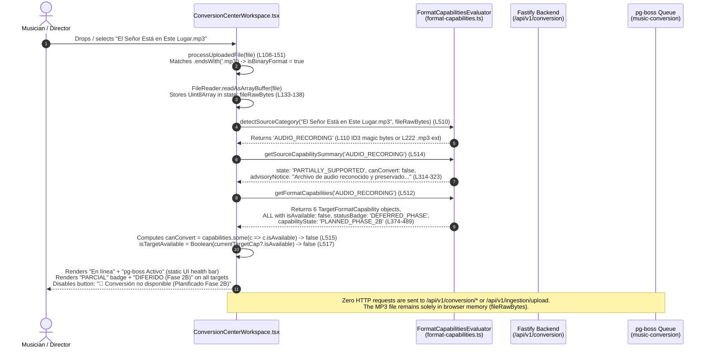
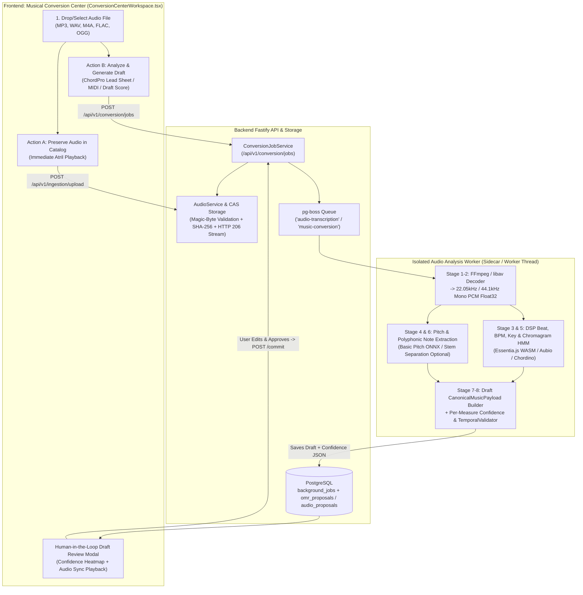

# BETHESDA WORSHIP STUDIO
# MUSICAL CONVERSION CENTER — MP3 CONVERSION FAILURE
## FORENSIC FUNCTIONAL AUDIT & PHASE 2B IMPLEMENTATION READINESS

- **Repository:** `https://github.com/juancastro2381-hub/BETHESDA-WORSHIP-STUDIO.git`
- **Branch:** `feature/phase-1a-core-foundation`
- **Audited Baseline Commit:** `bdae9ebd3494442b8d5ad6f36103ec5fc0107117`
- **Test Case Audited:** `El Señor Está en Este Lugar.mp3`
- **Audit Scope:** Strictly Read-Only Forensic Investigation & Architecture Readiness Assessment (Zero Application Code Changes)

---

## 1. EXECUTIVE DIAGNOSIS

When a user uploads `El Señor Está en Este Lugar.mp3` into the **Musical Conversion Center** (`ConversionCenterWorkspace.tsx`), the file is detected as **`Grabación de Audio (MP3, WAV, M4A, FLAC, OGG)`** (`AUDIO_RECORDING`) with a **`PARCIAL`** (`PARTIALLY_SUPPORTED`) source badge, every target conversion card displays **`DIFERIDO (Fase 2B)`**, the primary action button is disabled with **`🚫 Conversión no disponible (Planificado Fase 2B)`**, and the advisory banner states:

> *"Archivo de audio reconocido y preservado de forma duradera. Puede reproducir el archivo en el atril digital. La transcripción automática polifónica a partitura (Demucs / Basic Pitch / Whisper) está planificada para la Fase 2B sin servicios comerciales de terceros."*

### Forensic Evaluation Against the 6 Diagnostic Hypotheses

| # | Hypothesis | Verdict | Forensic Evidence |
| :--- | :--- | :--- | :--- |
| **1** | **Intentionally unimplemented capability** | **CONFIRMED (Primary)** | Audio-to-notation conversion (`AUDIO_RECORDING` $\rightarrow$ symbolic score) was intentionally excluded from Phase 2A and Phase 2B.1/2B.2 scope (`PHASE_2A_FORMAL_ACCEPTANCE_AND_PHASE_2B_ENTRY_PROPOSAL.md`, lines 111–116 & 130–131) and fail-closed across frontend and backend capability gates. |
| **2** | **Incomplete backend integration** | **CONFIRMED (Secondary)** | While `AudioService` (`/api/v1/songs/:songId/audio`) and `AudioIngestionAdapter` (`/api/v1/ingestion/upload`) persist and stream raw audio files, `ConversionCenterWorkspace.tsx` never calls either endpoint when an `.mp3` is dropped. Furthermore, `AudioIngestionAdapter` checks `process.env.AUDIO_TRANSCRIPTION_ENGINE_CONFIGURED === 'true'` (`audio-adapter.ts:110`), which is a dead stub variable not connected to any worker or transcription engine. |
| **3** | **Missing transcription or analysis pipeline** | **CONFIRMED (Primary)** | Zero audio decoding (`ffmpeg`, `libsndfile`), zero DSP/MIR libraries (`essentia`, `aubio`, `librosa`), and zero ML transcription runtimes (`onnxruntime-node`, `@spotify/basic-pitch`, `demucs`, `whisper.cpp`) exist in `backend/package.json` or `frontend/package.json`. |
| **4** | **Frontend feature-flag or capability-registry issue** | **CONFIRMED (Primary Mechanism)** | `FormatCapabilitiesEvaluator.getFormatCapabilities('AUDIO_RECORDING')` (`format-capabilities.ts:370-489`) hardcodes `isAvailable: false`, `capabilityState: 'PLANNED_PHASE_2B'`, and `statusBadge: 'DEFERRED_PHASE'` for all 6 target formats, directly disabling the submit button (`!canConvert || !isTargetAvailable`). |
| **5** | **Outdated phase/status declaration** | **CONFIRMED (Governance Drift)** | The capability registry still labels audio transcription as `PLANNED_PHASE_2B` (`Planificado Fase 2B`), even though project execution already completed **Phase 2B** (Auth/RBAC), **Phase 2B.1** (CAS Storage & Leases), **Phase 2B.2** (ASCII Tablature & Temporal Validator), **Phase 2C** (Setlist Management), and **Phase 2D WS-2D-01** (Offline PWA). In `BETHESDA_WORSHIP_STUDIO_MASTER_ROADMAP.md` (§8 item 9, §9 Layer 4 `Phase 6D`, and §10 `Phase 7`), Audio-to-Chords and AI stem separation are actually scheduled for **Phase 6D / Phase 7**. |
| **6** | **Combination of these issues** | **FINAL DETERMINATION** | **The behavior is a deterministic combination of Hypotheses 1, 2, 3, 4, and 5.** It is not a runtime crash or broken `pg-boss` queue, but a deliberately fail-closed capability gate backed by zero DSP/transcription engines and an outdated `PLANNED_PHASE_2B` label. |

---

## 2. EXACT MP3 CONVERSION WORKFLOW

The following end-to-end trace documents the exact execution path when `El Señor Está en Este Lugar.mp3` is loaded into the Musical Conversion Center:



### Step-by-Step Code Trace

1. **File Selection & Binary Buffer Load (`frontend/src/components/conversion/ConversionCenterWorkspace.tsx:108-151`):**
   - `processUploadedFile(file)` inspects the lowercase filename (`lowerName = "el señor está en este lugar.mp3"`).
   - At lines 118–130, `isBinaryFormat` evaluates to `true` because `lowerName.endsWith('.mp3')` is matched at line 125.
   - `FileReader.readAsArrayBuffer(file)` reads the binary payload into a `Uint8Array` and stores it in React component state via `setFileRawBytes(bytes)` and `setFileContent('')` (lines 133–138).
   - **Important Forensic Finding:** No network call is made inside `processUploadedFile`. Despite the advisory notice claiming *"Archivo de audio reconocido y preservado de forma duradera"*, dropping an MP3 in the Musical Conversion Center **does not upload or persist the file to the backend**.

2. **Source Category Detection (`frontend/src/core/conversion/format-capabilities.ts:24-248`):**
   - On re-render, line 510 calls `FormatCapabilitiesEvaluator.detectSourceCategory(fileName, fileRawBytes || fileContent)`.
   - When `fileRawBytes` is present, lines 56–113 inspect binary magic bytes:
     - Line 110 checks `bytes[0] === 0x49 && bytes[1] === 0x44 && bytes[2] === 0x33` (`"ID3"` header) and returns `'AUDIO_RECORDING'`.
     - Before `FileReader` finishes (or if `content` is empty), lines 221–227 match `lowerName.endsWith('.mp3')` and also return `'AUDIO_RECORDING'`.
   - **Secondary Defect Discovered in Magic-Byte Inspector (`format-capabilities.ts:93-116`):**
     - `detectSourceCategory` checks `ID3` (`0x49 0x44 0x33`) for MP3, `RIFF....WAVE` for WAV, `OggS` for OGG, `fLaC` for FLAC, and `ftyp` for M4A/MP4. However, it **omits the raw MPEG-1/MPEG-2 Audio Layer III frame sync check** (`bytes[0] === 0xFF && (bytes[1] & 0xE0) === 0xE0`), even though `AudioIngestionAdapter.detectAudioFormatFromBytes` (`backend/src/domain/ingestion/adapters/audio/audio-adapter.ts:83`) and `AudioService.validateAudioMagicBytes` (`backend/src/application/audio-service.ts:80`) both include it. Consequently, an MP3 file without an `ID3v2` header that contains null/control bytes is misclassified by `detectSourceCategory` at line 115 (`if (isBufferBinary) return 'UNKNOWN_UNSUPPORTED'`) as `'UNKNOWN_UNSUPPORTED'` once `fileRawBytes` finishes loading.

3. **Source Capability Summary Resolution (`format-capabilities.ts:314-323`):**
   - Line 514 calls `FormatCapabilitiesEvaluator.getSourceCapabilitySummary('AUDIO_RECORDING')`, returning:
     ```ts
     {
       category: 'AUDIO_RECORDING',
       label: 'Grabación de Audio (MP3, WAV, M4A, FLAC, OGG)',
       state: 'PARTIALLY_SUPPORTED',
       canConvert: false,
       advisoryNotice: 'Archivo de audio reconocido y preservado de forma duradera. Puede reproducir el archivo en el atril digital. La transcripción automática polifónica a partitura (Demucs / Basic Pitch / Whisper) está planificada para la Fase 2B sin servicios comerciales de terceros.'
     }
     ```

4. **Target Format Matrix Evaluation (`format-capabilities.ts:370-489`):**
   - Line 512 calls `FormatCapabilitiesEvaluator.getFormatCapabilities('AUDIO_RECORDING')`.
   - At lines 374–375, `isAudioOrVideo` is `true` (`sourceCategory === 'AUDIO_RECORDING' || sourceCategory === 'VIDEO_REFERENCE'`).
   - All six targets (`MUSIC_XML`, `MIDI`, `CHORD_PRO`, `LYRICS_ONLY`, `ENGRAVED_PDF`, `TABLATURE`) evaluate:
     - `isAvailable: false`
     - `capabilityState: 'PLANNED_PHASE_2B'`
     - `statusBadge: 'DEFERRED_PHASE'`
     - `blockingReason: 'La transcripción automática de audio a partitura (Basic Pitch / Demucs / Whisper.cpp) está planificada formalmente para Fase 2B con modelos locales sin servicios comerciales pagos.'`

5. **Health Indicators & Disabled Action Render (`ConversionCenterWorkspace.tsx:700-712, 1007-1037`):**
   - Lines 705 & 710 render `Servidor API: En línea` (hardcoded text) and `Motor de Cola: pg-boss Activo` (rendered whenever `user` is logged in: `{user ? 'pg-boss Activo' : 'Transpilador Local'}`).
   - Line 1028 disables the action button because `!canConvert` (`true`) and `!isTargetAvailable` (`true`), rendering `🚫 Conversión no disponible (Planificado Fase 2B)`.

6. **What Happens If the Frontend Guard Is Bypassed (Triple Backend Gate):**
   - **Gate 1 — `ConversionJobService.checkViability()` (`backend/src/application/conversion-job-service.ts:206-267`):** Called by `/api/v1/conversion/validate`, `/api/v1/conversion/transpile`, and `/api/v1/conversion/jobs`. Returns `viable: false`, `errorCode: 'SOURCE_CATEGORY_DEFERRED_PHASE'`, causing `POST /api/v1/conversion/jobs` to throw `ValidationError` (`HTTP 400`) at line 279 **before** saving the file or creating a `pg-boss` job.
   - **Gate 2 — `ConversionWorker.processJob()` (`backend/src/application/conversion-worker.ts:1318-1341`):** If a job row were manually inserted into PostgreSQL with `sourceFormat = 'AUDIO_RECORDING'`, the worker explicitly fails the job via `failJobFenced(..., 'SOURCE_CATEGORY_DEFERRED_PHASE', ...)`.
   - **Gate 3 — `ConversionEngine.convertSource()` (`frontend/src/core/conversion/conversion-engine.ts:63-83`):** Also rejects `AUDIO_RECORDING` with `errorCode: 'SOURCE_CATEGORY_DEFERRED_PHASE'`.

---

## 3. RELEVANT FILES, COMPONENTS, FUNCTIONS, API ENDPOINTS & WORKERS

### 3.1 Frontend Files & Functions

| File Path | Lines | Component / Function | Role in MP3 & Conversion Workflow |
| :--- | :--- | :--- | :--- |
| `frontend/src/components/conversion/ConversionCenterWorkspace.tsx` | `108–151` | `processUploadedFile(file)` | Detects binary extension (`.mp3`), reads `Uint8Array` via `FileReader.readAsArrayBuffer`. |
| `frontend/src/components/conversion/ConversionCenterWorkspace.tsx` | `278–395` | `handleStartConversion()` | Client-side guard (`!canConvert \|\| !isTargetAvailable`); sends `POST /api/v1/conversion/jobs` only for viable formats. |
| `frontend/src/components/conversion/ConversionCenterWorkspace.tsx` | `508–520` | Capability evaluation memo | Calls `detectSourceCategory`, `getFormatCapabilities`, `getSourceCapabilitySummary`, computes `canConvert`. |
| `frontend/src/components/conversion/ConversionCenterWorkspace.tsx` | `700–712` | `.conversion-health-bar` | Renders static `"En línea"` and `{user ? 'pg-boss Activo' : 'Transpilador Local'}`. |
| `frontend/src/components/conversion/ConversionCenterWorkspace.tsx` | `761–766` | `<input type="file" accept="...">` | File picker filter (note: includes `.mp3,.wav,.m4a` at L764 but omits `.flac,.ogg` even though the UI label advertises `FLAC, OGG`). |
| `frontend/src/components/conversion/ConversionCenterWorkspace.tsx` | `1025–1038` | Submit `<button>` | Disabled when `!canConvert \|\| !isTargetAvailable`; renders `🚫 Conversión no disponible (Planificado Fase 2B)`. |
| `frontend/src/core/conversion/types.ts` | `1–103` | `SourceCategory`, `ConversionTargetFormat`, `CapabilityState` | Defines `'AUDIO_RECORDING'`, `'PLANNED_PHASE_2B'`, `'DEFERRED_PHASE'`. |
| `frontend/src/core/conversion/format-capabilities.ts` | `24–248` | `detectSourceCategory(fileName, content)` | Classifies input via magic bytes (`ID3`, `RIFF`, `OggS`, `fLaC`, `ftyp`) and file extensions (`.mp3`, `.wav`, `.m4a`, `.flac`, `.ogg`). |
| `frontend/src/core/conversion/format-capabilities.ts` | `297–365` | `getSourceCapabilitySummary(category)` | Returns `state: 'PARTIALLY_SUPPORTED'`, `canConvert: false`, and the Phase 2B advisory string for `AUDIO_RECORDING`. |
| `frontend/src/core/conversion/format-capabilities.ts` | `370–489` | `getFormatCapabilities(sourceCategory)` | Marks all 6 target formats as `isAvailable: false` when `sourceCategory === 'AUDIO_RECORDING'`. |
| `frontend/src/core/conversion/conversion-engine.ts` | `29–233` | `ConversionEngine.convertSource()` | Orchestrates symbolic conversions; rejects `AUDIO_RECORDING` at lines 63–83. |
| `frontend/src/core/conversion/conversion-transformer.ts` | `1–299` | `ConversionTransformer` | Serializes `CanonicalMusicPayload` to MusicXML, MIDI, ChordPro, Lyrics, and ASCII Tablature. |
| `frontend/src/core/ingestion/unified-importer.ts` | `1–101` | `UnifiedImporter.importFile()` | Browser-side importer for MusicXML, ChordPro, MIDI, and Plaintext; rejects all other extensions (`UNSUPPORTED`). |
| `frontend/src/components/workspace/DocumentConversionModal.tsx` | `1–400` | `DocumentConversionModal` | Secondary quick-import modal in the workspace; uses the same `FormatCapabilitiesEvaluator`. |

### 3.2 Backend Routes, Services, Adapters & Workers

| File Path | Lines | Service / Endpoint / Worker | Role in Audio & Conversion Lifecycle |
| :--- | :--- | :--- | :--- |
| `backend/src/interfaces/http/routes/conversion.routes.ts` | `1–299` | `/api/v1/conversion/*` (`9` endpoints) | `POST /validate`, `POST /transpile`, `POST /jobs`, `GET /jobs`, `GET /jobs/:jobId`, `POST /jobs/:jobId/retry`, `POST /jobs/:jobId/cancel`, `GET /jobs/:jobId/download`, `POST /jobs/:jobId/commit`. |
| `backend/src/application/conversion-job-service.ts` | `206–375` | `ConversionJobService.checkViability()` & `createJob()` | Validates capability matrix, blocks `AUDIO_RECORDING` with `SOURCE_CATEGORY_DEFERRED_PHASE` before storage or `pg-boss` enqueueing. |
| `backend/src/application/conversion-worker.ts` | `1240–1600` | `ConversionWorker.processJob()` | Acquires 60s distributed lease + 15s heartbeat, rejects `AUDIO_RECORDING` at lines 1318–1341, runs symbolic transpile, writes CAS output. |
| `backend/src/infrastructure/queue/conversion-queue.ts` | `1–147` | `ConversionQueue` (`pg-boss 12.38.1`) | Manages PostgreSQL-backed queue `'music-conversion'` (`retryLimit: 3`, `expireInSeconds: 300`). |
| `backend/src/interfaces/http/routes/ingestion.routes.ts` | `39–230` | `POST /api/v1/ingestion/upload` | Universal ingestion endpoint; routes `.mp3/.wav/.ogg/.flac/.m4a` to `AudioIngestionAdapter`. |
| `backend/src/application/universal-ingestion-service.ts` | `1–350` | `UniversalIngestionService.ingest()` | Dispatches by MIME/extension to domain adapters (`MusicXml`, `ChordPro`, `WrittenNotes`, `Midi`, `VisualScore`, `Audio`). |
| `backend/src/domain/ingestion/adapters/audio/audio-adapter.ts` | `1–170` | `AudioIngestionAdapter.ingest()` | Validates audio magic bytes, stores raw binary via `ISourceStorageProvider`, records `song_sources`, returns `canonicalPayload: null` and `RECOGNITION_UNAVAILABLE`. |
| `backend/src/interfaces/http/routes/audio.routes.ts` | `1–230` | `/api/v1/songs/:songId/audio`, `/api/v1/audio/:id/stream` | Uploads, lists, deletes, and streams audio attachments with RFC 7233/9110 `206 Partial Content` byte ranges. |
| `backend/src/application/audio-service.ts` | `1–381` | `AudioService` | Manages durable audio recordings attached to songs, magic-byte validation, stream tickets, and SHA-256 verification. |
| `backend/src/application/multitrack-service.ts` | `1–296` | `MultitrackService` | Manages multi-stem playback sessions (`CLICK`, `GUIDE`, `DRUMS`, `BASS`, `KEYS`, `GUITAR`, `VOCALS`, etc.). |
| `backend/src/application/omr-service.ts` | `1–360` | `OmrService` | Implements the human-in-the-loop proposal/review workflow (`omr_proposals`, `REVIEW_REQUIRED`, `approveProposal`) for PDF/Image OMR. |

---

## 4. IMPLEMENTED VERSUS MISSING CAPABILITIES MATRIX

### 4.1 Source-to-Target Conversion Matrix (`FormatCapabilitiesEvaluator`)

| Source Category | Detected Extensions / Magic Bytes | `MUSIC_XML` | `MIDI` | `CHORD_PRO` | `LYRICS_ONLY` | `TABLATURE` (`.tab`) | `ENGRAVED_PDF` |
| :--- | :--- | :---: | :---: | :---: | :---: | :---: | :---: |
| **`STRUCTURED_MUSICXML`** | `.xml`, `.musicxml`, `<score-partwise` | ✅ Ready | ✅ Ready | ✅ Ready | ✅ Ready | ✅ Ready | ⏳ Deferred |
| **`STRUCTURED_MIDI`** | `.mid`, `.midi`, `MThd` (`4D 54 68 64`) | ✅ Ready | ✅ Ready | ✅ Ready | ❌ Unsupported | ✅ Ready | ⏳ Deferred |
| **`STRUCTURED_CHORDPRO`** | `.cho`, `.chordpro`, `{title:}` | ✅ Ready | ✅ Ready | ✅ Ready | ✅ Ready | ✅ Ready | ⏳ Deferred |
| **`TXT_LYRICS`** | `.txt` (chords over lyrics) | ✅ Ready | ✅ Ready | ✅ Ready | ✅ Ready | ✅ Ready | ⏳ Deferred |
| **`WRITTEN_NOTES`** | `Do Re Mi` / `C D E` note lists | ✅ Ready | ✅ Ready | ✅ Ready | ❌ Unsupported | ✅ Ready | ⏳ Deferred |
| **`TABLATURE_ASCII`** | `.tab`, `e\|---\|B\|---\|` (`6` strings) | ✅ Ready | ✅ Ready | ✅ Ready | ❌ Unsupported | ✅ Ready | ⏳ Deferred |
| **`AUDIO_RECORDING`** | `.mp3`, `.wav`, `.m4a`, `.flac`, `.ogg` | 🚫 **Deferred (`PLANNED_PHASE_2B`)** | 🚫 **Deferred (`PLANNED_PHASE_2B`)** | 🚫 **Deferred (`PLANNED_PHASE_2B`)** | 🚫 **Deferred (`PLANNED_PHASE_2B`)** | 🚫 **Deferred (`PLANNED_PHASE_2B`)** | 🚫 **Deferred (`PLANNED_PHASE_2B`)** |
| **`PDF_SCORE` / `IMAGE_SCORE`** | `.pdf` (`%PDF-`), `.png`, `.jpg` | 🚫 Deferred (OMR) | 🚫 Deferred (OMR) | 🚫 Deferred (OMR) | 🚫 Deferred (OMR) | 🚫 Deferred (OMR) | 🚫 Deferred (OMR) |
| **`VIDEO_REFERENCE`** | `.mp4`, `.mov`, `.webm` | 🚫 Deferred | 🚫 Deferred | 🚫 Deferred | 🚫 Deferred | 🚫 Deferred | 🚫 Deferred |

### 4.2 Nine-Stage Audio-to-Notation Processing Pipeline Evaluation

| Stage | Pipeline Stage Name | Current Repository Status | Forensic Evidence in Codebase |
| :---: | :--- | :---: | :--- |
| **1** | **Audio Decoding & Validation** | **PARTIAL (Header Validation Only; Zero PCM Decoding)** | `audio-service.ts:62-122` and `audio-adapter.ts:71-101` verify magic bytes (`ID3`, `0xFF 0xE0`, `RIFF/WAVE`, `OggS`, `fLaC`, `ftyp`) and estimate WAV duration via naive `byteLength / 176400`. Zero compressed audio decoders (`ffmpeg`, `libav`, `minimp3`, `music-metadata`) exist on the backend to decode `.mp3` frames into raw PCM float32 samples. |
| **2** | **Audio Preprocessing & Stem Separation** | **MISSING (`0%`)** | No resampling (e.g., to `22050 Hz` or `44100 Hz` mono), no loudness/DC-offset normalization, no High-Pass/Harmonic-Percussive Source Separation (HPSS), and no neural stem separation (`Demucs` / `Spleeter`) exist anywhere in the repo. |
| **3** | **Tempo, Meter & Beat Estimation** | **MISSING (`0%`)** | No onset detection function (ODF), spectral flux, tempogram, dynamic-programming beat tracker, or downbeat/barline estimator is implemented. `audio-adapter.ts:154-155` hardcodes `defaultBpm: null, timeSignature: null`. |
| **4** | **Pitch & Polyphonic Note Estimation** | **MISSING (`0%`)** | No monophonic $f_0$ estimator (`pYIN`, `CREPE`) and no polyphonic frame-level onset/contour/note posteriorgram (`Basic Pitch`, `MT3`, `Omnizart`) exist. |
| **5** | **Melody & Harmonic (Chord/Key) Analysis** | **MISSING (`0%`)** | No Constant-Q Transform (CQT), pitch-class profile (PCP / chromagram) extraction, Krumhansl-Schmuckler key correlation, or HMM/Viterbi chord sequence decoder (`Chordino` / `madmom` equivalent) exists. (`frontend/src/core/music-theory/` operates solely on symbolic chord strings). |
| **6** | **Musical Event Extraction & Quantization** | **SYMBOLIC ONLY (`0%` for Audio)** | `MidiParser` (`midi-parser.ts`) and `TemporalValidator` (`temporal-validator.ts`) quantize and validate discrete MIDI ticks (`480 TPQN`) and split cross-barline notes with ties (`START`/`BOTH`/`STOP`), but there is no audio-seconds-to-beat-grid quantizer, voice separator, or acoustic confidence threshold filter. |
| **7** | **Canonical Musical Model Generation** | **IMPLEMENTED (`100%` Schema & Proposal Infrastructure)** | `CanonicalMusicPayload` (`measures`, `voices`, `notes`, `rests`, `chords`, `lyrics`, `tempoMap`, `timeline`) and the human-in-the-loop review architecture (`OmrService` in `backend/src/application/omr-service.ts`) are fully implemented and production-tested. |
| **8** | **MusicXML / MIDI / ChordPro / Lyrics / Tablature Serialization** | **IMPLEMENTED (`100%`)** | `ConversionTransformer` (`conversion-transformer.ts`), `CanonicalToMidiSerializer`, `MidiExportGatekeeper`, and `AsciiTabSerializer` deterministically serialize any valid `CanonicalMusicPayload` into all 5 symbolic output formats. |
| **9** | **Music-Stand Format Rendering** | **IMPLEMENTED (`100%`)** | `ProjectionService`, `OsmdAdapter` (Standard Staff), `AlphaTabAdapter` (Tablature & GP/MusicXML), and `LeadSheetDomAdapter` (ChordPro / Lyrics / Nashville / Roman) render canonical payloads in the live Music Stand (`StageView`) and offline PWA cache. |

---

## 5. ROOT CAUSE OF THE DISABLED CONVERSION ACTION

### 5.1 Primary Root Cause (Capability Registry Gate)

In `frontend/src/core/conversion/format-capabilities.ts` (lines 374–489):
```ts
const isAudioOrVideo =
  sourceCategory === 'AUDIO_RECORDING' ||
  sourceCategory === 'VIDEO_REFERENCE';
```
For every target format (`MUSIC_XML`, `MIDI`, `CHORD_PRO`, `LYRICS_ONLY`, `ENGRAVED_PDF`, `TABLATURE`), `getFormatCapabilities()` sets:
```ts
isAvailable: isDirectSymbolic, // false when isAudioOrVideo === true
capabilityState: isDirectSymbolic ? 'READY_NOW' : 'PLANNED_PHASE_2B',
statusBadge: isDirectSymbolic ? 'SUPPORTED' : 'DEFERRED_PHASE',
```

In `frontend/src/components/conversion/ConversionCenterWorkspace.tsx` (lines 512–517 and 1028):
```ts
const capabilities = FormatCapabilitiesEvaluator.getFormatCapabilities(sourceCategory);
const canConvert = capabilities.some((c) => c.isAvailable); // false
const currentTargetCap = capabilities.find((c) => c.targetFormat === targetFormat);
const isTargetAvailable = Boolean(currentTargetCap?.isAvailable); // false
```
```tsx
<button
  className={`btn-convert-submit ${!canConvert || !isTargetAvailable ? 'disabled-action' : ''}`}
  disabled={conversionStatus === 'PROCESSING' || !canConvert || !isTargetAvailable}
  onClick={handleStartConversion}
>
```
Because both `canConvert` and `isTargetAvailable` evaluate to `false`, the button is unconditionally disabled.

### 5.2 Four Secondary Defects Uncovered During Forensic Code Inspection

1. **Unfulfilled Durable Preservation Claim in `ConversionCenterWorkspace.tsx`:**
   - The UI displays: *"Archivo de audio reconocido y preservado de forma duradera. Puede reproducir el archivo en el atril digital."* (`format-capabilities.ts:321`).
   - **Reality:** While `POST /api/v1/ingestion/upload` (`AudioIngestionAdapter`) and `POST /api/v1/songs/:songId/audio` (`AudioService`) **do** preserve audio files durably on disk, `ConversionCenterWorkspace.tsx` never calls either endpoint when an audio file is dropped. The MP3 bytes sit only in React state (`fileRawBytes`) and vanish when the tab closes.
2. **Missing Raw MPEG Frame Sync Check in `FormatCapabilitiesEvaluator.detectSourceCategory()` (`format-capabilities.ts:110-116`):**
   - `detectSourceCategory` checks `ID3` (`0x49 0x44 0x33`) at line 110, but does not check raw MPEG frame sync (`0xFF` followed by `0xE0` mask). If an `.mp3` lacks an `ID3v2` tag and contains binary null bytes, line 115 (`if (isBufferBinary) return 'UNKNOWN_UNSUPPORTED'`) misclassifies it as `'UNKNOWN_UNSUPPORTED'` instead of `'AUDIO_RECORDING'`.
3. **File Picker `accept` Attribute Omission (`ConversionCenterWorkspace.tsx:764`):**
   - The UI badge advertises `MP3, WAV, M4A, FLAC, OGG`, and `detectSourceCategory` supports `.flac` and `.ogg`, but the `<input type="file" accept="...">` attribute at line 764 only includes `.mp3,.wav,.m4a` (omitting `.flac,.ogg`).
4. **UTF-8 Text Decoding Corruption for Binary Sources in `ConversionWorker.processJob()` (`backend/src/application/conversion-worker.ts:1368-1375`):**
   - In `ConversionWorker.processJob()`, after reading `sourceBuffer: Buffer` from storage, line 1368 executes:
     ```ts
     const contentString = new TextDecoder('utf-8', { fatal: false }).decode(sourceBuffer);
     const engineResult = await this.engine.convertSource(contentString, job.targetFormat, job.sourceFilename);
     ```
   - Decoding binary files as lossy UTF-8 (`\uFFFD` replacement characters) destroys binary byte offsets. Any binary pipeline (Audio or Binary MIDI routed through `ConversionWorker`) must pass raw `Uint8Array` / `Buffer` or file paths rather than a UTF-8 `contentString`.

---

## 6. `pg-boss` INTEGRATION STATUS

### 6.1 What Is Real and Operational in `pg-boss`
- **Library & Queue Initialization:** `pg-boss` (`^12.38.1` in `backend/package.json`) is initialized in `ConversionQueue` (`backend/src/infrastructure/queue/conversion-queue.ts:27-79`) against `process.env.DATABASE_URL` and started automatically on server boot via `await conversionWorker.start()` (`backend/src/server.ts:43-45`).
- **Registered Queue:** `'music-conversion'` (`CONVERSION_QUEUE_NAME`).
- **Distributed Concurrency & Fencing Guarantees:** `ConversionWorker` (`backend/src/application/conversion-worker.ts`) implements production-grade distributed locking:
  - 60-second PostgreSQL lease (`lease_expires_at`) with atomic `attempt_count` increment and UUID `current_execution_token` fencing (`acquireJobLease` at lines 1606–1647).
  - 15-second active heartbeat (`HEARTBEAT_INTERVAL_MS = 15_000`) that aborts processing if lease ownership is lost.
  - Per-song PostgreSQL transactional advisory locks (`pg_advisory_xact_lock`) during canonical commit (`commitJobToCatalog`).
  - Content-Addressable Storage (CAS) output persistence under `storage/outputs/<sha256>.<ext>`.

### 6.2 Why `pg-boss` Never Receives MP3 Jobs
1. **Frontend Short-Circuit:** The button is disabled (`ConversionCenterWorkspace.tsx:1028`), so `POST /api/v1/conversion/jobs` is never called.
2. **Backend Pre-Enqueue Gate:** Even if `POST /api/v1/conversion/jobs` is called directly via `curl`, `ConversionJobService.createJob()` calls `this.checkViability()` at line 277 and throws `HTTP 400 ValidationError (SOURCE_CATEGORY_DEFERRED_PHASE)` **before** calling `this.queue.enqueue()`.
3. **Misleading Static Frontend Health Indicator:** The header badge `Motor de Cola: pg-boss Activo` in `ConversionCenterWorkspace.tsx:710` does **not** query `pg-boss` or backend health; it is a static ternary expression `{user ? 'pg-boss Activo' : 'Transpilador Local'}`.

---

## 7. AUDIO TRANSCRIPTION FEASIBILITY & TECHNICAL LIMITATIONS

A worship recording such as `El Señor Está en Este Lugar.mp3` is typically a **full stereo master mix** containing lead vocals, backing vocals, acoustic/electric guitars, piano/synth pads, bass, drums, and room reverb. Acoustic-to-score transcription on full mixes faces fundamental information-theoretic and signal-processing limits that the architecture must handle honestly:

| Musical Dimension | Technical Feasibility (Open-Source Local Models) | Achievable Accuracy on Full Worship Mix | Primary Technical Limitation |
| :--- | :--- | :--- | :--- |
| **1. Tempo (BPM) & Beat Grid** | **High** (Onset flux + dynamic programming beat tracking / tempogram) | **High (`~85–95%`)** on rhythmic songs; **Low-Medium** on free-time/spontaneous worship intros | Half-time / double-time octave errors (e.g., `68 BPM` vs `136 BPM`); rubato worship bridges lack a periodic pulse. |
| **2. Global Key & Time Signature** | **Medium-High** (Chromagram profile correlation + downbeat spectral accent) | **Key: `~80–90%`**; **Meter (`4/4` vs `6/8`): `~70–85%`** | Relative major/minor ambiguity (e.g., `G Major` vs `E minor`); `6/8` vs `3/4` vs `4/4` triplet feel ambiguity. |
| **3. Chord Progression (Harmonic Lead Sheet)** | **Medium-High** (CQT Chromagram + HMM/Viterbi chord decoding, e.g., Chordino / NNLS Chroma) | **Root & Triad (`Maj/min`): `~75–85%`**; **Extensions (`sus4`, `add9`, slash bass): `~40–60%`** | Overtones from vocals, cymbals, and distorted guitars mask inner chord extensions and inverted bass notes. |
| **4. Isolated Stem Separation** | **High (Compute-Heavy)** (`HTDemucs` 4-stem or 6-stem: `vocals`, `drums`, `bass`, `other`, `guitar`, `piano`) | **SDR `~7–11 dB`** per stem | High CPU/RAM footprint (`~30–120s` per song on CPU); crosstalk/bleed artifacts between piano, pads, and guitars in the `other` stem. |
| **5. Monophonic Lead Vocal / Bass Transcription** | **Medium-High (After Stem Separation)** (`Basic Pitch` / `pYIN` / `CREPE` on isolated `vocals` or `bass` stem) | **Pitch accuracy `~75–88%`** on isolated stem | Vocal vibrato, portamento/slides, backing-vocal harmonies on the vocal stem, and unquantized expressive phrasing produce fragmented 16th/32nd notes if naively quantized. |
| **6. Polyphonic Multi-Instrument Transcription to Full Score** | **Low-Medium** (`Basic Pitch` / `MT3` on separated stems) | **Playable Draft Only (`~50–70%` note F1)** | Acoustic polyphony lacks voice-leading identity (which finger/hand played which note), stave spelling (`F#` vs `Gb`), notation ornaments, and clean rhythmic quantization without human editing. |
| **7. Lyric Extraction & Note Alignment** | **Medium** (`Whisper.cpp` on isolated `vocals` stem + forced alignment) | **Words: `~75–90%` (Spanish)**; **Syllable-to-note alignment: `~50–65%`** | Sung vowels with long melismas, choir reverb, and overlapping backing vocals degrade ASR timestamps. |

### Crucial Architectural Conclusion
**No open-source model can deterministically convert a full-mix worship MP3 directly into a publication-ready, rehearsal-safe multi-instrument engraved score in one unreviewed step.**
However, a **staged, human-verified Audio Intelligence Pipeline** can reliably produce:
1. **Tier 1 (High Reliability, Low Compute):** Durable audio attachment + automatic **BPM, Key, Meter, Beat Grid, and Time-Aligned Chord Chart (`ChordPro` / Lead Sheet Draft)** with per-chord confidence indicators.
2. **Tier 2 (Medium Reliability, Sidecar Compute):** Stem separation (`vocals`, `bass`, `piano/guitar`, `drums`) + **Quantized MIDI / Draft Canonical Melody & Bass Notation** routed through a mandatory **Human Review & Confidence Gate** before committing to the song catalog.

---

## 8. ZERO-FABRICATION SAFEGUARDS

To comply with Bethesda Worship Studio's **Zero-Fabrication Constitutional Invariant** (`docs/04_INGESTION_AND_NOTATION_ENGINE.md` & Phase 2B.2 Temporal Validator invariants), any MP3 analysis or transcription capability must enforce the following seven mandatory safeguards:

1. **Immutable Source Preservation First:**
   - The original `.mp3` binary must be verified by magic bytes (`ID3` or MPEG sync `0xFF 0xE0`), hashed (`SHA-256`), and stored immutably in CAS (`ISourceStorageProvider` / `AudioService`) **before** any analysis job is enqueued. Even if transcription fails or is rejected, the audio recording remains playable in the Music Stand.
2. **Strict Separation of Measured vs. Estimated Metadata:**
   - **Measured (Deterministic):** `byteSize`, `sha256Checksum`, `sampleRateHz`, `channels`, `durationMs` (decoded from exact PCM sample count), `codec`.
   - **Estimated (Probabilistic):** `estimatedBpm`, `bpmConfidence`, `estimatedKey`, `keyConfidence`, `estimatedTimeSignature`, `chordCandidates[]`, `noteEvents[]`. Estimated fields must never overwrite verified catalog metadata without explicit user confirmation.
3. **Per-Event & Per-Measure Confidence Scores (`0.0` – `1.0`):**
   - Every detected chord, beat, and note event must carry an explicit acoustic confidence score. Events below the minimum confidence threshold (e.g., `< 0.45`) must be suppressed or marked as `[?]` (ambiguous) rather than hallucinated to fill measures.
4. **Explicit Provenance Tagging:**
   - Every generated proposal and payload must record:
     ```json
     {
       "provenance": "AUDIO_AUTOMATIC_TRANSCRIPTION_DRAFT",
       "isAiDraft": true,
       "sourceAudioChecksum": "<sha256>",
       "models": { "dsp": "...", "pitch": "...", "chords": "..." },
       "overallConfidence": 0.78
     }
     ```
5. **Mandatory Human-in-the-Loop Review Gate (`REVIEW_REQUIRED`):**
   - Modeled directly on the existing `OmrService` (`backend/src/application/omr-service.ts`), audio transcription jobs must write to a **Proposal/Draft state** (`REVIEW_REQUIRED`) and **never** auto-commit directly into `song_versions` as an active rehearsal score until a musician or director previews, edits, and explicitly approves the draft.
6. **Honest Partial Failure & Low-Confidence Flagging:**
   - If a song section is a free-worship spoken prayer or ambient pad with no periodic beat or pitched harmony, the analyzer must flag those measures/timestamps as `UNRECOGNIZED_AMBIENT_OR_FREE_TIME` rather than fabricating synthetic `4/4` bars of rest or random chords.
7. **Canonical Temporal Validator Enforcement on Commit:**
   - When a user approves a transcribed draft for `MUSIC_XML`, `MIDI`, or `TABLATURE`, the draft must pass the existing 5-Factor `TemporalValidator` (`backend/src/domain/notation/validation/temporal-validator.ts`) and `MidiExportGatekeeper` so corrupted measure durations can never enter the canonical database.

---

## 9. PHASE & ROADMAP INCONSISTENCIES

### 9.1 Forensic Trace of the Phase Numbering Drift

A cross-document audit of the repository reveals why the UI displays `Planificado Fase 2B` even though the project is currently in **Phase 2D**:

| Document / Code Artifact | How "Phase 2B" and Audio Transcription Are Defined |
| :--- | :--- |
| **`BETHESDA_WORSHIP_STUDIO_MASTER_ROADMAP.md`** (§8 item 9, §9 Layer 4, §10) | Defines **Phase 2** as *Core Musical Domain & Conversion Center*, **Phase 3** as *Stage Ergonomics & Offline-First Atril*, **Phase 6 (`6D`)** as *Advanced Ingestion: Audio to Chords*, and **Phase 7** as *AI Intelligence (Stem separation via Demucs, Chord recognition, Whisper lyrics)*. |
| **`frontend/src/core/conversion/format-capabilities.ts`** (Written in Phase 2A) | Used the enum identifier `'PLANNED_PHASE_2B'` and Spanish string `"planificada para la Fase 2B"` as a catch-all bucket for **every** capability not built in Phase 2A (ASCII Tablature, Engraved PDF, PDF/Image OMR, Audio Transcription, and Video Reference). |
| **`PHASE_2B_IMPLEMENTATION_PLAN.md` & `PHASE_2B_ENGINEERING_REPORT.md`** | Assigned the designation **Phase 2B** to **Authentication, Authorization & RBAC Security Foundation**. |
| **`PHASE_2A_FORMAL_ACCEPTANCE_AND_PHASE_2B_ENTRY_PROPOSAL.md`** (Part III, lines 106–134) | Scoped the Conversion Center's Phase 2B strictly to **Phase 2B.1** (CAS Storage & Leases) and **Phase 2B.2** (ASCII Tablature & Temporal Validator), and **explicitly excluded** Demucs/Whisper/OMR from Phase 2B (lines 111–116 & 130–131). |
| **`PHASE_2B2_ASCII_TAB_CONVERSION_AND_ACCEPTANCE_REPORT.md`** | Enabled `TABLATURE_ASCII` in `format-capabilities.ts`, leaving `'PLANNED_PHASE_2B'` untouched on `AUDIO_RECORDING`, `VIDEO_REFERENCE`, `PDF_SCORE`, `IMAGE_SCORE`, and `ENGRAVED_PDF`. (Also left a dead `TABLATURE_INGESTION_UNSUPPORTED` error branch in `ConversionCenterWorkspace.tsx:607-617`). |
| **`PHASE_2C_FORMAL_CLOSURE_REPORT.md` & `PHASE_2D_ARCHITECTURAL_PREFLIGHT_REPORT.md`** | Closed **Phase 2C** (Setlists) and launched **Phase 2D** (Stage Ergonomics & Offline Readiness = Master Roadmap Phase 3). |

### 9.2 Recommended Governance Classification
To eliminate user confusion without silently altering historical phase records:
1. **Immediate Terminology Alignment:** The capability state enum and UI badges in `format-capabilities.ts` should distinguish between:
   - **Durable Audio Preservation & Atril Playback** (Available Now via `AudioService` / `AudioIngestionAdapter` when wired to the Conversion Center).
   - **Audio Harmonic & Tempo Analysis (`AUDIO_TO_CHORDS_AND_BPM`)** (Targetable as a dedicated Phase 2B.3 / Phase 6D workstream if authorized by the Project Owner).
   - **Polyphonic Multi-Stem AI Transcription (`DEMUCS_BASIC_PITCH_WHISPER`)** (Deferred to Master Roadmap Phase 7 AI Intelligence).

---

## 10. RECOMMENDED IMPLEMENTATION ARCHITECTURE

To support MP3/WAV/FLAC/OGG/M4A workflows in the Musical Conversion Center cleanly, safely, and modularly—without blocking the Fastify event loop or risking canonical data corruption—the following three-tier architecture is recommended:



### Key Architectural Pillars

1. **Immediate Durable Audio Preservation (Decoupled from Transcription):**
   - Even before or without full score transcription, uploading an `.mp3` in the Conversion Center should allow one-click durable persistence via `AudioService` / `UniversalIngestionService` so the user's expectation (*"Archivo de audio reconocido y preservado de forma duradera. Puede reproducir el archivo en el atril digital"*) is genuinely fulfilled.
2. **Dedicated `pg-boss` Queue & Worker Isolation:**
   - Symbolic transpilation jobs (`MusicXML <-> ChordPro <-> Tablature`) execute in `< 100 ms` inside `ConversionWorker`.
   - Audio DSP and neural inference take `5–90 seconds` of CPU/SIMD compute. They must run on a dedicated `pg-boss` queue (`audio-transcription` with `teamConcurrency: 1` or `2`, `expireInSeconds: 600`) inside a Node `worker_threads` pool or isolated local Python/ONNX sidecar process so symbolic conversions and HTTP requests never stall.
3. **Tiered Output Targets Based on Signal Reliability:**
   - **Target 1 — `CHORD_PRO` (Harmonic Lead Sheet + Tempo/Key/Meter):** Highest musical utility for worship teams. Extracts BPM, Time Signature, Key, and bar-aligned chord symbols (`[G]`, `[Em7]`, `[C]`, `[D]`) with confidence badges.
   - **Target 2 — `MIDI` (Quantized Acoustic Events):** Exports detected beat tempo map + quantized note events (`Basic Pitch` ONNX).
   - **Target 3 — `MUSIC_XML` / `TABLATURE` (Draft Score via Review Gate):** Generates a draft `CanonicalMusicPayload` marked `isAiDraft: true`, routed through the `TemporalValidator` and a mandatory Human Review UI before catalog commit.

---

## 11. DEPENDENCY, INFRASTRUCTURE & OPERATIONAL REQUIREMENTS

All recommended options below are **100% free, open-source, and local/self-hosted**, honoring the project's strict non-commercial constitution:

| Capability Layer | Option A: Pure Node.js / WASM / ONNX (Recommended for Zero External Runtime) | Option B: Local Python Sidecar Worker (Highest ML Ecosystem Maturity) | Resource & Operational Footprint |
| :--- | :--- | :--- | :--- |
| **1. Audio Decoding (`.mp3`, `.m4a`, `.flac`, `.ogg`, `.wav` $\rightarrow$ PCM)** | `ffmpeg-static` (spawned with strict args) or `wasm-audio-decoders` (`@eshaz/web-audio-api` / `mpg123-decoder` + `flac` + `ogg-vorbis`) | `ffmpeg` + `soundfile` / `librosa` | **CPU:** `< 0.5s` per 5-min MP3.<br/>**RAM:** `~60 MB` for 5-min mono `44.1 kHz` Float32 PCM buffer (`~53 MB`). |
| **2. Tempo, Beat Grid, Key & Chord Recognition** | `essentia.js` (WASM port of MTG Essentia C++ library: `RhythmExtractor2013`, `KeyExtractor`, `HPCP`, `ChordsDetection`) | `librosa` + `madmom` / `chord-extractor` (Chordino VAMP) | **CPU:** `~2–6s` per song.<br/>**RAM:** `~150–300 MB`.<br/>**GPU:** Not required. |
| **3. Polyphonic Pitch-to-MIDI / Note Extraction** | `@spotify/basic-pitch` + `onnxruntime-node` (Spotify's lightweight CNN model `< 20 MB` weights running on CPU/DirectML/CoreML) | `basic-pitch` (Python ONNX/TFLite) | **CPU:** `~8–25s` per song.<br/>**RAM:** `~400–700 MB` peak.<br/>**Disk:** `~18 MB` ONNX model artifact. |
| **4. Multi-Stem Separation (Optional Phase 7 Upgrade)** | `demucs.onnx` via `onnxruntime-node` or CLI subprocess | `demucs` (`htdemucs` PyTorch/C++ local worker) | **CPU:** `~45–180s` per song.<br/>**RAM:** `~2.5–4 GB` peak.<br/>**Disk:** `~80–320 MB` weights; temp WAV stems `~200 MB`/job. |
| **5. Lyric Transcription (Optional Phase 7 Upgrade)** | `whisper-node` / `whisper.cpp` local binary (`ggml-base` or `ggml-small`) | `faster-whisper` (CTranslate2 INT8 CPU) | **CPU:** `~15–45s` per song.<br/>**RAM:** `~500 MB – 1.2 GB`.<br/>**Disk:** `~140–460 MB` model weights. |

### Operational Limits to Configure
- **Max Upload Size:** Already capped at `50 MB` (`MAX_AUDIO_FILE_SIZE_BYTES = 50 * 1024 * 1024` in `backend/src/application/audio-service.ts:15` and `bodyLimit: 52428800` in `backend/src/app.ts:17`).
- **Max Audio Duration per Job:** Cap at `15 minutes` (`900 seconds`) after header/PCM inspection to prevent decompression bombs (e.g., a 50 MB low-bitrate MP3 decoding into 3 hours of raw PCM RAM).
- **Worker Timeout & Heartbeat:** `LEASE_DURATION_MS = 120_000` (2 minutes) renewed every `15_000 ms` during stage transitions.

---

## 12. SECURITY & PRIVACY RISKS

| Risk Category | Threat Vector | Mandatory Mitigation Control |
| :--- | :--- | :--- |
| **1. Malformed Media / Decoder Exploits** | Crafted MP3/M4A headers triggering buffer overflows or infinite loops in native audio decoders (`FFmpeg` / `libav`). | 1. Enforce strict magic-byte validation (`ID3`, MPEG sync `0xFF 0xE0`, `RIFF/WAVE`, `OggS`, `fLaC`, `ftyp`) before invoking any decoder.<br/>2. If spawning `ffmpeg`, use `execFile` (never shell string interpolation) with `-nostdin -threads 2 -t 900 -f f32le -ac 1 -ar 22050 pipe:1` and a hard `maxBuffer` + process timeout (`30s`). |
| **2. Decompression Bomb (RAM Exhaustion / DoS)** | A highly compressed `50 MB` mono `8 kbps` MP3 expands to `> 11 hours` (`~7 GB`) of uncompressed Float32 PCM in memory, crashing the Node process (`OOM`). | Enforce both a **compressed input cap** (`50 MB`) and a **decoded PCM byte cap** (`MAX_DECODED_PCM_BYTES = 120 * 1024 * 1024`, ~15 minutes at 22.05 kHz/44.1 kHz) on the decoder stream; abort immediately if exceeded. |
| **3. Path Traversal & Arbitrary File Access** | Malicious original filenames (`../../etc/passwd.mp3` or Windows reserved names `CON.mp3`). | Never use user filenames for filesystem paths. Store all audio inputs and intermediate artifacts exclusively by `SHA-256` content hash (`storage/sources/<sha256>.bin`, `storage/outputs/<sha256>.<ext>`) as already enforced in `LocalFileSystemSourceStorageProvider`. |
| **4. Multi-Tenant / Cross-User IDOR on Drafts & Stems** | User A accessing or committing User B's audio transcription job, draft proposal, or audio stream. | Enforce `eq(backgroundJobs.userId, request.user.id)` on all `/api/v1/conversion/jobs/:jobId/*` endpoints (already implemented in `ConversionJobService`) and enforce ownership checks on any new audio proposal review endpoints. |
| **5. Third-Party Cloud Data Leakage** | Uploading church rehearsal recordings or copyrighted arrangements to external commercial AI APIs. | **Zero external network calls.** All DSP/ONNX models must execute strictly locally on the backend host with offline model weights verified by SHA-256 checksum. |

---

## 13. MANUAL ACCEPTANCE CRITERIA (FOR FUTURE AUTHORIZED IMPLEMENTATION)

Once the Project Owner selects an implementation tier and grants formal authorization, the implementation must pass the following manual and automated verification criteria:

1. **Magic-Byte Detection Parity:**
   - Uploading both `ID3v2`-tagged MP3s (e.g., `El Señor Está en Este Lugar.mp3`) and raw frame-sync MP3s (`0xFF 0xFB`), WAV, FLAC, OGG, and M4A files in `ConversionCenterWorkspace` accurately classifies all of them as `AUDIO_RECORDING` (`🎙️ Grabación de Audio`).
   - Spoofed files (e.g., an executable or HTML file renamed to `test.mp3`) are rejected with `UNKNOWN_UNSUPPORTED` / `INVALID_AUDIO_MAGIC_BYTES`.
2. **Honest Queue & API Health Reporting:**
   - The Conversion Center health bar reflects real backend `/api/v1/health` and `pg-boss` worker readiness rather than static JSX strings.
3. **Durable Audio Preservation Workflow:**
   - Uploading `El Señor Está en Este Lugar.mp3` persists the raw audio binary in CAS storage with SHA-256 verification and makes it immediately streamable in the Music Stand via `/api/v1/audio/:id/stream` (`HTTP 206 Partial Content`).
4. **Asynchronous `pg-boss` Audio Analysis Execution:**
   - Triggering an authorized audio conversion target (`CHORD_PRO`, `MIDI`, `MUSIC_XML`, or `TABLATURE`) creates a tracked `background_jobs` row, transitions through `QUEUED` $\rightarrow$ `PROCESSING` with stage progress updates, and completes without blocking concurrent symbolic conversions.
5. **Zero-Fabrication Confidence & Review Gate:**
   - Completed audio transcription jobs enter `REVIEW_REQUIRED` (or present an explicit Draft Review banner with `isAiDraft: true`), displaying estimated BPM, Key, Time Signature, per-measure/per-chord confidence scores, and low-confidence warnings (`[?]`).
   - Catalog commit (`POST /api/v1/conversion/jobs/:jobId/commit`) is permitted only after explicit user confirmation and passes `TemporalValidator` (`5/5` temporal checks) and `MidiExportGatekeeper`.

---

## 14. PROPOSED IMPLEMENTATION SEQUENCE & ESTIMATED COMPLEXITY

| Workstream | Scope & Deliverables | Prerequisites | Estimated Complexity |
| :--- | :--- | :--- | :---: |
| **WS-AUDIO-01: Detection, Health Bar & Durable Audio Preservation Remediation** | 1. Add raw MPEG frame-sync (`0xFF & 0xE0`) magic-byte detection to `FormatCapabilitiesEvaluator.detectSourceCategory`.<br/>2. Add `.flac,.ogg` to `<input accept>` in `ConversionCenterWorkspace.tsx`.<br/>3. Fix `ConversionWorker.processJob` so binary sources are passed as `Uint8Array`/`Buffer` instead of UTF-8 `TextDecoder` strings.<br/>4. Connect "Preserve Audio for Atril Playback" action in `ConversionCenterWorkspace` to `AudioIngestionAdapter` / `AudioService`.<br/>5. Reconcile outdated `PLANNED_PHASE_2B` UI badge strings with the approved roadmap designation. | Project Owner authorization | **Low (`S`)** |
| **WS-AUDIO-02: Local Audio Decoding & Harmonic/Beat Analysis (`AUDIO` $\rightarrow$ `CHORD_PRO`)** | 1. Integrate local audio decoder (`ffmpeg-static` or WASM decoders) with strict `50 MB` input / `15 min` PCM caps.<br/>2. Integrate local DSP beat tracker, key detector, and chromagram HMM chord recognizer (`Essentia.js` WASM or Python sidecar).<br/>3. Enable `AUDIO_RECORDING` $\rightarrow$ `CHORD_PRO` in `FormatCapabilitiesEvaluator`, `ConversionJobService`, and `ConversionWorker` with confidence metadata and review gate. | `WS-AUDIO-01` + Decision on Node/WASM vs. Python runtime | **Medium (`M`)** |
| **WS-AUDIO-03: Polyphonic Pitch Extraction & Quantized Score Drafts (`AUDIO` $\rightarrow$ `MIDI` / `MUSIC_XML` / `TABLATURE`)** | 1. Integrate `@spotify/basic-pitch` (`onnxruntime-node`) to extract polyphonic note events with confidence scores.<br/>2. Build beat-grid quantizer (`480 TPQN`) converting high-confidence note events into a draft `CanonicalMusicPayload` validated by `TemporalValidator`.<br/>3. Route output through `REVIEW_REQUIRED` human-in-the-loop approval before catalog commit. | `WS-AUDIO-02` | **High (`L`)** |
| **WS-AUDIO-04: Neural Stem Separation & Lyric Alignment (`Demucs` + `Whisper.cpp`)** | 1. Optional multi-stem separation (`vocals`, `bass`, `drums`, `other`) feeds isolated stems into `MultitrackService` and improves pitch transcription accuracy.<br/>2. Optional `Whisper.cpp` local lyric extraction aligned to chord/melody measures. | `WS-AUDIO-03` + Host CPU/RAM capacity approval | **Very High (`XL`)** |

---

## 15. EXPLICIT PROJECT OWNER DECISIONS REQUIRED BEFORE IMPLEMENTATION

Before any code is written to enable MP3/audio conversion in the Musical Conversion Center, the Project Owner must formally decide on the following five architectural questions:

1. **Decision 1 — Authorized Scope Tier:**
   - **Option 1A (Fix Preservation & Roadmap Labels Only — Minimal):** Keep automatic audio-to-score transcription deferred to Phase 6D/7, fix the magic-byte and file-picker bugs (`WS-AUDIO-01`), update the outdated `Planificado Fase 2B` badge to reflect the true roadmap phase, and allow users to save the uploaded MP3 directly as a playable audio attachment.
   - **Option 1B (Harmonic Lead Sheet + Tempo/Key — Recommended Practical Worship Scope):** Implement `WS-AUDIO-01` + `WS-AUDIO-02` (`AUDIO_RECORDING` $\rightarrow$ `CHORD_PRO` Lead Sheet with BPM, Key, Time Signature, and time-aligned chords + confidence scores).
   - **Option 1C (Full Symbolic Draft Pipeline — Chords + Quantized MIDI / MusicXML / Tablature):** Implement `WS-AUDIO-01` + `WS-AUDIO-02` + `WS-AUDIO-03` using local DSP + `Basic Pitch` ONNX with a mandatory `REVIEW_REQUIRED` human review gate.
   - **Option 1D (Full Multi-Stem AI Suite):** Include `WS-AUDIO-04` (`Demucs` stem separation + `Whisper.cpp` lyrics).

2. **Decision 2 — Local Inference Runtime Stack:**
   - **Option 2A (Pure Node.js + WASM + `onnxruntime-node` + `ffmpeg-static`):** Self-contained inside `npm install`; zero Python installation required on Windows/Linux development or production machines.
   - **Option 2B (Local Python Sidecar Worker):** Higher ML model flexibility (`librosa`, `basic-pitch`, `demucs`, `faster-whisper`), but requires managing a local Python virtual environment alongside the Node.js backend.

3. **Decision 3 — Target Hardware Envelope:**
   - Must the pipeline run strictly on **standard CPU-only hosts** (`4–8 cores`, `< 2 GB RAM` per worker), or can it assume a dedicated local GPU (`CUDA` / `DirectML`)?

4. **Decision 4 — Phase Designation & Governance Sequencing:**
   - Should audio conversion be authorized next as **Phase 2B.3 (Audio Conversion Extension)**, or should the project complete the remaining **Phase 2D** workstreams (`WS-2D-02`, `WS-2D-03`, `WS-2D-04`) first and schedule Audio Conversion under its Master Roadmap designation (**Phase 6D / Phase 7**)?

5. **Decision 5 — Default Behavior for Unconvertible/Low-Confidence Audio Passages:**
   - Confirm that all audio-derived notations must enter as **`DRAFT / REVIEW_REQUIRED`** (`isAiDraft: true`) and never auto-overwrite a song's active canonical version without explicit musician approval.

---

**GOVERNANCE STATEMENT:**
- Zero application code, database schemas, migrations, or dependencies were modified during this audit.
- Phase 2B / Audio Conversion implementation remains **unauthorized** until the Project Owner reviews this forensic audit, records the decisions in Section 15, and issues a separate explicit implementation directive.

`AUDIT COMPLETE — IMPLEMENTATION READY FOR PROJECT OWNER APPROVAL`

