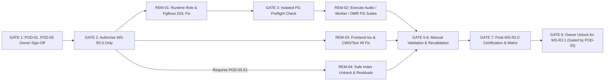

# BETHESDA WORSHIP STUDIO — WS-R2.0 PROJECT OWNER DECISION REGISTER AND REMEDIATION EXECUTION PLAN

- **Date:** `2026-11-21`
- **Repository:** `BETHESDA WORSHIP STUDIO` (`https://github.com/juancastro2381-hub/BETHESDA-WORSHIP-STUDIO.git`)
- **Branch:** `feature/phase-1a-core-foundation` (`origin/feature/phase-1a-core-foundation`, sync `0 0`)
- **Verified HEAD SHA:** `765a6312780ae155be3be7b2e19cbebbb56856c5` (`Reporte Ejecutivo — Certificación y Compuerta Controlada WS-R2.0 (Fase R2)`, `2026-11-21 16:53:31 -0500`)
- **Reported Prior Baseline Parent:** `d93534429039c0ad59da9c4fedd8e714f904eed9` (`2026-11-21 16:40:18 -0500`)
- **Approved Phase R1 Formal Closure:** `2ebb0fd1c4b70780e740da60342e07e81a166cdd` (`2026-11-21 14:44:37 -0500`)
- **Certification State:** **`CONDITIONAL PASS`** — **`PROJECT OWNER REVIEW REQUIRED`**
- **Authorization Boundary:** **PLANNING & DECISION CONSOLIDATION ONLY** — Zero code, schema, role, dependency, config, `.env`, or Git history changes performed; **`WS-R2.1` through `WS-R2.6` remain STRICTLY UNAUTHORIZED**.

---

## Phase 1 — Verified Baseline, Cross-Document Inventory & Blocker Mapping

### 1.1 Verified Commit Lineage (Zero Non-Doc Delta Since R1 Closure)
- `2ebb0fd1c4b70780e740da60342e07e81a166cdd` (`2026-11-21 14:44:37 -0500`): Formal closure of **Phase R1**.
- `83fbe26a7c019fbd8e58265256afa18a3065d259` (`2026-11-21 15:28:32 -0500`): Added 3 Phase R2 readiness assessment Markdown documents (`795 insertions(+)`).
- `d93534429039c0ad59da9c4fedd8e714f904eed9` (`2026-11-21 16:40:18 -0500`): Added 4 Phase R2 preparation/decision/certification Markdown documents (`657 insertions(+)`).
- `765a6312780ae155be3be7b2e19cbebbb56856c5` (`2026-11-21 16:53:31 -0500`, current `HEAD`): Added 3 `WS-R2.0` gate documents + updated traceability matrix (`454 insertions(+), 10 deletions(-)`).
- **Pre-Action Working Tree:** Clean (`git status --porcelain=v1` and `git diff --stat` empty). Zero application source, test, migration, or configuration edits exist since R1 closure.

### 1.2 Consolidated Phase R2 Document Suite (`10` Existing + This Register)
- Readiness Assessment & Roadmap: [`ARCHITECTURE_AND_READINESS_ASSESSMENT.md`](../../BETHESDA_WORSHIP_STUDIO_PHASE_R2_ARCHITECTURE_AND_READINESS_ASSESSMENT.md), [`PROPOSED_ROADMAP.md`](../../BETHESDA_WORSHIP_STUDIO_PHASE_R2_PROPOSED_ROADMAP.md), [`TRACEABILITY_AND_ACCEPTANCE_MATRIX.md`](../../BETHESDA_WORSHIP_STUDIO_PHASE_R2_TRACEABILITY_AND_ACCEPTANCE_MATRIX.md).
- Master Execution & Certification Reports: [`MASTER_EXECUTION_AND_GOVERNANCE_PLAN.md`](../../BETHESDA_WORSHIP_STUDIO_PHASE_R2_MASTER_EXECUTION_AND_GOVERNANCE_PLAN.md), [`WS_R2_0_PREREQUISITE_CERTIFICATION_REPORT.md`](../../BETHESDA_WORSHIP_STUDIO_PHASE_R2_WS_R2_0_PREREQUISITE_CERTIFICATION_REPORT.md), [`WS_R2_0_FINAL_CERTIFICATION_AND_BLOCKERS_REPORT.md`](../../BETHESDA_WORSHIP_STUDIO_PHASE_R2_WS_R2_0_FINAL_CERTIFICATION_AND_BLOCKERS_REPORT.md), [`WS_R2_0_REMEDIATION_PLAN.md`](../../BETHESDA_WORSHIP_STUDIO_PHASE_R2_WS_R2_0_REMEDIATION_PLAN.md).
- Owner Decisions & Master Matrix: [`PROJECT_OWNER_DECISIONS_POD_01_POD_05.md`](../../BETHESDA_WORSHIP_STUDIO_PHASE_R2_PROJECT_OWNER_DECISIONS_POD_01_POD_05.md), [`OWNER_DECISION_ANALYSIS_POD_01_POD_05.md`](../../BETHESDA_WORSHIP_STUDIO_PHASE_R2_OWNER_DECISION_ANALYSIS_POD_01_POD_05.md), [`UPDATED_TRACEABILITY_AND_ACCEPTANCE_MATRIX.md`](../../BETHESDA_WORSHIP_STUDIO_PHASE_R2_UPDATED_TRACEABILITY_AND_ACCEPTANCE_MATRIX.md).

### 1.3 Traceability Summary (`38` Verified Findings & `5` `WS-R2.0` Blockers)
- **Total Findings:** **`38` (`R2-F01`–`R2-F38`, `0` false positives)**: **`17` Critical**, **`17` High**, **`4` Medium** | Priorities: **`22` P0**, **`11` P1**, **`5` P2** | Evidence state: **`34` `VERIFIED`**, **`4` `VERIFIED (Static) / REQUIRES RUNTIME VALIDATION`** (`R2-F18`, `R2-F22`, `R2-F26`, `R2-F36`).
- **Active `WS-R2.0` Blockers Mapped to Packages:** `BLK-01` -> `REM-01` (`R2-F18`), `BLK-02` -> `REM-02` (`R2-F36`), `BLK-03` -> `REM-03` (`R2-F37`), `BLK-04` -> `REM-04` (`R2-F38`/`R2-F35`), `BLK-05` -> `POD-01`..`POD-05` gate matrix.

---

## Phase 2 — Consolidated Project Owner Decision Register (`POD-01` to `POD-05`)

> **Governance Rule:** Every recommendation below is advisory ONLY. **ZERO options are marked approved** until the Project Owner signs or explicitly approves them in writing.

### `POD-01` — Hosting and Storage Architecture
- **Options:**
  - **Option A:** Single Persistent VPS (Docker + SSD Volume + local unified `STORAGE_ROOT_DIR`, queued Python DSP `concurrency: 1`, `OutputRetentionService`, `pg_dump` + offsite snapshots).
  - **Option B:** Single-Node Cloud PaaS + Managed PG + Unified **S3/R2 Object Storage** (adapting all 4 providers: `sources`, `outputs`, `audio`, `documents`; single replica avoids immediate Redis clustering).
  - **Option C:** Multi-Replica Cloud Architecture (+ Redis for rate limits/tickets/SSE + Dedicated Worker Container + S3).
- **Technical Pros & Cons:** Option A has minimal architecture churn and fast local HTTP 206 audio seeking, but fixed disk capacity and single-host maintenance. Option B survives ephemeral PaaS redeploys cleanly, uses free object tiers (e.g., Cloudflare R2 10 GB), and builds an S3 abstraction across 4 domains, at higher `WS-R2.4` refactoring effort. Option C unlocks horizontal scaling and HA, at `XL` complexity and extra infrastructure maintenance.
- **Security Implications:** Local/S3 private buckets require IAM scoping and safe signed-URL/stream validation (`R2-F22`); single-node RAM stores (`DualRateLimiter`, `StreamTicketService`) are safe ONLY when capped strictly at 1 API replica.
- **Scalability Implications:** Option A/B scale vertically within 1 API node; Option C removes single-node state bottlenecks (`R2-F26`).
- **Maintenance & Financial Estimates:** Option A: ~\$5–12/mo VPS, low infra ops; Option B: ~\$0–7/mo (free PaaS + R2 free tier + Neon/Supabase free PG), moderate bucket ops; Option C: ~\$25–60+/mo (multi-container + Redis + Managed PG + S3), high ops overhead.
- **Dependencies on Future Workstreams:** Directly shapes **`WS-R2.4`** (storage driver, audio Range proxy, backup runbook) and Redis deferral boundary in **`WS-R2.3` / `R3+`**.
- **Recommended Option *(Recommendation ONLY — Not Approved)*:** **Option B** for free/ephemeral PaaS deployment, or **Option A** if hosting on a persistent SSD VPS. Defer Option C (`Redis`) to `R3+`.
- **Approval Status:** `PENDING PROJECT OWNER WRITTEN APPROVAL`
- **Owner Approval Field:** `[ ] Option A`  `[ ] Option B`  `[ ] Option C` — **Signed / Date:** \_\_\_\_\_\_\_\_\_\_\_\_\_\_\_\_\_\_

### `POD-02` — Multi-Tenancy Architecture
- **Options:** **Option A:** Single-Church PostgreSQL instance during Phase R2 (defer `community_id` + RLS to `R3+`); **Option B:** Multi-Church SaaS isolation (`community_id` + PostgreSQL RLS across all 21 tables + per-community active setlist) implemented in Phase R2.
- **Technical Pros & Cons:** Option A avoids touching 21 schema tables, 48 test suites, and every Drizzle query during urgent musical/security stabilization; Option B enables shared multi-church hosting immediately at `XL+` engineering/regression cost.
- **Security & Scalability Implications:** Under Option A, one DB must strictly serve one church congregation (never co-mingle two congregations without separate DBs); Option B enforces tenant isolation via RLS if every query path is audited.
- **Maintenance & Financial Estimates:** Option A: `\$0` R2 migration overhead (`1` free DB per congregation if self-hosted); Option B: heavy maintenance across every repository query in R2.
- **Dependencies on Future Workstreams:** Determines schema scope of **`WS-R2.3`** (`idx_setlists_single_active`, FKs) and **`R3+`** SaaS isolation.
- **Recommended Option *(Recommendation ONLY — Not Approved)*:** **Option A** (Single-church R2; defer `community_id` + RLS to `R3+`).
- **Approval Status:** `PENDING PROJECT OWNER WRITTEN APPROVAL`
- **Owner Approval Field:** `[ ] Option A`  `[ ] Option B` — **Signed / Date:** \_\_\_\_\_\_\_\_\_\_\_\_\_\_\_\_\_\_

### `POD-03` — Governance of `APPROVED` Songs
- **Options:** **Option A:** Restrict `songs:approve` strictly to `ADMIN` & `SUPER_ADMIN` everywhere (blocking `WORSHIP_LEADER` across OMR/Completion/Audio); **Option B:** Authorize `WORSHIP_LEADER` + `ADMIN` + `SUPER_ADMIN` to hold `songs:approve` strictly via explicit human-review actions, while **forcing `'DRAFT'` on every upload/import/AI run** (`POST /songs`, `DocumentService`, `UniversalIngestionService`, `ConversionJobService`) and **blocking `MUSICIAN`/`VIEWER` edits on `APPROVED` active versions**.
- **Technical Pros & Cons:** Option A isolates technical administration cleanly but bottlenecks daily Sunday worship prep if `ADMIN` lacks musical literacy; Option B matches real ministry authority and existing OMR/Audio UI intent while eliminating auto-approval.
- **Security, Scalability & Maintenance Implications:** Both options close `R2-F11` mass assignment and `MUSICIAN` catalog tampering, add immutable `audit_logs`, and require `DRAFT -> PENDING_REVIEW -> APPROVED` endpoint alignment (`M` effort).
- **Financial Estimates:** `\$0`.
- **Dependencies on Future Workstreams:** Directly governs RBAC contracts in **`WS-R2.1`** and **`WS-R2.2`**.
- **Recommended Option *(Recommendation ONLY — Not Approved)*:** **Option B** (Explicit human-reviewed approval by `WORSHIP_LEADER`/`ADMIN`/`SUPER_ADMIN`; zero auto-approval on ingestion/AI).
- **Approval Status:** `PENDING PROJECT OWNER WRITTEN APPROVAL`
- **Owner Approval Field:** `[ ] Option A`  `[ ] Option B` — **Signed / Date:** \_\_\_\_\_\_\_\_\_\_\_\_\_\_\_\_\_\_

### `POD-04` — SMTP Onboarding and Account Recovery
- **Options:** **Option A:** Integrate configurable transactional SMTP provider (`nodemailer` + free-tier relay such as Resend/Brevo/church SMTP) with hashed short-TTL tokens, single-use DB consumption, anti-enumeration/rate limits, and **zero tokens in HTTP JSON responses**; **Option B:** No SMTP in R2 (out-of-band admin temporary password `MUST_CHANGE_PASSWORD`; self-service reset stays disabled).
- **Technical Pros & Cons:** Option A closes `R2-F12` production token leakage (`user.routes.ts:121,156`), restores self-service forgot-password, and unlocks `/accept-invite` UI cleanly; Option B avoids DNS `SPF`/`DKIM` setup now but weakens user privacy/recovery.
- **Security & Scalability Implications:** Eliminates plaintext credential exposure in proxy/admin logs and adds `IP + account` email-flood throttling.
- **Maintenance & Financial Estimates:** Option A: `\$0` within free transactional relays (e.g., 3,000 emails/mo) + minor SMTP env credential management; Option B: `\$0` infra cost, higher manual support load for Worship Admins.
- **Dependencies on Future Workstreams:** Directly governs **`WS-R2.2`** (API/email delivery) and **`WS-R2.6`** (`/accept-invite` & `/forgot-password` UI flows).
- **Recommended Option *(Recommendation ONLY — Not Approved)*:** **Option A** (SMTP transactional relay with zero plaintext tokens in JSON/logs).
- **Approval Status:** `PENDING PROJECT OWNER WRITTEN APPROVAL`
- **Owner Approval Field:** `[ ] Option A (Provider: ____________)`  `[ ] Option B` — **Signed / Date:** \_\_\_\_\_\_\_\_\_\_\_\_\_\_\_\_\_\_

### `POD-05` — Git Repository Hygiene and FFmpeg Licensing
- **Truthful Dependency Fact:** Audio pipeline uses [`imageio-ffmpeg>=0.6.0,<1.0.0`](../../workers/audio_worker/requirements.txt#L14-L17) (which bundles GPLv3 FFmpeg executed strictly as an isolated OS subprocess via stdin/stdout pipes; **zero ImageMagick packages exist**). Git currently tracks `7,367` files under `backend/node_modules/` (`103.8 MiB`, incl. 4 Windows `.exe`/`.node` `31.7 MiB`), `223` `backend/storage/` files, `20` `.zip`, `87` `.sha256`, plus ignored `<repo>/storage/` residuals (`non_existent_cert_dir_404`, `test-symlink-outside`).
- **Options:** **Git A1:** Safe `git rm -r --cached backend/node_modules` (no history rewrite, keeps local disk copy) + delete stray `<repo>/storage/` test residuals + keep existing lockfile `npm ci`; **Git A2:** Leave `backend/node_modules/` tracked. **License B1:** Keep GPLv3 `imageio-ffmpeg` strictly server-side behind subprocess isolation with formal legal review prior to any external bundle/container distribution; **License B2:** Swap to system-installed LGPL-only `ffmpeg` in R2.
- **Technical Pros & Cons / Security / Scalability:** Option A1 stops committing OS-locked Windows binaries, ensures CI verifies `package-lock.json` integrity, and unblocks clean workspace separation; Option B1 preserves the live 18/18 passing Python worker while strictly preventing unlicensed binary redistribution.
- **Financial Estimates:** `\$0` (unless legal counsel review requested prior to distribution).
- **Dependencies on Future Workstreams:** Gates `REM-04` inside **`WS-R2.0`** and clean packaging in **`WS-R2.5`**.
- **Recommended Option *(Recommendation ONLY — Not Approved)*:** **Git A1 + License B1**.
- **Approval Status:** `PENDING PROJECT OWNER WRITTEN APPROVAL`
- **Owner Approval Field:** **Git:** `[ ] A1` `[ ] A2` | **FFmpeg:** `[ ] B1` `[ ] B2` — **Signed / Date:** \_\_\_\_\_\_\_\_\_\_\_\_\_\_\_\_\_\_

---

## Phase 3 — Actionable & Dependency-Aware `WS-R2.0` Remediation Execution Plan

*(Blueprint only — NO code, SQL, tests, `.gitignore`, or Git commands executed during this planning step.)*

### `BLK-01` — PostgreSQL Runtime Role Provisioning (`REM-01`)
1. **Fix Database-Name Hardcoding:** Replace hardcoded `bethesda_worship_dev` at [`provision_app_runtime_role.sql:45`](../../backend/src/db/scripts/provision_app_runtime_role.sql#L45) with dynamic `EXECUTE format('GRANT CONNECT ON DATABASE %I TO bethesda_app_runtime', current_database());`.
2. **Complete Table & Schema Coverage:** Expand `GRANT SELECT, INSERT, UPDATE, DELETE` (`L49-59`) from 9 to all **20 operational public tables** (`users`, `refresh_tokens`, `password_reset_tokens`, `user_invitations`, `audit_logs`, `songs`, `song_versions`, `song_sources`, `song_metadata`, `worship_services`, `setlists`, `setlist_items`, `user_view_preferences`, `audio_assets`, `multitrack_sessions`, `multitrack_tracks`, `background_jobs`, `cas_deletion_intents`, `omr_proposals`, `omr_proposal_measures`), preserve `SELECT, INSERT`-only on `omr_audit_history` (`L65-67`), and grant `USAGE, SELECT` on public sequences.
3. **Separate `pgboss` DDL from Runtime Execution:** Have the DBA/migration runner pre-initialize schema `pgboss` and grant `USAGE` + table/sequence DML on `pgboss` to `bethesda_app_runtime`; update [`conversion-queue.ts:64-98`](../../backend/src/infrastructure/queue/conversion-queue.ts#L64-L98) so runtime workers do not run `pgboss` DDL when connected as the restricted role.
4. **Harden & Wire Startup Role Validation:** Update `assertNonSuperuserRuntimeRole()` in [`backend/src/db/index.ts:88`](../../backend/src/db/index.ts#L88) to reject `rolsuper || rolcreaterole || rolcreatedb`, invoke it at [`backend/src/server.ts`](../../backend/src/server.ts) startup (before `app.listen`), and enforce clean `MIGRATION_DATABASE_URL` (DDL) vs `DATABASE_URL` (`bethesda_app_runtime` DML) separation.
5. **Eliminate Test Hardcoding & Static Password Literals:** Refactor [`omr-persistence-and-integrity.test.ts:2540-2693`](../../backend/src/__tests__/omr-persistence-and-integrity.test.ts#L2540-L2693) to derive database/host/port dynamically from `env.TEST_DATABASE_URL` (replacing hardcoded `bethesda_worship_test`) and generate an in-memory ephemeral test password (`crypto.randomBytes(16).toString('hex')`) dropped cleanly in `finally`.

### `BLK-02` — PostgreSQL Isolated Certification (`REM-02`)
Target suites: `audio-preservation-and-worker.test.ts` (`40`), `conversion-worker-certification.test.ts` (`105`), `omr-persistence-and-integrity.test.ts` (`68`).
- **Mandatory Safety Controls (Stop Immediately If Any Fails):**
  1. **Target Whitelist Lock:** Allow execution **ONLY** against explicitly created blank disposable DB `bethesda_worship_r2_cert_tmp`. Hard-reject `bethesda_worship_dev`, `bethesda_worship_test`, or any production DB name.
  2. **URL Separation Check:** Assert `areDatabaseTargetsEquivalent(TEST_DATABASE_URL, DATABASE_URL) === false` (`db/index.ts:21-62`) **before** starting `migrate.ts` or tests.
  3. **Isolated Storage & CWD:** Route `AUDIO_STORAGE_PATH` to OS temp directory (`%TEMP%\bethesda_r2_cert_audio`) and run `conversion-worker-certification.test.ts` inside an isolated temp working directory (`cwd`) so `storage/test-cert-r221` / `storage/non_existent_cert_dir_404` never pollute `<repo>/storage/`.
  4. **Rollback & Cleanup Protocol:** After tests complete (or fail), revoke/drop ephemeral test role `bethesda_app_test_runtime`, execute `DROP DATABASE IF EXISTS bethesda_worship_r2_cert_tmp`, remove `%TEMP%\bethesda_r2_cert_audio` and temp `cwd`, and verify `git status --porcelain=v1` shows zero leaked repository storage artifacts.

### `BLK-03` — Frontend Test Runner Alignment (`REM-03`)
- Minimal non-destructive remediation:
  1. Add `"tsx": "^4.19.3"` to `frontend/package.json` `devDependencies` (matching `backend/package.json`) and switch `"test"` (`L9`) to `"tsx --test \"src/core/**/__tests__/**/*.test.ts\""` so Node `.tsx` imports (`AutoscrollControl.tsx`, `AudioPlayerBar.tsx`, `ScenarioPresets.tsx`, `MusicalControls.tsx`) run cleanly.
  2. Fix `process.cwd()` coupling in [`autoscroll.test.ts:265,270,326`](../../frontend/src/core/autoscroll/__tests__/autoscroll.test.ts#L265-L326) using `fileURLToPath(new URL(..., import.meta.url))` so tests pass from both monorepo root and `frontend/`.
  3. Align [`browser-rendering-integration.test.ts:362-380`](../../frontend/src/core/rendering/__tests__/browser-rendering-integration.test.ts#L362-L380) test `#8`: test Capo 0 -> Capo 2 on `acoustic_guitar` (`primaryRepresentation: 'CHORDS', secondaryRepresentations: ['LYRICS']`) AND retain an explicit test proving `LYRICS_ONLY` keeps `capo === 0` (`commit b012879`).
  4. Strictly **zero browser automation** (`Playwright`/`Selenium`/`Cypress` excluded).

### `BLK-04` — Git and Repository Hygiene (`REM-04` — Strictly Gated by `POD-05`)
- Tracked inventory baseline (`8,875` tracked; `.git` `53.4 MiB`; disk excl. `.git` `519.0 MiB`): `7,367` tracked files in `backend/node_modules/` (`103.8 MiB`, incl. 4 Windows `.exe`/`.node` `31.7 MiB`), `223` tracked in `backend/storage/` (`4.5 MiB`), `20` `.zip` (`3.1 MiB`), `87` `.sha256` (`11.2 KB`), plus ignored `<repo>/storage/` residuals (`90.6 KB` incl. `non_existent_cert_dir_404/` & `test-symlink-outside/`).
- **Conservative Sequence (Executed ONLY After Explicit `POD-05` Approval — NOT Now):**
  1. Untrack index cleanly with `git rm -r --cached backend/node_modules` (preserves working directory copies, performs zero history rewrite).
  2. Delete strictly the verified untracked test residuals `<repo>/storage/non_existent_cert_dir_404` and `<repo>/storage/test-symlink-outside`.
  3. Re-verify `npm --prefix backend ci` succeeds cleanly against `package-lock.json`.
  4. Keep `223` `backend/storage/` & `20` `.zip` files untouched unless a separate fixture consolidation task is authorized; maintain `imageio-ffmpeg` GPLv3 strictly inside server subprocess IPC (`POD-05` B1).

### `BLK-05` — Dependency Ordering (`POD-01`–`POD-05` & `REM-01`–`REM-05`)

- **Exact Dependencies on Owner Decisions:** `REM-04` depends directly on **`POD-05`**. Subsequent workstreams depend on **`POD-03`** (`WS-R2.1`, `WS-R2.2`), **`POD-04`** (`WS-R2.2`, `WS-R2.6`), **`POD-02`** (`WS-R2.3` vs `R3+`), and **`POD-01`** (`WS-R2.4`).

---

## Phase 4 — Strict 8-Gate Execution Sequence (`GATE 1` to `GATE 8`)

| Gate | Entry Criteria | Exit Criteria | Required Evidence | Active Blockers | Authorization Status |
|---|---|---|---|---|---|
| **GATE 1: Project Owner Decisions** | `POD-01`–`POD-05` options & risks documented (Complete) | Written selection & signature for all 5 PODs (or explicit `WS-R2.0` isolation decision for `POD-05`) | Signed decision fields in this register / `POD_01_POD_05` report | `BLK-05` | **PENDING OWNER REVIEW** |
| **GATE 2: Explicit Authorization of `WS-R2.0` Scope** | GATE 1 signed (at minimum `REM-01`–`REM-03` + `POD-05` for `REM-04`) | Explicit Owner sign-off limiting edits strictly to `REM-01`–`REM-04` | Owner written approval of `WS-R2.0` boundary (`WS-R2.1`–`R2.6` still locked) | `BLK-01`–`BLK-04` | **NOT AUTHORIZED YET** |
| **GATE 3: Isolated PG Certification Environment Safety Preflight** | GATE 2 approved + `REM-01` applied in working tree | Disposable `bethesda_worship_r2_cert_tmp` verified; `TEST_DATABASE_URL !== DATABASE_URL`; zero dev/test/prod target match; isolated temp storage & `cwd` ready | Printed target DB name check, `areDatabaseTargetsEquivalent` pass, clean temp paths | `BLK-02` | **BLOCKED BY GATE 2** |
| **GATE 4: Controlled Implementation of Approved `WS-R2.0` Items Only** | GATE 3 safety preflight passed | `REM-01`, `REM-02` test portability, `REM-03`, and (if `POD-05` approved) `REM-04` implemented with zero out-of-scope edits | `git diff --stat` strictly within authorized `WS-R2.0` allow-list; `npm ci` & `tsc` pass | `BLK-01`–`BLK-04` | **BLOCKED BY GATE 3** |
| **GATE 5: Manual Validation & Permitted Non-Browser Testing** | GATE 4 code/scripts in place on disposable DB | Executed `40/40` audio, `105/105` worker, `68/68` OMR (restricted role), `18/18` `pytest`, `629/629` frontend `tsx`, `MV-0.1` & `MV-0.2` (no browser automation) | Raw test stdout (`0` failed/skipped), SQL `42501`/`55000` denial logs, `/health -> 200` boot output | Runtime PG runs | **BLOCKED BY GATE 4** |
| **GATE 6: Independent Revalidation** | GATE 5 green logs & disposable DB dropped | Clean verification of `bethesda_worship_dev`/`test` untouched, repo root `/storage/` clean, `git status` clean of stray binaries, negative superuser startup rejection check | Post-test cleanup log, `git status --porcelain=v1`, `psql -l` verifying temp DB dropped | Post-cleanup checks | **BLOCKED BY GATE 5** |
| **GATE 7: Updated Evidence, Acceptance Matrix & Final Certification** | GATE 6 verified | Updated traceability matrix (`R2-F18`, `R2-F36`, `R2-F37`, `R2-F38` updated from runtime logs) + formal `WS-R2.0` Closure Report upgrading verdict to `PASS` | Committed/reviewable `WS-R2.0` closure doc + updated traceability matrix | Pending GATE 6 | **BLOCKED BY GATE 6** |
| **GATE 8: Project Owner Approval Before `WS-R2.1`** | GATE 7 `WS-R2.0` `PASS` + `POD-03` resolved | Explicit Owner authorization for `WS-R2.1` (`R2-F01`–`R2-F10` musical integrity) | Written Project Owner unlock for `WS-R2.1` (`WS-R2.2`–`R2.6` remain individually gated) | **`WS-R2.1` UNAUTHORIZED** | **HARD STOP / UNAUTHORIZED** |

---

## Strict Prohibitions & Project Owner Authorization Block

During this preparation step and until **GATE 1 & GATE 2** are explicitly signed:
- **PROHIBITED:** Application code edits, DB/role changes, migrations, `npm` dependency changes, `.gitignore`/`.env` edits, file deletions, `git rm`, `git clean`, history rewrites, commits/pushes, browser automation, destructive DB tests, and any work on **`WS-R2.1` through `WS-R2.6`**.

### Formal `WS-R2.0` Gate Sign-Off (For Project Owner Completion Only)
- **POD Decisions Recorded Above:** `POD-01 [___]`, `POD-02 [___]`, `POD-03 [___]`, `POD-04 [___]`, `POD-05 [___ / ___]`
- **Authorize `GATE 2` (`WS-R2.0` Controlled Implementation Only):** `[ ] YES — Proceed with REM-01..REM-03 (+ REM-04 if POD-05=A1)`   `[ ] NO / HOLD`
- **`WS-R2.1` through `WS-R2.6` Status:** **Explicitly Kept UNAUTHORIZED Pending GATE 8**  
**Project Owner Signature / Date:** \_\_\_\_\_\_\_\_\_\_\_\_\_\_\_\_\_\_\_\_\_\_\_\_\_\_\_\_\_\_\_\_\_\_\_\_

---

## Public Documentary Privacy Sanitization Note (`2026-11-24`)

- **Authorization:** Authorized under Pull Request #2 Option B documentary privacy sanitization (`2026-11-24`). Does **not** authorize `WS-R2.0`, `Phase 2B.1`, `POD-01`–`POD-05`, `GATE 2`, or any Category D resolution (all approval checkboxes above remain intentionally unsigned).
- **Sanitization applied:** Replaced `18` non-portable local file URI links in Sections 1.2, `POD-05`, `BLK-01`, and `BLK-03` with repository-relative Markdown links (`../../...`) pointing to existing tracked files. Zero technical decisions, findings, code, SQL, or runtime behavior were modified.
- **Forensic provenance:** Original byte-identical artifact (`CF2CB4EEA314D0DA9A8F83AA5ACDDA896C429D3CED8BF5AE2CE1C067686D898D`, dated `2026-11-21`) is retained unmodified in the **private external evidence backup** and in prior Git commits `01f16e9a`–`cc9aec18`. See [`BETHESDA_WORSHIP_STUDIO_PR2_PRIVACY_SANITIZATION_AND_EVIDENCE_PRESERVATION_REPORT.md`](BETHESDA_WORSHIP_STUDIO_PR2_PRIVACY_SANITIZATION_AND_EVIDENCE_PRESERVATION_REPORT.md).

---

## Stage 0 `GATE 1` Reconciliation Addendum (`2026-11-27`)

- **Pre-Reconciliation SHA-256 on `98919fe8`:** `86172EF1EEDF3E34BAB84219013120011EAEB1A02D23F6C96C396D210CA928E8` (`25,716` B).
- **Phase 2B.1 & Authoritative Register Update (`L177`):** Core Phase 2B.1 storage/retention code (`storage-provider.ts`, `output-retention-service.ts`, `cas_deletion_intents`) was already merged on `main` via PR `#1` (`765a6312`); the note above attested solely that PR `#2` initiated zero new Phase 2B.1 remediation. Formal Project Owner approvals for `POD-01`–`POD-09`, `OI-01`, and **`GATE 1`** (while keeping `GATE 2`–`GATE 8` / `WS-R2.0`–`WS-R2.6` strictly **NOT AUTHORIZED**) are now recorded in the authoritative [`MASTER_PROJECT_OWNER_DECISION_REGISTER.md`](../../MASTER_PROJECT_OWNER_DECISION_REGISTER.md) (`v1.2`) and [`STAGE_0_PROJECT_OWNER_DECISION_DOSSIER.md`](../../STAGE_0_PROJECT_OWNER_DECISION_DOSSIER.md) (`v1.1`). The `GATE 1`–`GATE 8` identifiers inside this legacy `WS-R2.0` plan map to `WS-R2.0-SG1`…`SG8` inside [`STAGE_0_GATE_PREREQUISITES_AND_ACCEPTANCE_MATRIX.md`](../../STAGE_0_GATE_PREREQUISITES_AND_ACCEPTANCE_MATRIX.md).
