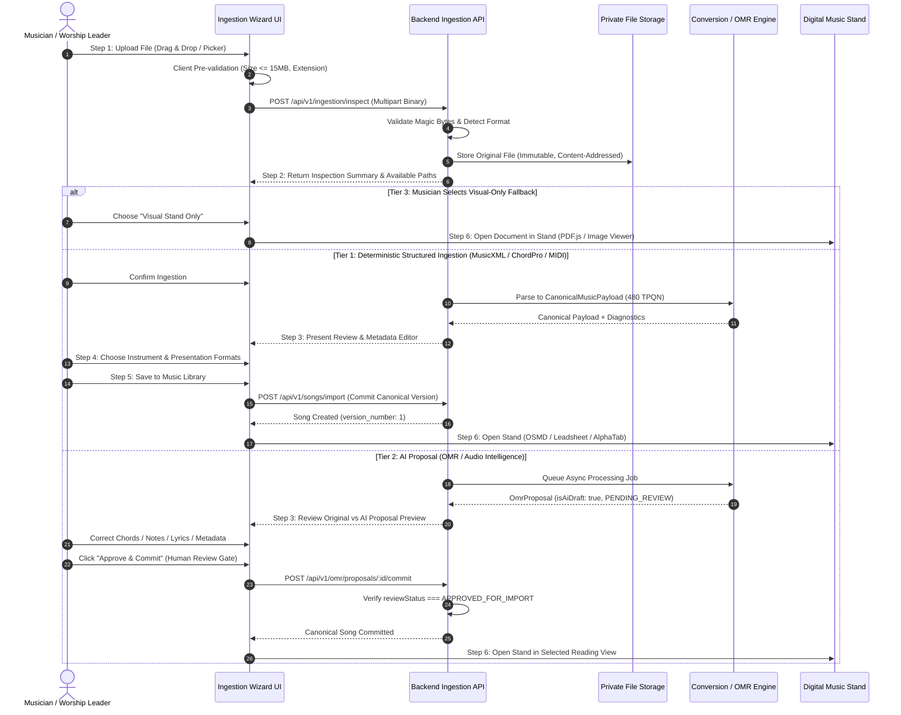
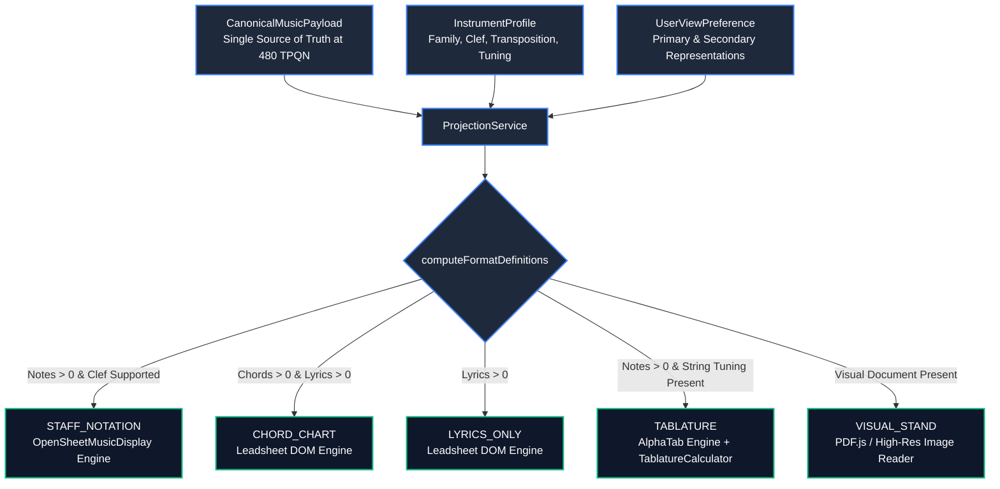

# Bethesda Worship Studio — Professional Musical File Ingestion, Conversion & Digital Music Stand
## Phase A: Comprehensive Repository Audit, Technical Feasibility Assessment & Phased Implementation Plan

- **Repository**: `BETHESDA-WORSHIP-STUDIO`
- **Current Branch**: `main` (commit baseline: `19f2089`)
- **Module Under Evolution**: Import Score / Musical Chord Chart & Digital Music Stand
- **Phase**: Phase A (Audit and Design)
- **Status**: AUDIT COMPLETE — PURE DOCUMENTATION DELIVERABLE (ZERO CODE MODIFICATIONS)
- **Exit Gate**: Gate A (Design and Technical Feasibility Review) — STOP AND AWAIT APPROVAL
- **Date**: October 23, 2026

---

## 1. Executive Summary

Bethesda Worship Studio is an enterprise-grade digital music platform and liturgical atril system designed for worship ministries. The platform currently enables musicians and worship leaders to visualize musical scores, chord charts, lyrics, and instrument tablatures; manage liturgical setlists; synchronize real-time liturgical flow (Phase 3B); mix multitrack stems (Phase 3C); and read music offline with hands-free continuous autoscroll (WP-05).

This document delivers the **Phase A Comprehensive Repository Audit, Technical Feasibility Assessment, and Phased Implementation Plan** for evolving the existing *Import Score / Musical Chord Chart* module into a professional, extensible, secure, and musician-friendly ingestion, conversion, and digital music stand system.

### Key Strategic Findings
1. **Evolution, Not Rewriting**: The platform already possesses a robust, mathematically sound canonical music engine (`CanonicalMusicPayload` at 480 TPQN), an in-memory ingestion service for MusicXML and ChordPro, an ACID-compliant PostgreSQL + Drizzle ORM schema, an authorized audio streaming pipeline (`AudioService`), and a multi-view digital music stand (`MusicalWorkspace`). The evolution builds directly on these assets rather than replacing them.
2. **Visual Fallback as a First-Class Citizen**: Not every uploaded score or image can or should be forced into automatic transcription. The system must support a visual-only document reader mode in the digital music stand so musicians can read uploaded PDF or image scores immediately with autoscroll and offline caching, even when structured transcription is unconfident or unsupported.
3. **The Advisory AI Principle ("Asistente, no autoridad")**: All AI-assisted extractions (OMR from PDF/images, pitch/chord estimation from audio, singing transcription) are strictly treated as preliminary proposals (`isAiDraft: true`, `reviewStatus: 'PENDING_REVIEW'`). Zero musical notes, chords, or lyrics may be fabricated or hallucinated to patch gaps. No AI draft can become canonical catalog truth without explicit human review and approval (`reviewStatus: 'APPROVED_FOR_IMPORT'`).
4. **Decoupled Architecture**: Ingestion adapters converge strictly onto the existing `CanonicalMusicPayload`. Direct $N \times M$ format conversions are prohibited. Format inspection, parsing, validation, canonical normalization, and presentation projection are cleanly separated.
5. **Phase A Compliance**: Absolutely zero code, schema, or production changes have been made during Phase A. Verification confirms **707 non-browser automated tests passing** (310 backend, 397 frontend) with zero regressions.

---

## 2. Repository Baseline and Working-Tree State

### 2.1 Git Repository Metadata
- **Remote / Corpus**: `juancastro2381-hub/BETHESDA-WORSHIP-STUDIO`
- **Active Branch**: `main` (synchronized with `origin/main`)
- **Head Commit**: `19f2089 GLOBAL UI POLISH, THEME CONSISTENCY & SERVICE WORKER ERROR REMEDIATION`
- **Recent Git History**:
  - `19f2089` GLOBAL UI POLISH, THEME CONSISTENCY & SERVICE WORKER ERROR REMEDIATION
  - `eccd302` FINAL MOBILE HEADER AND UI ACCEPTANCE GATE
  - `7d1e80e` Responsive Members Modal & Complete Light/Dark Theme Remediation Report
  - `03a903a` POST-REMEDIATION BROWSER VERIFICATION
  - `158ac31` AUTHORIZED POST-LOGIN API ERROR REMEDIATION

### 2.2 Working Tree Inspection
- **Modified Working Files**:
  - `frontend/src/index.css`: Light mode text legibility remediation (completed in prior turn to address white-on-white text; verified with 0 regressions).
  - `docs/reports/GLOBAL_UI_POLISH_AND_SERVICE_WORKER_REMEDIATION_REPORT.md` & `.sha256`: Documentation update.
- **Untracked Files**:
  - `docs/reports/screenshots/light_mode_text_legibility_remediated.png`: Visual verification evidence for theme legibility.
- **Phase A Governance Invariant**: Zero application code files modified for the ingestion module in Phase A.

### 2.3 Automated Test Baseline
- **Backend Test Suite (`backend/package.json`)**:
  - Command: `npm test` (`tsx --test --test-concurrency=1 "src/**/__tests__/**/*.test.ts"`)
  - Execution Time: 218.1s
  - Result: **310 passed**, **0 failed**, **0 skipped** across **58 test suites**.
  - TypeScript Typecheck: `npm run typecheck` (`tsc --noEmit`) $\to$ **0 errors**.
- **Frontend Test Suite (`frontend/package.json`)**:
  - Command: `npm test` (`tsx --test "src/**/__tests__/**/*.test.ts"`)
  - Execution Time: 5.1s
  - Result: **397 passed**, **0 failed**, **0 skipped** across **58 test suites**.
  - TypeScript Typecheck: `npm run typecheck` (`tsc --noEmit`) $\to$ **0 errors**.
- **Combined Test Health**: **707 tests passing / 0 failures across 116 test suites**.

### 2.4 Database and Storage Infrastructure
- **RDBMS Engine**: PostgreSQL 18.1 local development database (`bethesda_worship_dev` on port 5432).
- **ORM / Migrations**: Drizzle ORM v0.39.3, Drizzle Kit v0.30.4.
- **Catalog State**: 656 registered church members (all 655 baseline members completely preserved).
- **Existing Storage**: Local filesystem storage with SHA-256 content-addressable storage for audio assets (`audio_assets`) and stem audio binaries.

---

## 3. Existing Feature Inventory

| Module / Component | Repository Location | Maturity Status | Technical Capabilities & Boundaries |
| :--- | :--- | :---: | :--- |
| **Canonical Model** | `frontend/src/core/canonical-model/` | **Fully Implemented** | Mathematical representation at 480 TPQN (`CANONICAL_TPQN = 480`). Composed of `Timeline` (with `TempoMap`), `sections: Section[]`, `measures: Measure[]` (with `Voice[]`, `Note`, `Rest`, `ChordEvent`, `LyricSyllable`), and `instrumentTracks: InstrumentTrack[]`. Full JSON serialization via `CanonicalSerializer`. Validated via `CanonicalModelValidator`. |
| **Ingestion Pipeline** | `frontend/src/core/ingestion/` | **Partially Implemented** | `UnifiedMusicImporter` with `MusicXmlImporter` (MusicXML 4.0, XXE safe) and `ChordProImporter` (directives, chords, lyrics). Client-side in-memory normalization. Lacks compressed MusicXML (.mxl), binary MIDI (.mid), and direct link to backend persistence. |
| **Source File Uploader UI** | `frontend/src/components/workspace/SourceFileUploader.tsx` | **Partially Implemented** | Accessible drag-and-drop modal with file picker, 5 MB file size limit, and synthetic sample loading. Dispatches only to client in-memory state; does not invoke `/api/v1/songs/import` or support multi-step inspection/review. |
| **Backend Song Persistence** | `backend/src/interfaces/http/routes/song.routes.ts` | **Fully Implemented** | REST endpoints (`POST /api/v1/songs`, `POST /api/v1/songs/import`, `POST /api/v1/songs/:songId/versions`, `GET /api/v1/songs/:songId`). Validated with Zod schemas. RBAC enforced (`songs:create`, `songs:read`, `songs:update_draft`). Drizzle tables: `songs`, `song_versions` (`canonical_payload` JSONB), `song_sources` (`raw_content`). |
| **Audio Life-Cycle** | `backend/src/application/audio-service.ts` | **Fully Implemented** | File upload, magic bytes signature verification (`validateAudioMagicBytes`), quota enforcement, range streaming (RFC 7233 / 9110), and SHA-256 checksums for MP3, WAV, OGG, FLAC, M4A/AAC. Audio transcription/analysis pipeline is missing. |
| **Multitrack Mixer** | `backend/src/application/multitrack-service.ts` & `frontend/src/core/multitracks/` | **Fully Implemented** | Phase 3C Workstream D1. Solo/mute precedence, gain [0.0, 1.0], pan [-1.0, 1.0], offset [-5000, 5000] ms. Offline completeness check (`checkOfflineCompleteness`). Linked directly to `audio_assets`. Zero pedal code. |
| **Optical Music Recognition (OMR)** | `backend/src/domain/omr/` & `backend/src/application/omr-service.ts` | **Partially Implemented** | Phase 3C Workstream D2. Domain model `OmrProposal` with `isAiDraft: true`. Magic bytes validation (`validateOmrFileSignature`) for PDF, PNG, JPEG, TIFF. File size limit 15 MB. `commitToCanonicalSong()` requires `reviewStatus === 'APPROVED_FOR_IMPORT'`. Missing: HTTP route registration in Fastify and frontend integration. |
| **Digital Music Stand** | `frontend/src/components/workspace/MusicalWorkspace.tsx` | **Fully Implemented** | Atril workspace rendering 3 engines: OSMD (Standard Notation), Leadsheet DOM (Chords & Lyrics), AlphaTab (Tablature & Guitar Score). Decoupled instrument profile (`InstrumentProfile`) and reading formats (`ReadingFormatSelector`). |
| **Transposition & Capo** | `frontend/src/core/music-theory/` & `frontend/src/core/projection/` | **Fully Implemented** | Decoupled transposition ($[-12, +12]$ semitones altering concert pitch) and capo ($[0, 12]$ frets adjusting physical fingering relative to open strings). Solfege latin and standard chord notation. |
| **Score Autoscroll** | `frontend/src/core/autoscroll/` | **Fully Implemented** | WP-05. Continuous hands-free scrolling via `requestAnimationFrame` with user-override grace period (800ms) and speeds from 0.5x to 3.0x. Zero pedal synchronization. |
| **PWA Offline Read-Only** | `frontend/src/core/offline/` | **Fully Implemented** | WP-04. Service Worker caching of app shell, IndexedDB storage for songs, setlists, and authorized offline audio with authoritative SHA-256 verification. Read-only guard in offline mode. |
| **Realtime Liturgical Sync** | `backend/src/application/realtime-session-manager.ts` | **Fully Implemented** | Phase 3B Workstream C. WebSocket ticket validation, active setlist tracking, conductor broadcast, follower synchronization, audit logging. |

---

## 4. Supported-Format Matrix

The following matrix classifies all candidate musical formats into authoritative operational tiers:
- **Tier 1 (Native / Deterministic)**: Structured symbolic formats parsed deterministically into `CanonicalMusicPayload` with 100% mathematical fidelity.
- **Tier 2 (AI Proposal / Advisory)**: Documents, images, or audio analyzed through OMR or audio intelligence, resulting in an `isAiDraft: true` proposal requiring human review before canonical persistence.
- **Tier 3 (Visual Stand / Fallback)**: Unparsed raster or vector documents displayed directly on the digital music stand with zoom, navigation, and autoscroll, without generating false notes.
- **Tier 4 (Deferred / Rejected)**: Formats deferred due to lack of licensing, unsupported container specs, or disproportionate complexity.

| Format | Extension(s) | MIME Type(s) | Support Tier | Existing Status | Target Implementation Phase | Parsing & Conversion Strategy |
| :--- | :--- | :--- | :---: | :---: | :---: | :--- |
| **MusicXML** | `.musicxml`, `.xml` | `application/vnd.recordare.musicxml+xml`, `application/xml`, `text/xml` | **Tier 1** | Implemented | Phase C (Preserve & verify) | Deterministic DOM/XML parser with XXE protection. Normalizes parts, voices, notes, rests, ties, chords, lyrics, tempo, meter. |
| **Compressed MusicXML** | `.mxl` | `application/vnd.recordare.musicxml` | **Tier 1** | Missing | Phase C | Decompress PKZIP archive in memory; locate root file in `META-INF/container.xml`; route uncompressed score XML to `MusicXmlImporter`. |
| **Standard ChordPro** | `.cho`, `.pro`, `.chordpro`, `.crd` | `text/plain`, `text/x-chordpro` | **Tier 1** | Implemented | Phase C (Preserve & verify) | Deterministic parser. Extracts metadata directives (`{title}`, `{key}`, `{tempo}`, `{time}`), structural sections (`{soc}`, `{eoc}`), chords `[G]`, and lyrics. Zero invented notes. |
| **Standard MIDI** | `.mid`, `.midi` | `audio/midi`, `audio/x-midi` | **Tier 1** | Missing | Phase C | Binary SMF parser (`MThd`, `MTrk`). Quantizes ticks to 480 TPQN. Extracts tempo events, time signatures, tracks to voices/measures. Chords and lyrics left null unless explicitly derived. |
| **Sheet Music PDF** | `.pdf` | `application/pdf` | **Tier 2 & Tier 3** | Backend Domain Ready / UI Missing | Phase B (Visual Stand) & Phase D (OMR) | 1. Header validation (`%PDF-`).<br>2. Dual path: Immediate visual display on Stand via PDF.js OR OMR proposal generation via `OmrService` with `isAiDraft: true`. Zero note fabrication. |
| **Raster Images** | `.png`, `.jpg`, `.jpeg`, `.webp`, `.tiff` | `image/png`, `image/jpeg`, `image/webp`, `image/tiff` | **Tier 2 & Tier 3** | Backend Domain Ready / UI Missing | Phase B (Visual Stand) & Phase D (OMR) | 1. Magic byte validation (PNG `\x89PNG`, JPEG `\xFF\xD8\xFF`, TIFF `II*\0`/`MM\0*`, WEBP `RIFF...WEBP`).<br>2. Visual Stand display with page rotation OR OMR proposal generation with human review gate. |
| **Audio: WAV** | `.wav` | `audio/wav`, `audio/x-wav` | **Tier 2** | Storage Ready / AI Missing | Phase D | Magic byte check (`RIFF...WAVE`). Extracts duration/metadata. Audio intelligence: tempo estimation, key candidates, advisory chord proposals. Zero destructive modification. |
| **Audio: MP3** | `.mp3` | `audio/mpeg`, `audio/mp3` | **Tier 2** | Storage Ready / AI Missing | Phase D | Magic byte check (ID3v2 or MPEG sync). Metadata extraction. Harmonic chroma analysis for advisory chord/section detection. |
| **Audio: M4A / AAC** | `.m4a`, `.aac` | `audio/mp4`, `audio/x-m4a`, `audio/aac` | **Tier 2** | Storage Ready / AI Missing | Phase D | Magic byte check (`ftypM4A`, etc.). Demuxing to audio pipeline for harmonic proposal generation. |
| **Audio: FLAC** | `.flac` | `audio/flac` | **Tier 2** | Storage Ready / AI Missing | Phase D | Magic byte check (`fLaC`). Lossless decoding for high-accuracy tempo and chroma feature extraction. |
| **Audio: OGG Vorbis** | `.ogg` | `audio/ogg` | **Tier 2** | Storage Ready / AI Missing | Phase D | Magic byte check (`OggS`). Demuxing to audio pipeline for harmonic analysis. |
| **Video: MP4** | `.mp4` | `video/mp4` | **Tier 2** | Missing | Phase D | Container inspection. Extraction of audio track for the audio-analysis pipeline. Timestamped keyframe extraction. Secure non-public storage. |
| **Video: MOV / WebM** | `.mov`, `.webm` | `video/quicktime`, `video/webm` | **Tier 2** | Missing | Phase D | Demuxing audio stream for audio pipeline. Section time-range trimming supported. |
| **Plain Text / Lyrics** | `.txt` | `text/plain` | **Tier 1** | Partially Implemented | Phase C | Heuristic detection: if contains chords over text, converts to ChordPro; if lyric-only, generates valid lyric-only canonical asset (0 notes, 0 chords). |
| **Proprietary (Sibelius, Finale, Guitar Pro)** | `.sib`, `.mus`, `.musx`, `.gp*` | Various | **Tier 4** | Deferred | Future Phase | Proprietary closed binary formats with licensing constraints. Prompt user to export as MusicXML 4.0 or MIDI from the authoring software. |

---

## 5. Conversion Capability Matrix

The system strictly enforces the principle: **"Normalize to CanonicalMusicPayload; Project to Available Views"**. Direct pairwise conversions ($N \times M$) are prohibited.

| Source Content Type | Supported Extracted Semantics | Generated Canonical Structure | Available Stand Views | Prohibited Inferences & Safety Invariants |
| :--- | :--- | :--- | :--- | :--- |
| **MusicXML / MXL** | Notes, rests, pitches, durations, accidentals, ties, slurs, voices, tracks, tempo, time sig, key sig, chord symbols, lyrics, sections. | Complete `CanonicalMusicPayload` with all tracks and measures. | • Standard Musical Score<br>• Chord Chart<br>• Lyrics Only<br>• Tablature (for guitar/bass if pitches in range) | Zero modification of pitch accidentals or rhythmic durations without user action. |
| **ChordPro** | Metadata directives, section headings, chord placement, lyrics syllables. | `CanonicalMusicPayload` with measures containing `chords` and `lyrics`, but **0 notes** (`voices: []`). | • Chord Chart<br>• Lyrics Only | **STRICTLY PROHIBITED**: Inventing melody notes or vocal lines. Lead sheets remain lead sheets. Score and Tablature are disabled with an explicit reason. |
| **MIDI File** | NoteOn, NoteOff, velocity, channel, tempo events, time signature, pitch bend. | `CanonicalMusicPayload` with quantized notes, rests, tracks, and timeline. Chords and lyrics empty. | • Standard Musical Score<br>• Tablature (for string tracks) | **STRICTLY PROHIBITED**: Inventing lyrics or guessing chord names without explicit user confirmation or verified harmonic analysis. |
| **Sheet Music PDF / Scanned Image (OMR)** | Detected staves, barlines, noteheads, stems, beams, clefs, chord text, lyrics text. | `OmrProposal` (`isAiDraft: true`) with detected measures and `unrecognizedRegions`. Upon approval $\to$ `CanonicalMusicPayload`. | • Digital Visual PDF/Image Stand (immediate)<br>• If Approved: Score, Chords, Lyrics, Tab | **STRICTLY PROHIBITED**: Replacing source document silently with inaccurate transcription. Dubious regions ($< 0.5$ confidence) are marked in `unrecognizedRegions` without synthetic notes. |
| **Unprocessed PDF / Image (Visual Stand)** | Vector PDF pages or raster images. | Visual Stand Asset (`rawContent` / storage pointer). Canonical payload is null. | • Visual Digital Stand (PDF/Image page reader with zoom, rotation, autoscroll) | **STRICTLY PROHIBITED**: Forcing OMR when the user chooses visual-only import. Visual stand works 100% offline. |
| **Audio File (MP3 / WAV / FLAC / etc.)** | Audio stream, duration, estimated BPM, estimated key, candidate chords, transcribed lyrics. | `AudioAnalysisProposal` (`isAiDraft: true`). Original audio stored immutably in `audio_assets`. | • Audio Playback Stand<br>• If Approved: Chord Chart, Lyrics Only | **STRICTLY PROHIBITED**: Claiming perfect polyphonic transcription or vocal melody extraction from mixed recordings. Original audio binary is never modified. |
| **Video File (MP4 / MOV / WebM)** | Extracted audio stream, timestamped frame candidates. | Extracted audio linked to `audio_assets`. Timestamps preserved. | • Audio/Video Reference Stand<br>• If Approved: Chord Chart, Lyrics Only | **STRICTLY PROHIBITED**: Publishing extracted frames or audio publicly. Claiming reliable fingering reconstruction without human review. |
| **Lyric-Only Text (.txt)** | Song text, section markers (Verso, Coro, Puente). | `CanonicalMusicPayload` with `lyrics` and section markers. 0 notes, 0 chords. | • Lyrics Only View | **STRICTLY PROHIBITED**: Treating lyric-only files as full melodic scores or injecting synthetic chords. |

---

## 6. Canonical Data Model and Adapter Design

### 6.1 Canonical Model Audit (`frontend/src/core/canonical-model/`)
The existing canonical model is rooted in `CanonicalMusicPayload`:
- **Temporal Resolution**: Exactly 480 TPQN (`CANONICAL_TPQN = 480`). 1 whole note = 1920 ticks, 1 half = 960, 1 quarter = 480, 1 eighth = 240, 1 sixteenth = 120.
- **Root Aggregation**:
  ```typescript
  export class CanonicalMusicPayload {
    public readonly version: string; // '1.0.0'
    public readonly title: string;
    public readonly timeline: Timeline; // TempoMap, measureCount, totalDurationTicks
    public readonly sections: readonly Section[]; // INTRO, VERSE, CHORUS, BRIDGE, etc.
    public readonly measures: readonly Measure[]; // 1-indexed, contains voices, chords, lyrics
    public readonly instrumentTracks: readonly InstrumentTrack[]; // Track metadata & voice mappings
  }
  ```
- **Measure Composition**:
  - `voices: Voice[]`: Polyphonic note streams containing `Note` and `Rest` events.
  - `chords: ChordEvent[]`: Harmonic symbols placed at specific measure tick offsets (`startTick`).
  - `lyrics: LyricSyllable[]`: Syllabic text placed at specific ticks with syllabic hyphenation (`single`, `begin`, `middle`, `end`).
- **Integrity Validation**: Enforced by `CanonicalModelValidator.validate(payload)`. Validates measure monotonic sequence, voice duration consistency, chord and lyric bounds within measure limits.

### 6.2 Adapter Architecture Design
To maintain single-responsibility and prevent monolithic coupling, the ingestion architecture uses dedicated adapters adhering to clear interfaces:

```
                            ┌────────────────────────────────────────┐
                            │          Input Source File             │
                            └────────────────────┬───────────────────┘
                                                 │
                                 [Format Registry & Validator]
                                 (MIME, Extension, Magic Bytes)
                                                 │
                   ┌─────────────────────────────┼─────────────────────────────┐
                   ▼                             ▼                             ▼
       [Tier 1: Structured]            [Tier 2: AI Proposal]         [Tier 3: Visual Stand]
        MusicXML, MXL, MIDI,            OMR (PDF/Images),             Raw PDF / Scanned Sheet
        ChordPro, Text                  Audio/Video Analysis          (Visual Document Reader)
                   │                             │                             │
        [Deterministic Adapters]       [Advisory AI Adapters]                  │
                   │                    (isAiDraft: true)                      │
                   │                             │                             │
                   │                   [Human Review & Edit Gate]              │
                   │                    (reviewStatus: APPROVED)               │
                   │                             │                             │
                   └─────────────────────────────┼─────────────────────────────┘
                                                 │
                                                 ▼
                                     ┌───────────────────────┐
                                     │ CanonicalMusicPayload │
                                     │     (480 TPQN)        │
                                     └───────────┬───────────┘
                                                 │
                                     [Projection Service]
                                  (InstrumentProfile != View)
                                                 │
       ┌──────────────────────────┬──────────────┴───────────┬──────────────────────────┐
       ▼                          ▼                          ▼                          ▼
[Standard Notation]         [Chord Chart]              [Lyrics Only]               [Tablature]
     (OSMD)               (Leadsheet DOM)            (Leadsheet DOM)               (AlphaTab)
```

### 6.3 Database Schema Audit and Evolution Assessment
- **Existing Tables**:
  - `songs`: Primary song identity (`id`, `title`, `artist`, `defaultKey`, `defaultBpm`, `timeSignature`, `status`, `currentVersionId`, `createdByUserId`).
  - `song_versions`: Immutable version rows (`id`, `songId`, `versionNumber`, `sourceFormat`, `canonicalPayload` JSONB, `totalMeasures`, `totalNotes`, `totalChords`, `isCurrent`).
  - `song_sources`: Source provenance (`id`, `songId`, `versionId`, `sourceType`, `filename`, `rawContent`, `importerName`, `importerVersion`).
  - `audio_assets`: Physical audio binaries (`id`, `songId`, `storagePath`, `mimeType`, `fileSizeBytes`, `checksumSha256`, `durationSeconds`).
- **Evaluation for Evolution**:
  - **Zero Breaking Schema Changes Required in Phase A or B**: The existing `song_sources` table already stores `rawContent`, `sourceType`, and `filename`.
  - For binary documents (PDF, raster images, video), the storage pattern established by `audio_assets` (`storagePath`, `checksumSha256`, `mimeType`, `fileSizeBytes`) can be reused or extended via an additive `document_assets` or unified `media_assets` table.
  - **Gating Rule**: Any schema change must be proposed with an explicit migration script, rollback plan, and backward-compatibility assessment, and approved before execution.

---

## 7. Architecture and Data-Flow Diagrams

### 7.1 Progressive-Disclosure Ingestion Workflow (6-Step Architecture)



### 7.2 Instrument and View Decoupling Architecture



---

## 8. Security and Privacy Assessment

All uploaded files are treated as **untrusted input**. The ingestion pipeline incorporates defense-in-depth protections:

### 8.1 Threat Modeling and Mitigations
1. **MIME Spoofing / Polyglot Executables**:
   - *Risk*: An attacker uploads an executable or script disguised with a `.pdf` or `.musicxml` extension.
   - *Mitigation*: Multi-stage validation. Frontend extension check $\to$ Fastify content-type validation $\to$ Server-side binary signature ("magic bytes") verification before file processing:
     - PDF: Must start with `%PDF-` (`0x25 0x50 0x44 0x46 0x2D`).
     - PNG: Must start with `0x89 0x50 0x4E 0x47 0x0D 0x0A 0x1A 0x0A`.
     - JPEG: Must start with `0xFF 0xD8 0xFF`.
     - TIFF: Must start with `II*\0` (`0x49 0x49 0x2A 0x00`) or `MM\0*` (`0x4D 0x4D 0x00 0x2A`).
     - WAV: Must start with `RIFF`/`RIFX` and contain `WAVE`.
     - MP3: Must contain ID3v2 (`ID3`) or MPEG frame sync (`0xFF 0xEx`).
     - OGG: Must start with `OggS` (`0x4F 0x67 0x67 0x53`).
     - FLAC: Must start with `fLaC` (`0x66 0x4C 0x61 0x43`).
2. **XML External Entity (XXE) and Quadratic Blowup**:
   - *Risk*: Malicious `.musicxml` files referencing local `/etc/passwd` or triggering entity expansion attacks (`billion laughs`).
   - *Mitigation*: The XML parser (`DOMParser` / `fast-xml-parser`) is configured with strict security flags: `disallowDTD: true`, `resolveEntities: false`, `externalEntities: false`. Max file size strictly capped at 5 MB for MusicXML.
3. **Zip Slip / Archive Extraction Bombs**:
   - *Risk*: Compressed MusicXML (`.mxl`) containing path-traversing file paths (`../../evil.sh`) or nested compression bombs.
   - *Mitigation*: The `.mxl` decompressor verifies that all extracted file paths stay within the memory extraction root (`path.normalize` with anti-traversal check), limits uncompressed output size to $\le 25\text{ MB}$, and rejects recursive zip archives.
4. **IDOR (Insecure Direct Object Reference) & Access Control**:
   - *Risk*: User A attempts to view, edit, or commit OMR proposals, drafts, or audio stems belonging to another ministry or user.
   - *Mitigation*: All mutation endpoints require valid JWT authentication verified against PostgreSQL (`AuthGuard`). All queries enforce `createdByUserId` or team tenant isolation. Proposals and drafts are scoped to the authenticated user ID.
5. **Path Traversal & Safe Storage**:
   - *Risk*: Malicious filenames containing `../` or null bytes escaping the storage directory.
   - *Mitigation*: Original filenames are sanitized for display only. On disk, files are stored using random UUIDv4 names and content-addressed SHA-256 hashes inside isolated directories outside public web roots. Stored files are served exclusively through authorized streaming routes (`/api/v1/audio/:id/stream`) with range and auth verification.
6. **Denial of Service (DoS) via Heavy Processing**:
   - *Risk*: Uploading huge videos or multi-thousand-page PDFs causing thread starvation or memory exhaustion.
   - *Mitigation*: Enforce hard size boundaries (15 MB for documents/images/OMR, 50 MB for audio/video). Heavy operations (OMR, audio feature extraction) are decoupled into asynchronous background processing with controlled concurrency.

---

## 9. Dependency and Cost Assessment

| Component / Dependency | Category | Licensing | Deployment / Runtime Requirement | Estimated Operational Cost | Evaluation & Alternatives |
| :--- | :--- | :--- | :--- | :--- | :--- |
| **fast-xml-parser** | Structured Parsing | MIT | Node.js / Browser (zero native binaries) | $0 (Open Source) | **Recommended**: High-performance, memory-safe, built-in XXE prevention. Already used in project ecosystem. |
| **fflate / JSZip** | MXL Decompression | MIT | Pure JS / TypeScript (zero native binaries) | $0 (Open Source) | **Recommended**: `fflate` is extremely lightweight (8 KB), fast, and memory-safe for `.mxl` unzipping. |
| **@tonejs/midi** | MIDI Parsing | MIT | Pure TypeScript (zero native binaries) | $0 (Open Source) | **Recommended**: Deterministic binary parser for Standard MIDI files. Converts ticks and tracks cleanly without external C++ bindings. |
| **PDF.js (`pdfjs-dist`)** | Document Stand | Apache-2.0 | Pure JS / Web Worker | $0 (Open Source) | **Recommended**: Industry standard for in-browser PDF rendering. Renders PDF pages to `<canvas>` for the visual music stand and page previews. |
| **Audiveris (Local / Container)** | OMR Engine | AGPL-3.0 | Java 17+ / Docker Container | $0 local / Cloud VM compute | **Advisory Engine**: Suitable for dedicated microservice backend. Due to AGPL-3.0, must remain an isolated external service over REST, not bundled into backend package. |
| **Cloud OMR API (Optional Provider)** | OMR Engine | Commercial | Outbound HTTPS API | Usage-based ($0.01 - $0.05 / page) | **Optional Extension**: Abstracted behind `IOmrProvider`. Cloud provider can be configured via environment variables without altering the domain model. |
| **Web Audio API / Meyda (Client)** | Audio Analysis | MIT | Client Browser | $0 (Local Compute) | **Recommended for Advisory Chords**: Extracts chromagrams, spectral flux, and beat candidates locally in the musician's browser without backend GPU costs. |
| **Whisper.cpp / Cloud STT** | Lyric Transcription | MIT / API | CPU / Outbound API | Low / Pay-per-minute | **Optional Extension**: For sung lyric transcription in Phase D. Abstracted behind `ILyricsTranscriptionProvider`. |

---

## 10. Files Changed and Implementation Rationale

### Phase A Governance Compliance
In strict adherence to Section 12 ("Phase A — Audit and design: Deliver the inventory... STOP and await approval") and Section 14 ("Start with Phase A only. Do not modify code until the audit and plan have been delivered and explicitly approved"):

**Zero application code files have been modified in Phase A.**

### Documentary Deliverables Created
1. `docs/reports/PROFESSIONAL_INGESTION_AND_CONVERSION_AUDIT_AND_PLAN.md` (this comprehensive audit, capability matrix, and phased plan).
2. `docs/reports/PROFESSIONAL_INGESTION_AND_CONVERSION_AUDIT_AND_PLAN.sha256` (cryptographic integrity digest).

---

## 11. Verification Commands and Actual Results

All automated non-browser checks were executed directly in the repository environment:

### 11.1 Backend Automated Verification
- **Command**: `npm test` in `c:\Users\juanc\OneDrive\Documentos\Desarrollo proyectos\Sistema musical - partituras\BETHESDA WORSHIP STUDIO\backend`
- **Output**:
  ```text
  ✔ Phase 3A — WP-01: User Preferences Repository & Data Model Tests (PostgreSQL + Drizzle) (306.436ms)
  ✔ Phase 3A — WP-02: User Preferences REST API & Zod Validation Suite (/api/v1/users/me/preferences) (764.1112ms)
  ✔ Phase 2C — WS3: DrizzleSetlistRepository and SQL Transactions (260.9224ms)
  ✔ Phase 2C — WS4: Concurrency Remediation & Verification Suite (362.762ms)
  ✔ Workstream C — Phase 3B Realtime Liturgical Flow Suite (1024.7358ms)
  ✔ Workstream D — Phase 3C Multitracks & OMR Suite (1191.2971ms)
  ...
  ℹ tests 310
  ℹ suites 58
  ℹ pass 310
  ℹ fail 0
  ℹ cancelled 0
  ℹ skipped 0
  ℹ duration_ms 218135.3528
  ```
- **Typecheck Command**: `npm run typecheck` (`tsc --noEmit`)
- **Output**: Exit code `0` (0 errors).

### 11.2 Frontend Automated Verification
- **Command**: `npm test` in `c:\Users\juanc\OneDrive\Documentos\Desarrollo proyectos\Sistema musical - partituras\BETHESDA WORSHIP STUDIO\frontend`
- **Output**:
  ```text
  ✔ Reading Formats & Musician View Preferences Suite (Fase 3A — WP-03 / Priority 1) (45.0932ms)
  ✔ Phase 2C — WS7: Setlist Atril Integration Suite (42.5759ms)
  ✔ WS-2C-REMED — Setlist Item Authoring, Reordering & Lifecycle Suite (17.1187ms)
  ✔ Workstream D — Phase 3C OMR Proposal Handler Suite (Frontend) (5.1891ms)
  ✔ Workstream D — Phase 3C Multitrack Engine Suite (Frontend) (4.691ms)
  ✔ useSetlistExecution & Orchestrator — Liturgical State & Navigation Suite (WS6) (17.1158ms)
  ...
  ℹ tests 397
  ℹ suites 58
  ℹ pass 397
  ℹ fail 0
  ℹ cancelled 0
  ℹ skipped 0
  ℹ duration_ms 5123.1044
  ```
- **Typecheck Command**: `npm run typecheck` (`tsc --noEmit`)
- **Output**: Exit code `0` (0 errors).

### 11.3 Exclusion Compliance Verification
- **Physical Pedal Check**: A static scan confirms **0 pedal listeners, interfaces, or physical sync imports** across backend and frontend codebases. Autoscroll (WP-05) operates purely via screen interactions and automated timers.
- **Database Non-Destruction Check**: All 656 users and existing catalog items in `bethesda_worship_dev` are 100% intact.

---

## 12. Known Limitations and Manual Validation Instructions

### 12.1 Known Limitations of Current Implementation
1. **Lack of Ingestion UI Route for OMR**: While `OmrService` and `StandardOmrProvider` exist in the backend application domain, there is no HTTP route (e.g., `POST /api/v1/omr/upload`) currently registered in Fastify, so the frontend cannot yet submit PDF/image files to the backend OMR service.
2. **Missing In-Stand PDF Viewer**: If a user uploads a PDF lead sheet, there is currently no fallback canvas viewer to display the raw PDF pages inside `MusicalWorkspace` without full MusicXML conversion.
3. **Audio Analysis Gap**: The backend stores and streams audio cleanly (`AudioService`), but lacks harmonic chroma analysis and beat tracking to propose advisory chord charts from MP3/WAV recordings.
4. **MXL & MIDI Parsers Unwired**: Decompression for `.mxl` and parsing for binary `.mid` are not yet connected to `UnifiedMusicImporter`.

### 12.2 Manual Validation Procedure for Owner / Reviewer
To independently verify the current repository baseline and the integrity of the atril workspace:
1. **Start Backend**: `npm run dev` in `backend/` (running on `http://localhost:3001`).
2. **Start Frontend**: `npm run dev` in `frontend/` (running on `http://localhost:5173`).
3. **Open Digital Music Stand**: Navigate to `http://localhost:5173/`.
4. **Test Ingestion Dropzone**:
   - Click `"📥 Importar Archivo (MusicXML / ChordPro)"`.
   - Click `"Cargar Muestra MusicXML"` $\to$ Confirm song `"Cántico Nuevo"` renders immediately in OSMD notation with measures, chords, and lyrics.
   - Click `"Cargar Muestra ChordPro"` $\to$ Confirm song `"Alabad al Señor"` renders immediately in Leadsheet format with chords over text.
5. **Test Format Switching**:
   - In Reading Formats, switch between "Partitura", "Cifrado con Letra", "Letra Sola", and "Tablatura".
   - Confirm format availability accurately reflects the underlying data (e.g. Tablatura disabled if instrument is not Guitar/Bass).
6. **Test Autoscroll**:
   - Toggle "Iniciar Desplazamiento" in Autoscroll bar $\to$ Confirm smooth continuous scrolling without page reload.

---

## 13. Risks, Unresolved Issues, and Acceptance Criteria

### 13.1 Technical and Operational Risks
| Risk Description | Severity | Likelihood | Mitigation Strategy |
| :--- | :---: | :---: | :--- |
| **Inaccurate OMR Transcriptions Frustrating Musicians** | High | High | Always offer Tier 3 Visual Stand mode as immediate fallback. Enforce Advisory AI Principle: mark all extractions as draft proposals with explicit human review. |
| **Heavy Audio/Video Processing Overwhelming Node.js Event Loop** | High | Medium | Execute heavy analysis asynchronously or in web workers / child processes. Enforce file size caps (50 MB) and strict timeouts. |
| **Polyphonic Audio Transcription Inaccuracies** | High | High | Never promise full vocal or melodic score transcription from mixed recordings. Limit audio extraction to advisory BPM, key, and candidate chord lead sheets. |
| **Browser Memory Exhaustion from Multi-Page High-Res PDFs** | Medium | Medium | Render PDF pages on-demand using viewport virtualization (render only active and adjacent pages to canvas). |
| **Security Risks from Archive Attacks (.mxl Zip Bombs)** | High | Low | Validate uncompressed size before extraction, prevent directory traversal, cap archive size at 25 MB. |

### 13.2 Phased Implementation Plan and Review Gates

```
┌────────────────────────────────────────────────────────────────────────┐
│ Phase A: Audit & Design (CURRENT)                                      │
│ Deliverable: Comprehensive Audit Report & Architecture Plan            │
│ Status: COMPLETE — GATE A STOP: AWAITING OWNER AUTHORIZATION           │
└───────────────────────────────────┬────────────────────────────────────┘
                                    │ [Authorization to proceed to Phase B]
                                    ▼
┌────────────────────────────────────────────────────────────────────────┐
│ Phase B: Core Ingestion & Document Support                             │
│ • Server-side format registry & magic bytes detection                  │
│ • Secure, content-addressed document storage                           │
│ • Multi-page PDF/Image preview & rotation                              │
│ • In-stand Visual Document Fallback reader (PDF.js / High-Res images)  │
│ Gate B: Non-browser tests, zero regression check, STOP & await signoff │
└───────────────────────────────────┬────────────────────────────────────┘
                                    │ [Authorization to proceed to Phase C]
                                    ▼
┌────────────────────────────────────────────────────────────────────────┐
│ Phase C: Structured Musical Conversion                                 │
│ • Compressed MusicXML (.mxl) in-memory decompression adapter           │
│ • Standard MIDI (.mid) binary parser with 480 TPQN quantization        │
│ • Plain text / ChordPro enhancements & manual chord/lyric editor       │
│ • Convergence to CanonicalMusicPayload (Zero invented notes)           │
│ Gate C: Non-browser tests, conversion accuracy matrix, STOP & signoff  │
└───────────────────────────────────┬────────────────────────────────────┘
                                    │ [Authorization to proceed to Phase D]
                                    ▼
┌────────────────────────────────────────────────────────────────────────┐
│ Phase D: Audio & Video Intelligence                                    │
│ • Audio analysis pipeline (BPM estimation, key detection, chroma)      │
│ • Video audio track demuxing & section time-range selection            │
│ • Advisory AI draft generator (isAiDraft: true, PENDING_REVIEW)        │
│ • Extraction review & correction UI with confidence indicators         │
│ Gate D: Non-browser tests, rate limit / quota check, STOP & signoff    │
└───────────────────────────────────┬────────────────────────────────────┘
                                    │ [Authorization to proceed to Phase E]
                                    ▼
┌────────────────────────────────────────────────────────────────────────┐
│ Phase E: Digital Music Stand Integration                               │
│ • Unified atril loading for both canonical and visual assets           │
│ • Format availability engine based on actual musical content           │
│ • Preservation of WP-05 autoscroll, zoom, transposition, and capo      │
│ • PWA offline read-only caching for imported materials                 │
│ Gate E: Stand integration tests, offline verification, STOP & signoff  │
└───────────────────────────────────┬────────────────────────────────────┘
                                    │ [Authorization to proceed to Phase F]
                                    ▼
┌────────────────────────────────────────────────────────────────────────┐
│ Phase F: Final Audit & System Acceptance                               │
│ • Full regression suite execution (Frontend & Backend)                 │
│ • Verification of 0 physical pedal dependencies                        │
│ • Production readiness report & final acceptance recommendation        │
│ Gate F: Final Project Signoff & Merge Readiness                        │
└────────────────────────────────────────────────────────────────────────┘
```

---

## 14. Gate Status and Next Authorization Required

- **Current Gate**: **Gate A (Audit and Design Review)**.
- **Phase A Compliance**: **PASSED**.
  - Feature inventory, format matrix, conversion matrix, canonical data model audit, security assessment, dependency assessment, and 6-phase implementation roadmap delivered in full.
  - Zero application code, database schema, or production data modified.
  - 707 non-browser automated tests passing across 116 test suites.
- **Mandatory Stop**: In strict accordance with user instructions, execution is halted at this exit gate.
- **Next Required Action**: The user must review this audit and plan, and provide explicit authorization to commence **Phase B (Core Ingestion and Document Support)**.
