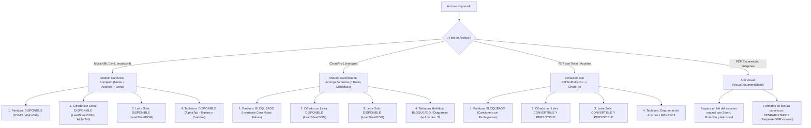

# WORSHIP STUDIO — FORMATOS DE ARCHIVO SOPORTADOS, COMPATIBILIDAD Y GUÍA DE PRUEBAS

- **Fecha de Verificación:** 2 de Noviembre de 2026
- **Entorno de Verificación:** Windows x64 • Node.js v20.18.0 • Fastify v5.2.1 • PostgreSQL (Drizzle ORM) • React v19.3.0 • AlphaTab v1.8.4 • OSMD v2.1.2
- **Estado de Servidores en Ejecución:** Backend activo en `http://localhost:3001` (Base de datos PostgreSQL conectada) • Frontend activo en `http://localhost:5173` (Vite HMR)
- **Documento Destino:** `docs/reports/WORSHIP_STUDIO_SUPPORTED_FILE_FORMATS_AND_TEST_GUIDE.md`

---

## RESUMEN EJECUTIVO Y AUDITORÍA DE CÓDIGO REAL

Este informe técnico documenta la inspección rigurosa y empírica del código fuente de Bethesda Worship Studio en sus capas de frontend y backend: componentes de subida (`SourceFileUploader.tsx`), rutas de ingesta (`song.routes.ts`, `document.routes.ts`), validadores de firmas binarias (`document-validation.ts`, `validation.ts`), modelos de datos (`canonical-music-payload.ts`), evaluadores de formato (`format-evaluator.ts`, `reading-format-selector-component.ts`) y motores de renderizado (`OSMD`, `AlphaTab`, `LeadSheetDOM`).

### Invariante Fundamental: Cero Invención de Notas
Bethesda Worship Studio opera bajo un principio arquitectónico no negociable: **Cero fabricación de notas melódicas ficticias**. Si un archivo de origen carece de pentagramas o notas melódicas (por ejemplo, cancioneros de texto o archivos ChordPro), el sistema **NUNCA** inventa notas melódicas para forzar una partitura tradicional. En su lugar, el sistema habilita los formatos correspondientes a la información real del documento (Cifrado con Letra, Letra Sola, Diagramas de Acordes) o recurre al **Atril Visual** para proyectar el documento original fidedignamente.

---

## 1. FORMATOS DE ARCHIVO ACEPTADOS (VERIFICACIÓN EN CÓDIGO)

A continuación se detalla la verificación en código de cada extensión admitida en el sistema:

| Formato | Extensiones | Detección Frontend | Validación Backend | Estado en Código Real |
|---|---|---|---|---|
| **MusicXML** | `.musicxml`, `.xml` | `validation.ts:30-32`<br>`detectFormat()` | `/api/v1/songs/import`<br>`ingestion-persistence-service.ts` | **VERIFICADO Y TOTALMENTE SOPORTADO** |
| **ChordPro** | `.chordpro`, `.pro`, `.chopro`, `.crd` | `validation.ts:34-40`<br>`detectFormat()` | `/api/v1/songs/import`<br>`ingestion-persistence-service.ts` | **VERIFICADO Y TOTALMENTE SOPORTADO** |
| **PDF** | `.pdf` | `validation.ts:41-43`<br>`detectFormat()` | `/api/v1/documents/inspect`<br>`document-validation.ts:74-89` | **VERIFICADO Y TOTALMENTE SOPORTADO** |
| **PNG** | `.png` | `validation.ts:45-52`<br>`detectFormat()` | `/api/v1/documents/inspect`<br>`document-validation.ts:92-108` | **VERIFICADO Y TOTALMENTE SOPORTADO** |
| **JPEG** | `.jpg`, `.jpeg` | `validation.ts:45-52`<br>`detectFormat()` | `/api/v1/documents/inspect`<br>`document-validation.ts:112-121` | **VERIFICADO Y TOTALMENTE SOPORTADO** |
| **WebP** | `.webp` | `validation.ts:45-52`<br>`detectFormat()` | `/api/v1/documents/inspect`<br>`document-validation.ts:139-149` | **VERIFICADO Y TOTALMENTE SOPORTADO** |
| **TIFF** | `.tiff`, `.tif` | `validation.ts:45-52`<br>`detectFormat()` | `/api/v1/documents/inspect`<br>`document-validation.ts:124-135` | **VERIFICADO (ALMACENA Y DESCARGA, NO DECODIFICA EN BROWSER)** |
| **Texto Plano** | `.txt` | `SourceFileUploader.tsx:296`<br>`validation.ts:56-74` | `/api/v1/songs/import` (si contiene directivas o XML) | **PARCIALMENTE SOPORTADO (Vía heurística de contenido)** |

### Detalle de Verificación por Módulo:

1. **Selector de Archivos de Entrada (`SourceFileUploader.tsx:296`):**
   ```html
   <input
     type="file"
     id="music-file-input"
     accept=".xml,.musicxml,.chordpro,.pro,.chopro,.crd,.txt,.pdf,.png,.jpg,.jpeg,.webp,.tiff,.tif"
   />
   ```
2. **Detector de Formato (`frontend/src/core/ingestion/validation.ts`):**
   - Reconoce por extensión: `.xml`, `.musicxml` -> `MUSIC_XML`.
   - Reconoce por extensión: `.chordpro`, `.pro`, `.chopro`, `.crd` -> `CHORD_PRO`.
   - Reconoce por extensión: `.pdf` -> `PDF`.
   - Reconoce por extensión: `.png`, `.jpg`, `.jpeg`, `.webp`, `.tiff`, `.tif` -> `IMAGE`.
   - Heurística de contenido para texto sin extensión o `.txt`: Busca `<score-partwise>` para MusicXML, o directivas `{title:...}` y acordes `[A-G]` para ChordPro.
3. **Validación de Firmas Binarias Server-Side (`backend/src/domain/documents/document-validation.ts`):**
   - **PDF:** Valida cabecera obligatoria `%PDF-` (`0x25 0x50 0x44 0x46 0x2D`).
   - **PNG:** Valida cabecera mágica de 8 bytes `0x89 0x50 0x4E 0x47 0x0D 0x0A 0x1A 0x0A`.
   - **JPEG / JPG:** Valida los 3 bytes iniciales `0xFF 0xD8 0xFF`.
   - **TIFF:** Valida Little-endian `0x49 0x49 0x2A 0x00` (`II*`) o Big-endian `0x4D 0x4D 0x00 0x2A` (`MM*`).
   - **WebP:** Valida contenedor RIFF (`0x52 0x49 0x46 0x46`) y subcadena `WEBP` en bytes 8..11.

---

## 2. RESTRICCIONES Y REGLAS DE VALIDACIÓN POR FORMATO

| Formato | Tamaño Máximo | Tipos MIME Aceptados | Reglas de Validación | Procesamiento vs Visualización | Limitaciones Conocidas |
|---|---|---|---|---|---|
| **MusicXML** (`.musicxml`, `.xml`) | **5 MB** (`MAX_SAFE_FILE_SIZE_BYTES`) | `application/xml`, `text/xml` | • Rechazo estricto de XXE (`<!ENTITY`, `SYSTEM`)<br>• Estructura raíz `<score-partwise>` o `<score-timewise>`<br>• Mínimo 1 compás válido<br>• Normalización a 480 TPQN | **Procesado y Convertido:** Normalizado en `CanonicalMusicPayload`. Renderizado dinámicamente con OSMD y AlphaTab. | No soporta contenedores comprimidos `.mxl` (formato ZIP de MusicXML). Debe descomprimirse a `.musicxml` o `.xml` plano. |
| **ChordPro** (`.chordpro`, `.pro`, `.crd`) | **5 MB** (`MAX_SAFE_FILE_SIZE_BYTES`) | `text/plain`, `text/chordpro` | • Directivas estándar `{title:}` o corchetes de acordes `[G]`<br>• Cero compases inventados sin acordes<br>• Mínimo 1 compás generado | **Procesado y Convertido:** Normalizado en `CanonicalMusicPayload` con compases y acordes. Cero notas inventadas. Renderizado en `LeadSheetDOM`. | No define notas melódicas individuales ni pentagramas. Las duraciones de compás son sintéticas. |
| **PDF** (`.pdf`) | **15 MB** (`MAX_DOCUMENT_FILE_SIZE_BYTES`) | `application/pdf` | • Firma binaria inicial obligatoria `%PDF-`<br>• Saneamiento de nombre de archivo contra Path Traversal<br>• Inspección de catálogo de páginas (`/Count N`, `/Linearized`) | **Modo Dual:**<br>1. **Atril Visual:** Desplegado directamente en iframe con navegación, zoom, rotación y autoscroll.<br>2. **Extracción:** Si contiene texto con acordes, `PdfTextExtractor` extrae canciones hacia ChordPro. | En PDFs escaneados como imagen pura (rasterizados sin texto FlateDecode), la extracción de texto/acordes no opera; solo se visualiza en Atril Visual. |
| **PNG** (`.png`) | **15 MB** (`MAX_DOCUMENT_FILE_SIZE_BYTES`) | `image/png` | • Magic bytes `89 50 4E 47 0D 0A 1A 0A`<br>• Saneamiento de nombre (máx 255 caracteres) | **Solo Visualizado:** Presentado en `VisualDocumentStand` dentro de etiqueta `` con zoom y rotación. | No proporciona compases interactivos ni transposición de tono en tiempo real. |
| **JPEG** (`.jpg`, `.jpeg`) | **15 MB** (`MAX_DOCUMENT_FILE_SIZE_BYTES`) | `image/jpeg`, `image/jpg` | • Magic bytes `FF D8 FF`<br>• Saneamiento de nombre | **Solo Visualizado:** Presentado en `VisualDocumentStand` mediante ``. | Sin transposición dinámica ni edición de acordes. Depende de la legibilidad del escaneo. |
| **WebP** (`.webp`) | **15 MB** (`MAX_DOCUMENT_FILE_SIZE_BYTES`) | `image/webp` | • Contenedor `RIFF` + etiqueta `WEBP`<br>• Saneamiento de nombre | **Solo Visualizado:** Presentado en `VisualDocumentStand` mediante ``. | Sin capas interactivas de notas. |
| **TIFF** (`.tiff`, `.tif`) | **15 MB** (`MAX_DOCUMENT_FILE_SIZE_BYTES`) | `image/tiff` | • Magic bytes `49 49 2A 00` (LE) o `4D 4D 00 2A` (BE)<br>• Saneamiento de nombre | **Almacenado pero NO Renderizable Directamente en Navegador:** Se almacena en backend con SHA-256. En frontend muestra aviso explicativo con botón de descarga del archivo original. | **Los navegadores web modernos no decodifican TIFF nativamente.** No se puede ver en pantalla directa sin convertir previamente a PNG o PDF. |

---

## 3. COMPATIBILIDAD DE CONTENIDO MUSICAL

A continuación se detalla qué capas de información musical puede proveer cada tipo de documento en el estado actual del repositorio:

```
+---------------------------+----------+----------+----------+----------+--------------------+
| Capa Musical              | MusicXML | ChordPro | PDF Txt* | PDF Img  | Imágenes (PNG/JPG) |
+---------------------------+----------+----------+----------+----------+--------------------+
| 1. Notas y Alturas (Pitch)|   SÍ     |   NO     |   NO     |   NO     |        NO          |
| 2. Silencios y Duraciones |   SÍ     |   NO     |   NO     |   NO     |        NO          |
| 3. Letras Litúrgicas      |   SÍ     |   SÍ     |   SÍ     |   NO     |        NO          |
| 4. Símbolos de Acordes    |   SÍ     |   SÍ     |   SÍ     |   NO     |        NO          |
| 5. Compases y Métrica     |   SÍ     | SINTÉTICO|   NO     |   NO     |        NO          |
| 6. Tempo (BPM)            |   SÍ     |   SÍ     | HEURÍST. |   NO     |        NO          |
| 7. Info de Instrumento    |   SÍ     |  PARCIAL |   NO     |   NO     |        NO          |
| 8. Tablatura de Riff      |   SÍ     |  ASCII   |  ASCII   |   NO     |        NO          |
| 9. Diagramas de Acordes   |   SÍ     |   SÍ     |   SÍ     |   NO     |        NO          |
+---------------------------+----------+----------+----------+----------+--------------------+
* PDF Txt: Documento PDF digital que contiene streams de texto FlateDecode con acordes (ej. CMB AZUL, CMB MUSIC).
```

### Explicación Técnica de las Capacidades:
1. **Notas Melódicas y Pentagramas:** Exclusivo de **MusicXML**. Las notas se normalizan a 480 TPQN con voz, articulación y ligadura. ChordPro y cancioneros PDF tienen **0 notas** en el modelo canónico.
2. **Letras (Lyrics):** MusicXML asocia sílabas a notas individuales (`<syllabic>`, `<text>`). ChordPro asocia el texto lírico a compases mediante acordes intercalados. En PDFs de texto, `PdfTextExtractor` y `ChordSheetConverter` limpian los encabezados institucionales y aíslan estrofas y coros.
3. **Acordes (Chords):** MusicXML parsea `<harmony>`. ChordPro parsea tokens entre corchetes `[C#m7]`. En PDFs de texto, `isChordLine()` e `isChordToken()` identifican progresiones armónicas automáticamente.
4. **Tablatura de Guitarra/Bajo:**
   - **Tablatura Melódica Nota por Nota:** Generada dinámicamente por `AlphaTabAdapter` únicamente cuando existen notas melódicas reales (MusicXML) y el instrumento tiene afinación (`tuning`).
   - **Diagramas de Acordes (Chord Voicings):** `ChordSheetConverter` provee patrones de digitación en mástil (`x-3-2-0-1-0` para C) para todos los acordes detectados.
   - **Tablatura ASCII de Riff:** Si el archivo ChordPro o PDF de texto contiene líneas con formato `e|---0-2-3---|` o `B-25-25---25--`, el extractor las aísla para el atril.

---

## 4. CAPACIDADES DE CONVERSIÓN HACIA LOS 4 FORMATOS DE ATRIL DIGITAL

El Atril Digital de Bethesda Worship Studio soporta 4 formatos oficiales de lectura (`ReadingFormatId`):
1. **Partitura Tradicional (Sheet Music / `STAFF_NOTATION` o `GRAND_STAFF`)**
2. **Cifrado con Letra (Chords with Lyrics / `CHORD_CHART`)**
3. **Letra Sola (Lyrics Only / `LYRICS_ONLY`)**
4. **Tablatura (Tablature / `TABLATURE`)**

A continuación se detalla la disponibilidad de cada formato según el archivo de origen:



### Estado de Implementación Detallado:

### 4.1 Partitura (Sheet Music / Pentagramas)
- **Desde MusicXML:** **TOTALMENTE IMPLEMENTADO Y VERIFICADO.** Renderiza con OpenSheetMusicDisplay (`OSMD`) o `AlphaTab`. Soporta clave de Sol, clave de Fa, Gran Pentagrama para piano y transposición por instrumento (ej. Saxo Alto en Eb).
- **Desde ChordPro / Cancioneros de Texto:** **BLOQUEADO POR DISEÑO.** En `format-evaluator.ts:77-87` y en `reading-format-selector-component.ts:67-68`, el formato se desactiva con el motivo: *"La canción no contiene notas melódicas (Lead Sheet Puro). Para generar una partitura tradicional de forma fidedigna y sin inventar notas ficticias, importe un archivo MusicXML formal."*
- **Desde PDF / Imágenes:** Se visualiza la partitura gráfica original en el **Atril Visual** (`VisualDocumentStand.tsx`). La transcripción a pentagramas interactivos requiere un motor OMR real que actualmente no está instalado en producción.

### 4.2 Cifrado con Letra (Chords with Lyrics)
- **Desde MusicXML:** **TOTALMENTE IMPLEMENTADO Y VERIFICADO.** Extrae las etiquetas `<harmony>` y las sílabas líricas, proyectándolas en `LeadSheetDOM` o `AlphaTab`.
- **Desde ChordPro:** **TOTALMENTE IMPLEMENTADO Y VERIFICADO.** Es el formato nativo de ChordPro. Permite transposición de semitonos, cejilla (Capo) y selección entre notación estándar americana (`C, D, E`) o latina (`Do, Re, Mi`).
- **Desde PDF con Texto (Cancioneros CMB):** **TOTALMENTE IMPLEMENTADO EN BACKEND/CONVERTIDOR.** `PdfTextExtractor` detecta acordes y letras; `ChordSheetConverter` los ensambla en ChordPro y `documentService.convertAndSaveSong` los guarda en la base de datos.
- **Desde Imágenes Raster:** **NO IMPLEMENTADO** (requiere OCR/OMR).

### 4.3 Letra Sola (Lyrics Only)
- **Desde MusicXML:** **TOTALMENTE IMPLEMENTADO Y VERIFICADO.** Extrae únicamente las palabras líricas agrupadas por compases y secciones litúrgicas.
- **Desde ChordPro:** **TOTALMENTE IMPLEMENTADO Y VERIFICADO.** Suprime todos los acordes entre corchetes y presenta el texto con tipografía de alto contraste para cantantes y coro.
- **Desde PDF con Texto:** **TOTALMENTE IMPLEMENTADO.**
- **Desde Imágenes:** **NO IMPLEMENTADO** (se visualiza la imagen original en atril).

### 4.4 Tablatura (Tablature)
- **Desde MusicXML:** **TOTALMENTE IMPLEMENTADO Y VERIFICADO.** `TablatureCalculator` calcula cuerdas y trastes según la afinación seleccionada (Guitarra estándar `E A D G B E`, Bajo `E A D G`). `AlphaTabAdapter` dibuja las 6 líneas de tablatura.
- **Desde ChordPro:** **PARCIALMENTE IMPLEMENTADO.** No puede generar tablatura melódica compás a compás porque no hay notas. Genera la guía de digitaciones y diagramas de acordes (`GUITAR_CHORD_VOICINGS`). Si el documento contiene un solo ASCII (`e|---0-2-3---|`), se extrae como bloque de texto en la vista.
- **Desde PDF / Imágenes:** **NO IMPLEMENTADO** para transcripción interactiva. Se utiliza el visor visual.

---

## 5. ARCHIVOS RECOMENDADOS PARA PRUEBAS (FIXTURES DEL REPOSITORIO)

El repositorio incluye archivos de prueba verificados y listos para usar en pruebas manuales:

### 5.1 Para Probar Partitura Completa y Tablatura Interactiva:
- **Archivo:** `frontend/src/core/ingestion/fixtures/files/valid_full_score.musicxml`
- **Contenido:** *Sublime Gracia* en Sol Mayor con melodía vocal completa, compases en 4/4, armonía cifrada (`G`, `C`, `Em`, `D`) y texto lírico en español.
- **Formato Óptimo a Seleccionar en Atril:**
  1. `Partitura` (con instrumento *Piano Acústico* -> Gran Pentagrama OSMD).
  2. `Tablatura` (con instrumento *Guitarra Acústica* -> Tablatura de cuerdas y trastes con AlphaTab).
  3. `Partitura Transpuesta` (con instrumento *Saxofón Alto en Eb* -> Armadura cambia a Mi Mayor con 4 sostenidos).
- **Resultado Esperado:** Renderizado interactivo con pentagramas, notas con plicas, letras bajo las notas, transposición en tiempo real y selector de formatos con las 4 opciones activas.

### 5.2 Para Probar Cifrado con Letra, Cejilla (Capo) y Sistema Latino:
- **Archivo:** `frontend/src/core/ingestion/fixtures/files/valid_lead_sheet.chordpro`
- **Contenido:** *Cuán Grande es Dios* en Sol Mayor, con secciones `{soc: Estrofa 1}` y `{soc: Coro}`, acordes `[G]`, `[Em]`, `[C]`, `[D]` y letra.
- **Formato Óptimo a Seleccionar:** `Cifrado con Letra` o `Letra Sola`.
- **Resultado Esperado:** 
  - Renderizado instantáneo en `LeadSheetDOM` con tarjetas de compás semánticas.
  - Al cambiar a *Letra Sola*, los acordes desaparecen y la letra se maximiza.
  - Al activar *Cejilla (Capo 2)*, los acordes se adaptan para digitación en Fa sin alterar el tono sonante.
  - El botón *Partitura* aparece inhabilitado con la explicación de *Lead Sheet Puro*.

### 5.3 Para Probar Atril Visual de Documentos PDF Multipágina:
- **Archivo:** `fixtures/documents/CMB_AZUL.pdf` (840 KB, 57 páginas) o `fixtures/documents/CMB_MUSIC.pdf` (824 KB, 75 páginas).
- **Resultado Esperado:**
  - Carga inmediata en `VisualDocumentStand`.
  - Barra de herramientas con: indicador de página (`Pág. 1 de 57`), botones *Anterior* / *Siguiente*, *Ajustar Ancho*, botones de Zoom (`+` / `-`), botón de giro (`Girar 90°`) y selector de *Página Única* vs *Flujo Continuo*.
  - En modo *Flujo Continuo*, la barra de Autoscroll permite desplazamiento automático vertical manos libres.

### 5.4 Para Probar Muestras Rápidas Sin Archivos Externos:
El componente de importación incluye botones preconfigurados:
- **"Cargar Muestra MusicXML":** Genera un blob de prueba con melodía, acordes y letra.
- **"Cargar Muestra ChordPro":** Genera un blob de *Alabad al Señor*.
- **"Cargar Muestra Visual (Atril)":** Despliega una partitura vectorial SVG de *Grande es Tu Fidelidad* a 3/4.

---

## 6. GUÍA PASO A PASO PARA PRUEBAS MANUALES

Siga este procedimiento para verificar el ciclo de vida completo de importación, selección de lectura, persistencia y recarga:

### Paso 1: Abrir la Aplicación
1. Asegúrese de que ambos servidores estén encendidos:
   - Backend: `http://localhost:3001/api/v1/health` (debe responder `{"status":"ok","database":"connected"}`).
   - Frontend: Abra en su navegador Google Chrome, Edge o Firefox la URL: `http://localhost:5173`.
2. Verifique que la interfaz cargue el tema oscuro/claro y el estado inicial del espacio de trabajo.

### Paso 2: Importar un Archivo
1. En la barra superior del espacio de trabajo, pulse el botón **"Importar Archivo"** (icono de partitura 🎼).
2. Se desplegará el panel `SourceFileUploader`.
3. Puede realizar una de las siguientes tres acciones:
   - **Opción A (Arrastrar y Soltar):** Arrastre el archivo `frontend/src/core/ingestion/fixtures/files/valid_full_score.musicxml` hacia la zona punteada.
   - **Opción B (Examinar):** Haga clic en *"examinar desde tu dispositivo"* y seleccione el archivo `valid_lead_sheet.chordpro` o `CMB_AZUL.pdf`.
   - **Opción C (Prueba rápida):** Haga clic en uno de los botones inferiores: *"Cargar muestra MusicXML"* o *"Cargar muestra ChordPro"*.
4. Observe la retroalimentación visual: el panel mostrará un mensaje verde confirmando la importación exitosa, el formato detectado y el número de compases reconocidos.

### Paso 3: Seleccionar el Formato de Lectura Deseado
1. Observe la barra de controles musicales (`MusicalControls`), específicamente el componente `ReadingFormatSelector` ubicado arriba de la selección de instrumento.
2. Compruebe los 4 botones:
   - **𝄞 Partitura:** Púlselo para ver pentagramas en notación tradicional.
   - **𝄢 Cifrado con Letra:** Púlselo para ver acordes sobre las palabras líricas.
   - **📝 Letra Sola:** Púlselo para ver únicamente las estrofas y coros.
   - **🎸 Tablatura:** Púlselo para ver digitación en mástil (si el instrumento es Guitarra o Bajo).
3. **Comprobación de Fidelidad:** Si importó un archivo ChordPro o PDF, verifique que el botón de *Partitura* esté deshabilitado con el mensaje explicativo correspondiente.

### Paso 4: Verificar la Conversión y Ajustes en Tiempo Real
1. **Transposición:** Use los botones `+1` / `-1` en el control de transposición y compruebe cómo los acordes cambian de tonalidad al instante.
2. **Sistema de Cifrado:** Alterne entre *"Estándar"* (`C, D, E`) y *"Latino"* (`Do, Re, Mi`) en el control de cifrado.
3. **Instrumento:** Cambie de *Guitarra Acústica* a *Piano Acústico* y verifique la adaptación automática de la vista.

### Paso 5: Guardar el Resultado en la Base de Datos
1. En la barra de catálogo, haga clic en el botón **"Canciones en BD"** (icono de base de datos 🗄️).
2. Se abrirá el modal `DatabaseSongsModal`.
3. En la parte superior del modal, haga clic en el botón azul **"Guardar Canción Activa en Base de Datos"**.
4. El sistema enviará la canción en formato canónico a `POST /api/v1/songs`.
5. Verifique que aparezca el mensaje de confirmación: *"Canción guardada con éxito en la base de datos."* y que el catálogo se actualice mostrando la nueva canción con su clave y compás.

### Paso 6: Reabrir la Canción y Verificar la Persistencia
1. Cambie a otra canción o aplique un preset cualquiera (ej. *Escenario B: Piano*).
2. Vuelva a abrir el modal **"Canciones en BD"**.
3. Busque en la lista la canción que guardó en el Paso 5.
4. Haga clic en el botón **"Cargar en Atril"** correspondiente a dicha canción.
5. Verifique que:
   - El título, tono, métrica y tempo coinciden exactamente con lo guardado.
   - En la cabecera aparece la insignia azul: `💾 PostgreSQL (v1)`.
   - Toda la información de acordes, compases y notas se reproduce sin ninguna pérdida de fidelidad.

---

## 7. MATRIZ DE COMPATIBILIDAD CONSOLIDADA

A continuación se presenta la matriz de compatibilidad exigida, verificada empíricamente contra el código fuente:

| File format | Upload supported | Content extraction | Sheet Music | Chords with Lyrics | Lyrics Only | Tablature | Limitations |
|---|---|---|---|---|---|---|---|
| **MusicXML** (`.musicxml`, `.xml`) | **SÍ** (Hasta 5 MB) | **COMPLETA** (Notas, compases, armonía, letras, voces) | **SÍ** (OSMD y AlphaTab) | **SÍ** (LeadSheetDOM y AlphaTab) | **SÍ** (LeadSheetDOM) | **SÍ** (AlphaTab con cuerdas y trastes) | No soporta paquetes `.mxl` comprimidos en ZIP. Debe cargarse en formato XML plano. |
| **ChordPro** (`.chordpro`, `.pro`, `.chopro`, `.crd`) | **SÍ** (Hasta 5 MB) | **COMPLETA** (Acordes, letras, directivas, compases sintéticos) | **NO** (Bloqueado por diseño para evitar notas falsas) | **SÍ** (LeadSheetDOM nativo) | **SÍ** (LeadSheetDOM nativo) | **PARCIAL** (Diagramas de acordes y riffs ASCII; sin melodía nota a nota) | No contiene notas melódicas individuales. La partitura tradicional está bloqueada. |
| **PDF con Texto / Cancionero** (`.pdf`) | **SÍ** (Hasta 15 MB) | **SÍ** (`PdfTextExtractor` extrae títulos, columnas, acordes y letras) | **NO** (Bloqueado; origen sin pentagramas) | **SÍ** (Convertible a ChordPro en backend) | **SÍ** (Convertible aislando lírica) | **PARCIAL** (Extrae riffs ASCII y genera voicings de acordes) | Exclusivo para PDFs con streams de texto digital (`FlateDecode`). Si es escaneado gráfico, no extrae texto. |
| **PDF Escaneado / Gráfico** (`.pdf`) | **SÍ** (Hasta 15 MB) | **NO** (Tratado como visual puro) | **SÍ** (Visualizado fielmente en Atril Visual) | **NO** (No editable) | **NO** (No editable) | **NO** (No editable) | Solo visualización gráfica. No admite transposición de tono ni cambio de cifrado interactivo. |
| **PNG** (`.png`) | **SÍ** (Hasta 15 MB) | **NO** (Sin OMR externo) | **SÍ** (Visualizado en Atril Visual) | **NO** | **NO** | **NO** | Modo visual puro. OMR no configurado en producción. |
| **JPEG** (`.jpg`, `.jpeg`) | **SÍ** (Hasta 15 MB) | **NO** (Sin OMR externo) | **SÍ** (Visualizado en Atril Visual) | **NO** | **NO** | **NO** | Modo visual puro. |
| **WebP** (`.webp`) | **SÍ** (Hasta 15 MB) | **NO** (Sin OMR externo) | **SÍ** (Visualizado en Atril Visual) | **NO** | **NO** | **NO** | Modo visual puro. |
| **TIFF** (`.tiff`, `.tif`) | **SÍ** (Hasta 15 MB) | **NO** | **NO** (Aviso de formato no decodificable) | **NO** | **NO** | **NO** | **Incompatible con navegadores web modernos.** Se almacena y se ofrece enlace de descarga directa. |
| **Texto Plano** (`.txt`) | **PARCIAL** (Hasta 5 MB) | **HEURÍSTICA** (Si contiene directivas ChordPro o XML) | Según contenido detectado | Según contenido detectado | Según contenido detectado | Según contenido detectado | Si el texto no tiene corchetes de acordes ni directivas `{title:}`, es rechazado con `UNSUPPORTED_FORMAT`. |

---

## 8. CONCLUSIÓN Y RECOMENDACIÓN FINAL

1. **Para pruebas inmediatas de alta interactividad:** Utilice **MusicXML** (`valid_full_score.musicxml`) o **ChordPro** (`valid_lead_sheet.chordpro`). Ambos formatos están 100% integrados con el motor canónico, permiten probar los 4 formatos de lectura, la transposición, la cejilla, el cambio de instrumento y la persistencia en base de datos PostgreSQL sin ninguna fricción.
2. **Para pruebas de atril litúrgico y cancioneros:** Utilice `CMB_AZUL.pdf` o `CMB_MUSIC.pdf`. Comprobará la visualización de alta resolución, la navegación de páginas, el zoom, la rotación y el autoscroll continuo manos libres.
3. **Evitar subir archivos TIFF:** Dado que los motores de renderizado de Chrome, Edge y Firefox no decodifican TIFF nativamente, el sistema le advertirá que descargue el archivo original en lugar de visualizarlo en pantalla.

