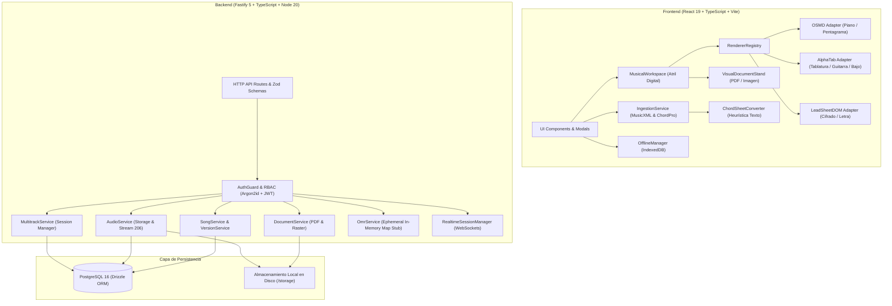

# BETHESDA WORSHIP STUDIO — AUDITORÍA DEL ESTADO ACTUAL DEL SISTEMA
## Fase 0A — Arquitectura Base, Capacidades Verificadas, Análisis de Brechas y Hallazgos Remediados

- **Fecha de Auditoría:** 2 de Noviembre de 2026
- **Estado de la Fase:** FASE 0A — AUDIT REMEDIATION & FINAL ARCHITECTURE VALIDATION (READ-ONLY)
- **Autor:** Principal Software Architect, Senior Music Technology Engineer & DevSecOps Engineer
- **Repositorio Auditado:** `https://github.com/juancastro2381-hub/BETHESDA-WORSHIP-STUDIO.git`
- **Compilación de Referencia:** Node.js v20.18.0 • Fastify v5.2.1 • PostgreSQL 16 (Drizzle ORM v0.39.3) • React v19.3.0 • AlphaTab v1.8.4 • OSMD v2.1.2

---

## 1. RESUMEN EJECUTIVO DEL ESTADO ACTUAL

Bethesda Worship Studio es una plataforma web full-stack diseñada para la gestión litúrgica, visualización musical en atril digital y streaming de audio en vivo. Posee una base sólida y madura en:
- **Modelo Musical Canónico:** Representación centralizada a 480 TPQN (`CanonicalMusicPayload`).
- **Seguridad y Control de Acceso:** RBAC con 5 roles, autenticación JWT con rotación de tokens de refresco, hashing Argon2id y auditoría transaccional.
- **Visualización en Atril Digital:** Adaptadores de renderizado integrados para OpenSheetMusicDisplay (`OSMD`), `AlphaTab`, `LeadSheetDOM` y visor de documentos (`VisualDocumentStand`).
- **Gestión Litúrgica y Offline:** Setlists, momentos litúrgicos, sincronización en tiempo real vía WebSockets y almacenamiento local en IndexedDB.

### Hallazgos Críticos de la Auditoría Independiente (F-01 a F-09)
1. **Ausencia Total de Motor OMR Real (F-01):** `StandardOmrProvider` es un *stub* estructural. En producción arroja error no disponible o retorna 0 compases. No existe binario de Audiveris ni Calamari vinculado.
2. **Efimeridad de Propuestas OMR (F-02):** `OmrService` almacena propuestas en memoria RAM (`this.proposals = new Map()`). No existe tabla de OMR en PostgreSQL; cualquier reinicio del servidor destruye permanentemente las propuestas.
3. **Ausencia de Cola de Procesamiento Asíncrono (F-03):** Fastify ejecuta todo de forma síncrona dentro del ciclo de vida de la petición HTTP. No existe Redis ni BullMQ. Tareas de IA bloquearán el bucle de eventos o causarán timeouts 504.
4. **Anomalías de Higiene en Git (F-08):** El índice de Git rastrea **7,367 archivos dentro de `backend/node_modules/`** y **más de 140 archivos binarios en `backend/storage/`** (archivos `.wav`, `.mp3` y `.pdf`), inflando el repositorio e introduciendo riesgos de fuga de datos.
5. **Modelo Canónico v1.0.0 sin Metadatos de Confianza ni Proveniencia (F-07):** El modelo canónico actual no soporta puntuaciones de confianza por nota/compás ni mapas de tiempo para sincronización MIDI/Audio.
6. **Módulos de Audio de Solo Almacenamiento (F-05):** `AudioService` almacena y transmite audio mediante HTTP 206. No existe separación de pistas (stems), transcripción de audio a MIDI ni extracción de tonalidad/acordes.

---

## 2. ARQUITECTURA EXISTENTE: COMPONENTES Y CAPAS



### 2.1 Frontend (`@bethesda/frontend`)
- **Arquitectura de Estado:** Hooks de composición (`useMusicalWorkspace`, `useSetlistExecution`, `useOffline`, `useAutoscroll`, `useRealtimeFlow`, `useAuth`, `useTheme`).
- **Modelo Canónico:** Implementado en `src/core/canonical-model/`. Modela compases (`Measure`), eventos (`Note`, `Rest`, `Voice`), armonía (`ChordEvent`), lírica (`LyricSyllable`), armaduras (`KeySignatureReference`), compás de tiempo (`TimeSignature`), pistas de instrumento (`InstrumentTrack`) y mapa de tempo (`Timeline`).
- **Renderizado Musical:** `RendererRegistry` selecciona el motor óptimo:
  - `OSMD`: Gran Pentagrama de piano y notación estándar de viento/voces.
  - `AlphaTab`: Notación en pentagrama, tablatura de 4 a 6 cuerdas con afinaciones reales, y diagramas de acordes.
  - `LeadSheetDOM`: Renderizado ligero en HTML semántico para voz principal y cifrado.
  - `VisualDocumentStand`: Iframe encapsulado para PDFs multipágina e imágenes con autoscroll y zoom.
- **Ingesta en Cliente:** `IngestionService` detecta extensiones y contenido, delegando a `MusicXmlImporter` o `ChordProImporter`.

### 2.2 Backend (`@bethesda/backend`)
- **Framework:** Fastify v5.2.1 estructurado en Clean Architecture / Puertos y Adaptadores.
- **Rutas HTTP RESTful:**
  - `/api/v1/auth`: Login, logout, refresh, recuperación de contraseña, invitaciones.
  - `/api/v1/songs`: Catálogo de canciones, versiones inmutables, importación estructurada.
  - `/api/v1/documents`: Inspección de firmas binarias, tickets de visualización, almacenamiento y extracción de texto de cancioneros.
  - `/api/v1/audio`: Subida de archivos de audio (hasta 50 MB), validación de magic bytes, emisión de tickets de streaming con TTL (60s), soporte HTTP Range (RFC 7233).
  - `/api/v1/multitrack`: Sesiones multipista que agrupan stems ya subidos.
  - `/api/v1/setlists`: Listas de alabanza litúrgica con momentos de servicio y transiciones.
  - `/api/v1/realtime`: Sincronización en vivo del atril entre músicos.
- **Persistencia (PostgreSQL + Drizzle ORM):**
  - Enfoque híbrido relacional + JSONB: La tabla `song_versions` contiene la columna `canonical_payload` con el árbol canónico serializado.

---

## 3. AUDITORÍA DETALLADA DE CAPACIDADES DE ENTRADA Y ARCHIVOS

| Formato / Extensión | Tipo MIME Declarado | Límite de Tamaño | Validación en Código | Implementación Real de Procesamiento | ¿Convertible a Datos Musicales Editables? |
|---|---|---|---|---|---|
| **MusicXML** (`.musicxml`, `.xml`) | `application/xml`, `text/xml` | **5 MB** | Sintaxis XML, rechazo de XXE (`<!ENTITY`, `SYSTEM`), raíz `<score-partwise>` o `<score-timewise>`, mínimo 1 compás. | Normalizado a 480 TPQN en `CanonicalMusicPayload`. Extrae notas, silencios, armonía, letras, compases y claves. | **SÍ (Totalmente editable y proyectable en los 4 formatos).** |
| **Compressed MusicXML** (`.mxl`) | `application/vnd.recordare.musicxml+xml` | N/A | **Rechazado.** No soportado por el descompresor XML. | Ninguna. Lanza `UNSUPPORTED_FORMAT`. | **NO.** Requiere extracción previa de ZIP a `.xml`. |
| **ChordPro** (`.chordpro`, `.pro`, `.crd`) | `text/plain`, `text/chordpro` | **5 MB** | Directivas estándar `{title:}` o corchetes de acordes `[G]`. Mínimo 1 compás sintético. | Parsea acordes, letras y directivas. Respeta invariante estricto: 0 notas melódicas inventadas. | **SÍ (Editable para Cifrado con Letra, Letra Sola y Diagramas de Acordes).** |
| **PDF con Texto Digital** (`.pdf`) | `application/pdf` | **15 MB** | Magic bytes `%PDF-`, saneamiento de nombre de archivo. | `PdfTextExtractor` descomprime streams FlateDecode, agrupa coordenadas Tm/Td en renglones, detecta columnas y acordes, y genera ChordPro. | **SÍ (Convertible a Cifrado con Letra y Letra Sola; Partitura bloqueada por ausencia de pentagramas).** |
| **PDF Escaneado / Raster** (`.pdf`) | `application/pdf` | **15 MB** | Magic bytes `%PDF-`, inspección de catálogo de páginas. | Proyectado en `VisualDocumentStand` dentro de `<iframe>` con control de zoom, rotación y autoscroll continuo. | **NO (Modo solo visual en atril digital).** |
| **Imágenes Raster** (`.png`, `.jpg`, `.jpeg`, `.webp`) | `image/png`, `image/jpeg`, `image/webp` | **15 MB** | Firmas binarias estrictas en backend (PNG: `89 50 4E 47...`, JPEG: `FF D8 FF`, WebP: `RIFF...WEBP`). | Proyectado en `VisualDocumentStand` mediante etiqueta ``. | **NO (Modo solo visual).** |
| **TIFF** (`.tiff`, `.tif`) | `image/tiff` | **15 MB** | Magic bytes `II*` (LE) o `MM*` (BE). | Almacenado físicamente con SHA-256. En frontend muestra advertencia explicativa con enlace de descarga. | **NO (Los navegadores web modernos no decodifican TIFF nativamente).** |
| **Audio** (`.mp3`, `.wav`, `.m4a`, `.flac`, `.ogg`, `.webm`) | `audio/mpeg`, `audio/wav`, `audio/mp4`, `audio/flac`, `audio/ogg`, `audio/webm` | **50 MB** | Magic bytes específicos por códec (ID3/Sync para MP3, RIFF/WAVE para WAV, ftyp para M4A, fLaC para FLAC, OggS para OGG). | Almacenado en disco `/storage/audio/`, streaming con HTTP 206 Partial Content y tickets temporales de 60s. | **NO (No existe pipeline de transcripción de audio a MIDI ni extracción de notas).** |
| **Video y URLs Externas** (MP4, YouTube, Vimeo) | N/A | N/A | **No implementado.** | Ninguna. | **NO.** |
| **Archivos MIDI** (`.mid`, `.midi`) | `audio/midi` | N/A | **No implementado.** | Ninguna. No existe parser ni sintetizador MIDI en la base de código. | **NO.** |

---

## 4. AUDITORÍA DEL SUBSISTEMA OMR Y HALLAZGOS F-01 / F-02

### 4.1 Principios Implementados en Código:
1. **Propuesta Preliminar Obligatoria:** Toda salida del OMR se etiqueta con `isAiDraft: true` y `reviewStatus: 'PENDING_REVIEW'`.
2. **Revisión Humana Mandatoria:** La ruta `/api/v1/multitrack/omr/:proposalId/review` requiere aprobación explícita antes de persistir en el catálogo litúrgico.
3. **Cero Invención de Notas:** En `StandardOmrProvider.recognize()` (líneas 207-232):
   ```typescript
   // En producción o sin motor real:
   // CERO invención de compases, notas o confianzas simuladas. Retornar estado explícito no disponible (R1-A).
   return {
     proposalId,
     sourceFilename: input.filename,
     sourceHash: hash,
     detectedTitle: null,
     overallConfidence: 0.0,
     isAiDraft: true,
     reviewStatus: 'PENDING_REVIEW',
     measures: [], // CERO notas inventadas
     unrecognizedRegions: [
       { page: 1, reason: 'Motor de reconocimiento OMR no configurado en este servidor...' }
     ]
   };
   ```

### 4.2 Hallazgos Críticos Confirmados:
- **F-01 (Falta de Motor OMR):** No existe Audiveris, Calamari ni Oemer instalado ni enlazado. En producción siempre retorna 0 compases.
- **F-02 (Efimeridad de Propuestas OMR):** En `backend/src/application/omr-service.ts`:
  ```typescript
  export class OmrService {
    private proposals: Map<string, OmrProposal> = new Map();
  ```
  Las propuestas viven en la memoria heap del proceso Node.js. Al reiniciar el servidor o escalar horizontalmente, todas las propuestas pendientes se pierden.

---

## 5. AUDITORÍA DEL SUBSISTEMA DE AUDIO Y MULTIPISTAS (F-05)

### 5.1 Capacidades Verificadas en Código:
- **Almacenamiento Confiable:** `LocalFileSystemAudioStorageProvider` gestiona archivos de hasta 50 MB con comprobación criptográfica SHA-256.
- **Streaming Seguro con Cuotas y TTL:** `StreamTicketService` emite tickets criptográficos temporales de 60 segundos con límite de 25 peticiones para elementos multimedia `<iframe>` y `<audio>`, previniendo exposición de tokens Bearer en URLs de medios.
- **Soporte Estricto de HTTP 206 Range:** Permite búsqueda inmediata (*seeking*) en reproductores de audio HTML5.
- **Sesiones Multipista (Stems):** `MultitrackService` agrupa pistas de audio preexistentes, validando que todas pertenezcan a la misma canción (prevención de IDOR) y configurando volumen, balance y desfase temporal (`offsetMs`).

### 5.2 Brechas Críticas en el Dominio de Audio:
1. **Cero Transcripción Audio-to-MIDI:** No existe código para convertir frecuencias de audio en eventos de nota MIDI.
2. **Cero Reconocimiento de Acordes o Tonalidad desde Audio:** No hay extracción de cromas ni análisis armónico.
3. **Cero Separación de Fuentes (Stem Separation):** El sistema asume que el usuario sube los stems ya separados individualmente; no posee algoritmos de demultiplexación (Demucs, Spleeter).
4. **Cero Transcripción de Letras (Speech-to-Text):** No hay modelos como Whisper ni alineación forzada de fonemas.

---

## 6. AUDITORÍA DE HIGIENE DE REPOSITORIO Y GIT (F-08)

La inspección con `git ls-files` reveló serias anomalías en el índice de Git:
1. **7,367 archivos rastreados en `backend/node_modules/`:** Fueron confirmados previamente y nunca desindexados con `git rm --cached`. Inflan el tiempo de clonación y provocan ensuciamiento espurio del árbol en Windows (`CRLF`).
2. **140+ archivos binarios rastreados en `backend/storage/`:** Archivos `.wav`, `.mp3` y `.pdf` subidos durante pruebas locales quedaron registrados en Git debido a la omisión de `backend/storage/` en `backend/.gitignore`.
3. **Plan de Remediación F-08:** Elaborado en `docs/reports/WS_AI_MUSIC_PLATFORM_GIT_HYGIENE_REMEDIATION_PLAN.md` para ejecutar `git rm --cached` de forma segura tras la aprobación del Product Owner.

---

## 7. MATRIZ CONSOLIDADA DE BRECHAS FRENTE AL OBJETIVO SONGCRIPTION+

| Capacidad Requerida | Estado Actual en Código | Brecha / Hallazgo Asociado |
|---|---|---|
| **Subida de Archivos de Audio** | **IMPLEMENTADO** | Soporta hasta 50 MB (MP3, WAV, FLAC, OGG, M4A). |
| **Reproductor de Audio en Atril** | **IMPLEMENTADO** | `AudioPlayerBar.tsx` con soporte de streaming 206 y offline. |
| **Separación de Pistas (Stems)** | **FALTANTE** | Requiere HTDemucs aislado (F-04, F-05). |
| **Audio-to-MIDI Polifónico** | **FALTANTE** | Requiere Basic Pitch precedido de stem separation (F-05). |
| **Detección de Melodía y Bajo** | **FALTANTE** | Requiere canalización por stem (voz a melodía, bajo a monofónico). |
| **Detección de Acordes y Tempo** | **FALTANTE** | Requiere Madmom / NNLS Chroma alineado a la grilla de compases. |
| **Transcripción de Letras (ASR)** | **FALTANTE** | Requiere WhisperX sobre el stem aislado de voz. |
| **Motor OMR de Partituras** | **STUB / CONTRATO** | F-01: Audiveris como microservicio aislado; Tesseract para acordes OCR. |
| **Persistencia de Propuestas OMR** | **EFÍMERO (RAM)** | F-02: Requiere esquema PostgreSQL durable (`omr_proposals`). |
| **Colas de Procesamiento Asíncrono** | **FALTANTE** | F-03: Fastify opera síncrono; requiere cola PostgreSQL en Fase 1A. |
| **Almacenamiento de Objetos en Nube** | **DISCO LOCAL** | F-09: Reemplazar MinIO (AGPL) por abstracción S3 / Cloudflare R2. |
| **Editor Interactivo de Notación** | **FALTANTE** | El atril actual es de solo lectura. |
| **Modelo Canónico Extendido** | **v1.0.0** | F-07: Requiere migración a v2.0.0 con campos de confianza y MIDI. |

---

## 8. CONCLUSIÓN Y DICTAMEN DE LA AUDITORÍA FASE 0A

Bethesda Worship Studio cuenta con una arquitectura base de nivel profesional en su frontend de atril digital, su modelo canónico inicial y su backend Fastify. Sin embargo, carece de infraestructura de ejecución para IA y arrastra deudas operativas en persistencia de OMR y control de versiones de Git.

Los hallazgos F-01 a F-09 han sido plenamente demostrados con evidencia de código y cuentan con un plan de remediación riguroso y técnicamente defendible para su implementación controlada en la Fase 1A.
