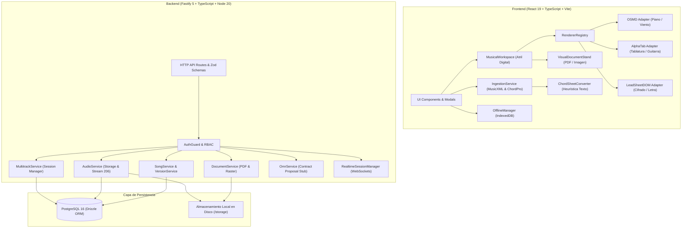

# BETHESDA WORSHIP STUDIO — AUDITORÍA DEL ESTADO ACTUAL DEL SISTEMA
## Fase 0 — Arquitectura Base, Capacidades Verificadas y Análisis de Brechas

- **Fecha de Auditoría:** 2 de Noviembre de 2026
- **Estado de la Fase:** FASE 0 — STRICTLY READ-ONLY ARCHITECTURAL ASSESSMENT
- **Autor:** Principal Software Architect & Senior Music Technology Engineer
- **Repositorio Auditado:** `https://github.com/juancastro2381-hub/BETHESDA-WORSHIP-STUDIO.git`
- **Compilación de Referencia:** Node.js v20.18.0 • Fastify v5.2.1 • PostgreSQL 16 (Drizzle ORM v0.39.3) • React v19.3.0 • AlphaTab v1.8.4 • OSMD v2.1.2

---

## 1. RESUMEN EJECUTIVO DEL ESTADO ACTUAL

Bethesda Worship Studio es una plataforma web full-stack diseñada para la gestión litúrgica, visualización musical en atril digital y reproducción de audio en vivo. Posee una base sólida y madura en:
- **Modelo Musical Canónico:** Representación centralizada a 480 TPQN (`CanonicalMusicPayload`).
- **Seguridad y Control de Acceso:** RBAC con 5 roles, autenticación JWT con rotación de tokens de refresco, hashing Argon2id y auditoría transaccional.
- **Visualización en Atril Digital:** Adaptadores de renderizado integrados para OpenSheetMusicDisplay (`OSMD`), `AlphaTab`, `LeadSheetDOM` y visor de documentos (`VisualDocumentStand`).
- **Gestión Litúrgica y Offline:** Setlists, momentos litúrgicos, sincronización en tiempo real vía WebSockets y almacenamiento local en IndexedDB.

### Hallazgo Central de la Auditoría de IA
**Actualmente NO existe ningún motor de Inteligencia Artificial ni aprendizaje automático integrado funcionalmente en el código fuente.**
- Los módulos de **OMR** (`omr-service.ts`, `omr-provider.ts`) representan una arquitectura de contratos y propuestas humanas (`isAiDraft: true`), pero en producción retornan 0 compases debido a que no existe ningún ejecutable ni servicio de OMR vinculado.
- Los módulos de **Audio** (`audio-service.ts`, `multitrack-service.ts`) operan exclusivamente como gestores de almacenamiento, metadatos y streaming con soporte HTTP Range 206. **No existe transcripción de audio a MIDI, no existe extracción de melodía, no existe reconocimiento de acordes desde audio, no existe separación de pistas (stems) y no existe transcripción de lírica mediante habla.**

---

## 2. ARQUITECTURA EXISTENTE: COMPONENTES Y CAPAS



### 2.1 Frontend (`@bethesda/frontend`)
- **Arquitectura de Estado:** Hooks de composición (`useMusicalWorkspace`, `useSetlistExecution`, `useOffline`, `useAutoscroll`, `useRealtimeFlow`, `useAuth`, `useTheme`).
- **Modelo Canónico:** Implementado en `src/core/canonical-model/`. Modela compases (`Measure`), eventos (`Note`, `Rest`, `Voice`), armonía (`ChordEvent`), lírica (`LyricSyllable`), armaduras (`KeySignatureReference`), compás de tiempo (`TimeSignature`), pistas de instrumento (`InstrumentTrack`) y mapa de tempo (`Timeline`).
- **Renderizado Musical:** `RendererRegistry` selecciona el motor óptimo:
  - `OSMD`: Gran Pentagrama de piano y notación estándar de viento/voces.
  - `AlphaTab`: Notación en pentagrama, tablatura de 4 a 6 cuerdas con afinaciones reales, y diagramas de acordes.
  - `LeadSheetDOM`: Renderizado ligero en HTML semántico para voz principal y cifrado.
  - `VisualDocumentStand`: Iframe encapsulado para PDFs multipágina e imágenes con autoscroll y zoom.
- **Ingesta en Cliente:** `IngestionService` detecta extensiones y contenido, delegando a `MusicXmlImporter` o `ChordProImporter`.

### 2.2 Backend (`@bethesda/backend`)
- **Framework:** Fastify v5.2.1 estructurado en Clean Architecture / Puertos y Adaptadores.
- **Rutas HTTP RESTful:**
  - `/api/v1/auth`: Login, logout, refresh, recuperación de contraseña, invitaciones.
  - `/api/v1/songs`: Catálogo de canciones, versiones inmutables, importación estructurada.
  - `/api/v1/documents`: Inspección de firmas binarias, tickets de visualización, almacenamiento y extracción de texto de cancioneros.
  - `/api/v1/audio`: Subida de archivos de audio (hasta 50 MB), validación de magic bytes, emisión de tickets de streaming con TTL (60s), soporte HTTP Range (RFC 7233).
  - `/api/v1/multitrack`: Sesiones multipista que agrupan stems ya subidos.
  - `/api/v1/setlists`: Listas de alabanza litúrgica con momentos de servicio y transiciones.
  - `/api/v1/realtime`: Sincronización en vivo del atril entre músicos.
- **Persistencia (PostgreSQL + Drizzle ORM):**
  - Enfoque híbrido relacional + JSONB: La tabla `song_versions` contiene la columna `canonical_payload` con el árbol canónico serializado.

---

## 3. AUDITORÍA DETALLADA DE CAPACIDADES DE ENTRADA Y ARCHIVOS

| Formato / Extensión | Tipo MIME Declarado | Límite de Tamaño | Validación en Código | Implementación Real de Procesamiento | ¿Convertible a Datos Musicales Editables? |
|---|---|---|---|---|---|
| **MusicXML** (`.musicxml`, `.xml`) | `application/xml`, `text/xml` | **5 MB** | Sintaxis XML, rechazo de XXE (`<!ENTITY`, `SYSTEM`), raíz `<score-partwise>` o `<score-timewise>`, mínimo 1 compás. | Normalizado a 480 TPQN en `CanonicalMusicPayload`. Extrae notas, silencios, armonía, letras, compases y claves. | **SÍ (Totalmente editable y proyectable en los 4 formatos).** |
| **Compressed MusicXML** (`.mxl`) | `application/vnd.recordare.musicxml+xml` | N/A | **Rechazado.** No soportado por el descompresor XML. | Ninguna. Lanza `UNSUPPORTED_FORMAT`. | **NO.** Requiere extracción previa de ZIP a `.xml`. |
| **ChordPro** (`.chordpro`, `.pro`, `.crd`) | `text/plain`, `text/chordpro` | **5 MB** | Directivas estándar `{title:}` o corchetes de acordes `[G]`. Mínimo 1 compás sintético. | Parsea acordes, letras y directivas. Respeta invariante estricto: 0 notas melódicas inventadas. | **SÍ (Editable para Cifrado con Letra, Letra Sola y Diagramas de Acordes).** |
| **PDF con Texto Digital** (`.pdf`) | `application/pdf` | **15 MB** | Magic bytes `%PDF-`, saneamiento de nombre de archivo. | `PdfTextExtractor` descomprime streams FlateDecode, agrupa coordenadas Tm/Td en renglones, detecta columnas y acordes, y genera ChordPro. | **SÍ (Convertible a Cifrado con Letra y Letra Sola; Partitura bloqueada por ausencia de pentagramas).** |
| **PDF Escaneado / Raster** (`.pdf`) | `application/pdf` | **15 MB** | Magic bytes `%PDF-`, inspección de catálogo de páginas. | Proyectado en `VisualDocumentStand` dentro de `<iframe>` con control de zoom, rotación y autoscroll continuo. | **NO (Modo solo visual en atril digital).** |
| **Imágenes Raster** (`.png`, `.jpg`, `.jpeg`, `.webp`) | `image/png`, `image/jpeg`, `image/webp` | **15 MB** | Firmas binarias estrictas en backend (PNG: `89 50 4E 47...`, JPEG: `FF D8 FF`, WebP: `RIFF...WEBP`). | Proyectado en `VisualDocumentStand` mediante etiqueta ``. | **NO (Modo solo visual).** |
| **TIFF** (`.tiff`, `.tif`) | `image/tiff` | **15 MB** | Magic bytes `II*` (LE) o `MM*` (BE). | Almacenado físicamente con SHA-256. En frontend muestra advertencia explicativa con enlace de descarga. | **NO (Los navegadores web modernos no decodifican TIFF nativamente).** |
| **Audio** (`.mp3`, `.wav`, `.m4a`, `.flac`, `.ogg`, `.webm`) | `audio/mpeg`, `audio/wav`, `audio/mp4`, `audio/flac`, `audio/ogg`, `audio/webm` | **50 MB** | Magic bytes específicos por códec (ID3/Sync para MP3, RIFF/WAVE para WAV, ftyp para M4A, fLaC para FLAC, OggS para OGG). | Almacenado en disco `/storage/audio/`, streaming con HTTP 206 Partial Content y tickets temporales de 60s. | **NO (No existe pipeline de transcripción de audio a MIDI ni extracción de notas).** |
| **Video y URLs Externas** (MP4, YouTube, Vimeo) | N/A | N/A | **No implementado.** | Ninguna. | **NO.** |
| **Archivos MIDI** (`.mid`, `.midi`) | `audio/midi` | N/A | **No implementado.** | Ninguna. No existe parser ni sintetizador MIDI en la base de código. | **NO.** |

---

## 4. AUDITORÍA DEL SUBSISTEMA OMR (OPTICAL MUSIC RECOGNITION)

El subsistema OMR fue diseñado en la Fase 3C bajo un modelo de contratos en `backend/src/domain/omr/` y `backend/src/application/omr-service.ts`:

### 4.1 Principios Implementados en Código:
1. **Propuesta Preliminar Obligatoria:** Toda salida del OMR se etiqueta con `isAiDraft: true` y `reviewStatus: 'PENDING_REVIEW'`.
2. **Revisión Humana Mandatoria:** La ruta `/api/v1/multitrack/omr/:proposalId/review` requiere aprobación explícita de un usuario con rol autorizado antes de poder persistir en el catálogo.
3. **Cero Invención de Notas:** En `StandardOmrProvider.recognize()` (líneas 207-232):
   ```typescript
   // En producción o sin motor real:
   // CERO invención de compases, notas o confianzas simuladas. Retornar estado explícito no disponible (R1-A).
   return {
     proposalId,
     sourceFilename: input.filename,
     sourceHash: hash,
     detectedTitle: null,
     overallConfidence: 0.0,
     isAiDraft: true,
     reviewStatus: 'PENDING_REVIEW',
     measures: [], // CERO notas inventadas
     unrecognizedRegions: [
       { page: 1, reason: 'Motor de reconocimiento OMR no configurado en este servidor...' }
     ]
   };
   ```

### 4.2 Brecha Identificada:
No existe un motor OMR real (como Audiveris, Calamari u Oemer) instalado ni enlazado mediante proceso secundario, CLI o API remota. El código pasa las pruebas unitarias únicamente cuando se activa explícitamente la bandera `enableTestFixture: true` en el entorno de testing.

---

## 5. AUDITORÍA DEL SUBSISTEMA DE AUDIO Y MULTIPISTAS

### 5.1 Capacidades Verificadas en Código:
- **Almacenamiento Confiable:** `LocalFileSystemAudioStorageProvider` gestiona archivos de hasta 50 MB con comprobación criptográfica SHA-256.
- **Streaming Seguro con Cuotas y TTL:** `StreamTicketService` emite tickets criptográficos temporales de 60 segundos con límite de 25 peticiones para elementos multimedia `<iframe>` y `<audio>`, previniendo exposición de tokens Bearer en URLs de medios.
- **Soporte Estricto de HTTP 206 Range:** Permite búsqueda inmediata (*seeking*) en reproductores de audio HTML5.
- **Sesiones Multipista (Stems):** `MultitrackService` agrupa pistas de audio preexistentes, validando que todas pertenezcan a la misma canción (prevención de IDOR) y configurando volumen, balance y desfase temporal (`offsetMs`).

### 5.2 Brechas Críticas en el Dominio de Audio:
1. **Cero Transcripción Audio-to-MIDI:** No existe código para convertir frecuencias de audio en eventos de nota MIDI.
2. **Cero Reconocimiento de Acordes o Tonalidad desde Audio:** No hay extracción de cromas ni análisis armónico.
3. **Cero Separación de Fuentes (Stem Separation):** El sistema asume que el usuario sube los stems ya separados individualmente; no posee algoritmos de demultiplexación (Demucs, Spleeter).
4. **Cero Transcripción de Letras (Speech-to-Text):** No hay modelos como Whisper ni alineación forzada de fonemas.

---

## 6. MATRIZ DE BRECHAS TÉCNICAS (GAP ANALYSIS) FRENTE AL OBJETIVO SONGCRIPTION+

| Capacidad Requerida | Estado en Bethesda Worship Studio | Brecha Técnica Específica |
|---|---|---|
| **Subida de Archivos de Audio** | **IMPLEMENTADO** | Soporta hasta 50 MB (MP3, WAV, FLAC, OGG, M4A). |
| **Reproductor de Audio en Atril** | **IMPLEMENTADO** | `AudioPlayerBar.tsx` con soporte de streaming 206 y offline. |
| **Separación de Pistas (Stems)** | **FALTANTE** | No hay integración de modelos tipo Demucs v4. |
| **Audio-to-MIDI (Polifónico)** | **FALTANTE** | No hay integración de modelos tipo Basic Pitch / MT3. |
| **Detección de Melodía Vocal** | **FALTANTE** | No hay estimación de pitch f0 (CREPE, pyin, etc.). |
| **Detección de Acordes desde Audio** | **FALTANTE** | No hay extractor de acordes (BTC, Chordino). |
| **Detección de Ritmo y Tempo (BPM)** | **FALTANTE** | No hay detector de beats ni mapa de tempo desde audio (Madmom). |
| **Transcripción de Letras desde Voz** | **FALTANTE** | No hay integración de Whisper / WhisperX. |
| **Alineación Sílaba-Nota** | **FALTANTE** | No hay alineación forzada fonema-tiempo (wav2vec2 aligner). |
| **Reconocimiento OMR de Partituras** | **STUB / CONTRATO** | Estructura de propuestas presente; motor OMR ausente. |
| **Entrada de Enlaces de Video (YouTube)** | **FALTANTE** | No hay soporte para URLs externas ni descarga de flujos. |
| **Grabación de Audio Directa** | **FALTANTE** | No hay captura desde micrófono vía `MediaRecorder` API. |
| **Captura de Partitura con Cámara** | **FALTANTE** | No hay acceso a `navigator.mediaDevices.getUserMedia` para escaneo fotográfico. |
| **Importación de Archivos MIDI** | **FALTANTE** | No hay parser ni serializador MIDI. |
| **Importación de MusicXML Comprimido (.mxl)** | **FALTANTE** | Solo se acepta `.musicxml` y `.xml` descomprimido. |
| **Editor Interactivo de Notación Musical** | **FALTANTE** | El atril es de solo lectura; no hay manipulación de notas con ratón/teclado. |
| **Editor de Cifrado y Letra** | **PARCIAL** | Existe modal asistido de conversión (`DocumentConversionModal`), pero no edición interactiva en el atril. |
| **Colas de Procesamiento Asíncrono** | **FALTANTE** | Todo el backend opera síncronamente; no hay Redis ni BullMQ para trabajos pesados de IA. |

---

## 7. CONCLUSIÓN DE LA AUDITORÍA

La arquitectura actual de Bethesda Worship Studio es sólida en su modelo canónico, su capa de persistencia y su atril de lectura interactiva, pero se encuentra completamente desacoplada de capacidades de IA activa. Para transformar el producto en una plataforma inteligente de transcripción musical comparable y superior a SongScription, se requiere:
1. Diseñar una arquitectura de microservicios asíncronos para tareas intensivas de cómputo (GPU/CPU).
2. Integrar motores probados de código abierto con licencias comerciales permisivas para transcripción, OMR y separación.
3. Extender el modelo canónico con campos de confianza, trazabilidad de IA y puente MIDI.
4. Desarrollar una interfaz de corrección e inspección humana antes de la consolidación de arreglos en el catálogo litúrgico.

