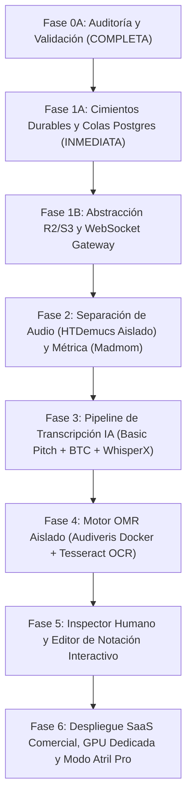
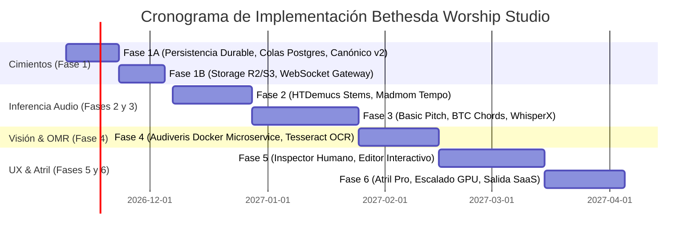

# BETHESDA WORSHIP STUDIO — PLAN DE IMPLEMENTACIÓN Y ROADMAP DE FASES
## Hoja de Ruta Remediada: De los Cimientos de Persistencia a la Plataforma de IA

- **Fecha:** 2 de Noviembre de 2026
- **Estado:** FASE 0A — AUDIT REMEDIATION & FINAL ARCHITECTURE VALIDATION (READ-ONLY)
- **Autor:** Technical Product Lead, Principal Software Architect & DevSecOps Engineer
- **Documento:** `docs/reports/WS_AI_MUSIC_PLATFORM_IMPLEMENTATION_ROADMAP.md`

---

## 1. ESTRUCTURA Y METODOLOGÍA DEL ROADMAP REMEDIADO

Para garantizar la estabilidad operativa del sistema litúrgico existente en Bethesda Worship Studio y responder con rigor a los hallazgos de la auditoría independiente (F-01 a F-09), la implementación se estructura en **fases secuenciales, desacopladas y no disruptivas**.

### Principio Fundamental de Fase 1A: Cero Cambios Disruptivos
Antes de desplegar costosos clústeres de GPUs o añadir dependencias de infraestructura como Redis, es imperativo corregir las deficiencias de persistencia y cola detectadas en el código base actual (`omr-service.ts` efímero, Fastify 100% síncrono, almacenamiento local sin abstracción).

---

## 2. DESGLOSE DETALLADO DE FASES

---

### FASE 1A: CIMIENTOS DE PERSISTENCIA DURABLE, COLA TRANSACCIONAL Y MODELO CANÓNICO v2.0
> **ESTADO: FASE TÉCNICA PRIORITARIA E INMEDIATA TRAS APROBACIÓN DE FASE 0A**

- **Objetivo:** Resolver definitivamente la pérdida de estado de propuestas OMR (F-02), la ausencia de colas asíncronas en Fastify (F-03) y la evolución del modelo canónico (F-07) utilizando exclusivamente PostgreSQL sin añadir servicios externos complejos.
- **Criterios de Entrada:**
  - Aprobación formal del informe de remediación Fase 0A por el Product Owner.
  - Base de código actual estable con suite de pruebas pasando (`npm run test`).
  - Autorización de ejecución del plan de higiene de Git (F-08).
- **Entregables Concretos:**
  1. **Migración de Persistencia OMR Durable (F-02):**
     - Tablas PostgreSQL: `omr_proposals`, `omr_proposal_measures` y `omr_audit_history`.
     - Refactorización de `OmrService` para abandonar el `Map` en memoria RAM e interactuar con la base de datos mediante Drizzle ORM.
  2. **Cola de Tareas Asíncronas en PostgreSQL (F-03):**
     - Tabla `background_jobs` (`id`, `job_type`, `status`, `payload`, `attempts`, `locked_at`, `locked_by`, `scheduled_at`, `created_at`).
     - Despachador transaccional con semántica `FOR UPDATE SKIP LOCKED`.
     - Manejo de reintentos con *exponential backoff* y registro de fallos en base de datos.
  3. **Especificación e Implementación de `CanonicalMusicPayloadV2` (F-07):**
     - Esquemas Zod y tipos TypeScript para v2.0.0 (confianza por elemento, proveniencia, instrumentos, pistas y marcas temporales MIDI).
     - Funciones de conversión bidireccionales con pruebas de regresión automatizadas: `migrateV1ToV2()` y `downgradeV2ToV1()`.
  4. **Garantía de No Ruptura:**
     - Las rutas existentes de Fastify y los visualizadores de frontend (OSMD, AlphaTab, LeadSheetDOM) continúan operando sin modificaciones visibles.
- **Definition of Done (DoD) para Fase 1A:**
  - [ ] Esquema Drizzle ejecutado y probado mediante migración reversible en PostgreSQL.
  - [ ] Al reiniciar el backend, las propuestas OMR registradas persisten intactas con su estado (`PENDING_REVIEW`).
  - [ ] Una tarea encolada en `background_jobs` es tomada de forma exclusiva por un worker transaccional sin colisión de bloqueos.
  - [ ] 100% de cobertura en tests unitarios para conversión y degradación de `CanonicalMusicPayload` v1 ↔ v2.
  - [ ] Cero regresiones en la suite de pruebas existente del backend y frontend.
- **Estimación:** 2 semanas.

---

### FASE 1B: ABSTRACCIÓN DE ALMACENAMIENTO EN LA NUBE Y MONITOREO DE PROGRESO
- **Objetivo:** Desacoplar el almacenamiento de archivos del disco local hacia S3/Cloudflare R2 (F-09) y proveer retroalimentación en tiempo real de tareas largas mediante WebSockets.
- **Entregables:**
  1. **Interfaz `StorageProvider` (F-09):** Implementación con `@aws-sdk/client-s3` (Apache 2.0). Soporte para Cloudflare R2 (cero egress) en producción y adaptador de disco local en tests/dev.
  2. **Streaming Seguro Actualizado:** `StreamTicketService` actualizado para generar URLs firmadas temporales compatibles con S3/R2.
  3. **Gateway de Notificación WebSocket:** Emisión reactiva de eventos de progreso (`JOB_PROGRESS: 0%..100%`, `JOB_FAILED`, `JOB_READY`) hacia el cliente.
  4. **Componente de Progreso en Frontend:** Notificación no bloqueante en la interfaz de usuario de Bethesda.
- **Estimación:** 1.5 a 2 semanas.

---

### FASE 2: SEPARACIÓN DE AUDIO (HTDEMUCS AISLADO) Y ANÁLISIS MÉTRICO (MADMOM)
- **Objetivo:** Incorporar la capacidad de descomponer audio estéreo en 4 pistas independientes (Voz, Batería, Bajo, Instrumental) y detectar el tempo/métrica automáticamente respetando el licenciamiento (F-04, F-05).
- **Entregables:**
  1. **Microservicio Worker Python:** Contenedor Docker autónomo con PyTorch y `HTDemucs v4`.
  2. **Pipeline de Métrica:** Integración de `Madmom` para detección de BPM y compás canónico (downbeats 4/4, 3/4, 6/8).
  3. **Almacenamiento de Stems en R2:** Guardado de las 4 pistas WAV de alta fidelidad.
  4. **Controles de Audio en Frontend:** Actualización de `AudioPlayerBar` para mute/solo por stem durante la práctica litúrgica.
- **Estimación:** 3 semanas.

---

### FASE 3: PIPELINE DE TRANSCRIPCIÓN IA (AUDIO-TO-SCORE)
- **Objetivo:** Convertir stems de audio en notas MIDI limpias, acordes litúrgicos y letras sincronizadas mediante modelos del estado del arte.
- **Entregables:**
  1. **Worker de Melodía y Bajo:** `Spotify Basic Pitch` (Apache 2.0) ejecutado exclusivamente sobre stems aislados para evitar artefactos armónicos (F-05).
  2. **Worker de Acordes:** `BTC Transformer` sobre el stem instrumental con detección de acordes suspendidos e inversiones.
  3. **Worker de Letras y Fonemas:** `WhisperX` sobre el stem de voz con marcas temporales milimétricas por palabra y sílaba.
  4. **Sintetizador Canónico:** Fusión determinista a 480 TPQN en `CanonicalMusicPayloadV2`.
- **Estimación:** 4 semanas.

---

### FASE 4: MOTOR OMR PROFESIONAL Y CAPTURA FOTOGRÁFICA / SCAN
- **Objetivo:** Dotar a la plataforma de reconocimiento óptico de partituras impresas y cancioneros mediante microservicios legalmente desacoplados (F-01, F-04).
- **Entregables:**
  1. **Microservicio Docker Audiveris:** Contenedor aislado de red con JVM headless exportando MusicXML 4.0 mediante API REST interna.
  2. **Pipeline OCR de Texto y Acordes:** `Tesseract OCR` para reconocimiento de cifrados y letras en documentos PDF escaneados sin pentagramas.
  3. **Captura Fotográfica Web:** Acceso a la cámara del dispositivo móvil/tablet con corrección de perspectiva y contraste antes del envío al servidor.
- **Estimación:** 3 a 4 semanas.

---

### FASE 5: INSPECTOR HUMANO (HUMAN-IN-THE-LOOP) Y EDITOR DE NOTACIÓN
- **Objetivo:** Brindar a los directores de alabanza una interfaz ergonómica para validar y corregir propuestas generadas por IA antes de su publicación oficial en el atril.
- **Entregables:**
  1. **Inspector Visual de Confianza:** Resaltado cromático de notas y compases con confianza inferior al umbral configurable (ej. < 0.75).
  2. **Editor Rápido de Acordes:** Selección y modificación de cifrado con sugerencias armónicas litúrgicas.
  3. **Edición Básica de Notación:** Ajuste de alturas y duraciones sobre pentagrama reactivo.
  4. **Flujo de Aprobación Formal:** Transición atómica de `omr_proposals` a versión canónica inmutable en el catálogo.
- **Estimación:** 4 semanas.

---

### FASE 6: ATRIL AVANZADO, DESPLIEGUE SAAS Y OPTIMIZACIÓN DE GPU
- **Objetivo:** Consolidar la experiencia en vivo, optimizar la capacidad de cómputo GPU y habilitar la comercialización SaaS.
- **Entregables:**
  1. **Modo Rendimiento Atril:** Bloqueo de suspensión de pantalla (`Wake Lock API`), metrónomo visual/auditivo sincronizado y cambio de canción en vivo vía WebSocket.
  2. **Orquestación de GPU Híbrida:** Despliegue serverless (Modal/RunPod) con migración a instancia dedicada reservada según el modelo de capacidad (F-06).
  3. **Gobernanza y Cuotas:** Gestión de cuotas de transcripción por iglesia, auditoría de licencias y cumplimiento CCLI.
- **Estimación:** 3 semanas.

---

## 3. RESUMEN DE TIEMPOS Y DEPENDENCIAS

---

## 4. DICTAMEN DE AUTORIZACIÓN PARA FASE 1A

La Fase 1A representa una intervención de bajo riesgo y alto beneficio arquitectónico:
- No introduce nuevas dependencias de infraestructura (opera 100% sobre PostgreSQL).
- Elimina los fallos de pérdida de datos en propuestas OMR detectados en la auditoría.
- Sienta las bases para que las fases posteriores de IA se conecten de manera asíncrona, robusta y limpia.

**Recomendación:** Autorizar de inmediato la Fase 1A una vez firmado el informe de remediación de la Fase 0A.
