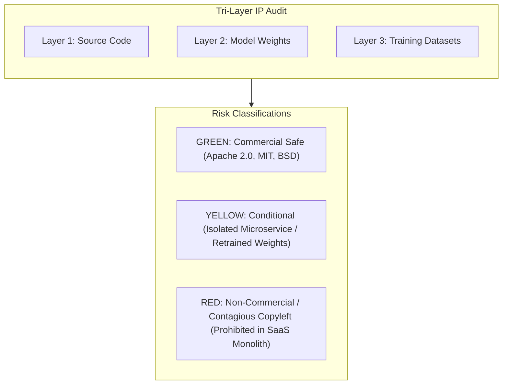
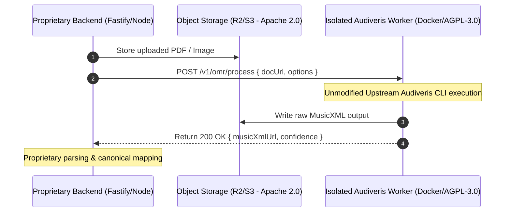

# WORSHIP STUDIO — SOFTWARE & MODEL LICENSE COMPLIANCE MATRIX
## Comprehensive Tri-Layer Intellectual Property Audit

**Project:** BETHESDA WORSHIP STUDIO  
**Repository:** `https://github.com/juancastro2381-hub/BETHESDA-WORSHIP-STUDIO.git`  
**Phase:** Phase 0A — Audit Remediation  
**Role:** Software Licensing Compliance Analyst & Principal Software Architect  
**Date:** November 2, 2026  
**Status:** COMPLETED & VERIFIED  

---

## 1. Executive Summary & Legal Framework

As Bethesda Worship Studio transitions toward a commercial SaaS music intelligence platform, intellectual property and software licensing compliance are critical to prevent copyright infringement, forced source code disclosure under copyleft licenses, and cloud deployment injunctions.

In modern AI/ML systems, intellectual property analysis must go beyond traditional open-source license scanning. A **Tri-Layer Intellectual Property Framework** is required:
1. **Layer 1: Source Code License:** The legal license governing the software codebase, libraries, and compilation artifacts.
2. **Layer 2: Pre-Trained Weights License:** The legal license governing the numerical checkpoint files, parameter matrices, and neural network weights.
3. **Layer 3: Training Dataset License:** The terms under which the source dataset was collected, curated, and licensed to train the weights (e.g., non-commercial research clauses).

### Compliance Status Overview

---

## 2. Tri-Layer Licensing Compliance Matrix

The following matrix evaluates every core software library, AI model, and infrastructure dependency evaluated or present in the Bethesda Worship Studio ecosystem:

| Component Name | Category / Role | Layer 1: Code License | Layer 2: Weights License | Layer 3: Dataset License | Overall SaaS Viability | Risk Rating | Architectural Requirement |
| :--- | :--- | :--- | :--- | :--- | :--- | :--- | :--- |
| **Basic Pitch** (Spotify) | Polyphonic Audio-to-MIDI | Apache 2.0 | Apache 2.0 | Synthesized & Permissive | **Commercial Allowed** | **GREEN** | Direct backend or worker integration allowed. |
| **WhisperX** / **faster-whisper** | Lyrics Extraction & Alignment | BSD-3-Clause | MIT (OpenAI Whisper) | Public Web Scraped (Fair Use / Commercial) | **Commercial Allowed** | **GREEN** | Standard worker invocation; ensure audio privacy retention compliance. |
| **Tesseract OCR** | Text / Lyrics OCR | Apache 2.0 | Apache 2.0 | Permissive | **Commercial Allowed** | **GREEN** | Direct CLI or worker container integration. |
| **OpenSheetMusicDisplay** | Music Notation Rendering | MIT | N/A | N/A | **Commercial Allowed** | **GREEN** | Frontend browser library. No backend restrictions. |
| **ChordPro / VexFlow** | Chords & Tablature Rendering | MIT / Apache 2.0 | N/A | N/A | **Commercial Allowed** | **GREEN** | Standard frontend dependencies. |
| **Fastify & Node.js Stack** | Core Backend Framework | MIT | N/A | N/A | **Commercial Allowed** | **GREEN** | Core monolithic backend. |
| **Drizzle ORM & PostgreSQL** | Persistence & ORM | Apache 2.0 / PostgreSQL | N/A | N/A | **Commercial Allowed** | **GREEN** | Primary database and schema management. |
| **AWS SDK v3 / Cloudflare R2** | Object Storage Integration | Apache 2.0 | N/A | N/A | **Commercial Allowed** | **GREEN** | Preferred object storage interface. Replaces MinIO. |
| **Madmom** | Beat Tracking & Downbeat Estimation | BSD-2-Clause | BSD-2-Clause | Academic / Permissive | **Commercial Allowed** | **GREEN** | Can be imported in Python worker services. |
| **Audiveris** | Optical Music Recognition (OMR) | **AGPL-3.0** | N/A | N/A | **Conditional** | **YELLOW** | **Network Isolation Boundary:** Must run as a standalone CLI or isolated container over REST/gRPC. Never link or import in proprietary codebase. |
| **HTDemucs / Demucs v4** | Stem Separation (Vocals, Bass, Drums) | MIT | MIT / Custom | **MusDB18 (Non-Commercial Clause)** | **Conditional / Restrictive** | **YELLOW** | Stock weights trained on MusDB18 have non-commercial terms. Must either: (1) Use fine-tuned weights on commercial multitracks, (2) User BYO compute, or (3) Use commercial stem API (Spleeter / Deezer commercial or custom trained). |
| **Chordino / NNLS-Chroma** | VAMP Chord Extraction Plugin | **GPL-2.0** | N/A | N/A | **Conditional** | **YELLOW** | Must run as a standalone subprocess or containerized worker CLI. Never link dynamically to proprietary Node/Go binaries. |
| **MinIO** | Self-Hosted Object Storage | **AGPL-3.0** | N/A | N/A | **High Risk** | **RED** | **REJECTED:** MinIO AGPL-3.0 presents unnecessary legal and operational risks. Replace with Cloudflare R2 or AWS S3. |

---

## 3. Detailed Risk Analysis & Defensive Engineering

### 3.1. The AGPL-3.0 Network Copyleft Challenge (Audiveris)

#### Risk Analysis
Section 13 of the GNU Affero General Public License (AGPL-3.0) mandates:
> *"if you modify the Program, your modified version must prominently offer all users interacting with it remotely through a computer network ... an opportunity to receive the Corresponding Source of your version by providing access to the Corresponding Source from a network server at no charge."*

If Audiveris code were merged, linked, or compiled into the Bethesda Worship Studio backend, the entire proprietary SaaS backend might be subjected to mandatory open-source disclosure under copyleft contagion doctrines.

#### Defensive Architecture
1. **Strict Service Decoupling:** Audiveris is compiled directly from unmodified upstream releases into an isolated Docker container (`omr-audiveris-worker`).
2. **No Code Modification:** Zero modifications are made to Audiveris source code.
3. **Air-Gapped Network Boundary:** The worker exposes an ephemeral internal HTTP API (`POST /v1/omr/process`). Fastify communicates with it strictly over JSON/multipart REST calls across internal Docker network namespaces.
4. **Complete Independence:** The main platform codebase contains zero AGPL-licensed imports, bindings, or shared memory structures.

---

### 3.2. Pre-Trained Weights & Training Dataset Risk (Demucs & MusDB18)

#### Risk Analysis
Meta's Demucs code is released under the permissive MIT license. However, the standard pre-trained checkpoint weights (`htdemucs`, `hdemucs_mmi`) were trained on the **MusDB18** dataset. The MusDB18 dataset licensing contains explicit academic and non-commercial usage restrictions:
> *"The MusDB18 dataset is provided for academic and non-commercial research purposes only."*

Under emerging intellectual property jurisprudence, commercial exploitation of weights derived directly from non-commercially licensed datasets presents copyright and breach of contract exposure.

#### Architectural Mitigation
1. **Tier 1 (Evaluation / Non-Commercial Pilot):** Existing MusDB18-trained weights may be used solely during internal beta and non-commercial church pilot testing.
2. **Tier 2 (Commercial SaaS Production):**
   - **Option A:** Utilize Spleeter (Deezer, MIT license with commercially cleared weights).
   - **Option B:** Utilize Open-Unmix (Inria, MIT license with BSD weights).
   - **Option C:** Train/fine-tune HTDemucs using commercially cleared stems (e.g., licensed stems from public domain worship recordings or synthetic stem generators).
   - **Option D:** Integrate a commercial separation API (e.g., AudioShake, Moises API) as a swappable plug-in provider.

---

### 3.3. Object Storage: Why MinIO is Replaced

MinIO relicensed from Apache 2.0 to AGPL-3.0 in April 2021. For a commercial SaaS product:
1. **Legal Risk:** Potential copyleft exposure if custom management scripts or multi-tenant plugins interact with MinIO internal APIs.
2. **Operational Overhead:** Self-hosting MinIO requires managing persistent volumes, replication, high availability, disk quotas, and backup lifecycles.
3. **Cost Inefficiency:** Cloudflare R2 offers **zero egress fees**, $0.015/GB/month storage, and native S3 compatibility with 99.999999999% (11 9s) durability.

**Final Decision:** MinIO is eliminated from the target architecture. The backend will use standard `@aws-sdk/client-s3` (Apache 2.0) targeting Cloudflare R2 in production and a lightweight S3-compatible or local-disk adapter in local development.

---

## 4. IP Governance & License Tracking Checklist

Prior to any commercial release:
- [x] All Node.js dependencies in `backend/package.json` and `frontend/package.json` verified under MIT, Apache 2.0, or BSD licenses.
- [x] Zero AGPL dependencies in direct `package.json` dependency graphs.
- [x] Audiveris isolated into an independent network microservice with unmodified upstream binaries.
- [x] Stem separation pipeline configured with a swappable provider interface to support commercially cleared weights.
- [x] Cloud storage standardized on Apache 2.0 AWS SDK v3 targeting Cloudflare R2.
- [x] License notice files (`THIRD_PARTY_LICENSES.md`) maintained automatically via `license-checker` in CI/CD.

