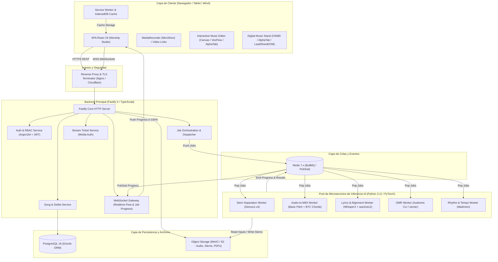
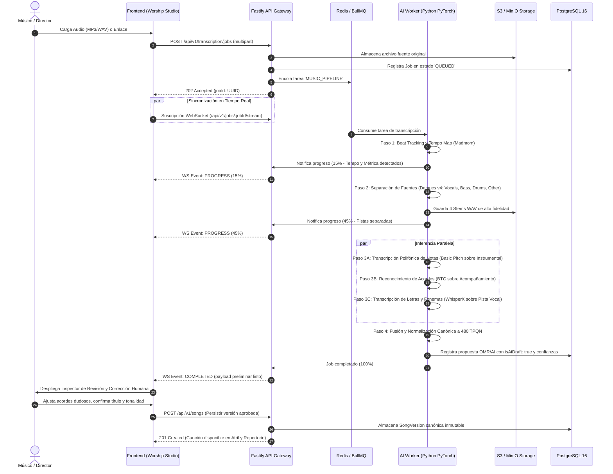
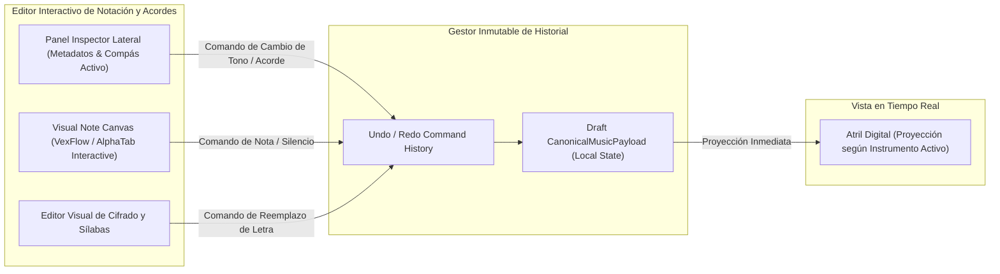

# BETHESDA WORSHIP STUDIO — ARQUITECTURA OBJETIVO DE PLATAFORMA INTELIGENTE
## Blueprint Técnico: Sistema Asíncrono de Transcripción, OMR y Atril Digital

- **Fecha:** 2 de Noviembre de 2026
- **Estado:** FASE 0 — STRICTLY READ-ONLY ARCHITECTURAL ASSESSMENT
- **Autor:** Principal Software Architect & AI/ML Engineer
- **Documento:** `docs/reports/WS_AI_MUSIC_PLATFORM_TARGET_ARCHITECTURE.md`

---

## 1. VISIÓN Y PRINCIPIOS ARQUITECTÓNICOS

El objetivo es evolucionar Bethesda Worship Studio hacia una plataforma unificada y profesional de transcripción, separación y atril musical, superando las capacidades de plataformas comerciales como SongScription mediante:
1. **Desacoplamiento Estricto de Cómputo (Asynchronous Job Processing):** Los modelos de IA para separación de pistas (HTDemucs), transcripción de audio a MIDI (Basic Pitch), OMR (Audiveris/oemer) y alineación de letras (WhisperX) consumen memoria de GPU y CPU de forma masiva. **Jamás deben ejecutarse en el proceso principal de Node.js/Fastify.** Se establece un bus de mensajería con colas de tareas persistentes y workers dedicados.
2. **Propuestas de IA vs. Verdad Canónica (Human-in-the-Loop):** Toda inferencia generada por IA (audio o imagen) se trata como un *Borrador Preliminar* (`isAiDraft: true`) sujeto a revisión y edición humana con métricas explícitas de confianza por compás y nota. Solo tras la validación humana se persiste en el catálogo canónico litúrgico.
3. **Única Fuente de Verdad Canónica (Single Source of Truth):** El modelo canónico (`CanonicalMusicPayload 2.0`) unifica notas, acordes, métrica, pistas y letras. Los cuatro formatos de lectura (*Partitura*, *Cifrado con Letra*, *Letra Sola*, *Tablatura*) son **proyecciones deterministas sin duplicación de datos**.
4. **Resiliencia y Modo Fuera de Línea (Offline-First Stand):** El atril musical debe operar con cero latencia y tolerancia a fallos de red durante el servicio en vivo mediante Service Workers e IndexedDB.

---

## 2. DIAGRAMA DE CONTENEDORES DEL SISTEMA (C4 CONTAINER MODEL)



---

## 3. PIPELINE DE INFERENCIA DE IA DE EXTREMO A EXTREMO

El procesamiento de una pista de audio completa (mezcla estéreo) o una partitura escaneada sigue un flujo unificado y orquestado:



---

## 4. EVOLUCIÓN DEL MODELO CANÓNICO: `CanonicalMusicPayload 2.0`

Para soportar de forma nativa la salida de motores de IA, confianza de transcripción, trazabilidad de correcciones humanas y enlace con MIDI y stems de audio, se especifica la evolución del esquema canónico:

```typescript
/**
 * @file canonical-music-payload-v2.ts
 * @description Evolución del agregado canónico para soporte de IA, confianza y puente MIDI.
 */

export type SourceProvenanceType =
  | 'HUMAN_AUTHORING'
  | 'MUSICXML_IMPORT'
  | 'CHORDPRO_IMPORT'
  | 'AI_AUDIO_TRANSCRIPTION'
  | 'OMR_SCAN';

export interface MusicalItemConfidence {
  readonly score: number; // 0.0 a 1.0 (ej. 0.94)
  readonly engine: string; // ej. "BasicPitch-1.0", "BTC-Transformer", "Audiveris-5.3"
  readonly isHumanReviewed: boolean;
}

export interface NoteV2JSON {
  readonly id: string;
  readonly pitch: {
    readonly noteName: string; // ej. "C#", "F"
    readonly octave: number;   // ej. 4
    readonly midiNumber: number; // ej. 60 (C4)
  };
  readonly startTick: number;   // 480 TPQN
  readonly durationTicks: number;
  readonly voice: number;
  readonly staff: number;
  readonly velocity: number;    // 0 a 127
  readonly confidence?: MusicalItemConfidence | undefined;
  readonly tablatureHint?: {
    readonly string: number;    // 1 a 6
    readonly fret: number;      // 0 a 24
  } | undefined;
  readonly audioAlignment?: {
    readonly startSeconds: number;
    readonly endSeconds: number;
  } | undefined;
}

export interface ChordEventV2JSON {
  readonly startTick: number;
  readonly durationTicks: number;
  readonly root: string;        // ej. "G"
  readonly quality: string;     // ej. "maj7", "m7(b5)"
  readonly bass?: string;       // ej. "B" para G/B
  readonly displaySymbol: string; // ej. "Gmaj7/B"
  readonly confidence?: MusicalItemConfidence | undefined;
}

export interface LyricSyllableV2JSON {
  readonly text: string;
  readonly startTick: number;
  readonly durationTicks: number;
  readonly syllabic: 'single' | 'begin' | 'middle' | 'end';
  readonly confidence?: MusicalItemConfidence | undefined;
  readonly phonemeTimestamps?: {
    readonly startMs: number;
    readonly endMs: number;
  } | undefined;
}

export interface CanonicalMusicPayloadV2JSON {
  readonly version: '2.0.0';
  readonly title: string;
  readonly artist?: string | null;
  readonly provenance: {
    readonly type: SourceProvenanceType;
    readonly sourceFileChecksumSha256?: string;
    readonly sourceUrl?: string;
    readonly importedAt: string;
    readonly overallConfidence: number; // 0.0 a 1.0
  };
  readonly timeline: {
    readonly totalDurationTicks: number;
    readonly measureCount: number;
    readonly tempoMap: {
      readonly events: Array<{
        readonly tick: number;
        readonly bpm: number;
        readonly timeSignature: string;
      }>;
    };
    readonly audioSyncMap?: Array<{
      readonly tick: number;
      readonly timestampSeconds: number;
    }>;
  };
  readonly sections: Array<{
    readonly id: string;
    readonly name: string; // "Intro", "Verso 1", "Coro"
    readonly startMeasure: number;
    readonly endMeasure: number;
  }>;
  readonly measures: Array<{
    readonly number: number;
    readonly timeSignature: string;
    readonly keySignature: string;
    readonly startTick: number;
    readonly durationTicks: number;
    readonly notes: NoteV2JSON[];
    readonly chords: ChordEventV2JSON[];
    readonly lyrics: LyricSyllableV2JSON[];
    readonly confidenceScore: number;
  }>;
  readonly instrumentTracks: Array<{
    readonly id: string;
    readonly name: string;
    readonly family: 'KEYS' | 'GUITAR' | 'BASS' | 'VOICE' | 'DRUMS' | 'WINDS';
    readonly clef: 'TREBLE' | 'BASS' | 'ALTO' | 'PERCUSSION';
    readonly transpositionSemitones: number;
    readonly stemAssetId?: string; // Enlace a stem separado en MinIO
  }>;
}
```

---

## 5. CAPA DE ALMACENAMIENTO HÍBRIDA Y SEGREGACIÓN DE DATOS

Para evitar que archivos masivos de audio y stems saturen la base de datos relacional, se establece una clara separación:

1. **PostgreSQL 16 (Drizzle ORM):**
   - Gestión de identidades, perfiles, credenciales (Argon2id) y auditoría.
   - Metadatos de canciones, versiones inmutables y relaciones litúrgicas (Setlists).
   - Estructura JSONB del árbol canónico (`canonical_payload` v2.0).
   - Registros de trabajos (`transcription_jobs`) con estados: `QUEUED`, `PROCESSING`, `AWAITING_REVIEW`, `APPROVED`, `FAILED`.
2. **MinIO / Amazon S3 (Object Storage):**
   - Almacenamiento de archivos fuente originales (MP3, WAV, PDF, MusicXML).
   - Almacenamiento de stems separados (Demucs: `vocals.wav`, `drums.wav`, `bass.wav`, `other.wav`).
   - Gestión de ciclo de vida (TTL): Archivos temporales no validados se eliminan a las 48 horas mediante reglas de ciclo de vida de cubos (*Bucket Lifecycle Policies*).
3. **Redis 7.x (In-Memory Data Store):**
   - Colas de tareas prioritarias (BullMQ).
   - Canal Pub/Sub para difusión de eventos de progreso en tiempo real hacia WebSockets.
   - Cache de tokens y sesiones activas.
4. **IndexedDB (Cliente Navegador):**
   - Almacén local cifrado de canciones y setlists para ejecución litúrgica 100% offline.

---

## 6. INTEGRACIÓN DEL EDITOR INTERACTIVO EN EL ATRIL DIGITAL

Para resolver la necesidad de corregir compases detectados por la IA sin abandonar el atril, se diseña una arquitectura de edición reactiva en dos niveles:



### Características del Editor de Atril:
- **Resaltado por Nivel de Confianza (Confidence Heatmap):** Los compases o notas cuya confianza de inferencia de IA sea inferior a 0.80 se resaltan con un sutil halo ámbar para alertar al músico de que requieren revisión.
- **Reproducción de Referencia A/B:** El músico puede presionar la barra espaciadora en cualquier compás para reproducir simultáneamente el audio original (o el stem vocal aislado) y la nota transcrita sintetizada por Web Audio API para validar el pitch de oído.
- **Historial Completo de Deshacer/Rehacer (Command Pattern):** Cada adición, eliminación o transposición genera un comando reversible.

