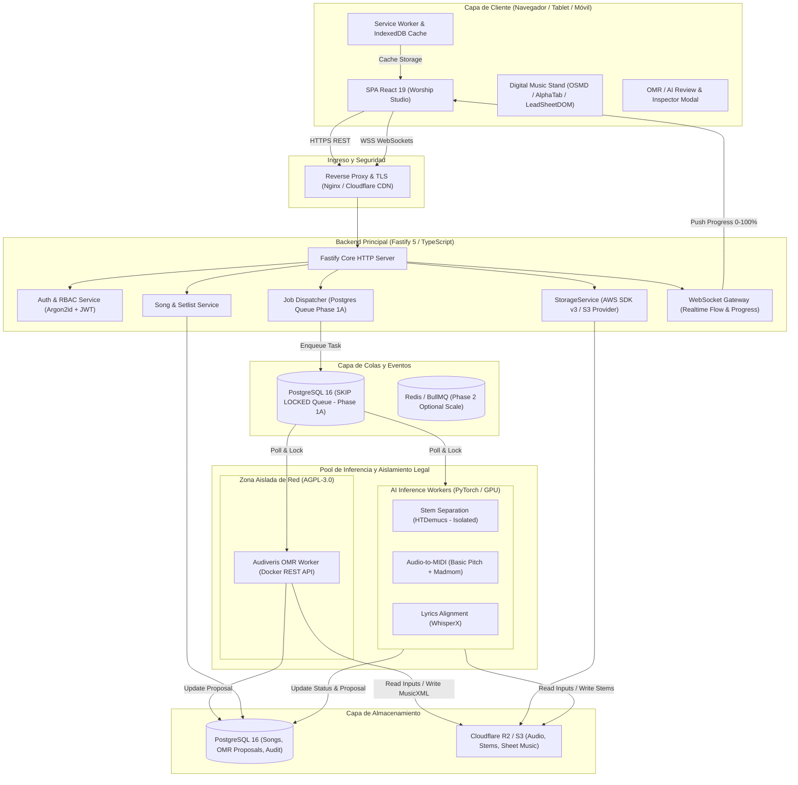
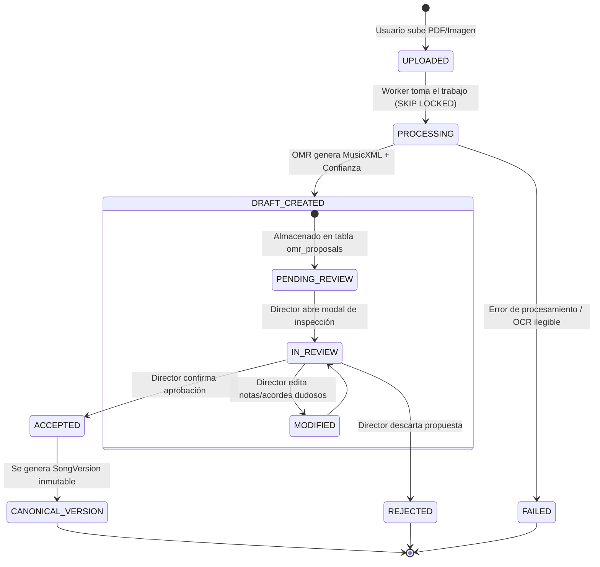

# BETHESDA WORSHIP STUDIO — ARQUITECTURA OBJETIVO DE PLATAFORMA INTELIGENTE
## Blueprint Técnico Remediado: Sistema Asíncrono de Transcripción, OMR y Atril Digital

- **Fecha:** 2 de Noviembre de 2026
- **Estado:** FASE 0A — AUDIT REMEDIATION & FINAL ARCHITECTURE VALIDATION (READ-ONLY)
- **Autor:** Principal Software Architect, AI/ML Infrastructure Architect & DevSecOps Engineer
- **Documento:** `docs/reports/WS_AI_MUSIC_PLATFORM_TARGET_ARCHITECTURE.md`

---

## 1. VISIÓN Y PRINCIPIOS ARQUITECTÓNICOS REMEDIADOS

El objetivo es evolucionar Bethesda Worship Studio hacia una plataforma unificada y profesional de transcripción, separación y atril musical, superando las capacidades de plataformas comerciales como SongScription mediante:

1. **Desacoplamiento Estricto de Cómputo (Asynchronous Job Processing):** Los modelos de IA para separación de pistas (HTDemucs), transcripción de audio a MIDI (Basic Pitch), OMR (Audiveris) y alineación de letras (WhisperX) consumen memoria de GPU y CPU de forma masiva. **Jamás se ejecutan en el proceso principal de Node.js/Fastify.**
   - **Fase 1A:** Cola transaccional ligera nativa en PostgreSQL con semántica `FOR UPDATE SKIP LOCKED`. Cero dependencias externas adicionales de infraestructura.
   - **Fase 2:** Migración controlada a BullMQ sobre Redis/Dragonfly al superar 10 trabajos/minuto concurrentes.
2. **Propuestas de IA vs. Verdad Canónica (Human-in-the-Loop y Persistencia Durable - F-02):** Toda inferencia generada por IA (audio o imagen) se persiste de forma durable en PostgreSQL (`omr_proposals`) como un *Borrador Preliminar* (`isAiDraft: true`) con métricas explícitas de confianza por compás y nota. Se erradica por completo el almacenamiento efímero en memoria RAM.
3. **Almacenamiento de Objetos Seguro y sin Egress (F-09):** Se sustituye MinIO (licencia AGPL-3.0 y sobrecosto de administración) por una interfaz agnóstica `StorageProvider` (`@aws-sdk/client-s3`, Apache 2.0) apuntando a **Cloudflare R2** en producción (cero costos de transferencia de salida) o adaptador de disco local en desarrollo.
4. **Aislamiento Estricto de Componentes Copyleft (F-04 / F-01):** Audiveris (AGPL-3.0) opera encapsulado en un microservicio Docker aislado, invocable exclusivamente mediante API REST interna. Se prohíbe cualquier enlace estático o dinámico con el código propietario.
5. **Única Fuente de Verdad Canónica Versionada (F-07):** El modelo canónico evoluciona a `CanonicalMusicPayload 2.0` con soporte de trazabilidad, confianza e instrumentos, manteniendo compatibilidad bidireccional estricta con v1.0.0.
6. **Resiliencia y Modo Fuera de Línea (Offline-First Stand):** El atril musical opera con cero latencia y tolerancia a fallos de red durante el servicio en vivo mediante Service Workers e IndexedDB.

---

## 2. DIAGRAMA DE CONTENEDORES DEL SISTEMA (C4 CONTAINER MODEL)



---

## 3. CICLO DE VIDA DURABLE DE PROPUESTAS OMR (F-02)

Para resolver definitivamente la pérdida de estado identificada en `OmrService`:



### 3.1. Esquema Relacional de Persistencia Durable
1. **Tabla `omr_proposals`:**
   - `id`: UUID (Primary Key).
   - `document_file_id`: UUID (Foreign Key a `song_files`).
   - `status`: Enum (`'PENDING_REVIEW'`, `'IN_REVIEW'`, `'ACCEPTED'`, `'REJECTED'`).
   - `overall_confidence`: Numeric(5, 4).
   - `raw_musicxml`: Text (salida pura del motor OMR).
   - `canonical_payload`: JSONB (versión canónica normalizada v2.0.0).
   - `created_by`: UUID (Foreign Key a `users`).
   - `created_at`: Timestamptz.
   - `updated_at`: Timestamptz.
2. **Tabla `omr_proposal_measures`:**
   - `id`: UUID (Primary Key).
   - `proposal_id`: UUID (Foreign Key a `omr_proposals`).
   - `measure_number`: Integer.
   - `confidence`: Numeric(5, 4).
   - `flagged_errors`: JSONB (ej: compás incompleto, desfase rítmico).
   - `measure_xml`: Text.
3. **Tabla `omr_audit_history`:**
   - Registra cada acción humana (aprobación, edición, rechazo) con sello temporal y actor.

---

## 4. ESTRATEGIA DE COLAS ASÍNCRONAS EN DOS FASES (F-03)

### Fase 1A: Cola Ligera Transaccional en PostgreSQL (`SKIP LOCKED`)
Sin necesidad de aprovisionar ni mantener instancias de Redis:
```sql
-- Adquisición atómica de trabajos concurrentes por parte de workers
WITH next_job AS (
  SELECT id
  FROM background_jobs
  WHERE status = 'QUEUED' AND scheduled_at <= NOW()
  ORDER BY priority DESC, created_at ASC
  LIMIT 1
  FOR UPDATE SKIP LOCKED
)
UPDATE background_jobs
SET status = 'PROCESSING', locked_at = NOW(), locked_by = $worker_id
WHERE id = (SELECT id FROM next_job)
RETURNING *;
```
- **Ventajas:** ACID garantizado, respaldo automático junto a la base de datos principal, cero dependencias adicionales, soporta hasta 50 trabajos concurrentes sin latencia apreciable.

### Fase 2: BullMQ sobre Redis / Dragonfly (Escalado Horizontal)
Cuando el volumen de transcripciones supere los 10 trabajos por minuto o se desplieguen múltiples clústeres de GPUs en nubes separadas, se migrará a BullMQ aprovechando la interfaz desacoplada de `JobDispatcher`.

---

## 5. ESPECIFICACIÓN DEL MODELO CANÓNICO v2.0.0 (F-07)

El modelo canónico se expande para capturar la riqueza requerida por la transcripción de IA sin romper la compatibilidad con v1.0.0:

```typescript
export interface CanonicalMusicPayloadV2 {
  version: '2.0.0';
  metadata: {
    title: string;
    artist?: string;
    key: string;
    tempo: number;
    timeSignature: [number, number];
    ccliNumber?: string;
    copyright?: string;
  };
  provenance: {
    source: 'MUSICXML_UPLOAD' | 'CHORDPRO_UPLOAD' | 'OMR_AUDIVERIS' | 'AUDIO_AI_TRANSCRIPTION' | 'MANUAL';
    engineVersion?: string;
    sourceHash: string;
    confidenceScore: number; // 0.00 a 1.00
    isAiDraft: boolean;
  };
  timeline: Array<{
    measureNumber: number;
    startMs: number;
    durationMs: number;
    startMidiTick: number;
  }>;
  instruments: Array<{
    id: string;
    name: string;
    family: 'KEYS' | 'GUITAR' | 'BASS' | 'VOICE' | 'DRUMS' | 'OTHER';
    clef: 'TREBLE' | 'BASS' | 'TAB';
    midiChannel: number;
    staves: Array<{
      measures: Array<{
        number: number;
        confidence: number;
        notes: Array<{
          step: string;
          octave: number;
          alter?: number;
          duration: number; // Ticks a 480 TPQN
          type: string;
          fret?: number;    // Para AlphaTab
          string?: number;  // Para AlphaTab
          confidence: number;
        }>;
      }>;
    }>;
  }>;
  sections: Array<{
    name: string;
    measures: Array<{
      number: number;
      chords: Array<{ name: string; beat: number; confidence: number }>;
      lyrics: Array<{ text: string; beat: number; confidence: number }>;
    }>;
  }>;
}
```

### Mecanismo de Migración v1.0.0 ↔ v2.0.0:
- **Up-converter (`migrateV1ToV2`):** Asigna valores por defecto de proveniencia (`source: 'MANUAL'`, `confidence: 1.0`), calcula ticks MIDI a 480 TPQN y envuelve las notas en el instrumento por defecto.
- **Down-converter (`downgradeV2ToV1`):** Aplana las pistas de instrumentos al formato legacy para alimentar visualizadores que aún no soporten v2.

---

## 6. INTEGRACIÓN DE ALMACENAMIENTO S3 / CLOUDFLARE R2 (F-09)

Se implementa el patrón de diseño *Ports and Adapters*:
- **Puerto:** `StorageProvider` (`putObject`, `getObject`, `getSignedDownloadUrl`, `deleteObject`).
- **Adaptador Producción:** `S3StorageProvider` configurado contra el endpoint de Cloudflare R2 con credenciales S3 estándar.
- **Adaptador Desarrollo:** `LocalStorageProvider` que mantiene los archivos en el disco local sin alterar los tests unitarios existentes.

---

## 7. DICTAMEN DE LA ARQUITECTURA OBJETIVO

La arquitectura objetivo remediada responde con rigor y defensibilidad a todas las objeciones de la auditoría independiente:
1. Resuelve la persistencia de propuestas OMR con esquemas SQL durables.
2. Elimina riesgos legales de AGPL-3.0 aislando Audiveris y desechando MinIO a favor de Cloudflare R2.
3. Proporciona una ruta pragmática y libre de dependencias complejas para colas asíncronas en Fase 1A.
4. Establece un modelo canónico v2.0 preparado para IA con compatibilidad y reversibilidad garantizadas.
