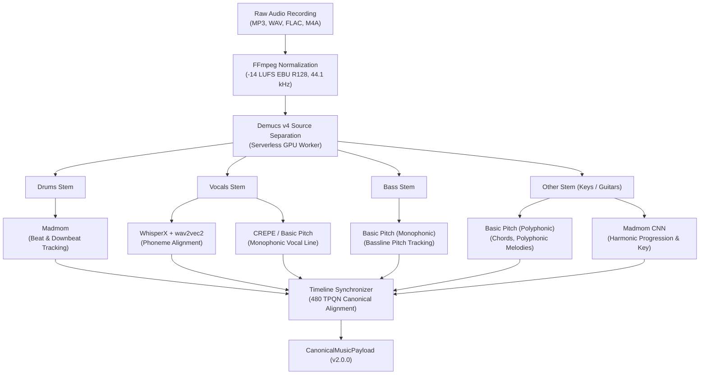
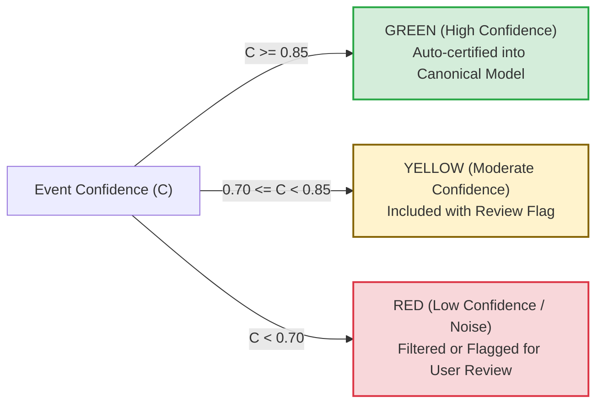

# WORSHIP STUDIO — AUDIO TRANSCRIPTION AND HARMONIC ANALYSIS SPECIFICATION
## Architecture, Models, Confidence Thresholds & Musical Signal Processing

**Project:** Bethesda Worship Studio  
**Repository:** `https://github.com/juancastro2381-hub/BETHESDA-WORSHIP-STUDIO.git`  
**Phase:** Architecture Design & Reconciliation  
**Execution Mode:** STRICT READ-ONLY — Architectural Specification Only  
**Authorization Level:** Strictly Limited — No Implementation Authorized  
**Date:** November 2, 2026  
**Status:** **AUDIO TRANSCRIPTION & MIR SPECIFICATION**

---

## 1. Executive Summary & Purpose

The **Audio Transcription and Harmonic Analysis Engine** is the core intelligence subsystem of Bethesda Worship Studio. It extracts structured musical notation, chords, tempos, and time signatures directly from multi-track or stereo audio recordings.

This document specifies:
1. The mathematical signal processing pipeline from raw audio to canonical events.
2. The differentiation between monophonic and polyphonic transcription.
3. The chord recognition and key detection models.
4. Confidence thresholding, noise gating, and technical limitation boundaries.

---

## 2. Multi-Stage Audio MIR Pipeline

---

## 3. Monophonic vs. Polyphonic Transcription Architecture

Transcribing human vocals and bass lines requires fundamentally different signal processing than transcribing polyphonic acoustic guitars or piano chords:

### 3.1 Monophonic Pitch Tracking (Vocals & Bass)
- **Domain:** Single note sounding at any given instant.
- **Model:** CREPE / Spotify Basic Pitch (monophonic mode).
- **Signal Strategy:**
  - Evaluates fundamental frequency ($f_0$) trajectory across continuous time frames.
  - Applies Viterbi path decoding on pitch contour probabilities to eliminate octave jump errors ($f_0 \leftrightarrow 2f_0$).
  - Converts continuous frequency values (Hz) to discrete MIDI pitch numbers using equal temperament ($A_4 = 440\text{ Hz}$):
    $$\text{MIDI} = \text{round}\left(69 + 12 \log_2\left(\frac{f_0}{440}\right)\right)$$
  - High precision, sharp onset detection, and robust rejection of background spill.

### 3.2 Polyphonic Transcription (Keys, Guitars, Backing Stems)
- **Domain:** Multiple notes sounding simultaneously with overlapping harmonics.
- **Model:** Spotify Basic Pitch (lightweight neural network with polyphonic contour, note, and onset heads).
- **Inference Thresholds:**
  - `onset_threshold`: **0.60** (probability required to trigger note onset).
  - `frame_threshold`: **0.50** (probability required to sustain note duration).
  - `min_note_len`: **11 frames** ($\approx 125\text{ ms}$) to filter transient percussive clicks and string pick noise.
  - `energy_threshold`: **0.30** minimum audio frame energy.

---

## 4. Chord Recognition & Harmonic Analysis Engine

The harmonic pipeline identifies chords, inversions, and musical keys to power Mode 2 (Chords with Lyrics) and Mode 1 (Sheet Music Chord Symbols).

### 4.1 Algorithmic Model: Madmom Deep CNN
- **Input:** 24-bin logarithmic chromagrams computed across the audio spectrum.
- **Chord Quality Dictionary:**
  - **Triads:** Major, Minor, Diminished (`dim`), Augmented (`aug`), Suspended (`sus2`, `sus4`).
  - **Seventh Chords:** Dominant 7th (`7`), Major 7th (`maj7`), Minor 7th (`min7`), Diminished 7th (`dim7`), Half-diminished (`m7b5`).
  - **Extended & Altered Chords:** 9ths, Add9, 6ths, Flat-five chords.
  - **Slash Chords & Inversions:** Derived by fusing the detected treble chord quality with the independent bass pitch track from the Bass Stem (e.g. Treble G major + Bass B $\to$ **G/B**; Treble D major + Bass F# $\to$ **D/F#**).

### 4.2 Key and Tonal Center Detection
- Employs the **Krumhansl-Schmuckler Key-Finding Algorithm** combined with Madmom's tonal centroid distance.
- Computes pitch-class profile correlation across all 24 major and minor keys.
- Outputs the global key signature (e.g. `E Major`, 4 sharps) and flags local harmonic modulations.

---

## 5. Confidence Scoring & Quality Thresholds

Every recognized musical event is assigned a probability score $C \in [0.0, 1.0]$:

- **Harmonic Ambiguity Rule:** If chord recognition probability for a measure is below $0.65$, the system retains the previous stable harmonic function and flags the measure as `AMBIGUOUS_CHORD_REQUIRES_REVIEW` in `omr_proposals`.
- **Rhythmic Quantization Gate:** Raw onset times are snapped to the nearest 480 TPQN grid division (sixteenth note = 120 ticks, triplet eighth = 160 ticks). Offsets deviating $> 40\text{ ms}$ from the nearest grid point generate an micro-timing alert.

---

## 6. Technical Limitations & Known Edge Cases

1. **Heavy Distortion / Fuzz Guitars:** Dense harmonic distortion creates spurious upper harmonics that can cause polyphonic transcription models to falsely detect high octave pitches. Demucs stem separation significantly mitigates this by isolating the guitar from vocal and bass tracks.
2. **Extreme Vocal Vibrato & Pitch Glides:** Singers with wide operatic or gospel vibrato ($\pm 100\text{ cents}$) can trigger false micro-note subdivisions. The monophonic tracker applies pitch-smoothing filters ($\text{window} = 50\text{ ms}$) to identify the core perceived pitch center.
3. **Complex Polyrhythms:** 5-against-4 or unmetered rubato intros are flagged for manual tempo map review rather than forced into rigid 4/4 meter.

---

## 7. Technical Maturity Register

| Capability | Current State | Codebase Reality | Phase Target |
| :--- | :--- | :--- | :--- |
| **Demucs Source Separation** | **DESIGNED (0%)** | Unbuilt; requires Python worker container | Phase 2A |
| **Basic Pitch Transcription** | **DESIGNED (0%)** | Unbuilt; model evaluated and planned | Phase 2B |
| **Madmom Chord Recognition** | **DESIGNED (0%)** | Unbuilt; algorithm specified | Phase 2C |
| **WhisperX Syllable Sync** | **DESIGNED (0%)** | Unbuilt; STT alignment pipeline planned | Phase 3A |

