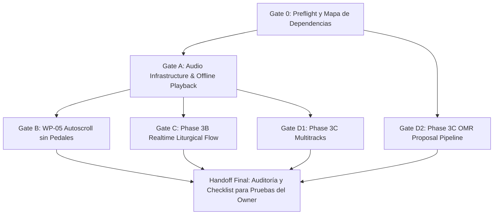

# BETHESDA WORSHIP STUDIO
## Preflight Técnico y Mapa de Dependencias — Workstreams Autorizados
### Audio Offline, WP-05 Autoscroll, Fase 3B Flujo Litúrgico en Tiempo Real, Fase 3C Multipistas y OMR
> **Exclusión Estricta:** Sincronización de Pedales Físicos (USB/Bluetooth) ESTRICTAMENTE NO AUTORIZADA.

---

### 1. Evidencia de Línea Base Git y Estado del Árbol de Trabajo

- **Repositorio:** `https://github.com/juancastro2381-hub/BETHESDA-WORSHIP-STUDIO`
- **Rama Actual:** `main`
- **HEAD Commit SHA:** `4e9ca1ba7d97e07360566dc6a5d95036f5fb4146`
- **Mensaje de Commit:** `DEFECT CONFIRMED AND FIXED` (Remediación de revocación WP-04)
- **Estado del Árbol de Trabajo (`git status --short`):**
  ```
  ?? docs/wp04/WP04_INDEPENDENT_CODE_DIFF_REVIEW_PACKAGE.md
  ```
  *Observación:* Árbol de trabajo limpio de modificaciones sobre archivos rastreados; existe un único archivo no rastreado de revisión de código generado en la sesión previa de auditoría.
- **Entorno de Ejecución:**
  - Sistema Operativo: Windows 11 / PowerShell
  - Runtime: Node.js v24.x / tsx / Vite 8.3
  - Base de Datos: PostgreSQL 16 (puerto local 5432 verificado y escuchando)

---

### 2. Inventario de Implementación Actual por Workstream

| Workstream | Estado Actual en Código Fuente | Brecha Arquitectónica Identificada |
| :--- | :--- | :--- |
| **A. Infraestructura de Audio, Descarga y Playback Offline** | **Frontend Parcial / Backend Inexistente:**<br>- `frontend/src/core/offline/storage/indexeddb-storage.ts` define `OfflineAudioRecord` y métodos CRUD de IndexedDB.<br>- `frontend/src/core/offline/offline-manager.ts` implementa `downloadAudio` apuntando a URLs remotas.<br>- `backend/src/db/schema.ts` NO tiene tabla de audio.<br>- Backend carece de rutas, proveedor de almacenamiento seguro y endpoints de streaming con Range. | Falta entidad `audio_assets` en Drizzle, migración `0005`, capa de repositorio/servicio de audio, proveedor de almacenamiento en disco con prevención de *path traversal*, endpoints autenticados con RBAC (`POST /api/v1/songs/:id/audio`, `GET /api/v1/audio/:id/download`, `GET /api/v1/audio/:id/stream` con HTTP 206 Range), y reproductor integrado en el atril. |
| **B. WP-05 Autoscroll (Sin Pedales)** | **Inexistente:**<br>- No existen hooks ni componentes de autoscroll en `frontend/src/core/` ni en `frontend/src/components/`.<br>- No existe código de pedales (debe mantenerse 100% ausente). | Se requiere implementar el motor de desplazamiento continuo basado en `requestAnimationFrame`, selector de velocidad regulable (0.5x a 3.0x), pausa/reanudación, cancelación segura en desmontaje/cambio de canción, detección de scroll manual del usuario, accesibilidad (prefers-reduced-motion) y controles en el atril. |
| **C. Fase 3B Flujo Litúrgico en Tiempo Real** | **Especificación Documental / Sin Código Activo:**<br>- Documentado en `docs/03_PERFORMANCE_REHEARSAL_AND_REALTIME.md` (protocolo de sesión, roles MD/Músico, eventos `SECTION_CHANGE`, `TICK_SYNC`, `KEY_OVERRIDE`).<br>- Fastify no tiene websocket configurado en `backend/src/app.ts`. | Se requiere implementar el gestor de sesiones de culto en vivo (`RealtimeSessionManager`), control de concurrencia y roles (Director emite comandos, músicos reciben como followers), resincronización de estado (*Full Snapshot*), control de latencia/heartbeat, transporte HTTP/SSE o WebSocket seguro, y hooks en frontend para el atril en vivo. |
| **D. Fase 3C Multipistas (D1) y OMR (D2)** | **D1 (Multipistas): Inexistente en backend y frontend.**<br>**D2 (OMR): Documentado conceptualmente en `docs/04_INGESTION_AND_NOTATION_ENGINE.md` (Canal D y Principio "Asistente, no autoridad").** | **D1:** Se requiere modelo de sesión multipista (`MultitrackSession`, `MultitrackTrack`), enlazado a los activos de audio de Workstream A, soporte de ganancia/paneo/mute/solo y sincronización determinista.<br>**D2:** Se requiere arquitectura de proveedor OMR (`OmrProvider`), pipeline de procesamiento de imagen/partitura, modelo de propuesta con niveles de confianza y bandera mandatoria `is_ai_draft = true`, y flujo de revisión humana antes de persistir en el modelo canónico. |

---

### 3. Grafo de Dependencias y Orden de Implementación Propuesto



**Justificación del Orden:**
1. **Gate A (Audio):** Es el cimiento esencial. Proporciona el almacenamiento físico seguro, la entidad de persistencia y el delivery HTTP de audio con streaming/rango, del cual dependen tanto el reproductor offline como las pistas de audio de las sesiones multipistas (Gate D1).
2. **Gate B (WP-05 Autoscroll):** Es autónomo en frontend, se apoya en el visor del atril digital (`bethesda-renderer-viewport`) y resuelve la necesidad de lectura manos libres sin pedales.
3. **Gate C (Fase 3B Realtime):** Se apoya en la arquitectura de setlists existente (`setlists`, `setlist_items`) y los roles de usuario (`WORSHIP_LEADER`, `MUSICIAN`).
4. **Gate D (Fase 3C Multipistas & OMR):** 
   - D1 (Multipistas) reutiliza los activos de audio de Gate A.
   - D2 (OMR) implementa el contrato de ingesta de partituras asistida por IA/visión computacional con revisión previa al compromiso canónico.

---

### 4. Cambios Requeridos en Modelos de Datos, APIs y UI

#### 4.1 Backend (Drizzle ORM & Fastify)
1. **Esquema de Base de Datos (`backend/src/db/schema.ts`):**
   - Tabla `audio_assets`:
     - `id`: UUID (Primary Key)
     - `song_id`: UUID (Foreign Key a `songs.id`, onDelete cascade)
     - `title`: varchar(255)
     - `filename`: varchar(255)
     - `storage_path`: varchar(512)
     - `mime_type`: varchar(64) (`audio/mpeg`, `audio/wav`, `audio/ogg`, `audio/mp4`, etc.)
     - `file_size_bytes`: integer
     - `checksum_sha256`: varchar(64)
     - `duration_seconds`: integer (nullable)
     - `uploaded_by_user_id`: UUID (Foreign Key a `users.id`)
     - `created_at`, `updated_at`: timestamps
   - Migración versionada: `backend/src/db/migrations/0005_audio_assets.sql`.
2. **Endpoints REST:**
   - Audio:
     - `POST /api/v1/songs/:songId/audio` (Upload autenticado con RBAC de líderes/administradores)
     - `GET /api/v1/songs/:songId/audio` (Listar audios de una canción)
     - `GET /api/v1/audio/:id/download` (Descarga completa autenticada)
     - `GET /api/v1/audio/:id/stream` (Streaming con soporte de cabecera `Range: bytes=start-end`, HTTP 206)
     - `DELETE /api/v1/audio/:id` (Eliminación lógica/física con RBAC)
   - Realtime Litúrgico (Fase 3B):
     - `POST /api/v1/realtime/sessions` (Crear sesión de culto en vivo ligada a setlist)
     - `GET /api/v1/realtime/sessions/:sessionId` (Consultar estado canónico de la sesión)
     - `POST /api/v1/realtime/sessions/:sessionId/actions` (Emitir acciones litúrgicas: `SECTION_CHANGE`, `TICK_SYNC`, `KEY_OVERRIDE`, `SETLIST_TRANSITION`)
     - `GET /api/v1/realtime/sessions/:sessionId/stream` (Stream SSE para recepción de eventos en tiempo real)
     - `POST /api/v1/realtime/sessions/:sessionId/heartbeat` (Keepalive y control de desconexión)
   - OMR Ingestion (Fase 3C):
     - `POST /api/v1/omr/analyze` (Subida de partitura/imagen, extracción asistida y generación de propuesta de borrador)
     - `POST /api/v1/omr/proposals/:proposalId/commit` (Aprobación humana y persistencia canónica como `song_version`)

#### 4.2 Frontend (React & TypeScript)
1. **Audio Player & Offline Manager:**
   - Integrar `BethesdaApiClient` con las nuevas rutas de audio.
   - Conectar `offlineManager.downloadAudio` con el endpoint de backend real.
   - Componente `AudioPlayerBar` en `MusicalWorkspace` con soporte para reproducir tanto stream remoto autenticado como audio local desde IndexedDB (`OfflineAudioRecord`).
2. **WP-05 Autoscroll:**
   - Hook `useAutoscroll` y componente `AutoscrollControl` en `MusicalWorkspace`.
   - Velocidades configurables (0.5x, 0.75x, 1x, 1.25x, 1.5x, 2x, 2.5x, 3x).
   - Control de teclado (Espacio para Pausar/Reanudar, Escape para Detener).
   - Detección de interacción manual del usuario.
   - **CERO código o dependencias de pedales físicos.**
3. **Fase 3B Realtime Workspace:**
   - Hook `useRealtimeSession` con reconexión automática (*exponential backoff*).
   - Indicador visual de modo en vivo: "Director (Broadcaster)" vs "Músico (Seguidor)".
   - Resincronización silenciosa sin parpadeo.
4. **Fase 3C Multipistas & OMR:**
   - Panel de control multipista (`MultitrackPlayer`) con canales de Click, Guía, Pistas instrumentales con mute/solo/fader.
   - Interfaz de revisión de propuesta OMR (`OmrReviewModal`) mostrando la partitura original escaneada frente a los compases reconocidos con indicador visual de confianza y botón explícito de "Aprobar y Guardar en Cancionero".

---

### 5. Análisis de Riesgos de Seguridad, Almacenamiento y Concurrencia

1. **Riesgo de Inyección y Path Traversal en Audio:**
   - *Mitigación:* Los nombres de archivo subidos no se utilizan directamente como rutas en el sistema de archivos del servidor. Se asigna un UUID aleatorio interno y se valida que la ruta resuelta se encuentre estrictamente contenida dentro del directorio base de almacenamiento (`storage/audio/`).
2. **Consumo Desmedido de Almacenamiento (Cuotas):**
   - *Mitigación:* Se aplica validación estricta de cuota máxima de 50 MB por archivo de audio en backend y frontend. Se rechazan tipos MIME no autorizados (restringido a `audio/mpeg`, `audio/wav`, `audio/ogg`, `audio/mp4`, `audio/aac`).
3. **Exposición de Contenido Protegido:**
   - *Mitigación:* No existen URLs públicas directas al sistema de archivos. Toda descarga o streaming requiere encabezado Bearer JWT o cookie de sesión válida.
4. **Regla de Oro Offline (Gracia de 7 Días y Revocación):**
   - *Mitigación:* La reproducción offline de audio queda sujeta a la misma política de seguridad de canciones: vencimiento a los 7 días y purga inmediata si el servidor responde con 401/403/404 al reconectar.
5. **Concurrencia en Sesiones en Vivo (Fase 3B):**
   - *Mitigación:* Solo usuarios con roles autorizados (`WORSHIP_LEADER`, `ADMIN`, `SUPER_ADMIN`) pueden emitir eventos de cambio de estado. Los músicos solo tienen permisos de suscripción y lectura. Los eventos llevan un número de secuencia incremental monótono para descartar mensajes desordenados o retrasados por latencia de red.
6. **Integridad del Modelo Canónico en OMR (Fase 3C):**
   - *Mitigación:* El OMR jamás inserta directamente en `song_versions`. Se crea una propuesta volátil o en borrador con `is_ai_draft = true`. La persistencia definitiva requiere la revisión y clic de aprobación explícito del usuario.

---

### 6. Contradicciones Identificadas entre Reportes y Código Fuente

1. **Estado en README.md vs Autorización Actual:**
   - `README.md` declara que WP-03 a Fase 3C están bajo "HOLD de Gobernanza / No Autorizadas".
   - *Reconciliación:* Esta instrucción del Project Owner autoriza formalmente Audio Offline, WP-05, Fase 3B y Fase 3C. `README.md` se mantendrá intacto según la regla estricta de no-commit/no-modificaciones de gobernanza previas.
2. **Sincronización de Pedales Físicos:**
   - El documento conceptual histórico `docs/01_PRODUCT_VISION_AND_UX.md` y `docs/03_PERFORMANCE_REHEARSAL_AND_REALTIME.md` contemplaban la posibilidad futura de pedales Bluetooth.
   - *Reconciliación:* La instrucción mandatoria actual establece la **EXCLUSIÓN ESTRICTA** de pedales ("Physical Pedal Synchronization Is NOT Authorized"). No se implementará ningún manejador de pedales.
3. **Infraestructura de Audio:**
   - Reportes de WP-04 mencionaban la descarga de audio como funcionalidad offline en el cliente, pero la infraestructura backend no existía físicamente.
   - *Reconciliación:* Se implementará la infraestructura completa de backend (tablas, almacenamiento, streaming con rango HTTP) antes de declarar operativa la descarga y reproducción de audio.

---

### 7. Comandos y Pruebas de Verificación Disponibles

- **Frontend Tests:**
  `cd frontend; npm test` (316 pruebas activas actualmente pasando al 100%)
- **Frontend Typecheck:**
  `cd frontend; npm run typecheck`
- **Backend Tests:**
  `cd backend; npm test`
- **Backend Typecheck:**
  `cd backend; npm run typecheck`
- **PostgreSQL Local:**
  Puerto 5432 verificado y escuchando.

---

### 8. Decisión de Puerta: Proceder con la Implementación Acotada

- **Decisión:** **PROCEDER.**
- **Motivo:** No existen bloqueos arquitectónicos insolubles ni ambigüedades contractuales. Los contratos de datos, las restricciones de seguridad y el alcance de las cuatro fases están claramente delimitados.
- **Siguiente Paso:** Ejecutar **Gate A — Audio Infrastructure, Download, and Offline Playback**.
