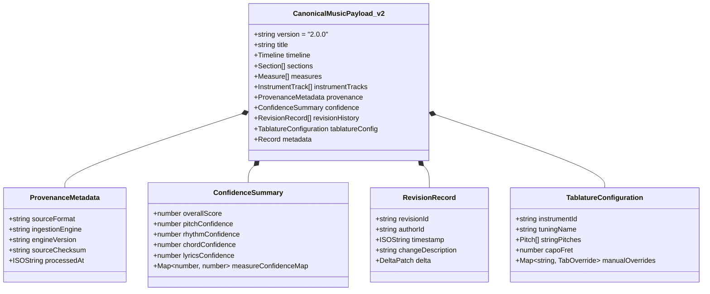

# WORSHIP STUDIO — CANONICAL MUSIC DATA MODEL EVOLUTION
## Evaluation of CanonicalMusicPayload v1.0.0 & Specification of v2.0.0 Schema Architecture

**Project:** Bethesda Worship Studio  
**Repository:** `https://github.com/juancastro2381-hub/BETHESDA-WORSHIP-STUDIO.git`  
**Phase:** Architecture Design & Reconciliation  
**Execution Mode:** STRICT READ-ONLY — Architectural Specification Only  
**Authorization Level:** Strictly Limited — No Implementation Authorized  
**Date:** November 2, 2026  
**Status:** **CANONICAL MODEL EVOLUTION SPECIFICATION**

---

## 1. Executive Summary & Purpose

The **Canonical Music Model** (`CanonicalMusicPayload`) is the architectural heart of Bethesda Worship Studio. It represents the single, authoritative, and immutable source of musical truth for every song arrangement.

In accordance with the Product Owner's Master Directive:
> *"The platform must internally process musical source material and generate the musical representations required by its own digital music stand... All processing services must converge on a consistent canonical model."*

This document provides a comprehensive evaluation of the existing **`CanonicalMusicPayload` v1.0.0** implementation, identifies architectural gaps required to support AI transcription and OMR, and specifies the backward-compatible **v2.0.0 schema evolution**.

---

## 2. Evaluation of Current Model (v1.0.0)

### 2.1 Existing v1.0.0 Capabilities
Inspection of [`frontend/src/core/canonical-model/canonical-music-payload.ts`](file:///c:/Users/juanc/OneDrive/Documentos/Desarrollo%20proyectos/Sistema%20musical%20-%20partituras/BETHESDA%20WORSHIP%20STUDIO/frontend/src/core/canonical-model/canonical-music-payload.ts) and related domain files confirms a robust, mathematically sound foundation:

1. **High Temporal Resolution:** Canonical timeline locked at **480 Ticks Per Quarter Note (TPQN)**, allowing exact representation of whole notes (1920 ticks), quarter notes (480 ticks), eighth notes (240 ticks), and triplets (160 ticks).
2. **Structural Segmentation:** Domain objects for `Section` (Intro, Verse, Chorus, Bridge, Solo) linked to measure ranges.
3. **Multi-Track Architecture:** `InstrumentTrack` entities supporting distinct instrumental families (`KEYS`, `GUITAR`, `BASS`, `VOCALS`, `DRUMS`) with independent clefs and voices.
4. **Harmonic & Lyric Streams:** First-class `ChordEvent` (root, quality, bass, tickOffset) and `LyricSyllable` (text, syllabic state: SINGLE, BEGIN, END, MIDDLE) mapped to the timeline.
5. **Immutability & Integrity:** Strong validation via `CanonicalModelValidator` ensuring non-overlapping measures and sorted ticks.

### 2.2 Critical Gaps in v1.0.0 for AI & OMR Workflows
While v1.0.0 excels at displaying manually authored scores, it lacks essential metadata required for automated AI recognition, quality filtering, and human auditing:

| Architectural Requirement | Present in v1.0.0? | Impact on AI & OMR Transcription |
| :--- | :---: | :--- |
| **Confidence Scoring** | **NO** | Cannot distinguish high-confidence recognized notes from uncertain guesses; prevents automated quality gating. |
| **Processing Provenance** | **NO** | Cannot determine whether a note originated from Demucs/Basic Pitch, Audiveris OMR, or a human musician edit. |
| **Revision History & Audit** | **NO** | Cannot undo human edits or track who corrected specific chords or lyrics over time. |
| **Native Tablature Tuning** | **NO** | Tablature is computed ephemerally by `TablatureCalculator` but cannot persist custom instrument tunings or hand-adjusted frets. |
| **Expressive Notations** | **PARTIAL** | Enums exist for dynamics (`mp`, `ff`) and clefs, but articulations (staccato, accent, fermata) and tuplets lack full schema persistence. |

---

## 3. Specification of `CanonicalMusicPayload` v2.0.0

To support the full internal music engine without breaking existing v1.0.0 consumers, the model will evolve to **v2.0.0** through additive, backward-compatible properties.



### 3.1 Extended JSON Schema Definition (v2.0.0)
```typescript
export interface CanonicalMusicPayloadJSON_v2 {
  readonly version: '2.0.0';
  readonly title: string;
  readonly timeline: TimelineJSON;
  readonly sections: readonly SectionJSON[];
  readonly measures: readonly MeasureJSON_v2[];
  readonly instrumentTracks: readonly InstrumentTrackJSON_v2[];
  
  /** Metadata tracing the origin and pipeline execution */
  readonly provenance?: ProvenanceMetadataJSON;
  
  /** Statistical confidence metrics emitted by AI / OMR engines */
  readonly confidence?: ConfidenceSummaryJSON;
  
  /** Chronological history of manual reviews and corrections */
  readonly revisionHistory?: readonly RevisionRecordJSON[];
  
  /** Instrument-specific persistent tuning and tablature preferences */
  readonly tablatureConfig?: TablatureConfigurationJSON;
  
  readonly metadata?: Readonly<Record<string, unknown>>;
}

export interface MeasureJSON_v2 extends MeasureJSON {
  readonly confidence?: number; // 0.00 to 1.00
  readonly flags?: readonly ('INCOMPLETE_MEASURE' | 'EXTRA_BEATS' | 'LOW_CONFIDENCE')[];
}

export interface NoteEventJSON_v2 {
  readonly id: string;
  readonly tickOffset: number;
  readonly durationTicks: number;
  readonly pitch: {
    readonly step: 'C' | 'D' | 'E' | 'F' | 'G' | 'A' | 'B';
    readonly alter: number; // -2, -1, 0, 1, 2
    readonly octave: number;
    readonly midiNumber: number;
  };
  readonly velocity?: number; // 0 to 127
  readonly confidence?: number; // 0.00 to 1.00
  readonly articulations?: readonly ('STACCATO' | 'ACCENT' | 'TENUTO' | 'FERMATA')[];
  readonly tie?: 'START' | 'STOP' | 'CONTINUE';
}
```

---

## 4. Migration & Backward Compatibility Architecture

### 4.1 Zero-Downtime Schema Upgrade Strategy
- Existing stored JSONB payloads in PostgreSQL (`ARRANGEMENT.canonical_music_payload`) are formatted in v1.0.0.
- When `CanonicalSerializer.deserialize()` encounters a v1.0.0 payload:
  1. It automatically populates default values for v2.0.0 fields:
     - `confidence.overallScore = 1.0` (presumed 100% verified manual score).
     - `provenance.sourceFormat = 'LEGACY_IMPORT'`.
     - `revisionHistory = []`.
  2. The upgraded in-memory object functions identically across all existing rendering adapters (`osmd-adapter.ts`, `alphatab-adapter.ts`, `leadsheet-dom-adapter.ts`).
- When exporting or serializing for legacy components, a `downgradeToV1()` method strips v2.0.0 metadata while preserving 100% of the musical notes, chords, and lyrics.

### 4.2 Migration Verification Invariants
1. **Mathematical Invariance:** Note tick offsets and pitch MIDI numbers must match to the exact integer before and after migration.
2. **Round-Trip Determinism:** `deserialize(serialize(payload_v1))` must produce identical musical output with zero note loss or measure displacement.

---

## 5. Technical Maturity Register

| Dimension | Current State | Phase 1A Target |
| :--- | :--- | :--- |
| **Model Specification** | v1.0.0 Implemented; v2.0.0 Designed | Author v2.0.0 TypeScript classes and Zod schemas |
| **Confidence Persistence** | Unimplemented (0%) | Persist note and measure confidence scores |
| **Provenance Tracking** | Unimplemented (0%) | Record audio/OMR pipeline metadata |
| **Automated Migration** | Unimplemented (0%) | Deliver unit tests verifying v1.0.0 -> v2.0.0 upcasting |

