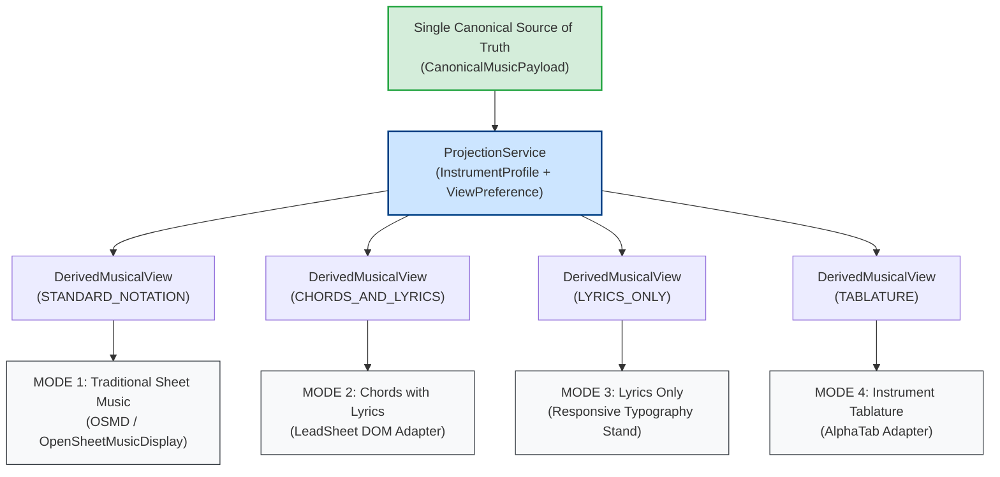

# WORSHIP STUDIO — DIGITAL MUSIC STAND: FOUR NATIVE MUSICAL REPRESENTATIONS
## Architecture, Client-Side Projection & Seamless Multi-View Presentation Engine

**Project:** Bethesda Worship Studio  
**Repository:** `https://github.com/juancastro2381-hub/BETHESDA-WORSHIP-STUDIO.git`  
**Phase:** Architecture Design & Reconciliation  
**Execution Mode:** STRICT READ-ONLY — Architectural Specification Only  
**Authorization Level:** Strictly Limited — No Implementation Authorized  
**Date:** November 2, 2026  
**Status:** **DIGITAL MUSIC STAND MULTI-VIEW SPECIFICATION**

---

## 1. Executive Summary & Purpose

The **Bethesda Worship Studio Digital Music Stand** is an interactive, multi-view performance interface designed for church worship teams, musical directors, vocalists, and instrumentalists.

In strict adherence to the Product Owner's Master Directive:
> *"The WORSHIP STUDIO digital music stand must support four native presentation modes generated from the same canonical musical content... The user must be able to switch between supported representations without manually converting the song again. Where a representation cannot be generated reliably, the interface must communicate its status rather than presenting fabricated musical information."*

This document specifies the architecture that enables a single, immutable `CanonicalMusicPayload` to dynamically power all four native presentation modes with zero server round-trips.

---

## 2. The Four Native Presentation Modes

### 2.1 Mode 1 — Traditional Sheet Music (Partitura)
- **Target Audience:** Pianists, brass/woodwind players, musical directors, classical worship musicians.
- **Rendering Technology:** OpenSheetMusicDisplay (OSMD) SVG/Canvas adapter ([`osmd-adapter.ts`](file:///c:/Users/juanc/OneDrive/Documentos/Desarrollo%20proyectos/Sistema%20musical%20-%20partituras/BETHESDA%20WORSHIP%20STUDIO/frontend/src/core/rendering/adapters/osmd-adapter.ts)).
- **Displayed Musical Elements:**
  - Standard five-line staves with clefs (Treble, Bass, Alto, Tenor).
  - Notes, rests, accidentals, key signatures, and time signatures.
  - Multi-voice polyphony, beams, ties, and tuplets.
  - Dynamic markings (`p`, `mf`, `ff`, crescendo), tempo markers, and rehearsal letters.
  - Vocal syllables rendered directly beneath the melody staff.

### 2.2 Mode 2 — Chords with Lyrics (Cifrado con Letra)
- **Target Audience:** Acoustic guitarists, rhythm keyboardists, worship leaders.
- **Rendering Technology:** LeadSheet DOM adapter ([`leadsheet-dom-adapter.ts`](file:///c:/Users/juanc/OneDrive/Documentos/Desarrollo%20proyectos/Sistema%20musical%20-%20partituras/BETHESDA%20WORSHIP%20STUDIO/frontend/src/core/rendering/adapters/leadsheet-dom-adapter.ts)).
- **Displayed Musical Elements:**
  - Aligned chord symbols positioned vertically above the exact syllable of lyric onset.
  - Song structure markers (`[VERSO 1]`, `[CORO]`, `[PUENTE]`, `[SOLO]`).
  - Real-time client-side chord transposition (e.g. transposing from G to Bb without server re-fetch).
  - Capo calculation (e.g. *"Tono real: Bb | Cejilla: Traste 3 | Digitación: G"*).

### 2.3 Mode 3 — Lyrics Only (Solo Letra)
- **Target Audience:** Backing vocalists, choir members, congregation projection monitors.
- **Rendering Technology:** Responsive high-contrast typography component.
- **Displayed Musical Elements:**
  - Full poetic lyrics organized into clean, legible liturgical stanzas.
  - Large, high-visibility stage typography with user-adjustable font sizing.
  - Automated continuous autoscroll synchronized to rehearsal tempo.

### 2.4 Mode 4 — Instrument Tablature (Tablatura de Guitarra / Bajo)
- **Target Audience:** Electric guitarists, acoustic soloists, 4-string and 5-string bass players.
- **Rendering Technology:** AlphaTab adapter ([`alphatab-adapter.ts`](file:///c:/Users/juanc/OneDrive/Documentos/Desarrollo%20proyectos/Sistema%20musical%20-%20partituras/BETHESDA%20WORSHIP%20STUDIO/frontend/src/core/rendering/adapters/alphatab-adapter.ts)).
- **Displayed Musical Elements:**
  - Horizontal string lines matching instrument tuning (6-line guitar, 4/5-line bass).
  - Fret numbers mapped ergonomically by [`TablatureCalculator`](file:///c:/Users/juanc/OneDrive/Documentos/Desarrollo%20proyectos/Sistema%20musical%20-%20partituras/BETHESDA%20WORSHIP%20STUDIO/frontend/src/core/projection/tablature-calculator.ts).
  - Rhythmic stems and beams indicating note durations directly on the tablature staff.
  - Alternative tuning indicators (Standard, Drop D, DADGAD).

---

## 3. Instantaneous Client-Side View Switching

Because all four views derive from the same immutable in-memory `CanonicalMusicPayload`, **switching between representations is instantaneous**:

1. Musician clicks view selector pill (`Partitura` $\leftrightarrow$ `Cifrado` $\leftrightarrow$ `Letra` $\leftrightarrow$ `Tablatura`).
2. `ProjectionService.project()` executes synchronously in under **5 milliseconds**.
3. Target renderer mounts or updates its view container.
4. **Zero network calls, zero latency, zero re-transcription.**

---

## 4. Honest Status Communication & Unreliable Data Handling

The system strictly enforces the principle: **Never fabricate musical data.**

If an ingested source lacks the musical elements required to produce a specific representation, the stand displays a clear, informative status badge rather than placeholder or invented notes:

| Scenario | Input Source | Mode 1 (Sheet Music) | Mode 2 (Chords+Lyrics) | Mode 3 (Lyrics Only) | Mode 4 (Tablature) |
| :--- | :--- | :---: | :---: | :---: | :---: |
| **ChordPro Lead Sheet** | Text with chord tags | **UNAVAILABLE** *(No pitch data in source)* | **READY** | **READY** | **UNAVAILABLE** *(Requires transcribed notes)* |
| **Instrumental Audio** | Backing track without vocals | **READY** | **CHORDS ONLY** *(No vocals detected)* | **UNAVAILABLE** *(No lyrics detected)* | **READY** |
| **Scanned Hymnal Sheet** | OMR processing completed | **READY** | **READY** | **READY** | **READY** |
| **Low-Confidence Audio** | Audio transcription < 0.70 | **REQUIRES REVIEW** *(Human validation gate)* | **REQUIRES REVIEW** | **READY** | **REQUIRES REVIEW** |

When an unavailable mode is selected, the UI provides an actionable prompt:
> *"Traditional Sheet Music is not available for this song because it was imported from a chord chart. Would you like to upload a sheet music PDF or run audio transcription to generate notes?"*

---

## 5. Technical Maturity Register

| Capability | Current State | Codebase Location |
| :--- | :--- | :--- |
| **Mode 1: OSMD Adapter** | **PARTIALLY IMPLEMENTED** | `frontend/src/core/rendering/adapters/osmd-adapter.ts` |
| **Mode 2: LeadSheet Adapter** | **IMPLEMENTED** | `frontend/src/core/rendering/adapters/leadsheet-dom-adapter.ts` |
| **Mode 3: Lyrics View** | **PARTIALLY IMPLEMENTED** | Integrated in reading view; needs typography controls |
| **Mode 4: Tablature Adapter** | **PARTIALLY IMPLEMENTED** | `frontend/src/core/rendering/adapters/alphatab-adapter.ts` |
| **Projection Service** | **IMPLEMENTED** | `frontend/src/core/projection/projection-service.ts` |
| **Honest Status Banner UI** | **DESIGNED (0%)** | Unbuilt; needs UI error boundary integration |

