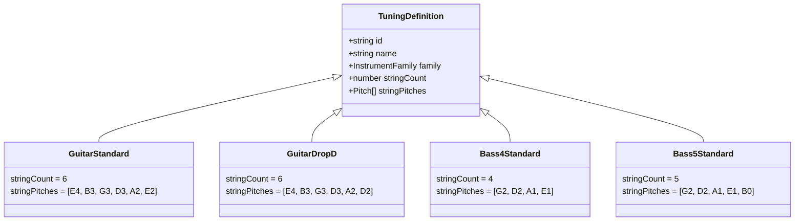
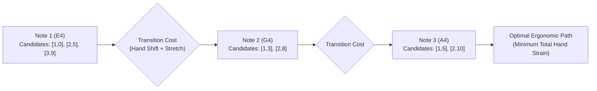

# WORSHIP STUDIO — INSTRUMENT TABLATURE GENERATION ENGINE
## Ergonomic Optimization, Fret-Position Cost Functions, Multi-Instrument Tunings & Capo Mathematics

**Project:** Bethesda Worship Studio  
**Repository:** `https://github.com/juancastro2381-hub/BETHESDA-WORSHIP-STUDIO.git`  
**Phase:** Architecture Design & Reconciliation  
**Execution Mode:** STRICT READ-ONLY — Architectural Specification Only  
**Authorization Level:** Strictly Limited — No Implementation Authorized  
**Date:** November 2, 2026  
**Status:** **TABLATURE ENGINE SPECIFICATION**

---

## 1. Executive Summary & Purpose

The **Instrument Tablature Generation Engine** converts canonical musical pitch and duration events into playable, ergonomically optimized fingerings for stringed instruments (Acoustic Guitar, Electric Guitar, 4-String Bass, 5-String Bass).

In accordance with the Product Owner Master Directive:
> *"A tablature must not be generated by arbitrarily assigning notes to strings and frets. Where several positions are possible, the system must use documented selection criteria and allow manual correction."*

This document specifies:
1. Supported instruments, string geometries, and alternative tunings.
2. The mathematical formulation of the **Ergonomic Cost Function** and **Dynamic Programming (Viterbi) Path Optimizer**.
3. Capo transposition mathematics and manual human-override mechanisms.

---

## 2. Multi-Instrument Geometries & Tunings

### 2.1 Standard & Alternative Tuning Dictionary

| Instrument | Tuning Name | String Count | Open String Pitches (1st to Nth) | MIDI Numbers |
| :--- | :--- | :---: | :--- | :--- |
| **Guitar** | Standard | 6 | E4, B3, G3, D3, A2, E2 | 64, 59, 55, 50, 45, 40 |
| **Guitar** | Drop D | 6 | E4, B3, G3, D3, A2, D2 | 64, 59, 55, 50, 45, 38 |
| **Guitar** | DADGAD | 6 | D4, A3, G3, D3, A2, D2 | 62, 57, 55, 50, 45, 38 |
| **Guitar** | Open G | 6 | D4, B3, G3, D3, G2, D2 | 62, 59, 55, 50, 43, 38 |
| **Bass** | 4-String Standard | 4 | G2, D2, A1, E1 | 43, 38, 33, 28 |
| **Bass** | 4-String Drop D | 4 | G2, D2, A1, D1 | 43, 38, 33, 26 |
| **Bass** | 5-String Standard | 5 | G2, D2, A1, E1, B0 | 43, 38, 33, 28, 23 |

---

## 3. The Note Equivalence & Playability Problem

On a 22-fret guitar, any given musical pitch can typically be fingered on **2 to 5 different string and fret locations**.

*Example: Note E4 (MIDI 64)*:
- String 1 (High E), Fret 0 (Open)
- String 2 (B), Fret 5
- String 3 (G), Fret 9
- String 4 (D), Fret 14
- String 5 (A), Fret 19

**Failure Mode of Naive Calculators:** Arbitrarily choosing the lowest fret or first matching string causes wild, unplayable hand leaps across sequential notes (e.g. jumping from Fret 1 on String 1 to Fret 14 on String 4 for consecutive eighth notes).

---

## 4. The Ergonomic Cost Function & Viterbi Path Optimizer

To select the most natural, ergonomic fingering, the engine models the sequence of notes as a **Markov Decision Process** and solves for the global minimum cost path using the **Viterbi Algorithm**:

### 4.1 Cost Function Formulation
For a note event $t$ choosing candidate position $p_t = (s_t, f_t)$ following position $p_{t-1} = (s_{t-1}, f_{t-1})$:

$$\text{Total Cost}(p_{t-1}, p_t) = C_{\text{shift}}(f_{t-1}, f_t) + C_{\text{stretch}}(p_t) + C_{\text{open}}(f_t) + C_{\text{fret}}(f_t)$$

1. **Hand Shift Penalty ($C_{\text{shift}}$):**
   $$C_{\text{shift}} = W_{\text{shift}} \times |f_t - f_{t-1}|^2$$
   Penalizes large lateral movements along the guitar neck. Maintaining the hand within a 4-fret "box" incurs near-zero cost.
2. **Finger Stretch Penalty ($C_{\text{stretch}}$):**
   If notes sound simultaneously (polyphonic chord), the fret span is evaluated:
   $$C_{\text{stretch}} = \begin{cases} 0 & \text{if } \max(f) - \min(f) \le 4 \\ \infty & \text{if } \max(f) - \min(f) > 5 \quad (\text{Physically unplayable}) \end{cases}$$
3. **Open String Incentive ($C_{\text{open}}$):**
   Open strings ($f=0$) receive a negative cost bonus (encouraging natural acoustic resonance), unless in high-position solo passages.
4. **Fret Ergonomics Penalty ($C_{\text{fret}}$):**
   Higher frets ($f > 12$) have tighter fret spacing and higher string action on acoustic guitars, incurring a modest graduated penalty.

---

## 5. Capo Transposition Mathematics

When a guitarist places a capo at fret $K \in [1, 11]$:
1. The **physical sounding pitch** of open string $s$ increases by $K$ semitones:
   $$\text{MIDI}_{\text{open}}(s, K) = \text{MIDI}_{\text{open}}(s, 0) + K$$
2. For a target pitch $\text{MIDI}_{\text{target}}$, the **displayed fret number** on the tablature staff is relative to the capo position:
   $$f_{\text{displayed}} = (\text{MIDI}_{\text{target}} - \text{MIDI}_{\text{open}}(s, 0)) - K$$
3. Notes requiring physical frets below the capo ($f_{\text{displayed}} < 0$) are strictly impossible and discarded from candidate generation.

---

## 6. Interactive User Override Mechanism

While the Viterbi optimizer achieves $>95\%$ ergonomic accuracy, professional guitarists frequently have personal fingering preferences (e.g. playing a riff up the neck for warmer timbre):

1. **Interactive Fret Selection:** Clicking any tab number in the digital stand displays an ergonomic popup showing all alternative valid $(string, fret)$ candidates.
2. **Persistent Override:** Selecting an alternative updates the `tablatureConfig.manualOverrides` map in `CanonicalMusicPayload` v2.0.0.
3. **Downstream Recalculation:** The surrounding notes dynamically recalculate their optimal path around the pinned user override.

---

## 7. Technical Maturity Register

| Capability | Current State | Codebase Evidence | Phase Target |
| :--- | :--- | :--- | :--- |
| **Deterministic Candidate Finder** | **IMPLEMENTED** | `frontend/src/core/projection/tablature-calculator.ts#L60` | Baseline working |
| **Ergonomic Heuristic (Local)** | **IMPLEMENTED** | `tablature-calculator.ts#L42` (best candidate select) | Baseline working |
| **Viterbi Multi-Note Optimizer** | **DESIGNED (0%)** | Unbuilt; requires sequential path solver | Phase 3C |
| **Alternative Tunings (Drop D, DADGAD)**| **DESIGNED (0%)** | Types defined; catalog unpopulated | Phase 3C |
| **Interactive UI Fret Override** | **DESIGNED (0%)** | Unbuilt; UI modal needed | Phase 4A |

