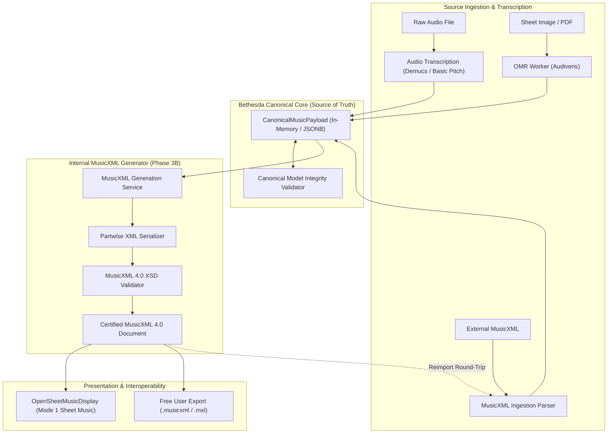
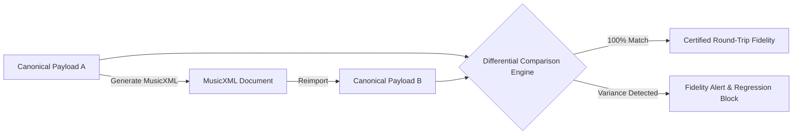

# WORSHIP STUDIO — INTERNAL MUSICXML GENERATION AND VALIDATION ENGINE
## Architecture, Bidirectional Round-Trip Pipeline & Schema Verification Specification

**Project:** Bethesda Worship Studio  
**Repository:** `https://github.com/juancastro2381-hub/BETHESDA-WORSHIP-STUDIO.git`  
**Phase:** Architecture Design & Reconciliation  
**Execution Mode:** STRICT READ-ONLY — Architectural Specification Only  
**Authorization Level:** Strictly Limited — No Implementation Authorized  
**Date:** November 2, 2026  
**Status:** **INTERNAL MUSICXML GENERATOR SPECIFICATION**

---

## 1. Executive Summary & Purpose

In compliance with the Product Owner Master Directive:
> *"MusicXML must become an internally generated interoperability format... Users must NOT depend on paid external applications to convert their songs into MusicXML before importing them into WORSHIP STUDIO. The platform must perform this workflow internally."*

This document specifies the internal **MusicXML Generation, Validation, and Round-Trip Reimport Engine**. It establishes how Bethesda Worship Studio translates internal `CanonicalMusicPayload` data structures into standard W3C MusicXML 4.0 for rendering and external export, without relying on third-party conversion software.

---

## 2. Bidirectional MusicXML Lifecycle Architecture

MusicXML is an **interoperability and notation exchange format**, while the **Canonical Music Model remains the single source of truth**:

---

## 3. Internal MusicXML Serializer Specification

The internal generator translates the canonical graph into valid **MusicXML 4.0 Partwise (`<score-partwise>`)** via a fast, pure TypeScript builder.

### 3.1 Mapping Rules: Canonical Model $\to$ MusicXML 4.0

| Canonical Property | Target MusicXML 4.0 Element | Encoding Specification |
| :--- | :--- | :--- |
| `payload.title` | `<work-title>` | Placed in `<work>` and `<movement-title>`. |
| `payload.timeline.tempo` | `<direction><sound tempo="BPM"/>` | Metronome marking placed in Measure 1, Voice 1. |
| `payload.sections` | `<direction><rehearsal>` | Rehearsal marks containing section titles (e.g. `[VERSE 1]`, `[CHORUS]`). |
| `measure.timeSignature` | `<attributes><time>` | `<beats>N</beats><beat-type>D</beat-type>` (e.g. 4/4, 3/4, 6/8). |
| `measure.keySignature` | `<attributes><key>` | `<fifths>K</fifths><mode>major|minor</mode>`. |
| `instrumentTrack.clef` | `<attributes><clef>` | Treble (`<sign>G</sign><line>2</line>`), Bass (`<sign>F</sign><line>4</line>`). |
| `Note.pitch` | `<note><pitch>` | `<step>C</step><alter>1</alter><octave>4</octave>`. |
| `Note.durationTicks` | `<note><duration>` | Scaled to match `<divisions>` (e.g. 480 ticks $\to$ duration 480 when divisions=480). |
| `Note.articulations` | `<notations><articulations>` | `<staccato/>`, `<accent/>`, `<tenuto/>`, `<fermata/>`. |
| `ChordEvent` | `<harmony>` | `<root><root-step>C</root-step></root><kind>major</kind>`. |
| `LyricSyllable` | `<note><lyric>` | `<syllabic>single|begin|end|middle</syllabic><text>word</text>`. |
| `TabPosition` | `<notations><technical>` | `<string>S</string><fret>F</fret>` for string instruments. |

---

## 4. Internal Validation & Schema Verification

Before any internally generated MusicXML is passed to the OSMD renderer or exported to a user, it must pass a strict two-stage validation gate:

1. **Stage 1: Syntactic & Structural XML Validation:**
   - Validates well-formedness, correct opening/closing tags, and XML namespace declarations (`http://www.musicxml.org/xsd/MusicXML`).
   - Verifies that `<divisions>` is declared before the first `<duration>` element.
2. **Stage 2: Musical Measure Arithmetic Verification:**
   - Evaluates whether the sum of `<duration>` elements in each voice within a measure matches the expected measure length:
     $$\sum_{\text{notes, rests}} \text{duration} = \text{divisions} \times \frac{4 \times \text{beats}}{\text{beat-type}}$$
   - Any measure with duration discrepancies is flagged and corrected with appropriate filler rests or ties, preventing parser crashes in external notation software.

---

## 5. Bidirectional Round-Trip Fidelity Protocol

To guarantee that Bethesda Worship Studio maintains flawless interoperability, all generated MusicXML must pass the **100% Round-Trip Fidelity Protocol**:

$$\text{Canonical Payload } A \xrightarrow{\text{Generate}} \text{MusicXML } X \xrightarrow{\text{Reimport}} \text{Canonical Payload } B$$

### 5.1 Non-Negotiable Fidelity Invariants:
- **Pitch Fidelity:** $100.0\%$ match on all note steps, octaves, and alterations. Zero transposition drift.
- **Rhythmic Fidelity:** $100.0\%$ match on start tick offsets and durations across all 480 TPQN measures.
- **Harmonic Fidelity:** $100.0\%$ match on chord root, quality, and bass notes.
- **Lyric Alignment Fidelity:** $100.0\%$ match on syllable text, hyphenation state, and note binding.

---

## 6. Technical Maturity Register

| Capability | Current State | Codebase Evidence | Phase Target |
| :--- | :--- | :--- | :--- |
| **MusicXML Ingestion Parser** | **IMPLEMENTED** | `frontend/src/core/ingestion/musicxml/` | Phase 1 Maintenance |
| **Internal MusicXML Generator** | **DESIGNED (0%)** | Unbuilt in codebase | Phase 3B Implementation |
| **MusicXML Schema Validator** | **DESIGNED (0%)** | Unbuilt in codebase | Phase 3B Implementation |
| **Automated Round-Trip Test** | **DESIGNED (0%)** | Unbuilt in codebase | Phase 3B Implementation |

