# WORSHIP STUDIO — INTERNAL MUSIC ENGINE 10-PHASE IMPLEMENTATION ROADMAP
## Phased Engineering Blueprint, Dependency DAG, Risk Mitigation & Acceptance Criteria

**Project:** Bethesda Worship Studio  
**Repository:** `https://github.com/juancastro2381-hub/BETHESDA-WORSHIP-STUDIO.git`  
**Phase:** Architecture Design & Reconciliation  
**Execution Mode:** STRICT READ-ONLY — Architectural Specification Only  
**Authorization Level:** Strictly Limited — No Implementation Authorized  
**Date:** November 2, 2026  
**Status:** **MASTER IMPLEMENTATION ROADMAP RATIFIED**

---

## 1. Executive Summary & Purpose

The transition of Bethesda Worship Studio into an integrated, self-owned music transcription, conversion, and digital music stand platform requires a disciplined, phase-gated engineering execution plan.

In compliance with the Product Owner Master Directive:
> *"Do not assume these capabilities can all be implemented in one phase. Identify dependencies, risks, acceptance criteria, and measurable quality requirements for every stage. Preserve existing functionality and avoid breaking current imports and renderers."*

This document establishes the official **10-Phase Internal Music Engine Roadmap**, defining the dependency graph, technical scope, quality gates, and non-regression boundaries for each engineering stage.

---

## 2. Master 10-Phase Dependency DAG

```mermaid
flowchart TD
    P0["Phase 0: Master Architecture & Audit Reconciliation\n(COMPLETE - Phase 0D)"] --> G0{"PO Sign-Off Gate"}

    subgraph Foundation ["Stage 1: Core Foundation & Reliability"]
        G0 -->|"Authorized"| P1A["Phase 1A: Core Foundation & OMR Remediation\n• Drizzle schema for proposals/jobs\n• Fix 10 silent defects in omr-service.ts\n• Zero-regression unit test suite"]
        P1A --> P1B["Phase 1B: Async Queue & Storage Engine\n• PostgreSQL FOR UPDATE SKIP LOCKED\n• 30s heartbeat & fencing tokens\n• Cloudflare R2 transactional outbox"]
    end

    subgraph AudioEngine ["Stage 2: Audio Transcription & Harmony"]
        P1B --> P2A["Phase 2A: Audio Pipeline & Source Separation\n• FFmpeg EBU R128 normalizer\n• Demucs v4 containerized worker\n• 4-stem extraction (Vocals, Bass, Drums, Other)"]
        P2A --> P2B["Phase 2B: Audio-to-MIDI Transcription\n• Spotify Basic Pitch worker\n• Monophonic vocal/bass pitch tracking\n• Polyphonic keyboard transcription\n• 480 TPQN temporal quantization"]
        P2B --> P2C["Phase 2C: Musical Analysis & Harmony\n• Madmom beat & downbeat tracking\n• CNN chord recognition (triads, 7ths, slash)\n• Tonal center & key signature estimation"]
    end

    subgraph MultimodalCore ["Stage 3: Lyrics, MusicXML & Tablature"]
        P2C --> P3A["Phase 3A: Lyrics Extraction & Forced Alignment\n• WhisperX speech-to-text\n• Wav2Vec2 phonetic forced alignment\n• Syllable-to-melody binding in Canonical Core"]
        P3A --> P3B["Phase 3B: Internal MusicXML Generator\n• Fast TypeScript MusicXML 4.0 serializer\n• XSD schema validation\n• 100% round-trip fidelity test harness"]
        P3B --> P3C["Phase 3C: Instrument Tablature Engine\n• Viterbi dynamic programming path solver\n• Guitar & bass alternative tunings\n• Capo transposition math & manual override"]
    end

    subgraph UserExperience ["Stage 4: Stand Presentation & Production"]
        P3C --> P4A["Phase 4A: Digital Music Stand (4 Native Modes)\n• Unified ProjectionService integration\n• Instantaneous view switching\n• Interactive human correction editor\n• Visual confidence heatmap"]
        P4A --> P4B["Phase 4B: Production Hardening & Launch\n• CMB_HYMNAL_CORPUS_v1 empirical benchmarks\n• FinOps rate limiting & budget guards\n• Church community deployment & sign-off"]
    end

    style P0 fill:#d4edda,stroke:#28a745,stroke-width:2px;
    style G0 fill:#fff3cd,stroke:#856404,stroke-width:2px;
    style P1A fill:#cce5ff,stroke:#004085,stroke-width:2px;
    style P1B fill:#cce5ff,stroke:#004085,stroke-width:2px;
    style P2A fill:#e2e3e5,stroke:#383d41,stroke-width:2px;
    style P2B fill:#e2e3e5,stroke:#383d41,stroke-width:2px;
    style P2C fill:#e2e3e5,stroke:#383d41,stroke-width:2px;
    style P3A fill:#e2e3e5,stroke:#383d41,stroke-width:2px;
    style P3B fill:#e2e3e5,stroke:#383d41,stroke-width:2px;
    style P3C fill:#e2e3e5,stroke:#383d41,stroke-width:2px;
    style P4A fill:#e2e3e5,stroke:#383d41,stroke-width:2px;
    style P4B fill:#d4edda,stroke:#28a745,stroke-width:2px;
```



---

## 3. Detailed Phase Breakdown & Quality Acceptance Criteria

### Phase 1A: Core Foundation, Persistence & OMR Remediation
- **Objectives:**
  1. Add `background_jobs`, `omr_proposals`, `omr_proposal_measures`, and `omr_audit_history` tables to `backend/src/db/schema.ts` via Drizzle ORM.
  2. Remediate all 10 code-level defects in [`backend/src/application/omr-service.ts`](file:///c:/Users/juanc/OneDrive/Documentos/Desarrollo%20proyectos/Sistema%20musical%20-%20partituras/BETHESDA%20WORSHIP%20STUDIO/backend/src/application/omr-service.ts) (eliminate silent fallbacks, preserve accidentals, handle non-4/4 meters).
  3. Author comprehensive unit tests covering non-4/4 meters, non-C tonalities, accidentals, and confidence gating.
- **Acceptance Criteria:**
  - `npm test` runs with 100% pass rate.
  - Zero silent note C or 480-tick fallback occurrences.
  - Relational round-trip proposal persistence verified against PostgreSQL.

### Phase 1B: Asynchronous Processing Engine & Storage Reliability
- **Objectives:**
  1. Implement PostgreSQL-native queue daemon (`FOR UPDATE SKIP LOCKED`).
  2. Implement worker lease protocol (30s expiry), 10s heartbeat ping, and monotonic fencing tokens.
  3. Install `@aws-sdk/client-s3` and implement `CloudflareR2StorageProvider`.
  4. Implement transactional `storage_operations` outbox and daily garbage collection sweeper.
- **Acceptance Criteria:**
  - Passes all 10 failure-mode tests (worker crashes, GC pauses, race conditions).
  - Zero storage leak orphans during simulated failed uploads.

### Phase 2A: Audio Pipeline Foundation & Stem Separation
- **Objectives:**
  1. Implement multi-format audio ingestion endpoints (MP3, WAV, FLAC, M4A).
  2. Implement FFmpeg audio normalization service (-14 LUFS EBU R128).
  3. Deploy containerized Demucs v4 serverless worker for 4-stem separation.
- **Acceptance Criteria:**
  - Automated separation of audio into isolated stems (Vocals, Bass, Drums, Other) within 45 seconds on GPU.

### Phase 2B: Audio-to-MIDI & Note Transcription
- **Objectives:**
  1. Integrate Spotify Basic Pitch inference worker.
  2. Implement monophonic pitch tracking for Bass and Vocal melodies.
  3. Implement polyphonic pitch tracking for Keyboards and Guitars.
  4. Quantize raw onsets to 480 TPQN canonical timeline.
- **Acceptance Criteria:**
  - Raw Pitch Accuracy target $\ge 88\%$ on clean recordings.
  - Generated notes correctly bound to `InstrumentTrack` objects.

### Phase 2C: Musical Analysis, Harmony & Key Detection
- **Objectives:**
  1. Deploy Madmom beat tracking and downbeat estimation service.
  2. Implement Madmom CNN chord recognition model.
  3. Implement Krumhansl-Schmuckler key-finding algorithm.
  4. Derive slash chords by fusing bass pitch with treble triads.
- **Acceptance Criteria:**
  - Weighted Chord Symbol Recall $\ge 82\%$ on standard worship song progressions.
  - Global key signature and meter correctly detected.

### Phase 3A: Lyrics Extraction & Forced Alignment
- **Objectives:**
  1. Integrate WhisperX automatic speech recognition for vocal stems.
  2. Run Wav2Vec2 phonetic forced alignment.
  3. Segment text into liturgical sections (Verse, Chorus, Bridge) and individual syllables.
  4. Bind syllables to melodic note tick offsets in `CanonicalMusicPayload`.
- **Acceptance Criteria:**
  - Mean syllable onset alignment error $\le 100\text{ ms}$.
  - Zero syllable stacking at `tickOffset: 0`.

### Phase 3B: Internal MusicXML Generation & Bidirectional Validation
- **Objectives:**
  1. Author pure TypeScript MusicXML 4.0 partwise serializer.
  2. Implement MusicXML 4.0 XSD schema validator.
  3. Build bidirectional round-trip verification harness (`Canonical -> XML -> Canonical`).
  4. Provide free user export for `.musicxml` and `.mxl`.
- **Acceptance Criteria:**
  - 100% round-trip fidelity on pitches, durations, chords, and lyrics.
  - Generated files open without warnings in MuseScore, Sibelius, and Finale.

### Phase 3C: Instrument Tablature Engine & Ergonomic Optimization
- **Objectives:**
  1. Implement Viterbi dynamic programming path solver on `TablatureCalculator`.
  2. Populate multi-instrument tuning catalog (Standard, Drop D, DADGAD, 4/5 Bass).
  3. Implement capo transposition mathematics.
  4. Author interactive fret-shift override UI.
- **Acceptance Criteria:**
  - Tablature generated with zero unplayable physical hand stretches ($> 5$ frets).
  - Instantaneous client-side transposition and capo calculation.

### Phase 4A: Digital Music Stand (4 Modes) & Interactive Correction UI
- **Objectives:**
  1. Integrate all 4 native modes into the digital stand UI (`Partitura`, `Cifrado`, `Letra`, `Tablatura`).
  2. Implement instantaneous client-side view switching via `ProjectionService`.
  3. Build interactive human-in-the-loop score editor (notes, chords, lyrics, frets).
  4. Render visual confidence heatmap (Green, Yellow, Red).
- **Acceptance Criteria:**
  - View switching executes in $< 10\text{ ms}$ with zero network calls.
  - Review status transitions cleanly from `REQUIRES_REVIEW` to `READY` upon human edit.

### Phase 4B: Production Hardening, Quality Benchmarks & Zero-Cost Launch
- **Objectives:**
  1. Execute statistical benchmark evaluations against `CMB_HYMNAL_CORPUS_v1` using `mir_eval`.
  2. Implement FinOps rate limiting (max 2 active jobs per user; budget cap guards).
  3. Conduct security review (SSRF guards, path traversal verification).
  4. Deploy to Bethesda church worship community.
- **Acceptance Criteria:**
  - Operational cost remains strictly under $\$50/\text{month}$ for medium church community.
  - Zero-cost user access verified with 100% self-hosted internal engine.

---

## 4. Master Risk Register & Mitigations

| Risk ID | Risk Description | Severity | Mitigation Strategy |
| :--- | :--- | :---: | :--- |
| **RISK-01** | GPU Cost Spikes from Unchecked Jobs | HIGH | Enforce per-user queue depth cap (2 in-flight) and monthly cloud spending limit ($100 hard stop). |
| **RISK-02** | Demucs MusDB18 Licensing In Commercial SaaS | MEDIUM | Valid for internal church use. If commercialized, train custom weights on royalty-free multitracks or switch to Open-Unmix. |
| **RISK-03** | Audiveris AGPL Copyleft Contamination | HIGH | Strict container isolation. Audiveris runs as a black-box CLI daemon over RPC; zero in-process library linking. |
| **RISK-04** | Complex Musical Audio Errors (Rubato/Distortion)| MEDIUM | Non-fatal; flagged as `REQUIRES_REVIEW` with red heatmap badges for quick human correction in the UI. |
| **RISK-05** | Distributed Dual-Write Storage Leaks | MEDIUM | Transactional `storage_operations` outbox in PostgreSQL + daily garbage collection sweeper. |

---

## 5. Formal Gating Protocol

Engineering implementation remains strictly blocked:

```
┌──────────────────────────────────────────────────────────────────┐
│                   PHASE 1A READINESS GATE                        │
├────────────────────────────────────────┬─────────────────────────┤
│ Requirement                            │ Status                  │
├────────────────────────────────────────┼─────────────────────────┤
│ Phase 0D Documentation Delivered       │ VERIFIED                │
│ Master Directive Documents Ratified    │ 11/11 DELIVERED         │
│ Working Tree Clean (Zero Code Changes) │ VERIFIED                │
│ Product Owner Explicit Authorization   │ PENDING PO SIGN-OFF     │
└────────────────────────────────────────┴─────────────────────────┘
```

