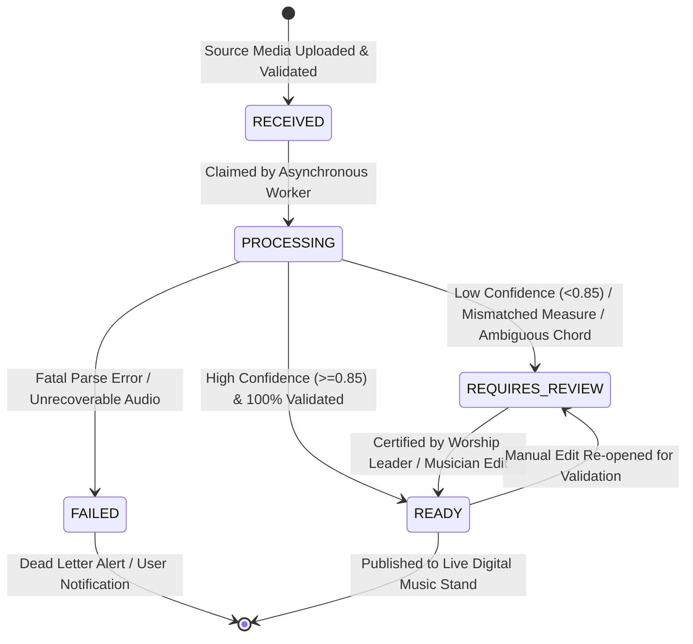

# WORSHIP STUDIO — MUSIC CORRECTION AND QUALITY CONTROL WORKFLOW
## Human-in-the-Loop Verification, Confidence Heatmaps, Audit History & State Machine

**Project:** Bethesda Worship Studio  
**Repository:** `https://github.com/juancastro2381-hub/BETHESDA-WORSHIP-STUDIO.git`  
**Phase:** Architecture Design & Reconciliation  
**Execution Mode:** STRICT READ-ONLY — Architectural Specification Only  
**Authorization Level:** Strictly Limited — No Implementation Authorized  
**Date:** November 2, 2026  
**Status:** **QUALITY CONTROL WORKFLOW SPECIFICATION**

---

## 1. Executive Summary & Purpose

Professional music publishing and worship ministry require infallible musical accuracy. Even state-of-the-art AI audio transcription and OMR engines occasionally misidentify faint accidentals, obscure chord extensions, or complex lyrics.

In accordance with the Product Owner Master Directive:
> *"Professional musical transcription requires a correction workflow. Design an interface that allows users to review and correct... Every generated result must have a processing status: RECEIVED, PROCESSING, REQUIRES_REVIEW, READY, FAILED... Do not silently convert uncertain recognition results into supposedly verified musical information. The system must preserve the original uploaded material and maintain revision history."*

This document specifies the **Processing Lifecycle State Machine**, the **Visual Confidence Heatmap**, the **Interactive Musical Editor**, and the **Relational Audit Trail**.

---

## 2. Processing Lifecycle State Machine

Every song ingestion and transcription operation transitions through a strictly defined finite state machine:



### 2.1 State Definitions & Invariants
1. **`RECEIVED`:** The raw audio, image, or PDF has been safely uploaded to Cloudflare R2 staging, validated for MIME/magic-number integrity, and entered into the `background_jobs` table.
2. **`PROCESSING`:** The task is actively running within the worker pool under a 30-second heartbeat lease. Progress is reported via WebSocket/SSE.
3. **`REQUIRES_REVIEW`:** Processing completed, but automated quality checks detected anomalies (e.g. measure duration mismatch, symbol confidence $< 0.70$, or ambiguous chord). The score is visible in the editor with highlighted flags, but cannot be published to the church team as "verified".
4. **`READY`:** The musical score has passed all automated integrity checks with high confidence ($\ge 0.85$) OR has been manually reviewed, corrected, and certified by a worship musician.
5. **`FAILED`:** Processing encountered an unrecoverable error (e.g. corrupted file, non-musical audio, unreadable scan). A structured error log is recorded, and the user is prompted with an actionable diagnostic.

---

## 3. Visual Confidence Heatmap

To make quality review fast and intuitive, the digital stand interface overlays a **visual confidence heatmap** on top of the rendered score:

```
┌────────────────────────────────────────────────────────────────────────┐
│ [MEASURE 1 - 4/4]        [MEASURE 2 - 4/4]        [MEASURE 3 - 4/4]    │
│  C        G/B             Am       F               G (AMBIGUOUS?)      │
│  ♩   ♩   ♩   ♩            ♩   ♩   ♩   ♩            ♩   ♩   ♩   ♩       │
│  [GREEN: Conf 0.96]      [GREEN: Conf 0.91]       [RED: Conf 0.62]     │
│  "Sublime gracia del"     "Señor que a mí salvó"   "Perdido fui..."    │
│                                                   ▲                    │
│                                                   └── CLICK TO CORRECT │
└────────────────────────────────────────────────────────────────────────┘
```

- **GREEN ($\text{Confidence} \ge 0.85$):** Certified high accuracy. Automatically approved.
- **YELLOW ($0.70 \le \text{Confidence} < 0.85$):** Moderate confidence. Minor caution indicator; user can glance to confirm.
- **RED ($\text{Confidence} < 0.70$):** Low confidence or rule violation (e.g. extra beat in bar). Highlighted with a pulse badge directing the user to inspect and confirm.

---

## 4. Interactive Human-in-the-Loop Editor Capabilities

When a user clicks on an unverified or flagged element, an inline modal opens with dedicated correction tools:

| Element Type | Interactive Editing Tool | Underlying Canonical Mutation |
| :--- | :--- | :--- |
| **Note Pitch** | Click-and-drag note head; semitone $\pm$ arrows; sharp/flat toggle | Mutates `Note.pitch` (`step`, `alter`, `octave`) |
| **Note Duration** | Duration palette (Whole, Half, Quarter, 8th, 16th, Dotted, Triplet) | Recalculates `Note.durationTicks` |
| **Chord Symbol** | Musical autocomplete chord selector (Root + Quality + Bass) | Replaces `ChordEvent` root, quality, and slash bass |
| **Key Signature** | Key signature modal (Circle of Fifths selector) | Updates `Measure.keySignature` and transposes visual display |
| **Time Signature** | Meter selector (4/4, 3/4, 6/8, 12/8) | Updates `Measure.timeSignature` and re-runs measure math |
| **Lyrics & Syllables** | Inline text box with syllable hyphenation split (`sub - li - me`) | Rebinds `LyricSyllable` to note onset ticks |
| **Tablature Fret** | String/fret candidate selector showing all physical neck positions | Updates `tablatureConfig.manualOverrides` |

---

## 5. Preservation of Original Assets & Relational Audit Trail

1. **Source Immutability:** The raw uploaded media file (e.g. original MP3 audio or scan PDF) is **never overwritten or deleted** during the editing process. It remains permanently archived in Cloudflare R2 (`permanent/{song_id}/original_source`).
2. **Relational Audit Logging:** Every edit performed in the review interface is recorded in the `omr_audit_history` table in PostgreSQL:

```sql
CREATE TABLE omr_audit_history (
    id UUID PRIMARY KEY DEFAULT gen_random_uuid(),
    proposal_id UUID NOT NULL REFERENCES omr_proposals(id) ON DELETE CASCADE,
    user_id UUID NOT NULL REFERENCES users(id),
    action_type VARCHAR(64) NOT NULL, -- 'NOTE_PITCH_EDIT', 'CHORD_OVERRIDE', 'MEASURE_METER_FIX'
    target_measure INTEGER NOT NULL,
    target_tick INTEGER,
    previous_value JSONB NOT NULL,
    new_value JSONB NOT NULL,
    reason TEXT,
    created_at TIMESTAMP WITH TIME ZONE DEFAULT NOW()
);
```

3. **Full Undo / Redo:** Client-side state manager maintains an immutable command history stack allowing musicians to undo changes with `Ctrl+Z`.

---

## 6. Technical Maturity Register

| Capability | Current State | Codebase Reality | Phase Target |
| :--- | :--- | :--- | :--- |
| **Proposal Map & In-Memory Store** | Prototype exists | Ephemeral Map in `omr-service.ts#L34` | Phase 1A (Relational DDL) |
| **State Machine (`REQUIRES_REVIEW`)**| Conceptual | Proposed in specs; unbuilt | Phase 1A |
| **Relational Audit Trail Table** | Unbuilt | Table missing from `schema.ts` | Phase 1A |
| **Confidence Heatmap UI** | Unbuilt | UI components not created | Phase 4A |
| **Interactive Score Editor** | Unbuilt | UI editors not created | Phase 4A |

