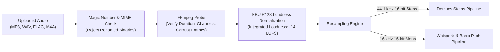
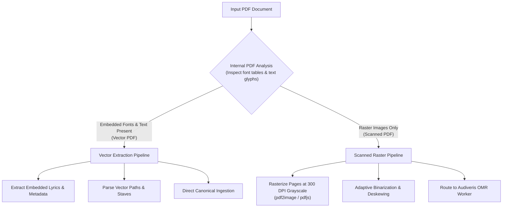

# WORSHIP STUDIO — MUSIC INGESTION AND SOURCE FORMATS SPECIFICATION
## Multi-Modal Input Ingestion, Media Validation, Normalization & Security Architecture

**Project:** Bethesda Worship Studio  
**Repository:** `https://github.com/juancastro2381-hub/BETHESDA-WORSHIP-STUDIO.git`  
**Phase:** Architecture Design & Reconciliation  
**Execution Mode:** STRICT READ-ONLY — Architectural Specification Only  
**Authorization Level:** Strictly Limited — No Implementation Authorized  
**Date:** November 2, 2026  
**Status:** **TECHNICAL INGESTION SPECIFICATION**

---

## 1. Executive Summary & Purpose

Bethesda Worship Studio is designed to ingest musical material across five distinct modalities:
1. **Audio Recordings** (MP3, WAV, FLAC, M4A/AAC).
2. **Sheet Music Images** (JPG, PNG, WebP, TIFF).
3. **PDF Documents** (Vector scores and scanned image songbooks).
4. **Video and External Links** (YouTube, direct media streams, uploaded videos).
5. **Existing Musical Documents** (MusicXML, Compressed .mxl, ChordPro, MIDI).

The purpose of this specification is to define the exact MIME validation, size constraints, pre-processing normalization pipelines, SSRF security guards, and fallback workflows for every supported input format.

---

## 2. Ingestion Modality Specifications

### 2.1 Modality A: Audio Recordings
Audio recordings serve as the primary source for automated transcription, stem separation, and harmonic analysis.

- **Supported Extensions:** `.mp3`, `.wav`, `.flac`, `.m4a`, `.aac`, `.ogg`.
- **Max File Size:** 100 MB per file (accommodates up to 60 minutes of high-resolution audio).
- **MIME Validation:** Strict magic-number inspection (`audio/mpeg`, `audio/wav`, `audio/x-wav`, `audio/flac`, `audio/mp4`, `audio/aac`, `audio/ogg`).
- **Audio Pre-Processing:**
  - FFmpeg decodes audio and normalizes integrated loudness to **-14 LUFS** ($\pm 1.0 \text{ LUFS}$) in accordance with EBU R128 / ITU-R BS.1770-4.
  - Multi-rate export: Generates 44.1 kHz stereo for Demucs stem separation, and 16 kHz mono PCM for acoustic models (WhisperX and Spotify Basic Pitch).

### 2.2 Modality B: Sheet Music Images
Used for camera captures of physical sheet music and scanned hymnal pages.

- **Supported Extensions:** `.jpg`, `.jpeg`, `.png`, `.webp`, `.tiff`, `.tif`.
- **Max File Size:** 25 MB per image (up to 100 MB for multi-image batch archives).
- **Resolution Validation:** Minimum resolution 150 DPI; recommended **300 DPI** for high symbol recall. Images below $1200 \times 1600$ pixels generate a resolution warning.
- **Image Pre-Processing:**
  - **Deskewing:** Automated skew angle detection using Radon transform / Hough transform ($\pm 15^\circ$ correction).
  - **Binarization:** Adaptive Otsu thresholding to separate black musical glyphs from uneven paper backgrounds and lighting gradients.
  - **Border Cleaning:** Trimming scanner margins and black shadows.

### 2.3 Modality C: PDF Documents
PDF documents present two fundamentally distinct internal structures that require automated classification and dual-path routing:

- **Supported Extensions:** `.pdf`.
- **Max File Size:** 50 MB, up to 100 pages per document.
- **Classification Engine:**
  - Evaluates page stream operators (`/Font`, `/Text`, `/Type /Font`, `/Do`).
  - If recognizable font glyphs and vector curves represent $>70\%$ of page elements, the document is classified as a **Vector PDF**.
  - If pages consist predominantly of large bitmap objects (`/Subtype /Image`), it is routed to the **Scanned Raster Pipeline** and rendered at 300 DPI for OMR processing.

### 2.4 Modality D: Video & External Links
Enables church worship leaders to transcribe rehearsals or song references from online platforms.

- **Supported Sources:** YouTube, Vimeo, direct media stream links (`.mp4`, `.m4a`, `.mp3`).
- **Security & SSRF Mitigation:**
  - Strict IP blacklisting: Blocks connections to `localhost`, `127.0.0.1`, private subnets (`10.0.0.0/8`, `172.16.0.0/12`, `192.168.0.0/16`), and cloud metadata IP addresses (`169.254.169.254`).
  - URL scheme restricted to `http:` and `https:`.
- **Controlled Ingestion Protocol:**
  - Extracts audio track via `yt-dlp` or headless streaming client.
  - Rate-limited to prevent abuse; maximum streaming duration capped at 15 minutes per link.
- **Compulsory Fallback Workflow:**
  - If a link fails due to copyright blocks, geo-restrictions, DRM, or platform API changes, the system **never fails silently**.
  - The UI immediately surfaces a friendly fallback prompt:
    > *"This external link could not be downloaded due to platform access restrictions. Please upload an MP3 or WAV audio file directly to transcribe this song."*

### 2.5 Modality E: Existing Musical Documents (Interoperability)
Existing notation files allow users to migrate their repertoire without re-transcription.

- **MusicXML (`.musicxml`, `.xml`):** Standard W3C MusicXML 3.0 / 4.0. Validated against schema.
- **Compressed MusicXML (`.mxl`):** Standard ZIP archive containing `META-INF/container.xml`. Automatically uncompressed and parsed.
- **ChordPro (`.chordpro`, `.cho`, `.crd`):** Plain text lead sheets. Direct line-by-line parsing of chords `[C]`, directives (`{title}`, `{key}`), and lyrics.
- **MIDI (`.mid`, `.midi`):** Standard MIDI files (Format 0 and 1). Quantized to 480 TPQN canonical timeline.

---

## 3. Master Ingestion Format & Validation Matrix

| Format Category | Extensions | Accepted MIME Types | Max Size | Pre-Processing Applied | Destination Subsystem | Current Repository State |
| :--- | :--- | :--- | :---: | :--- | :--- | :--- |
| **Audio** | `.mp3`, `.wav`, `.flac`, `.m4a`, `.ogg` | `audio/mpeg`, `audio/wav`, `audio/flac`, `audio/mp4` | 100 MB | EBU R128 norm; 44.1k/16k resample | Demucs / Basic Pitch / Madmom | Upload endpoint exists; AI worker unbuilt |
| **Images** | `.jpg`, `.jpeg`, `.png`, `.webp`, `.tiff` | `image/jpeg`, `image/png`, `image/webp`, `image/tiff` | 25 MB | Deskew, Otsu binarization, 300 DPI | Audiveris OMR Worker | Ingestion contract exists; OMR in-memory |
| **PDF Scores** | `.pdf` | `application/pdf` | 50 MB | Vector vs. Scanned classification | Vector Parser or OMR Worker | PDF upload and viewing exist; classification unbuilt |
| **Video Links** | YouTube, Vimeo, Direct URLs | N/A (URL String) | 15 min | SSRF check; audio track extraction | Audio Ingestion Pipeline | UI link input exists; backend worker unbuilt |
| **MusicXML** | `.musicxml`, `.xml`, `.mxl` | `application/xml`, `application/vnd.recordare.musicxml+xml` | 15 MB | XML Schema validation; unzipping `.mxl` | MusicXML Ingestion Parser | Parser implemented in `frontend/src/core/ingestion` |
| **ChordPro** | `.chordpro`, `.cho`, `.crd` | `text/plain`, `text/x-chordpro` | 5 MB | Directive & chord tag tokenization | ChordPro Parser | Parser implemented in `frontend/src/core/ingestion` |
| **MIDI** | `.mid`, `.midi` | `audio/midi`, `audio/x-midi` | 10 MB | 480 TPQN quantization; track split | Canonical Synthesizer | Specification drafted; parser unbuilt |

---

## 4. Ingestion Security & Resource Limits

1. **Magic-Number Header Validation:** File extensions are never trusted. All incoming byte streams are inspected for valid magic numbers (e.g. `RIFF....WAVE`, `ID3`, `\x25PDF-`, `PK\x03\x04`).
2. **Path Traversal Guards:** All storage keys are sanitized using strict basename checks (`resolveSafePath` rejecting `..`, absolute paths, and null bytes).
3. **Queue Depth Throttling:** Each user account is limited to 2 active in-flight processing jobs to prevent queue flooding and maintain fair-share GPU access.

