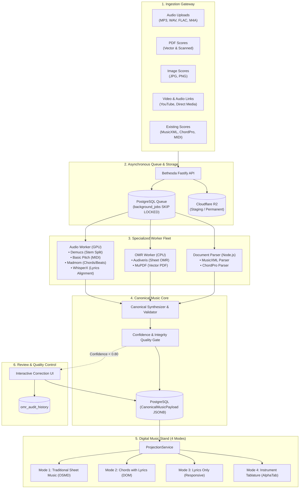
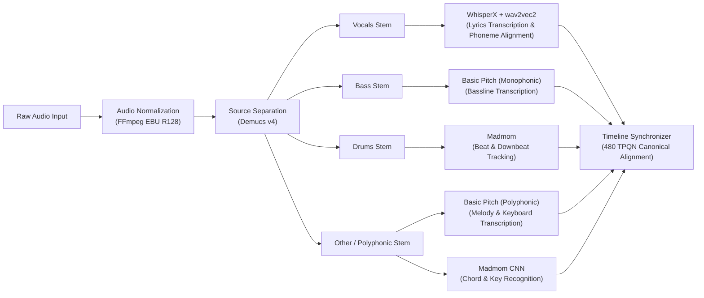
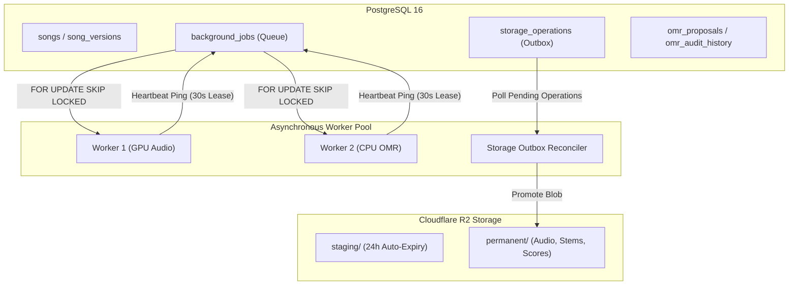

# WORSHIP STUDIO — MUSIC PROCESSING ENGINE ARCHITECTURE
## End-to-End System Blueprint, Microservice Boundaries & Event-Driven Orchestration

**Project:** Bethesda Worship Studio  
**Repository:** `https://github.com/juancastro2381-hub/BETHESDA-WORSHIP-STUDIO.git`  
**Phase:** Architecture Design & Reconciliation  
**Execution Mode:** STRICT READ-ONLY — Architectural Specification Only  
**Authorization Level:** Strictly Limited — No Implementation Authorized  
**Date:** November 2, 2026  
**Status:** **TARGET ARCHITECTURE SPECIFICATION**

---

## 1. Executive Summary & Architectural Overview

The **WORSHIP STUDIO Music Processing Engine** is an integrated, self-hosted, event-driven platform designed to ingest raw musical source material (audio, sheet music images, PDFs, video links, and digital music documents) and transform it into high-fidelity musical notation, chord charts, and tablature for the digital music stand.

The architecture eliminates reliance on external paid conversion services. It achieves zero per-song operating costs through serverless GPU execution, open-source AI models, and an ACID-compliant PostgreSQL job queue.



---

## 2. Specialized Processing Pipelines

### 2.1 Audio Transcription & Harmonic Analysis Pipeline
Designed to process raw polyphonic or multi-track audio into synchronized musical notation:



1. **Audio Decoding & Normalization:** FFmpeg converts input streams to standard uncompressed PCM (16-bit, 44.1 kHz stereo for separation; 16 kHz mono for speech alignment).
2. **Source Separation (Demucs v4):** Splits polyphonic audio into 4 isolated stems: Vocals, Bass, Drums, and Other (Piano/Guitars).
3. **Polyphonic & Monophonic Note Transcription (Spotify Basic Pitch):** Generates note events (pitch, onset, offset, velocity) from isolated stems.
4. **Harmonic & Beat Estimation (Madmom):** Computes beat positions, downbeats (measure boundaries), and chroma-based chord symbols (major, minor, 7ths, inversions).
5. **Speech Recognition & Alignment (WhisperX + wav2vec2):** Transcribes lyrics and locks each syllable to millisecond timestamps aligned with transcribed vocal notes.

### 2.2 Optical Music Recognition (OMR) Pipeline
Designed for printed sheet music images and scanned PDF scores:

1. **Document Classification & Routing:**
   - **Vector PDFs:** Detected via text/font glyph presence; vector path elements are parsed directly.
   - **Scanned PDFs / Images:** Rendered to 300 DPI grayscale rasters.
2. **Image Pre-Processing:** Binarization (Otsu thresholding), deskewing (Hough transform), staff line detection and removal/isolation.
3. **OMR Recognition (Audiveris Batch Daemon):** Runs in an isolated Docker container, outputting structural MusicXML containing notes, accidentals, clefs, meter, dynamics, and text.
4. **Integrity Enforcement Engine:** Rejects silent fallbacks. Validates measure durations against time signatures; flags incomplete measures for review.

### 2.3 Existing Musical Document Ingestion
- **MusicXML & Compressed .mxl:** Parsed via strict DOM validator, converting XML elements directly into the internal canonical graph.
- **ChordPro:** Parsed via internal tokenizer, extracting directives (`{title}`, `{key}`, `{capo}`), chords `[Am]`, and aligned lyrics.
- **MIDI:** Ingested via standard MIDI parser, quantizing tick resolution to canonical 480 TPQN.

---

## 3. The Canonical Musical Core (`CanonicalMusicPayload`)

All pipelines output intermediate data structures that the **Canonical Synthesizer** merges into a single, unified `CanonicalMusicPayload`:

```
CanonicalMusicPayload (Root)
 ├── title, composer, copyright
 ├── timeline (resolution: 480 TPQN, tempoMap, timeSignatures, keySignatures)
 ├── sections (Intro, Verse, Chorus, Bridge, Solo, Outro...)
 ├── measures (Measure numbers, startTick, durationTicks, meter, key)
 ├── instrumentTracks (Track ID, name, family: GUITAR | KEYS | BASS | VOCALS, clef)
 │    └── musicalEvents (Notes, Chords, Rests with tickOffset, pitch, velocity)
 ├── chords (Harmonic timeline: chordRoot, quality, bassNote, tickOffset)
 ├── lyrics (Syllables: text, syllabic: START | MIDDLE | END | SINGLE, tickOffset)
 ├── tablature (Tunings, string/fret coordinates, capo specifications)
 └── metadata (Provenance, confidence heatmap, revision history)
```

---

## 4. Digital Music Stand: Multi-Representation Projection

The platform enforces the architectural invariant: **Instrument $\neq$ View**.

The unified `CanonicalMusicPayload` is projected deterministically on the client side via [`ProjectionService`](file:///c:/Users/juanc/OneDrive/Documentos/Desarrollo%20proyectos/Sistema%20musical%20-%20partituras/BETHESDA%20WORSHIP%20STUDIO/frontend/src/core/projection/projection-service.ts) into four native views:

1. **Mode 1: Traditional Sheet Music (Partitura):** Rendered dynamically in the browser using OpenSheetMusicDisplay (OSMD). Supports clefs, accidentals, beams, dynamic markings, and vocal lyrics under the staff.
2. **Mode 2: Chords with Lyrics (Cifrado con Letra):** Rendered using responsive DOM components. Displays chords positioned precisely above the matching lyrics, with instant key transposition and capo calculation.
3. **Mode 3: Lyrics Only (Solo Letra):** High-contrast typography view optimized for singers and vocalists. Displays structured song sections (Verses, Chorus) with automated autoscroll.
4. **Mode 4: Instrument Tablature (Tablatura):** Rendered via AlphaTab. Displays 6-string guitar and 4/5-string bass tablatures with fret numbers, string lines, and rhythmic stems calculated by [`TablatureCalculator`](file:///c:/Users/juanc/OneDrive/Documentos/Desarrollo%20proyectos/Sistema%20musical%20-%20partituras/BETHESDA%20WORSHIP%20STUDIO/frontend/src/core/projection/tablature-calculator.ts).

---

## 5. Persistence, Concurrency & Infrastructure Architecture



### 5.1 ACID Job Queue with Fencing Tokens
- Implemented natively in PostgreSQL using `FOR UPDATE SKIP LOCKED`.
- Workers claim tasks with a 30-second lease, maintained via heartbeats every 10 seconds.
- Monotonic fencing tokens prevent stale worker overwrites in the event of GC pauses or network partitions.

### 5.2 Storage Dual-Write Outbox Pattern
- Solves atomicity issues between PostgreSQL and Cloudflare R2.
- Upload promotions and permanent deletions are written to `storage_operations` within the primary database transaction.
- An asynchronous reconciler executes R2 operations and retries upon transient failures.
- Daily garbage collector compares active database keys against R2 blobs to eliminate storage leaks.

---

## 6. Technical Maturity & Implementation Status

| Subsystem Component | Maturity Classification | Codebase Evidence |
| :--- | :--- | :--- |
| **Ingestion Gateway (HTTP)** | **IMPLEMENTED** | Multi-format upload endpoints exist in backend. |
| **Audio Pipeline (Demucs / Basic Pitch)** | **DESIGNED (0% Implemented)** | Models specified; Python worker unbuilt. |
| **OMR Pipeline (Audiveris)** | **DOCUMENTED DEFECTS** | Prototype in `omr-service.ts` with 10 open defects. |
| **Harmony & Beat Engine (Madmom)** | **DESIGNED (0% Implemented)** | Algorithmic pipeline specified; unbuilt. |
| **Lyrics Forced Alignment (WhisperX)**| **DESIGNED (0% Implemented)** | Architecture specified; acoustic models unintegrated. |
| **Canonical Model (`CanonicalMusicPayload`)** | **IMPLEMENTED (v1.0.0)** | TypeScript classes exist in `frontend/src/core/canonical-model`. |
| **Digital Music Stand (4 Native Modes)** | **PARTIALLY IMPLEMENTED** | Projection service and adapters exist; needs unified integration. |
| **Job Queue & Outbox Persistence** | **DESIGNED (0% Implemented)** | Tables missing from `backend/src/db/schema.ts`. |

