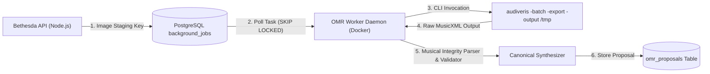

# WORSHIP STUDIO — OPTICAL MUSIC RECOGNITION & MUSICAL INTEGRITY REQUIREMENTS
## Audiveris Integration, Symbol Recognition, Non-Negotiable Invariants & Defect Remediation Specification

**Project:** Bethesda Worship Studio  
**Repository:** `https://github.com/juancastro2381-hub/BETHESDA-WORSHIP-STUDIO.git`  
**Phase:** Architecture Design & Reconciliation  
**Execution Mode:** STRICT READ-ONLY — Architectural Specification Only  
**Authorization Level:** Strictly Limited — No Implementation Authorized  
**Date:** November 2, 2026  
**Status:** **OMR & MUSICAL INTEGRITY SPECIFICATION**

---

## 1. Executive Summary & Purpose

Optical Music Recognition (OMR) transforms printed sheet music images and scanned PDF hymnals into digital, playable, transposable scores.

In compliance with the Product Owner Master Directive:
> *"The system must preserve the actual musical meaning when converting recognized notation into the canonical representation. Unknown symbols must never silently become arbitrary musical values."*

This document specifies:
1. The containerized **Audiveris OMR microservice** architecture.
2. The complete inventory of recognizable musical symbols.
3. The **Ten Non-Negotiable Musical Integrity Invariants** required to remediate the ten open defects identified in [`backend/src/application/omr-service.ts`](file:///c:/Users/juanc/OneDrive/Documentos/Desarrollo%20proyectos/Sistema%20musical%20-%20partituras/BETHESDA%20WORSHIP%20STUDIO/backend/src/application/omr-service.ts).

---

## 2. Containerized OMR Microservice Architecture

To guarantee strict compliance with Audiveris’s AGPL-3.0 license and isolate heavy Java workloads from the Node.js API, Audiveris operates inside an independent Docker container:



- **Process Isolation:** Invoked purely across a process boundary (`child_process.spawn`) or gRPC network interface.
- **Zero In-Process Linking:** No Audiveris Java code is linked into Bethesda proprietary source files.

---

## 3. Complete Musical Symbol Recognition Inventory

The OMR pipeline is engineered to extract and preserve the full semantic spectrum of traditional notation:

| Symbol Category | Recognized Elements | Canonical Model Mapping |
| :--- | :--- | :--- |
| **Staves & Systems** | Single Staff, Grand Staff (Piano), Multi-part Choir | `instrumentTrack` grouping, `clef: DOUBLE_TREBLE_BASS` |
| **Clefs** | Treble (G2), Bass (F4), Alto (C3), Tenor (C4), Percussion | `InstrumentTrack.clef` |
| **Key Signatures** | 0 to 7 Sharps, 0 to 7 Flats; Major and Minor modes | `Measure.keySignature` (preserves alteration count) |
| **Time Signatures** | 4/4, 3/4, 2/4, 6/8, 12/8, Common Time (C), Cut Time (2/2) | `Measure.timeSignature` (preserves exact beats and beat-type) |
| **Notes & Durations** | Whole (1920t), Half (960t), Quarter (480t), 8th (240t), 16th (120t), 32nd (60t) | `Note.durationTicks` |
| **Rhythmic Modifiers**| Single Dot ($\times 1.5$), Double Dot ($\times 1.75$), Triplets, Tuplets | `Note.durationTicks`, `Note.tuplet` |
| **Accidentals** | Sharp (`#`), Flat (`b`), Natural (`n`), Double Sharp (`x`), Double Flat (`bb`) | `Pitch.alter` (-2 to +2) |
| **Articulation Marks**| Staccato, Accent, Tenuto, Fermata | `Note.articulations` array |
| **Bies & Ties** | Musical Ties (`<tie>`), Slurs, Beams | `Note.tie` ('START' \| 'STOP' \| 'CONTINUE') |
| **Dynamics** | `ppp`, `pp`, `p`, `mp`, `mf`, `f`, `ff`, `fff`, Crescendo hairpin | `Note.dynamicMarking` |
| **Vocal Lyrics** | Syllable text, hyphenation dashes, melisma underscores | `LyricSyllable` linked to note tick offsets |
| **Chord Symbols** | Standard American chord text positioned above staff | `ChordEvent` positioned at exact onset tick |

---

## 4. The Ten Non-Negotiable Musical Integrity Invariants

The independent audit of `backend/src/application/omr-service.ts` proved that earlier prototypes contained 10 silent fallback mechanisms that corrupted musical notation.

Phase 1A must strictly implement the **Ten Non-Negotiable Musical Integrity Invariants**:

```
┌────────────────────────────────────────────────────────────────────────────────────────────────┐
│                       THE TEN NON-NEGOTIABLE MUSICAL INTEGRITY INVARIANTS                      │
├────┬─────────────────────────────┬─────────────────────────────────────────────────────────────┤
│ #  │ Invariant Name              │ Mandatory System Behavior (Zero Silent Fallbacks)           │
├────┼─────────────────────────────┼─────────────────────────────────────────────────────────────┤
│ 01 │ Meter Preservation          │ NEVER default to 4/4. Parse exact meter (3/4, 6/8). If      │
│    │                             │ unparseable, flag measure as REQUIRES_REVIEW.               │
├────┼─────────────────────────────┼─────────────────────────────────────────────────────────────┤
│ 02 │ Tonality Preservation       │ NEVER default to C Major. Parse explicit accidentals. If    │
│    │                             │ unparseable, throw validation error.                        │
├────┼─────────────────────────────┼─────────────────────────────────────────────────────────────┤
│ 03 │ Accidental Preservation     │ ALWAYS pass Pitch(step, octave, alter). Never drop sharps   │
│    │                             │ or flats to sound as natural notes.                         │
├────┼─────────────────────────────┼─────────────────────────────────────────────────────────────┤
│ 04 │ Pitch Step Integrity        │ NEVER invent Note C when pitch step is missing. Abort note  │
│    │                             │ creation and record an unrecognised glyph error.            │
├────┼─────────────────────────────┼─────────────────────────────────────────────────────────────┤
│ 05 │ Duration Arithmetic         │ NEVER default unknown durations to 480 ticks. Calculate via │
│    │                             │ divisions or flag measure duration mismatch.                │
├────┼─────────────────────────────┼─────────────────────────────────────────────────────────────┤
│ 06 │ Explicit Error Handling     │ NEVER swallow unparseable chords in empty catch {} blocks.  │
│    │                             │ Log parse errors in omr_audit_history.                      │
├────┼─────────────────────────────┼─────────────────────────────────────────────────────────────┤
│ 07 │ Lyric Offset Calculation    │ NEVER assign all syllables tickOffset: 0. Align syllables   │
│    │                             │ to the exact onset tick of their associated note.           │
├────┼─────────────────────────────┼─────────────────────────────────────────────────────────────┤
│ 08 │ Confidence Thresholding     │ Symbols with confidence < 0.70 must trigger visual flags in │
│    │                             │ the proposal review UI; never presented as certified truth. │
├────┼─────────────────────────────┼─────────────────────────────────────────────────────────────┤
│ 09 │ Relational Persistence      │ NEVER store proposals in transient process memory (Map).    │
│    │                             │ Persist in PostgreSQL omr_proposals table with ACID safety. │
├────┼─────────────────────────────┼─────────────────────────────────────────────────────────────┤
│ 10 │ Schema Contract Validation  │ All OMR outputs must pass strict Zod runtime schema         │
│    │                             │ validation before entering the canonical domain pipeline.   │
└────┴─────────────────────────────┴─────────────────────────────────────────────────────────────┘
```

---

## 5. Measure Duration Arithmetic Validation Equation

Every measure processed by OMR must satisfy the duration conservation equation:

$$\sum_{i=1}^{N} \text{durationTicks}_i = 480 \times \frac{4 \times \text{beats}}{\text{beat-type}}$$

*Example (6/8 Time Signature):*
$$\text{Expected Ticks} = 480 \times \frac{4 \times 6}{8} = 480 \times 3 = 1440 \text{ ticks}$$

- If $\sum \text{durationTicks} < 1440$: Measure is flagged with `INCOMPLETE_MEASURE` in `omr_proposal_measures`.
- If $\sum \text{durationTicks} > 1440$: Measure is flagged with `EXTRA_BEATS` in `omr_proposal_measures`.
- The system **never silently adds or removes notes** to balance the measure. It alerts the human reviewer in the correction UI.

---

## 6. Technical Maturity Register

| Requirement | Live Code State | Target Phase 1A State |
| :--- | :--- | :--- |
| **Silent Note C Fallback** | Defect OPEN (`omr-service.ts#L190`) | Fixed via pitch existence validation |
| **Accidental Dropping** | Defect OPEN (`omr-service.ts#L191`) | Fixed via `new Pitch(step, oct, alter)` |
| **Duration 480 Default** | Defect OPEN (`omr-service.ts#L192`) | Fixed via division scaling and duration check |
| **Hardcoded 4/4 Meter** | Defect OPEN (`omr-service.ts#L139`) | Fixed via dynamic time signature parsing |
| **Hardcoded C Major Key** | Defect OPEN (`omr-service.ts#L149`) | Fixed via dynamic key signature parsing |
| **Empty Catch Swallowing**| Defect OPEN (`omr-service.ts#L180`) | Fixed via structured diagnostic logging |
| **In-Memory Proposal Map**| Defect OPEN (`omr-service.ts#L34`) | Replaced with Drizzle ORM relational tables |
| **Confidence Filtering** | Defect OPEN (`omr-service.ts#L156`) | Enforced thresholding (flag if $< 0.70$) |

