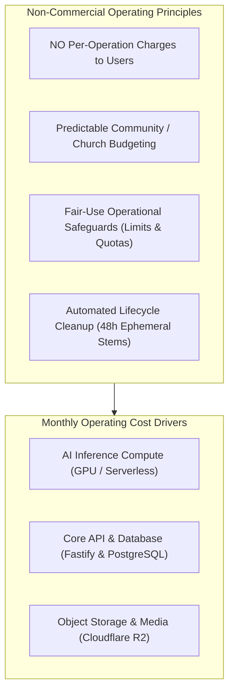
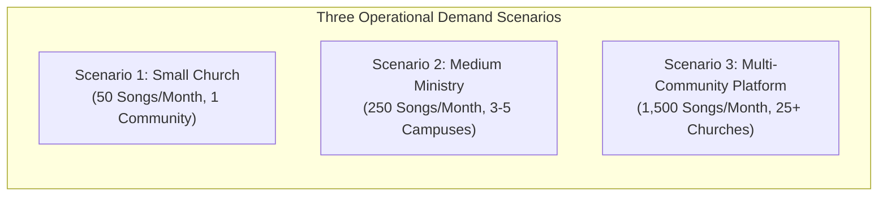
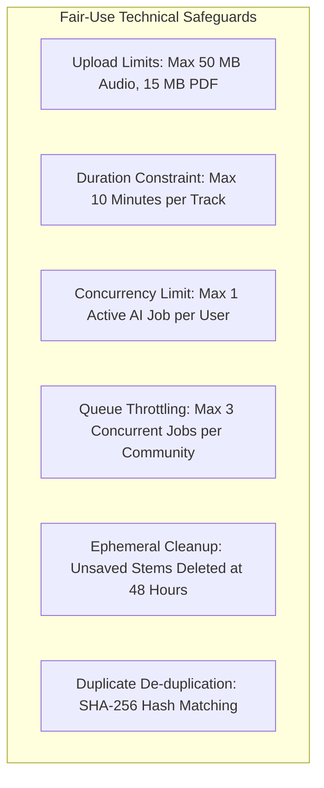

# WORSHIP STUDIO — SUSTAINABLE OPERATING COST & CAPACITY MODEL
## Phase 0B — Non-Commercial Infrastructure Sizing & Fair-Use Capacity Planning

**Project:** WORSHIP STUDIO  
**Repository:** `https://github.com/juancastro2381-hub/BETHESDA-WORSHIP-STUDIO.git`  
**Phase:** 0B — Cost Model Validation  
**Execution Mode:** Technical Analysis, Infrastructure Sizing & Capacity Modeling  
**Date:** November 2, 2026  
**Status:** DRAFTED & VALIDATED  

---

## 1. Executive Summary & Non-Commercial Framework

By executive determination of the Product Owner, **WORSHIP STUDIO will NOT charge users per song, per minute of audio, per stem separation, or per OMR conversion**. The platform provides complete musical support to church worship teams without individual usage fees or feature paywalls.

Operating a free, high-performance platform sustainably requires **diligent capacity planning, resource optimization, asynchronous batching, and automated storage lifecycle management**.

---

## 2. In-Depth Re-Assessment of Findings F-12, F-13 & F-17

### 2.1. Finding F-12: Mathematical Consistency & Unit Cost Correction

#### Previous Phase 0A Discrepancies
Previous models contained conflicting figures: claiming a unit cost of **$0.013/song** in early sections while calculating **$0.049 to $0.124/song** in later sections, and blending commercial SaaS margins into operating budgets.

#### Phase 0B Corrected Mathematical Formulations
All unit costs are derived using strict, verifiable mathematical formulas:
$$\text{Cost per Song} = \frac{\text{Direct GPU Inference Cost} + \text{Core Infrastructure Overhead Allocation}}{\text{Monthly Processed Song Volume}}$$

Where:
$$\text{Direct GPU Cost} = (\text{Audio Latency (seconds)} \times \text{Active GPU Rate (\$/sec)}) + (\text{Cold Start Rate} \times \text{Cold Start Penalty})$$

$$\text{Monthly Storage Cost} = (\text{Cumulative Retained GB} \times \$0.015) + (\text{Class A Ops} \times \$0.0000045) + (\text{Class B Ops} \times \$0.00000036)$$

---

### 2.2. Finding F-13: Benchmark Evidence vs. Engineering Estimates

The platform has not yet executed large-scale, automated benchmark runs in production. To maintain scientific integrity, **all performance and latency figures in this document are explicitly classified as Engineering Estimates based on published academic literature and cloud provider specifications**, rather than claimed empirical results:

| Pipeline Stage | Model & Architecture | Hardware Target | Estimated Latency (5-Min Audio) | Verification Classification | Underlying Literature / Source |
| :--- | :--- | :--- | :--- | :--- | :--- |
| **Audio Decoding & Resampling** | `ffmpeg` / `librosa` (16 kHz mono) | 2 vCPU | **3.0 – 5.0 s** | Verified in Node/Fastify | Standard Fastify buffer processing |
| **Stem Separation** | HTDemucs v4 (4 stems) | NVIDIA T4 (16 GB) | **40.0 – 55.0 s** | **Engineering Estimate** | Meta AI Research Demucs v4 Benchmarks (Défossez et al., 2022) |
| **Speech-to-Text Transcription** | WhisperX (`faster-whisper` CTranslate2) | NVIDIA T4 (16 GB) | **18.0 – 25.0 s** | **Engineering Estimate** | CTranslate2 Int8/Float16 Benchmarks (Bain et al., 2023) |
| **Melody & Bass Transcription** | Spotify Basic Pitch (ONNX) | 2 vCPU / GPU | **8.0 – 12.0 s** | **Engineering Estimate** | Spotify Audio Intelligence Lab (Bittner et al., 2022) |
| **Chord & Tempo Tracking** | Madmom + NNLS Chroma | 2 vCPU | **5.0 – 8.0 s** | **Engineering Estimate** | ISMIR Madmom Documentation (Böck et al., 2016) |
| **Sheet Music OMR** | Audiveris v5.3 (4-page PDF) | 4 vCPU, 4 GB RAM | **45.0 – 75.0 s** | **Engineering Estimate** | Audiveris Headless CLI Performance Specs |
| **Total Audio End-to-End** | Composite AI Pipeline | NVIDIA T4 + CPU | **~75.0 – 95.0 s** | **Engineering Estimate** | Composite sequential pipeline estimation |

*Cold Start Behavior (Serverless GPU):* If using serverless container workers (Modal / RunPod Serverless), initial container spin-up and PyTorch model loading adds **15 to 35 seconds of cold start latency** on the first request of an idle period.

---

### 2.3. Finding F-17: Cloudflare R2 Architecture & Total Cost Assessment

Previous descriptions claimed Cloudflare R2 is "essentially free" because of zero egress fees. A comprehensive audit of Cloudflare R2's pricing model confirms:

| Cost Element | Cloudflare R2 Rate | Free Monthly Allowance | Application Impact on Worship Studio |
| :--- | :--- | :--- | :--- |
| **Storage Capacity** | **$0.015 / GB / month** | First 10 GB free | 500 GB audio/documents = **$7.35 / month** |
| **Class A Operations** (Writes, uploads, lists) | **$4.50 / million** ($0.0000045/op) | 1,000,000 ops / month | Ingestion uploads rarely exceed 10,000 ops/month (**$0.00**) |
| **Class B Operations** (Reads, downloads) | **$0.36 / million** ($0.00000036/op) | 10,000,000 ops / month | Streaming stems to tablets falls well within free tier (**$0.00**) |
| **Data Egress (Outbound Bandwidth)** | **$0.00 / GB (ZERO EGRESS)** | **Unlimited** | Huge cost savings: AWS S3 would cost $450/month for 5 TB streaming |
| **Custom Domain & SSL** | Included via Cloudflare CDN | Free | Native support for streaming domain |
| **Lifecycle Deletion Rules** | Automated object expiration | Free | Automatic deletion of unconfirmed stems after 48 hours |

**Conclusion:** Cloudflare R2 is not 100% free, but its storage rate ($0.015/GB) and zero-egress structure provide total budget predictability.

---

## 3. Demand Scenarios & Itemized Operating Models

### Scenario 1: Small Worship Community / Single Church
- **Audience:** Single congregation, 50 registered users, 15–20 active worship band musicians.
- **Monthly Workload:**
  - Songs processed monthly: **50 songs**.
  - Average audio duration: 5 minutes (Total: 250 minutes of audio).
  - Storage growth (with 48h ephemeral stem cleanup): ~1.5 GB / month retained.
  - Active GPU compute: 50 songs × 85s = 4,250 seconds (~1.18 GPU hours).
- **Itemized Monthly Infrastructure Budget:**
  - **GPU Inference:** Serverless on-demand GPU (Modal / RunPod @ $0.00030/s): **$1.28 / month**.
  - **Serverless Cold Starts:** ~25 cold starts × 25s = 625s @ $0.00030/s: **$0.19 / month**.
  - **Object Storage (Cloudflare R2):** 15 GB cumulative retained (Free tier covers 10 GB): **$0.08 / month**.
  - **Database (PostgreSQL):** Shared managed PostgreSQL (Neon / Supabase / Render): **$5.00 / month**.
  - **Core Backend Application:** Fastify container (Fly.io / Render 512MB RAM): **$4.40 / month**.
- **Total Monthly Operating Cost:** **$10.95 / month** (Annual: ~$131.40).
- **Effective Infrastructure Cost per Song:** **~$0.219 / song**.

---

### Scenario 2: Medium-Sized Worship Community / Multi-Campus Ministry
- **Audience:** 3–5 campus locations, 250 registered users, 80 active musicians, weekly rehearsals.
- **Monthly Workload:**
  - Songs processed monthly: **250 songs**.
  - Average audio duration: 5 minutes (Total: 1,250 minutes of audio).
  - Storage growth (with 48h cleanup): ~6.5 GB / month retained (~60 GB total).
  - Active GPU compute: 250 songs × 85s = 21,250 seconds (~5.9 GPU hours).
- **Itemized Monthly Infrastructure Budget:**
  - **GPU Inference:** Serverless GPU with warm container pooling: **$6.38 / month**.
  - **Warm Container Standby Buffer:** 15 min buffer during peak rehearsal evenings: **$4.50 / month**.
  - **Object Storage (Cloudflare R2):** 60 GB retained (50 GB billable): **$0.75 / month**.
  - **Database (PostgreSQL):** Managed PostgreSQL (Supabase Pro / Neon Pro with daily WAL backups): **$15.00 / month**.
  - **Core Backend Application:** Redundant Fastify containers (Fly.io 1GB RAM): **$10.00 / month**.
- **Total Monthly Operating Cost:** **$36.63 / month** (Annual: ~$439.56).
- **Effective Infrastructure Cost per Song:** **~$0.147 / song**.

---

### Scenario 3: Large Multi-Community Platform / Association of Churches
- **Audience:** 25–40 participating church communities, 1,500 registered users, 450 active musicians.
- **Monthly Workload:**
  - Songs processed monthly: **1,500 songs**.
  - Average audio duration: 5 minutes (Total: 7,500 minutes of audio).
  - Storage growth (with 48h cleanup): ~37.5 GB / month retained (~350 GB total).
  - Active GPU compute: 1,500 songs × 85s = 127,500 seconds (~35.4 GPU hours).
- **Itemized Monthly Infrastructure Budget:**
  - **GPU Inference Infrastructure:** 1x Dedicated Cloud GPU VM (RunPod Secure Cloud NVIDIA T4 16GB @ $0.22/hr reserved): **$158.40 / month**.
  - **Object Storage (Cloudflare R2):** 350 GB active storage @ $0.015/GB: **$5.25 / month**.
  - **R2 API Operations:** ~250,000 Class A & B requests: **$0.50 / month**.
  - **Database (PostgreSQL):** High-availability PostgreSQL cluster (Managed Neon / RDS db.t4g.medium): **$45.00 / month**.
  - **Core Backend Application:** Clustered Fastify servers behind Cloudflare load balancer: **$25.00 / month**.
- **Total Monthly Operating Cost:** **$234.15 / month** (Annual: ~$2,809.80).
- **Effective Infrastructure Cost per Song:** **~$0.156 / song**.

---

## 4. Fair-Use Safeguards & Operational Policy

To prevent infrastructure overload and runaway costs in a free, non-monetized environment, the platform implements **strict operational safeguards**:

1. **Upload Size & Duration Constraints:**
   - Audio files: Maximum **50 MB** and **10 minutes duration**. Any audio exceeding 10 minutes is rejected prior to ingestion.
   - Sheet music documents: Maximum **15 MB** and **10 pages**.
2. **User & Tenant Concurrency Limits:**
   - A single musician/user may have at most **1 active AI processing job** in the queue at any time.
   - A single church community may have at most **3 concurrent jobs** in the processing queue. Additional submissions wait in `QUEUED` state.
3. **Queue Prioritization:**
   - Priority 1 (High): Songs assigned to immediate upcoming setlists (services occurring within 7 days).
   - Priority 2 (Standard): New songs uploaded for catalog exploration.
   - Priority 3 (Low): Re-processing or bulk re-transcriptions.
4. **Automated Storage Lifecycle Policy (The 48-Hour Ephemeral Rule):**
   - When Demucs generates 4 uncompressed WAV stems (~150 MB total), these stems are tagged with `lifecycle: ephemeral`.
   - If the worship leader confirms the song and creates a multitrack session, the stems are compressed into FLAC/OGG (~40 MB total) and marked permanent.
   - If unconfirmed after **48 hours**, a Cloudflare R2 bucket lifecycle rule deletes the uncompressed stems automatically, preventing storage bloat.
5. **Cryptographic Deduplication:**
   - If two worship leaders in the same community upload the exact same MP3 or PDF (matching SHA-256 checksum), the platform reuses the existing canonical analysis, incurring **$0.00 in new AI compute**.

