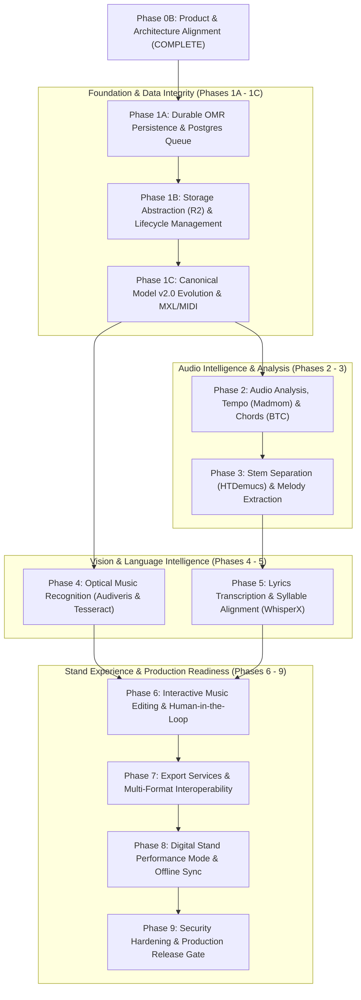

# WORSHIP STUDIO — REVISED IMPLEMENTATION ROADMAP
## Phase 0B — Dependency-Aware Phased Engineering Roadmap

**Project:** WORSHIP STUDIO  
**Repository:** `https://github.com/juancastro2381-hub/BETHESDA-WORSHIP-STUDIO.git`  
**Phase:** 0B — Implementation Roadmap Revision  
**Execution Mode:** Phased Planning & Dependency Mapping Only  
**Implementation Authorization:** NOT GRANTED  
**Date:** November 2, 2026  
**Status:** DRAFTED & VALIDATED  

---

## 1. Executive Summary & Phasing Strategy

In response to Finding **F-18** (Roadmap Inconsistency), this revised roadmap reconciles the non-commercial product model, the PostgreSQL-first queue architecture, Cloudflare R2 storage economics, and legal licensing boundaries into **ten discrete, dependency-aware implementation phases**.

### Strict Governance Rules
1. **Zero Breaking Changes:** Existing functionality (OSMD stand, AlphaTab tablature, LeadSheetDOM chords, audio streaming 206) must remain 100% operational across all phases.
2. **Git Cleanup Gating:** Untracking `node_modules` and runtime storage (F-08) remains **strictly pending explicit Product Owner authorization**.
3. **Implementation Authorization:** Execution of Phase 1A or any subsequent phase is **NOT authorized** until formal Product Owner sign-off on Phase 0B deliverables.



---

## 2. Detailed Phase Specifications

---

### PHASE 1A: DURABLE OMR PERSISTENCE & TRANSACTIONAL JOB QUEUE
- **Objective:** Eliminate ephemeral in-memory state in `OmrService` (F-02) and provide reliable asynchronous job execution (F-03, F-14) using existing PostgreSQL infrastructure.
- **Dependencies:** Phase 0B sign-off by Product Owner.
- **Deliverables:**
  1. Drizzle ORM migrations creating `omr_proposals`, `omr_proposal_measures`, `omr_audit_history`, and `background_jobs`.
  2. Refactored `OmrService` interacting with PostgreSQL instead of `this.proposals = new Map()`.
  3. Transactional job dispatcher implementing `SELECT ... FOR UPDATE SKIP LOCKED` with lease expiration and exponential backoff.
- **Risks:** Database deadlocks or lock contention under concurrent load (mitigated by `SKIP LOCKED`).
- **Required Infrastructure:** Existing PostgreSQL 16 database. Zero new infrastructure dependencies.
- **Operating Cost Impact:** **$0.00 additional monthly cost**.
- **Manual Validation Procedure:**
  1. Restart backend container while an OMR proposal is in `PENDING_REVIEW` status; confirm proposal remains intact upon reboot.
  2. Enqueue 5 concurrent test jobs; verify each job is leased by exactly one worker without lock contention.
- **Exit Gate:** 100% test pass on backend test suite; zero regressions on existing song endpoints.

---

### PHASE 1B: FILE STORAGE ABSTRACTION (R2/S3) & LIFECYCLE POLICIES
- **Objective:** Desacoplar el almacenamiento de archivos del disco local hacia Cloudflare R2 (F-09, F-17) e implementar la política de limpieza efímera de 48 horas.
- **Dependencies:** Phase 1A complete.
- **Deliverables:**
  1. `StorageProvider` interface implemented with `@aws-sdk/client-s3`.
  2. `R2StorageProvider` for production and `LocalStorageProvider` for local testing.
  3. Automated 48-hour lifecycle policy deleting unconfirmed stems.
  4. Updated `StreamTicketService` generating signed S3/R2 URLs.
- **Risks:** Network latency during large file uploads (mitigated by direct presigned S3 upload URLs).
- **Required Infrastructure:** Cloudflare R2 bucket with scoped IAM tokens.
- **Operating Cost Impact:** **~$0.10 to $0.75 / month** (based on storage volume; zero egress fees).
- **Manual Validation Procedure:**
  1. Upload audio file via presigned URL; verify presence in R2 bucket with matching SHA-256 checksum.
  2. Stream audio using generated ticket; verify HTTP 206 seeking support.
- **Exit Gate:** All existing document and audio tests pass against local and mock S3 providers.

---

### PHASE 1C: CANONICAL MODEL v2.0 EVOLUTION & ARCHIVE INGESTION
- **Objective:** Extend the canonical music data model to support AI confidence scores, provenance, and instrument tracks (F-07), and add support for `.mxl` and standard MIDI.
- **Dependencies:** Phase 1A complete.
- **Deliverables:**
  1. `CanonicalMusicPayloadV2` specification in backend and frontend.
  2. Bidirectional schema converters: `migrateV1ToV2()` and `downgradeV2ToV1()`.
  3. Compressed MusicXML (`.mxl`) extraction pipeline via streaming ZIP decompressor.
  4. Standard MIDI (`.mid`) parser populating canonical notes and tempo maps.
- **Risks:** Incomplete schema migration breaking frontend visualizers (mitigated by automated golden scenario tests).
- **Required Infrastructure:** In-process CPU libraries (JSZip, MidiParser).
- **Operating Cost Impact:** **$0.00 additional monthly cost**.
- **Manual Validation Procedure:**
  1. Import legacy v1 song; verify transparent up-conversion to v2.
  2. Upload `.mxl` file; verify decompression and rendering in OSMD and AlphaTab.
- **Exit Gate:** 100% conversion fidelity across all existing golden fixtures (`valid_full_score.musicxml`).

---

### PHASE 2: AUDIO ANALYSIS, TEMPO DETECTION & LITURGICAL CHORDS
- **Objective:** Implement automated audio analysis to extract BPM, metric downbeats, and harmonic chord progressions from input audio.
- **Dependencies:** Phase 1A, 1B, 1C complete.
- **Deliverables:**
  1. Python worker service integrating `Madmom` (BSD-2) for downbeat and tempo tracking.
  2. `BTC Transformer` (MIT) worker extracting chords, suspensions (sus4, add9), and bass inversions.
  3. Dynamic `Timeline.tempoMap` synthesis.
- **Risks:** Harmonic ambiguity in songs with heavy synthesizer pads (mitigated by downbeat-aligned chromagram quantization).
- **Required Infrastructure:** CPU worker or light GPU instance.
- **Operating Cost Impact:** **~$1.50 to $6.00 / month** on serverless compute.
- **Manual Validation Procedure:**
  1. Process worship reference track (*Grande es tu fidelidad*); verify detected BPM within +/- 1 BPM of metronome.
  2. Confirm chords align to bar lines in generated `CanonicalMusicPayloadV2`.
- **Exit Gate:** Chord recognition accuracy `>= 85%` on reference audio test corpus.

---

### PHASE 3: STEM SEPARATION & INSTRUMENT-SPECIFIC TRANSCRIPTION
- **Objective:** Isolate audio into four stems (vocals, bass, drums, other) using HTDemucs and transcribe solo vocal and bass melody lines using Basic Pitch (F-05, F-16).
- **Dependencies:** Phase 2 complete.
- **Deliverables:**
  1. Containerized `HTDemucs v4` worker running in a locked Docker environment (`Python 3.10`, `PyTorch 2.1.2`, `CUDA 11.8`).
  2. `Spotify Basic Pitch` ONNX worker processing isolated vocal and bass stems.
  3. Multitrack session integration enabling solo/mute controls in `AudioPlayerBar`.
- **Risks:** Out-Of-Memory (OOM) errors on long audio files (mitigated by segmenting audio into chunks with crossfade overlap).
- **Required Infrastructure:** GPU compute instance (NVIDIA T4 or L4).
- **Operating Cost Impact:** **~$2.00 to $12.00 / month** on serverless GPU.
- **Manual Validation Procedure:**
  1. Upload 5-minute worship mix; verify separation into 4 clean WAV stems in `< 90 seconds`.
  2. Confirm Basic Pitch generates clean vocal melody without synthetic guitar/keyboard artifacts.
- **Exit Gate:** Successful stem generation and zero false notes from instrumental leakage.

---

### PHASE 4: OPTICAL MUSIC RECOGNITION (OMR) & SCAN PIPELINE
- **Objective:** Deploy a network-isolated Audiveris container for traditional sheet music recognition (F-01, F-11) and Tesseract OCR for text chord sheets.
- **Dependencies:** Phase 1A, 1B, 1C complete.
- **Deliverables:**
  1. Isolated Docker microservice running unmodified upstream Audiveris v5.3 headless.
  2. File-exchange integration: Fastify posts image to storage, Audiveris writes MusicXML, Fastify reads MusicXML.
  3. Tesseract OCR pipeline for scanned text lead sheets.
  4. Camera capture component in frontend with Canvas perspective correction.
- **Risks:** Poor quality or low-resolution scans (mitigated by minimum DPI validation and pre-processing contrast filters).
- **Required Infrastructure:** CPU worker (4 vCPU, 4 GB RAM) for Audiveris JVM.
- **Operating Cost Impact:** **~$1.00 to $4.00 / month** on CPU serverless.
- **Manual Validation Procedure:**
  1. Submit 300 DPI PDF of hymnal score; verify valid MusicXML 4.0 generation.
  2. Project generated MusicXML in OSMD; confirm pitch and measure alignment.
- **Exit Gate:** Legal counsel review of Audiveris isolation; OMR accuracy `>= 90%` on printed sheet fixtures.

---

### PHASE 5: LYRICS TRANSCRIPTION & FORCED PHONEME ALIGNMENT
- **Objective:** Transcribe worship lyrics from the isolated vocal stem and align syllables to musical notes using WhisperX (F-15).
- **Dependencies:** Phase 3 complete (isolated vocal stem required).
- **Deliverables:**
  1. `WhisperX` worker using `Silero VAD` (replacing gated pyannote VAD).
  2. `wav2vec2` forced alignment models for Spanish and English liturgical texts.
  3. Ingestion into `LyricSyllable` structures linked to musical note ticks.
- **Risks:** Misinterpretation of poetic or non-standard liturgical phrasing (mitigated by Spanish language model fine-tuning).
- **Required Infrastructure:** GPU worker (NVIDIA T4).
- **Operating Cost Impact:** **~$1.00 to $4.00 / month**.
- **Manual Validation Procedure:**
  1. Process vocal stem; confirm word error rate (WER) `< 10%`.
  2. Verify syllables map to the corresponding melodic notes in the digital stand.
- **Exit Gate:** Syllable-to-note alignment accuracy `>= 85%` on vocal test corpus.

---

### PHASE 6: INTERACTIVE MUSIC STAND EDITING & HUMAN INSPECTOR
- **Objective:** Build an ergonomic human-in-the-loop inspector and in-stand notation editor.
- **Dependencies:** Phases 3, 4, 5 complete.
- **Deliverables:**
  1. Confidence Heatmap component highlighting uncertain measures (`confidence < 0.75`) in amber.
  2. Interactive chord editor with circle-of-fifths liturgical recommendations.
  3. Interactive note pitch and duration adjustment on reactive canvas.
  4. Atomic approval workflow promoting `omr_proposals` to official `SongVersion`.
- **Risks:** Visual clutter on small tablet screens (mitigated by collapsible toolbars and responsive controls).
- **Required Infrastructure:** Client-side React components.
- **Operating Cost Impact:** **$0.00 additional monthly cost**.
- **Manual Validation Procedure:**
  1. Open draft proposal; modify an ambiguous chord; click approve.
  2. Confirm new immutable `SongVersion` is created and available in setlist builder.
- **Exit Gate:** Complete end-to-end review and approval workflow achievable in `< 60 seconds`.

---

### PHASE 7: EXPORT SERVICES & MULTI-FORMAT INTEROPERABILITY
- **Objective:** Enable export of validated canonical songs into industry-standard interchange formats.
- **Dependencies:** Phase 6 complete.
- **Deliverables:**
  1. High-fidelity MusicXML 4.0 exporter.
  2. Formatted ChordPro `.chordpro` text generator.
  3. Standard MIDI Type 1 file generator with embedded tempo map and lyrics.
  4. High-resolution vector PDF generator formatted for Letter and A4 printing.
- **Risks:** Visual formatting discrepancies in exported PDFs (mitigated by CSS print media styling).
- **Required Infrastructure:** Fastify export services.
- **Operating Cost Impact:** **$0.00 additional monthly cost**.
- **Manual Validation Procedure:**
  1. Export song to MusicXML; import into MuseScore; confirm zero XML parse warnings.
  2. Export to ChordPro; import into OnSong; confirm correct chord rendering.
- **Exit Gate:** 100% round-trip fidelity on exported MusicXML and ChordPro files.

---

### PHASE 8: DIGITAL STAND PERFORMANCE MODE & OFFLINE SYNCHRONIZATION
- **Objective:** Maximize stage reliability with full-screen performance mode, real-time setlist synchronization, and zero-latency offline caching.
- **Dependencies:** Phase 6 complete.
- **Deliverables:**
  1. Fullscreen mode with `WakeLockSentinel` preventing screen timeout during worship services.
  2. Synchronized visual and audio metronome powered by Web Audio API.
  3. Director-led WebSocket live synchronization advancing all band tablets simultaneously.
  4. Background Service Worker caching active setlists into `IndexedDB`.
- **Risks:** Wi-Fi dropouts during live services (mitigated by offline-first IndexedDB stand fallback).
- **Required Infrastructure:** WebSocket server inside Fastify.
- **Operating Cost Impact:** **$0.00 additional monthly cost**.
- **Manual Validation Procedure:**
  1. Disconnect Wi-Fi while performing a 5-song setlist; verify uninterrupted navigation and autoscroll.
  2. Reconnect Wi-Fi; confirm seamless background re-synchronization.
- **Exit Gate:** 2-hour simulated rehearsal stress test with zero crashes, zero memory leaks, and zero network blockages.

---

### PHASE 9: SECURITY HARDENING & PRODUCTION RELEASE GATE
- **Objective:** Conduct end-to-end security penetration testing, virus scanning, and final production validation.
- **Dependencies:** All previous phases complete.
- **Deliverables:**
  1. ClamAV virus scanner integrated into upload worker queue.
  2. Penetration audit for IDOR vulnerabilities and tenant isolation.
  3. Final production Docker Compose configuration and Kubernetes deployment manifests.
  4. Comprehensive user documentation and rehearsal setup guide.
- **Risks:** Zero-day vulnerabilities in third-party npm packages (mitigated by automated `npm audit` in CI/CD).
- **Required Infrastructure:** Production cluster.
- **Operating Cost Impact:** **Aligned with selected community demand tier**.
- **Manual Validation Procedure:**
  1. Execute automated security test suite and OWASP Top 10 checklist.
  2. Conduct live rehearsal deployment with a pilot worship team.
- **Exit Gate:** Zero open high/critical security findings; formal sign-off by Lead Architect and Product Owner.

---

## 3. Implementation Schedule & Milestone Projections

```mermaid
gantt
    title Revised Worship Studio Implementation Roadmap (Non-Commercial Sizing)
    dateFormat  YYYY-MM-DD
    section Foundation Tier
    Phase 1A: Durable OMR Persistence & Postgres Queue       :2026-11-09, 14d
    Phase 1B: Storage Abstraction (R2) & Ephemeral Lifecycle  :2026-11-23, 14d
    Phase 1C: Canonical Model v2.0 Evolution & MXL/MIDI      :2026-12-07, 14d
    section Audio & AI Tier
    Phase 2: Audio Analysis, Tempo & Chords (Madmom/BTC)      :2026-12-21, 21d
    Phase 3: Stem Separation (HTDemucs) & Melody Extraction   :2027-01-11, 28d
    section Vision & Language Tier
    Phase 4: Optical Music Recognition (Audiveris Microservice) :2027-02-08, 21d
    Phase 5: Lyrics Transcription & Syllable Alignment (WhisperX) :2027-03-01, 21d
    section Experience & Production
    Phase 6: Interactive Music Stand Editing & Human Review   :2027-03-22, 28d
    Phase 7: Export Services & Multi-Format Interoperability   :2027-04-19, 14d
    Phase 8: Stand Performance Mode & Offline Sync            :2027-05-03, 21d
    Phase 9: Security Hardening & Production Release Gate     :2027-05-24, 21d
```

