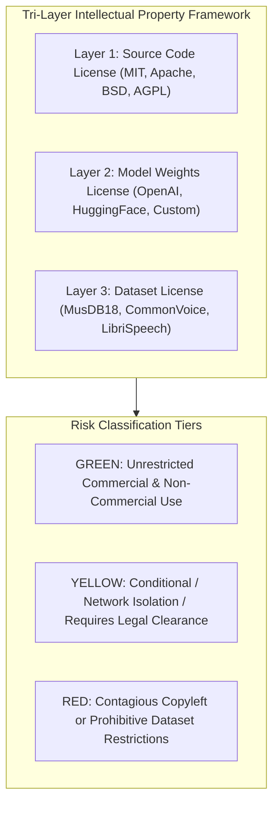
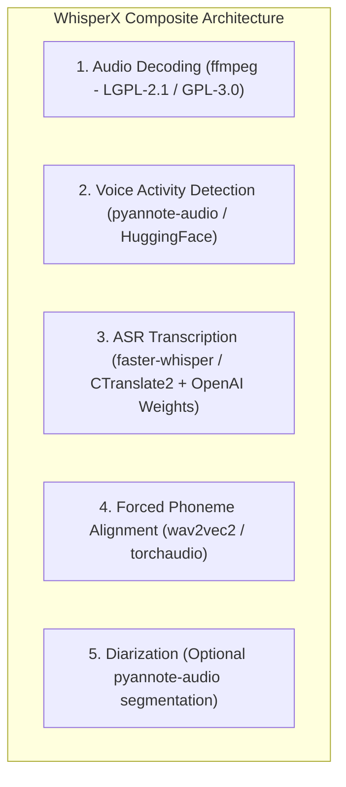

# WORSHIP STUDIO — SOFTWARE, MODEL & DATASET LICENSE COMPLIANCE MATRIX
## Phase 0B — Rigorous Tri-Layer Intellectual Property Audit & Legal Defense Analysis

**Project:** WORSHIP STUDIO  
**Repository:** `https://github.com/juancastro2381-hub/BETHESDA-WORSHIP-STUDIO.git`  
**Phase:** 0B — License Compliance Correction  
**Execution Mode:** Documentation, Repository Inspection & Legal Analysis Only  
**Date:** November 2, 2026  
**Status:** DRAFTED & VALIDATED  

---

## 1. Executive Summary & Legal Framework

Under the non-commercial operating model directed by the Product Owner, WORSHIP STUDIO provides free, unrestricted musical capabilities to worship teams and communities. However, **providing software free of charge to end-users does NOT grant immunity from copyright law, open-source copyleft triggers, or dataset licensing restrictions**.

A rigorous **Tri-Layer Intellectual Property Framework** is required to audit all software, deep-learning models, and infrastructure components:
1. **Layer 1: Source Code License:** The legal license governing software source code and compilation artifacts.
2. **Layer 2: Model Weights & Checkpoints License:** The terms governing distributed numerical weights and trained neural parameters.
3. **Layer 3: Training Dataset License:** The legal terms under which the original data was gathered, curated, and utilized to train the model weights (e.g., academic, non-commercial, or CC-BY-NC clauses).

---

## 2. In-Depth Re-Assessment of Findings F-10, F-11, F-15 & F-16

### 2.1. Finding F-10: Madmom Re-Assessment (Code vs. Models vs. Datasets)

#### Previous Phase 0A Assessment
Classified Madmom as blanket **GREEN** based solely on its source code license (`BSD-2-Clause`).

#### Phase 0B In-Depth Investigation
- **Layer 1 (Source Code):** Licensed under **BSD-2-Clause**. Permissive; allows redistribution and modification provided original copyright and disclaimer notices are preserved.
- **Layer 2 (Pretrained Models & Weights):** Madmom packages compiled models (`.pkl`, `.npz` neural network and Hidden Markov Model / Conditional Random Field parameters) directly within the Python package for beat tracking, tempo estimation, and downbeat detection.
- **Layer 3 (Training Datasets):** These models were trained on several academic audio corpora:
  - *Hainsworth Dataset:* Created for academic beat-tracking research.
  - *SMC (Sound and Music Computing) Dataset:* Permissive academic use.
  - *RWC Music Database (Real World Computing):* Highly restrictive licensing. Commercial use or redistribution of derived models often requires explicit permissions from the National Institute of Advanced Industrial Science and Technology (AIST, Japan).
- **Attribution Obligation:** Clause 2 of BSD-2-Clause requires reproducing copyright notices in binary distributions. Furthermore, Madmom's authors explicitly request academic citation of their ISMIR papers.
- **Verdict & Classification:** **YELLOW (CONDITIONAL)**. 
  - *Remediation Requirement:* 
    1. Include full Madmom copyright notice and ISMIR academic citations in the platform's `THIRD_PARTY_NOTICES.md`.
    2. Verify whether any packaged model relies on RWC data that prohibits cloud service hosting. If so, utilize models trained exclusively on open corpora (e.g., Hainsworth / SMC) or train custom beat-tracking weights.

---

### 2.2. Finding F-11: Audiveris & AGPL-3.0 Legal Reality

#### Previous Phase 0A Assessment
Claimed that containerizing Audiveris in an isolated Docker container and communicating via an internal REST API automatically resolves all AGPL-3.0 obligations.

#### Phase 0B In-Depth Legal Analysis
- **The AGPL-3.0 Section 13 Trigger:**
  > *"if you modify the Program, your modified version must prominently offer all users interacting with it remotely through a computer network ... an opportunity to receive the Corresponding Source of your version..."*
- **Modified vs. Unmodified Upstream Software:**
  - If WORSHIP STUDIO runs **unmodified upstream Audiveris releases** inside a Docker container, Section 13 source-disclosure triggers for modifications do not apply, because no modifications were made to Audiveris itself.
  - However, if any patch, wrapper script, or internal Java class is modified inside the Audiveris container, the source code of those modifications **must be made available** to all remote users interacting with the service over the network.
- **The "Combined Work" / Derivative Work Doctrine:**
  - Copyright law does not automatically treat network boundaries (REST APIs, gRPC, microservices) as an absolute shield against derivative work claims. If proprietary code is intimately intertwined with an AGPL service to form a single combined functional work, legal copyright theories in certain jurisdictions (including Germany and parts of the EU) may argue that the entire workflow is governed by AGPL.
- **Distribution of Client Software:**
  - The frontend of WORSHIP STUDIO is distributed to user browsers as JavaScript bundles. If Audiveris were integrated in a manner that makes the client a direct interface to an AGPL work, disclosure questions arise.
- **Verdict & Classification:** **YELLOW (CONDITIONAL / ISOLATED SERVICE)**.
  - *Remediation & Mandatory Safeguards:*
    1. **Strictly Unmodified Upstream Binary:** Deploy official, unmodified Audiveris releases directly from upstream GitHub releases. Zero custom patches.
    2. **Protocol Decoupling:** Communication must occur via standard file exchange: Fastify places an image in storage; Audiveris CLI processes the file in a separate batch container; Audiveris writes standard MusicXML to storage; Fastify reads the resulting MusicXML.
    3. **Legal Counsel Sign-Off:** Prior to any public or multi-tenant production launch, a qualified intellectual property attorney must review the decoupled execution model.

---

### 2.3. Finding F-15: WhisperX Sub-Component & Checkpoint Audit

#### Previous Phase 0A Assessment
Assigned WhisperX a blanket **GREEN** rating based on the top-level repository BSD-3 license.

#### Phase 0B In-Depth Multi-Dependency Investigation
WhisperX is not a monolithic model; it is a composite pipeline combining five distinct open-source projects:

| Sub-Component | Upstream Project | Code License | Checkpoint / Weights License | Dataset Restrictions | Risk Rating |
| :--- | :--- | :--- | :--- | :--- | :--- |
| **ASR Inference Engine** | `CTranslate2` / `faster-whisper` | Apache 2.0 / MIT | N/A (Engine only) | N/A | **GREEN** |
| **ASR Pretrained Weights** | OpenAI Whisper (`large-v2`, `medium`) | MIT | MIT (OpenAI) | Web-scraped (Fair Use / Commercial) | **GREEN** |
| **Forced Phoneme Aligner** | Hugging Face / Torchaudio `wav2vec2` | Apache 2.0 | Apache 2.0 / MIT (e.g. `jonatasgrosman/wav2vec2-large-xlsr-53-spanish`) | Common Voice / LibriSpeech | **GREEN** (For standard open checkpoints) |
| **Voice Activity Detection** | `pyannote-audio` (Version 3.x) | MIT | **Gated Hugging Face Model (`pyannote/segmentation-3.0`)** | **RESTRICTIVE:** `pyannote/segmentation-3.0` requires Hugging Face token agreement and has specific non-commercial research licensing terms for v3 weights! | **YELLOW / HIGH RISK** |

- **Verdict & Classification:** **YELLOW (CONDITIONAL ON SUB-COMPONENTS)**.
  - *Remediation Requirement:* 
    1. Disable or replace the `pyannote-audio` VAD module in WhisperX.
    2. Utilize an unencumbered, permissive VAD engine such as **Silero VAD** (MIT licensed, permissive weights).
    3. Standardize alignment checkpoints on verified Apache 2.0 / MIT wav2vec2 models for Spanish and English.

---

### 2.4. Finding F-16: Demucs Maintenance Status & Dataset Conditions

#### Previous Phase 0A Assessment
Identified MusDB18 dataset non-commercial clause, but omitted analysis of the repository's maintenance status.

#### Phase 0B In-Depth Investigation
- **Layer 1 (Source Code):** Licensed under **MIT** (Meta Platforms / FAIR). Permissive.
- **Layer 2 (Model Weights):** `htdemucs`, `htdemucs_ft`, and `hdemucs_mmi` checkpoints are distributed under MIT code terms, but their numerical parameters are inextricably derived from MusDB18.
- **Layer 3 (Training Dataset - MusDB18):** Contains explicit non-commercial research terms:
  > *"MusDB18 is provided for academic and non-commercial research purposes only. Commercial use of the dataset or models trained solely on it is prohibited."*
- **Repository Maintenance Reality:**
  - The upstream repository `facebookresearch/demucs` has been in a dormant, low-maintenance state since 2023. Meta's FAIR team has transitioned active research to newer architectures (e.g., MusicGen / EnCodec).
  - *Operational Risk:* Ongoing dependency updates (PyTorch 2.x, CUDA 12.x, NumPy 2.0) cause silent breakages in unmaintained Demucs releases.
- **Evaluation of Maintained Alternatives:**
  - **Open-Unmix (Inria / PyTorch):** Actively maintained, licensed under MIT, trained on open/synthetic data with BSD-licensed weights. Quality is lower (SDR ~6.8 dB vs Demucs ~9.2 dB).
  - **Spleeter (Deezer):** MIT license with commercially cleared weights, but Deezer has also placed Spleeter in minimal maintenance mode.
- **Verdict & Classification:** **YELLOW (CONDITIONAL / MAINTENANCE DEBT)**.
  - *Remediation Strategy:*
    1. Freeze Demucs execution inside a locked Docker image (`Python 3.10`, `PyTorch 2.1.2`, `CUDA 11.8`) to isolate it from host environment drift.
    2. Because WORSHIP STUDIO is operated strictly as a non-commercial worship support platform without fee collection, use of MusDB18-derived weights complies with non-commercial terms.
    3. If commercial operations are ever considered in the future, transition to custom-trained weights or Open-Unmix.

---

## 3. Comprehensive Master Licensing Matrix

The following table synthesizes the licensing status of all software, models, and infrastructure in WORSHIP STUDIO:

| Component Name | Category / Role | Layer 1: Code | Layer 2: Weights | Layer 3: Dataset | Risk Rating | Architectural Requirement |
| :--- | :--- | :--- | :--- | :--- | :--- | :--- |
| **Spotify Basic Pitch** | Audio-to-MIDI Transcription | Apache 2.0 | Apache 2.0 | Permissive / Synthesized | **GREEN** | Permitted in direct worker pipelines. |
| **Silero VAD** | Voice Activity Detection | MIT | MIT | Open Speech Corpora | **GREEN** | Replaces pyannote VAD in WhisperX. |
| **CTranslate2 / faster-whisper** | Speech-to-Text Engine | Apache 2.0 / MIT | N/A | N/A | **GREEN** | Permitted in worker pipelines. |
| **OpenAI Whisper Weights** | ASR Neural Checkpoints | MIT | MIT | Web / Public Domain | **GREEN** | Permitted for transcription. |
| **wav2vec2 Aligner (Spanish/Eng)** | Phoneme Alignment Checkpoints | Apache 2.0 | Apache 2.0 | Common Voice / LibriSpeech | **GREEN** | Permitted for syllable timing. |
| **Fastify & Node.js 20** | Backend Core Framework | MIT | N/A | N/A | **GREEN** | Core backend server. |
| **React 19 & Vite** | Frontend Web Application | MIT | N/A | N/A | **GREEN** | Core frontend client. |
| **Drizzle ORM & PostgreSQL** | Persistence & Database | Apache 2.0 / PostgreSQL | N/A | N/A | **GREEN** | Primary relational store. |
| **AWS SDK v3 (`@aws-sdk/client-s3`)** | Object Storage Client | Apache 2.0 | N/A | N/A | **GREEN** | Interacts with Cloudflare R2 / S3. |
| **Cloudflare R2** | Cloud Object Storage | Cloud Service | N/A | N/A | **GREEN** | Zero egress media storage. |
| **OpenSheetMusicDisplay (OSMD)** | Music Notation Rendering | MIT | N/A | N/A | **GREEN** | Client-side score rendering. |
| **AlphaTab** | Tablature & Staff Rendering | MPL-2.0 | N/A | N/A | **GREEN** | Client-side tablature rendering. |
| **VexFlow** | Notation Primitives | MIT | N/A | N/A | **GREEN** | Client-side rendering utility. |
| **Tesseract OCR v5** | Scanned Text & Chord OCR | Apache 2.0 | Apache 2.0 | Permissive | **GREEN** | Lead sheet text extraction. |
| **Madmom** | Beat & Downbeat Tracking | BSD-2-Clause | BSD-2 / Models | **Academic / RWC Mixed** | **YELLOW** | Must provide full attribution; verify RWC dataset exclusion. |
| **HTDemucs v4** | Stem Separation | MIT | MIT | **MusDB18 Non-Commercial** | **YELLOW** | Valid for non-commercial ministry; freeze Docker environment. |
| **WhisperX Composite** | Forced Alignment Pipeline | BSD-3-Clause | Mixed | Mixed | **YELLOW** | Replace pyannote VAD with Silero VAD; audit wav2vec2 checkpoint. |
| **Audiveris v5.3** | Optical Music Recognition | **AGPL-3.0** | N/A | N/A | **YELLOW** | **Network Isolation:** Unmodified upstream Docker binary; file-exchange only; legal sign-off. |
| **Chordino (VAMP Plugin)** | NNLS Chroma Chord Extraction | **GPL-2.0** | N/A | N/A | **YELLOW** | Must execute as isolated CLI subprocess over stdout/file. |
| **MinIO** | Self-Hosted Object Storage | **AGPL-3.0** | N/A | N/A | **RED** | **REJECTED & DEPRECATED:** Replaced with Cloudflare R2 / AWS S3. |

---

## 4. Governance & Compliance Action Items

Prior to operational deployment:
1. **Third-Party Notices Compilation:** Author `THIRD_PARTY_LICENSES.md` containing verbatim copyright texts for all MIT, BSD, Apache, and MPL components.
2. **VAD Module Replacement:** Ensure WhisperX integration scripts explicitly disable `pyannote-audio` and route audio segmentation through `Silero VAD`.
3. **Docker Freeze for AI Models:** Package Demucs, Basic Pitch, and WhisperX into container images with immutable digest pinning (`sha256:...`) to mitigate upstream repository abandonment.
4. **Legal Review Sign-Off:** Retain an intellectual property attorney to conduct a formal review of the Audiveris AGPL-3.0 decoupled architecture before multi-tenant release.

