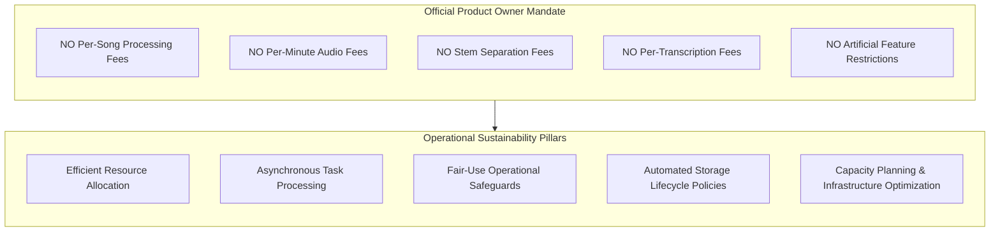
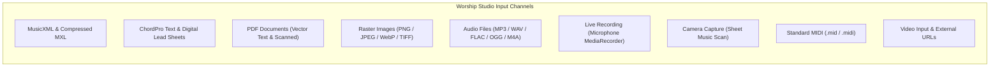
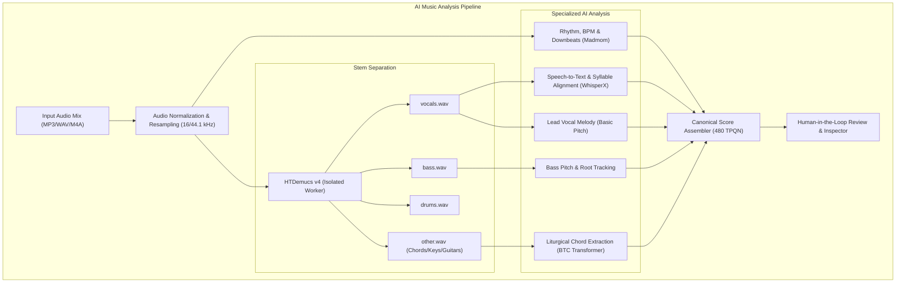
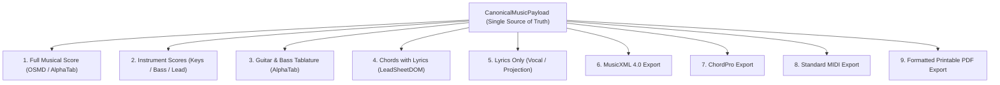
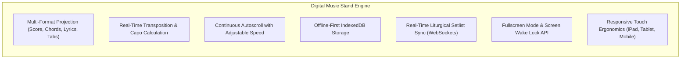

# WORSHIP STUDIO — DEFINITIVE PRODUCT MODEL & CAPABILITY BLUEPRINT
## Phase 0B — Non-Commercial Integrated Music Intelligence & Digital Stand Platform

**Project:** WORSHIP STUDIO  
**Repository:** `https://github.com/juancastro2381-hub/BETHESDA-WORSHIP-STUDIO.git`  
**Phase:** 0B — Product Model Realignment & Technical Blueprint  
**Execution Mode:** Documentation, Repository Inspection & Planning Only  
**Implementation Authorization:** NOT GRANTED  
**Date:** November 2, 2026  
**Status:** DRAFTED & VALIDATED  

---

## 1. Executive Summary & Official Product Direction

By executive determination of the Product Owner, **WORSHIP STUDIO** is established as an integrated, professional musical production, transcription, and worship support platform designed for ministry communities, worship leaders, and musicians.

### 1.1. Core Product Mandate
The platform provides a comprehensive suite of AI-assisted music analysis, transcription, sheet music recognition, and digital stand tools **without introducing per-use charges or feature paywalls**:

### 1.2. Scope of this Document
This document defines the complete product model:
1. **Music Input Capabilities:** Detailed specification of every accepted or planned ingestion format, file constraints, validation rules, processing pipelines, limitations, and current verified status in the codebase.
2. **AI-Powered Music Analysis Capabilities:** Explicit delineation of audio analysis, stem separation, pitch tracking, harmony detection, lyrics alignment, and optical music recognition (OMR), distinguishing verified implementations from planned capabilities.
3. **Music Output Formats:** Interoperable score, tablature, chord chart, lyric, and document exports.
4. **Digital Music Stand Experience:** Real-time liturgical performance stand, offline synchronization, transposition, multi-device ergonomics, and multi-format projection.

---

## 2. Capability Status Taxonomy

To eliminate ambiguity across architecture and product planning, every feature is classified under one of the following five standardized statuses:

| Status Tag | Operational Definition |
| :--- | :--- |
| **VERIFIED IMPLEMENTED** | The capability is fully implemented in the existing codebase, passes automated tests, and has been verified by code inspection. |
| **PARTIAL / CONTRACT STUB** | An API contract, domain interface, or UI modal exists in the repository, but the backend implementation relies on mock responses or incomplete logic. |
| **DOCUMENTED BUT NOT IMPLEMENTED** | The capability was specified in documentation or design blueprints, but zero source code exists in the repository. |
| **PROPOSED** | A new capability planned for future phases, evaluated for technical and operational feasibility. |
| **BLOCKED / UNCERTAIN** | A proposed capability subject to third-party licensing constraints, legal copyleft risks, or unresolved scientific uncertainties. |

---

## 3. Section A — Music Input Capabilities

### 3.1. Detailed Input Matrix

| Input Channel | Formats / Extensions | File Limits & Constraints | Validation in Code | Processing Pipeline | Limitations | Verified Status |
| :--- | :--- | :--- | :--- | :--- | :--- | :--- |
| **MusicXML** | `.musicxml`, `.xml` | **Max 5 MB** MIME: `application/xml`, `text/xml` | XML schema syntax, XXE injection rejection (`<!ENTITY`, `SYSTEM`), root `<score-partwise>` or `<score-timewise>`, at least 1 measure. | [MusicXmlImporter](file:///c:/Users/juanc/OneDrive/Documentos/Desarrollo%20proyectos/Sistema%20musical%20-%20partituras/BETHESDA%20WORSHIP%20STUDIO/frontend/src/core/ingestion/musicxml-importer.ts) maps parts, staves, measures, notes, chords, and lyrics to `CanonicalMusicPayload` at 480 TPQN. | Does not support proprietary notation extensions from Sibelius/Finale outside MusicXML 3.1 schema. | **VERIFIED IMPLEMENTED** |
| **Compressed MusicXML** | `.mxl` | **Max 5 MB** MIME: `application/vnd.recordare.musicxml+xml` | ZIP container verification, extraction of `META-INF/container.xml` pointing to primary XML root score. | Currently rejected by `validateXmlFormat` with `UNSUPPORTED_FORMAT`. Requires JSZip / AdmZip decompression step prior to parsing. | Currently requires manual unzipping by the user prior to upload. | **PROPOSED (Phase 1C)** |
| **ChordPro** | `.chordpro`, `.pro`, `.crd`, `.txt` | **Max 5 MB** MIME: `text/plain`, `text/chordpro` | Directives (`{title:}`, `{artist:}`) or inline square-bracket chords (`[G]`, `[Em7]`). Mínimo 1 synthetic measure. | [ChordProImporter](file:///c:/Users/juanc/OneDrive/Documentos/Desarrollo%20proyectos/Sistema%20musical%20-%20partituras/BETHESDA%20WORSHIP%20STUDIO/frontend/src/core/ingestion/chordpro-importer.ts) parses chords, lyrics, sections. Preserves **NO FALSE NOTES** invariant (zero synthetic melody notes). | Does not contain staff notation, clefs, or melody pitches. | **VERIFIED IMPLEMENTED** |
| **Digital PDF (Vector)** | `.pdf` | **Max 15 MB** MIME: `application/pdf` | Binary magic bytes `%PDF-` check in [document-validation.ts](file:///c:/Users/juanc/OneDrive/Documentos/Desarrollo%20proyectos/Sistema%20musical%20-%20partituras/BETHESDA%20WORSHIP%20STUDIO/backend/src/domain/documents/document-validation.ts). | [PdfTextExtractor](file:///c:/Users/juanc/OneDrive/Documentos/Desarrollo%20proyectos/Sistema%20musical%20-%20partituras/BETHESDA%20WORSHIP%20STUDIO/backend/src/domain/documents/pdf-text-extractor.ts) unpacks FlateDecode streams, groups `Tm`/`Td` font coordinates, extracts chords & lyrics into ChordPro. | Cannot extract staff notes or measures. Limited to text-based songbooks (e.g. CMB Azul/Music). | **VERIFIED IMPLEMENTED** |
| **Scanned PDF / Images** | `.pdf`, `.png`, `.jpg`, `.jpeg`, `.webp` | **Max 15 MB** MIME: `image/png`, `image/jpeg`, `image/webp` | Strict magic bytes inspection (PNG: `89 50 4E 47`, JPEG: `FF D8 FF`, WebP: `RIFF...WEBP`). Filename sanitization. | Displayed in [VisualDocumentStand](file:///c:/Users/juanc/OneDrive/Documentos/Desarrollo%20proyectos/Sistema%20musical%20-%20partituras/BETHESDA%20WORSHIP STUDIO/frontend/src/core/rendering/visual-document-stand.tsx) via sandboxed `<iframe>` or ``. Continuous autoscroll, zoom, rotation. | Purely visual stand viewing. OMR conversion stub returns 0 measures in production. | **VERIFIED IMPLEMENTED (Visual) / CONTRACT STUB (OMR)** |
| **TIFF Images** | `.tiff`, `.tif` | **Max 15 MB** MIME: `image/tiff` | Magic bytes `II*` (Little Endian) or `MM*` (Big Endian). | Stored with SHA-256 in backend. In frontend, displays warning modal and download link. | Modern web browsers do not natively render TIFF. Requires server-side conversion to PNG/WebP. | **VERIFIED IMPLEMENTED (Storage/Download) / PROPOSED (Server Conversion)** |
| **Audio Files** | `.mp3`, `.wav`, `.m4a`, `.flac`, `.ogg`, `.webm` | **Max 50 MB** Duration: Up to 10 min | Magic bytes check per codec (ID3/Sync for MP3, RIFF/WAVE for WAV, ftyp for M4A, fLaC for FLAC, OggS for OGG). | Stored with SHA-256 in backend. Served via HTTP 206 Partial Content with 60s TTL cryptographic stream tickets. | Storage and playback only. No transcription, chord recognition, or stem separation currently operational. | **VERIFIED IMPLEMENTED (Streaming) / MISSING (AI Pipeline)** |
| **Microphone Recording** | Real-time audio stream | Max 10 min recording | Browser `MediaRecorder` API with WebM/Opus or WAV container. | Local browser capture → validation of audio buffer → upload to audio ingestion endpoint. | Requires user microphone permissions; subject to room acoustic reverberation. | **PROPOSED (Phase 2)** |
| **Camera Sheet Capture** | Video stream / Snapshot | 150–300 DPI resolution | `navigator.mediaDevices.getUserMedia` with video constraints. | HTML5 Canvas video stream capture → perspective correction & contrast binarization → upload to document endpoint. | Dependent on mobile/tablet camera quality and ambient lighting conditions. | **PROPOSED (Phase 4)** |
| **Standard MIDI** | `.mid`, `.midi` | **Max 2 MB** MIME: `audio/midi` | Header chunk `MThd`, track chunk `MTrk`, format 0 or 1 verification. | Binary parser extracting note-on, note-off, velocity, tempo, and PPQ ticks to `CanonicalMusicPayload`. | Does not natively contain lyrics or chord symbols unless encoded in Meta events. | **PROPOSED (Phase 1C)** |
| **Video & External URLs** | MP4, YouTube, Vimeo | Embed only | URL regex validation, HTTPS verification, YouTube embed ID extraction. | Sandboxed `<iframe>` embedded in the music stand for visual reference during rehearsal. | **Strict Compliance:** No audio ripping, stream grabbing, or scraping permitted. Only official embeds supported. | **DOCUMENTED BUT NOT IMPLEMENTED (Phase 8)** |

---

## 4. Section B — AI-Powered Music Analysis Capabilities

### 4.1. Detailed Analysis Capabilities Assessment

| Capability | Target Model / Engine | Hardware Requirement | Target Output Format | Current Verification Status | Operational Notes & Safeguards |
| :--- | :--- | :--- | :--- | :--- | :--- |
| **Stem Separation** | HTDemucs v4 (Isolated Container) | NVIDIA GPU (>= 6 GB VRAM) | 4 Stems: Vocals, Bass, Drums, Other | **PROPOSED (Phase 3)** | Prerequisite for accurate transcription. Stems kept 48 hours for unconfirmed drafts; compressed to FLAC upon confirmation. |
| **Vocal Isolation** | HTDemucs v4 (`vocals.wav`) | Included in stem separation | Monophonic or lead vocal audio stem | **PROPOSED (Phase 3)** | Eliminates band leakage prior to lyrics recognition and melody pitch tracking. |
| **Bass Isolation** | HTDemucs v4 (`bass.wav`) | Included in stem separation | Isolated low-end instrument track | **PROPOSED (Phase 3)** | Enables clean fundamental frequency tracking for root-note validation. |
| **Tempo & BPM Detection** | Madmom / Librosa | CPU (Multi-core) | Global BPM + dynamic tempo map (`Timeline.tempoMap`) | **PROPOSED (Phase 2)** | Aligns measure boundaries to audio timestamps with +/- 1 BPM tolerance. |
| **Time Signature Detection** | Madmom Downbeat Tracker | CPU (Multi-core) | Time signature (4/4, 3/4, 6/8) | **PROPOSED (Phase 2)** | Evaluates downbeat probability peaks to establish the metric grid. |
| **Rhythm & Beat Analysis** | Madmom Beat Tracking | CPU | Array of beat onsets in milliseconds | **PROPOSED (Phase 2)** | Quantizes musical notes into standard divisions (quarter, eighth, triplets). |
| **Audio-to-MIDI Transcription** | Spotify Basic Pitch (ONNX) | CPU or GPU | MIDI events mapped to 480 TPQN ticks | **PROPOSED (Phase 2)** | Must run ONLY on isolated stems. Confidence threshold `>= 0.65` prevents false notes. |
| **Melody Extraction** | Basic Pitch on Vocal Stem | CPU or GPU | Monophonic vocal melody line | **PROPOSED (Phase 2)** | Vocal pitch contour quantized to nearest half-steps with pitch bend notation. |
| **Chord Detection** | BTC Transformer / NNLS Chroma | CPU or GPU | Chord progression with measure/beat offsets | **PROPOSED (Phase 2)** | Analyzes `other.wav` harmonic content. Detects triads, 7ths, suspensions (sus4, add9), and slash bass inversions. |
| **Key & Scale Detection** | Krumhansl-Schmuckler Key-Finding Algorithm | CPU | Root pitch + mode (e.g. "G Major", "B Minor") | **PROPOSED (Phase 2)** | Informs accidental spelling (sharps vs flats) in generated scores. |
| **Lyrics Recognition (ASR)** | WhisperX (`medium` / `large-v2`) | GPU (>= 4 GB VRAM) | Text string divided into lines and verses | **PROPOSED (Phase 5)** | Runs on `vocals.wav`. Fine-tuned for Spanish and English liturgical vocabulary. |
| **Lyrics & Music Alignment** | WhisperX wav2vec2 forced aligner | GPU or CPU | Syllables mapped to millisecond timestamps and note ticks | **PROPOSED (Phase 5)** | Associates `LyricSyllable` objects directly to `Note` events in canonical payload. |
| **Musical Structure Detection** | Structural segmentation heuristic | CPU | Section tags (`[Verse]`, `[Chorus]`, `[Bridge]`, `[Outro]`) | **PROPOSED (Phase 2)** | Compares harmonic repetitions and silence intervals. |
| **Optical Music Recognition (OMR)** | Audiveris v5.3 (Isolated Microservice) | CPU (4 vCPU, 4 GB RAM) | MusicXML 3.1 / 4.0 containing staves, notes, clefs | **CONTRACT STUB (Phase 4)** | `StandardOmrProvider` is currently a stub returning 0 measures. Full headless Audiveris engine planned for Phase 4. |
| **Automatic Score Generation** | Canonical Synthesizer Engine | CPU | Complete `CanonicalMusicPayloadV2` | **PROPOSED (Phase 3)** | Deterministic fusion of detected melody, chords, rhythm, and lyrics into a unified score. |

---

## 5. Section C — Music Outputs & Projections

WORSHIP STUDIO treats the canonical data model (`CanonicalMusicPayload`) as the single source of truth. Users can generate, view, edit, and export in multiple musical formats:

### 5.1. Output Format Specifications

| Output Format | Generating Module | Content Rendered / Exported | Supported Stems / Instruments | Target Audience / Use Case | Verified Status |
| :--- | :--- | :--- | :--- | :--- | :--- |
| **Full Musical Score (Partitura)** | OpenSheetMusicDisplay (`OSMDAdapter`) | Grand staff (piano) or single staves with clefs, key signature, notes, rests, chords, lyrics. | Keys, Flute, Violin, Lead Vocal | Pianists, arrangers, vocal directors | **VERIFIED IMPLEMENTED** |
| **Chords with Lyrics (Cifrado)** | Semantic HTML (`LeadSheetDOMAdapter`) | Transposable chords positioned precisely above lyric syllables. Section headers. | Acoustic guitar, piano, vocals | Worship leaders, rhythm section | **VERIFIED IMPLEMENTED** |
| **Lyrics Only (Letra Sola)** | Semantic HTML (`LeadSheetDOMAdapter`) | Pure lyric text formatted by liturgical section without chord symbols. | Vocals, multimedia projection operators | Congregation, choir vocalists | **VERIFIED IMPLEMENTED** |
| **Guitar / Bass Tablature** | AlphaTab (`AlphaTabAdapter`) | Standard notation + 4/5/6-string tablature with fret numbers, bend markers, chord boxes. | Electric guitar, acoustic guitar, bass | Guitarists, bassists | **VERIFIED IMPLEMENTED** |
| **MusicXML Export** | `musicxml-generator.ts` | Validated MusicXML 3.1 / 4.0 score-partwise interchange file. | All tracks and voices | Export to MuseScore, Finale, Sibelius | **PARTIAL (Basic staves supported)** |
| **ChordPro Export** | `chordpro-generator.ts` | Formatted ChordPro `.chordpro` text file with directives. | Chords and lyrics | Export to OnSong, Planning Center, SongBook | **PARTIAL (Basic chords/lyrics)** |
| **Standard MIDI Export** | Binary MIDI serializer | Standard MIDI file (Format 1) with tempo track and instrument channels. | All pitched instruments | Export to DAWs (Logic, Ableton, Pro Tools) | **PROPOSED (Phase 7)** |
| **Printable PDF Export** | Headless browser / canvas PDF generator | High-resolution vector PDF formatted for Letter / A4 paper. | All 4 stand formats | Rehearsal printouts, binder archives | **PROPOSED (Phase 7)** |

---

## 6. Section D — Digital Music Stand Specifications

The digital music stand is the central user experience of WORSHIP STUDIO during rehearsal and live worship services.

### 6.1. Stand Operational Capabilities

1. **Multi-Format Instant Switching:** The musician can switch instantaneously between *Partitura*, *Cifrado con Letra*, *Letra Sola*, and *Tablatura* with zero re-rendering delay.
2. **Dynamic Harmonic Transposition:**
   - Real-time transposition across all 12 keys using circle-of-fifths enharmonic spelling.
   - Capo calculation: Displays guitar chord shapes relative to capo position while preserving sounding pitch.
3. **Autoscroll & Hands-Free Navigation:**
   - Configurable smooth scrolling (pixels per second) calibrated to song tempo.
   - Bluetooth foot pedal support (Page Up / Page Down / Spacebar keyboard events).
4. **Offline Resilience (Culto-Safe Architecture):**
   - Active setlists, song arrangements, and media tickets are pre-cached into `IndexedDB`.
   - If the church Wi-Fi fails completely during a live service, the music stand continues operating seamlessly without interruption.
5. **Real-Time Liturgical Flow:**
   - Director-led mode: When the worship leader advances to the next song in the setlist, all connected team tablets navigate simultaneously via WebSocket events.
6. **Hardware & Visual Ergonomics:**
   - Fullscreen API activation with `WakeLockSentinel` preventing device sleep.
   - High-contrast Dark and Light liturgical themes preventing eye strain on dark stages.

---

## 7. Product Model Governance & Principles

To maintain trust and technical integrity:
1. **Human-in-the-Loop Supremacy:** AI models generate drafts (`isAiDraft: true`). No AI output is published to the congregation's official song catalog without human review and approval.
2. **The "NO FALSE NOTES" Invariant:** The system must never synthesize speculative melody notes or guess complex polyphony when confidence is low. If uncertain, the system outputs chords with lyrics or unrendered drafts, highlighting ambiguous measures for human inspection.
3. **Attribution & Copyright Integrity:** All songs store optional CCLI license numbers. Audio ripping from commercial streaming services is strictly prohibited.

