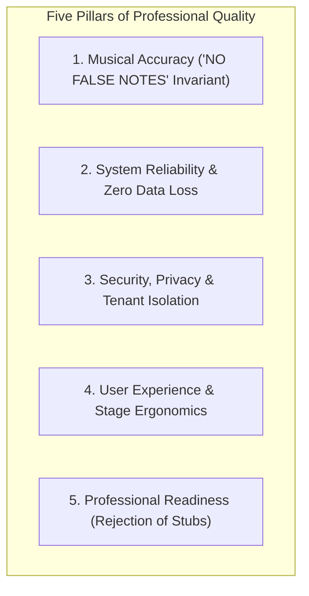
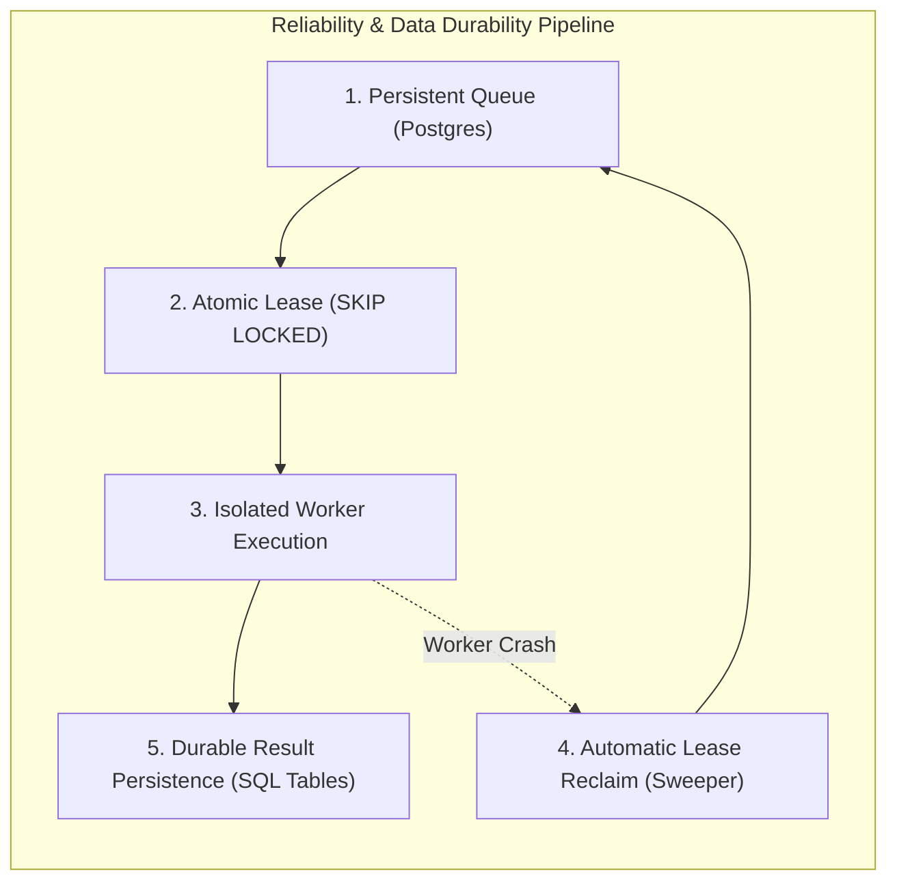

# WORSHIP STUDIO — QUALITY GATES & PROFESSIONAL ACCEPTANCE CRITERIA
## Phase 0B — Verification Standards, Invariants & Definition of Done

**Project:** WORSHIP STUDIO  
**Repository:** `https://github.com/juancastro2381-hub/BETHESDA-WORSHIP-STUDIO.git`  
**Phase:** 0B — Quality Criteria Definition  
**Execution Mode:** Quality Assurance & Governance Specification Only  
**Date:** November 2, 2026  
**Status:** DRAFTED & VALIDATED  

---

## 1. Executive Summary & Core Quality Principles

To ensure that WORSHIP STUDIO achieves commercial-grade reliability and musical excellence without individual user fees, all platform capabilities must satisfy strict, verifiable **Quality Gates**.

A core rule of Phase 0B is the **unconditional rejection of mock implementations and UI facades as completed features**. A button, modal, or API route that returns hardcoded or synthetic data does not constitute a delivered capability.



---

## 2. Pillar 1: Musical Accuracy & Invariant Preservation

### 2.1. The "NO FALSE NOTES" Invariant
- **Rule:** The system must **never invent, speculate, or synthesize notes** to fill in uncertain regions of an audio recording or sheet music scan.
- **Enforcement:**
  - In audio transcription, notes detected with confidence score `< 0.65` are omitted or tagged as low-confidence ghost notes.
  - In OMR, measures where staff lines cannot be resolved with confidence `>= 0.70` are designated as unrecognized regions (`unrecognizedRegions`), prompting manual review rather than inserting random pitches.
  - In ChordPro conversion, if musical notation is absent, the system outputs chords with lyrics. It never synthesizes a fake melody staff.

### 2.2. Granular Confidence Scoring & Visual Highlighting
- Every note, chord symbol, lyric syllable, and measure must carry a normalized `confidence` value (`0.00` to `1.00`).
- **Visual Confidence Heatmap:**
  - Confidence `>= 0.85`: Standard visual rendering (High Confidence).
  - `0.65 <= Confidence < 0.85`: Amber underline / boundary highlight indicating review recommended.
  - Confidence `< 0.65`: Red alert badge indicating human verification required before live performance.

### 2.3. Provenance & Non-Destructive Storage
- Every generated arrangement stores immutable provenance metadata:
  - `source`: Ingestion channel (`MUSICXML`, `CHORDPRO`, `AUDIO_AI`, `OMR_AUDIVERIS`, `MANUAL`).
  - `engineVersion`: Precise version/checkpoint of the model or parser.
  - `sourceSha256`: Cryptographic hash of the original uploaded file.
  - `isAiDraft: true`: Automatically flagged on all AI/OMR outputs until reviewed by a user.
- **Original Media Immutability:** Source audio, PDF documents, and images are stored read-only in Cloudflare R2 and are never overwritten or mutated.

---

## 3. Pillar 2: System Reliability & Fault Tolerance



1. **Zero Ephemeral State (Data Loss Prevention):**
   - All background jobs, OMR proposals, measure adjustments, and review audits must reside in PostgreSQL.
   - Restarting or redeploying any container must cause **zero loss of in-flight or pending jobs**.
2. **Idempotency & Deduplication:**
   - Background jobs generate an idempotency key: `SHA256(sourceFileHash + tenantId + processingType)`.
   - Submitting the same file twice within an organization reuses the existing analysis rather than consuming duplicate compute.
3. **Lease Expiration & Worker Crash Recovery:**
   - Active jobs carry a 10-minute lease (`locked_at`). If a worker process terminates abruptly (OOM, container restart), a background sweeper resets the job to `QUEUED` with zero manual intervention.
4. **Offline Resilience (Culto-Safe Guarantee):**
   - Active setlists and arrangements are mirrored into `IndexedDB` in the user's browser.
   - If church Wi-Fi fails completely during a live worship service, the digital music stand must continue operating with zero latency, uninterrupted autoscroll, and local format switching.

---

## 4. Pillar 3: Security, Privacy & Multi-Tenant Isolation

1. **Multi-Tenant Data Segregation:**
   - All database queries for songs, versions, proposals, and setlists must strictly filter by `tenant_id`.
   - Direct Object Reference (IDOR) checks in `MultitrackService` ensure that all audio stems belong to the authenticated user's organization.
2. **Strict File Validation & Security Scanning:**
   - Magic bytes verification (`validateAudioMagicBytes`, `validateDocumentFileSignature`) prevents file extension spoofing.
   - XML External Entity (XXE) injection attacks in MusicXML files are blocked by parser configuration rejecting `<!ENTITY` and `SYSTEM` declarations.
   - S3/R2 storage buckets must remain 100% private. Media files are accessed exclusively through short-lived cryptographic signed URLs (60-second TTL).

---

## 5. Pillar 4: User Experience & Stage Ergonomics

1. **Stage-Ready Usability:**
   - The digital stand must support high-contrast **Liturgical Dark** and **Light** themes.
   - Fullscreen mode activates the `WakeLockSentinel` API to prevent device sleep during live services.
   - Instant format switching (*Partitura*, *Cifrado*, *Letra*, *Tablatura*) must execute in `< 150 ms` without layout flickering.
2. **Accessible, Transparent Status:**
   - Long-running AI tasks emit real-time WebSocket progress updates (`0% to 100%`).
   - If an error occurs, user-facing error messages must provide actionable explanations rather than unhandled technical stack traces.

---

## 6. Pillar 5: Professional Readiness (Definition of Done)

A capability is considered **Done and Verified** only when it satisfies all seven dimensions of the **Professional Readiness Gate**:

```mermaid
flowchart TD
    subgraph GateCriteria [Professional Readiness Gate (DoD)]
        G1["1. Real Engine Integration (No Stubs / No Mocks)"]
        G2["2. Strict Input Validation (Magic Bytes, Size, Constraints)"]
        G3["3. Durable SQL Persistence (Survives Server Reboot)"]
        G4["4. Graceful Error Handling & Dead-Letter Routing"]
        G5["5. Automated Test Coverage (Unit & Integration >= 85%)"]
        G6["6. End-to-End Golden File Verification"]
        G7["7. User & Architecture Documentation Complete"]
    end
```

### Specific Phase 1A Definition of Done (DoD) Checklist
- [ ] Drizzle ORM migrations executed for `omr_proposals`, `omr_proposal_measures`, `omr_audit_history`, and `background_jobs`.
- [ ] `OmrService` re-implemented with PostgreSQL persistence. Verified that proposals persist intact across server restarts.
- [ ] `SKIP LOCKED` job queue tested under concurrent worker access with verified zero lock waiting.
- [ ] `CanonicalMusicPayloadV2` schema implemented with bidirectional converters (`migrateV1ToV2`, `downgradeV2ToV1`) passing 100% of test assertions.
- [ ] Zero regressions across existing backend and frontend test suites (`npm run test`).
- [ ] Working tree clean; zero code mutations executed prior to explicit Product Owner sign-off.

