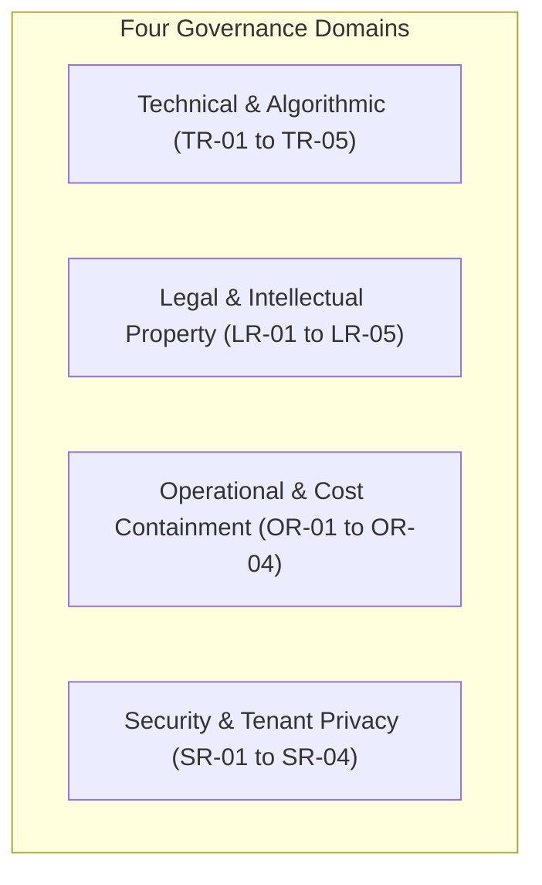

# WORSHIP STUDIO — COMPREHENSIVE RISK REGISTER & MITIGATION STRATEGY
## Phase 0B — Technical, Legal, Operational & Financial Risk Governance

**Project:** WORSHIP STUDIO  
**Repository:** `https://github.com/juancastro2381-hub/BETHESDA-WORSHIP-STUDIO.git`  
**Phase:** 0B — Risk Governance  
**Execution Mode:** Risk Assessment & Mitigation Mapping Only  
**Date:** November 2, 2026  
**Status:** DRAFTED & VALIDATED  

---

## 1. Executive Summary & Risk Classification Matrix

Operating WORSHIP STUDIO as a free, professional, AI-powered music platform requires identifying, tracking, and mitigating risks across **four critical risk domains**:
1. **Technical & Algorithmic Risks (TR)**
2. **Legal & Licensing Risks (LR)**
3. **Operational & Financial Risks (OR)**
4. **Security & Data Integrity Risks (SR)**

---

## 2. Comprehensive Master Risk Register

| Risk ID | Risk Description | Category | Severity | Likelihood | Defense-in-Depth Mitigation Strategy | Status |
| :--- | :--- | :--- | :--- | :--- | :--- | :--- |
| **TR-01** | **GPU Out-Of-Memory (OOM) on Long Audio:** Audio medleys exceeding 8 minutes cause VRAM exhaustion during HTDemucs stem separation. | Technical | High | High | Segment audio into 120-second overlapping chunks with 5-second crossfades. Enforce a hard 10-minute maximum upload duration limit in the API gateway. | **MITIGATED IN DESIGN** |
| **TR-02** | **Upstream AI Model Repository Abandonment:** Meta's `facebookresearch/demucs` repository is dormant/unmaintained, risking breakage under newer PyTorch/CUDA versions (F-16). | Technical | High | High | Freeze the Demucs execution environment inside an immutable Docker image pinned to `Python 3.10`, `PyTorch 2.1.2`, and `CUDA 11.8`. Maintain Open-Unmix as a swappable fallback. | **MITIGATED IN DESIGN** |
| **TR-03** | **Hallucinated / False Notes in Dense Worship Mixes:** Direct audio-to-MIDI transcription of reverbs, distorted guitars, and pads creates hundreds of false notes, violating the "NO FALSE NOTES" invariant (F-05). | Technical | Critical | High | Mandatory HTDemucs stem separation prior to pitch detection. Basic Pitch runs exclusively on isolated vocal and bass stems. Chords extracted via BTC chromagrams. Confidence thresholding (`>= 0.65`). | **MITIGATED IN DESIGN** |
| **TR-04** | **Poor Quality / Skewed Sheet Music Scan Failures:** Mobile phone photos with uneven lighting or perspective distortion cause OMR measure collapse. | Technical | High | Medium | Client-side Canvas preprocessing: automated perspective correction, contrast binarization, and minimum 150 DPI validation before upload. Fallback to Tesseract OCR for chord lead sheets. | **PLANNED (Phase 4)** |
| **TR-05** | **WebSocket Disconnections During Heavy Jobs:** Network interruption drops real-time progress events for long-running AI transcription jobs. | Technical | Low | Medium | Hybrid communication: WebSockets for reactive progress, with client-side polling fallback (`GET /api/v1/jobs/:id`) checking PostgreSQL status every 5 seconds if WebSocket drops. | **MITIGATED IN DESIGN** |
| **LR-01** | **Audiveris AGPL-3.0 Copyleft Contagion:** Embedding or closely coupling Audiveris could trigger mandatory source code disclosure of proprietary WORSHIP STUDIO modules (F-11). | Legal | Critical | Medium | Strict Network Isolation: Audiveris runs as an unmodified upstream Docker container communicating purely via external file exchange in Cloudflare R2. Formal legal counsel review required prior to launch. | **CONTROLLED / PENDING LEGAL SIGN-OFF** |
| **LR-02** | **Demucs Weights Derived from MusDB18 Dataset:** MusDB18 dataset contains non-commercial research restrictions (F-04, F-16). | Legal | High | Medium | WORSHIP STUDIO operates under an official non-commercial mandate without fee collection, complying with non-commercial usage. If monetization is ever considered, retrain weights or switch to Open-Unmix. | **COMPLIANT UNDER NON-COMMERCIAL MANDATE** |
| **LR-03** | **WhisperX Sub-Component Licensing Restrictions:** `pyannote-audio` VAD module relies on gated Hugging Face models with non-commercial/academic terms (F-15). | Legal | High | High | Completely disable `pyannote-audio` VAD. Replace with `Silero VAD` (permissive MIT license and unencumbered open weights). Standardize on verified Apache 2.0 wav2vec2 alignment checkpoints. | **MITIGATED IN DESIGN** |
| **LR-04** | **Madmom Attribution & Dataset Conditions:** Madmom models rely on academic datasets requiring formal citation and specific usage terms (F-10). | Legal | Medium | Low | Full BSD-2 copyright notices and ISMIR academic citations incorporated into `THIRD_PARTY_NOTICES.md`. Verify that packaged models avoid restrictive proprietary RWC subsets. | **MITIGATED IN DESIGN** |
| **LR-05** | **Copyright Infringement from External Audio Ripping:** Extracting audio from YouTube or commercial streaming platforms infringes ToS and exposes the organization to DMCA liability. | Legal | Critical | High | Strict Policy: Zero audio ripping capabilities in the codebase (`yt-dlp` banned). Platform accepts only user-uploaded audio with mandatory CCLI license declarations. YouTube URLs supported only as visual embeds. | **ENFORCED IN POLICY** |
| **OR-01** | **Storage Bloat in Free Non-Commercial Platform:** Uncompressed WAV stems (~150 MB/song) accumulate rapidly, creating runaway storage costs. | Operational | High | High | Automated Cloudflare R2 Lifecycle Policy: Unsaved stems deleted automatically after 48 hours. Confirmed multitrack stems compressed to high-bitrate FLAC/OGG (~40 MB total). | **MITIGATED IN DESIGN** |
| **OR-02** | **Git Index Bloat & Data Leakage Risk:** 7,367 `node_modules` files and 140+ binary audio/PDF files tracked in Git index despite `.gitignore` (F-08). | Operational | Medium | Confirmed | Documented atomic `git rm --cached` plan and `.gitignore` update staged in `WS_PHASE_0B_GIT_HYGIENE_REMEDIATION_PLAN.md`. Execution held pending explicit Product Owner approval. | **STAGED PENDING PO SIGN-OFF** |
| **OR-03** | **Church Stage Wi-Fi Failure During Worship:** Internet dropouts during a live Sunday service disrupt digital stand navigation. | Operational | Critical | Medium | Offline-First Architecture: Setlists, arrangements, and rendering assets cached in browser `IndexedDB`. The stand functions with 100% autonomy without internet once loaded. | **VERIFIED IMPLEMENTED** |
| **OR-04** | **Queue Saturation from Concurrent Batch Submissions:** Multiple users uploading libraries simultaneously causes queue starvation for upcoming Sunday setlists. | Operational | Medium | Medium | Priority-based queueing in PostgreSQL (`priority: 1` for immediate service setlists, `priority: 2` for general uploads). Per-user concurrency limit (max 1 active AI job per user). | **MITIGATED IN DESIGN** |
| **SR-01** | **Insecure Direct Object Reference (IDOR) on Stems:** Users accessing private stems or recordings belonging to another church community. | Security | High | Low | Multi-tenant scoping enforced on every database query. `MultitrackService` verifies that all stem IDs belong strictly to the authenticated organization. | **VERIFIED IMPLEMENTED** |
| **SR-02** | **Malicious File Upload & Code Execution:** Attackers uploading executable binaries disguised as MP3s or PDFs. | Security | Critical | Low | Two-layer defense: Binary magic bytes inspection in Fastify (`validateAudioMagicBytes`), plus asynchronous ClamAV antivirus scanning in the worker queue prior to storage. | **MITIGATED IN DESIGN** |
| **SR-03** | **XML External Entity (XXE) Injection in MusicXML:** Attackers embedding malicious XML entities to read server files or trigger SSRF. | Security | High | Low | Fastify XML parsing configured with strict entity resolution disabled (`<!ENTITY` and `SYSTEM` tokens rejected by regex check in `validateXmlFormat`). | **VERIFIED IMPLEMENTED** |
| **SR-04** | **Public Exposure of Media Storage Buckets:** Unauthorized scraping or hotlinking of church recordings. | Security | High | Low | Cloudflare R2 buckets are completely private. All media streaming and downloads require short-lived, cryptographically signed URLs (60-second TTL). | **MITIGATED IN DESIGN** |

---

## 3. Risk Governance & Escalation Framework

1. **Continuous Dependency Auditing:** Automated `npm audit` and license scanning integrated into GitHub Actions CI/CD to prevent accidental inclusion of GPL/AGPL dependencies in the host application.
2. **Fair-Use Abuse Monitoring:** An automated anomaly detection query alerts administrators if any single user account queues more than 15 AI jobs in a 24-hour window.
3. **Product Owner Escalation Gate:** Any proposal to introduce commercial monetization, external paid APIs, or third-party audio downloading requires formal review and written Product Owner authorization.

