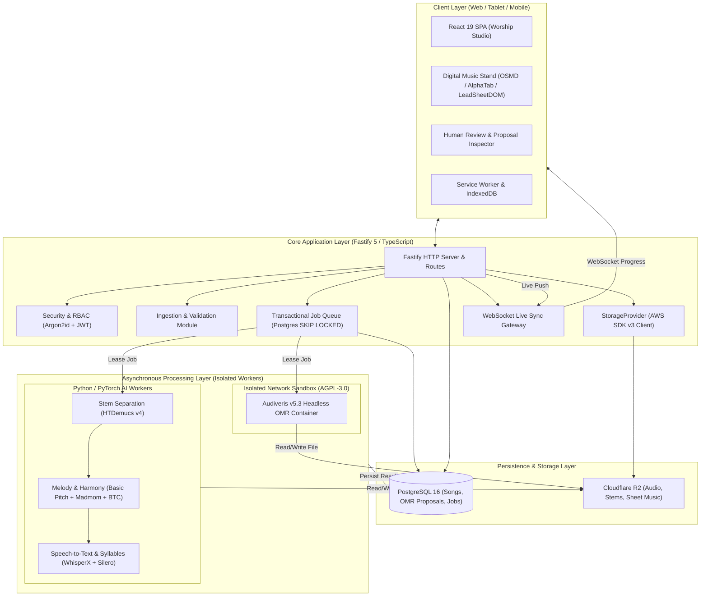
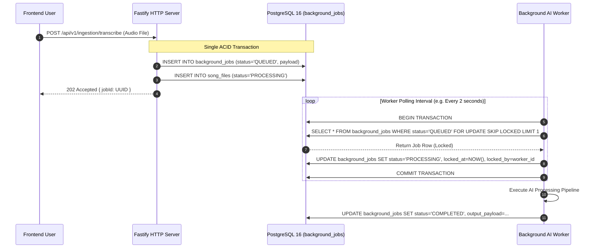
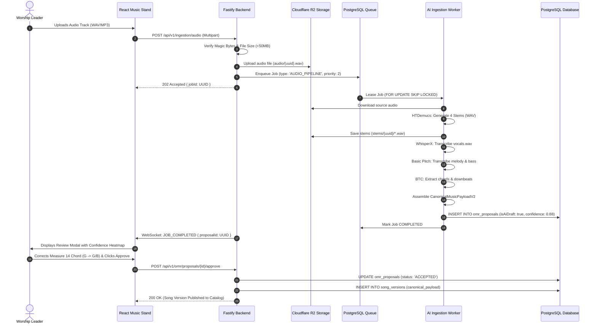

# WORSHIP STUDIO — TARGET TECHNICAL ARCHITECTURE
## Phase 0B — Non-Commercial Integrated Music Intelligence & Stand Platform

**Project:** WORSHIP STUDIO  
**Repository:** `https://github.com/juancastro2381-hub/BETHESDA-WORSHIP-STUDIO.git`  
**Phase:** 0B — Target Architecture Validation  
**Execution Mode:** Architecture Blueprint & Systems Design Only  
**Date:** November 2, 2026  
**Status:** DRAFTED & VALIDATED  

---

## 1. Architectural Principles & System Context

WORSHIP STUDIO is architected to balance **professional musical precision, high operational reliability, and non-commercial budget predictability**.



---

## 2. In-Depth Analysis of Finding F-14: PostgreSQL `SKIP LOCKED` Queue Architecture

### 2.1. Why PostgreSQL First for Phase 1A?
In Phase 0, introducing Redis and BullMQ was proposed as an immediate requirement. Finding F-14 correctly noted that introducing Redis adds infrastructure complexity, operational failure modes, and double-write consistency challenges between PostgreSQL and Redis.

For Phase 1A through Phase 3, a **transactional, PostgreSQL-backed queue using `FOR UPDATE SKIP LOCKED`** provides an optimal, highly reliable queue infrastructure.



### 2.2. Engineering Specifications for the PostgreSQL Queue

1. **Table Schema (`background_jobs`):**
   - `id`: UUID (Primary Key).
   - `job_type`: Varchar (`'STEM_SEPARATION'`, `'OMR_PROCESSING'`, `'AUDIO_TRANSCRIPTION'`).
   - `status`: Varchar (`'QUEUED'`, `'PROCESSING'`, `'COMPLETED'`, `'FAILED'`, `'DEAD_LETTER'`).
   - `priority`: Integer (1 = Urgent Live Service, 2 = Standard, 3 = Batch Library).
   - `payload`: JSONB (Source S3 storage keys, processing parameters).
   - `output_payload`: JSONB (Canonical payload draft, metadata, warnings).
   - `attempts`: Integer (Default 0).
   - `max_attempts`: Integer (Default 3).
   - `locked_at`: Timestamptz (Nullable).
   - `locked_by`: Varchar (Worker hostname / container UUID).
   - `scheduled_at`: Timestamptz (For exponential backoff retries).
   - `created_at`: Timestamptz.
   - `updated_at`: Timestamptz.

2. **Atomic Job Acquisition Query:**
   ```sql
   WITH available_job AS (
     SELECT id
     FROM background_jobs
     WHERE status = 'QUEUED'
       AND scheduled_at <= NOW()
     ORDER BY priority ASC, created_at ASC
     LIMIT 1
     FOR UPDATE SKIP LOCKED
   )
   UPDATE background_jobs
   SET status = 'PROCESSING',
       locked_at = NOW(),
       locked_by = $1,
       attempts = attempts + 1,
       updated_at = NOW()
   WHERE id = (SELECT id FROM available_job)
   RETURNING *;
   ```

3. **Lease Expiration & Worker Crash Recovery:**
   - If a worker crashes or encounters an Out-Of-Memory (OOM) error, its row lock is released by the PostgreSQL connection drop, but the row status remains `PROCESSING`.
   - A lightweight sweeper query runs every 5 minutes:
     ```sql
     UPDATE background_jobs
     SET status = 'QUEUED',
         locked_at = NULL,
         locked_by = NULL,
         scheduled_at = NOW() + INTERVAL '30 seconds'
     WHERE status = 'PROCESSING'
       AND locked_at < NOW() - INTERVAL '10 minutes';
     ```

4. **Exponential Backoff & Dead-Letter Handling:**
   - When a job fails with a retryable error:
     $$\text{Retry Delay} = 2^{\text{attempts}} \times 30\text{ seconds}$$
   - If `attempts >= max_attempts`, the job transitions to `status = 'DEAD_LETTER'`, storing the complete error stack in `output_payload['error']`.

5. **Trigger Conditions for Migrating to Redis / BullMQ (Phase 6):**
   - Concurrency exceeds **25 continuous parallel workers** causing high table update churn.
   - Sustained job throughput exceeds **50 jobs per second**.
   - Workers are distributed across multiple external cloud providers where opening direct PostgreSQL connection pools introduces firewall or latency overhead.

---

## 3. The 16 Architecture Subsystems

### Subsystem 1: Frontend Application Layer
- **Tech Stack:** React 19, TypeScript 5.5, Vite 6, Tailwind CSS.
- **Role:** Interactive user interface for song catalog management, setlist execution, file ingestion, human-in-the-loop inspection, and live stand rendering.

### Subsystem 2: API Gateway & HTTP Routing
- **Tech Stack:** Fastify v5.2.1.
- **Role:** Clean Architecture routing layer. Provides input schema validation via Zod, rate limiting, and HTTP error normalization.

### Subsystem 3: Authentication, Authorization & RBAC
- **Tech Stack:** Argon2id password hashing, Fastify JWT (`@fastify/jwt`) with rotating refresh tokens.
- **Role:** Enforces Role-Based Access Control (SuperAdmin, Admin, WorshipLeader, Musician, Congregation).

### Subsystem 4: Ingestion Pipeline & File Validation
- **Role:** Enforces file type verification via binary magic bytes (`validateAudioMagicBytes`, `validateDocumentFileSignature`), rejecting forged MIME headers and sanitizing filenames against Path Traversal attacks.

### Subsystem 5: Security Scanning & Malware Protection
- **Role:** Inbound files are checked for XML External Entity (XXE) injection vulnerabilities and passed through a containerized ClamAV daemon before being committed to persistent storage.

### Subsystem 6: Durable Asynchronous Job Queue
- **Tech Stack:** PostgreSQL 16 with `SKIP LOCKED` semantics (Phase 1A).
- **Role:** Decouples long-running AI inference tasks from the Fastify HTTP event loop.

### Subsystem 7: Processing Worker Pool
- **Role:** Standalone worker processes that poll the job queue, download source files, execute inference tasks, and write structured results.

### Subsystem 8: AI Model Services
- **Tech Stack:** PyTorch, ONNX Runtime, Java 17 headless.
- **Role:** Executes HTDemucs v4, Basic Pitch, BTC Transformer, WhisperX, and Audiveris.

### Subsystem 9: Canonical Music Data Layer
- **Role:** `CanonicalMusicPayloadV2` represents musical notation at 480 TPQN, storing granular confidence scores, instrument tracks, tablature data, and MIDI timeline maps.

### Subsystem 10: Object Storage Abstraction
- **Tech Stack:** AWS SDK v3 (`@aws-sdk/client-s3`) pointing to Cloudflare R2 in production.
- **Role:** Stores original audio, stems, sheet music PDFs, and raster images with zero data transfer egress costs.

### Subsystem 11: Result Persistence & Durable OMR Tables
- **Tech Stack:** PostgreSQL tables: `omr_proposals`, `omr_proposal_measures`, and `omr_audit_history`.
- **Role:** Eradicates ephemeral in-memory state, ensuring all AI-generated drafts survive server reboots.

### Subsystem 12: Human-in-the-Loop Review & Inspector
- **Role:** UI component that highlights measures with confidence `< 0.75` in amber, enabling musicians to correct pitch, chords, and lyrics before publication.

### Subsystem 13: Export & Interoperability Services
- **Role:** Serializes canonical data into MusicXML 4.0, ChordPro, Standard MIDI (Type 1), and vector PDF files.

### Subsystem 14: Digital Music Stand (Visual Stand Engine)
- **Tech Stack:** OpenSheetMusicDisplay (OSMD), AlphaTab, LeadSheetDOM, and VisualDocumentStand.
- **Role:** Renders full score, chords with lyrics, lyrics only, tablature, and scanned PDFs with smooth autoscroll.

### Subsystem 15: Monitoring & Observability
- **Tech Stack:** Structured JSON logging (Pino), Prometheus metrics endpoint, queue lag telemetry.
- **Role:** Tracks system health, worker memory utilization, queue latency, and failure rates.

### Subsystem 16: Backup & Disaster Recovery
- **Role:** Continuous Write-Ahead Log (WAL) archiving for PostgreSQL and automated multi-region Cloudflare R2 bucket replication.

---

## 4. End-to-End Ingestion & Processing Data Flow



---

## 5. Architectural Quality Attributes & Non-Functional Guarantees

1. **Musical Accuracy Guarantee:** AI inference results are labeled `isAiDraft: true`. No speculative notes are written without human confirmation.
2. **Zero In-Memory Ephemerality:** All proposals, measure corrections, and background tasks reside in PostgreSQL.
3. **Budget Predictability:** Storage and inference architectures prevent cost volatility via Cloudflare R2 zero-egress policies and 48-hour temporary stem cleanup.
4. **Offline Resilience:** Active setlists are cached in client `IndexedDB` with Service Worker asset caching, allowing uninterrupted rehearsal even during complete internet failure.

