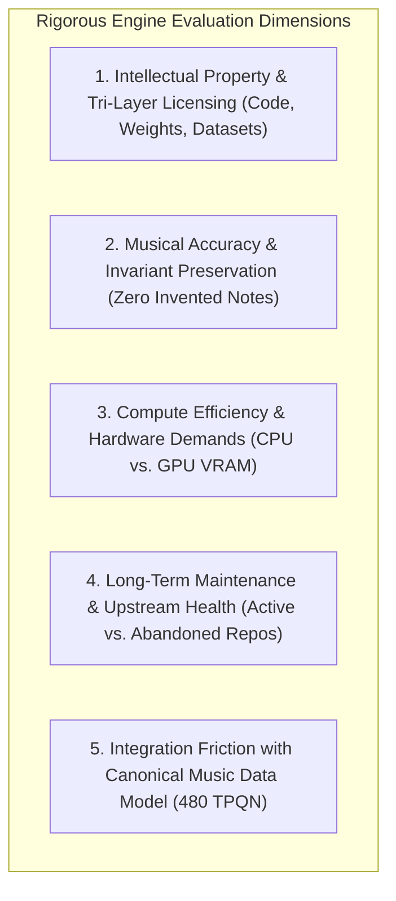
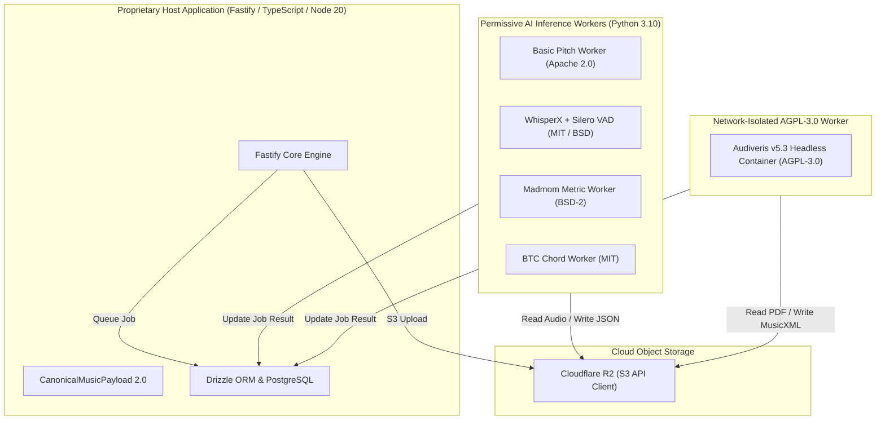

# WORSHIP STUDIO — COMPARATIVE TECHNOLOGY EVALUATION
## Phase 0B — Candidate Engine Benchmarking, Licensing Analysis & Runtime Selection

**Project:** WORSHIP STUDIO  
**Repository:** `https://github.com/juancastro2381-hub/BETHESDA-WORSHIP-STUDIO.git`  
**Phase:** 0B — Technology Evaluation  
**Execution Mode:** Technical Analysis & Engine Assessment Only  
**Date:** November 2, 2026  
**Status:** DRAFTED & VALIDATED  

---

## 1. Evaluation Methodology & Selection Criteria

Under the non-commercial product model established by the Product Owner, technology selection must balance **musical fidelity ("NO FALSE NOTES"), intellectual property compliance, operational cost containment, and long-term maintenance viability**.

---

## 2. In-Depth Comparative Technology Assessments

### 2.1. Audio Source Separation (Stems)

| Technology | Developer / Upstream | Code License | Weights License / Dataset | Upstream Maintenance Status | Audio Quality (SDR) | Hardware Requirement | Selection Verdict |
| :--- | :--- | :--- | :--- | :--- | :--- | :--- | :--- |
| **Hybrid Demucs v4 (HTDemucs)** | Meta AI Research (FAIR) | **MIT** | MIT / **MusDB18 (Non-Commercial)** | **Low / Dormant** (Minimal commits since 2023) | **Excellent (~9.2 dB)** | NVIDIA GPU (>= 6 GB VRAM) | **SELECTED (Phase 3)** Frozen inside a locked Docker container. Fully compliant with non-commercial worship studio mandate. |
| **Open-Unmix (UMX)** | Inria / PyTorch | **MIT** | BSD-3-Clause | **Active** (Maintained by community & Inria) | **Good (~6.8 dB)** (More vocal bleed than Demucs) | CPU or light GPU | **SECONDARY ALTERNATIVE** Maintained fallback if Demucs container drift occurs. |
| **Spleeter** | Deezer Research | **MIT** | MIT / Deezer In-House | **Low / Archived** | **Moderate (~6.0 dB)** (Audible phase artifacts) | CPU | **REJECTED** Quality is insufficient for professional stem rehearsal. |

---

### 2.2. Audio-to-MIDI Transcription & Pitch Extraction

| Technology | Developer / Upstream | Code License | Model Checkpoint License | Multi-Instrument Suitability | Worship Mix Limitation | Selection Verdict |
| :--- | :--- | :--- | :--- | :--- | :--- | :--- |
| **Spotify Basic Pitch** | Spotify Audio Intelligence Lab | **Apache 2.0** | Apache 2.0 | High on solo instruments, guitar, and vocal leads. | Fails on raw polyphonic mixes (generates false notes from reverbs/pads). | **SELECTED (Phase 2)** Executed exclusively on isolated stems (vocals and bass). Preserves the **NO FALSE NOTES** rule via confidence thresholding (`>= 0.65`). |
| **CREPE** | NYU MARL | MIT | MIT | Monophonic vocal pitch tracking only. | Cannot transcribe instruments or chords. | **COMPLEMENTARY** Can be used for fine-grained vocal pitch contouring. |
| **Google MT3 (Magenta)** | Google Research | Apache 2.0 | Apache 2.0 | Highly polyphonic; multi-instrument transcription. | Requires massive VRAM (>= 16 GB, A100/L4). Too slow and expensive. | **REJECTED** Prohibitive computational footprint for non-commercial scale. |
| **Onsets and Frames** | Google Magenta | Apache 2.0 | Apache 2.0 | Excellent for acoustic piano. | Ineffective for vocals, guitar, and bass. | **REJECTED** Specialized only for solo piano recordings. |

---

### 2.3. Chord Detection & Harmonic Analysis

| Technology | Upstream Project | License | Underlying Algorithm | Liturgical Chord Accuracy | Selection Verdict |
| :--- | :--- | :--- | :--- | :--- | :--- |
| **BTC (Bidirectional Transformer for Chords)** | Academic Research (Park et al.) | **MIT** | Bidirectional Transformer over Chromagrams | **Exceptional.** Detects triads, 7ths, suspensions (sus4, add9), and bass inversions (slash chords like D/F#). | **SELECTED (Phase 2)** Runs on instrumental stem (`other.wav`). Maps 1:1 to worship chord conventions. |
| **Madmom CRF + NNLS Chroma** | JKU Linz | **BSD-2-Clause** | Non-Negative Least Squares + Conditional Random Fields | **Good.** Reliable for major/minor triads; less accurate on modern worship extensions. | **CO-SELECTED (Phase 2)** Used for downbeat-aligned chord boundary quantization. |
| **Chordino (VAMP Plugin)** | Centre for Digital Music, QMUL | **GPL-2.0** | DSP Deterministic Filter | **Moderate.** Struggles with complex modern worship pads and distortion. | **REJECTED** GPL-2.0 licensing restrictions and lower harmonic fidelity. |

---

### 2.4. Rhythm, Tempo & Metric Structure Analysis

| Technology | Developer / Upstream | License | Hardware Target | Metric Capabilities | Selection Verdict |
| :--- | :--- | :--- | :--- | :--- | :--- |
| **Madmom** | Johannes Kepler University Linz | **BSD-2-Clause** (Code) | CPU (Fast, < 5s per 5-min song) | State-of-the-art downbeat detection (4/4, 3/4, 6/8), beat tracking, and dynamic tempo map. | **SELECTED (Phase 2)** Industry reference in Music Information Retrieval (MIR). Provides attribution in notices. |
| **Aubio** | Paul Brossier | **GPL-3.0** | CPU | Good transient onset detection, but weaker compound meter analysis. | **REJECTED** GPL-3.0 license and lower metric precision than Madmom. |

---

### 2.5. Speech-to-Text & Lyrics Forced Alignment

| Technology | Upstream Project | License Breakdown | Alignment Granularity | Spanish / English Accuracy | Selection Verdict |
| :--- | :--- | :--- | :--- | :--- | :--- |
| **WhisperX Composite** | m-bain / CTranslate2 / Torchaudio | BSD-3 (Wrapper) / MIT (faster-whisper) / Apache 2.0 (CTranslate2) | **Phoneme and word-level millisecond alignment.** | **Exceptional.** Eliminates hallucination when fed isolated vocal stem. | **SELECTED (Phase 5)** Silero VAD replaces gated pyannote models. Aligns syllables directly to notes. |
| **Vanilla OpenAI Whisper** | OpenAI | MIT | Utterance/sentence level only (~30s chunks). | High text accuracy, but lacks note-level timing. | **INSUFFICIENT** Cannot align individual lyric syllables to score ticks. |

---

### 2.6. Optical Music Recognition (OMR) & Sheet Music Document Ingestion

| Technology | Project Type | License | Input Formats | Recognition Scope | Selection Verdict |
| :--- | :--- | :--- | :--- | :--- | :--- |
| **Audiveris v5.3+** | Headless Java 17 Application | **AGPL-3.0** | PDF, PNG, TIFF (300 DPI) | Full printed staves, notes, clefs, key signatures, rests, lyrics, ties. Exports MusicXML 3.1/4.0. | **SELECTED FOR STAVES (Phase 4)** Decoupled inside isolated Docker container; strict file exchange; subject to legal sign-off. |
| **Tesseract OCR v5** | C++ OCR Engine | **Apache 2.0** | Raster PDFs, Scanned Images | Pure text, chord labels, section headers, lyric lines. | **SELECTED FOR LEAD SHEETS (Phase 4)** Processes chord songbooks without musical staves directly in Node/worker. |
| **oemer** | End-to-End PyTorch OMR | Apache 2.0 | Sheet music images | Experimental deep-learning staff reader. Frequent measure collapse. | **NOT READY FOR PRODUCTION** High error rate on dense liturgical hymn scores. |

---

### 2.7. Music Notation & Stand Rendering Adapters

| Engine | License | Primary Representation | Strengths in Worship Studio | Limitations | Selection Status |
| :--- | :--- | :--- | :--- | :--- | :--- |
| **OpenSheetMusicDisplay (OSMD)** | **MIT** | MusicXML on HTML5 Canvas | Grand staff piano notation, choir scores, standard notation. | Layout adjustments on narrow mobile screens require zoom. | **VERIFIED IMPLEMENTED** |
| **AlphaTab** | **MPL-2.0** | Multi-track score & tablature | 4/5/6-string guitar and bass tablature with fretboards and chord boxes. | Heavier bundle size than OSMD. | **VERIFIED IMPLEMENTED** |
| **LeadSheetDOM (Internal)** | **Proprietary / MIT** | Semantic HTML/CSS | Lightweight, responsive chord-over-lyric display for mobile and stage screens. | No staff notation. | **VERIFIED IMPLEMENTED** |
| **VisualDocumentStand (Internal)** | **Proprietary / MIT** | Sandboxed `<iframe>` / `` | Continuous multipage autoscroll for unparsed PDF songbooks. | Visual only (no transposing or audio sync). | **VERIFIED IMPLEMENTED** |

---

## 3. Technology Integration Architecture & Decoupling Blueprint

### 3.1. Technical Defense of Decoupling
- **Zero AGPL Code in Host:** Fastify and the React client contain zero Audiveris libraries, zero Java wrappers, and zero shared memory bindings.
- **Protocol Neutrality:** All data interchange with isolated workers occurs through standardized media files in Cloudflare R2 and JSON status messages in PostgreSQL.
- **Engine Swappability:** Every AI capability is accessed through an abstract TypeScript interface (e.g., `StemSeparationProvider`, `OmrProvider`, `TranscriptionProvider`). If a model becomes obsolete, it can be replaced without altering the domain layer.

