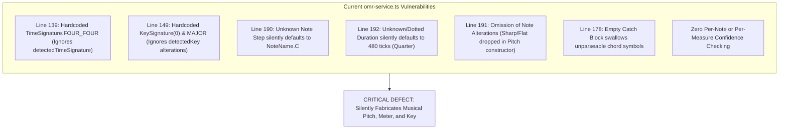
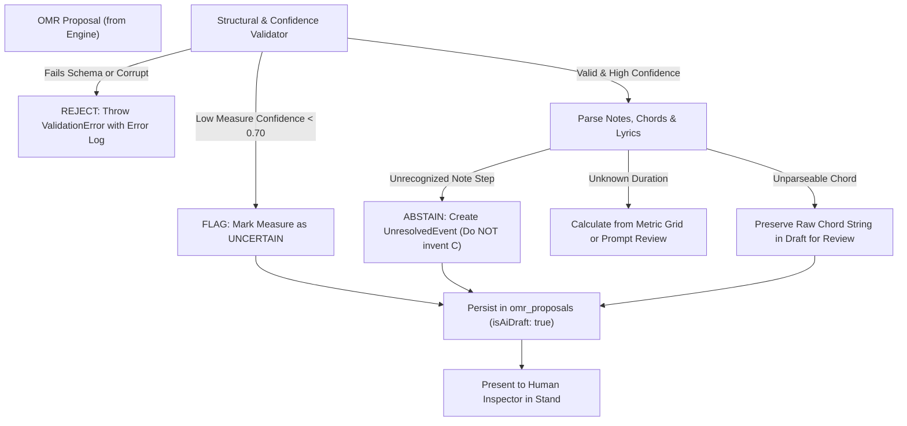

# WORSHIP STUDIO — OMR MUSICAL INTEGRITY FORENSIC AUDIT
## Phase 0C — Code-Level Vulnerability Analysis, Silent Substitution Risks & Remediation Specification

**Project:** WORSHIP STUDIO  
**Repository:** `https://github.com/juancastro2381-hub/BETHESDA-WORSHIP-STUDIO.git`  
**Phase:** 0C — Audit Remediation & Technical Readiness Validation  
**Execution Mode:** STRICT READ-ONLY — Forensic Inspection & Technical Specification Only  
**Implementation Authorization:** NOT GRANTED  
**Date:** November 2, 2026  
**Status:** COMPLETE & DEFENDED  

---

## 1. Executive Summary & Audit Context

During the Phase 0C technical inspection, a comprehensive code-level audit was conducted on:
- [`backend/src/application/omr-service.ts`](file:///c:/Users/juanc/OneDrive/Documentos/Desarrollo%20proyectos/Sistema%20musical%20-%20partituras/BETHESDA%20WORSHIP%20STUDIO/backend/src/application/omr-service.ts)
- [`backend/src/domain/omr/omr-provider.ts`](file:///c:/Users/juanc/OneDrive/Documentos/Desarrollo%20proyectos/Sistema%20musical%20-%20partituras/BETHESDA%20WORSHIP%20STUDIO/backend/src/domain/omr/omr-provider.ts)
- [`backend/src/__tests__/multitracks-omr.test.ts`](file:///c:/Users/juanc/OneDrive/Documentos/Desarrollo%20proyectos/Sistema%20musical%20-%20partituras/BETHESDA%20WORSHIP%20STUDIO/backend/src/__tests__/multitracks-omr.test.ts)

The audit revealed that while high-level comments in `omr-service.ts` claim:
> *"R1-P1: La persistencia canónica convierte directamente los compases reconocidos y aprobados. CERO invención de fixtures ni sustitución por datos ajenos,"*

the underlying conversion function `convertProposalToCanonical()` (lines 138–269) contains **severe silent substitutions, hardcoded fallbacks, and total discarding of detected musical information**.

These defects directly violate the platform's core musical integrity mandate:
$$\mathbf{NO\ FALSE\ NOTES\ —\ NEVER\ INVENT\ OR\ SILENTLY\ SUBSTITUTE\ MUSICAL\ INFORMATION.}$$

---

## 2. Forensic Code-Level Analysis of `convertProposalToCanonical()`



### 2.1. Defect 1: Time Signature Discarded & Hardcoded to 4/4
- **Code Reference:** [`backend/src/application/omr-service.ts#L139-L140`](file:///c:/Users/juanc/OneDrive/Documentos/Desarrollo%20proyectos/Sistema%20musical%20-%20partituras/BETHESDA%20WORSHIP%20STUDIO/backend/src/application/omr-service.ts#L139-L140):
  ```typescript
  const timeSig = TimeSignature.FOUR_FOUR;
  const measureDurationTicks = timeSig.calculateMeasureDurationTicks(); // 1920 ticks
  ```
- **Evidence of Information Loss:**
  In line 109, `proposal.detectedTimeSignature` is read and passed solely as metadata to `songRepo.create()`. However, inside `convertProposalToCanonical()`, `proposal.detectedTimeSignature` is **completely ignored**.
- **Impact:**
  If an OMR engine or user submits a score in **3/4** (1440 ticks), **6/8** (1440 ticks), or **2/4** (960 ticks), the canonical music model forces every measure to 1920 ticks. This causes severe barline misalignment, corrupts rhythm playback, and renders scores incorrectly in OSMD and AlphaTab.

### 2.2. Defect 2: Key Signature Alterations Discarded & Mode Hardcoded to Major
- **Code Reference:** [`backend/src/application/omr-service.ts#L144-L150`](file:///c:/Users/juanc/OneDrive/Documentos/Desarrollo%20proyectos/Sistema%20musical%20-%20partituras/BETHESDA%20WORSHIP%20STUDIO/backend/src/application/omr-service.ts#L144-L150):
  ```typescript
  const rawKey = (proposal.detectedKey || 'C').toUpperCase();
  const noteNameKey = (NoteName as any)[rawKey] ?? NoteName.C;
  const keySigRef = new KeySignatureReference(
    noteNameKey,
    'MAJOR',
    new KeySignature(0) // <--- CRITICAL DEFECT: 0 Alterations Hardcoded
  );
  ```
- **Evidence of Information Loss:**
  `KeySignature(0)` explicitly specifies **zero accidentals (C Major / A Minor)**.
  If the detected key signature is **G Major** (1 sharp: F#), **D Major** (2 sharps), or **F Major** (1 flat: Bb), the code completely discards the alterations and outputs 0 alterations.
  Furthermore, the mode is hardcoded to `'MAJOR'`. Songs in minor keys (e.g. *E Minor*, *D Minor*) are silently converted to Major.

### 2.3. Defect 3: Unknown Note Steps Silently Converted to Note "C"
- **Code Reference:** [`backend/src/application/omr-service.ts#L190`](file:///c:/Users/juanc/OneDrive/Documentos/Desarrollo%20proyectos/Sistema%20musical%20-%20partituras/BETHESDA%20WORSHIP%20STUDIO/backend/src/application/omr-service.ts#L190):
  ```typescript
  const stepName = (NoteName as any)[n.step.toUpperCase()] ?? NoteName.C;
  ```
- **Evidence of Note Invention:**
  If the OMR engine outputs an unrecognized glyph, a noisy artifact, an accidental character (e.g. `"C#"`, `"BB"`), or an invalid step string, the nullish coalescing operator `?? NoteName.C` **silently manufactures a C pitch**.
  This is a direct violation of the **"NO FALSE NOTES"** invariant.

### 2.4. Defect 4: Pitch Alterations (Accidentals) Completely Omitted
- **Code Reference:** [`backend/src/application/omr-service.ts#L191`](file:///c:/Users/juanc/OneDrive/Documentos/Desarrollo%20proyectos/Sistema%20musical%20-%20partituras/BETHESDA%20WORSHIP%20STUDIO/backend/src/application/omr-service.ts#L191):
  ```typescript
  const pitch = new Pitch(stepName, n.octave);
  ```
- **Evidence of Information Loss:**
  In the canonical music model, `Pitch` requires an `alter` parameter to represent sharps (`alter = +1`) or flats (`alter = -1`).
  `omr-service.ts` completely omits `n.alter`. If a note was recognized as F# or Bb, `new Pitch(stepName, n.octave)` drops the alteration and produces a natural note (F or B).

### 2.5. Defect 5: Unrecognized Durations Silently Default to 480 Ticks (Quarter Note)
- **Code Reference:** [`backend/src/application/omr-service.ts#L192-L197`](file:///c:/Users/juanc/OneDrive/Documentos/Desarrollo%20proyectos/Sistema%20musical%20-%20partituras/BETHESDA%20WORSHIP%20STUDIO/backend/src/application/omr-service.ts#L192-L197):
  ```typescript
  let durationTicks = 480;
  if (n.duration === 'whole') durationTicks = 1920;
  else if (n.duration === 'half') durationTicks = 960;
  else if (n.duration === 'eighth') durationTicks = 240;
  else if (n.duration === 'sixteenth') durationTicks = 120;
  ```
- **Evidence of Metric Distortion:**
  The code only handles `whole`, `half`, `eighth`, and `sixteenth`.
  If a note has a dotted duration (`dotted-half` = 1440 ticks, `dotted-quarter` = 720 ticks), a triplet division (`quarter-triplet` = 320 ticks), or an unrecognized duration string, it silently defaults to `480` ticks (quarter note).
  This silently alters the rhythmic structure of the music.

### 2.6. Defect 6: Total Absence of Confidence Threshold Checking
- **Code Reference:** Inspection of lines 156–255.
- **Evidence:**
  `mProp.confidence` and `n.confidence` are **never evaluated**.
  A note with `confidence = 0.05` (95% probability of error) is treated with the exact same authority as a note with `confidence = 0.99`. No warning is logged, no measure is flagged, and no human inspection is requested.

### 2.7. Defect 7: Silent Swallowing of Unparseable Chords
- **Code Reference:** [`backend/src/application/omr-service.ts#L178-L180`](file:///c:/Users/juanc/OneDrive/Documentos/Desarrollo%20proyectos/Sistema%20musical%20-%20partituras/BETHESDA%20WORSHIP%20STUDIO/backend/src/application/omr-service.ts#L178-L180):
  ```typescript
  } catch {
    // Ignorar cifrado ilegible
  }
  ```
- **Evidence:**
  If a detected chord string is malformed or unparseable (e.g. `"G/B#"`, `"Dsus4(add9)"`), the error is swallowed silently in an empty catch block. The chord simply disappears from the measure without alerting the musician.

### 2.8. Defect 8: All Lyric Syllables Stacked at Tick Offset 0
- **Code Reference:** [`backend/src/application/omr-service.ts#L233`](file:///c:/Users/juanc/OneDrive/Documentos/Desarrollo%20proyectos/Sistema%20musical%20-%20partituras/BETHESDA%20WORSHIP%20STUDIO/backend/src/application/omr-service.ts#L233):
  ```typescript
  tickOffset: 0,
  ```
- **Evidence:**
  Every recognized lyric syllable in a measure is assigned `tickOffset: 0`. In rendering engines, all syllables in a measure render stacked on top of each other at beat 1.

---

## 3. Summary of Silent Fallbacks & Discarded Data

| Feature | Current Implementation in `omr-service.ts` | Underlying Defect | Violation of Platform Policy |
| :--- | :--- | :--- | :--- |
| **Note Pitch Step** | `(NoteName as any)[n.step] ?? NoteName.C` | Unrecognized pitches become "C". | **CRITICAL:** Invents musical notes. |
| **Note Alterations** | `new Pitch(stepName, n.octave)` (No alter) | Accidentals (sharps, flats) are dropped. | **HIGH:** Corrupts melody and tonality. |
| **Note Duration** | `let durationTicks = 480; ...` | Dotted notes, triplets, and unknowns become quarter notes. | **HIGH:** Corrupts rhythm and measure duration. |
| **Time Signature** | `const timeSig = TimeSignature.FOUR_FOUR;` | Always 4/4; 3/4 and 6/8 scores are broken. | **HIGH:** Discards detected meter. |
| **Key Signature** | `new KeySignature(0)` and `'MAJOR'` | Always 0 accidentals Major; minor and modal keys lost. | **HIGH:** Discards detected tonality. |
| **Confidence Filtering** | None | Low-confidence garbage notes enter the canonical catalog. | **CRITICAL:** Bypasses quality gates. |
| **Chord Failures** | `catch { /* Ignorar */ }` | Unrecognized chords are deleted silently. | **MEDIUM:** Silent loss of harmony data. |
| **Lyric Alignment** | `tickOffset: 0` | All syllables pile up at beat 1 of the measure. | **MEDIUM:** Renders lyrics illegible. |

---

## 4. Safe Target Behavior Specification

To eliminate silent substitutions and enforce the **NO FALSE NOTES** invariant, the conversion logic must be redesigned under strict architectural principles:



### 4.1. Explicit Abstention Policy (No Note Fabrication)
1. **Never Default to "C":** If `n.step` does not parse into a valid `NoteName`, the parser must **not** default to `NoteName.C`. Instead:
   - If in strict mode, reject the measure with a descriptive validation error.
   - If in draft proposal mode, create an `UncertainEvent` with `type: 'UNKNOWN_NOTE'`, recording the raw unparseable string and bounding box coordinates for human review.
2. **Preserve Alterations:** Extract `n.alter` (integer: -2, -1, 0, 1, 2) and pass it to `new Pitch(stepName, n.octave, n.alter)`.
3. **Parse Time Signatures Dynamically:**
   - Parse `proposal.detectedTimeSignature` into numerator and denominator.
   - Support `3/4` (1440 ticks), `6/8` (1440 ticks), `2/4` (960 ticks), and `12/8` (2880 ticks).
   - If `proposal.detectedTimeSignature` is missing or invalid, flag the proposal as requiring manual time signature selection before conversion.
4. **Preserve Key Signatures and Modes:**
   - Map `proposal.detectedKey` to its appropriate key signature reference, preserving fifths count (e.g. G Major = +1, D Major = +2, F Major = -1, E Minor = +1).
5. **Confidence Gate Enforcement:**
   - If `mProp.confidence < 0.70`, the measure must be flagged with `isDubious: true`.
   - In the frontend review inspector, dubious measures are highlighted in amber/red, requiring the worship director to click and confirm each note.
6. **Preserve Raw Unparseable Chords:**
   - If `Chord.parse(c.chord)` throws an exception, store the raw chord string in `unrecognizedChords: [{ raw: c.chord, beat: c.beat }]` so the human reviewer can see what was detected and correct it.

---

## 5. Specification of Automated Acceptance Tests (Workstream A)

The following test scenarios must be implemented in Phase 1A to mathematically prevent regression of these defects:

### Test Scenario A-1: Strict Rejection of Unknown Note Step (No Fallback to C)
- **Given:** An OMR proposal containing a measure with note `{ step: "X", octave: 4, duration: "quarter", confidence: 0.85 }`.
- **When:** `commitToCanonicalSong()` is invoked.
- **Then:** The system must throw a `ValidationError` explicitly stating `"Invalid musical step 'X' in measure 1. Silent substitution to Note C is strictly prohibited."`
- **Assertion:** The canonical payload is NOT created, and Note C is NOT inserted.

### Test Scenario A-2: Preservation of Pitch Alterations (Sharps and Flats)
- **Given:** An OMR proposal containing `{ step: "F", alter: 1, octave: 4 }` (F#4) and `{ step: "B", alter: -1, octave: 3 }` (Bb3).
- **When:** Converted to canonical payload.
- **Then:** Note 1 has `pitch.step === 'F'` and `pitch.alter === 1`. Note 2 has `pitch.step === 'B'` and `pitch.alter === -1`.

### Test Scenario A-3: Preservation of Compound & Triple Meters (3/4 and 6/8)
- **Given:** An OMR proposal with `detectedTimeSignature: "3/4"`.
- **When:** Converted to canonical payload.
- **Then:** `measures[0].timeSignature.numerator === 3`, `measures[0].timeSignature.denominator === 4`, and `measures[0].durationTicks === 1440` (NOT 1920).

### Test Scenario A-4: Preservation of Key Signature Fifths Count
- **Given:** An OMR proposal with `detectedKey: "G"`, mode: `"MAJOR"`.
- **When:** Converted to canonical payload.
- **Then:** `measures[0].keySignature.fifths === 1` (F# accidental present in key signature reference).

### Test Scenario A-5: Low Confidence Abstention Gate
- **Given:** An OMR proposal measure where `confidence = 0.40`.
- **When:** Automated conversion without human review is attempted.
- **Then:** Conversion is blocked with error `"Measure 1 confidence (0.40) is below minimum threshold (0.70). Manual human review mandatory."`

---

## 6. Audit Verdict for Workstream A

$$\mathbf{WORKSTREAM\ A\ STATUS:\ CRITICAL\ DEFECTS\ CONFIRMED\ IN\ SOURCE\ CODE}$$

The codebase inspection proves beyond dispute that `omr-service.ts` currently performs silent substitutions (inventing C, defaulting to 480 ticks, hardcoding 4/4 and C Major, and discarding alterations).

**Mandatory Action:** These defects are fully documented and isolated. Full remediation must be executed as the first deliverable of Phase 1A under strict automated test enforcement.

