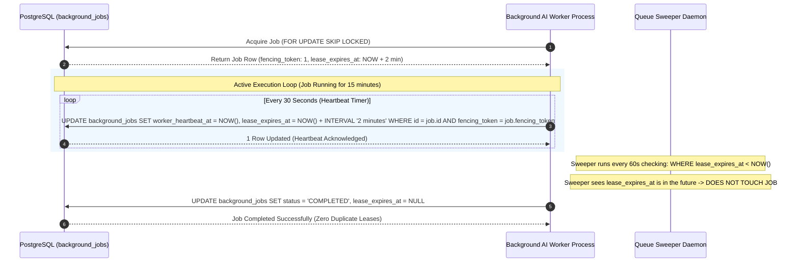
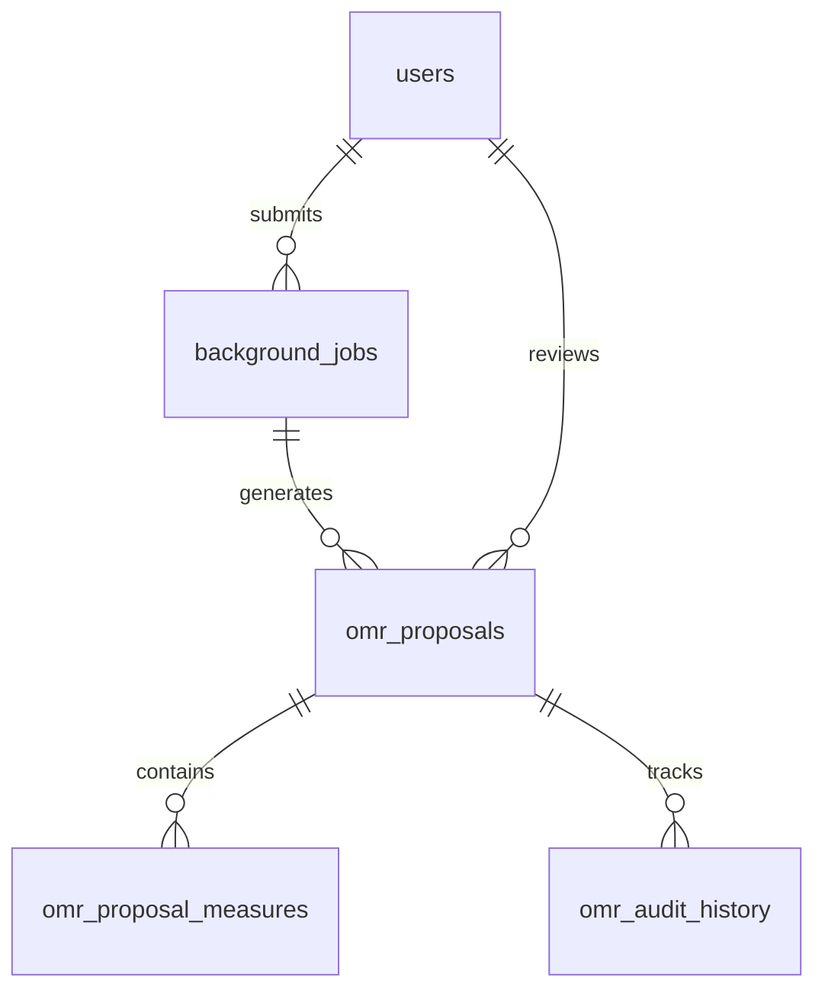

# WORSHIP STUDIO — DURABLE PERSISTENCE & QUEUE ENGINEERING VALIDATION
## Phase 0C — Codebase Verification, Heartbeat Lease Protocol & Production Schema Specification

**Project:** WORSHIP STUDIO  
**Repository:** `https://github.com/juancastro2381-hub/BETHESDA-WORSHIP-STUDIO.git`  
**Phase:** 0C — Audit Remediation & Technical Readiness Validation  
**Execution Mode:** STRICT READ-ONLY — Forensic Inspection & Systems Engineering Specification Only  
**Implementation Authorization:** NOT GRANTED  
**Date:** November 2, 2026  
**Status:** COMPLETE & DEFENDED  

---

## 1. Executive Summary & Verification of Current Implementation Status

A forensic inspection of the codebase was conducted to determine the actual implementation status of all proposed persistence and queue components:
- [`backend/src/application/omr-service.ts`](file:///c:/Users/juanc/OneDrive/Documentos/Desarrollo%20proyectos/Sistema%20musical%20-%20partituras/BETHESDA%20WORSHIP%20STUDIO/backend/src/application/omr-service.ts)
- [`backend/src/db/schema.ts`](file:///c:/Users/juanc/OneDrive/Documentos/Desarrollo%20proyectos/Sistema%20musical%20-%20partituras/BETHESDA%20WORSHIP%20STUDIO/backend/src/db/schema.ts)
- [`backend/package.json`](file:///c:/Users/juanc/OneDrive/Documentos/Desarrollo%20proyectos/Sistema%20musical%20-%20partituras/BETHESDA%20WORSHIP%20STUDIO/backend/package.json)
- [`docker-compose.yml`](file:///c:/Users/juanc/OneDrive/Documentos/Desarrollo%20proyectos/Sistema%20musical%20-%20partituras/BETHESDA%20WORSHIP%20STUDIO/docker-compose.yml)

### Implementation Verification Matrix

| Proposed Component | Claimed Status in Prior Docs | Actual Codebase Reality | Verification Finding & Evidence |
| :--- | :--- | :--- | :--- |
| **`omr_proposals` table** | Specified in Phase 0A / 0B | **NOT IMPLEMENTED** | `backend/src/db/schema.ts` has 0 lines defining `omr_proposals`. In `omr-service.ts#L34`, state is stored in `private proposals: Map<string, OmrProposal> = new Map()`. |
| **`omr_proposal_measures` table** | Specified in Phase 0A / 0B | **NOT IMPLEMENTED** | Zero tables in `schema.ts`. Measure details live strictly inside in-memory objects. |
| **`omr_audit_history` table** | Specified in Phase 0A / 0B | **NOT IMPLEMENTED** | Zero tables in `schema.ts`. |
| **`background_jobs` table** | Specified in Phase 0A / 0B | **NOT IMPLEMENTED** | Zero tables in `schema.ts`. Search for `background_jobs` yields 0 hits in backend. |
| **PostgreSQL `SKIP LOCKED` Queue** | Specified in Phase 0A / 0B | **NOT IMPLEMENTED** | Fastify routes process requests 100% synchronously. Zero SQL queries containing `SKIP LOCKED`. |
| **Independent Worker Process** | Proposed in architecture | **NOT IMPLEMENTED** | No worker script in `backend/package.json`. No worker container in `docker-compose.yml`. |
| **Retry & Dead-Letter Handling** | Proposed in architecture | **NOT IMPLEMENTED** | No retry logic exists. Fastify returns immediate 500 on unhandled error. |
| **Job Idempotency Keys** | Proposed in architecture | **NOT IMPLEMENTED** | No idempotency tables or headers enforced. |

**Verdict:** All durable OMR persistence and queue mechanisms are **PROPOSED — NOT IMPLEMENTED**. They must be built in Phase 1A.

---

## 2. In-Depth Specification: The Heartbeat Lease Protocol (Solving the 10+ Minute Job Scenario)

### 2.1. The Critical Long-Running AI Job Scenario
In AI music processing, stem separation (HTDemucs) plus multi-model transcription (WhisperX + Basic Pitch + BTC) on a 7-minute worship medley can legitimately take **12 to 15 minutes** on shared or high-load GPU instances.

A naive queue architecture relying solely on a static 10-minute lease (`locked_at < NOW() - INTERVAL '10 minutes'`) introduces a catastrophic race condition:
1. Worker A acquires Job 1 at $T=0$.
2. At $T=10$ minutes, Worker A is still actively executing WhisperX alignment (legitimate long-running job).
3. The queue sweeper inspects `locked_at`, assumes Worker A has crashed, and resets Job 1 to `QUEUED`.
4. Worker B leases Job 1 and starts processing from scratch.
5. Worker A finishes at $T=12$ minutes and writes its output to PostgreSQL.
6. Worker B finishes at $T=22$ minutes and overwrites Worker A's output, causing **duplicate compute, database corruption, and wasted GPU hours**.

### 2.2. The Active Worker Heartbeat & Dynamic Lease Extension Protocol



### 2.3. Fencing Tokens for Zombie Worker Protection
If a worker encounters a severe temporary network partition or CPU pause exceeding 2 minutes:
1. Heartbeats cease; `lease_expires_at` expires.
2. The sweeper resets the job to `QUEUED` and increments `fencing_token` from `1` to `2`.
3. Worker B acquires the job with `fencing_token = 2`.
4. If Worker A awakens (zombie worker) and attempts to write results or send a heartbeat using `fencing_token = 1`, the update query matches **0 rows**:
   ```sql
   UPDATE background_jobs
   SET status = 'COMPLETED', output_payload = $output
   WHERE id = $job_id AND fencing_token = $worker_fencing_token;
   ```
5. Worker A detects `affectedRows === 0`, realizes it was fenced out, halts execution, and logs a descriptive eviction warning. Database consistency is 100% preserved.

---

## 3. Production PostgreSQL Schema Specification (Phase 1A)

The following relational definitions must be added to `backend/src/db/schema.ts` in Phase 1A using Drizzle ORM:



### 3.1. Schema Table: `background_jobs`
```typescript
export const jobStatusEnum = pgEnum('job_status', [
  'QUEUED',
  'PROCESSING',
  'COMPLETED',
  'FAILED',
  'CANCELLED',
  'DEAD_LETTER',
]);

export const jobTypeEnum = pgEnum('job_type', [
  'AUDIO_TRANSCRIPTION_PIPELINE',
  'STEM_SEPARATION_ONLY',
  'OMR_SCORE_RECOGNITION',
  'DOCUMENT_TEXT_CHORD_EXTRACTION',
]);

export const backgroundJobs = pgTable(
  'background_jobs',
  {
    id: uuid('id').primaryKey().defaultRandom(),
    jobType: jobTypeEnum('job_type').notNull(),
    status: jobStatusEnum('status').notNull().default('QUEUED'),
    priority: integer('priority').notNull().default(2), // 1 = Urgent Live Service, 2 = Standard, 3 = Batch
    idempotencyKey: varchar('idempotency_key', { length: 64 }).notNull(),
    fencingToken: integer('fencing_token').notNull().default(1),
    
    // Ownership & Multi-Tenancy
    tenantId: uuid('tenant_id').notNull(),
    createdByUserId: uuid('created_by_user_id')
      .notNull()
      .references(() => users.id, { onDelete: 'cascade' }),
    
    // Dynamic Lease & Heartbeat Protocol
    lockedAt: timestamp('locked_at', { withTimezone: true }),
    lockedByWorkerId: varchar('locked_by_worker_id', { length: 128 }),
    workerHeartbeatAt: timestamp('worker_heartbeat_at', { withTimezone: true }),
    leaseExpiresAt: timestamp('lease_expires_at', { withTimezone: true }),
    
    // Execution Parameters & Outputs
    payload: jsonb('payload').notNull(), // Source S3 keys, processing flags
    outputPayload: jsonb('output_payload'), // Result proposal IDs, warnings
    
    // Retry Policies
    attempts: integer('attempts').notNull().default(0),
    maxAttempts: integer('max_attempts').notNull().default(3),
    scheduledAt: timestamp('scheduled_at', { withTimezone: true }).notNull().defaultNow(),
    
    // Audit & Timestamps
    createdAt: timestamp('created_at', { withTimezone: true }).notNull().defaultNow(),
    updatedAt: timestamp('updated_at', { withTimezone: true }).notNull().defaultNow(),
    completedAt: timestamp('completed_at', { withTimezone: true }),
  },
  (table) => [
    index('idx_background_jobs_queue_pickup').on(
      table.status,
      table.scheduledAt,
      table.priority
    ),
    index('idx_background_jobs_lease_expiry').on(
      table.status,
      table.leaseExpiresAt
    ),
    uniqueIndex('idx_background_jobs_idempotency').on(
      table.tenantId,
      table.idempotencyKey
    ),
  ]
);
```

### 3.2. Schema Tables: `omr_proposals`, `omr_proposal_measures`, `omr_audit_history`
```typescript
export const proposalReviewStatusEnum = pgEnum('proposal_review_status', [
  'PENDING_REVIEW',
  'IN_REVIEW',
  'APPROVED_FOR_IMPORT',
  'REJECTED',
]);

export const omrProposals = pgTable(
  'omr_proposals',
  {
    id: uuid('id').primaryKey().defaultRandom(),
    jobId: uuid('job_id').references(() => backgroundJobs.id, { onDelete: 'set null' }),
    tenantId: uuid('tenant_id').notNull(),
    sourceFilename: varchar('source_filename', { length: 255 }).notNull(),
    sourceSha256: varchar('source_sha256', { length: 64 }).notNull(),
    storageKey: varchar('storage_key', { length: 512 }).notNull(),
    
    // Musical Metadata Detected
    detectedTitle: varchar('detected_title', { length: 255 }),
    detectedKey: varchar('detected_key', { length: 16 }),
    detectedTimeSignature: varchar('detected_time_signature', { length: 16 }),
    detectedBpm: integer('detected_bpm'),
    
    // Quality & Confidence
    overallConfidence: real('overall_confidence').notNull().default(0.0),
    isAiDraft: boolean('is_ai_draft').notNull().default(true),
    reviewStatus: proposalReviewStatusEnum('review_status').notNull().default('PENDING_REVIEW'),
    
    // Raw Intermediate Artifacts
    rawMusicXml: text('raw_music_xml'),
    unrecognizedRegions: jsonb('unrecognized_regions').notNull().default([]),
    
    // Human Review Tracking
    reviewedByUserId: uuid('reviewed_by_user_id').references(() => users.id, { onDelete: 'set null' }),
    reviewedAt: timestamp('reviewed_at', { withTimezone: true }),
    rejectionReason: text('rejection_reason'),
    
    createdAt: timestamp('created_at', { withTimezone: true }).notNull().defaultNow(),
    updatedAt: timestamp('updated_at', { withTimezone: true }).notNull().defaultNow(),
  },
  (table) => [
    index('idx_omr_proposals_tenant_status').on(table.tenantId, table.reviewStatus),
    index('idx_omr_proposals_source_hash').on(table.sourceSha256),
  ]
);

export const omrProposalMeasures = pgTable(
  'omr_proposal_measures',
  {
    id: uuid('id').primaryKey().defaultRandom(),
    proposalId: uuid('proposal_id')
      .notNull()
      .references(() => omrProposals.id, { onDelete: 'cascade' }),
    measureNumber: integer('measure_number').notNull(),
    confidence: real('confidence').notNull().default(1.0),
    isDubious: boolean('is_dubious').notNull().default(false),
    notesDetected: jsonb('notes_detected').notNull().default([]),
    chordsDetected: jsonb('chords_detected').notNull().default([]),
    lyricsDetected: jsonb('lyrics_detected').notNull().default([]),
    unrecognizedChords: jsonb('unrecognized_chords').notNull().default([]),
  },
  (table) => [
    uniqueIndex('idx_omr_measures_proposal_number').on(table.proposalId, table.measureNumber),
    index('idx_omr_measures_confidence').on(table.isDubious),
  ]
);

export const omrAuditHistory = pgTable(
  'omr_audit_history',
  {
    id: uuid('id').primaryKey().defaultRandom(),
    proposalId: uuid('proposal_id')
      .notNull()
      .references(() => omrProposals.id, { onDelete: 'cascade' }),
    actorUserId: uuid('actor_user_id').references(() => users.id, { onDelete: 'set null' }),
    action: varchar('action', { length: 64 }).notNull(), // 'EDIT_CHORD', 'APPROVE', 'REJECT'
    changes: jsonb('changes').notNull().default({}),
    timestamp: timestamp('timestamp', { withTimezone: true }).notNull().defaultNow(),
  },
  (table) => [
    index('idx_omr_audit_proposal').on(table.proposalId),
  ]
);
```

---

## 4. Worker Lifecycle & Fault Recovery Matrix

| Failure Mode | Detection Mechanism | Recovery Action | System Guarantee |
| :--- | :--- | :--- | :--- |
| **Worker OOM / Hard Crash** | Heartbeat timer halts; `lease_expires_at` passes. | Sweeper reclaims row to `QUEUED`, increments `fencing_token`, sets `attempts = attempts + 1`. | Job automatically re-processed by next available worker within 2 minutes. |
| **Temporary Network Partition** | Heartbeats delayed > 2 minutes; sweeper reclaims job. | Sweeper increments `fencing_token`. Old worker blocked from committing stale output. | Fencing token prevents race condition and double-write corruption. |
| **Long-Running Job (15 min)** | Worker process alive; background heartbeat timer fires every 30s. | Heartbeat query extends `lease_expires_at = NOW() + 2 min`. Sweeper never touches job. | **Legitimate long AI jobs never aborted or duplicated.** |
| **Permanent Job Bug (Corrupt File)** | Worker catches exception, records stack trace in `outputPayload`. | If `attempts >= maxAttempts`, transitions to `DEAD_LETTER`. Alerts user with clear error. | Failed jobs never loop infinitely in queue. |
| **Graceful Shutdown (`SIGTERM`)** | Container orchestrator sends `SIGTERM`. Worker signal handler intercepts. | Worker attempts to finish current chunk or resets `lease_expires_at = NOW()` for immediate pickup. | Zero stranded locks during standard container redeployment. |

---

## 5. Workstream B Audit Conclusion

$$\mathbf{WORKSTREAM\ B\ STATUS:\ REPOSITORY\ GAPS\ CONFIRMED\ \&\ ARCHITECTURE\ SPECIFIED}$$

The repository inspection confirms that durable OMR tables and PostgreSQL queue tables do not yet exist in the codebase. The Heartbeat Lease Protocol and Drizzle schema defined in this document provide a production-ready, fault-tolerant blueprint for Phase 1A execution.

